<!-- AUTOGENERADO por tools/inventario/flujos.mjs. No editar manualmente. -->

# Flujos del módulo `read_models`

- **Procesos:** 1 · **Máquinas de estado:** 0
- **Operaciones:** 15 (15 con decisiones propias, 0 sin ellas)
- Inventario de endpoints del módulo: [read_models](../endpoints/read_models.md)

## Proceso: Módulo 30 · Read Models (Frontend View Contracts & Read Models)

- **Código:** `read_models` · **Agrupación:** CASO_DE_USO_README · **Operaciones:** 15
- **Actores:** Cualquier sesión válida · Público (sin sesión) · SECURITY_ADMIN · SYSTEM
- **Revisión:** AUTO_DETECTADA
- **Fuentes:** `src/modules/read_models/README.md`

### Para qué sirve

Contratos de read model versionados, materialized views, contratos de vista de frontend (route + view + fields/filters/sort/actions/kpis/states), preferencias de usuario y proyecciones públicas. Los endpoints son contratos de lectura y de materialización: no exponen SQL crudo al cliente (allow-lists de campos, filtros, orden y acciones), aplican masking heredado y derivan las acciones en servidor.

_Fuente: `src/modules/read_models/README.md:3`_

### Etapas y operaciones

| Etapa | Descripción | Operación | Quién actúa | Riesgo | Tablas |
|---|---|---|---|---|---|
| `UC-30-01` | Registrar y publicar un contrato versionado + dependencias upstream | POST /read-models/definitions | SECURITY_ADMIN | MEDIO | 3 |
| `UC-30-02` | Publicar contrato de vista (upsert portal/route + view + hijos) | POST /portals/{portalCode}/routes/{routeCode}/views | SECURITY_ADMIN | MEDIO | 12 |
| `UC-30-03` | Refresh manual de la MV (REFRESH CONCURRENTLY) | POST /read-models/{definitionId}/refresh | SECURITY_ADMIN | MEDIO | 2 |
| `UC-30-04` | Backfill inicial (FULL) de la MV | POST /read-models/{definitionId}/backfill | SECURITY_ADMIN | MEDIO | 2 |
| `UC-30-05` | Servir el read model (masking + cursor + staleness) | GET /portals/{portalCode}/routes/{routeCode}/views/{viewCode}/data | Cualquier sesión válida | BAJO | 6 |
| `UC-30-06` | Invalidar y recomputar tras cambio upstream | POST /read-models/{definitionId}/invalidate | SECURITY_ADMIN | MEDIO | 2 |
| `UC-30-07` | Reconciliar la MV divergente (result REPAIRED) | POST /read-models/{definitionId}/reconcile | SYSTEM · SECURITY_ADMIN | MEDIO | 2 |
| `UC-30-08` | Nueva versión N+1 en DRAFT (anterior sigue ACTIVE) | POST /read-models/definitions/{schema}/{object}/versions | SECURITY_ADMIN | MEDIO | 3 |
| `UC-30-09` | Preferencias de vista (validadas contra el allow-list) | PUT /views/{frontendPageViewId}/preferences | Cualquier sesión válida | ALTO | 5 |
| `UC-30-10` | Proyecciones públicas (sin PHI, sin sesión) | GET /public/{slug} | Público (sin sesión) | BAJO | 1 |
|  |  | GET /public/directory | Público (sin sesión) | BAJO | 1 |
| `UC-30-11` | Derivar available_actions_json (estado + permiso) | GET /portals/{portalCode}/routes/{routeCode}/views/{viewCode}/actions | Cualquier sesión válida | BAJO | 4 |
| `UC-30-12` | Detectar staleness/degradación de las MV | GET /read-models/health | SYSTEM · SECURITY_ADMIN | BAJO | 2 |
| `UC-30-13` | Deprecar (ACTIVE→DEPRECATED) y retirar (guarda de FK) | DELETE /read-models/definitions/{id} | SECURITY_ADMIN | MEDIO | 3 |
|  |  | POST /read-models/definitions/{id}/deprecate | SECURITY_ADMIN | MEDIO | 2 |

### Diagrama — etapas `UC-30-01`, `UC-30-02`, `UC-30-03`…

```mermaid
flowchart LR
  a2(["SECURITY_ADMIN"]):::actor
  a15(["Cualquier sesión válida"]):::actor
  a19(["SYSTEM · SECURITY_ADMIN"]):::actor
  a24(["Público (sin sesión)"]):::actor
  t3[("read_models.read_model_definitions")]:::tabla
  t4[("read_models.read_model_dependencies")]:::tabla
  t6[("read_models.frontend_page_views")]:::tabla
  t7[("read_models.frontend_routes")]:::tabla
  t8[("read_models.frontend_view_actions")]:::tabla
  t9[("read_models.frontend_view_fields")]:::tabla
  t12[("read_models.read_model_refresh_runs")]:::tabla
  t16[("read_models.portal_surfaces")]:::tabla
  t22[("read_models.user_view_preferences")]:::tabla
  t25[("read_models.public_provider_directory")]:::tabla
  subgraph s0["UC-30-01 · Registrar y publicar un contrato versionado + dependencias upstream"]
    o1["POST /read-models/definitions"]:::op
  end
  t10[("+6 tablas más")]
  subgraph s1["UC-30-02 · Publicar contrato de vista (upsert portal/route + view + hijos)"]
    o5["POST /portals/{portalCode}/routes/{routeCode}/views"]:::op
  end
  subgraph s2["UC-30-03 · Refresh manual de la MV (REFRESH CONCURRENTLY)"]
    o11["POST /read-models/{definitionId}/refresh"]:::op
  end
  subgraph s3["UC-30-04 · Backfill inicial (FULL) de la MV"]
    o13["POST /read-models/{definitionId}/backfill"]:::op
  end
  subgraph s4["UC-30-05 · Servir el read model (masking + cursor + staleness)"]
    o14["GET /portals/{portalCode}/routes/{routeCode}/views/{viewCode}/data"]:::op
  end
  subgraph s5["UC-30-06 · Invalidar y recomputar tras cambio upstream"]
    o17["POST /read-models/{definitionId}/invalidate"]:::op
  end
  subgraph s6["UC-30-07 · Reconciliar la MV divergente (result REPAIRED)"]
    o18["POST /read-models/{definitionId}/reconcile"]:::op
  end
  subgraph s7["UC-30-08 · Nueva versión N+1 en DRAFT (anterior sigue ACTIVE)"]
    o20["POST /read-models/definitions/{schema}/{object}/versions"]:::op
  end
  subgraph s8["UC-30-09 · Preferencias de vista (validadas contra el allow-list)"]
    o21["PUT /views/{frontendPageViewId}/preferences"]:::op
  end
  subgraph s9["UC-30-10 · Proyecciones públicas (sin PHI, sin sesión)"]
    o23["GET /public/{slug}"]:::op
    o26["GET /public/directory"]:::op
  end
  subgraph s10["UC-30-11 · Derivar available_actions_json (estado + permiso)"]
    o27["GET /portals/{portalCode}/routes/{routeCode}/views/{viewCode}/actions"]:::op
  end
  subgraph s11["UC-30-12 · Detectar staleness/degradación de las MV"]
    o28["GET /read-models/health"]:::op
  end
  subgraph s12["UC-30-13 · Deprecar (ACTIVE→DEPRECATED) y retirar (guarda de FK)"]
    o29["DELETE /read-models/definitions/{id}"]:::op
    o30["POST /read-models/definitions/{id}/deprecate"]:::op
  end
  a2 --> o1
  o1 -->|"CREA"| t3
  o1 -->|"LEE"| t3
  o1 -->|"CREA"| t4
  a2 --> o5
  o5 -->|"CREA"| t6
  o5 -->|"LEE"| t6
  o5 -->|"CREA"| t7
  o5 -->|"LEE"| t7
  o5 -->|"CREA"| t8
  o5 -->|"CREA"| t9
  o5 -.-> t10
  a2 --> o11
  o11 -->|"LEE"| t3
  o11 -->|"CREA"| t12
  a2 --> o13
  o13 -->|"LEE"| t3
  o13 -->|"CREA"| t12
  a15 --> o14
  o14 -->|"LEE"| t6
  o14 -->|"LEE"| t7
  o14 -->|"LEE"| t8
  o14 -->|"LEE"| t9
  o14 -->|"LEE"| t16
  o14 -->|"LEE"| t12
  a2 --> o17
  o17 -->|"LEE"| t3
  o17 -->|"CREA"| t12
  a19 --> o18
  o18 -->|"LEE"| t3
  o18 -->|"CREA"| t12
  a2 --> o20
  o20 -->|"CREA"| t3
  o20 -->|"LEE"| t3
  o20 -->|"CREA"| t4
  a15 --> o21
  o21 -->|"LEE"| t6
  o21 -->|"LEE"| t9
  o21 -->|"ACTUALIZA"| t22
  o21 -->|"CREA"| t22
  o21 -->|"LEE"| t22
  a24 --> o23
  o23 -->|"LEE"| t25
  a24 --> o26
  o26 -->|"LEE"| t25
  a15 --> o27
  o27 -->|"LEE"| t6
  o27 -->|"LEE"| t7
  o27 -->|"LEE"| t8
  o27 -->|"LEE"| t16
  a19 --> o28
  o28 -->|"LEE"| t3
  o28 -->|"LEE"| t12
  a2 --> o29
  o29 -->|"LEE"| t6
  o29 -->|"ACTUALIZA"| t3
  o29 -->|"LEE"| t3
  a2 --> o30
  o30 -->|"ACTUALIZA"| t3
  o30 -->|"LEE"| t3
  classDef op fill:#fff,stroke:#446
  classDef actor fill:#eef,stroke:#66a
  classDef tabla fill:#ffd,stroke:#aa3
  classDef evento fill:#efe,stroke:#3a3
```

## Árbol de decisión por operación

Cada árbol se deriva del código del handler y de los métodos que invoca (hasta 4 niveles). Una rama que no decide, no escribe y no falla se poda. Los accesos y los efectos consecutivos se agrupan en un solo nodo.

### Operaciones con decisiones propias

#### 1. POST /portals/{portalCode}/routes/{routeCode}/views

Publicar el contrato de una vista de página

| HTTP | Código | Cuándo |
|---|---|---|
| 201 | — | Éxito |
| 400 | `VALIDATION_FAILED` | El cuerpo cumple el DTO (sin propiedades extra) |
| 401 | `UNAUTHENTICATED` | Hay una sesión válida (JWT) |
| 403 | `FORBIDDEN` | El rol está permitido; El tenant se resuelve y pertenece al actor |
| 404 | `NOT_FOUND` | ResourceNotFoundException: Definición de read model no encontrada |
| 409 | `CONFLICT` | ConflictException: La vista ya existe en esa ruta |
| 422 | `PRECONDITION_FAILED` | PreconditionFailedException: La definición de read model no está ACTIVE |
| 429 | `RATE_LIMITED` | No se supera el límite de solicitudes |

```mermaid
flowchart TD
  n1(("Solicitud")):::inicio
  n2{{"Acceso: sesión (401) · rol (403) · tenant (403) · cuerpo válido (400) · límite de tasa (429)"}}:::acceso
  n1 --> n2
  n3["Llama a FrontendViewsService.publishViewContract"]:::llamada
  n2 --> n3
  n4["Transacción: transactional(…)"]:::transaccion
  n3 --> n4
  n5["Llama a ReadModelDefinitionsRepository.findById"]:::llamada
  n4 --> n5
  n6[("LEE read_models.read_model_definitions")]:::efecto
  n5 --> n6
  n7{"!definition"}:::decision
  n6 --> n7
  n8(["404 NOT_FOUND Definición de read model no encontrada"]):::error
  n7 -->|"sí"| n8
  n9{"definition.statusConceptId !== RM.DEF_ACTIVE"}:::decision
  n7 -->|"no"| n9
  n10(["422 PRECONDITION_FAILED La definición de read model no está ACTIVE"]):::error
  n9 -->|"sí"| n10
  n11["Llama a PortalSurfacesRepository.findByCode"]:::llamada
  n9 -->|"no"| n11
  n12[("LEE read_models.portal_surfaces")]:::efecto
  n11 --> n12
  n13{"!surface"}:::decision
  n12 --> n13
  n14["Llama a PortalSurfacesRepository.create"]:::llamada
  n13 -->|"sí"| n14
  n15[("CREA read_models.portal_surfaces")]:::efecto
  n14 --> n15
  n16["Llama a FrontendRoutesRepository.findBySurfaceAndCode"]:::llamada
  n15 --> n16
  n13 -->|"no"| n16
  n17[("LEE read_models.frontend_routes")]:::efecto
  n16 --> n17
  n18{"!route"}:::decision
  n17 --> n18
  n19["Llama a FrontendRoutesRepository.create"]:::llamada
  n18 -->|"sí"| n19
  n20[("CREA read_models.frontend_routes")]:::efecto
  n19 --> n20
  n21["Llama a FrontendPageViewsRepository.findByRouteAndCode"]:::llamada
  n20 --> n21
  n18 -->|"no"| n21
  n22[("LEE read_models.frontend_page_views")]:::efecto
  n21 --> n22
  n23{"clash"}:::decision
  n22 --> n23
  n24(["409 CONFLICT La vista ya existe en esa ruta"]):::error
  n23 -->|"sí"| n24
  n25["Llama a FrontendPageViewsRepository.create"]:::llamada
  n23 -->|"no"| n25
  n26[("CREA read_models.frontend_page_views")]:::efecto
  n25 --> n26
  n27["Repite: forEach(…)"]:::bucle
  n26 --> n27
  n28["Llama a FrontendViewChildrenRepository.createField"]:::llamada
  n27 -->|"cada elemento"| n28
  n29[("CREA read_models.frontend_view_fields")]:::efecto
  n28 --> n29
  n30["Repite: forEach(…)"]:::bucle
  n29 --> n30
  n27 -->|"al terminar"| n30
  n31["Llama a FrontendViewChildrenRepository.createSortOption"]:::llamada
  n30 -->|"cada elemento"| n31
  n32[("CREA read_models.frontend_view_sort_options")]:::efecto
  n31 --> n32
  n33["Repite: forEach(…)"]:::bucle
  n32 --> n33
  n30 -->|"al terminar"| n33
  n34["Llama a FrontendViewChildrenRepository.createAction"]:::llamada
  n33 -->|"cada elemento"| n34
  n35[("CREA read_models.frontend_view_actions")]:::efecto
  n34 --> n35
  n36["Repite: forEach(…)"]:::bucle
  n35 --> n36
  n33 -->|"al terminar"| n36
  n37["Llama a FrontendViewChildrenRepository.createKpi"]:::llamada
  n36 -->|"cada elemento"| n37
  n38[("CREA read_models.frontend_view_kpis")]:::efecto
  n37 --> n38
  n39["Repite: forEach(…)"]:::bucle
  n38 --> n39
  n36 -->|"al terminar"| n39
  n40["Llama a FrontendViewChildrenRepository.createState"]:::llamada
  n39 -->|"cada elemento"| n40
  n41[("CREA read_models.frontend_view_states")]:::efecto
  n40 --> n41
  n42(("201 Responde con éxito")):::ok
  n41 --> n42
  n39 -->|"al terminar"| n42
  classDef acceso fill:#eef,stroke:#66a
  classDef error fill:#fee,stroke:#c33
  classDef ok fill:#efe,stroke:#3a3
  classDef efecto fill:#ffd,stroke:#aa3
  classDef decision fill:#fff,stroke:#555
  classDef corte fill:#eee,stroke:#999,stroke-dasharray: 4
```

#### 2. GET /portals/{portalCode}/routes/{routeCode}/views/{viewCode}/actions

Derivar available_actions_json (estado + permiso + purpose)

| HTTP | Código | Cuándo |
|---|---|---|
| 200 | — | Éxito |
| 401 | `UNAUTHENTICATED` | Hay una sesión válida (JWT) |
| 403 | `FORBIDDEN` | El rol está permitido; El tenant se resuelve y pertenece al actor |
| 404 | `NOT_FOUND` | ResourceNotFoundException: Portal no encontrado; ResourceNotFoundException: Ruta no encontrada; ResourceNotFoundException: Vista no encontrada |
| 429 | `RATE_LIMITED` | No se supera el límite de solicitudes |

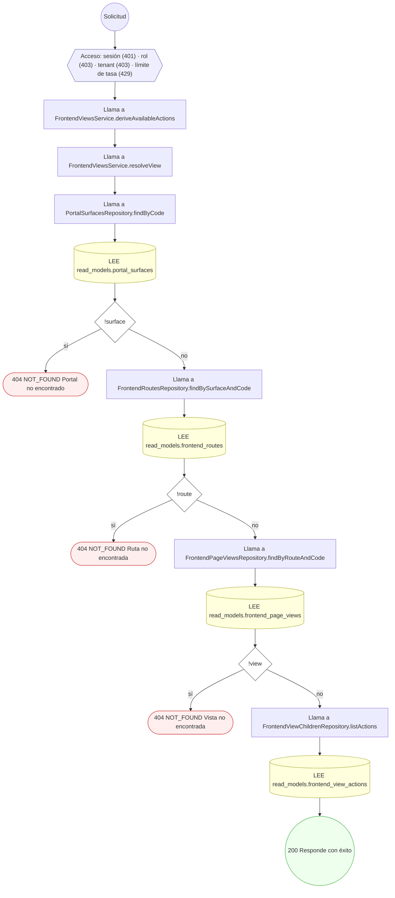

#### 3. GET /portals/{portalCode}/routes/{routeCode}/views/{viewCode}/data

Servir el read model al frontend (consent-aware, masking heredado)

| HTTP | Código | Cuándo |
|---|---|---|
| 200 | — | Éxito |
| 401 | `UNAUTHENTICATED` | Hay una sesión válida (JWT) |
| 403 | `FORBIDDEN` | El rol está permitido; El tenant se resuelve y pertenece al actor |
| 404 | `NOT_FOUND` | ResourceNotFoundException: Portal no encontrado; ResourceNotFoundException: Ruta no encontrada; ResourceNotFoundException: Vista no encontrada |
| 429 | `RATE_LIMITED` | No se supera el límite de solicitudes |

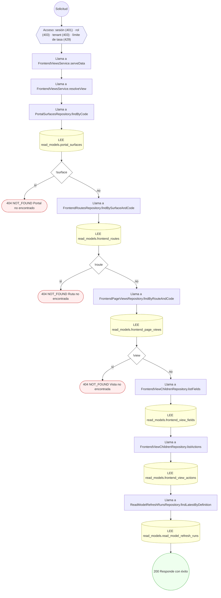

#### 4. GET /public/{slug}

Servir una proyección pública por slug

| HTTP | Código | Cuándo |
|---|---|---|
| 200 | — | Éxito |
| 401 | `UNAUTHENTICATED` | Hay una sesión válida (JWT) |
| 429 | `RATE_LIMITED` | No se supera el límite de solicitudes |

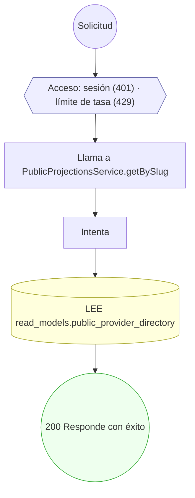

#### 5. GET /public/directory

Servir el directorio público (solo campos aprobados)

| HTTP | Código | Cuándo |
|---|---|---|
| 200 | — | Éxito |
| 401 | `UNAUTHENTICATED` | Hay una sesión válida (JWT) |
| 429 | `RATE_LIMITED` | No se supera el límite de solicitudes |

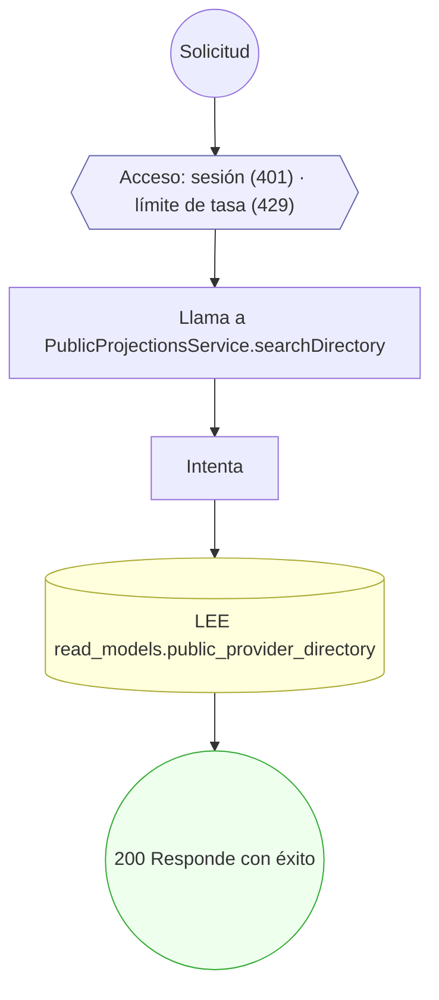

#### 6. POST /read-models/{definitionId}/backfill

Backfill inicial de una nueva materialized view

| HTTP | Código | Cuándo |
|---|---|---|
| 200 | — | Éxito |
| 400 | `VALIDATION_FAILED` | Los parámetros de ruta son UUID válidos |
| 401 | `UNAUTHENTICATED` | Hay una sesión válida (JWT) |
| 403 | `FORBIDDEN` | El rol está permitido; El tenant se resuelve y pertenece al actor |
| 404 | `NOT_FOUND` | ResourceNotFoundException: Read model no encontrado |
| 422 | `PRECONDITION_FAILED` | PreconditionFailedException: La operación requiere una materialized view; PreconditionFailedException: La versión está retirada; PreconditionFailedException: El nombre físico de la vista no es un identificador SQL válido |
| 429 | `RATE_LIMITED` | No se supera el límite de solicitudes |

#### 7. POST /read-models/{definitionId}/invalidate

Invalidar y recomputar el read model tras cambio upstream

| HTTP | Código | Cuándo |
|---|---|---|
| 200 | — | Éxito |
| 400 | `VALIDATION_FAILED` | Los parámetros de ruta son UUID válidos |
| 401 | `UNAUTHENTICATED` | Hay una sesión válida (JWT) |
| 403 | `FORBIDDEN` | El rol está permitido; El tenant se resuelve y pertenece al actor |
| 404 | `NOT_FOUND` | ResourceNotFoundException: Read model no encontrado |
| 422 | `PRECONDITION_FAILED` | PreconditionFailedException: La operación requiere una materialized view; PreconditionFailedException: La versión está retirada; PreconditionFailedException: El nombre físico de la vista no es un identificador SQL válido |
| 429 | `RATE_LIMITED` | No se supera el límite de solicitudes |

#### 8. POST /read-models/{definitionId}/reconcile

Reconciliar read model divergente contra la fuente canónica

| HTTP | Código | Cuándo |
|---|---|---|
| 200 | — | Éxito |
| 400 | `VALIDATION_FAILED` | Los parámetros de ruta son UUID válidos |
| 401 | `UNAUTHENTICATED` | Hay una sesión válida (JWT) |
| 403 | `FORBIDDEN` | El rol está permitido; El tenant se resuelve y pertenece al actor |
| 404 | `NOT_FOUND` | ResourceNotFoundException: Read model no encontrado |
| 422 | `PRECONDITION_FAILED` | PreconditionFailedException: La operación requiere una materialized view; PreconditionFailedException: La versión está retirada; PreconditionFailedException: El nombre físico de la vista no es un identificador SQL válido |
| 429 | `RATE_LIMITED` | No se supera el límite de solicitudes |

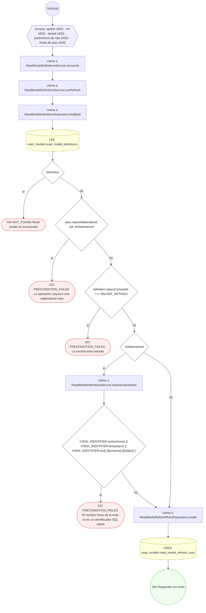

#### 9. POST /read-models/{definitionId}/refresh

Refrescar la materialized view (REFRESH CONCURRENTLY, manual)

| HTTP | Código | Cuándo |
|---|---|---|
| 200 | — | Éxito |
| 400 | `VALIDATION_FAILED` | Los parámetros de ruta son UUID válidos |
| 401 | `UNAUTHENTICATED` | Hay una sesión válida (JWT) |
| 403 | `FORBIDDEN` | El rol está permitido; El tenant se resuelve y pertenece al actor |
| 404 | `NOT_FOUND` | ResourceNotFoundException: Read model no encontrado |
| 422 | `PRECONDITION_FAILED` | PreconditionFailedException: La operación requiere una materialized view; PreconditionFailedException: La versión está retirada; PreconditionFailedException: El nombre físico de la vista no es un identificador SQL válido |
| 429 | `RATE_LIMITED` | No se supera el límite de solicitudes |

#### 10. POST /read-models/definitions

Registrar y publicar un contrato de read model versionado

| HTTP | Código | Cuándo |
|---|---|---|
| 201 | — | Éxito |
| 400 | `VALIDATION_FAILED` | El cuerpo cumple el DTO (sin propiedades extra) |
| 401 | `UNAUTHENTICATED` | Hay una sesión válida (JWT) |
| 403 | `FORBIDDEN` | El rol está permitido; El tenant se resuelve y pertenece al actor |
| 409 | `CONFLICT` | ConflictException: Ya existe esa versión del read model |
| 429 | `RATE_LIMITED` | No se supera el límite de solicitudes |

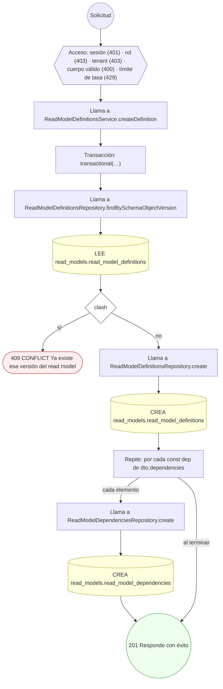

#### 11. DELETE /read-models/definitions/{id}

Retirar una versión de read model (guarda de FK)

| HTTP | Código | Cuándo |
|---|---|---|
| 200 | — | Éxito |
| 400 | `VALIDATION_FAILED` | Los parámetros de ruta son UUID válidos |
| 401 | `UNAUTHENTICATED` | Hay una sesión válida (JWT) |
| 403 | `FORBIDDEN` | El rol está permitido; El tenant se resuelve y pertenece al actor |
| 404 | `NOT_FOUND` | ResourceNotFoundException: Read model no encontrado |
| 422 | `PRECONDITION_FAILED` | PreconditionFailedException: No se puede retirar: hay vistas apuntando a esta versión |
| 429 | `RATE_LIMITED` | No se supera el límite de solicitudes |

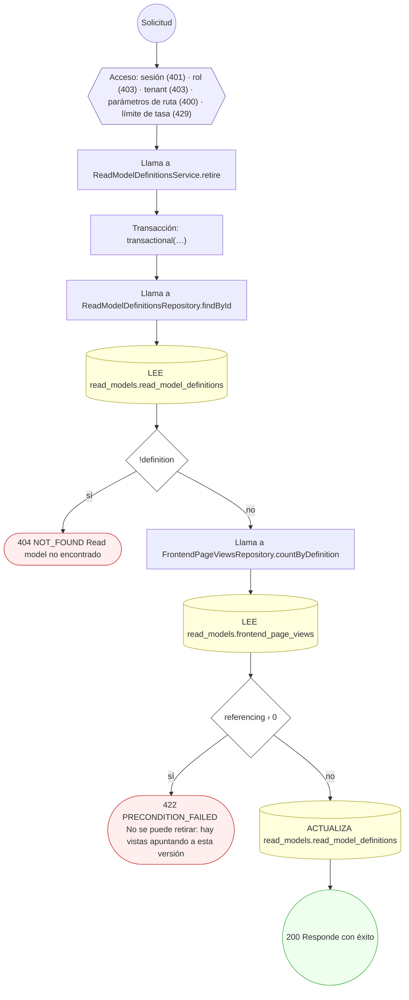

#### 12. POST /read-models/definitions/{id}/deprecate

Deprecar una versión de read model

| HTTP | Código | Cuándo |
|---|---|---|
| 200 | — | Éxito |
| 400 | `VALIDATION_FAILED` | Los parámetros de ruta son UUID válidos |
| 401 | `UNAUTHENTICATED` | Hay una sesión válida (JWT) |
| 403 | `FORBIDDEN` | El rol está permitido; El tenant se resuelve y pertenece al actor |
| 404 | `NOT_FOUND` | ResourceNotFoundException: Read model no encontrado |
| 422 | `PRECONDITION_FAILED` | PreconditionFailedException: La versión ya está retirada |
| 429 | `RATE_LIMITED` | No se supera el límite de solicitudes |

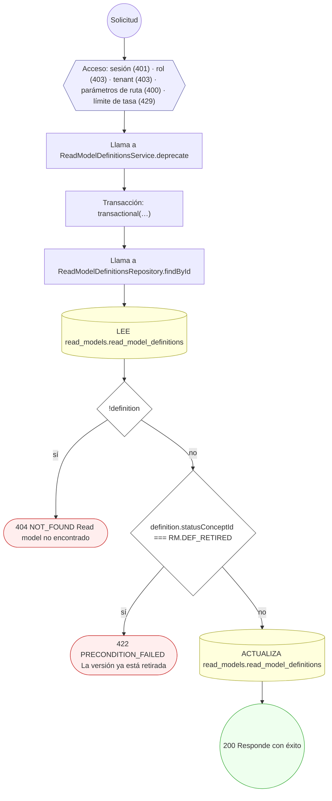

#### 13. POST /read-models/definitions/{schema}/{object}/versions

Versionar el esquema de un read model

| HTTP | Código | Cuándo |
|---|---|---|
| 201 | — | Éxito |
| 400 | `VALIDATION_FAILED` | El cuerpo cumple el DTO (sin propiedades extra) |
| 401 | `UNAUTHENTICATED` | Hay una sesión válida (JWT) |
| 403 | `FORBIDDEN` | El rol está permitido; El tenant se resuelve y pertenece al actor |
| 404 | `NOT_FOUND` | ResourceNotFoundException: No existe una versión previa del read model |
| 422 | `PRECONDITION_FAILED` | PreconditionFailedException: No hay una versión ACTIVE previa que respalde el corte de versión |
| 429 | `RATE_LIMITED` | No se supera el límite de solicitudes |

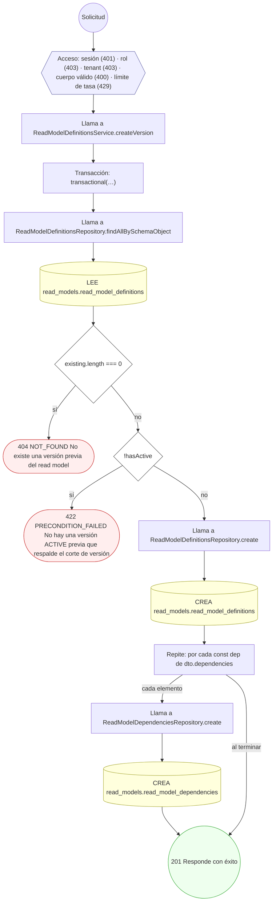

#### 14. GET /read-models/health

Detectar y reportar staleness/degradación de las MV

| HTTP | Código | Cuándo |
|---|---|---|
| 200 | — | Éxito |
| 401 | `UNAUTHENTICATED` | Hay una sesión válida (JWT) |
| 403 | `FORBIDDEN` | El rol está permitido; El tenant se resuelve y pertenece al actor |
| 429 | `RATE_LIMITED` | No se supera el límite de solicitudes |

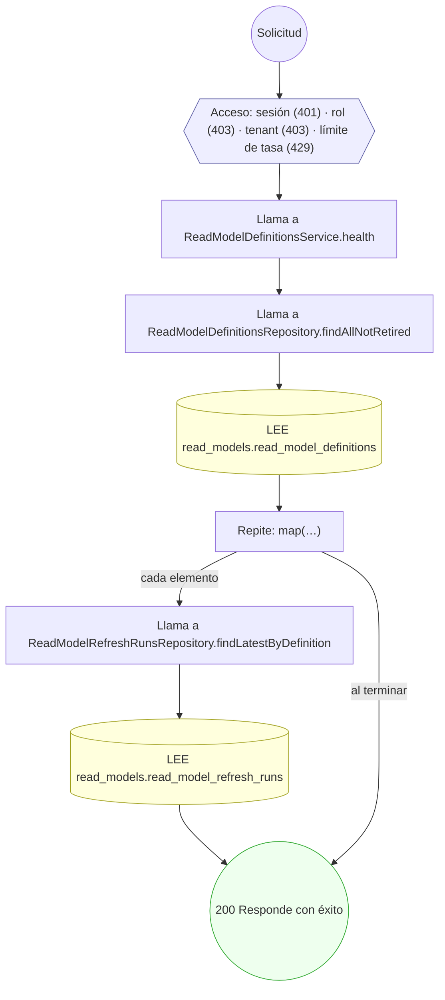

#### 15. PUT /views/{frontendPageViewId}/preferences

Guardar preferencias de vista del usuario

| HTTP | Código | Cuándo |
|---|---|---|
| 200 | — | Éxito |
| 400 | `VALIDATION_FAILED` | Los parámetros de ruta son UUID válidos; El cuerpo cumple el DTO (sin propiedades extra) |
| 401 | `UNAUTHENTICATED` | Hay una sesión válida (JWT) |
| 403 | `FORBIDDEN` | El rol está permitido; El tenant se resuelve y pertenece al actor |
| 404 | `NOT_FOUND` | ResourceNotFoundException: Vista no encontrada |
| 422 | `PRECONDITION_FAILED` | PreconditionFailedException: La vista no está ACTIVE; PreconditionFailedException: visibleFields contiene columnas fuera del contrato |
| 429 | `RATE_LIMITED` | No se supera el límite de solicitudes |

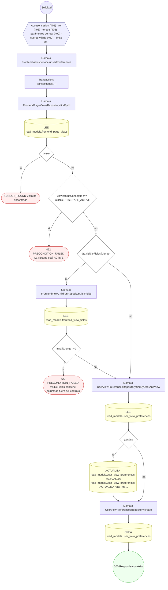

