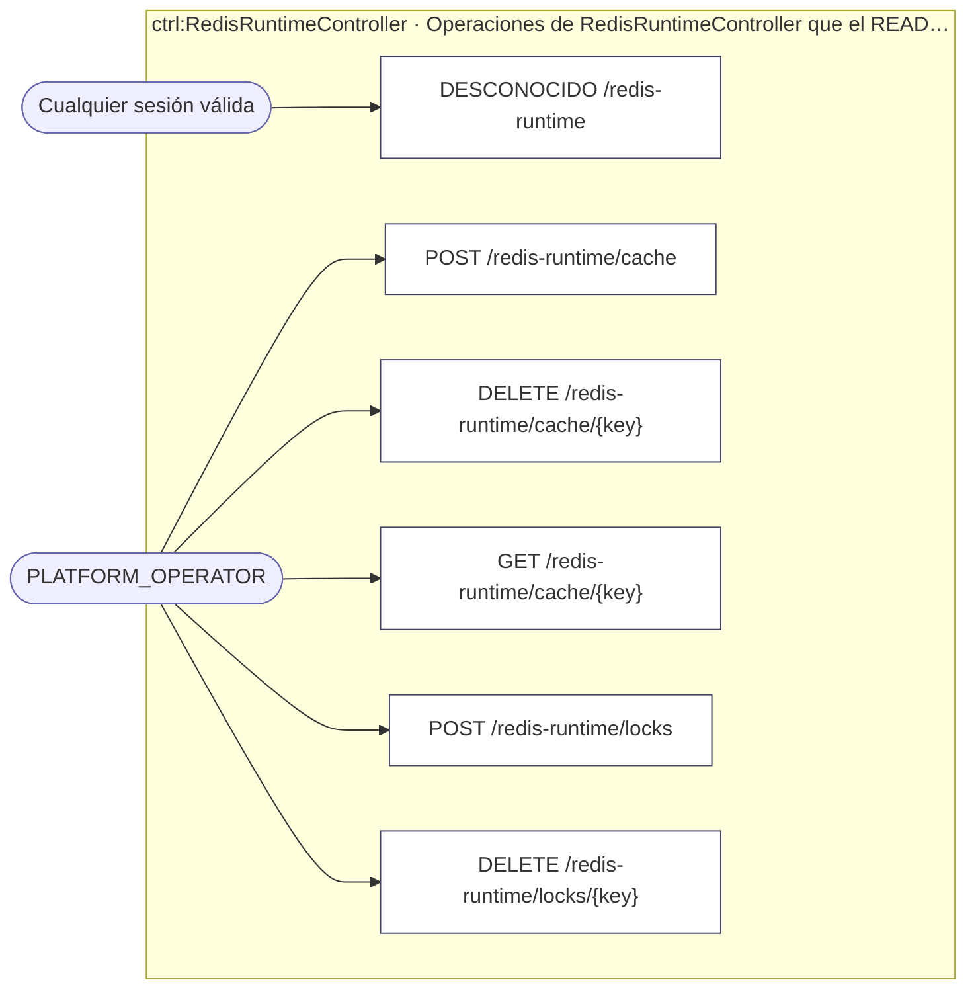
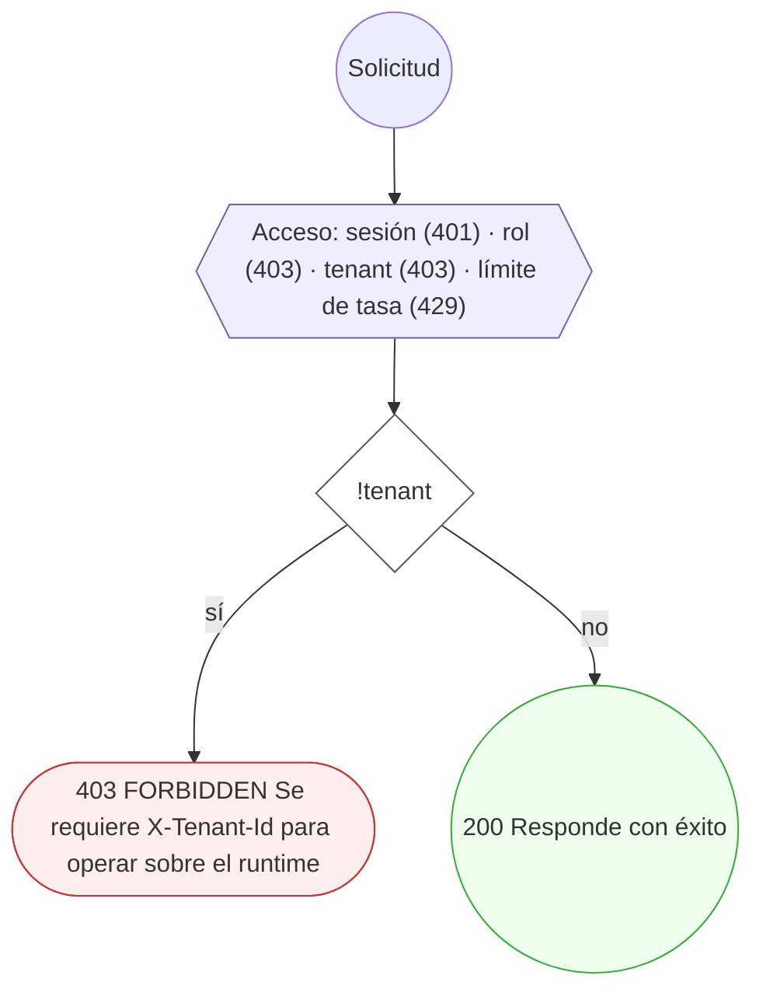
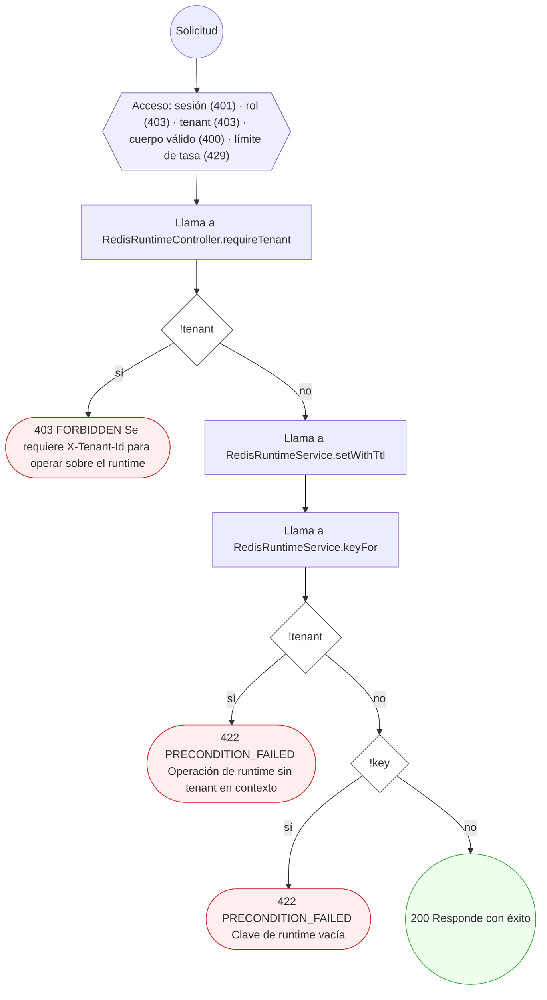
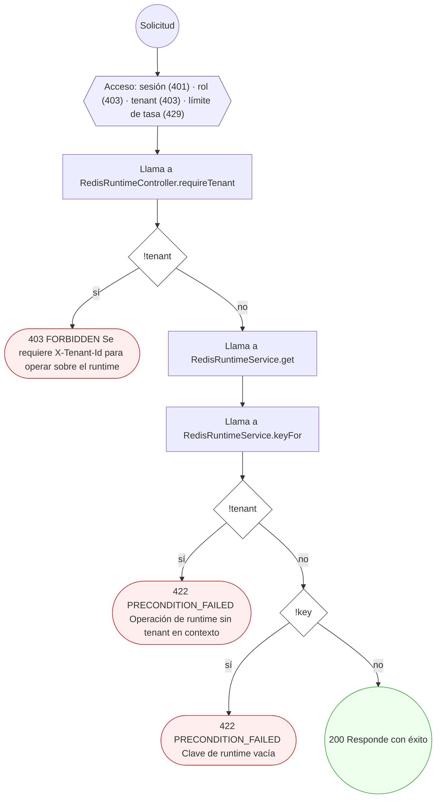
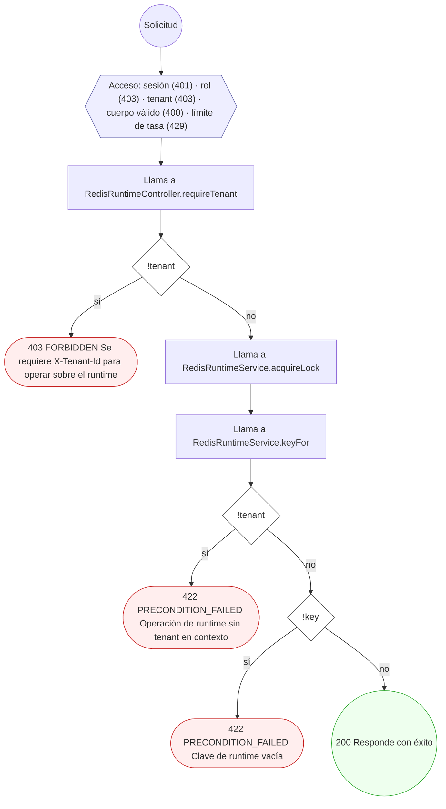
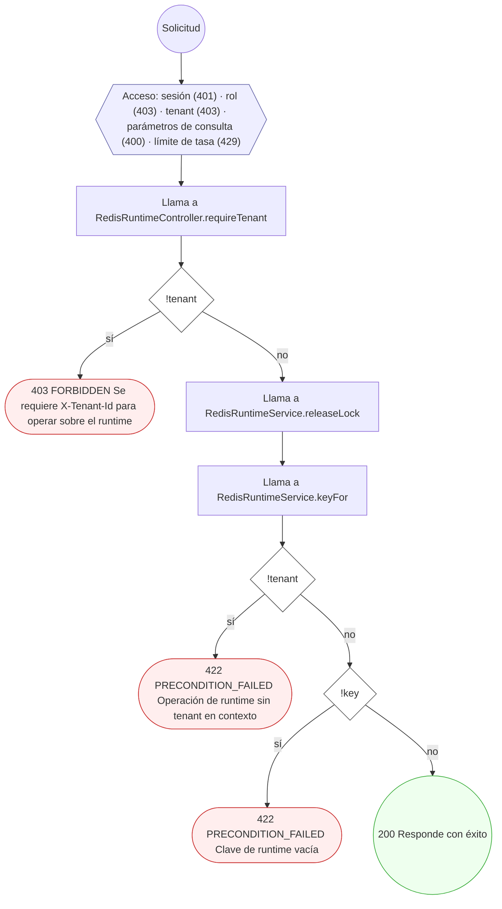

<!-- AUTOGENERADO por tools/inventario/flujos.mjs. No editar manualmente. -->

# Flujos del módulo `redis_runtime`

- **Procesos:** 1 · **Máquinas de estado:** 0
- **Operaciones:** 6 (6 con decisiones propias, 0 sin ellas)
- Inventario de endpoints del módulo: [redis_runtime](../endpoints/redis_runtime.md)

## Proceso: MÓDULO 56 — `redis_runtime`

- **Código:** `redis_runtime` · **Agrupación:** AGRUPACION_POR_CONTROLADOR · **Operaciones:** 6
- **Actores:** Cualquier sesión válida · PLATFORM_OPERATOR
- **Revisión:** AUTO_DETECTADA
- **Fuentes:** `src/modules/redis_runtime/README.md`

### Para qué sirve

Runtime de baja latencia sobre Redis **real** (contenedor `mantra-redesa-redis-1`, `REDIS_HOST` / `REDIS_PORT` / `REDIS_PASSWORD` del entorno; por defecto `localhost:6380`). Vía `ioredis`.

_Fuente: `src/modules/redis_runtime/README.md:3`_

### Etapas y operaciones

| Etapa | Descripción | Operación | Quién actúa | Riesgo | Tablas |
|---|---|---|---|---|---|
| `ctrl:RedisRuntimeController` | Operaciones de RedisRuntimeController que el README no asigna a un caso de uso | DESCONOCIDO /redis-runtime | Cualquier sesión válida | BAJO | 0 |
|  |  | POST /redis-runtime/cache | PLATFORM_OPERATOR | BAJO | 0 |
|  |  | DELETE /redis-runtime/cache/{key} | PLATFORM_OPERATOR | BAJO | 0 |
|  |  | GET /redis-runtime/cache/{key} | PLATFORM_OPERATOR | BAJO | 0 |
|  |  | POST /redis-runtime/locks | PLATFORM_OPERATOR | BAJO | 0 |
|  |  | DELETE /redis-runtime/locks/{key} | PLATFORM_OPERATOR | BAJO | 0 |

### Diagrama — etapas `ctrl:RedisRuntimeController`

## Árbol de decisión por operación

Cada árbol se deriva del código del handler y de los métodos que invoca (hasta 4 niveles). Una rama que no decide, no escribe y no falla se poda. Los accesos y los efectos consecutivos se agrupan en un solo nodo.

### Operaciones con decisiones propias

#### 1. DESCONOCIDO /redis-runtime

Tenant del contexto; obligatorio para acotar cualquier operación.

| HTTP | Código | Cuándo |
|---|---|---|
| 200 | — | Éxito |
| 401 | `UNAUTHENTICATED` | Hay una sesión válida (JWT) |
| 403 | `FORBIDDEN` | El rol está permitido; El tenant se resuelve y pertenece al actor; ForbiddenException: Se requiere X-Tenant-Id para operar sobre el runtime |
| 429 | `RATE_LIMITED` | No se supera el límite de solicitudes |

#### 2. POST /redis-runtime/cache

Escribir un valor en caché con TTL (namespaced por tenant)

| HTTP | Código | Cuándo |
|---|---|---|
| 200 | — | Éxito |
| 400 | `VALIDATION_FAILED` | El cuerpo cumple el DTO (sin propiedades extra) |
| 401 | `UNAUTHENTICATED` | Hay una sesión válida (JWT) |
| 403 | `FORBIDDEN` | El rol está permitido; El tenant se resuelve y pertenece al actor; ForbiddenException: Se requiere X-Tenant-Id para operar sobre el runtime |
| 422 | `PRECONDITION_FAILED` | PreconditionFailedException: Operación de runtime sin tenant en contexto; PreconditionFailedException: Clave de runtime vacía |
| 429 | `RATE_LIMITED` | No se supera el límite de solicitudes |

#### 3. DELETE /redis-runtime/cache/{key}

Borrar una clave de caché (namespaced por tenant)

| HTTP | Código | Cuándo |
|---|---|---|
| 200 | — | Éxito |
| 401 | `UNAUTHENTICATED` | Hay una sesión válida (JWT) |
| 403 | `FORBIDDEN` | El rol está permitido; El tenant se resuelve y pertenece al actor; ForbiddenException: Se requiere X-Tenant-Id para operar sobre el runtime |
| 422 | `PRECONDITION_FAILED` | PreconditionFailedException: Operación de runtime sin tenant en contexto; PreconditionFailedException: Clave de runtime vacía |
| 429 | `RATE_LIMITED` | No se supera el límite de solicitudes |

#### 4. GET /redis-runtime/cache/{key}

Leer un valor de caché por clave (namespaced por tenant)

| HTTP | Código | Cuándo |
|---|---|---|
| 200 | — | Éxito |
| 401 | `UNAUTHENTICATED` | Hay una sesión válida (JWT) |
| 403 | `FORBIDDEN` | El rol está permitido; El tenant se resuelve y pertenece al actor; ForbiddenException: Se requiere X-Tenant-Id para operar sobre el runtime |
| 422 | `PRECONDITION_FAILED` | PreconditionFailedException: Operación de runtime sin tenant en contexto; PreconditionFailedException: Clave de runtime vacía |
| 429 | `RATE_LIMITED` | No se supera el límite de solicitudes |

#### 5. POST /redis-runtime/locks

Adquirir un lock distribuido (SET NX PX + token)

| HTTP | Código | Cuándo |
|---|---|---|
| 200 | — | Éxito |
| 400 | `VALIDATION_FAILED` | El cuerpo cumple el DTO (sin propiedades extra) |
| 401 | `UNAUTHENTICATED` | Hay una sesión válida (JWT) |
| 403 | `FORBIDDEN` | El rol está permitido; El tenant se resuelve y pertenece al actor; ForbiddenException: Se requiere X-Tenant-Id para operar sobre el runtime |
| 422 | `PRECONDITION_FAILED` | PreconditionFailedException: Operación de runtime sin tenant en contexto; PreconditionFailedException: Clave de runtime vacía |
| 429 | `RATE_LIMITED` | No se supera el límite de solicitudes |

#### 6. DELETE /redis-runtime/locks/{key}

Liberar un lock si el token coincide (CAS)

| HTTP | Código | Cuándo |
|---|---|---|
| 200 | — | Éxito |
| 400 | `VALIDATION_FAILED` | Están los parámetros de consulta obligatorios |
| 401 | `UNAUTHENTICATED` | Hay una sesión válida (JWT) |
| 403 | `FORBIDDEN` | El rol está permitido; El tenant se resuelve y pertenece al actor; ForbiddenException: Se requiere X-Tenant-Id para operar sobre el runtime |
| 422 | `PRECONDITION_FAILED` | PreconditionFailedException: Operación de runtime sin tenant en contexto; PreconditionFailedException: Clave de runtime vacía |
| 429 | `RATE_LIMITED` | No se supera el límite de solicitudes |

