<!-- AUTOGENERADO por tools/inventario/flujos.mjs. No editar manualmente. -->

# Flujos del módulo `reporting`

- **Procesos:** 1 · **Máquinas de estado:** 0
- **Operaciones:** 12 (12 con decisiones propias, 0 sin ellas)
- Inventario de endpoints del módulo: [reporting](../endpoints/reporting.md)

## Proceso: Módulo 39 — Reportes, Distribución y Tableros

- **Código:** `reporting` · **Agrupación:** CASO_DE_USO_README · **Operaciones:** 12
- **Actores:** DATA_STEWARD · REPORTING_ADMIN · REPORT_AUTHOR · REPORT_VIEWER · SYSTEM
- **Revisión:** AUTO_DETECTADA
- **Fuentes:** `src/modules/reporting/README.md`

### Para qué sirve

Fuentes de datos gobernadas, definiciones versionadas con parámetros y columnas, corridas parametrizadas con snapshot, programación y distribución periódica, suscripciones y tableros.

_Fuente: `src/modules/reporting/README.md:3`_

### Flujo general declarado en el README

```text
fuente (active, gobernada) ── definición (draft) ── versión ──> definición active, vN
                                    │                                   │
                                    │                                   └─ deprecate ──> deprecated
                                    │                                          + schedules suspended
                                    │
     ├─ execution (queued) ── snapshot ──> succeeded (+ retención)
     │        └─ fallo ── retry ──> queued (+ distribuciones re-pendientes)
     │
     ├─ schedule (active) ── tick ──> execution (queued) + ventana avanzada
     │        └─ suscripciones ──> destinatarios del envío
     │
     └─ distribuciones (pending) ──> messaging las envía y las marca sent

tablero (active) ── widgets ──> apuntan a definiciones no deprecadas
```

_Fuente: `src/modules/reporting/README.md:61`_

### Etapas y operaciones

| Etapa | Descripción | Operación | Quién actúa | Riesgo | Tablas |
|---|---|---|---|---|---|
| `UC-39-01` | Registrar fuente gobernada | POST /reporting/data-sources | REPORTING_ADMIN · DATA_STEWARD | MEDIO | 2 |
| `UC-39-02` | Autorar definición con parámetros y columnas | POST /reporting/definitions | REPORTING_ADMIN · REPORT_AUTHOR | MEDIO | 5 |
| `UC-39-03` | Publicar versión | POST /reporting/definitions/{id}/versions/publish | REPORTING_ADMIN · REPORT_AUTHOR | MEDIO | 4 |
| `UC-39-04` | Encolar corrida parametrizada | POST /reporting/definitions/{id}/executions | REPORTING_ADMIN · REPORT_VIEWER | MEDIO | 4 |
| `UC-39-05` | Materializar el artefacto | POST /reporting/executions/{id}/snapshot | SYSTEM | MEDIO | 3 |
| `UC-39-06` | Programar distribución | POST /reporting/definitions/{id}/schedules | REPORTING_ADMIN · REPORT_AUTHOR | MEDIO | 3 |
| `UC-39-07` | Disparar corridas vencidas | POST /reporting/scheduler/tick | SYSTEM | MEDIO | 5 |
| `UC-39-08` | Crear distribuciones | POST /reporting/executions/{id}/distributions | SYSTEM · REPORTING_ADMIN | MEDIO | 4 |
| `UC-39-09` | Suscribirse | POST /reporting/schedules/{id}/subscriptions | REPORT_VIEWER · REPORTING_ADMIN | MEDIO | 4 |
| `UC-39-10` | Componer tablero con widgets | POST /reporting/dashboards | REPORTING_ADMIN · REPORT_AUTHOR | MEDIO | 4 |
| `UC-39-11` | Reintentar corrida fallida | POST /reporting/executions/{id}/retry | SYSTEM · REPORTING_ADMIN | MEDIO | 4 |
| `UC-39-12` | Deprecar definición | POST /reporting/definitions/{id}/deprecate | REPORTING_ADMIN | MEDIO | 3 |

### Diagrama — etapas `UC-39-01`, `UC-39-02`, `UC-39-03`…

```mermaid
flowchart LR
  a2(["REPORTING_ADMIN · DATA_STEWARD"]):::actor
  a5(["REPORTING_ADMIN · REPORT_AUTHOR"]):::actor
  a12(["REPORTING_ADMIN · REPORT_VIEWER"]):::actor
  a15(["SYSTEM"]):::actor
  a21(["SYSTEM · REPORTING_ADMIN"]):::actor
  a25(["REPORT_VIEWER · REPORTING_ADMIN"]):::actor
  a31(["REPORTING_ADMIN"]):::actor
  t3[("reporting.report_data_sources")]:::tabla
  t6[("reporting.report_columns")]:::tabla
  t7[("reporting.report_definitions")]:::tabla
  t8[("reporting.report_parameters")]:::tabla
  t10[("reporting.report_versions")]:::tabla
  t13[("reporting.report_executions")]:::tabla
  t16[("reporting.report_snapshots")]:::tabla
  t18[("reporting.report_schedules")]:::tabla
  t22[("reporting.report_distributions")]:::tabla
  t23[("reporting.report_subscriptions")]:::tabla
  t27[("reporting.dashboard_widgets")]:::tabla
  t28[("reporting.dashboards")]:::tabla
  subgraph s0["UC-39-01 · Registrar fuente gobernada"]
    o1["POST /reporting/data-sources"]:::op
  end
  subgraph s1["UC-39-02 · Autorar definición con parámetros y columnas"]
    o4["POST /reporting/definitions"]:::op
  end
  subgraph s2["UC-39-03 · Publicar versión"]
    o9["POST /reporting/definitions/{id}/versions/publish"]:::op
  end
  subgraph s3["UC-39-04 · Encolar corrida parametrizada"]
    o11["POST /reporting/definitions/{id}/executions"]:::op
  end
  subgraph s4["UC-39-05 · Materializar el artefacto"]
    o14["POST /reporting/executions/{id}/snapshot"]:::op
  end
  subgraph s5["UC-39-06 · Programar distribución"]
    o17["POST /reporting/definitions/{id}/schedules"]:::op
  end
  subgraph s6["UC-39-07 · Disparar corridas vencidas"]
    o19["POST /reporting/scheduler/tick"]:::op
  end
  subgraph s7["UC-39-08 · Crear distribuciones"]
    o20["POST /reporting/executions/{id}/distributions"]:::op
  end
  subgraph s8["UC-39-09 · Suscribirse"]
    o24["POST /reporting/schedules/{id}/subscriptions"]:::op
  end
  subgraph s9["UC-39-10 · Componer tablero con widgets"]
    o26["POST /reporting/dashboards"]:::op
  end
  subgraph s10["UC-39-11 · Reintentar corrida fallida"]
    o29["POST /reporting/executions/{id}/retry"]:::op
  end
  subgraph s11["UC-39-12 · Deprecar definición"]
    o30["POST /reporting/definitions/{id}/deprecate"]:::op
  end
  a2 --> o1
  o1 -->|"CREA"| t3
  o1 -->|"LEE"| t3
  a5 --> o4
  o4 -->|"CREA"| t6
  o4 -->|"LEE"| t3
  o4 -->|"CREA"| t7
  o4 -->|"LEE"| t7
  o4 -->|"CREA"| t8
  a5 --> o9
  o9 -->|"LEE"| t7
  o9 -->|"LEE"| t8
  o9 -->|"CREA"| t10
  o9 -->|"LEE"| t10
  a12 --> o11
  o11 -->|"LEE"| t7
  o11 -->|"CREA"| t13
  o11 -->|"LEE"| t8
  o11 -->|"LEE"| t10
  a15 --> o14
  o14 -->|"LEE"| t13
  o14 -->|"CREA"| t16
  o14 -->|"LEE"| t16
  a5 --> o17
  o17 -->|"LEE"| t7
  o17 -->|"LEE"| t8
  o17 -->|"CREA"| t18
  a15 --> o19
  o19 -->|"LEE"| t7
  o19 -->|"CREA"| t13
  o19 -->|"ACTUALIZA"| t18
  o19 -->|"LEE"| t18
  o19 -->|"LEE"| t10
  a21 --> o20
  o20 -->|"CREA"| t22
  o20 -->|"LEE"| t22
  o20 -->|"LEE"| t13
  o20 -->|"LEE"| t23
  a25 --> o24
  o24 -->|"LEE"| t18
  o24 -->|"ACTUALIZA"| t23
  o24 -->|"CREA"| t23
  o24 -->|"LEE"| t23
  a5 --> o26
  o26 -->|"CREA"| t27
  o26 -->|"CREA"| t28
  o26 -->|"LEE"| t28
  o26 -->|"LEE"| t7
  a21 --> o29
  o29 -->|"LEE"| t7
  o29 -->|"ACTUALIZA"| t22
  o29 -->|"LEE"| t22
  o29 -->|"LEE"| t13
  a31 --> o30
  o30 -->|"LEE"| t7
  o30 -->|"ACTUALIZA"| t18
  o30 -->|"LEE"| t18
  classDef op fill:#fff,stroke:#446
  classDef actor fill:#eef,stroke:#66a
  classDef tabla fill:#ffd,stroke:#aa3
  classDef evento fill:#efe,stroke:#3a3
```

## Árbol de decisión por operación

Cada árbol se deriva del código del handler y de los métodos que invoca (hasta 4 niveles). Una rama que no decide, no escribe y no falla se poda. Los accesos y los efectos consecutivos se agrupan en un solo nodo.

### Operaciones con decisiones propias

#### 1. POST /reporting/dashboards

Componer un tablero con sus widgets

| HTTP | Código | Cuándo |
|---|---|---|
| 201 | — | Éxito |
| 400 | `VALIDATION_FAILED` | El cuerpo cumple el DTO (sin propiedades extra) |
| 401 | `UNAUTHENTICATED` | Hay una sesión válida (JWT) |
| 403 | `FORBIDDEN` | El rol está permitido; El tenant se resuelve y pertenece al actor |
| 409 | `CONFLICT` | ConflictException: Ya existe un tablero con ese código |
| 422 | `PRECONDITION_FAILED` | PreconditionFailedException: Un widget CHART necesita su tipo de gráfico; PreconditionFailedException: El widget apunta a un reporte deprecado |
| 429 | `RATE_LIMITED` | No se supera el límite de solicitudes |

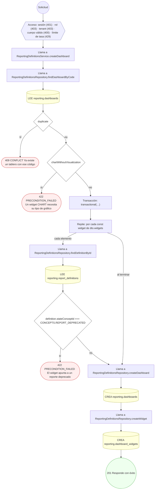

#### 2. POST /reporting/data-sources

Registrar una fuente de datos gobernada

| HTTP | Código | Cuándo |
|---|---|---|
| 201 | — | Éxito |
| 400 | `VALIDATION_FAILED` | El cuerpo cumple el DTO (sin propiedades extra) |
| 401 | `UNAUTHENTICATED` | Hay una sesión válida (JWT) |
| 403 | `FORBIDDEN` | El rol está permitido; El tenant se resuelve y pertenece al actor |
| 409 | `CONFLICT` | ConflictException: Ya existe una fuente con ese código |
| 422 | `PRECONDITION_FAILED` | PreconditionFailedException: Una fuente READ_MODEL necesita su read model gobernado; PreconditionFailedException: Una fuente VIEW necesita el nombre de la vista |
| 429 | `RATE_LIMITED` | No se supera el límite de solicitudes |

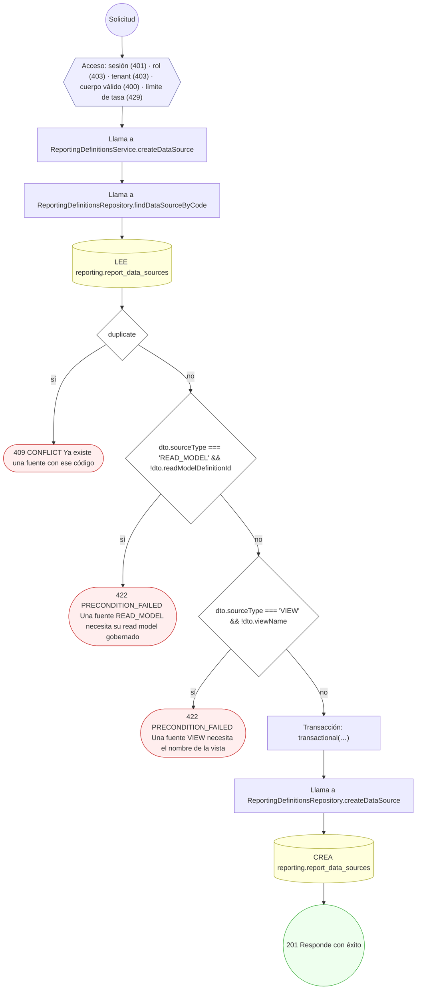

#### 3. POST /reporting/definitions

Autorar una definición con sus parámetros y columnas

| HTTP | Código | Cuándo |
|---|---|---|
| 201 | — | Éxito |
| 400 | `VALIDATION_FAILED` | El cuerpo cumple el DTO (sin propiedades extra) |
| 401 | `UNAUTHENTICATED` | Hay una sesión válida (JWT) |
| 403 | `FORBIDDEN` | El rol está permitido; El tenant se resuelve y pertenece al actor |
| 409 | `CONFLICT` | ConflictException: Ya existe una definición con ese código |
| 422 | `PRECONDITION_FAILED` | PreconditionFailedException: Un reporte no público necesita declarar el permiso que exige; PreconditionFailedException: El código de {kind} está repetido; PreconditionFailedException: La fuente de datos no está activa |
| 429 | `RATE_LIMITED` | No se supera el límite de solicitudes |

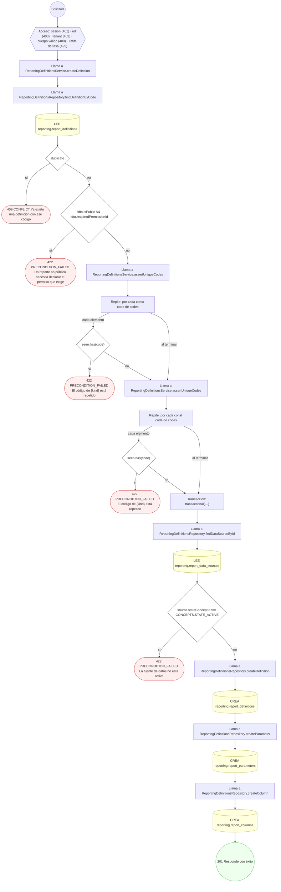

#### 4. POST /reporting/definitions/{id}/deprecate

Deprecar la definición y suspender sus programaciones

| HTTP | Código | Cuándo |
|---|---|---|
| 200 | — | Éxito |
| 400 | `VALIDATION_FAILED` | Los parámetros de ruta son UUID válidos; El cuerpo cumple el DTO (sin propiedades extra) |
| 401 | `UNAUTHENTICATED` | Hay una sesión válida (JWT) |
| 403 | `FORBIDDEN` | El rol está permitido; El tenant se resuelve y pertenece al actor |
| 409 | `CONFLICT` | ConflictException: La definición ya está deprecada |
| 429 | `RATE_LIMITED` | No se supera el límite de solicitudes |

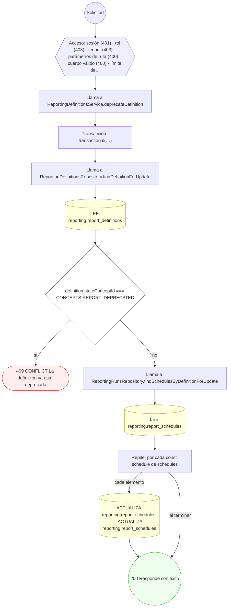

#### 5. POST /reporting/definitions/{id}/executions

Encolar una corrida parametrizada

| HTTP | Código | Cuándo |
|---|---|---|
| 201 | — | Éxito |
| 400 | `VALIDATION_FAILED` | Los parámetros de ruta son UUID válidos; El cuerpo cumple el DTO (sin propiedades extra) |
| 401 | `UNAUTHENTICATED` | Hay una sesión válida (JWT) |
| 403 | `FORBIDDEN` | El rol está permitido; El tenant se resuelve y pertenece al actor |
| 422 | `PRECONDITION_FAILED` | PreconditionFailedException: La definición no está activa; PreconditionFailedException: La definición no tiene versión publicada; PreconditionFailedException: Faltan parámetros obligatorios del reporte |
| 429 | `RATE_LIMITED` | No se supera el límite de solicitudes |

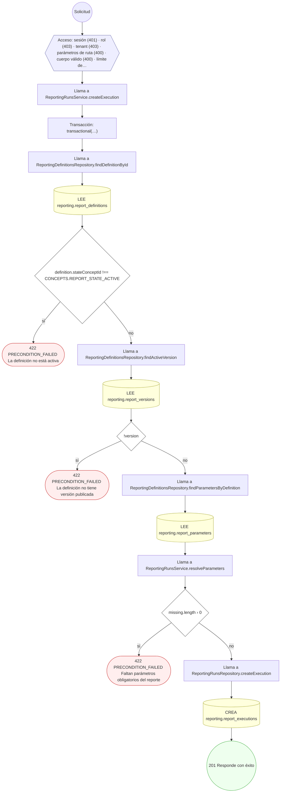

#### 6. POST /reporting/definitions/{id}/schedules

Programar la distribución periódica del reporte

| HTTP | Código | Cuándo |
|---|---|---|
| 201 | — | Éxito |
| 400 | `VALIDATION_FAILED` | Los parámetros de ruta son UUID válidos; El cuerpo cumple el DTO (sin propiedades extra) |
| 401 | `UNAUTHENTICATED` | Hay una sesión válida (JWT) |
| 403 | `FORBIDDEN` | El rol está permitido; El tenant se resuelve y pertenece al actor |
| 422 | `PRECONDITION_FAILED` | PreconditionFailedException: La definición no está activa; PreconditionFailedException: Faltan parámetros obligatorios del reporte |
| 429 | `RATE_LIMITED` | No se supera el límite de solicitudes |

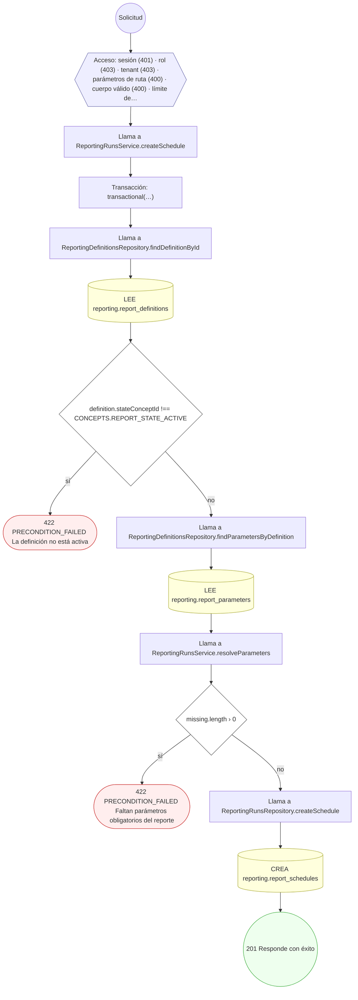

#### 7. POST /reporting/definitions/{id}/versions/publish

Publicar una versión del reporte

| HTTP | Código | Cuándo |
|---|---|---|
| 201 | — | Éxito |
| 400 | `VALIDATION_FAILED` | Los parámetros de ruta son UUID válidos; El cuerpo cumple el DTO (sin propiedades extra) |
| 401 | `UNAUTHENTICATED` | Hay una sesión válida (JWT) |
| 403 | `FORBIDDEN` | El rol está permitido; El tenant se resuelve y pertenece al actor |
| 409 | `CONFLICT` | ConflictException: Esa versión ya está publicada |
| 422 | `PRECONDITION_FAILED` | PreconditionFailedException: Una definición deprecada no admite versiones |
| 429 | `RATE_LIMITED` | No se supera el límite de solicitudes |

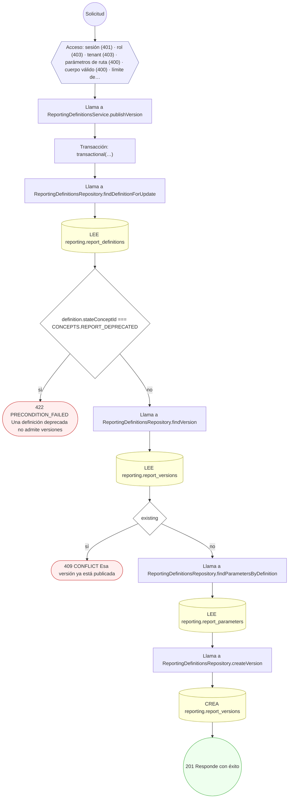

#### 8. POST /reporting/executions/{id}/distributions

Crear las distribuciones del reporte por destinatario

| HTTP | Código | Cuándo |
|---|---|---|
| 201 | — | Éxito |
| 400 | `VALIDATION_FAILED` | Los parámetros de ruta son UUID válidos; El cuerpo cumple el DTO (sin propiedades extra) |
| 401 | `UNAUTHENTICATED` | Hay una sesión válida (JWT) |
| 403 | `FORBIDDEN` | El rol está permitido; El tenant se resuelve y pertenece al actor |
| 422 | `PRECONDITION_FAILED` | PreconditionFailedException: Sólo se distribuye una ejecución que terminó con éxito; PreconditionFailedException: Un destinatario USER necesita su identificador; PreconditionFailedException: Un destinatario ADDRESS necesita su dirección |
| 429 | `RATE_LIMITED` | No se supera el límite de solicitudes |

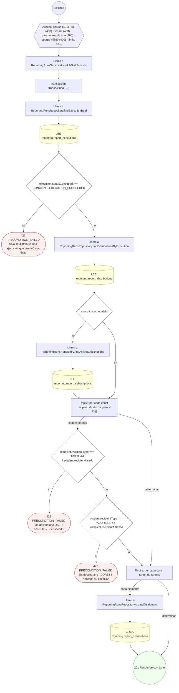

#### 9. POST /reporting/executions/{id}/retry

Devolver a la cola una corrida fallida

| HTTP | Código | Cuándo |
|---|---|---|
| 200 | — | Éxito |
| 400 | `VALIDATION_FAILED` | Los parámetros de ruta son UUID válidos; El cuerpo cumple el DTO (sin propiedades extra) |
| 401 | `UNAUTHENTICATED` | Hay una sesión válida (JWT) |
| 403 | `FORBIDDEN` | El rol está permitido; El tenant se resuelve y pertenece al actor |
| 422 | `PRECONDITION_FAILED` | PreconditionFailedException: Sólo se reintenta una ejecución fallida; PreconditionFailedException: La definición está deprecada: no se reintenta su corrida |
| 429 | `RATE_LIMITED` | No se supera el límite de solicitudes |

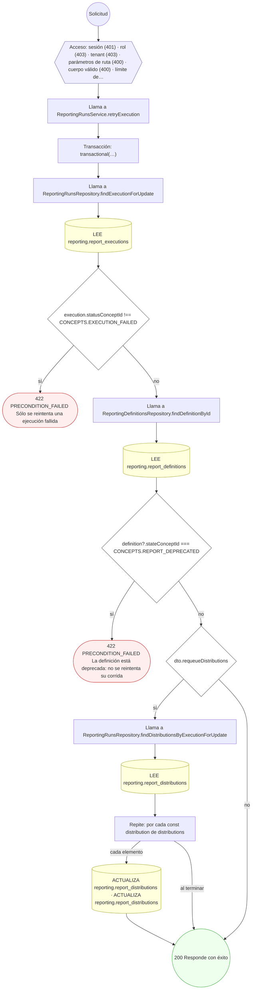

#### 10. POST /reporting/executions/{id}/snapshot

Registrar el artefacto materializado y cerrar la corrida

| HTTP | Código | Cuándo |
|---|---|---|
| 201 | — | Éxito |
| 400 | `VALIDATION_FAILED` | Los parámetros de ruta son UUID válidos; El cuerpo cumple el DTO (sin propiedades extra) |
| 401 | `UNAUTHENTICATED` | Hay una sesión válida (JWT) |
| 403 | `FORBIDDEN` | El rol está permitido; El tenant se resuelve y pertenece al actor |
| 409 | `CONFLICT` | ConflictException: La ejecución ya está materializada; ConflictException: La ejecución ya tiene snapshot |
| 422 | `PRECONDITION_FAILED` | PreconditionFailedException: Una ejecución fallida se reintenta antes de materializar |
| 429 | `RATE_LIMITED` | No se supera el límite de solicitudes |

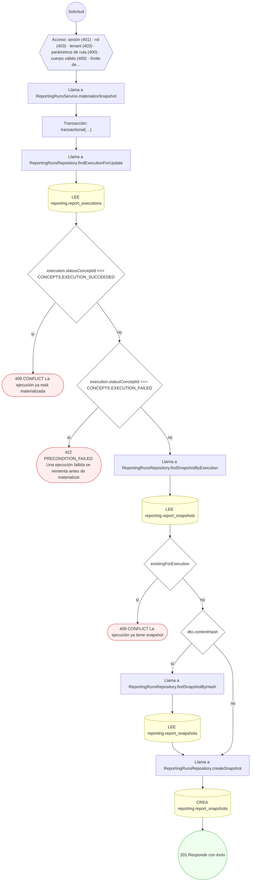

#### 11. POST /reporting/scheduler/tick

Disparar las programaciones vencidas

| HTTP | Código | Cuándo |
|---|---|---|
| 200 | — | Éxito |
| 400 | `VALIDATION_FAILED` | El cuerpo cumple el DTO (sin propiedades extra) |
| 401 | `UNAUTHENTICATED` | Hay una sesión válida (JWT) |
| 403 | `FORBIDDEN` | El rol está permitido; El tenant se resuelve y pertenece al actor |
| 429 | `RATE_LIMITED` | No se supera el límite de solicitudes |

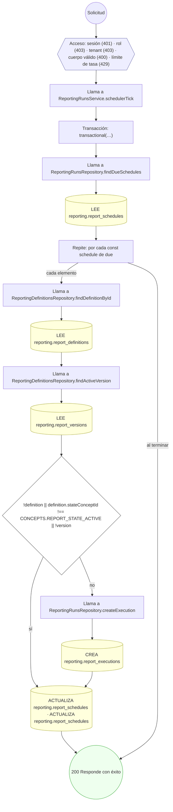

#### 12. POST /reporting/schedules/{id}/subscriptions

Suscribirse a una programación

| HTTP | Código | Cuándo |
|---|---|---|
| 201 | — | Éxito |
| 400 | `VALIDATION_FAILED` | Los parámetros de ruta son UUID válidos; El cuerpo cumple el DTO (sin propiedades extra) |
| 401 | `UNAUTHENTICATED` | Hay una sesión válida (JWT) |
| 403 | `FORBIDDEN` | El rol está permitido; El tenant se resuelve y pertenece al actor |
| 422 | `PRECONDITION_FAILED` | PreconditionFailedException: La programación no está activa |
| 429 | `RATE_LIMITED` | No se supera el límite de solicitudes |

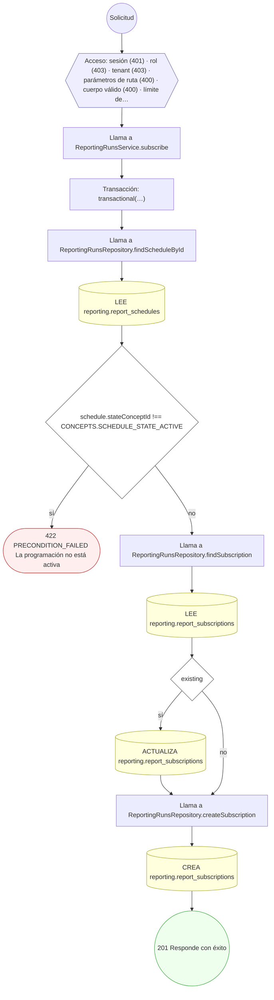

