<!-- AUTOGENERADO por tools/inventario/flujos.mjs. No editar manualmente. -->

# Flujos del módulo `scheduling`

- **Procesos:** 2 · **Máquinas de estado:** 1
- **Operaciones:** 50 (43 con decisiones propias, 7 sin ellas)
- Inventario de endpoints del módulo: [scheduling](../endpoints/scheduling.md)

## Proceso: Módulo 41 — Scheduling

- **Código:** `scheduling` · **Agrupación:** MIXTO · **Operaciones:** 50
- **Actores:** Cualquier sesión válida · PATIENT · PRACTITIONER · SCHEDULING_ADMIN · SCHEDULING_AGENT · SYSTEM · SYSTEM_WORKER
- **Revisión:** AUTO_DETECTADA
- **Fuentes:** `src/modules/scheduling/README.md`

### Para qué sirve

Agenda: recursos agendables, políticas de reserva, plantillas horarias, generación de slots, reservas con anti-double-booking, lista de espera y recordatorios.

_Fuente: `src/modules/scheduling/README.md:3`_

### Flujo general declarado en el README

```text
recurso + política
  └─ plantilla (franjas semanales)
       └─ generate-slots  -> bookable_slots (open, capacity/remaining)
            └─ hold  (FOR UPDATE, remaining--)   ── expira ──> worker devuelve el cupo
                 └─ confirm -> appointment_bookings (confirmed) + recordatorios
                      ├─ reschedule -> libera cupo origen, toma destino
                      ├─ cancel     -> libera cupo (+ cargo si no-show)
                      └─ check-in   -> checked_in
excepción de disponibilidad -> bloquea slots libres solapados
lista de espera -> worker promueve candidatos cuando hay cupo
```

_Fuente: `src/modules/scheduling/README.md:31`_

### Etapas y operaciones

| Etapa | Descripción | Operación | Quién actúa | Riesgo | Tablas |
|---|---|---|---|---|---|
| `UC-41-01` | Definir recurso y política | POST /scheduling/booking-policies | SCHEDULING_ADMIN · PRACTITIONER | MEDIO | 2 |
|  |  | POST /scheduling/resources | SCHEDULING_ADMIN · PRACTITIONER | MEDIO | 4 |
| `UC-41-02` | Publicar plantilla con franjas | POST /scheduling/resources/{id}/templates | SCHEDULING_ADMIN · PRACTITIONER | MEDIO | 5 |
| `UC-41-03` | Materializar slots | POST /scheduling/templates/{id}/generate-slots | SCHEDULING_ADMIN · PRACTITIONER | MEDIO | 7 |
| `UC-41-04` | Excepción de disponibilidad | POST /scheduling/resources/{id}/exceptions | SCHEDULING_ADMIN · PRACTITIONER | MEDIO | 5 |
| `UC-41-05` | Reserva temporal (anti-double-booking) | POST /scheduling/slots/{id}/holds | SCHEDULING_ADMIN · SCHEDULING_AGENT · PATIENT | MEDIO | 6 |
| `UC-41-06` | Confirmar cita | POST /scheduling/holds/{holdToken}/confirm | SCHEDULING_ADMIN · SCHEDULING_AGENT · PATIENT | MEDIO | 14 |
| `UC-41-07` | Worker: liberar holds vencidos | POST /scheduling/internal/expire-holds | SYSTEM · SYSTEM_WORKER | MEDIO | 4 |
| `UC-41-08` | Reprogramar | POST /scheduling/bookings/{id}/reschedule | SCHEDULING_ADMIN · SCHEDULING_AGENT · PRACTITIONER · PATIENT | MEDIO | 26 |
| `UC-41-09` | Cancelar (con cargo por no-show) | POST /scheduling/bookings/{id}/cancel | SCHEDULING_ADMIN · SCHEDULING_AGENT · PRACTITIONER · PATIENT | MEDIO | 27 |
| `UC-41-10` | Check-in | POST /scheduling/bookings/{id}/check-in | SCHEDULING_ADMIN · SCHEDULING_AGENT | MEDIO | 5 |
| `UC-41-11` | Inscribir en lista de espera | POST /scheduling/waitlist | SCHEDULING_ADMIN · SCHEDULING_AGENT · PATIENT | MEDIO | 1 |
| `UC-41-12` | Worker: promover lista de espera | POST /scheduling/internal/promote-waitlist/{slotId} | SYSTEM · SYSTEM_WORKER | MEDIO | 20 |
| `UC-41-13` | Programar recordatorios | POST /scheduling/bookings/{id}/reminders | SCHEDULING_ADMIN · SCHEDULING_AGENT | MEDIO | 3 |
| `UC-41-14` | Worker: despachar recordatorios | POST /scheduling/internal/dispatch-reminders | SYSTEM · SYSTEM_WORKER | MEDIO | 22 |
| `ctrl:SchedulingAgendaController` | Operaciones de SchedulingAgendaController que el README no asigna a un caso de uso | GET /scheduling/resources | SCHEDULING_ADMIN · SCHEDULING_AGENT · PRACTITIONER · PATIENT | BAJO | 6 |
|  |  | GET /scheduling/slots | SCHEDULING_ADMIN · SCHEDULING_AGENT · PRACTITIONER · PATIENT | BAJO | 1 |
| `ctrl:SchedulingBookingsController` | Operaciones de SchedulingBookingsController que el README no asigna a un caso de uso | GET /scheduling/bookings | SCHEDULING_ADMIN · SCHEDULING_AGENT · PRACTITIONER · PATIENT | BAJO | 9 |
|  |  | GET /scheduling/bookings/{id} | SCHEDULING_ADMIN · SCHEDULING_AGENT · PRACTITIONER · PATIENT | BAJO | 6 |
|  |  | POST /scheduling/bookings/{id}/accept | SCHEDULING_ADMIN · SCHEDULING_AGENT · PRACTITIONER | MEDIO | 33 |
|  |  | POST /scheduling/bookings/{id}/complete | SCHEDULING_ADMIN · SCHEDULING_AGENT · PRACTITIONER | MEDIO | 8 |
|  |  | POST /scheduling/bookings/{id}/delay | SCHEDULING_ADMIN · SCHEDULING_AGENT · PRACTITIONER | MEDIO | 23 |
|  |  | GET /scheduling/bookings/{id}/payment-state | SCHEDULING_ADMIN · SCHEDULING_AGENT · PRACTITIONER | BAJO | 3 |
|  |  | PUT /scheduling/bookings/{id}/payment-state | SCHEDULING_ADMIN · SCHEDULING_AGENT · PRACTITIONER | MEDIO | 9 |
|  |  | POST /scheduling/bookings/{id}/propose-schedule | SCHEDULING_ADMIN · SCHEDULING_AGENT · PRACTITIONER | MEDIO | 9 |
|  |  | POST /scheduling/bookings/{id}/reject | SCHEDULING_ADMIN · SCHEDULING_AGENT · PRACTITIONER | MEDIO | 27 |
|  |  | POST /scheduling/bookings/{id}/request-info | SCHEDULING_ADMIN · SCHEDULING_AGENT · PRACTITIONER | MEDIO | 6 |
|  |  | POST /scheduling/bookings/{id}/start | SCHEDULING_ADMIN · SCHEDULING_AGENT · PRACTITIONER | MEDIO | 8 |
| `ctrl:SchedulingConfirmationController` | Operaciones de SchedulingConfirmationController que el README no asigna a un caso de uso | GET /scheduling/confirmation-rules | SCHEDULING_ADMIN | BAJO | 1 |
|  |  | POST /scheduling/confirmation-rules | SCHEDULING_ADMIN | MEDIO | 1 |
|  |  | POST /scheduling/confirmation-rules/{id}/activate | SCHEDULING_ADMIN | MEDIO | 2 |
|  |  | POST /scheduling/confirmation-rules/{id}/deactivate | SCHEDULING_ADMIN | MEDIO | 2 |
|  |  | POST /scheduling/confirmation-rules/evaluate | SCHEDULING_ADMIN | BAJO | 1 |
| `ctrl:SchedulingController` | Operaciones de SchedulingController que el README no asigna a un caso de uso | GET /scheduling/activity-types | SCHEDULING_ADMIN · SCHEDULING_AGENT · PRACTITIONER | BAJO | 0 |
|  |  | POST /scheduling/appointments/direct | SCHEDULING_ADMIN · SCHEDULING_AGENT · PRACTITIONER | MEDIO | 32 |
|  |  | GET /scheduling/exception-types | SCHEDULING_ADMIN · SCHEDULING_AGENT · PRACTITIONER | BAJO | 0 |
|  |  | DELETE /scheduling/exceptions/{id} | SCHEDULING_ADMIN · PRACTITIONER | ALTO | 3 |
|  |  | PATCH /scheduling/exceptions/{id} | SCHEDULING_ADMIN · PRACTITIONER | MEDIO | 5 |
|  |  | POST /scheduling/holds/{holdToken}/request | SCHEDULING_ADMIN · SCHEDULING_AGENT · PATIENT | MEDIO | 30 |
|  |  | POST /scheduling/resources/{id}/close-slots | SCHEDULING_ADMIN · PRACTITIONER | MEDIO | 5 |
|  |  | POST /scheduling/resources/{id}/delay | SCHEDULING_ADMIN · SCHEDULING_AGENT · PRACTITIONER | MEDIO | 22 |
|  |  | GET /scheduling/resources/{id}/exceptions | SCHEDULING_ADMIN · PRACTITIONER · PATIENT | BAJO | 3 |
|  |  | POST /scheduling/resources/{id}/shift-slots | SCHEDULING_ADMIN · PRACTITIONER | MEDIO | 21 |
|  |  | GET /scheduling/resources/{id}/slots | SCHEDULING_ADMIN · SCHEDULING_AGENT · PRACTITIONER · PATIENT | BAJO | 2 |
|  |  | GET /scheduling/resources/{id}/templates | SCHEDULING_ADMIN · PRACTITIONER | BAJO | 3 |
|  |  | DELETE /scheduling/templates/{id} | SCHEDULING_ADMIN · PRACTITIONER | ALTO | 7 |
|  |  | POST /scheduling/templates/{id}/reactivate | SCHEDULING_ADMIN · PRACTITIONER | MEDIO | 3 |
|  |  | GET /scheduling/waitlist | SCHEDULING_ADMIN · SCHEDULING_AGENT · PRACTITIONER · PATIENT | BAJO | 4 |
| `ctrl:SchedulingInternalController` | Operaciones de SchedulingInternalController que el README no asigna a un caso de uso | GET /scheduling/internal/waitlist-candidates | SYSTEM · SYSTEM_WORKER | BAJO | 2 |
| `ctrl:TenantAgendaController` | Operaciones de TenantAgendaController que el README no asigna a un caso de uso | GET /tenants/{tenantId}/agenda | Cualquier sesión válida | BAJO | 5 |

### Diagrama 1 de 3 — etapas `UC-41-01`, `UC-41-02`, `UC-41-03`…

```mermaid
flowchart LR
  a2(["SCHEDULING_ADMIN · PRACTITIONER"]):::actor
  a19(["SCHEDULING_ADMIN · SCHEDULING_AGENT · PATIENT"]):::actor
  a28(["SYSTEM · SYSTEM_WORKER"]):::actor
  a30(["SCHEDULING_ADMIN · SCHEDULING_AGENT · PRACTITIONER · PATIENT"]):::actor
  a39(["SCHEDULING_ADMIN · SCHEDULING_AGENT"]):::actor
  t3[("scheduling.booking_policies")]:::tabla
  t5[("practice.practice_sites")]:::tabla
  t6[("practice.practices")]:::tabla
  t7[("profiles.practitioner_affiliations")]:::tabla
  t8[("scheduling.schedulable_resources")]:::tabla
  t10[("scheduling.schedule_rules")]:::tabla
  t11[("scheduling.schedule_templates")]:::tabla
  t13[("scheduling.appointment_bookings")]:::tabla
  t14[("scheduling.availability_exceptions")]:::tabla
  t15[("scheduling.bookable_slots")]:::tabla
  t20[("scheduling.slot_holds")]:::tabla
  t22[("clinical.appointments")]:::tabla
  t23[("profiles.patient_profiles")]:::tabla
  t24[("profiles.persons")]:::tabla
  t25[("scheduling.appointment_reminders")]:::tabla
  t31[("audit.appointment_bookings_history")]:::tabla
  t32[("iam.authentication_credentials")]:::tabla
  t33[("iam.email_verifications")]:::tabla
  t34[("messaging.in_app_notifications")]:::tabla
  t41[("scheduling.waitlist_entries")]:::tabla
  t43[("messaging.message_channels")]:::tabla
  t44[("messaging.message_templates")]:::tabla
  t45[("messaging.messaging_providers")]:::tabla
  t51[("common.addresses")]:::tabla
  t52[("practice.care_spaces")]:::tabla
  t53[("practice.practitioner_role_assignments")]:::tabla
  subgraph s0["UC-41-01 · Definir recurso y política"]
    o1["POST /scheduling/booking-policies"]:::op
    o4["POST /scheduling/resources"]:::op
  end
  subgraph s1["UC-41-02 · Publicar plantilla con franjas"]
    o9["POST /scheduling/resources/{id}/templates"]:::op
  end
  t16[("+1 tablas más")]
  subgraph s2["UC-41-03 · Materializar slots"]
    o12["POST /scheduling/templates/{id}/generate-slots"]:::op
  end
  subgraph s3["UC-41-04 · Excepción de disponibilidad"]
    o17["POST /scheduling/resources/{id}/exceptions"]:::op
  end
  subgraph s4["UC-41-05 · Reserva temporal (anti-double-booking)"]
    o18["POST /scheduling/slots/{id}/holds"]:::op
  end
  t26[("+8 tablas más")]
  subgraph s5["UC-41-06 · Confirmar cita"]
    o21["POST /scheduling/holds/{holdToken}/confirm"]:::op
  end
  subgraph s6["UC-41-07 · Worker: liberar holds vencidos"]
    o27["POST /scheduling/internal/expire-holds"]:::op
  end
  t35[("+20 tablas más")]
  subgraph s7["UC-41-08 · Reprogramar"]
    o29["POST /scheduling/bookings/{id}/reschedule"]:::op
  end
  t37[("+21 tablas más")]
  subgraph s8["UC-41-09 · Cancelar (con cargo por no-show)"]
    o36["POST /scheduling/bookings/{id}/cancel"]:::op
  end
  subgraph s9["UC-41-10 · Check-in"]
    o38["POST /scheduling/bookings/{id}/check-in"]:::op
  end
  subgraph s10["UC-41-11 · Inscribir en lista de espera"]
    o40["POST /scheduling/waitlist"]:::op
  end
  t46[("+14 tablas más")]
  subgraph s11["UC-41-12 · Worker: promover lista de espera"]
    o42["POST /scheduling/internal/promote-waitlist/{slotId}"]:::op
  end
  subgraph s12["UC-41-13 · Programar recordatorios"]
    o47["POST /scheduling/bookings/{id}/reminders"]:::op
  end
  t49[("+16 tablas más")]
  subgraph s13["UC-41-14 · Worker: despachar recordatorios"]
    o48["POST /scheduling/internal/dispatch-reminders"]:::op
  end
  subgraph s14["ctrl:SchedulingAgendaController · Operaciones de SchedulingAgendaController que…"]
    o50["GET /scheduling/resources"]:::op
    o54["GET /scheduling/slots"]:::op
  end
  a2 --> o1
  o1 -->|"CREA"| t3
  o1 -->|"LEE"| t3
  a2 --> o4
  o4 -->|"LEE"| t5
  o4 -->|"LEE"| t6
  o4 -->|"LEE"| t7
  o4 -->|"CREA"| t8
  a2 --> o9
  o9 -->|"LEE"| t8
  o9 -->|"CREA"| t10
  o9 -->|"LEE"| t10
  o9 -->|"CREA"| t11
  o9 -->|"LEE"| t11
  a2 --> o12
  o12 -->|"LEE"| t13
  o12 -->|"LEE"| t14
  o12 -->|"CREA"| t15
  o12 -->|"LEE"| t15
  o12 -->|"LEE"| t8
  o12 -->|"LEE"| t10
  o12 -.-> t16
  a2 --> o17
  o17 -->|"LEE"| t13
  o17 -->|"CREA"| t14
  o17 -->|"ACTUALIZA"| t15
  o17 -->|"LEE"| t15
  o17 -->|"LEE"| t8
  a19 --> o18
  o18 -->|"LEE"| t13
  o18 -->|"ACTUALIZA"| t15
  o18 -->|"LEE"| t15
  o18 -->|"LEE"| t3
  o18 -->|"LEE"| t11
  o18 -->|"CREA"| t20
  a19 --> o21
  o21 -->|"CREA"| t22
  o21 -->|"LEE"| t23
  o21 -->|"LEE"| t24
  o21 -->|"CREA"| t13
  o21 -->|"LEE"| t13
  o21 -->|"CREA"| t25
  o21 -.-> t26
  a28 --> o27
  o27 -->|"ACTUALIZA"| t15
  o27 -->|"LEE"| t15
  o27 -->|"ACTUALIZA"| t20
  o27 -->|"LEE"| t20
  a30 --> o29
  o29 -->|"ACTUALIZA"| t31
  o29 -->|"CREA"| t31
  o29 -->|"LEE"| t31
  o29 -->|"LEE"| t32
  o29 -->|"LEE"| t33
  o29 -->|"CREA"| t34
  o29 -.-> t35
  a30 --> o36
  o36 -->|"ACTUALIZA"| t31
  o36 -->|"CREA"| t31
  o36 -->|"LEE"| t31
  o36 -->|"LEE"| t32
  o36 -->|"LEE"| t33
  o36 -->|"CREA"| t34
  o36 -.-> t37
  a39 --> o38
  o38 -->|"ACTUALIZA"| t31
  o38 -->|"CREA"| t31
  o38 -->|"LEE"| t31
  o38 -->|"ACTUALIZA"| t13
  o38 -->|"LEE"| t13
  a19 --> o40
  o40 -->|"CREA"| t41
  a28 --> o42
  o42 -->|"LEE"| t32
  o42 -->|"LEE"| t33
  o42 -->|"CREA"| t34
  o42 -->|"LEE"| t43
  o42 -->|"LEE"| t44
  o42 -->|"LEE"| t45
  o42 -.-> t46
  a39 --> o47
  o47 -->|"LEE"| t13
  o47 -->|"CREA"| t25
  o47 -->|"LEE"| t15
  a28 --> o48
  o48 -->|"LEE"| t32
  o48 -->|"LEE"| t33
  o48 -->|"CREA"| t34
  o48 -->|"LEE"| t43
  o48 -->|"LEE"| t44
  o48 -->|"LEE"| t45
  o48 -.-> t49
  a30 --> o50
  o50 -->|"LEE"| t51
  o50 -->|"LEE"| t52
  o50 -->|"LEE"| t5
  o50 -->|"LEE"| t6
  o50 -->|"LEE"| t53
  o50 -->|"LEE"| t8
  a30 --> o54
  o54 -->|"LEE"| t15
  classDef op fill:#fff,stroke:#446
  classDef actor fill:#eef,stroke:#66a
  classDef tabla fill:#ffd,stroke:#aa3
  classDef evento fill:#efe,stroke:#3a3
```

### Diagrama 2 de 3 — etapas `ctrl:SchedulingBookingsController`, `ctrl:SchedulingConfirmationController`

```mermaid
flowchart LR
  a2(["SCHEDULING_ADMIN · SCHEDULING_AGENT · PRACTITIONER · PATIENT"]):::actor
  a15(["SCHEDULING_ADMIN · SCHEDULING_AGENT · PRACTITIONER"]):::actor
  a35(["SCHEDULING_ADMIN"]):::actor
  t3[("audit.appointment_bookings_history")]:::tabla
  t4[("clinical.appointments")]:::tabla
  t5[("profiles.patient_profiles")]:::tabla
  t6[("profiles.persons")]:::tabla
  t7[("scheduling.appointment_bookings")]:::tabla
  t8[("scheduling.appointment_payment_states")]:::tabla
  t11[("scheduling.bookable_slots")]:::tabla
  t12[("scheduling.booking_reschedules")]:::tabla
  t13[("scheduling.schedulable_resources")]:::tabla
  t16[("iam.authentication_credentials")]:::tabla
  t21[("iam.email_verifications")]:::tabla
  t22[("messaging.in_app_notifications")]:::tabla
  t36[("scheduling.booking_confirmation_rules")]:::tabla
  t9[("+3 tablas más")]
  t17[("+27 tablas más")]
  t19[("+2 tablas más")]
  t23[("+17 tablas más")]
  t26[("+3 tablas más")]
  t28[("+3 tablas más")]
  t30[("+21 tablas más")]
  t33[("+2 tablas más")]
  subgraph s0["ctrl:SchedulingBookingsController · Operaciones de SchedulingBookingsController…"]
    o1["GET /scheduling/bookings"]:::op
    o10["GET /scheduling/bookings/{id}"]:::op
    o14["POST /scheduling/bookings/{id}/accept"]:::op
    o18["POST /scheduling/bookings/{id}/complete"]:::op
    o20["POST /scheduling/bookings/{id}/delay"]:::op
    o24["GET /scheduling/bookings/{id}/payment-state"]:::op
    o25["PUT /scheduling/bookings/{id}/payment-state"]:::op
    o27["POST /scheduling/bookings/{id}/propose-schedule"]:::op
    o29["POST /scheduling/bookings/{id}/reject"]:::op
    o31["POST /scheduling/bookings/{id}/request-info"]:::op
    o32["POST /scheduling/bookings/{id}/start"]:::op
  end
  subgraph s1["ctrl:SchedulingConfirmationController · Operaciones de SchedulingConfirmationCo…"]
    o34["GET /scheduling/confirmation-rules"]:::op
    o37["POST /scheduling/confirmation-rules"]:::op
    o38["POST /scheduling/confirmation-rules/{id}/activate"]:::op
    o39["POST /scheduling/confirmation-rules/{id}/deactivate"]:::op
    o40["POST /scheduling/confirmation-rules/evaluate"]:::op
  end
  a2 --> o1
  o1 -->|"LEE"| t3
  o1 -->|"LEE"| t4
  o1 -->|"LEE"| t5
  o1 -->|"LEE"| t6
  o1 -->|"LEE"| t7
  o1 -->|"LEE"| t8
  o1 -.-> t9
  a2 --> o10
  o10 -->|"LEE"| t3
  o10 -->|"LEE"| t4
  o10 -->|"LEE"| t7
  o10 -->|"LEE"| t11
  o10 -->|"LEE"| t12
  o10 -->|"LEE"| t13
  a15 --> o14
  o14 -->|"ACTUALIZA"| t3
  o14 -->|"CREA"| t3
  o14 -->|"LEE"| t3
  o14 -->|"ACTUALIZA"| t4
  o14 -->|"LEE"| t4
  o14 -->|"LEE"| t16
  o14 -.-> t17
  a15 --> o18
  o18 -->|"ACTUALIZA"| t3
  o18 -->|"CREA"| t3
  o18 -->|"LEE"| t3
  o18 -->|"ACTUALIZA"| t4
  o18 -->|"LEE"| t4
  o18 -->|"ACTUALIZA"| t7
  o18 -.-> t19
  a15 --> o20
  o20 -->|"ACTUALIZA"| t3
  o20 -->|"CREA"| t3
  o20 -->|"LEE"| t3
  o20 -->|"LEE"| t16
  o20 -->|"LEE"| t21
  o20 -->|"CREA"| t22
  o20 -.-> t23
  a15 --> o24
  o24 -->|"LEE"| t7
  o24 -->|"LEE"| t8
  o24 -->|"LEE"| t13
  a15 --> o25
  o25 -->|"ACTUALIZA"| t3
  o25 -->|"CREA"| t3
  o25 -->|"LEE"| t3
  o25 -->|"LEE"| t7
  o25 -->|"ACTUALIZA"| t8
  o25 -->|"CREA"| t8
  o25 -.-> t26
  a15 --> o27
  o27 -->|"ACTUALIZA"| t3
  o27 -->|"CREA"| t3
  o27 -->|"LEE"| t3
  o27 -->|"ACTUALIZA"| t7
  o27 -->|"LEE"| t7
  o27 -->|"ACTUALIZA"| t11
  o27 -.-> t28
  a15 --> o29
  o29 -->|"ACTUALIZA"| t3
  o29 -->|"CREA"| t3
  o29 -->|"LEE"| t3
  o29 -->|"LEE"| t16
  o29 -->|"LEE"| t21
  o29 -->|"CREA"| t22
  o29 -.-> t30
  a15 --> o31
  o31 -->|"ACTUALIZA"| t3
  o31 -->|"CREA"| t3
  o31 -->|"LEE"| t3
  o31 -->|"ACTUALIZA"| t7
  o31 -->|"LEE"| t7
  o31 -->|"LEE"| t13
  a15 --> o32
  o32 -->|"ACTUALIZA"| t3
  o32 -->|"CREA"| t3
  o32 -->|"LEE"| t3
  o32 -->|"ACTUALIZA"| t4
  o32 -->|"LEE"| t4
  o32 -->|"ACTUALIZA"| t7
  o32 -.-> t33
  a35 --> o34
  o34 -->|"LEE"| t36
  a35 --> o37
  o37 -->|"CREA"| t36
  a35 --> o38
  o38 -->|"ACTUALIZA"| t36
  o38 -->|"LEE"| t36
  a35 --> o39
  o39 -->|"ACTUALIZA"| t36
  o39 -->|"LEE"| t36
  a35 --> o40
  o40 -->|"LEE"| t36
  classDef op fill:#fff,stroke:#446
  classDef actor fill:#eef,stroke:#66a
  classDef tabla fill:#ffd,stroke:#aa3
  classDef evento fill:#efe,stroke:#3a3
```

### Diagrama 3 de 3 — etapas `ctrl:SchedulingController`, `ctrl:SchedulingInternalController`, `ctrl:TenantAgendaController`

```mermaid
flowchart LR
  a2(["SCHEDULING_ADMIN · SCHEDULING_AGENT · PRACTITIONER"]):::actor
  a11(["SCHEDULING_ADMIN · PRACTITIONER"]):::actor
  a17(["SCHEDULING_ADMIN · SCHEDULING_AGENT · PATIENT"]):::actor
  a27(["SCHEDULING_ADMIN · PRACTITIONER · PATIENT"]):::actor
  a32(["SCHEDULING_ADMIN · SCHEDULING_AGENT · PRACTITIONER · PATIENT"]):::actor
  a44(["SYSTEM · SYSTEM_WORKER"]):::actor
  a46(["Cualquier sesión válida"]):::actor
  t4[("audit.appointment_bookings_history")]:::tabla
  t5[("clinical.appointments")]:::tabla
  t6[("iam.authentication_credentials")]:::tabla
  t7[("iam.email_verifications")]:::tabla
  t12[("scheduling.availability_exceptions")]:::tabla
  t13[("scheduling.schedulable_resources")]:::tabla
  t15[("scheduling.bookable_slots")]:::tabla
  t18[("messaging.in_app_notifications")]:::tabla
  t19[("messaging.message_channels")]:::tabla
  t20[("messaging.message_templates")]:::tabla
  t23[("scheduling.appointment_bookings")]:::tabla
  t29[("messaging.messaging_providers")]:::tabla
  t34[("scheduling.schedule_rules")]:::tabla
  t35[("scheduling.schedule_templates")]:::tabla
  t40[("profiles.person_profiles")]:::tabla
  t41[("profiles.persons")]:::tabla
  t42[("scheduling.waitlist_entries")]:::tabla
  t47[("directory.tenant_memberships")]:::tabla
  t8[("+26 tablas más")]
  t21[("+24 tablas más")]
  t25[("+16 tablas más")]
  t30[("+15 tablas más")]
  t37[("+1 tablas más")]
  subgraph s0["ctrl:SchedulingController · Operaciones de SchedulingController que el README n…"]
    o1["GET /scheduling/activity-types"]:::op
    o3["POST /scheduling/appointments/direct"]:::op
    o9["GET /scheduling/exception-types"]:::op
    o10["DELETE /scheduling/exceptions/{id}"]:::op
    o14["PATCH /scheduling/exceptions/{id}"]:::op
    o16["POST /scheduling/holds/{holdToken}/request"]:::op
    o22["POST /scheduling/resources/{id}/close-slots"]:::op
    o24["POST /scheduling/resources/{id}/delay"]:::op
    o26["GET /scheduling/resources/{id}/exceptions"]:::op
    o28["POST /scheduling/resources/{id}/shift-slots"]:::op
    o31["GET /scheduling/resources/{id}/slots"]:::op
    o33["GET /scheduling/resources/{id}/templates"]:::op
    o36["DELETE /scheduling/templates/{id}"]:::op
    o38["POST /scheduling/templates/{id}/reactivate"]:::op
    o39["GET /scheduling/waitlist"]:::op
  end
  subgraph s1["ctrl:SchedulingInternalController · Operaciones de SchedulingInternalController…"]
    o43["GET /scheduling/internal/waitlist-candidates"]:::op
  end
  subgraph s2["ctrl:TenantAgendaController · Operaciones de TenantAgendaController que el READ…"]
    o45["GET /tenants/{tenantId}/agenda"]:::op
  end
  a2 --> o1
  a2 --> o3
  o3 -->|"ACTUALIZA"| t4
  o3 -->|"CREA"| t4
  o3 -->|"LEE"| t4
  o3 -->|"CREA"| t5
  o3 -->|"LEE"| t6
  o3 -->|"LEE"| t7
  o3 -.-> t8
  a2 --> o9
  a11 --> o10
  o10 -->|"BORRA"| t12
  o10 -->|"LEE"| t12
  o10 -->|"LEE"| t13
  a11 --> o14
  o14 -->|"ACTUALIZA"| t12
  o14 -->|"LEE"| t12
  o14 -->|"ACTUALIZA"| t15
  o14 -->|"LEE"| t15
  o14 -->|"LEE"| t13
  a17 --> o16
  o16 -->|"CREA"| t5
  o16 -->|"LEE"| t6
  o16 -->|"LEE"| t7
  o16 -->|"CREA"| t18
  o16 -->|"LEE"| t19
  o16 -->|"LEE"| t20
  o16 -.-> t21
  a11 --> o22
  o22 -->|"LEE"| t23
  o22 -->|"CREA"| t12
  o22 -->|"ACTUALIZA"| t15
  o22 -->|"LEE"| t15
  o22 -->|"LEE"| t13
  a2 --> o24
  o24 -->|"ACTUALIZA"| t4
  o24 -->|"CREA"| t4
  o24 -->|"LEE"| t4
  o24 -->|"LEE"| t6
  o24 -->|"LEE"| t7
  o24 -->|"CREA"| t18
  o24 -.-> t25
  a27 --> o26
  o26 -->|"LEE"| t23
  o26 -->|"LEE"| t12
  o26 -->|"LEE"| t13
  a11 --> o28
  o28 -->|"LEE"| t6
  o28 -->|"LEE"| t7
  o28 -->|"CREA"| t18
  o28 -->|"LEE"| t19
  o28 -->|"LEE"| t20
  o28 -->|"LEE"| t29
  o28 -.-> t30
  a32 --> o31
  o31 -->|"LEE"| t15
  o31 -->|"LEE"| t13
  a11 --> o33
  o33 -->|"LEE"| t13
  o33 -->|"LEE"| t34
  o33 -->|"LEE"| t35
  a11 --> o36
  o36 -->|"LEE"| t23
  o36 -->|"BORRA"| t15
  o36 -->|"LEE"| t15
  o36 -->|"LEE"| t13
  o36 -->|"ACTUALIZA"| t35
  o36 -->|"LEE"| t35
  o36 -.-> t37
  a11 --> o38
  o38 -->|"LEE"| t13
  o38 -->|"ACTUALIZA"| t35
  o38 -->|"LEE"| t35
  a32 --> o39
  o39 -->|"LEE"| t40
  o39 -->|"LEE"| t41
  o39 -->|"LEE"| t13
  o39 -->|"LEE"| t42
  a44 --> o43
  o43 -->|"LEE"| t15
  o43 -->|"LEE"| t42
  a46 --> o45
  o45 -->|"LEE"| t47
  o45 -->|"LEE"| t41
  o45 -->|"LEE"| t23
  o45 -->|"LEE"| t15
  o45 -->|"LEE"| t13
  classDef op fill:#fff,stroke:#446
  classDef actor fill:#eef,stroke:#66a
  classDef tabla fill:#ffd,stroke:#aa3
  classDef evento fill:#efe,stroke:#3a3
```

## Flujo crítico: Ciclo de vida de una cita

- **Código:** `critico:scheduling` · **Agrupación:** CURADO_EN_DOCUMENTO · **Operaciones:** 8
- **Actores:** `PATIENT` (reserva), `SCHEDULING_AGENT`/`SCHEDULING_ADMIN` (configuración), `PRACTITIONER` (excepciones de disponibilidad), `SYSTEM_WORKER` (expiración/promoción).
- **Revisión:** CURADO_EN_DOCUMENTO
- **Fuentes:** `docs/business/critical-workflows.md:11`

### Para qué sirve

coordinar un recurso limitado (agenda de un profesional/quirófano) entre demanda simultánea, sin doble reserva, con reglas de cancelación/no-show y lista de espera.

_Fuente: `docs/business/critical-workflows.md:13`_

### Precondiciones

existe un recurso agendable con política de reserva y al menos una plantilla con slots materializados (`generate-slots`).

_Fuente: `docs/business/critical-workflows.md:19`_

### Reglas de negocio

anti-double-booking vía bloqueo pesimista (`FOR UPDATE`); límite de holds activos por paciente (`max_active_per_patient`); generación de slots idempotente (slots existentes = `skipped`, tope de 2000 por ejecución).

_Fuente: `docs/business/critical-workflows.md:47`_

### Estados y transiciones

`open → held → confirmed → checked_in` (camino feliz); `held → expired` (vencimiento); `confirmed → rescheduled \| cancelled`.

_Fuente: `docs/business/critical-workflows.md:51`_

### Etapas y operaciones

| Etapa | Descripción | Operación | Quién actúa | Riesgo | Tablas |
|---|---|---|---|---|---|
| `P1` | `POST /scheduling/slots/:id/holds` — toma un slot con `SELECT ... FOR UPDATE`, decrementa `remaining_capacity` (nunca baja de cero). | POST /scheduling/slots/{id}/holds | SCHEDULING_ADMIN · SCHEDULING_AGENT · PATIENT | MEDIO | 6 |
| `P2` | `POST /scheduling/holds/:holdToken/confirm` — dentro del TTL del hold (`hold_ttl_seconds`, 300s por defecto), confirma → `appointment_bookings` en estado `confirmed` + se programan recordatorios. | POST /scheduling/holds/{holdToken}/confirm | SCHEDULING_ADMIN · SCHEDULING_AGENT · PATIENT | MEDIO | 14 |
| `P3` | `POST /scheduling/bookings/:id/check-in` — el día de la cita, pasa a `checked_in`. | POST /scheduling/bookings/{id}/check-in | SCHEDULING_ADMIN · SCHEDULING_AGENT | MEDIO | 5 |
| `A1` | **Reprogramar** (`POST /scheduling/bookings/:id/reschedule`): libera el cupo de origen, toma el de destino. | POST /scheduling/bookings/{id}/reschedule | SCHEDULING_ADMIN · SCHEDULING_AGENT · PRACTITIONER · PATIENT | MEDIO | 26 |
| `A2` | **Cancelar** (`POST /scheduling/bookings/:id/cancel`): libera el cupo; cobra cargo por inasistencia solo si la política define `no_show_fee_amount` **y** se marca como no-show — una cancelación avisada nunca se cobra. | POST /scheduling/bookings/{id}/cancel | SCHEDULING_ADMIN · SCHEDULING_AGENT · PRACTITIONER · PATIENT | MEDIO | 27 |
| `A3` | **Hold vencido**: `POST /scheduling/internal/expire-holds` (worker) recicla el cupo. Un hold vencido no se puede confirmar aunque el worker aún no haya corrido. | POST /scheduling/internal/expire-holds | SYSTEM · SYSTEM_WORKER | MEDIO | 4 |
| `A4` | **Excepción de disponibilidad** (`POST /scheduling/resources/:id/exceptions`): bloquea slots libres solapados — **no cancela** citas ya confirmadas (decisión clínica explícita, no efecto colateral automático). | POST /scheduling/resources/{id}/exceptions | SCHEDULING_ADMIN · PRACTITIONER | MEDIO | 5 |
| `A5` | **Lista de espera**: `POST /scheduling/waitlist` inscribe; el worker (`promote-waitlist`) marca candidatos cuando hay cupo, pero **no reserva por ellos** — el paciente confirma por el flujo normal. | POST /scheduling/waitlist | SCHEDULING_ADMIN · SCHEDULING_AGENT · PATIENT | MEDIO | 1 |

### Diagrama — etapas `P1`, `P2`, `P3`…

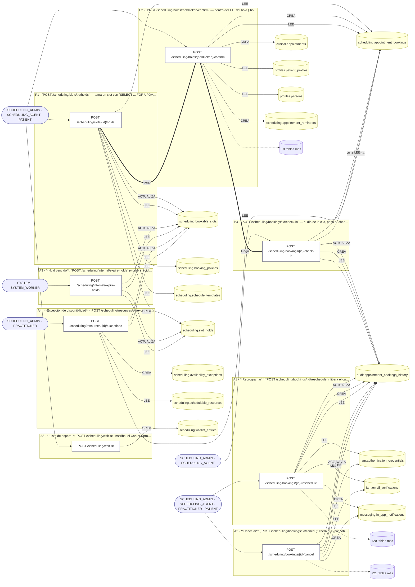

## Máquinas de estado

### Máquina de estados `BOOKING_TRANSITIONS`

Declarada en `src/modules/scheduling/state/booking-state-machine.ts:33`. Los estados llevan el nombre del identificador del código; no se resuelven al catálogo de conceptos.

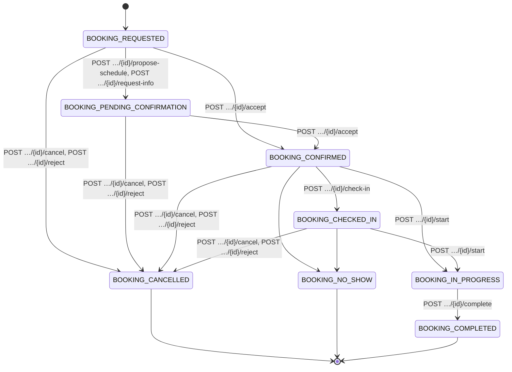

**Operaciones que ejercen esta máquina** _(POR_REFERENCIA: el handler alcanza un método que valida contra la tabla; «sin destino nombrado» significa que el estado de destino llega por el cuerpo de la petición)_:

| Operación | Estados de destino que nombra | A través de |
|---|---|---|
| POST /scheduling/bookings/{id}/accept | BOOKING_CONFIRMED | SchedulingBookingsService.accept → SchedulingBookingsService.assertTransition |
| POST /scheduling/bookings/{id}/cancel | BOOKING_CANCELLED | SchedulingBookingsService.cancelarYAvisar → SchedulingBookingsService.assertTransition |
| POST /scheduling/bookings/{id}/check-in | BOOKING_CHECKED_IN | SchedulingBookingsService.checkIn → SchedulingBookingsService.assertTransition |
| POST /scheduling/bookings/{id}/complete | BOOKING_COMPLETED | SchedulingBookingsService.complete → SchedulingBookingsService.assertTransition |
| POST /scheduling/bookings/{id}/propose-schedule | BOOKING_PENDING_CONFIRMATION | SchedulingBookingsService.proposeSchedule → SchedulingBookingsService.assertTransition |
| POST /scheduling/bookings/{id}/reject | BOOKING_CANCELLED | SchedulingBookingsService.cancelarYAvisar → SchedulingBookingsService.assertTransition |
| POST /scheduling/bookings/{id}/request-info | BOOKING_PENDING_CONFIRMATION | SchedulingBookingsService.requestInfo → SchedulingBookingsService.assertTransition |
| POST /scheduling/bookings/{id}/start | BOOKING_IN_PROGRESS | SchedulingBookingsService.start → SchedulingBookingsService.assertTransition |

## Árbol de decisión por operación

Cada árbol se deriva del código del handler y de los métodos que invoca (hasta 4 niveles). Una rama que no decide, no escribe y no falla se poda. Los accesos y los efectos consecutivos se agrupan en un solo nodo.

### Operaciones con decisiones propias

#### 1. POST /scheduling/appointments/direct

Asignar una cita puntual a un paciente (nace confirmada)

| HTTP | Código | Cuándo |
|---|---|---|
| 201 | — | Éxito |
| 400 | `VALIDATION_FAILED` | El cuerpo cumple el DTO (sin propiedades extra) |
| 401 | `UNAUTHENTICATED` | Hay una sesión válida (JWT) |
| 403 | `FORBIDDEN` | El rol está permitido; El tenant se resuelve y pertenece al actor; ForbiddenException: Un profesional solo puede asignar citas en su propia agenda. |
| 404 | `NOT_FOUND` | ResourceNotFoundException: Recurso no encontrado; ResourceNotFoundException: Paciente no encontrado |
| 422 | `PRECONDITION_FAILED` | PreconditionFailedException: Tu vínculo con esta organización todavía está pendiente de aprobación, así que todavía no podés comprometer turnos suyos. / Tu vínculo con esta organización ya…; PreconditionFailedException: El profesional ya tiene {quien} de {horaLocal( primero.startAt, p…} a {horaLocal( primero.endAt, pri…}{primero.resourceName ? ` en «…}. No puede estar en dos l…; PreconditionFailedException: El paciente ya tiene un turno confirmado en ese rato{choque.resourceName ? ` en «$…}. |
| 429 | `RATE_LIMITED` | No se supera el límite de solicitudes |
| 500 | `INTERNAL` | Error: Entidad de historial no registrada: {entity} |

```mermaid
flowchart TD
  n1(("Solicitud")):::inicio
  n2{{"Acceso: sesión (401) · rol (403) · tenant (403) · cuerpo válido (400) · límite de tasa (429)"}}:::acceso
  n1 --> n2
  n3["Llama a SchedulingBookingsService.createDirectAppointment"]:::llamada
  n2 --> n3
  n4["Transacción: transactional(…)"]:::transaccion
  n3 --> n4
  n5["Llama a SchedulingCatalogRepository.findResourceById"]:::llamada
  n4 --> n5
  n6[("LEE scheduling.schedulable_resources")]:::efecto
  n5 --> n6
  n7{"!resource"}:::decision
  n6 --> n7
  n8(["404 NOT_FOUND Recurso no encontrado"]):::error
  n7 -->|"sí"| n8
  n9{"!this.operaCualquierAgenda(actor) && !esSuAgenda"}:::decision
  n7 -->|"no"| n9
  n10(["403 FORBIDDEN Un profesional solo puede asignar citas en su propia agenda."]):::error
  n9 -->|"sí"| n10
  n11["Llama a SchedulingBookingsService.assertVinculoVigente"]:::llamada
  n9 -->|"no"| n11
  n12["Llama a PractitionerAffiliationGateService.evaluar"]:::llamada
  n11 --> n12
  n13[("LEE profiles.practitioner_affiliations")]:::efecto
  n12 --> n13
  n14["Llama a PractitionerAffiliationGateService.tenantDeCadaSede"]:::llamada
  n13 --> n14
  n15[("LEE practice.practice_sites · LEE practice.practices")]:::efecto
  n14 --> n15
  n16(["422 PRECONDITION_FAILED Tu vínculo con esta organización todavía está pendiente de aprobación, así que todaví…"]):::error
  n15 --> n16
  n17["Llama a SchedulingBookingsRepository.findPatientNames"]:::llamada
  n18[("LEE profiles.patient_profiles · LEE profiles.persons")]:::efecto
  n17 --> n18
  n19{"!nombres.has(dto.patientProfileId)"}:::decision
  n18 --> n19
  n20(["404 NOT_FOUND Paciente no encontrado"]):::error
  n19 -->|"sí"| n20
  n21{"TABLAS_DE_PERFIL_PROFESIONAL.includes(resource.resourceRefType)"}:::decision
  n19 -->|"no"| n21
  n22["Llama a SchedulingProfessionalTimeService.assertRangoLibre"]:::llamada
  n21 -->|"sí"| n22
  n23{"primero.kind === 'ocupado'"}:::decision
  n22 --> n23
  n24{"primero.patientProfileId"}:::decision
  n23 -->|"no"| n24
  n25["Llama a SchedulingBookingsRepository.findPatientNames"]:::llamada
  n24 -->|"sí"| n25
  n26[("LEE profiles.patient_profiles · LEE profiles.persons")]:::efecto
  n25 --> n26
  n27(["422 PRECONDITION_FAILED El profesional ya tiene {quien} de {horaLocal( primero.startAt, p…} a {horaLocal( pri…"]):::error
  n23 -->|"sí"| n27
  n26 --> n27
  n24 -->|"no"| n27
  n28["Llama a SchedulingBookingsRepository.findPatientBookingsOverlapping"]:::llamada
  n21 -->|"no"| n28
  n29[("LEE scheduling.appointment_bookings · LEE scheduling.bookable_slots · LEE scheduling.schedulable_resources")]:::efecto
  n28 --> n29
  n30{"yaComprometido.length › 0"}:::decision
  n29 --> n30
  n31(["422 PRECONDITION_FAILED El paciente ya tiene un turno confirmado en ese rato{choque.resourceName ? ` en «$…}."]):::error
  n30 -->|"sí"| n31
  n32{"TABLAS_DE_PERFIL_PROFESIONAL.includes(resource.resourceRefType)"}:::decision
  n30 -->|"no"| n32
  n33["Llama a SchedulingCatalogRepository.findOpenSlotsOfProfessionalInWindow"]:::llamada
  n32 -->|"sí"| n33
  n34[("LEE scheduling.schedulable_resources · LEE scheduling.bookable_slots")]:::efecto
  n33 --> n34
  n35["Repite: por cada const libre de libres"]:::bucle
  n34 --> n35
  n36[("ACTUALIZA scheduling.bookable_slots")]:::efecto
  n35 -->|"cada elemento"| n36
  n37["Llama a SchedulingCatalogRepository.createSlot"]:::llamada
  n36 --> n37
  n35 -->|"al terminar"| n37
  n32 -->|"no"| n37
  n38[("CREA scheduling.bookable_slots")]:::efecto
  n37 --> n38
  n39["Llama a SchedulingBookingsService.crearCitaClinica"]:::llamada
  n38 --> n39
  n40["Llama a AppointmentsRepository.create"]:::llamada
  n39 --> n40
  n41[("CREA clinical.appointments")]:::efecto
  n40 --> n41
  n42["Llama a SchedulingBookingsRepository.createBooking"]:::llamada
  n41 --> n42
  n43[("CREA scheduling.appointment_bookings")]:::efecto
  n42 --> n43
  n44["Repite: por cada const offset de DEFAULT_REMINDER_OFFSETS"]:::bucle
  n43 --> n44
  n45["Llama a SchedulingBookingsRepository.createReminder"]:::llamada
  n44 -->|"cada elemento"| n45
  n46[("CREA scheduling.appointment_reminders")]:::efecto
  n45 --> n46
  n47["Llama a SchedulingBookingsService.recordTransition"]:::llamada
  n46 --> n47
  n44 -->|"al terminar"| n47
  n48["Llama a HistoryRepository.append"]:::llamada
  n47 --> n48
  n49{"!binding"}:::decision
  n48 --> n49
  n50(["500 INTERNAL Entidad de historial no registrada: {entity}"]):::error
  n49 -->|"sí"| n50
  n51[("LEE audit.appointment_bookings_history · ACTUALIZA audit.appointment_bookings_history · CREA audit.appointmen…")]:::efecto
  n49 -->|"no"| n51
  n52["Llama a SchedulingBookingsService.avisarCambio"]:::llamada
  n51 --> n52
  n53["Llama a SchedulingNoticeRepository.describeBooking"]:::llamada
  n52 --> n53
  n54[("LEE scheduling.appointment_bookings · LEE scheduling.bookable_slots")]:::efecto
  n53 --> n54
  n55["Llama a SchedulingNoticeRepository.describeResource"]:::llamada
  n54 --> n55
  n56[("LEE scheduling.schedulable_resources")]:::efecto
  n55 --> n56
  n57["Llama a SchedulingNoticeRepository.describeSite"]:::llamada
  n56 --> n57
  n58[("LEE scheduling.schedulable_resources · LEE practice.practices")]:::efecto
  n57 --> n58
  n59["Llama a SchedulingNoticeRepository.findResourceAccount"]:::llamada
  n58 --> n59
  n60[("LEE scheduling.schedulable_resources")]:::efecto
  n59 --> n60
  n61["Llama a SchedulingNoticeRepository.findAccountForProfile"]:::llamada
  n60 --> n61
  n62[("LEE profiles.person_account_links")]:::efecto
  n61 --> n62
  n63(("201 Responde con éxito")):::ok
  n62 --> n63
  classDef acceso fill:#eef,stroke:#66a
  classDef error fill:#fee,stroke:#c33
  classDef ok fill:#efe,stroke:#3a3
  classDef efecto fill:#ffd,stroke:#aa3
  classDef decision fill:#fff,stroke:#555
  classDef corte fill:#eee,stroke:#999,stroke-dasharray: 4
```

#### 2. POST /scheduling/booking-policies

Definir una política de reserva

| HTTP | Código | Cuándo |
|---|---|---|
| 201 | — | Éxito |
| 400 | `VALIDATION_FAILED` | El cuerpo cumple el DTO (sin propiedades extra) |
| 401 | `UNAUTHENTICATED` | Hay una sesión válida (JWT) |
| 403 | `FORBIDDEN` | El rol está permitido; El tenant se resuelve y pertenece al actor; ForbiddenException: El tenant indicado no es uno de los del actor. |
| 409 | `CONFLICT` | ConflictException: Ya existe una política con ese código |
| 429 | `RATE_LIMITED` | No se supera el límite de solicitudes |

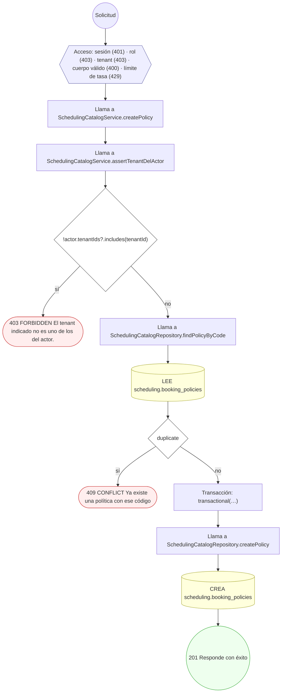

#### 3. GET /scheduling/bookings

UC-41-15: lista citas por paciente, recurso y/o ventana

| HTTP | Código | Cuándo |
|---|---|---|
| 200 | — | Éxito |
| 401 | `UNAUTHENTICATED` | Hay una sesión válida (JWT) |
| 403 | `FORBIDDEN` | El rol está permitido; El tenant se resuelve y pertenece al actor |
| 422 | `PRECONDITION_FAILED` | PreconditionFailedException: Indique al menos patientProfileId o resourceId para listar citas; PreconditionFailedException: La ventana debe empezar antes de terminar |
| 429 | `RATE_LIMITED` | No se supera el límite de solicitudes |

```mermaid
flowchart TD
  n1(("Solicitud")):::inicio
  n2{{"Acceso: sesión (401) · rol (403) · tenant (403) · límite de tasa (429)"}}:::acceso
  n1 --> n2
  n3["Llama a SchedulingBookingsService.searchBookings"]:::llamada
  n2 --> n3
  n4{"!filters.patientProfileId && !filters.resourceId"}:::decision
  n3 --> n4
  n5(["422 PRECONDITION_FAILED Indique al menos patientProfileId o resourceId para listar citas"]):::error
  n4 -->|"sí"| n5
  n6{"filters.from && filters.to && !(filters.from ‹ filters.to)"}:::decision
  n4 -->|"no"| n6
  n7(["422 PRECONDITION_FAILED La ventana debe empezar antes de terminar"]):::error
  n6 -->|"sí"| n7
  n8["Llama a SchedulingBookingsRepository.findBookings"]:::llamada
  n6 -->|"no"| n8
  n9[("LEE scheduling.appointment_bookings · LEE scheduling.bookable_slots")]:::efecto
  n8 --> n9
  n10[("LEE audit.appointment_bookings_history · LEE audit.appointment_bookings_history")]:::efecto
  n9 --> n10
  n11["Llama a SchedulingBookingsRepository.latestRescheduleOrigins"]:::llamada
  n10 --> n11
  n12[("LEE scheduling.booking_reschedules · LEE scheduling.bookable_slots")]:::efecto
  n11 --> n12
  n13{"actor?.practitionerProfileId !== undefined"}:::decision
  n12 --> n13
  n14["Repite: por cada const id de ids"]:::bucle
  n13 -->|"sí"| n14
  n15["Llama a SchedulingCatalogRepository.findResourceById"]:::llamada
  n14 -->|"cada elemento"| n15
  n16[("LEE scheduling.schedulable_resources")]:::efecto
  n15 --> n16
  n17["Llama a AppointmentsRepository.findTypesByIds"]:::llamada
  n16 --> n17
  n14 -->|"al terminar"| n17
  n13 -->|"no"| n17
  n18[("LEE clinical.appointments")]:::efecto
  n17 --> n18
  n19["Llama a SchedulingBookingsRepository.findPatientNames"]:::llamada
  n18 --> n19
  n20[("LEE profiles.patient_profiles · LEE profiles.persons")]:::efecto
  n19 --> n20
  n21["Llama a SchedulingBookingsRepository.findPaymentStatesForBookings"]:::llamada
  n20 --> n21
  n22[("LEE scheduling.appointment_payment_states")]:::efecto
  n21 --> n22
  n23(("200 Responde con éxito")):::ok
  n22 --> n23
  classDef acceso fill:#eef,stroke:#66a
  classDef error fill:#fee,stroke:#c33
  classDef ok fill:#efe,stroke:#3a3
  classDef efecto fill:#ffd,stroke:#aa3
  classDef decision fill:#fff,stroke:#555
  classDef corte fill:#eee,stroke:#999,stroke-dasharray: 4
```

#### 4. GET /scheduling/bookings/{id}

UC-41-15: consulta una cita

| HTTP | Código | Cuándo |
|---|---|---|
| 200 | — | Éxito |
| 400 | `VALIDATION_FAILED` | Los parámetros de ruta son UUID válidos |
| 401 | `UNAUTHENTICATED` | Hay una sesión válida (JWT) |
| 403 | `FORBIDDEN` | El rol está permitido; El tenant se resuelve y pertenece al actor |
| 404 | `NOT_FOUND` | ResourceNotFoundException: Cita no encontrada |
| 429 | `RATE_LIMITED` | No se supera el límite de solicitudes |

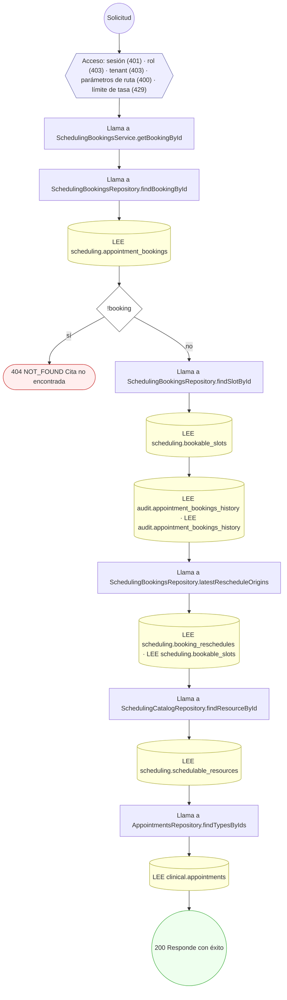

#### 5. POST /scheduling/bookings/{id}/accept

Aceptar la solicitud de cita

| HTTP | Código | Cuándo |
|---|---|---|
| 200 | — | Éxito |
| 400 | `VALIDATION_FAILED` | Los parámetros de ruta son UUID válidos; El cuerpo cumple el DTO (sin propiedades extra) |
| 401 | `UNAUTHENTICATED` | Hay una sesión válida (JWT) |
| 403 | `FORBIDDEN` | El rol está permitido; El tenant se resuelve y pertenece al actor; ForbiddenException: Esta cita es de otra agenda: solo la opera quien atiende en ella. |
| 404 | `NOT_FOUND` | ResourceNotFoundException: Cita no encontrada |
| 422 | `PRECONDITION_FAILED` | PreconditionFailedException: Tu vínculo con esta organización todavía está pendiente de aprobación, así que todavía no podés comprometer turnos suyos. / Tu vínculo con esta organización ya…; PreconditionFailedException: Transición de estado de cita no permitida; PreconditionFailedException: El profesional ya tiene {quien} de {horaLocal( primero.startAt, p…} a {horaLocal( primero.endAt, pri…}{primero.resourceName ? ` en «…}. No puede estar en dos l… |
| 429 | `RATE_LIMITED` | No se supera el límite de solicitudes |
| 500 | `INTERNAL` | Error: Entidad de historial no registrada: {entity} |

```mermaid
flowchart TD
  n1(("Solicitud")):::inicio
  n2{{"Acceso: sesión (401) · rol (403) · tenant (403) · parámetros de ruta (400) · cuerpo válido (400) · límite de…"}}:::acceso
  n1 --> n2
  n3["Llama a SchedulingBookingsService.accept"]:::llamada
  n2 --> n3
  n4["Transacción: transactional(…)"]:::transaccion
  n3 --> n4
  n5["Llama a SchedulingBookingsService.cargarParaOperar"]:::llamada
  n4 --> n5
  n6["Llama a SchedulingBookingsRepository.findBookingByIdForUpdate"]:::llamada
  n5 --> n6
  n7[("LEE scheduling.appointment_bookings")]:::efecto
  n6 --> n7
  n8{"!booking"}:::decision
  n7 --> n8
  n9(["404 NOT_FOUND Cita no encontrada"]):::error
  n8 -->|"sí"| n9
  n10["Llama a SchedulingCatalogRepository.findResourceById"]:::llamada
  n8 -->|"no"| n10
  n11[("LEE scheduling.schedulable_resources")]:::efecto
  n10 --> n11
  n12{"!esSuAgenda"}:::decision
  n11 --> n12
  n13(["403 FORBIDDEN Esta cita es de otra agenda: solo la opera quien atiende en ella."]):::error
  n12 -->|"sí"| n13
  n14["Llama a SchedulingBookingsService.assertVinculoVigente"]:::llamada
  n12 -->|"no"| n14
  n15["Llama a PractitionerAffiliationGateService.evaluar"]:::llamada
  n14 --> n15
  n16[("LEE profiles.practitioner_affiliations")]:::efecto
  n15 --> n16
  n17["Llama a PractitionerAffiliationGateService.tenantDeCadaSede"]:::llamada
  n16 --> n17
  n18[("LEE practice.practice_sites · LEE practice.practices")]:::efecto
  n17 --> n18
  n19(["422 PRECONDITION_FAILED Tu vínculo con esta organización todavía está pendiente de aprobación, así que todaví…"]):::error
  n18 --> n19
  n20["Llama a SchedulingBookingsService.assertTransition"]:::llamada
  n21{"!isValidBookingTransition(from, to)"}:::decision
  n20 --> n21
  n22(["422 PRECONDITION_FAILED Transición de estado de cita no permitida"]):::error
  n21 -->|"sí"| n22
  n23["Llama a SchedulingCatalogRepository.findResourceById"]:::llamada
  n21 -->|"no"| n23
  n24[("LEE scheduling.schedulable_resources")]:::efecto
  n23 --> n24
  n25{"recursoDeLaCita && TABLAS_DE_PERFIL_PROFESIONAL.includes(recursoDeLaCita.resourceRefType)"}:::decision
  n24 --> n25
  n26["Llama a SchedulingBookingsRepository.findSlotById"]:::llamada
  n25 -->|"sí"| n26
  n27[("LEE scheduling.bookable_slots")]:::efecto
  n26 --> n27
  n28{"slotDeLaCita"}:::decision
  n27 --> n28
  n29["Llama a SchedulingProfessionalTimeService.assertRangoLibre"]:::llamada
  n28 -->|"sí"| n29
  n30{"primero.kind === 'ocupado'"}:::decision
  n29 --> n30
  n31{"primero.patientProfileId"}:::decision
  n30 -->|"no"| n31
  n32["Llama a SchedulingBookingsRepository.findPatientNames"]:::llamada
  n31 -->|"sí"| n32
  n33[("LEE profiles.patient_profiles · LEE profiles.persons")]:::efecto
  n32 --> n33
  n34(["422 PRECONDITION_FAILED El profesional ya tiene {quien} de {horaLocal( primero.startAt, p…} a {horaLocal( pri…"]):::error
  n30 -->|"sí"| n34
  n33 --> n34
  n31 -->|"no"| n34
  n35[("ACTUALIZA scheduling.appointment_bookings · ACTUALIZA scheduling.appointment_bookings")]:::efecto
  n28 -->|"no"| n35
  n25 -->|"no"| n35
  n36["Llama a SchedulingBookingsService.sincronizarCitaClinica"]:::llamada
  n35 --> n36
  n37["Llama a AppointmentsRepository.findById"]:::llamada
  n36 --> n37
  n38[("LEE clinical.appointments")]:::efecto
  n37 --> n38
  n39[("ACTUALIZA clinical.appointments")]:::efecto
  n38 --> n39
  n40["Llama a SchedulingBookingsService.recordTransition"]:::llamada
  n39 --> n40
  n41["Llama a HistoryRepository.append"]:::llamada
  n40 --> n41
  n42{"!binding"}:::decision
  n41 --> n42
  n43(["500 INTERNAL Entidad de historial no registrada: {entity}"]):::error
  n42 -->|"sí"| n43
  n44[("LEE audit.appointment_bookings_history · ACTUALIZA audit.appointment_bookings_history · CREA audit.appointmen…")]:::efecto
  n42 -->|"no"| n44
  n45["Llama a SchedulingBookingsRepository.findSlotById"]:::llamada
  n44 --> n45
  n46[("LEE scheduling.bookable_slots")]:::efecto
  n45 --> n46
  n47["Repite: por cada const offset de offsets"]:::bucle
  n46 --> n47
  n48["Llama a SchedulingBookingsRepository.createReminder"]:::llamada
  n47 -->|"cada elemento"| n48
  n49[("CREA scheduling.appointment_reminders")]:::efecto
  n48 --> n49
  n50["Llama a SchedulingBookingsService.cancelarPendientesQueChocan"]:::llamada
  n49 --> n50
  n47 -->|"al terminar"| n50
  n51["Llama a SchedulingBookingsRepository.findSlotById"]:::llamada
  n50 --> n51
  n52[("LEE scheduling.bookable_slots")]:::efecto
  n51 --> n52
  n53["Llama a SchedulingBookingsRepository.findPatientBookingsOverlapping"]:::llamada
  n52 --> n53
  n54[("LEE scheduling.appointment_bookings · LEE scheduling.bookable_slots · LEE scheduling.schedulable_resources")]:::efecto
  n53 --> n54
  n55["Repite: por cada const otra de chocan"]:::bucle
  n54 --> n55
  n56["Llama a SchedulingBookingsRepository.findBookingByIdForUpdate"]:::llamada
  n55 -->|"cada elemento"| n56
  n57[("LEE scheduling.appointment_bookings")]:::efecto
  n56 --> n57
  n58["Llama a SchedulingBookingsRepository.createCancellation"]:::llamada
  n57 --> n58
  n59[("CREA scheduling.booking_cancellations")]:::efecto
  n58 --> n59
  n60[("ACTUALIZA scheduling.appointment_bookings")]:::efecto
  n59 --> n60
  n61["Llama a SchedulingBookingsService.recordTransition"]:::llamada
  n60 --> n61
  n62["Llama a HistoryRepository.append"]:::llamada
  n61 --> n62
  n63{"!binding"}:::decision
  n62 --> n63
  n64(["500 INTERNAL Entidad de historial no registrada: {entity}"]):::error
  n63 -->|"sí"| n64
  n65[("LEE audit.appointment_bookings_history · ACTUALIZA audit.appointment_bookings_history · CREA audit.appointmen…")]:::efecto
  n63 -->|"no"| n65
  n66["Llama a SchedulingBookingsRepository.findSlotForUpdate"]:::llamada
  n65 --> n66
  n67[("LEE scheduling.bookable_slots")]:::efecto
  n66 --> n67
  n68{"suSlot"}:::decision
  n67 --> n68
  n69[("ACTUALIZA scheduling.bookable_slots")]:::efecto
  n68 -->|"sí"| n69
  n70{"suSlot.statusConceptId === CONCEPTS.SLOT_HELD"}:::decision
  n69 --> n70
  n71["… el resto del árbol (1 nodos) está en el JSON del inventario"]:::corte
  n70 -->|"sí"| n71
  classDef acceso fill:#eef,stroke:#66a
  classDef error fill:#fee,stroke:#c33
  classDef ok fill:#efe,stroke:#3a3
  classDef efecto fill:#ffd,stroke:#aa3
  classDef decision fill:#fff,stroke:#555
  classDef corte fill:#eee,stroke:#999,stroke-dasharray: 4
```

#### 6. POST /scheduling/bookings/{id}/cancel

Cancelar la cita y liberar el cupo

| HTTP | Código | Cuándo |
|---|---|---|
| 200 | — | Éxito |
| 400 | `VALIDATION_FAILED` | Los parámetros de ruta son UUID válidos; El cuerpo cumple el DTO (sin propiedades extra) |
| 401 | `UNAUTHENTICATED` | Hay una sesión válida (JWT) |
| 403 | `FORBIDDEN` | El rol está permitido; El tenant se resuelve y pertenece al actor |
| 404 | `NOT_FOUND` | ResourceNotFoundException: Cita no encontrada |
| 409 | `CONFLICT` | ConflictException: La cita ya está cancelada |
| 422 | `PRECONDITION_FAILED` | PreconditionFailedException: Transición de estado de cita no permitida; PreconditionFailedException: Podés cancelar hasta {Math.round(windowMinutes / 60)} horas antes del turno. Si ya no podés asistir, comunicate con el consultorio. |
| 429 | `RATE_LIMITED` | No se supera el límite de solicitudes |
| 500 | `INTERNAL` | Error: Entidad de historial no registrada: {entity} |

```mermaid
flowchart TD
  n1(("Solicitud")):::inicio
  n2{{"Acceso: sesión (401) · rol (403) · tenant (403) · parámetros de ruta (400) · cuerpo válido (400) · límite de…"}}:::acceso
  n1 --> n2
  n3["Llama a SchedulingBookingsService.cancel"]:::llamada
  n2 --> n3
  n4["Llama a SchedulingBookingsService.cancelarYAvisar"]:::llamada
  n3 --> n4
  n5["Transacción: transactional(…)"]:::transaccion
  n4 --> n5
  n6["Llama a SchedulingBookingsRepository.findBookingByIdForUpdate"]:::llamada
  n5 --> n6
  n7[("LEE scheduling.appointment_bookings")]:::efecto
  n6 --> n7
  n8{"!booking"}:::decision
  n7 --> n8
  n9(["404 NOT_FOUND Cita no encontrada"]):::error
  n8 -->|"sí"| n9
  n10{"booking.statusConceptId === CONCEPTS.BOOKING_CANCELLED"}:::decision
  n8 -->|"no"| n10
  n11(["409 CONFLICT La cita ya está cancelada"]):::error
  n10 -->|"sí"| n11
  n12["Llama a SchedulingBookingsService.assertTransition"]:::llamada
  n10 -->|"no"| n12
  n13{"!isValidBookingTransition(from, to)"}:::decision
  n12 --> n13
  n14(["422 PRECONDITION_FAILED Transición de estado de cita no permitida"]):::error
  n13 -->|"sí"| n14
  n15{"feeSource === undefined && !snapshot && booking.bookingPolicyId"}:::decision
  n13 -->|"no"| n15
  n16["Llama a SchedulingCatalogRepository.findPolicyById"]:::llamada
  n15 -->|"sí"| n16
  n17[("LEE scheduling.booking_policies")]:::efecto
  n16 --> n17
  n18["Llama a SchedulingBookingsRepository.findSlotForUpdate"]:::llamada
  n17 --> n18
  n15 -->|"no"| n18
  n19[("LEE scheduling.bookable_slots")]:::efecto
  n18 --> n19
  n20{"esElPacienteTitular && withinWindow && !isNoShow"}:::decision
  n19 --> n20
  n21(["422 PRECONDITION_FAILED Podés cancelar hasta {Math.round(windowMinutes / 60)} horas antes del turno. Si ya no…"]):::error
  n20 -->|"sí"| n21
  n22["Llama a SchedulingBookingsRepository.createCancellation"]:::llamada
  n20 -->|"no"| n22
  n23[("CREA scheduling.booking_cancellations")]:::efecto
  n22 --> n23
  n24[("ACTUALIZA scheduling.appointment_bookings")]:::efecto
  n23 --> n24
  n25["Llama a SchedulingBookingsService.recordTransition"]:::llamada
  n24 --> n25
  n26["Llama a HistoryRepository.append"]:::llamada
  n25 --> n26
  n27{"!binding"}:::decision
  n26 --> n27
  n28(["500 INTERNAL Entidad de historial no registrada: {entity}"]):::error
  n27 -->|"sí"| n28
  n29[("LEE audit.appointment_bookings_history · ACTUALIZA audit.appointment_bookings_history · CREA audit.appointmen…")]:::efecto
  n27 -->|"no"| n29
  n30{"slot"}:::decision
  n29 --> n30
  n31[("ACTUALIZA scheduling.bookable_slots")]:::efecto
  n30 -->|"sí"| n31
  n32{"slot.scheduleTemplateId === undefined || slot.scheduleTemplateId === null"}:::decision
  n31 --> n32
  n33[("ACTUALIZA scheduling.bookable_slots")]:::efecto
  n32 -->|"sí"| n33
  n34{"slot.statusConceptId !== CONCEPTS.SLOT_BLOCKED"}:::decision
  n32 -->|"no"| n34
  n35[("ACTUALIZA scheduling.bookable_slots")]:::efecto
  n34 -->|"sí"| n35
  n36["Llama a SchedulingBookingsService.avisarCambio"]:::llamada
  n33 --> n36
  n35 --> n36
  n34 -->|"no"| n36
  n30 -->|"no"| n36
  n37["Llama a SchedulingNoticeRepository.describeBooking"]:::llamada
  n36 --> n37
  n38[("LEE scheduling.appointment_bookings · LEE scheduling.bookable_slots")]:::efecto
  n37 --> n38
  n39["Llama a SchedulingNoticeRepository.findResourceAccount"]:::llamada
  n38 --> n39
  n40[("LEE scheduling.schedulable_resources")]:::efecto
  n39 --> n40
  n41(("200 Responde con éxito")):::ok
  n40 --> n41
  classDef acceso fill:#eef,stroke:#66a
  classDef error fill:#fee,stroke:#c33
  classDef ok fill:#efe,stroke:#3a3
  classDef efecto fill:#ffd,stroke:#aa3
  classDef decision fill:#fff,stroke:#555
  classDef corte fill:#eee,stroke:#999,stroke-dasharray: 4
```

#### 7. POST /scheduling/bookings/{id}/check-in

Registrar la llegada del paciente

| HTTP | Código | Cuándo |
|---|---|---|
| 200 | — | Éxito |
| 400 | `VALIDATION_FAILED` | Los parámetros de ruta son UUID válidos |
| 401 | `UNAUTHENTICATED` | Hay una sesión válida (JWT) |
| 403 | `FORBIDDEN` | El rol está permitido; El tenant se resuelve y pertenece al actor |
| 404 | `NOT_FOUND` | ResourceNotFoundException: Cita no encontrada |
| 422 | `PRECONDITION_FAILED` | PreconditionFailedException: Transición de estado de cita no permitida |
| 429 | `RATE_LIMITED` | No se supera el límite de solicitudes |
| 500 | `INTERNAL` | Error: Entidad de historial no registrada: {entity} |

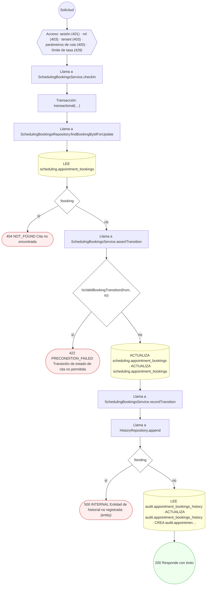

#### 8. POST /scheduling/bookings/{id}/complete

Completar la atención

| HTTP | Código | Cuándo |
|---|---|---|
| 200 | — | Éxito |
| 400 | `VALIDATION_FAILED` | Los parámetros de ruta son UUID válidos |
| 401 | `UNAUTHENTICATED` | Hay una sesión válida (JWT) |
| 403 | `FORBIDDEN` | El rol está permitido; El tenant se resuelve y pertenece al actor; ForbiddenException: Esta cita es de otra agenda: solo la opera quien atiende en ella. |
| 404 | `NOT_FOUND` | ResourceNotFoundException: Cita no encontrada |
| 422 | `PRECONDITION_FAILED` | PreconditionFailedException: Transición de estado de cita no permitida |
| 429 | `RATE_LIMITED` | No se supera el límite de solicitudes |
| 500 | `INTERNAL` | Error: Entidad de historial no registrada: {entity} |

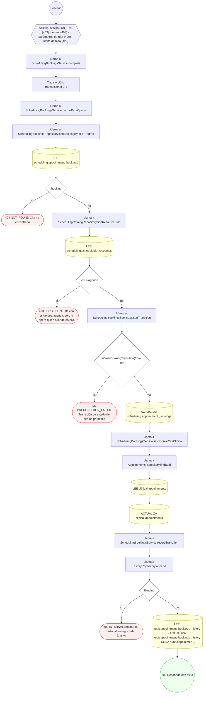

#### 9. POST /scheduling/bookings/{id}/delay

Informar una demora sobre una cita

| HTTP | Código | Cuándo |
|---|---|---|
| 200 | — | Éxito |
| 400 | `VALIDATION_FAILED` | Los parámetros de ruta son UUID válidos; El cuerpo cumple el DTO (sin propiedades extra) |
| 401 | `UNAUTHENTICATED` | Hay una sesión válida (JWT) |
| 403 | `FORBIDDEN` | El rol está permitido; El tenant se resuelve y pertenece al actor; ForbiddenException: Esta agenda es de otro profesional: sólo avisa su demora quien atiende en ella. |
| 404 | `NOT_FOUND` | ResourceNotFoundException: Cita no encontrada |
| 422 | `PRECONDITION_FAILED` | PreconditionFailedException: Una demora mayor a cuatro horas se resuelve reprogramando el turno, no avisando |
| 429 | `RATE_LIMITED` | No se supera el límite de solicitudes |
| 500 | `INTERNAL` | Error: Entidad de historial no registrada: {entity} |

```mermaid
flowchart TD
  n1(("Solicitud")):::inicio
  n2{{"Acceso: sesión (401) · rol (403) · tenant (403) · parámetros de ruta (400) · cuerpo válido (400) · límite de…"}}:::acceso
  n1 --> n2
  n3["Llama a SchedulingDelayService.delayBooking"]:::llamada
  n2 --> n3
  n4["Llama a SchedulingDelayService.assertMinutos"]:::llamada
  n3 --> n4
  n5{"minutos › MAX_DELAY_MINUTES"}:::decision
  n4 --> n5
  n6(["422 PRECONDITION_FAILED Una demora mayor a cuatro horas se resuelve reprogramando el turno, no avisando"]):::error
  n5 -->|"sí"| n6
  n7["Llama a SchedulingNoticeRepository.describeBooking"]:::llamada
  n5 -->|"no"| n7
  n8[("LEE scheduling.appointment_bookings · LEE scheduling.bookable_slots")]:::efecto
  n7 --> n8
  n9["Llama a SchedulingNoticeRepository.describeResource"]:::llamada
  n8 --> n9
  n10[("LEE scheduling.schedulable_resources")]:::efecto
  n9 --> n10
  n11{"TABLAS_DE_PERFIL_PROFESIONAL.includes(resource.resourceRefType)"}:::decision
  n10 --> n11
  n12["Llama a SchedulingNoticeRepository.findDisplayNameForProfile"]:::llamada
  n11 -->|"sí"| n12
  n13[("LEE profiles.persons")]:::efecto
  n12 --> n13
  n14["Llama a SchedulingNoticeRepository.describeSite"]:::llamada
  n13 --> n14
  n11 -->|"no"| n14
  n15[("LEE scheduling.schedulable_resources · LEE practice.practices")]:::efecto
  n14 --> n15
  n16{"!booking"}:::decision
  n15 --> n16
  n17(["404 NOT_FOUND Cita no encontrada"]):::error
  n16 -->|"sí"| n17
  n18["Llama a SchedulingDelayService.assertOperaLaAgenda"]:::llamada
  n16 -->|"no"| n18
  n19["Llama a SchedulingCatalogRepository.findResourceById"]:::llamada
  n18 --> n19
  n20[("LEE scheduling.schedulable_resources")]:::efecto
  n19 --> n20
  n21{"!esSuAgenda"}:::decision
  n20 --> n21
  n22(["403 FORBIDDEN Esta agenda es de otro profesional: sólo avisa su demora quien atiende en ella."]):::error
  n21 -->|"sí"| n22
  n23["Llama a SchedulingDelayService.anotarDemora"]:::llamada
  n21 -->|"no"| n23
  n24["Transacción: transactional(…)"]:::transaccion
  n23 --> n24
  n25["Llama a HistoryRepository.append"]:::llamada
  n24 --> n25
  n26{"!binding"}:::decision
  n25 --> n26
  n27(["500 INTERNAL Entidad de historial no registrada: {entity}"]):::error
  n26 -->|"sí"| n27
  n28[("LEE audit.appointment_bookings_history · ACTUALIZA audit.appointment_bookings_history · CREA audit.appointmen…")]:::efecto
  n26 -->|"no"| n28
  n29(("200 Responde con éxito")):::ok
  n28 --> n29
  classDef acceso fill:#eef,stroke:#66a
  classDef error fill:#fee,stroke:#c33
  classDef ok fill:#efe,stroke:#3a3
  classDef efecto fill:#ffd,stroke:#aa3
  classDef decision fill:#fff,stroke:#555
  classDef corte fill:#eee,stroke:#999,stroke-dasharray: 4
```

#### 10. GET /scheduling/bookings/{id}/payment-state

Lee el estado de pago de la cita. Devuelve `null` cuando nadie lo marcó todavía, que **no** es lo mismo que «pendiente de pago»: pendiente es algo que alguien firmó.

| HTTP | Código | Cuándo |
|---|---|---|
| 200 | — | Éxito |
| 400 | `VALIDATION_FAILED` | Los parámetros de ruta son UUID válidos |
| 401 | `UNAUTHENTICATED` | Hay una sesión válida (JWT) |
| 403 | `FORBIDDEN` | El rol está permitido; El tenant se resuelve y pertenece al actor; ForbiddenException: Esta cita es de otra agenda: solo la opera quien atiende en ella. |
| 404 | `NOT_FOUND` | ResourceNotFoundException: Cita no encontrada |
| 429 | `RATE_LIMITED` | No se supera el límite de solicitudes |

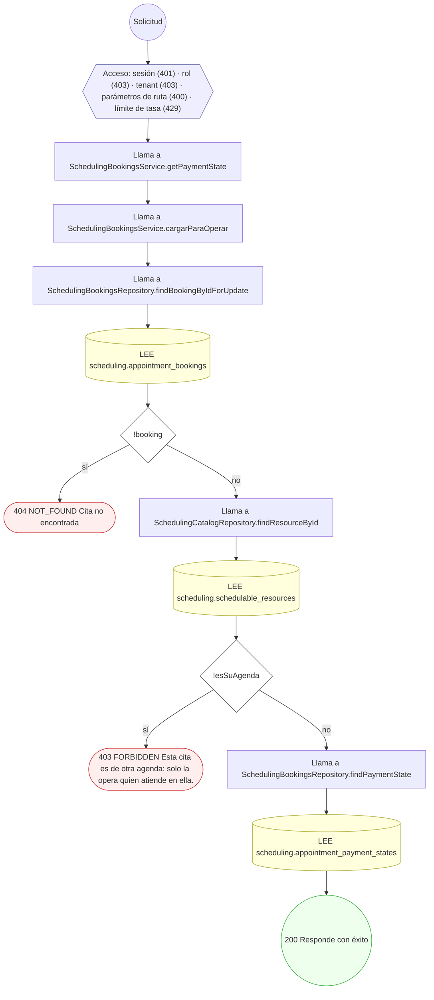

#### 11. PUT /scheduling/bookings/{id}/payment-state

Marca el estado de pago de la cita — TAREA-13, punto 5. `PUT` y no `POST` porque es **idempotente**: hay una fila por cita y volver a mandar el mismo estado deja exactamente el mismo resultado. Las otras operaciones de este controlador son `POST` porque cada una es un acto distinto —aceptar dos veces no es aceptar—; marcar un pago dos veces sí. Quién puede: los mismos que responden la solicitud. **El paciente no**: decir que una cita está pagada es una afirmación del prestador, y dejársela hacer a quien debe el dinero sería confiar en el campo equivocado.

| HTTP | Código | Cuándo |
|---|---|---|
| 200 | — | Éxito |
| 400 | `VALIDATION_FAILED` | Los parámetros de ruta son UUID válidos |
| 401 | `UNAUTHENTICATED` | Hay una sesión válida (JWT) |
| 403 | `FORBIDDEN` | El rol está permitido; El tenant se resuelve y pertenece al actor; ForbiddenException: Esta cita es de otra agenda: solo la opera quien atiende en ella. |
| 404 | `NOT_FOUND` | ResourceNotFoundException: Cita no encontrada |
| 422 | `PRECONDITION_FAILED` | PreconditionFailedException: Una cita cancelada o rechazada no lleva estado de pago: no hubo atención que cobrar. |
| 429 | `RATE_LIMITED` | No se supera el límite de solicitudes |
| 500 | `INTERNAL` | Error: Entidad de historial no registrada: {entity} |

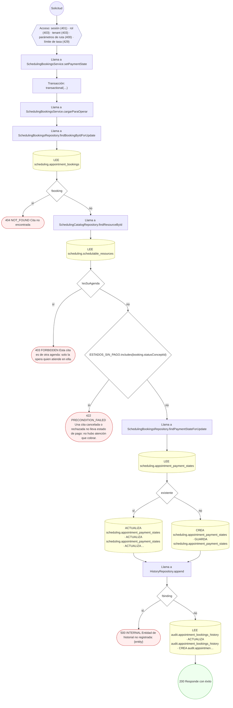

#### 12. POST /scheduling/bookings/{id}/propose-schedule

Proponer otro horario para la solicitud

| HTTP | Código | Cuándo |
|---|---|---|
| 200 | — | Éxito |
| 400 | `VALIDATION_FAILED` | Los parámetros de ruta son UUID válidos; El cuerpo cumple el DTO (sin propiedades extra) |
| 401 | `UNAUTHENTICATED` | Hay una sesión válida (JWT) |
| 403 | `FORBIDDEN` | El rol está permitido; El tenant se resuelve y pertenece al actor; ForbiddenException: Esta cita es de otra agenda: solo la opera quien atiende en ella. |
| 404 | `NOT_FOUND` | ResourceNotFoundException: Cita no encontrada; ResourceNotFoundException: Cupo propuesto no encontrado |
| 409 | `CONFLICT` | ConflictException: El cupo propuesto no tiene lugar |
| 422 | `PRECONDITION_FAILED` | PreconditionFailedException: Sólo se opera así sobre una solicitud pendiente; PreconditionFailedException: El horario propuesto es el que ya tiene la solicitud; PreconditionFailedException: Transición de estado de cita no permitida |
| 429 | `RATE_LIMITED` | No se supera el límite de solicitudes |
| 500 | `INTERNAL` | Error: Entidad de historial no registrada: {entity} |

```mermaid
flowchart TD
  n1(("Solicitud")):::inicio
  n2{{"Acceso: sesión (401) · rol (403) · tenant (403) · parámetros de ruta (400) · cuerpo válido (400) · límite de…"}}:::acceso
  n1 --> n2
  n3["Llama a SchedulingBookingsService.proposeSchedule"]:::llamada
  n2 --> n3
  n4["Transacción: transactional(…)"]:::transaccion
  n3 --> n4
  n5["Llama a SchedulingBookingsService.cargarParaOperar"]:::llamada
  n4 --> n5
  n6["Llama a SchedulingBookingsRepository.findBookingByIdForUpdate"]:::llamada
  n5 --> n6
  n7[("LEE scheduling.appointment_bookings")]:::efecto
  n6 --> n7
  n8{"!booking"}:::decision
  n7 --> n8
  n9(["404 NOT_FOUND Cita no encontrada"]):::error
  n8 -->|"sí"| n9
  n10["Llama a SchedulingCatalogRepository.findResourceById"]:::llamada
  n8 -->|"no"| n10
  n11[("LEE scheduling.schedulable_resources")]:::efecto
  n10 --> n11
  n12{"!esSuAgenda"}:::decision
  n11 --> n12
  n13(["403 FORBIDDEN Esta cita es de otra agenda: solo la opera quien atiende en ella."]):::error
  n12 -->|"sí"| n13
  n14["Llama a SchedulingBookingsService.asegurarPendiente"]:::llamada
  n12 -->|"no"| n14
  n15{"!PENDING_DECISION_STATES.includes(fromState)"}:::decision
  n14 --> n15
  n16(["422 PRECONDITION_FAILED Sólo se opera así sobre una solicitud pendiente"]):::error
  n15 -->|"sí"| n16
  n17{"dto.proposedSlotId === origenId"}:::decision
  n15 -->|"no"| n17
  n18(["422 PRECONDITION_FAILED El horario propuesto es el que ya tiene la solicitud"]):::error
  n17 -->|"sí"| n18
  n19["Llama a SchedulingBookingsRepository.findSlotForUpdate"]:::llamada
  n17 -->|"no"| n19
  n20[("LEE scheduling.bookable_slots")]:::efecto
  n19 --> n20
  n21{"!destino"}:::decision
  n20 --> n21
  n22(["404 NOT_FOUND Cupo propuesto no encontrado"]):::error
  n21 -->|"sí"| n22
  n23{"destino.remainingCapacity ‹= 0"}:::decision
  n21 -->|"no"| n23
  n24(["409 CONFLICT El cupo propuesto no tiene lugar"]):::error
  n23 -->|"sí"| n24
  n25["Llama a SchedulingBookingsRepository.findSlotForUpdate"]:::llamada
  n23 -->|"no"| n25
  n26[("LEE scheduling.bookable_slots")]:::efecto
  n25 --> n26
  n27{"origen"}:::decision
  n26 --> n27
  n28[("ACTUALIZA scheduling.bookable_slots")]:::efecto
  n27 -->|"sí"| n28
  n29{"origen.statusConceptId !== CONCEPTS.SLOT_BLOCKED"}:::decision
  n28 --> n29
  n30[("ACTUALIZA scheduling.bookable_slots")]:::efecto
  n29 -->|"sí"| n30
  n31[("ACTUALIZA scheduling.bookable_slots")]:::efecto
  n30 --> n31
  n29 -->|"no"| n31
  n27 -->|"no"| n31
  n32{"destino.remainingCapacity === 0"}:::decision
  n31 --> n32
  n33[("ACTUALIZA scheduling.bookable_slots")]:::efecto
  n32 -->|"sí"| n33
  n34[("ACTUALIZA scheduling.appointment_bookings")]:::efecto
  n33 --> n34
  n32 -->|"no"| n34
  n35{"fromState !== SCHED.BOOKING_PENDING_CONFIRMATION"}:::decision
  n34 --> n35
  n36["Llama a SchedulingBookingsService.assertTransition"]:::llamada
  n35 -->|"sí"| n36
  n37{"!isValidBookingTransition(from, to)"}:::decision
  n36 --> n37
  n38(["422 PRECONDITION_FAILED Transición de estado de cita no permitida"]):::error
  n37 -->|"sí"| n38
  n39[("ACTUALIZA scheduling.appointment_bookings")]:::efecto
  n37 -->|"no"| n39
  n40["Llama a SchedulingBookingsRepository.recordReschedule"]:::llamada
  n39 --> n40
  n35 -->|"no"| n40
  n41[("CREA scheduling.booking_reschedules")]:::efecto
  n40 --> n41
  n42["Llama a SchedulingBookingsService.recordTransition"]:::llamada
  n41 --> n42
  n43["Llama a HistoryRepository.append"]:::llamada
  n42 --> n43
  n44{"!binding"}:::decision
  n43 --> n44
  n45(["500 INTERNAL Entidad de historial no registrada: {entity}"]):::error
  n44 -->|"sí"| n45
  n46[("LEE audit.appointment_bookings_history · ACTUALIZA audit.appointment_bookings_history · CREA audit.appointmen…")]:::efecto
  n44 -->|"no"| n46
  n47(("200 Responde con éxito")):::ok
  n46 --> n47
  classDef acceso fill:#eef,stroke:#66a
  classDef error fill:#fee,stroke:#c33
  classDef ok fill:#efe,stroke:#3a3
  classDef efecto fill:#ffd,stroke:#aa3
  classDef decision fill:#fff,stroke:#555
  classDef corte fill:#eee,stroke:#999,stroke-dasharray: 4
```

#### 13. POST /scheduling/bookings/{id}/reject

Rechazar la solicitud de cita

| HTTP | Código | Cuándo |
|---|---|---|
| 200 | — | Éxito |
| 400 | `VALIDATION_FAILED` | Los parámetros de ruta son UUID válidos; El cuerpo cumple el DTO (sin propiedades extra) |
| 401 | `UNAUTHENTICATED` | Hay una sesión válida (JWT) |
| 403 | `FORBIDDEN` | El rol está permitido; El tenant se resuelve y pertenece al actor |
| 404 | `NOT_FOUND` | ResourceNotFoundException: Cita no encontrada |
| 409 | `CONFLICT` | ConflictException: La cita ya está cancelada |
| 422 | `PRECONDITION_FAILED` | PreconditionFailedException: Transición de estado de cita no permitida; PreconditionFailedException: Podés cancelar hasta {Math.round(windowMinutes / 60)} horas antes del turno. Si ya no podés asistir, comunicate con el consultorio. |
| 429 | `RATE_LIMITED` | No se supera el límite de solicitudes |
| 500 | `INTERNAL` | Error: Entidad de historial no registrada: {entity} |

```mermaid
flowchart TD
  n1(("Solicitud")):::inicio
  n2{{"Acceso: sesión (401) · rol (403) · tenant (403) · parámetros de ruta (400) · cuerpo válido (400) · límite de…"}}:::acceso
  n1 --> n2
  n3["Llama a SchedulingBookingsService.reject"]:::llamada
  n2 --> n3
  n4["Llama a SchedulingBookingsService.cancelarYAvisar"]:::llamada
  n3 --> n4
  n5["Transacción: transactional(…)"]:::transaccion
  n4 --> n5
  n6["Llama a SchedulingBookingsRepository.findBookingByIdForUpdate"]:::llamada
  n5 --> n6
  n7[("LEE scheduling.appointment_bookings")]:::efecto
  n6 --> n7
  n8{"!booking"}:::decision
  n7 --> n8
  n9(["404 NOT_FOUND Cita no encontrada"]):::error
  n8 -->|"sí"| n9
  n10{"booking.statusConceptId === CONCEPTS.BOOKING_CANCELLED"}:::decision
  n8 -->|"no"| n10
  n11(["409 CONFLICT La cita ya está cancelada"]):::error
  n10 -->|"sí"| n11
  n12["Llama a SchedulingBookingsService.assertTransition"]:::llamada
  n10 -->|"no"| n12
  n13{"!isValidBookingTransition(from, to)"}:::decision
  n12 --> n13
  n14(["422 PRECONDITION_FAILED Transición de estado de cita no permitida"]):::error
  n13 -->|"sí"| n14
  n15{"feeSource === undefined && !snapshot && booking.bookingPolicyId"}:::decision
  n13 -->|"no"| n15
  n16["Llama a SchedulingCatalogRepository.findPolicyById"]:::llamada
  n15 -->|"sí"| n16
  n17[("LEE scheduling.booking_policies")]:::efecto
  n16 --> n17
  n18["Llama a SchedulingBookingsRepository.findSlotForUpdate"]:::llamada
  n17 --> n18
  n15 -->|"no"| n18
  n19[("LEE scheduling.bookable_slots")]:::efecto
  n18 --> n19
  n20{"esElPacienteTitular && withinWindow && !isNoShow"}:::decision
  n19 --> n20
  n21(["422 PRECONDITION_FAILED Podés cancelar hasta {Math.round(windowMinutes / 60)} horas antes del turno. Si ya no…"]):::error
  n20 -->|"sí"| n21
  n22["Llama a SchedulingBookingsRepository.createCancellation"]:::llamada
  n20 -->|"no"| n22
  n23[("CREA scheduling.booking_cancellations")]:::efecto
  n22 --> n23
  n24[("ACTUALIZA scheduling.appointment_bookings")]:::efecto
  n23 --> n24
  n25["Llama a SchedulingBookingsService.recordTransition"]:::llamada
  n24 --> n25
  n26["Llama a HistoryRepository.append"]:::llamada
  n25 --> n26
  n27{"!binding"}:::decision
  n26 --> n27
  n28(["500 INTERNAL Entidad de historial no registrada: {entity}"]):::error
  n27 -->|"sí"| n28
  n29[("LEE audit.appointment_bookings_history · ACTUALIZA audit.appointment_bookings_history · CREA audit.appointmen…")]:::efecto
  n27 -->|"no"| n29
  n30{"slot"}:::decision
  n29 --> n30
  n31[("ACTUALIZA scheduling.bookable_slots")]:::efecto
  n30 -->|"sí"| n31
  n32{"slot.scheduleTemplateId === undefined || slot.scheduleTemplateId === null"}:::decision
  n31 --> n32
  n33[("ACTUALIZA scheduling.bookable_slots")]:::efecto
  n32 -->|"sí"| n33
  n34{"slot.statusConceptId !== CONCEPTS.SLOT_BLOCKED"}:::decision
  n32 -->|"no"| n34
  n35[("ACTUALIZA scheduling.bookable_slots")]:::efecto
  n34 -->|"sí"| n35
  n36["Llama a SchedulingBookingsService.avisarCambio"]:::llamada
  n33 --> n36
  n35 --> n36
  n34 -->|"no"| n36
  n30 -->|"no"| n36
  n37["Llama a SchedulingNoticeRepository.describeBooking"]:::llamada
  n36 --> n37
  n38[("LEE scheduling.appointment_bookings · LEE scheduling.bookable_slots")]:::efecto
  n37 --> n38
  n39["Llama a SchedulingNoticeRepository.findResourceAccount"]:::llamada
  n38 --> n39
  n40[("LEE scheduling.schedulable_resources")]:::efecto
  n39 --> n40
  n41(("200 Responde con éxito")):::ok
  n40 --> n41
  classDef acceso fill:#eef,stroke:#66a
  classDef error fill:#fee,stroke:#c33
  classDef ok fill:#efe,stroke:#3a3
  classDef efecto fill:#ffd,stroke:#aa3
  classDef decision fill:#fff,stroke:#555
  classDef corte fill:#eee,stroke:#999,stroke-dasharray: 4
```

#### 14. POST /scheduling/bookings/{id}/reminders

Programar recordatorios para la cita

| HTTP | Código | Cuándo |
|---|---|---|
| 201 | — | Éxito |
| 400 | `VALIDATION_FAILED` | Los parámetros de ruta son UUID válidos; El cuerpo cumple el DTO (sin propiedades extra) |
| 401 | `UNAUTHENTICATED` | Hay una sesión válida (JWT) |
| 403 | `FORBIDDEN` | El rol está permitido; El tenant se resuelve y pertenece al actor |
| 404 | `NOT_FOUND` | ResourceNotFoundException: Cita no encontrada |
| 429 | `RATE_LIMITED` | No se supera el límite de solicitudes |

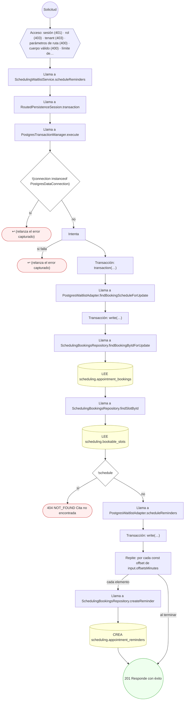

#### 15. POST /scheduling/bookings/{id}/request-info

Pedir documentación u orden médica antes de aceptar

| HTTP | Código | Cuándo |
|---|---|---|
| 200 | — | Éxito |
| 400 | `VALIDATION_FAILED` | Los parámetros de ruta son UUID válidos; El cuerpo cumple el DTO (sin propiedades extra) |
| 401 | `UNAUTHENTICATED` | Hay una sesión válida (JWT) |
| 403 | `FORBIDDEN` | El rol está permitido; El tenant se resuelve y pertenece al actor; ForbiddenException: Esta cita es de otra agenda: solo la opera quien atiende en ella. |
| 404 | `NOT_FOUND` | ResourceNotFoundException: Cita no encontrada |
| 422 | `PRECONDITION_FAILED` | PreconditionFailedException: Sólo se opera así sobre una solicitud pendiente; PreconditionFailedException: Transición de estado de cita no permitida |
| 429 | `RATE_LIMITED` | No se supera el límite de solicitudes |
| 500 | `INTERNAL` | Error: Entidad de historial no registrada: {entity} |

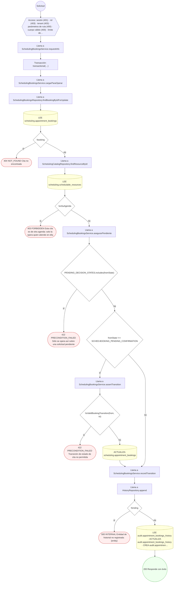

#### 16. POST /scheduling/bookings/{id}/reschedule

Reprogramar la cita a otro slot

| HTTP | Código | Cuándo |
|---|---|---|
| 200 | — | Éxito |
| 400 | `VALIDATION_FAILED` | Los parámetros de ruta son UUID válidos; El cuerpo cumple el DTO (sin propiedades extra) |
| 401 | `UNAUTHENTICATED` | Hay una sesión válida (JWT) |
| 403 | `FORBIDDEN` | El rol está permitido; El tenant se resuelve y pertenece al actor |
| 404 | `NOT_FOUND` | ResourceNotFoundException: Cita no encontrada; ResourceNotFoundException: Slot destino no encontrado |
| 409 | `CONFLICT` | ConflictException: El slot destino no tiene cupos |
| 422 | `PRECONDITION_FAILED` | PreconditionFailedException: Solo se reprograma una cita vigente; PreconditionFailedException: El slot destino es el mismo que el actual |
| 429 | `RATE_LIMITED` | No se supera el límite de solicitudes |
| 500 | `INTERNAL` | Error: Entidad de historial no registrada: {entity} |

```mermaid
flowchart TD
  n1(("Solicitud")):::inicio
  n2{{"Acceso: sesión (401) · rol (403) · tenant (403) · parámetros de ruta (400) · cuerpo válido (400) · límite de…"}}:::acceso
  n1 --> n2
  n3["Llama a SchedulingBookingsService.reschedule"]:::llamada
  n2 --> n3
  n4["Transacción: transactional(…)"]:::transaccion
  n3 --> n4
  n5["Llama a SchedulingBookingsRepository.findBookingByIdForUpdate"]:::llamada
  n4 --> n5
  n6[("LEE scheduling.appointment_bookings")]:::efecto
  n5 --> n6
  n7{"!booking"}:::decision
  n6 --> n7
  n8(["404 NOT_FOUND Cita no encontrada"]):::error
  n7 -->|"sí"| n8
  n9{"!ACTIVE_BOOKING_STATES.includes(booking.statusConceptId)"}:::decision
  n7 -->|"no"| n9
  n10(["422 PRECONDITION_FAILED Solo se reprograma una cita vigente"]):::error
  n9 -->|"sí"| n10
  n11{"fromSlotId === dto.toSlotId"}:::decision
  n9 -->|"no"| n11
  n12(["422 PRECONDITION_FAILED El slot destino es el mismo que el actual"]):::error
  n11 -->|"sí"| n12
  n13["Llama a SchedulingBookingsRepository.findSlotForUpdate"]:::llamada
  n11 -->|"no"| n13
  n14[("LEE scheduling.bookable_slots")]:::efecto
  n13 --> n14
  n15{"!target"}:::decision
  n14 --> n15
  n16(["404 NOT_FOUND Slot destino no encontrado"]):::error
  n15 -->|"sí"| n16
  n17{"target.remainingCapacity ‹= 0"}:::decision
  n15 -->|"no"| n17
  n18(["409 CONFLICT El slot destino no tiene cupos"]):::error
  n17 -->|"sí"| n18
  n19["Llama a SchedulingBookingsRepository.findSlotForUpdate"]:::llamada
  n17 -->|"no"| n19
  n20[("LEE scheduling.bookable_slots")]:::efecto
  n19 --> n20
  n21{"origin"}:::decision
  n20 --> n21
  n22[("ACTUALIZA scheduling.bookable_slots")]:::efecto
  n21 -->|"sí"| n22
  n23{"origin.statusConceptId !== CONCEPTS.SLOT_BLOCKED"}:::decision
  n22 --> n23
  n24[("ACTUALIZA scheduling.bookable_slots")]:::efecto
  n23 -->|"sí"| n24
  n25[("ACTUALIZA scheduling.bookable_slots")]:::efecto
  n24 --> n25
  n23 -->|"no"| n25
  n21 -->|"no"| n25
  n26{"target.remainingCapacity === 0"}:::decision
  n25 --> n26
  n27[("ACTUALIZA scheduling.bookable_slots")]:::efecto
  n26 -->|"sí"| n27
  n28[("ACTUALIZA scheduling.appointment_bookings")]:::efecto
  n27 --> n28
  n26 -->|"no"| n28
  n29["Llama a SchedulingBookingsRepository.recordReschedule"]:::llamada
  n28 --> n29
  n30[("CREA scheduling.booking_reschedules")]:::efecto
  n29 --> n30
  n31["Llama a HistoryRepository.append"]:::llamada
  n30 --> n31
  n32{"!binding"}:::decision
  n31 --> n32
  n33(["500 INTERNAL Entidad de historial no registrada: {entity}"]):::error
  n32 -->|"sí"| n33
  n34[("LEE audit.appointment_bookings_history · ACTUALIZA audit.appointment_bookings_history · CREA audit.appointmen…")]:::efecto
  n32 -->|"no"| n34
  n35["Llama a SchedulingBookingsService.avisarCambio"]:::llamada
  n34 --> n35
  n36["Llama a SchedulingNoticeRepository.describeBooking"]:::llamada
  n35 --> n36
  n37[("LEE scheduling.appointment_bookings · LEE scheduling.bookable_slots")]:::efecto
  n36 --> n37
  n38["Llama a SchedulingNoticeRepository.describeResource"]:::llamada
  n37 --> n38
  n39[("LEE scheduling.schedulable_resources")]:::efecto
  n38 --> n39
  n40["Llama a SchedulingNoticeRepository.describeSite"]:::llamada
  n39 --> n40
  n41[("LEE scheduling.schedulable_resources · LEE practice.practices")]:::efecto
  n40 --> n41
  n42["Llama a SchedulingNoticeRepository.findResourceAccount"]:::llamada
  n41 --> n42
  n43[("LEE scheduling.schedulable_resources")]:::efecto
  n42 --> n43
  n44["Llama a SchedulingNoticeRepository.findAccountForProfile"]:::llamada
  n43 --> n44
  n45[("LEE profiles.person_account_links")]:::efecto
  n44 --> n45
  n46(("200 Responde con éxito")):::ok
  n45 --> n46
  classDef acceso fill:#eef,stroke:#66a
  classDef error fill:#fee,stroke:#c33
  classDef ok fill:#efe,stroke:#3a3
  classDef efecto fill:#ffd,stroke:#aa3
  classDef decision fill:#fff,stroke:#555
  classDef corte fill:#eee,stroke:#999,stroke-dasharray: 4
```

#### 17. POST /scheduling/bookings/{id}/start

Iniciar la atención

| HTTP | Código | Cuándo |
|---|---|---|
| 200 | — | Éxito |
| 400 | `VALIDATION_FAILED` | Los parámetros de ruta son UUID válidos |
| 401 | `UNAUTHENTICATED` | Hay una sesión válida (JWT) |
| 403 | `FORBIDDEN` | El rol está permitido; El tenant se resuelve y pertenece al actor; ForbiddenException: Esta cita es de otra agenda: solo la opera quien atiende en ella. |
| 404 | `NOT_FOUND` | ResourceNotFoundException: Cita no encontrada |
| 422 | `PRECONDITION_FAILED` | PreconditionFailedException: Transición de estado de cita no permitida |
| 429 | `RATE_LIMITED` | No se supera el límite de solicitudes |
| 500 | `INTERNAL` | Error: Entidad de historial no registrada: {entity} |

```mermaid
flowchart TD
  n1(("Solicitud")):::inicio
  n2{{"Acceso: sesión (401) · rol (403) · tenant (403) · parámetros de ruta (400) · límite de tasa (429)"}}:::acceso
  n1 --> n2
  n3["Llama a SchedulingBookingsService.start"]:::llamada
  n2 --> n3
  n4["Transacción: transactional(…)"]:::transaccion
  n3 --> n4
  n5["Llama a SchedulingBookingsService.cargarParaOperar"]:::llamada
  n4 --> n5
  n6["Llama a SchedulingBookingsRepository.findBookingByIdForUpdate"]:::llamada
  n5 --> n6
  n7[("LEE scheduling.appointment_bookings")]:::efecto
  n6 --> n7
  n8{"!booking"}:::decision
  n7 --> n8
  n9(["404 NOT_FOUND Cita no encontrada"]):::error
  n8 -->|"sí"| n9
  n10["Llama a SchedulingCatalogRepository.findResourceById"]:::llamada
  n8 -->|"no"| n10
  n11[("LEE scheduling.schedulable_resources")]:::efecto
  n10 --> n11
  n12{"!esSuAgenda"}:::decision
  n11 --> n12
  n13(["403 FORBIDDEN Esta cita es de otra agenda: solo la opera quien atiende en ella."]):::error
  n12 -->|"sí"| n13
  n14["Llama a SchedulingBookingsService.assertTransition"]:::llamada
  n12 -->|"no"| n14
  n15{"!isValidBookingTransition(from, to)"}:::decision
  n14 --> n15
  n16(["422 PRECONDITION_FAILED Transición de estado de cita no permitida"]):::error
  n15 -->|"sí"| n16
  n17[("ACTUALIZA scheduling.appointment_bookings")]:::efecto
  n15 -->|"no"| n17
  n18["Llama a SchedulingBookingsService.sincronizarCitaClinica"]:::llamada
  n17 --> n18
  n19["Llama a AppointmentsRepository.findById"]:::llamada
  n18 --> n19
  n20[("LEE clinical.appointments")]:::efecto
  n19 --> n20
  n21[("ACTUALIZA clinical.appointments")]:::efecto
  n20 --> n21
  n22["Llama a SchedulingBookingsService.recordTransition"]:::llamada
  n21 --> n22
  n23["Llama a HistoryRepository.append"]:::llamada
  n22 --> n23
  n24{"!binding"}:::decision
  n23 --> n24
  n25(["500 INTERNAL Entidad de historial no registrada: {entity}"]):::error
  n24 -->|"sí"| n25
  n26[("LEE audit.appointment_bookings_history · ACTUALIZA audit.appointment_bookings_history · CREA audit.appointmen…")]:::efecto
  n24 -->|"no"| n26
  n27(("200 Responde con éxito")):::ok
  n26 --> n27
  classDef acceso fill:#eef,stroke:#66a
  classDef error fill:#fee,stroke:#c33
  classDef ok fill:#efe,stroke:#3a3
  classDef efecto fill:#ffd,stroke:#aa3
  classDef decision fill:#fff,stroke:#555
  classDef corte fill:#eee,stroke:#999,stroke-dasharray: 4
```

#### 18. POST /scheduling/confirmation-rules/{id}/activate

Reactivar una regla desactivada

| HTTP | Código | Cuándo |
|---|---|---|
| 200 | — | Éxito |
| 400 | `VALIDATION_FAILED` | Los parámetros de ruta son UUID válidos |
| 401 | `UNAUTHENTICATED` | Hay una sesión válida (JWT) |
| 403 | `FORBIDDEN` | El rol está permitido; El tenant se resuelve y pertenece al actor |
| 404 | `NOT_FOUND` | ResourceNotFoundException: Regla no encontrada |
| 429 | `RATE_LIMITED` | No se supera el límite de solicitudes |

```mermaid
flowchart TD
  n1(("Solicitud")):::inicio
  n2{{"Acceso: sesión (401) · rol (403) · tenant (403) · parámetros de ruta (400) · límite de tasa (429)"}}:::acceso
  n1 --> n2
  n3["Llama a SchedulingConfirmationService.activateRule"]:::llamada
  n2 --> n3
  n4["Llama a SchedulingConfirmationService.setEnabled"]:::llamada
  n3 --> n4
  n5["Transacción: transactional(…)"]:::transaccion
  n4 --> n5
  n6["Llama a SchedulingConfirmationRepository.findRuleByIdForUpdate"]:::llamada
  n5 --> n6
  n7[("LEE scheduling.booking_confirmation_rules")]:::efecto
  n6 --> n7
  n8{"!rule"}:::decision
  n7 --> n8
  n9(["404 NOT_FOUND Regla no encontrada"]):::error
  n8 -->|"sí"| n9
  n10[("ACTUALIZA scheduling.booking_confirmation_rules · ACTUALIZA scheduling.booking_confirmation_rules")]:::efecto
  n8 -->|"no"| n10
  n11(("200 Responde con éxito")):::ok
  n10 --> n11
  classDef acceso fill:#eef,stroke:#66a
  classDef error fill:#fee,stroke:#c33
  classDef ok fill:#efe,stroke:#3a3
  classDef efecto fill:#ffd,stroke:#aa3
  classDef decision fill:#fff,stroke:#555
  classDef corte fill:#eee,stroke:#999,stroke-dasharray: 4
```

#### 19. POST /scheduling/confirmation-rules/{id}/deactivate

Desactivar una regla (sin borrado duro)

| HTTP | Código | Cuándo |
|---|---|---|
| 200 | — | Éxito |
| 400 | `VALIDATION_FAILED` | Los parámetros de ruta son UUID válidos |
| 401 | `UNAUTHENTICATED` | Hay una sesión válida (JWT) |
| 403 | `FORBIDDEN` | El rol está permitido; El tenant se resuelve y pertenece al actor |
| 404 | `NOT_FOUND` | ResourceNotFoundException: Regla no encontrada |
| 429 | `RATE_LIMITED` | No se supera el límite de solicitudes |

```mermaid
flowchart TD
  n1(("Solicitud")):::inicio
  n2{{"Acceso: sesión (401) · rol (403) · tenant (403) · parámetros de ruta (400) · límite de tasa (429)"}}:::acceso
  n1 --> n2
  n3["Llama a SchedulingConfirmationService.deactivateRule"]:::llamada
  n2 --> n3
  n4["Llama a SchedulingConfirmationService.setEnabled"]:::llamada
  n3 --> n4
  n5["Transacción: transactional(…)"]:::transaccion
  n4 --> n5
  n6["Llama a SchedulingConfirmationRepository.findRuleByIdForUpdate"]:::llamada
  n5 --> n6
  n7[("LEE scheduling.booking_confirmation_rules")]:::efecto
  n6 --> n7
  n8{"!rule"}:::decision
  n7 --> n8
  n9(["404 NOT_FOUND Regla no encontrada"]):::error
  n8 -->|"sí"| n9
  n10[("ACTUALIZA scheduling.booking_confirmation_rules · ACTUALIZA scheduling.booking_confirmation_rules")]:::efecto
  n8 -->|"no"| n10
  n11(("200 Responde con éxito")):::ok
  n10 --> n11
  classDef acceso fill:#eef,stroke:#66a
  classDef error fill:#fee,stroke:#c33
  classDef ok fill:#efe,stroke:#3a3
  classDef efecto fill:#ffd,stroke:#aa3
  classDef decision fill:#fff,stroke:#555
  classDef corte fill:#eee,stroke:#999,stroke-dasharray: 4
```

#### 20. DELETE /scheduling/exceptions/{id}

Eliminar una excepción de disponibilidad

| HTTP | Código | Cuándo |
|---|---|---|
| 204 | — | Éxito |
| 400 | `VALIDATION_FAILED` | Los parámetros de ruta son UUID válidos |
| 401 | `UNAUTHENTICATED` | Hay una sesión válida (JWT) |
| 403 | `FORBIDDEN` | El rol está permitido; El tenant se resuelve y pertenece al actor; ForbiddenException: Esta agenda es de otro profesional: solo la administra quien atiende en ella. |
| 404 | `NOT_FOUND` | ResourceNotFoundException: Excepción no encontrada |
| 429 | `RATE_LIMITED` | No se supera el límite de solicitudes |

```mermaid
flowchart TD
  n1(("Solicitud")):::inicio
  n2{{"Acceso: sesión (401) · rol (403) · tenant (403) · parámetros de ruta (400) · límite de tasa (429)"}}:::acceso
  n1 --> n2
  n3["Llama a SchedulingCatalogService.removeException"]:::llamada
  n2 --> n3
  n4["Transacción: transactional(…)"]:::transaccion
  n3 --> n4
  n5["Llama a SchedulingCatalogRepository.findExceptionById"]:::llamada
  n4 --> n5
  n6[("LEE scheduling.availability_exceptions")]:::efecto
  n5 --> n6
  n7{"!exception"}:::decision
  n6 --> n7
  n8(["404 NOT_FOUND Excepción no encontrada"]):::error
  n7 -->|"sí"| n8
  n9["Llama a SchedulingCatalogRepository.findResourceById"]:::llamada
  n7 -->|"no"| n9
  n10[("LEE scheduling.schedulable_resources")]:::efecto
  n9 --> n10
  n11["Llama a SchedulingCatalogService.assertRecursoDelActor"]:::llamada
  n10 --> n11
  n12{"!esSuAgenda"}:::decision
  n11 --> n12
  n13(["403 FORBIDDEN Esta agenda es de otro profesional: solo la administra quien atiende en ella."]):::error
  n12 -->|"sí"| n13
  n14{"resource"}:::decision
  n12 -->|"no"| n14
  n15["Llama a SchedulingCatalogService.assertRecursoDelActor"]:::llamada
  n14 -->|"sí"| n15
  n16{"!esSuAgenda"}:::decision
  n15 --> n16
  n17(["403 FORBIDDEN Esta agenda es de otro profesional: solo la administra quien atiende en ella."]):::error
  n16 -->|"sí"| n17
  n18["Llama a SchedulingCatalogRepository.removeException"]:::llamada
  n16 -->|"no"| n18
  n14 -->|"no"| n18
  n19[("BORRA scheduling.availability_exceptions")]:::efecto
  n18 --> n19
  n20(("204 Responde con éxito")):::ok
  n19 --> n20
  classDef acceso fill:#eef,stroke:#66a
  classDef error fill:#fee,stroke:#c33
  classDef ok fill:#efe,stroke:#3a3
  classDef efecto fill:#ffd,stroke:#aa3
  classDef decision fill:#fff,stroke:#555
  classDef corte fill:#eee,stroke:#999,stroke-dasharray: 4
```

#### 21. PATCH /scheduling/exceptions/{id}

Edita un bloqueo sin borrarlo (AC-11-7). **Agrandar el rango cierra los cupos nuevos; achicarlo no reabre ninguno.** Es la P-11-3, y se resuelve por la consecuencia: cerrar de más ofrece menos turnos y el profesional lo pidió; reabrir ofrecería turnos que nadie decidió ofrecer. El módulo queda con una sola regla: **los cupos sólo los crea publicar el horario.**

| HTTP | Código | Cuándo |
|---|---|---|
| 200 | — | Éxito |
| 400 | `VALIDATION_FAILED` | Los parámetros de ruta son UUID válidos |
| 401 | `UNAUTHENTICATED` | Hay una sesión válida (JWT) |
| 403 | `FORBIDDEN` | El rol está permitido; El tenant se resuelve y pertenece al actor; ForbiddenException: Esta agenda es de otro profesional: solo la administra quien atiende en ella. |
| 404 | `NOT_FOUND` | ResourceNotFoundException: Excepción no encontrada |
| 422 | `PRECONDITION_FAILED` | PreconditionFailedException: El bloqueo termina antes de empezar; PreconditionFailedException: Elegiste «Otro» como motivo: escribí cuál es |
| 429 | `RATE_LIMITED` | No se supera el límite de solicitudes |

```mermaid
flowchart TD
  n1(("Solicitud")):::inicio
  n2{{"Acceso: sesión (401) · rol (403) · tenant (403) · parámetros de ruta (400) · límite de tasa (429)"}}:::acceso
  n1 --> n2
  n3["Llama a SchedulingCatalogService.updateException"]:::llamada
  n2 --> n3
  n4["Transacción: transactional(…)"]:::transaccion
  n3 --> n4
  n5["Llama a SchedulingCatalogRepository.findExceptionById"]:::llamada
  n4 --> n5
  n6[("LEE scheduling.availability_exceptions")]:::efecto
  n5 --> n6
  n7{"!exception"}:::decision
  n6 --> n7
  n8(["404 NOT_FOUND Excepción no encontrada"]):::error
  n7 -->|"sí"| n8
  n9["Llama a SchedulingCatalogRepository.findResourceById"]:::llamada
  n7 -->|"no"| n9
  n10[("LEE scheduling.schedulable_resources")]:::efecto
  n9 --> n10
  n11["Llama a SchedulingCatalogService.assertRecursoDelActor"]:::llamada
  n10 --> n11
  n12{"!esSuAgenda"}:::decision
  n11 --> n12
  n13(["403 FORBIDDEN Esta agenda es de otro profesional: solo la administra quien atiende en ella."]):::error
  n12 -->|"sí"| n13
  n14{"resource"}:::decision
  n12 -->|"no"| n14
  n15["Llama a SchedulingCatalogService.assertRecursoDelActor"]:::llamada
  n14 -->|"sí"| n15
  n16{"!esSuAgenda"}:::decision
  n15 --> n16
  n17(["403 FORBIDDEN Esta agenda es de otro profesional: solo la administra quien atiende en ella."]):::error
  n16 -->|"sí"| n17
  n18{"endAt !== undefined && endAt !== null && startAt ›= endAt"}:::decision
  n16 -->|"no"| n18
  n14 -->|"no"| n18
  n19(["422 PRECONDITION_FAILED El bloqueo termina antes de empezar"]):::error
  n18 -->|"sí"| n19
  n20{"tipoFinal === MOTIVO_QUE_EXIGE_TEXTO && (textoFinal === undefined || textoFinal.trim() === '')"}:::decision
  n18 -->|"no"| n20
  n21(["422 PRECONDITION_FAILED Elegiste «Otro» como motivo: escribí cuál es"]):::error
  n20 -->|"sí"| n21
  n22{"tipoFinal !== undefined"}:::decision
  n20 -->|"no"| n22
  n23[("ACTUALIZA scheduling.availability_exceptions")]:::efecto
  n22 -->|"sí"| n23
  n24[("ACTUALIZA scheduling.availability_exceptions")]:::efecto
  n23 --> n24
  n22 -->|"no"| n24
  n25{"dto.reason !== undefined"}:::decision
  n24 --> n25
  n26[("ACTUALIZA scheduling.availability_exceptions")]:::efecto
  n25 -->|"sí"| n26
  n27[("ACTUALIZA scheduling.availability_exceptions · ACTUALIZA scheduling.availability_exceptions")]:::efecto
  n26 --> n27
  n25 -->|"no"| n27
  n28{"endAt !== undefined && endAt !== null"}:::decision
  n27 --> n28
  n29[("ACTUALIZA scheduling.availability_exceptions")]:::efecto
  n28 -->|"sí"| n29
  n30{"creció && exception.isAvailable !== true"}:::decision
  n29 --> n30
  n28 -->|"no"| n30
  n31["Llama a SchedulingCatalogRepository.findOpenSlotsInWindow"]:::llamada
  n30 -->|"sí"| n31
  n32[("LEE scheduling.bookable_slots")]:::efecto
  n31 --> n32
  n33["Repite: por cada const slot de alcanzados"]:::bucle
  n32 --> n33
  n34{"slot.statusConceptId === CONCEPTS.SLOT_OPEN && intacto"}:::decision
  n33 -->|"cada elemento"| n34
  n35[("ACTUALIZA scheduling.bookable_slots")]:::efecto
  n34 -->|"sí"| n35
  n36(("200 Responde con éxito")):::ok
  n35 --> n36
  n34 -->|"no"| n36
  n33 -->|"al terminar"| n36
  n30 -->|"no"| n36
  classDef acceso fill:#eef,stroke:#66a
  classDef error fill:#fee,stroke:#c33
  classDef ok fill:#efe,stroke:#3a3
  classDef efecto fill:#ffd,stroke:#aa3
  classDef decision fill:#fff,stroke:#555
  classDef corte fill:#eee,stroke:#999,stroke-dasharray: 4
```

#### 22. POST /scheduling/holds/{holdToken}/confirm

Confirmar la cita a partir de la reserva temporal

| HTTP | Código | Cuándo |
|---|---|---|
| 201 | — | Éxito |
| 400 | `VALIDATION_FAILED` | Los parámetros de ruta son UUID válidos; El cuerpo cumple el DTO (sin propiedades extra) |
| 401 | `UNAUTHENTICATED` | Hay una sesión válida (JWT) |
| 403 | `FORBIDDEN` | El rol está permitido; El tenant se resuelve y pertenece al actor |
| 404 | `NOT_FOUND` | ResourceNotFoundException: Reserva temporal no encontrada; ResourceNotFoundException: Slot no encontrado |
| 409 | `CONFLICT` | ConflictException: La reserva temporal ya fue consumida o liberada; ConflictException: La reserva temporal expiró |
| 422 | `PRECONDITION_FAILED` | PreconditionFailedException: Ese horario ya pasó.; PreconditionFailedException: Ya tenés un turno confirmado ese día a esa hora{choque.resourceName ? ` en «$…}. Cancelalo primero si querés cambiarlo por éste.; PreconditionFailedException: El profesional ya tiene {quien} de {horaLocal( primero.startAt, p…} a {horaLocal( primero.endAt, pri…}{primero.resourceName ? ` en «…}. No puede estar en dos l… |
| 429 | `RATE_LIMITED` | No se supera el límite de solicitudes |

```mermaid
flowchart TD
  n1(("Solicitud")):::inicio
  n2{{"Acceso: sesión (401) · rol (403) · tenant (403) · parámetros de ruta (400) · cuerpo válido (400) · límite de…"}}:::acceso
  n1 --> n2
  n3["Llama a SchedulingBookingsService.confirmBooking"]:::llamada
  n2 --> n3
  n4["Llama a SchedulingBookingsService.materializarReserva"]:::llamada
  n3 --> n4
  n5["Transacción: transactional(…)"]:::transaccion
  n4 --> n5
  n6["Llama a SchedulingBookingsRepository.findHoldByTokenForUpdate"]:::llamada
  n5 --> n6
  n7[("LEE scheduling.slot_holds")]:::efecto
  n6 --> n7
  n8{"!hold"}:::decision
  n7 --> n8
  n9(["404 NOT_FOUND Reserva temporal no encontrada"]):::error
  n8 -->|"sí"| n9
  n10{"hold.statusConceptId !== CONCEPTS.HOLD_ACTIVE"}:::decision
  n8 -->|"no"| n10
  n11(["409 CONFLICT La reserva temporal ya fue consumida o liberada"]):::error
  n10 -->|"sí"| n11
  n12{"hold.expiresAt.getTime() ‹= Date.now()"}:::decision
  n10 -->|"no"| n12
  n13(["409 CONFLICT La reserva temporal expiró"]):::error
  n12 -->|"sí"| n13
  n14["Llama a SchedulingBookingsRepository.findSlotForUpdate"]:::llamada
  n12 -->|"no"| n14
  n15[("LEE scheduling.bookable_slots")]:::efecto
  n14 --> n15
  n16{"!slot"}:::decision
  n15 --> n16
  n17(["404 NOT_FOUND Slot no encontrado"]):::error
  n16 -->|"sí"| n17
  n18{"slot.startAt.getTime() ‹= Date.now()"}:::decision
  n16 -->|"no"| n18
  n19(["422 PRECONDITION_FAILED Ese horario ya pasó."]):::error
  n18 -->|"sí"| n19
  n20["Llama a SchedulingBookingsRepository.findPatientBookingsOverlapping"]:::llamada
  n18 -->|"no"| n20
  n21[("LEE scheduling.appointment_bookings · LEE scheduling.bookable_slots · LEE scheduling.schedulable_resources")]:::efecto
  n20 --> n21
  n22{"yaComprometido.length › 0"}:::decision
  n21 --> n22
  n23(["422 PRECONDITION_FAILED Ya tenés un turno confirmado ese día a esa hora{choque.resourceName ? ` en «$…}. Canc…"]):::error
  n22 -->|"sí"| n23
  n24["Llama a SchedulingBookingsService.resolvePolicy"]:::llamada
  n22 -->|"no"| n24
  n25["Llama a SchedulingCatalogRepository.findTemplateById"]:::llamada
  n24 --> n25
  n26[("LEE scheduling.schedule_templates")]:::efecto
  n25 --> n26
  n27["Llama a SchedulingCatalogRepository.findPolicyById"]:::llamada
  n26 --> n27
  n28[("LEE scheduling.booking_policies")]:::efecto
  n27 --> n28
  n29["Llama a SchedulingCatalogRepository.findResourceById"]:::llamada
  n28 --> n29
  n30[("LEE scheduling.schedulable_resources")]:::efecto
  n29 --> n30
  n31{"resource && TABLAS_DE_PERFIL_PROFESIONAL.includes(resource.resourceRefType)"}:::decision
  n30 --> n31
  n32["Llama a SchedulingProfessionalTimeService.assertRangoLibre"]:::llamada
  n31 -->|"sí"| n32
  n33{"primero.kind === 'ocupado'"}:::decision
  n32 --> n33
  n34{"primero.patientProfileId"}:::decision
  n33 -->|"no"| n34
  n35["Llama a SchedulingBookingsRepository.findPatientNames"]:::llamada
  n34 -->|"sí"| n35
  n36[("LEE profiles.patient_profiles · LEE profiles.persons")]:::efecto
  n35 --> n36
  n37(["422 PRECONDITION_FAILED El profesional ya tiene {quien} de {horaLocal( primero.startAt, p…} a {horaLocal( pri…"]):::error
  n33 -->|"sí"| n37
  n36 --> n37
  n34 -->|"no"| n37
  n38["Llama a SchedulingBookingsService.crearCitaClinica"]:::llamada
  n31 -->|"no"| n38
  n39["Llama a AppointmentsRepository.create"]:::llamada
  n38 --> n39
  n40[("CREA clinical.appointments")]:::efecto
  n39 --> n40
  n41["Llama a SchedulingBookingsRepository.createBooking"]:::llamada
  n40 --> n41
  n42[("CREA scheduling.appointment_bookings")]:::efecto
  n41 --> n42
  n43[("ACTUALIZA scheduling.slot_holds")]:::efecto
  n42 --> n43
  n44{"slot.remainingCapacity === 0"}:::decision
  n43 --> n44
  n45[("ACTUALIZA scheduling.bookable_slots")]:::efecto
  n44 -->|"sí"| n45
  n46["Repite: por cada const offset de offsets"]:::bucle
  n45 --> n46
  n44 -->|"no"| n46
  n47["Llama a SchedulingBookingsRepository.createReminder"]:::llamada
  n46 -->|"cada elemento"| n47
  n48[("CREA scheduling.appointment_reminders")]:::efecto
  n47 --> n48
  n49(("201 Responde con éxito")):::ok
  n48 --> n49
  n46 -->|"al terminar"| n49
  classDef acceso fill:#eef,stroke:#66a
  classDef error fill:#fee,stroke:#c33
  classDef ok fill:#efe,stroke:#3a3
  classDef efecto fill:#ffd,stroke:#aa3
  classDef decision fill:#fff,stroke:#555
  classDef corte fill:#eee,stroke:#999,stroke-dasharray: 4
```

#### 23. POST /scheduling/holds/{holdToken}/request

Solicitar la cita a partir de la reserva temporal

| HTTP | Código | Cuándo |
|---|---|---|
| 201 | — | Éxito |
| 400 | `VALIDATION_FAILED` | Los parámetros de ruta son UUID válidos; El cuerpo cumple el DTO (sin propiedades extra) |
| 401 | `UNAUTHENTICATED` | Hay una sesión válida (JWT) |
| 403 | `FORBIDDEN` | El rol está permitido; El tenant se resuelve y pertenece al actor |
| 404 | `NOT_FOUND` | ResourceNotFoundException: Reserva temporal no encontrada; ResourceNotFoundException: Slot no encontrado |
| 409 | `CONFLICT` | ConflictException: La reserva temporal ya fue consumida o liberada; ConflictException: La reserva temporal expiró |
| 422 | `PRECONDITION_FAILED` | PreconditionFailedException: Ese horario ya pasó.; PreconditionFailedException: Ya tenés un turno confirmado ese día a esa hora{choque.resourceName ? ` en «$…}. Cancelalo primero si querés cambiarlo por éste.; PreconditionFailedException: El profesional ya tiene {quien} de {horaLocal( primero.startAt, p…} a {horaLocal( primero.endAt, pri…}{primero.resourceName ? ` en «…}. No puede estar en dos l… |
| 429 | `RATE_LIMITED` | No se supera el límite de solicitudes |

```mermaid
flowchart TD
  n1(("Solicitud")):::inicio
  n2{{"Acceso: sesión (401) · rol (403) · tenant (403) · parámetros de ruta (400) · cuerpo válido (400) · límite de…"}}:::acceso
  n1 --> n2
  n3["Llama a SchedulingBookingsService.requestBooking"]:::llamada
  n2 --> n3
  n4["Llama a SchedulingBookingsService.materializarReserva"]:::llamada
  n3 --> n4
  n5["Transacción: transactional(…)"]:::transaccion
  n4 --> n5
  n6["Llama a SchedulingBookingsRepository.findHoldByTokenForUpdate"]:::llamada
  n5 --> n6
  n7[("LEE scheduling.slot_holds")]:::efecto
  n6 --> n7
  n8{"!hold"}:::decision
  n7 --> n8
  n9(["404 NOT_FOUND Reserva temporal no encontrada"]):::error
  n8 -->|"sí"| n9
  n10{"hold.statusConceptId !== CONCEPTS.HOLD_ACTIVE"}:::decision
  n8 -->|"no"| n10
  n11(["409 CONFLICT La reserva temporal ya fue consumida o liberada"]):::error
  n10 -->|"sí"| n11
  n12{"hold.expiresAt.getTime() ‹= Date.now()"}:::decision
  n10 -->|"no"| n12
  n13(["409 CONFLICT La reserva temporal expiró"]):::error
  n12 -->|"sí"| n13
  n14["Llama a SchedulingBookingsRepository.findSlotForUpdate"]:::llamada
  n12 -->|"no"| n14
  n15[("LEE scheduling.bookable_slots")]:::efecto
  n14 --> n15
  n16{"!slot"}:::decision
  n15 --> n16
  n17(["404 NOT_FOUND Slot no encontrado"]):::error
  n16 -->|"sí"| n17
  n18{"slot.startAt.getTime() ‹= Date.now()"}:::decision
  n16 -->|"no"| n18
  n19(["422 PRECONDITION_FAILED Ese horario ya pasó."]):::error
  n18 -->|"sí"| n19
  n20["Llama a SchedulingBookingsRepository.findPatientBookingsOverlapping"]:::llamada
  n18 -->|"no"| n20
  n21[("LEE scheduling.appointment_bookings · LEE scheduling.bookable_slots · LEE scheduling.schedulable_resources")]:::efecto
  n20 --> n21
  n22{"yaComprometido.length › 0"}:::decision
  n21 --> n22
  n23(["422 PRECONDITION_FAILED Ya tenés un turno confirmado ese día a esa hora{choque.resourceName ? ` en «$…}. Canc…"]):::error
  n22 -->|"sí"| n23
  n24["Llama a SchedulingBookingsService.resolvePolicy"]:::llamada
  n22 -->|"no"| n24
  n25["Llama a SchedulingCatalogRepository.findTemplateById"]:::llamada
  n24 --> n25
  n26[("LEE scheduling.schedule_templates")]:::efecto
  n25 --> n26
  n27["Llama a SchedulingCatalogRepository.findPolicyById"]:::llamada
  n26 --> n27
  n28[("LEE scheduling.booking_policies")]:::efecto
  n27 --> n28
  n29["Llama a SchedulingCatalogRepository.findResourceById"]:::llamada
  n28 --> n29
  n30[("LEE scheduling.schedulable_resources")]:::efecto
  n29 --> n30
  n31{"resource && TABLAS_DE_PERFIL_PROFESIONAL.includes(resource.resourceRefType)"}:::decision
  n30 --> n31
  n32["Llama a SchedulingProfessionalTimeService.assertRangoLibre"]:::llamada
  n31 -->|"sí"| n32
  n33{"primero.kind === 'ocupado'"}:::decision
  n32 --> n33
  n34{"primero.patientProfileId"}:::decision
  n33 -->|"no"| n34
  n35["Llama a SchedulingBookingsRepository.findPatientNames"]:::llamada
  n34 -->|"sí"| n35
  n36[("LEE profiles.patient_profiles · LEE profiles.persons")]:::efecto
  n35 --> n36
  n37(["422 PRECONDITION_FAILED El profesional ya tiene {quien} de {horaLocal( primero.startAt, p…} a {horaLocal( pri…"]):::error
  n33 -->|"sí"| n37
  n36 --> n37
  n34 -->|"no"| n37
  n38["Llama a SchedulingBookingsService.crearCitaClinica"]:::llamada
  n31 -->|"no"| n38
  n39["Llama a AppointmentsRepository.create"]:::llamada
  n38 --> n39
  n40[("CREA clinical.appointments")]:::efecto
  n39 --> n40
  n41["Llama a SchedulingBookingsRepository.createBooking"]:::llamada
  n40 --> n41
  n42[("CREA scheduling.appointment_bookings")]:::efecto
  n41 --> n42
  n43[("ACTUALIZA scheduling.slot_holds")]:::efecto
  n42 --> n43
  n44{"slot.remainingCapacity === 0"}:::decision
  n43 --> n44
  n45[("ACTUALIZA scheduling.bookable_slots")]:::efecto
  n44 -->|"sí"| n45
  n46["Repite: por cada const offset de offsets"]:::bucle
  n45 --> n46
  n44 -->|"no"| n46
  n47["Llama a SchedulingBookingsRepository.createReminder"]:::llamada
  n46 -->|"cada elemento"| n47
  n48[("CREA scheduling.appointment_reminders")]:::efecto
  n47 --> n48
  n49["Llama a SchedulingBookingsService.avisarSolicitud"]:::llamada
  n48 --> n49
  n46 -->|"al terminar"| n49
  n50["Llama a SchedulingNoticeRepository.describeBooking"]:::llamada
  n49 --> n50
  n51[("LEE scheduling.appointment_bookings · LEE scheduling.bookable_slots")]:::efecto
  n50 --> n51
  n52["Llama a SchedulingNoticeRepository.describeResource"]:::llamada
  n51 --> n52
  n53[("LEE scheduling.schedulable_resources")]:::efecto
  n52 --> n53
  n54["Llama a SchedulingNoticeRepository.describeSite"]:::llamada
  n53 --> n54
  n55[("LEE scheduling.schedulable_resources · LEE practice.practices")]:::efecto
  n54 --> n55
  n56["Llama a SchedulingNoticeRepository.findResourceAccount"]:::llamada
  n55 --> n56
  n57[("LEE scheduling.schedulable_resources")]:::efecto
  n56 --> n57
  n58["Llama a SchedulingNoticeRepository.findAccountForProfile"]:::llamada
  n57 --> n58
  n59[("LEE profiles.person_account_links")]:::efecto
  n58 --> n59
  n60{"profesional === null"}:::decision
  n59 --> n60
  n61["Llama a SchedulingNoticeRepository.findDisplayNameForProfile"]:::llamada
  n60 -->|"no"| n61
  n62["Llama a SchedulingNoticeRepository.resolvePersonId"]:::llamada
  n61 --> n62
  n63[("LEE profiles.persons · LEE profiles.person_profiles")]:::efecto
  n62 --> n63
  n64[("LEE profiles.persons")]:::efecto
  n63 --> n64
  n65(("201 Responde con éxito")):::ok
  n60 -->|"sí"| n65
  n64 --> n65
  classDef acceso fill:#eef,stroke:#66a
  classDef error fill:#fee,stroke:#c33
  classDef ok fill:#efe,stroke:#3a3
  classDef efecto fill:#ffd,stroke:#aa3
  classDef decision fill:#fff,stroke:#555
  classDef corte fill:#eee,stroke:#999,stroke-dasharray: 4
```

#### 24. POST /scheduling/internal/dispatch-reminders

Despachar los recordatorios cuya hora ya llegó

| HTTP | Código | Cuándo |
|---|---|---|
| 200 | — | Éxito |
| 400 | `VALIDATION_FAILED` | El cuerpo cumple el DTO (sin propiedades extra) |
| 401 | `UNAUTHENTICATED` | Hay una sesión válida (JWT) |
| 403 | `FORBIDDEN` | El rol está permitido; El tenant se resuelve y pertenece al actor |
| 429 | `RATE_LIMITED` | No se supera el límite de solicitudes |

```mermaid
flowchart TD
  n1(("Solicitud")):::inicio
  n2{{"Acceso: sesión (401) · rol (403) · tenant (403) · cuerpo válido (400) · límite de tasa (429)"}}:::acceso
  n1 --> n2
  n3["Llama a SchedulingWaitlistService.dispatchReminders"]:::llamada
  n2 --> n3
  n4["Llama a RoutedPersistenceSession.transaction"]:::llamada
  n3 --> n4
  n5["Llama a PostgresTransactionManager.execute"]:::llamada
  n4 --> n5
  n6{"!(connection instanceof PostgresDataConnection)"}:::decision
  n5 --> n6
  n7(["↩ (relanza el error capturado)"]):::error
  n6 -->|"sí"| n7
  n8["Intenta"]:::intento
  n6 -->|"no"| n8
  n9(["↩ (relanza el error capturado)"]):::error
  n8 -->|"si falla"| n9
  n10["Transacción: transaction(…)"]:::transaccion
  n8 --> n10
  n11["Llama a PostgresWaitlistAdapter.findDueReminders"]:::llamada
  n10 --> n11
  n12["Transacción: write(…)"]:::transaccion
  n11 --> n12
  n13["Llama a SchedulingBookingsRepository.findDueReminders"]:::llamada
  n12 --> n13
  n14[("LEE scheduling.appointment_reminders")]:::efecto
  n13 --> n14
  n15["Llama a PostgresWaitlistAdapter.markRemindersSent"]:::llamada
  n14 --> n15
  n16["Transacción: write(…)"]:::transaccion
  n15 --> n16
  n17[("LEE scheduling.appointment_reminders")]:::efecto
  n16 --> n17
  n18["Repite: por cada const reminder de reminders"]:::bucle
  n17 --> n18
  n19[("ACTUALIZA scheduling.appointment_reminders · ACTUALIZA scheduling.appointment_reminders")]:::efecto
  n18 -->|"cada elemento"| n19
  n20["Llama a SchedulingAgendaNoticesService.avisarRecordatorios"]:::llamada
  n19 --> n20
  n18 -->|"al terminar"| n20
  n21["Llama a SchedulingNoticeRepository.findBookingIdsForReminders"]:::llamada
  n20 --> n21
  n22[("LEE scheduling.appointment_reminders")]:::efecto
  n21 --> n22
  n23["Repite: por cada const recordatorio de recordatorios"]:::bucle
  n22 --> n23
  n24["Llama a SchedulingNoticeRepository.describeBooking"]:::llamada
  n23 -->|"cada elemento"| n24
  n25[("LEE scheduling.appointment_bookings · LEE scheduling.bookable_slots")]:::efecto
  n24 --> n25
  n26["Llama a SchedulingNoticeRepository.describeResource"]:::llamada
  n25 --> n26
  n27[("LEE scheduling.schedulable_resources")]:::efecto
  n26 --> n27
  n28["Llama a SchedulingNoticeRepository.describeSite"]:::llamada
  n27 --> n28
  n29[("LEE scheduling.schedulable_resources · LEE practice.practices")]:::efecto
  n28 --> n29
  n30(("200 Responde con éxito")):::ok
  n29 --> n30
  n23 -->|"al terminar"| n30
  classDef acceso fill:#eef,stroke:#66a
  classDef error fill:#fee,stroke:#c33
  classDef ok fill:#efe,stroke:#3a3
  classDef efecto fill:#ffd,stroke:#aa3
  classDef decision fill:#fff,stroke:#555
  classDef corte fill:#eee,stroke:#999,stroke-dasharray: 4
```

#### 25. POST /scheduling/internal/expire-holds

Liberar las reservas temporales vencidas

| HTTP | Código | Cuándo |
|---|---|---|
| 200 | — | Éxito |
| 400 | `VALIDATION_FAILED` | El cuerpo cumple el DTO (sin propiedades extra) |
| 401 | `UNAUTHENTICATED` | Hay una sesión válida (JWT) |
| 403 | `FORBIDDEN` | El rol está permitido; El tenant se resuelve y pertenece al actor |
| 429 | `RATE_LIMITED` | No se supera el límite de solicitudes |

```mermaid
flowchart TD
  n1(("Solicitud")):::inicio
  n2{{"Acceso: sesión (401) · rol (403) · tenant (403) · cuerpo válido (400) · límite de tasa (429)"}}:::acceso
  n1 --> n2
  n3["Llama a SchedulingBookingsService.expireHolds"]:::llamada
  n2 --> n3
  n4["Transacción: transactional(…)"]:::transaccion
  n3 --> n4
  n5["Llama a SchedulingBookingsRepository.findExpiredHolds"]:::llamada
  n4 --> n5
  n6[("LEE scheduling.slot_holds")]:::efecto
  n5 --> n6
  n7["Repite: por cada const hold de expired"]:::bucle
  n6 --> n7
  n8[("ACTUALIZA scheduling.slot_holds · ACTUALIZA scheduling.slot_holds")]:::efecto
  n7 -->|"cada elemento"| n8
  n9["Llama a SchedulingBookingsRepository.findSlotForUpdate"]:::llamada
  n8 --> n9
  n10[("LEE scheduling.bookable_slots")]:::efecto
  n9 --> n10
  n11[("ACTUALIZA scheduling.bookable_slots")]:::efecto
  n10 --> n11
  n12{"slot.statusConceptId === CONCEPTS.SLOT_HELD"}:::decision
  n11 --> n12
  n13[("ACTUALIZA scheduling.bookable_slots")]:::efecto
  n12 -->|"sí"| n13
  n14(("200 Responde con éxito")):::ok
  n13 --> n14
  n12 -->|"no"| n14
  n7 -->|"al terminar"| n14
  classDef acceso fill:#eef,stroke:#66a
  classDef error fill:#fee,stroke:#c33
  classDef ok fill:#efe,stroke:#3a3
  classDef efecto fill:#ffd,stroke:#aa3
  classDef decision fill:#fff,stroke:#555
  classDef corte fill:#eee,stroke:#999,stroke-dasharray: 4
```

#### 26. POST /scheduling/internal/promote-waitlist/{slotId}

Promover candidatos de la lista de espera a un slot con cupo

| HTTP | Código | Cuándo |
|---|---|---|
| 200 | — | Éxito |
| 400 | `VALIDATION_FAILED` | Los parámetros de ruta son UUID válidos; El cuerpo cumple el DTO (sin propiedades extra) |
| 401 | `UNAUTHENTICATED` | Hay una sesión válida (JWT) |
| 403 | `FORBIDDEN` | El rol está permitido; El tenant se resuelve y pertenece al actor |
| 404 | `NOT_FOUND` | ResourceNotFoundException: Slot no encontrado |
| 429 | `RATE_LIMITED` | No se supera el límite de solicitudes |

```mermaid
flowchart TD
  n1(("Solicitud")):::inicio
  n2{{"Acceso: sesión (401) · rol (403) · tenant (403) · parámetros de ruta (400) · cuerpo válido (400) · límite de…"}}:::acceso
  n1 --> n2
  n3["Llama a SchedulingWaitlistService.promoteWaitlist"]:::llamada
  n2 --> n3
  n4["Llama a RoutedPersistenceSession.transaction"]:::llamada
  n3 --> n4
  n5["Llama a PostgresTransactionManager.execute"]:::llamada
  n4 --> n5
  n6{"!(connection instanceof PostgresDataConnection)"}:::decision
  n5 --> n6
  n7(["↩ (relanza el error capturado)"]):::error
  n6 -->|"sí"| n7
  n8["Intenta"]:::intento
  n6 -->|"no"| n8
  n9(["↩ (relanza el error capturado)"]):::error
  n8 -->|"si falla"| n9
  n10["Transacción: transaction(…)"]:::transaccion
  n8 --> n10
  n11["Llama a PostgresWaitlistAdapter.findSlotCapacity"]:::llamada
  n10 --> n11
  n12["Transacción: write(…)"]:::transaccion
  n11 --> n12
  n13["Llama a SchedulingBookingsRepository.findSlotById"]:::llamada
  n12 --> n13
  n14[("LEE scheduling.bookable_slots")]:::efecto
  n13 --> n14
  n15{"!slot"}:::decision
  n14 --> n15
  n16(["404 NOT_FOUND Slot no encontrado"]):::error
  n15 -->|"sí"| n16
  n17["Llama a PostgresWaitlistAdapter.findActiveCandidates"]:::llamada
  n15 -->|"no"| n17
  n18["Transacción: write(…)"]:::transaccion
  n17 --> n18
  n19["Llama a SchedulingBookingsRepository.findWaitlistCandidates"]:::llamada
  n18 --> n19
  n20[("LEE scheduling.waitlist_entries")]:::efecto
  n19 --> n20
  n21["Llama a PostgresWaitlistAdapter.markCandidatesFulfilled"]:::llamada
  n20 --> n21
  n22["Transacción: write(…)"]:::transaccion
  n21 --> n22
  n23[("LEE scheduling.waitlist_entries")]:::efecto
  n22 --> n23
  n24["Repite: por cada const row de rows"]:::bucle
  n23 --> n24
  n25[("ACTUALIZA scheduling.waitlist_entries")]:::efecto
  n24 -->|"cada elemento"| n25
  n26["Llama a SchedulingAgendaNoticesService.avisarCupoLiberado"]:::llamada
  n25 --> n26
  n24 -->|"al terminar"| n26
  n27["Llama a SchedulingNoticeRepository.describeSlot"]:::llamada
  n26 --> n27
  n28[("LEE scheduling.bookable_slots")]:::efecto
  n27 --> n28
  n29["Llama a SchedulingNoticeRepository.describeResource"]:::llamada
  n28 --> n29
  n30[("LEE scheduling.schedulable_resources")]:::efecto
  n29 --> n30
  n31["Llama a SchedulingNoticeRepository.findWaitlistPatients"]:::llamada
  n30 --> n31
  n32[("LEE scheduling.waitlist_entries")]:::efecto
  n31 --> n32
  n33(("200 Responde con éxito")):::ok
  n32 --> n33
  classDef acceso fill:#eef,stroke:#66a
  classDef error fill:#fee,stroke:#c33
  classDef ok fill:#efe,stroke:#3a3
  classDef efecto fill:#ffd,stroke:#aa3
  classDef decision fill:#fff,stroke:#555
  classDef corte fill:#eee,stroke:#999,stroke-dasharray: 4
```

#### 27. GET /scheduling/resources

Listar los recursos agendables de un tenant

| HTTP | Código | Cuándo |
|---|---|---|
| 200 | — | Éxito |
| 400 | `VALIDATION_FAILED` | Están los parámetros de consulta obligatorios |
| 401 | `UNAUTHENTICATED` | Hay una sesión válida (JWT) |
| 403 | `FORBIDDEN` | El rol está permitido; El tenant se resuelve y pertenece al actor |
| 429 | `RATE_LIMITED` | No se supera el límite de solicitudes |

```mermaid
flowchart TD
  n1(("Solicitud")):::inicio
  n2{{"Acceso: sesión (401) · rol (403) · tenant (403) · parámetros de consulta (400) · límite de tasa (429)"}}:::acceso
  n1 --> n2
  n3["Llama a SchedulingAgendaService.listResources"]:::llamada
  n2 --> n3
  n4["Llama a SchedulingAgendaRepository.findResources"]:::llamada
  n3 --> n4
  n5[("LEE scheduling.schedulable_resources")]:::efecto
  n4 --> n5
  n6["Intenta"]:::intento
  n5 --> n6
  n7["Llama a PractitionerSitesService.resolveSitesForResources"]:::llamada
  n6 --> n7
  n8["Llama a PractitionerRoleAssignmentsRepository.findCurrentWithSite"]:::llamada
  n7 --> n8
  n9[("LEE practice.practitioner_role_assignments")]:::efecto
  n8 --> n9
  n10["Repite: por cada const spaceId de spaceIds"]:::bucle
  n9 --> n10
  n11["Llama a CareSpacesRepository.findById"]:::llamada
  n10 -->|"cada elemento"| n11
  n12[("LEE practice.care_spaces")]:::efecto
  n11 --> n12
  n13["Llama a PractitionerSitesService.loadSites"]:::llamada
  n12 --> n13
  n10 -->|"al terminar"| n13
  n14["Repite: por cada const siteId de siteIds"]:::bucle
  n13 --> n14
  n15["Llama a PracticeSitesRepository.findById"]:::llamada
  n14 -->|"cada elemento"| n15
  n16[("LEE practice.practice_sites")]:::efecto
  n15 --> n16
  n17["Llama a PracticesRepository.findById"]:::llamada
  n16 --> n17
  n18[("LEE practice.practices")]:::efecto
  n17 --> n18
  n19["Repite: por cada const site de propias"]:::bucle
  n18 --> n19
  n14 -->|"al terminar"| n19
  n20[("LEE common.addresses")]:::efecto
  n19 -->|"cada elemento"| n20
  n21(("200 Responde con éxito")):::ok
  n20 --> n21
  n19 -->|"al terminar"| n21
  classDef acceso fill:#eef,stroke:#66a
  classDef error fill:#fee,stroke:#c33
  classDef ok fill:#efe,stroke:#3a3
  classDef efecto fill:#ffd,stroke:#aa3
  classDef decision fill:#fff,stroke:#555
  classDef corte fill:#eee,stroke:#999,stroke-dasharray: 4
```

#### 28. POST /scheduling/resources

Dar de alta un recurso agendable

| HTTP | Código | Cuándo |
|---|---|---|
| 201 | — | Éxito |
| 400 | `VALIDATION_FAILED` | El cuerpo cumple el DTO (sin propiedades extra) |
| 401 | `UNAUTHENTICATED` | Hay una sesión válida (JWT) |
| 403 | `FORBIDDEN` | El rol está permitido; El tenant se resuelve y pertenece al actor; ForbiddenException: Un profesional solo puede publicar su propia agenda: el recurso debe apuntar a su perfil profesional.; ForbiddenException: El tenant indicado no es uno de los del actor. |
| 422 | `PRECONDITION_FAILED` | PreconditionFailedException: Tu vínculo con esta organización todavía está pendiente de aprobación. Cuando la acepten vas a poder publicar tu agenda acá. / Tu vínculo con esta organización… |
| 429 | `RATE_LIMITED` | No se supera el límite de solicitudes |

```mermaid
flowchart TD
  n1(("Solicitud")):::inicio
  n2{{"Acceso: sesión (401) · rol (403) · tenant (403) · cuerpo válido (400) · límite de tasa (429)"}}:::acceso
  n1 --> n2
  n3["Llama a SchedulingCatalogService.createResource"]:::llamada
  n2 --> n3
  n4["Llama a SchedulingCatalogService.assertPuedeCrearRecurso"]:::llamada
  n3 --> n4
  n5{"!esSuPerfil"}:::decision
  n4 --> n5
  n6(["403 FORBIDDEN Un profesional solo puede publicar su propia agenda: el recurso debe apuntar a su perfil profes…"]):::error
  n5 -->|"sí"| n6
  n7["Llama a SchedulingCatalogService.assertTenantDelActor"]:::llamada
  n5 -->|"no"| n7
  n8{"!actor.tenantIds?.includes(tenantId)"}:::decision
  n7 --> n8
  n9(["403 FORBIDDEN El tenant indicado no es uno de los del actor."]):::error
  n8 -->|"sí"| n9
  n10["Llama a SchedulingCatalogService.assertVinculoConLaOrganizacion"]:::llamada
  n8 -->|"no"| n10
  n11["Llama a PractitionerAffiliationGateService.evaluar"]:::llamada
  n10 --> n11
  n12[("LEE profiles.practitioner_affiliations")]:::efecto
  n11 --> n12
  n13["Llama a PractitionerAffiliationGateService.tenantDeCadaSede"]:::llamada
  n12 --> n13
  n14[("LEE practice.practice_sites · LEE practice.practices")]:::efecto
  n13 --> n14
  n15(["422 PRECONDITION_FAILED Tu vínculo con esta organización todavía está pendiente de aprobación. Cuando la acep…"]):::error
  n14 --> n15
  n16["Transacción: transactional(…)"]:::transaccion
  n17["Llama a SchedulingCatalogRepository.createResource"]:::llamada
  n16 --> n17
  n18[("CREA scheduling.schedulable_resources")]:::efecto
  n17 --> n18
  n19(("201 Responde con éxito")):::ok
  n18 --> n19
  classDef acceso fill:#eef,stroke:#66a
  classDef error fill:#fee,stroke:#c33
  classDef ok fill:#efe,stroke:#3a3
  classDef efecto fill:#ffd,stroke:#aa3
  classDef decision fill:#fff,stroke:#555
  classDef corte fill:#eee,stroke:#999,stroke-dasharray: 4
```

#### 29. POST /scheduling/resources/{id}/close-slots

Cierra cupos sueltos y deja el bloqueo que impide que vuelvan. Lo que el pedido pone entre paréntesis es su razón de ser: cerrar un cupo **sin** dejar la excepción sirve hasta que alguien regenera, y ahí el rato que el profesional había cerrado se ofrece otra vez. Un cupo con cita viva NO se cierra por acá: se rechaza entero y se nombran cuáles. Cancelar el turno de alguien exige motivo y avisa a esa persona; hacerlo de arrastre sería decidir por quien está esperando.

| HTTP | Código | Cuándo |
|---|---|---|
| 200 | — | Éxito |
| 400 | `VALIDATION_FAILED` | Los parámetros de ruta son UUID válidos |
| 401 | `UNAUTHENTICATED` | Hay una sesión válida (JWT) |
| 403 | `FORBIDDEN` | El rol está permitido; El tenant se resuelve y pertenece al actor; ForbiddenException: Esta agenda es de otro profesional: solo la administra quien atiende en ella. |
| 404 | `NOT_FOUND` | ResourceNotFoundException: Recurso no encontrado; ResourceNotFoundException: Ninguno de esos cupos es de esta agenda |
| 409 | `CONFLICT` | ConflictException: Esos ratos tienen pacientes citados: cancelá cada turno antes de cerrarlos |
| 422 | `PRECONDITION_FAILED` | PreconditionFailedException: Elegiste «Otro» como motivo: escribí cuál es |
| 429 | `RATE_LIMITED` | No se supera el límite de solicitudes |

```mermaid
flowchart TD
  n1(("Solicitud")):::inicio
  n2{{"Acceso: sesión (401) · rol (403) · tenant (403) · parámetros de ruta (400) · límite de tasa (429)"}}:::acceso
  n1 --> n2
  n3["Llama a SchedulingCatalogService.closeSlots"]:::llamada
  n2 --> n3
  n4{"dto.exceptionType === MOTIVO_QUE_EXIGE_TEXTO && (dto.reason === undefined || dto.reason.trim() === '')"}:::decision
  n3 --> n4
  n5(["422 PRECONDITION_FAILED Elegiste «Otro» como motivo: escribí cuál es"]):::error
  n4 -->|"sí"| n5
  n6["Transacción: transactional(…)"]:::transaccion
  n4 -->|"no"| n6
  n7["Llama a SchedulingCatalogRepository.findResourceById"]:::llamada
  n6 --> n7
  n8[("LEE scheduling.schedulable_resources")]:::efecto
  n7 --> n8
  n9{"!resource"}:::decision
  n8 --> n9
  n10(["404 NOT_FOUND Recurso no encontrado"]):::error
  n9 -->|"sí"| n10
  n11["Llama a SchedulingCatalogService.assertRecursoDelActor"]:::llamada
  n9 -->|"no"| n11
  n12{"!esSuAgenda"}:::decision
  n11 --> n12
  n13(["403 FORBIDDEN Esta agenda es de otro profesional: solo la administra quien atiende en ella."]):::error
  n12 -->|"sí"| n13
  n14["Llama a SchedulingCatalogRepository.findSlotsOfResourceForUpdate"]:::llamada
  n12 -->|"no"| n14
  n15[("LEE scheduling.bookable_slots")]:::efecto
  n14 --> n15
  n16{"cupos.length === 0"}:::decision
  n15 --> n16
  n17(["404 NOT_FOUND Ninguno de esos cupos es de esta agenda"]):::error
  n16 -->|"sí"| n17
  n18["Llama a SchedulingCatalogRepository.findBookingsOfSlots"]:::llamada
  n16 -->|"no"| n18
  n19[("LEE scheduling.appointment_bookings")]:::efecto
  n18 --> n19
  n20{"conPaciente.length › 0"}:::decision
  n19 --> n20
  n21(["409 CONFLICT Esos ratos tienen pacientes citados: cancelá cada turno antes de cerrarlos"]):::error
  n20 -->|"sí"| n21
  n22["Repite: por cada const cupo de cupos"]:::bucle
  n20 -->|"no"| n22
  n23[("ACTUALIZA scheduling.bookable_slots")]:::efecto
  n22 -->|"cada elemento"| n23
  n24["Llama a SchedulingCatalogRepository.createException"]:::llamada
  n23 --> n24
  n22 -->|"al terminar"| n24
  n25[("CREA scheduling.availability_exceptions")]:::efecto
  n24 --> n25
  n26(("200 Responde con éxito")):::ok
  n25 --> n26
  classDef acceso fill:#eef,stroke:#66a
  classDef error fill:#fee,stroke:#c33
  classDef ok fill:#efe,stroke:#3a3
  classDef efecto fill:#ffd,stroke:#aa3
  classDef decision fill:#fff,stroke:#555
  classDef corte fill:#eee,stroke:#999,stroke-dasharray: 4
```

#### 30. POST /scheduling/resources/{id}/delay

Informar una demora que alcanza a toda la agenda del recurso

| HTTP | Código | Cuándo |
|---|---|---|
| 200 | — | Éxito |
| 400 | `VALIDATION_FAILED` | Los parámetros de ruta son UUID válidos; El cuerpo cumple el DTO (sin propiedades extra) |
| 401 | `UNAUTHENTICATED` | Hay una sesión válida (JWT) |
| 403 | `FORBIDDEN` | El rol está permitido; El tenant se resuelve y pertenece al actor; ForbiddenException: Esta agenda es de otro profesional: sólo avisa su demora quien atiende en ella. |
| 404 | `NOT_FOUND` | ResourceNotFoundException: Recurso no encontrado |
| 422 | `PRECONDITION_FAILED` | PreconditionFailedException: Una demora mayor a cuatro horas se resuelve reprogramando el turno, no avisando; PreconditionFailedException: La ventana de la demora termina antes de empezar |
| 429 | `RATE_LIMITED` | No se supera el límite de solicitudes |
| 500 | `INTERNAL` | Error: Entidad de historial no registrada: {entity} |

```mermaid
flowchart TD
  n1(("Solicitud")):::inicio
  n2{{"Acceso: sesión (401) · rol (403) · tenant (403) · parámetros de ruta (400) · cuerpo válido (400) · límite de…"}}:::acceso
  n1 --> n2
  n3["Llama a SchedulingDelayService.delayResource"]:::llamada
  n2 --> n3
  n4["Llama a SchedulingDelayService.assertMinutos"]:::llamada
  n3 --> n4
  n5{"minutos › MAX_DELAY_MINUTES"}:::decision
  n4 --> n5
  n6(["422 PRECONDITION_FAILED Una demora mayor a cuatro horas se resuelve reprogramando el turno, no avisando"]):::error
  n5 -->|"sí"| n6
  n7["Llama a SchedulingCatalogRepository.findResourceById"]:::llamada
  n5 -->|"no"| n7
  n8[("LEE scheduling.schedulable_resources")]:::efecto
  n7 --> n8
  n9{"!resource"}:::decision
  n8 --> n9
  n10(["404 NOT_FOUND Recurso no encontrado"]):::error
  n9 -->|"sí"| n10
  n11["Llama a SchedulingDelayService.assertOperaLaAgenda"]:::llamada
  n9 -->|"no"| n11
  n12["Llama a SchedulingCatalogRepository.findResourceById"]:::llamada
  n11 --> n12
  n13[("LEE scheduling.schedulable_resources")]:::efecto
  n12 --> n13
  n14{"!esSuAgenda"}:::decision
  n13 --> n14
  n15(["403 FORBIDDEN Esta agenda es de otro profesional: sólo avisa su demora quien atiende en ella."]):::error
  n14 -->|"sí"| n15
  n16{"hasta.getTime() ‹ desde.getTime()"}:::decision
  n14 -->|"no"| n16
  n17(["422 PRECONDITION_FAILED La ventana de la demora termina antes de empezar"]):::error
  n16 -->|"sí"| n17
  n18["Llama a SchedulingNoticeRepository.findAffectedBookings"]:::llamada
  n16 -->|"no"| n18
  n19[("LEE scheduling.bookable_slots · LEE scheduling.appointment_bookings")]:::efecto
  n18 --> n19
  n20["Llama a SchedulingNoticeRepository.describeResource"]:::llamada
  n19 --> n20
  n21[("LEE scheduling.schedulable_resources")]:::efecto
  n20 --> n21
  n22{"TABLAS_DE_PERFIL_PROFESIONAL.includes(resource.resourceRefType)"}:::decision
  n21 --> n22
  n23["Llama a SchedulingNoticeRepository.findDisplayNameForProfile"]:::llamada
  n22 -->|"sí"| n23
  n24[("LEE profiles.persons")]:::efecto
  n23 --> n24
  n25["Repite: por cada const booking de afectadas"]:::bucle
  n24 --> n25
  n22 -->|"no"| n25
  n26["Llama a SchedulingDelayService.anotarDemora"]:::llamada
  n25 -->|"cada elemento"| n26
  n27["Transacción: transactional(…)"]:::transaccion
  n26 --> n27
  n28["Llama a HistoryRepository.append"]:::llamada
  n27 --> n28
  n29{"!binding"}:::decision
  n28 --> n29
  n30(["500 INTERNAL Entidad de historial no registrada: {entity}"]):::error
  n29 -->|"sí"| n30
  n31[("LEE audit.appointment_bookings_history · ACTUALIZA audit.appointment_bookings_history · CREA audit.appointmen…")]:::efecto
  n29 -->|"no"| n31
  n32(("200 Responde con éxito")):::ok
  n31 --> n32
  n25 -->|"al terminar"| n32
  classDef acceso fill:#eef,stroke:#66a
  classDef error fill:#fee,stroke:#c33
  classDef ok fill:#efe,stroke:#3a3
  classDef efecto fill:#ffd,stroke:#aa3
  classDef decision fill:#fff,stroke:#555
  classDef corte fill:#eee,stroke:#999,stroke-dasharray: 4
```

#### 31. GET /scheduling/resources/{id}/exceptions

Listar las excepciones de disponibilidad de un recurso

| HTTP | Código | Cuándo |
|---|---|---|
| 200 | — | Éxito |
| 400 | `VALIDATION_FAILED` | Están los parámetros de consulta obligatorios; Los parámetros de ruta son UUID válidos |
| 401 | `UNAUTHENTICATED` | Hay una sesión válida (JWT) |
| 403 | `FORBIDDEN` | El rol está permitido; El tenant se resuelve y pertenece al actor; ForbiddenException: Esta agenda es de otro profesional: solo la administra quien atiende en ella.; ForbiddenException: No podés ver los bloqueos de esta agenda |
| 404 | `NOT_FOUND` | ResourceNotFoundException: Recurso no encontrado |
| 422 | `PRECONDITION_FAILED` | PreconditionFailedException: La ventana debe empezar antes de terminar |
| 429 | `RATE_LIMITED` | No se supera el límite de solicitudes |

```mermaid
flowchart TD
  n1(("Solicitud")):::inicio
  n2{{"Acceso: sesión (401) · rol (403) · tenant (403) · parámetros de consulta (400) · parámetros de consulta (400)…"}}:::acceso
  n1 --> n2
  n3["Llama a SchedulingCatalogService.listExceptions"]:::llamada
  n2 --> n3
  n4{"!(from ‹ to)"}:::decision
  n3 --> n4
  n5(["422 PRECONDITION_FAILED La ventana debe empezar antes de terminar"]):::error
  n4 -->|"sí"| n5
  n6["Llama a SchedulingCatalogRepository.findResourceById"]:::llamada
  n4 -->|"no"| n6
  n7[("LEE scheduling.schedulable_resources")]:::efecto
  n6 --> n7
  n8{"!resource"}:::decision
  n7 --> n8
  n9(["404 NOT_FOUND Recurso no encontrado"]):::error
  n8 -->|"sí"| n9
  n10["Llama a SchedulingCatalogService.puedeAdministrarRecurso"]:::llamada
  n8 -->|"no"| n10
  n11["Intenta"]:::intento
  n10 --> n11
  n12["Llama a SchedulingCatalogService.assertRecursoDelActor"]:::llamada
  n11 --> n12
  n13{"!esSuAgenda"}:::decision
  n12 --> n13
  n14(["403 FORBIDDEN Esta agenda es de otro profesional: solo la administra quien atiende en ella."]):::error
  n13 -->|"sí"| n14
  n15{"!puedeLeer && actor.patientProfileId !== undefined"}:::decision
  n13 -->|"no"| n15
  n16["Llama a SchedulingCatalogRepository.patientHasBookingWithResource"]:::llamada
  n15 -->|"sí"| n16
  n17[("LEE scheduling.appointment_bookings")]:::efecto
  n16 --> n17
  n18{"!puedeLeer"}:::decision
  n17 --> n18
  n15 -->|"no"| n18
  n19(["403 FORBIDDEN No podés ver los bloqueos de esta agenda"]):::error
  n18 -->|"sí"| n19
  n20["Llama a SchedulingCatalogRepository.findExceptionsByResourceInRange"]:::llamada
  n18 -->|"no"| n20
  n21[("LEE scheduling.availability_exceptions")]:::efecto
  n20 --> n21
  n22(("200 Responde con éxito")):::ok
  n21 --> n22
  classDef acceso fill:#eef,stroke:#66a
  classDef error fill:#fee,stroke:#c33
  classDef ok fill:#efe,stroke:#3a3
  classDef efecto fill:#ffd,stroke:#aa3
  classDef decision fill:#fff,stroke:#555
  classDef corte fill:#eee,stroke:#999,stroke-dasharray: 4
```

#### 32. POST /scheduling/resources/{id}/exceptions

Registrar una excepción de disponibilidad

| HTTP | Código | Cuándo |
|---|---|---|
| 201 | — | Éxito |
| 400 | `VALIDATION_FAILED` | Los parámetros de ruta son UUID válidos; El cuerpo cumple el DTO (sin propiedades extra) |
| 401 | `UNAUTHENTICATED` | Hay una sesión válida (JWT) |
| 403 | `FORBIDDEN` | El rol está permitido; El tenant se resuelve y pertenece al actor |
| 404 | `NOT_FOUND` | ResourceNotFoundException: Recurso no encontrado |
| 422 | `PRECONDITION_FAILED` | PreconditionFailedException: Elegiste «Otro» como motivo: escribí cuál es; PreconditionFailedException: La excepción debe empezar antes de terminar; PreconditionFailedException: Tenés una cita confirmada en ese rato{primera.resourceName ? ` en «…}. Reprogramala primero o elegí otro horario. |
| 429 | `RATE_LIMITED` | No se supera el límite de solicitudes |

```mermaid
flowchart TD
  n1(("Solicitud")):::inicio
  n2{{"Acceso: sesión (401) · rol (403) · tenant (403) · parámetros de ruta (400) · cuerpo válido (400) · límite de…"}}:::acceso
  n1 --> n2
  n3["Llama a SchedulingCatalogService.createException"]:::llamada
  n2 --> n3
  n4{"dto.exceptionType === MOTIVO_QUE_EXIGE_TEXTO && (dto.reason === undefined || dto.reason.trim() === '')"}:::decision
  n3 --> n4
  n5(["422 PRECONDITION_FAILED Elegiste «Otro» como motivo: escribí cuál es"]):::error
  n4 -->|"sí"| n5
  n6{"startAt ›= endAt"}:::decision
  n4 -->|"no"| n6
  n7(["422 PRECONDITION_FAILED La excepción debe empezar antes de terminar"]):::error
  n6 -->|"sí"| n7
  n8["Transacción: transactional(…)"]:::transaccion
  n6 -->|"no"| n8
  n9["Llama a SchedulingCatalogRepository.findResourceById"]:::llamada
  n8 --> n9
  n10[("LEE scheduling.schedulable_resources")]:::efecto
  n9 --> n10
  n11{"!resource"}:::decision
  n10 --> n11
  n12(["404 NOT_FOUND Recurso no encontrado"]):::error
  n11 -->|"sí"| n12
  n13{"!isAvailable && TABLAS_DE_PERFIL_PROFESIONAL.includes(resource.resourceRefType)"}:::decision
  n11 -->|"no"| n13
  n14["Llama a SchedulingProfessionalTimeService.citasConfirmadas"]:::llamada
  n13 -->|"sí"| n14
  n15["Llama a SchedulingBookingsRepository.findProfessionalCommitmentsOverlapping"]:::llamada
  n14 --> n15
  n16[("LEE scheduling.appointment_bookings · LEE scheduling.bookable_slots · LEE scheduling.schedulable_resources")]:::efecto
  n15 --> n16
  n17{"confirmadas.length › 0"}:::decision
  n16 --> n17
  n18(["422 PRECONDITION_FAILED Tenés una cita confirmada en ese rato{primera.resourceName ? ` en «…}. Reprogramala p…"]):::error
  n17 -->|"sí"| n18
  n19["Llama a SchedulingCatalogRepository.createException"]:::llamada
  n17 -->|"no"| n19
  n13 -->|"no"| n19
  n20[("CREA scheduling.availability_exceptions")]:::efecto
  n19 --> n20
  n21{"!isAvailable"}:::decision
  n20 --> n21
  n22["Llama a SchedulingCatalogRepository.findOpenSlotsInWindow"]:::llamada
  n21 -->|"sí"| n22
  n23[("LEE scheduling.bookable_slots")]:::efecto
  n22 --> n23
  n24["Repite: por cada const slot de overlapping"]:::bucle
  n23 --> n24
  n25{"slot.statusConceptId === CONCEPTS.SLOT_OPEN && untouched"}:::decision
  n24 -->|"cada elemento"| n25
  n26[("ACTUALIZA scheduling.bookable_slots")]:::efecto
  n25 -->|"sí"| n26
  n27(("201 Responde con éxito")):::ok
  n26 --> n27
  n25 -->|"no"| n27
  n24 -->|"al terminar"| n27
  n21 -->|"no"| n27
  classDef acceso fill:#eef,stroke:#66a
  classDef error fill:#fee,stroke:#c33
  classDef ok fill:#efe,stroke:#3a3
  classDef efecto fill:#ffd,stroke:#aa3
  classDef decision fill:#fff,stroke:#555
  classDef corte fill:#eee,stroke:#999,stroke-dasharray: 4
```

#### 33. POST /scheduling/resources/{id}/shift-slots

Corre los cupos de una agenda N minutos — «mover horario» del carril 12. Distinto de «avisar demora», que **sólo avisa** y deja los cupos donde estaban. Acá el turno de la persona pasa a ser otro, así que se escribe y se avisa. Todo o nada: si un cupo no puede moverse porque su horario nuevo pisa otra cita del mismo profesional, no se mueve ninguno. La colisión la rechaza la base con `ex_appointments_practitioner_time`, no este código.

| HTTP | Código | Cuándo |
|---|---|---|
| 200 | — | Éxito |
| 400 | `VALIDATION_FAILED` | Los parámetros de ruta son UUID válidos |
| 401 | `UNAUTHENTICATED` | Hay una sesión válida (JWT) |
| 403 | `FORBIDDEN` | El rol está permitido; El tenant se resuelve y pertenece al actor; ForbiddenException: Esta agenda es de otro profesional: solo la administra quien atiende en ella. |
| 404 | `NOT_FOUND` | ResourceNotFoundException: Recurso no encontrado |
| 422 | `PRECONDITION_FAILED` | PreconditionFailedException: La ventana termina antes de empezar; PreconditionFailedException: Mover cero minutos no cambia nada: elegí cuánto correr la agenda |
| 429 | `RATE_LIMITED` | No se supera el límite de solicitudes |

```mermaid
flowchart TD
  n1(("Solicitud")):::inicio
  n2{{"Acceso: sesión (401) · rol (403) · tenant (403) · parámetros de ruta (400) · límite de tasa (429)"}}:::acceso
  n1 --> n2
  n3["Llama a SchedulingCatalogService.shiftSlots"]:::llamada
  n2 --> n3
  n4{"from ›= to"}:::decision
  n3 --> n4
  n5(["422 PRECONDITION_FAILED La ventana termina antes de empezar"]):::error
  n4 -->|"sí"| n5
  n6{"dto.shiftMinutes === 0"}:::decision
  n4 -->|"no"| n6
  n7(["422 PRECONDITION_FAILED Mover cero minutos no cambia nada: elegí cuánto correr la agenda"]):::error
  n6 -->|"sí"| n7
  n8["Transacción: transactional(…)"]:::transaccion
  n6 -->|"no"| n8
  n9["Llama a SchedulingCatalogRepository.findResourceById"]:::llamada
  n8 --> n9
  n10[("LEE scheduling.schedulable_resources")]:::efecto
  n9 --> n10
  n11{"!resource"}:::decision
  n10 --> n11
  n12(["404 NOT_FOUND Recurso no encontrado"]):::error
  n11 -->|"sí"| n12
  n13["Llama a SchedulingCatalogService.assertRecursoDelActor"]:::llamada
  n11 -->|"no"| n13
  n14{"!esSuAgenda"}:::decision
  n13 --> n14
  n15(["403 FORBIDDEN Esta agenda es de otro profesional: solo la administra quien atiende en ella."]):::error
  n14 -->|"sí"| n15
  n16["Llama a SchedulingCatalogRepository.findSlotsOfResourceForUpdate"]:::llamada
  n14 -->|"no"| n16
  n17[("LEE scheduling.bookable_slots")]:::efecto
  n16 --> n17
  n18["Repite: por cada const cupo de cupos"]:::bucle
  n17 --> n18
  n19[("ACTUALIZA scheduling.bookable_slots")]:::efecto
  n18 -->|"cada elemento"| n19
  n20{"cupo.endAt !== undefined && cupo.endAt !== null"}:::decision
  n19 --> n20
  n21[("ACTUALIZA scheduling.bookable_slots")]:::efecto
  n20 -->|"sí"| n21
  n22["Llama a SchedulingCatalogService.avisarDelMovimiento"]:::llamada
  n21 --> n22
  n20 -->|"no"| n22
  n18 -->|"al terminar"| n22
  n23["Llama a SchedulingCatalogRepository.findBookingsOfSlots"]:::llamada
  n22 --> n23
  n24[("LEE scheduling.appointment_bookings")]:::efecto
  n23 --> n24
  n25["Repite: por cada const cita de citas"]:::bucle
  n24 --> n25
  n26["Intenta"]:::intento
  n25 -->|"cada elemento"| n26
  n27["Llama a SchedulingNoticeRepository.describeBooking"]:::llamada
  n26 --> n27
  n28[("LEE scheduling.appointment_bookings · LEE scheduling.bookable_slots")]:::efecto
  n27 --> n28
  n29["Llama a SchedulingNoticeRepository.describeResource"]:::llamada
  n28 --> n29
  n30[("LEE scheduling.schedulable_resources")]:::efecto
  n29 --> n30
  n31["Llama a SchedulingNoticeRepository.describeSite"]:::llamada
  n30 --> n31
  n32[("LEE scheduling.schedulable_resources · LEE practice.practices")]:::efecto
  n31 --> n32
  n33["Llama a SchedulingNoticeRepository.findAccountForProfile"]:::llamada
  n32 --> n33
  n34["Llama a SchedulingNoticeRepository.resolvePersonId"]:::llamada
  n33 --> n34
  n35[("LEE profiles.persons · LEE profiles.person_profiles")]:::efecto
  n34 --> n35
  n36[("LEE profiles.person_account_links")]:::efecto
  n35 --> n36
  n37(("200 Responde con éxito")):::ok
  n36 --> n37
  n25 -->|"al terminar"| n37
  classDef acceso fill:#eef,stroke:#66a
  classDef error fill:#fee,stroke:#c33
  classDef ok fill:#efe,stroke:#3a3
  classDef efecto fill:#ffd,stroke:#aa3
  classDef decision fill:#fff,stroke:#555
  classDef corte fill:#eee,stroke:#999,stroke-dasharray: 4
```

#### 34. GET /scheduling/resources/{id}/slots

UC-41-14: agenda publicada del recurso en una ventana

| HTTP | Código | Cuándo |
|---|---|---|
| 200 | — | Éxito |
| 400 | `VALIDATION_FAILED` | Están los parámetros de consulta obligatorios; Los parámetros de ruta son UUID válidos |
| 401 | `UNAUTHENTICATED` | Hay una sesión válida (JWT) |
| 403 | `FORBIDDEN` | El rol está permitido; El tenant se resuelve y pertenece al actor |
| 404 | `NOT_FOUND` | ResourceNotFoundException: Recurso no encontrado |
| 422 | `PRECONDITION_FAILED` | PreconditionFailedException: Indique la ventana con from y to (ISO 8601); PreconditionFailedException: La ventana debe empezar antes de terminar |
| 429 | `RATE_LIMITED` | No se supera el límite de solicitudes |

```mermaid
flowchart TD
  n1(("Solicitud")):::inicio
  n2{{"Acceso: sesión (401) · rol (403) · tenant (403) · parámetros de consulta (400) · parámetros de consulta (400)…"}}:::acceso
  n1 --> n2
  n3{"!from || !to"}:::decision
  n2 --> n3
  n4(["422 PRECONDITION_FAILED Indique la ventana con from y to (ISO 8601)"]):::error
  n3 -->|"sí"| n4
  n5["Llama a SchedulingCatalogService.getResourceAgenda"]:::llamada
  n3 -->|"no"| n5
  n6{"!(options.from ‹ options.to)"}:::decision
  n5 --> n6
  n7(["422 PRECONDITION_FAILED La ventana debe empezar antes de terminar"]):::error
  n6 -->|"sí"| n7
  n8["Llama a SchedulingCatalogRepository.findResourceById"]:::llamada
  n6 -->|"no"| n8
  n9[("LEE scheduling.schedulable_resources")]:::efecto
  n8 --> n9
  n10{"!resource"}:::decision
  n9 --> n10
  n11(["404 NOT_FOUND Recurso no encontrado"]):::error
  n10 -->|"sí"| n11
  n12["Llama a SchedulingCatalogRepository.findSlotsByResourceInRange"]:::llamada
  n10 -->|"no"| n12
  n13[("LEE scheduling.bookable_slots")]:::efecto
  n12 --> n13
  n14(("200 Responde con éxito")):::ok
  n13 --> n14
  classDef acceso fill:#eef,stroke:#66a
  classDef error fill:#fee,stroke:#c33
  classDef ok fill:#efe,stroke:#3a3
  classDef efecto fill:#ffd,stroke:#aa3
  classDef decision fill:#fff,stroke:#555
  classDef corte fill:#eee,stroke:#999,stroke-dasharray: 4
```

#### 35. GET /scheduling/resources/{id}/templates

Listar las plantillas de agenda de un recurso

| HTTP | Código | Cuándo |
|---|---|---|
| 200 | — | Éxito |
| 400 | `VALIDATION_FAILED` | Los parámetros de ruta son UUID válidos |
| 401 | `UNAUTHENTICATED` | Hay una sesión válida (JWT) |
| 403 | `FORBIDDEN` | El rol está permitido; El tenant se resuelve y pertenece al actor; ForbiddenException: Esta agenda es de otro profesional: solo la administra quien atiende en ella. |
| 404 | `NOT_FOUND` | ResourceNotFoundException: Recurso no encontrado |
| 429 | `RATE_LIMITED` | No se supera el límite de solicitudes |

```mermaid
flowchart TD
  n1(("Solicitud")):::inicio
  n2{{"Acceso: sesión (401) · rol (403) · tenant (403) · parámetros de ruta (400) · límite de tasa (429)"}}:::acceso
  n1 --> n2
  n3["Llama a SchedulingCatalogService.listTemplates"]:::llamada
  n2 --> n3
  n4["Llama a SchedulingCatalogRepository.findResourceById"]:::llamada
  n3 --> n4
  n5[("LEE scheduling.schedulable_resources")]:::efecto
  n4 --> n5
  n6{"!resource"}:::decision
  n5 --> n6
  n7(["404 NOT_FOUND Recurso no encontrado"]):::error
  n6 -->|"sí"| n7
  n8["Llama a SchedulingCatalogService.assertRecursoDelActor"]:::llamada
  n6 -->|"no"| n8
  n9{"!esSuAgenda"}:::decision
  n8 --> n9
  n10(["403 FORBIDDEN Esta agenda es de otro profesional: solo la administra quien atiende en ella."]):::error
  n9 -->|"sí"| n10
  n11["Llama a SchedulingCatalogRepository.findTemplatesByResource"]:::llamada
  n9 -->|"no"| n11
  n12[("LEE scheduling.schedule_templates")]:::efecto
  n11 --> n12
  n13["Llama a SchedulingCatalogRepository.findRulesByTemplates"]:::llamada
  n12 --> n13
  n14[("LEE scheduling.schedule_rules")]:::efecto
  n13 --> n14
  n15(("200 Responde con éxito")):::ok
  n14 --> n15
  classDef acceso fill:#eef,stroke:#66a
  classDef error fill:#fee,stroke:#c33
  classDef ok fill:#efe,stroke:#3a3
  classDef efecto fill:#ffd,stroke:#aa3
  classDef decision fill:#fff,stroke:#555
  classDef corte fill:#eee,stroke:#999,stroke-dasharray: 4
```

#### 36. POST /scheduling/resources/{id}/templates

Publicar una plantilla de agenda con sus franjas

| HTTP | Código | Cuándo |
|---|---|---|
| 201 | — | Éxito |
| 400 | `VALIDATION_FAILED` | Los parámetros de ruta son UUID válidos; El cuerpo cumple el DTO (sin propiedades extra) |
| 401 | `UNAUTHENTICATED` | Hay una sesión válida (JWT) |
| 403 | `FORBIDDEN` | El rol está permitido; El tenant se resuelve y pertenece al actor; ForbiddenException: Esta agenda es de otro profesional: solo la administra quien atiende en ella. |
| 404 | `NOT_FOUND` | ResourceNotFoundException: Recurso no encontrado |
| 422 | `PRECONDITION_FAILED` | PreconditionFailedException: La franja debe empezar antes de terminar; PreconditionFailedException: Dos franjas de esta agenda se solapan entre sí; PreconditionFailedException: Ya tenés «{otra.resourceName}» el {existente.etiqueta}, que se cruza con estehorario. Cambiá el horario o el día, o editá esa otra agenda. |
| 429 | `RATE_LIMITED` | No se supera el límite de solicitudes |

```mermaid
flowchart TD
  n1(("Solicitud")):::inicio
  n2{{"Acceso: sesión (401) · rol (403) · tenant (403) · parámetros de ruta (400) · cuerpo válido (400) · límite de…"}}:::acceso
  n1 --> n2
  n3["Llama a SchedulingCatalogService.createTemplate"]:::llamada
  n2 --> n3
  n4["Repite: por cada const rule de dto.rules"]:::bucle
  n3 --> n4
  n5{"rule.startTime ›= rule.endTime"}:::decision
  n4 -->|"cada elemento"| n5
  n6(["422 PRECONDITION_FAILED La franja debe empezar antes de terminar"]):::error
  n5 -->|"sí"| n6
  n7["Transacción: transactional(…)"]:::transaccion
  n5 -->|"no"| n7
  n4 -->|"al terminar"| n7
  n8["Llama a SchedulingCatalogRepository.findResourceById"]:::llamada
  n7 --> n8
  n9[("LEE scheduling.schedulable_resources")]:::efecto
  n8 --> n9
  n10{"!resource"}:::decision
  n9 --> n10
  n11(["404 NOT_FOUND Recurso no encontrado"]):::error
  n10 -->|"sí"| n11
  n12["Llama a SchedulingCatalogService.assertRecursoDelActor"]:::llamada
  n10 -->|"no"| n12
  n13{"!esSuAgenda"}:::decision
  n12 --> n13
  n14(["403 FORBIDDEN Esta agenda es de otro profesional: solo la administra quien atiende en ella."]):::error
  n13 -->|"sí"| n14
  n15["Llama a SchedulingCatalogService.assertSinSolapeConSusOtrasAgendas"]:::llamada
  n13 -->|"no"| n15
  n16["Repite: ciclo for"]:::bucle
  n15 --> n16
  n17["Repite: ciclo for"]:::bucle
  n16 -->|"cada elemento"| n17
  n18{"seSolapan(nuevas[i], nuevas[j])"}:::decision
  n17 -->|"cada elemento"| n18
  n19(["422 PRECONDITION_FAILED Dos franjas de esta agenda se solapan entre sí"]):::error
  n18 -->|"sí"| n19
  n20["Llama a SchedulingCatalogRepository.findRulesByResourceOwner"]:::llamada
  n18 -->|"no"| n20
  n17 -->|"al terminar"| n20
  n16 -->|"al terminar"| n20
  n21[("LEE scheduling.schedulable_resources · LEE scheduling.schedule_templates · LEE scheduling.schedule_rules")]:::efecto
  n20 --> n21
  n22["Repite: por cada const otra de ajenas"]:::bucle
  n21 --> n22
  n23{"choque"}:::decision
  n22 -->|"cada elemento"| n23
  n24(["422 PRECONDITION_FAILED Ya tenés «{otra.resourceName}» el {existente.etiqueta}, que se cruza con estehorario.…"]):::error
  n23 -->|"sí"| n24
  n25["Llama a SchedulingCatalogRepository.createTemplate"]:::llamada
  n23 -->|"no"| n25
  n22 -->|"al terminar"| n25
  n26[("CREA scheduling.schedule_templates")]:::efecto
  n25 --> n26
  n27["Repite: por cada const rule de dto.rules"]:::bucle
  n26 --> n27
  n28["Llama a SchedulingCatalogRepository.createRule"]:::llamada
  n27 -->|"cada elemento"| n28
  n29[("CREA scheduling.schedule_rules")]:::efecto
  n28 --> n29
  n30(("201 Responde con éxito")):::ok
  n29 --> n30
  n27 -->|"al terminar"| n30
  classDef acceso fill:#eef,stroke:#66a
  classDef error fill:#fee,stroke:#c33
  classDef ok fill:#efe,stroke:#3a3
  classDef efecto fill:#ffd,stroke:#aa3
  classDef decision fill:#fff,stroke:#555
  classDef corte fill:#eee,stroke:#999,stroke-dasharray: 4
```

#### 37. GET /scheduling/slots

Consultar los cupos de una ventana

| HTTP | Código | Cuándo |
|---|---|---|
| 200 | — | Éxito |
| 400 | `VALIDATION_FAILED` | Están los parámetros de consulta obligatorios |
| 401 | `UNAUTHENTICATED` | Hay una sesión válida (JWT) |
| 403 | `FORBIDDEN` | El rol está permitido; El tenant se resuelve y pertenece al actor |
| 422 | `PRECONDITION_FAILED` | PreconditionFailedException: La ventana debe empezar antes de terminar; PreconditionFailedException: La ventana no puede superar {MAX_WINDOW_DAYS} días |
| 429 | `RATE_LIMITED` | No se supera el límite de solicitudes |

```mermaid
flowchart TD
  n1(("Solicitud")):::inicio
  n2{{"Acceso: sesión (401) · rol (403) · tenant (403) · parámetros de consulta (400) · parámetros de consulta (400)…"}}:::acceso
  n1 --> n2
  n3["Llama a SchedulingAgendaService.listSlots"]:::llamada
  n2 --> n3
  n4["Llama a SchedulingAgendaService.assertWindow"]:::llamada
  n3 --> n4
  n5{"from ›= to"}:::decision
  n4 --> n5
  n6(["422 PRECONDITION_FAILED La ventana debe empezar antes de terminar"]):::error
  n5 -->|"sí"| n6
  n7{"to.getTime() - from.getTime() › MAX_WINDOW_MS"}:::decision
  n5 -->|"no"| n7
  n8(["422 PRECONDITION_FAILED La ventana no puede superar {MAX_WINDOW_DAYS} días"]):::error
  n7 -->|"sí"| n8
  n9["Llama a SchedulingAgendaRepository.findSlots"]:::llamada
  n7 -->|"no"| n9
  n10[("LEE scheduling.bookable_slots")]:::efecto
  n9 --> n10
  n11(("200 Responde con éxito")):::ok
  n10 --> n11
  classDef acceso fill:#eef,stroke:#66a
  classDef error fill:#fee,stroke:#c33
  classDef ok fill:#efe,stroke:#3a3
  classDef efecto fill:#ffd,stroke:#aa3
  classDef decision fill:#fff,stroke:#555
  classDef corte fill:#eee,stroke:#999,stroke-dasharray: 4
```

#### 38. POST /scheduling/slots/{id}/holds

Reservar temporalmente un cupo del slot

| HTTP | Código | Cuándo |
|---|---|---|
| 201 | — | Éxito |
| 400 | `VALIDATION_FAILED` | Los parámetros de ruta son UUID válidos; El cuerpo cumple el DTO (sin propiedades extra) |
| 401 | `UNAUTHENTICATED` | Hay una sesión válida (JWT) |
| 403 | `FORBIDDEN` | El rol está permitido; El tenant se resuelve y pertenece al actor |
| 404 | `NOT_FOUND` | ResourceNotFoundException: Slot no encontrado |
| 409 | `CONFLICT` | ConflictException: El slot no tiene cupos disponibles; ConflictException: El paciente alcanzó el máximo de citas activas |
| 422 | `PRECONDITION_FAILED` | PreconditionFailedException: El slot está bloqueado; PreconditionFailedException: Ese horario ya pasó. / Ese turno empieza demasiado pronto: hay que pedirlo con al menos {minutosDeAviso} minutos de anticipación. |
| 429 | `RATE_LIMITED` | No se supera el límite de solicitudes |

```mermaid
flowchart TD
  n1(("Solicitud")):::inicio
  n2{{"Acceso: sesión (401) · rol (403) · tenant (403) · parámetros de ruta (400) · cuerpo válido (400) · límite de…"}}:::acceso
  n1 --> n2
  n3["Llama a SchedulingBookingsService.placeHold"]:::llamada
  n2 --> n3
  n4["Transacción: transactional(…)"]:::transaccion
  n3 --> n4
  n5["Llama a SchedulingBookingsRepository.findSlotForUpdate"]:::llamada
  n4 --> n5
  n6[("LEE scheduling.bookable_slots")]:::efecto
  n5 --> n6
  n7{"!slot"}:::decision
  n6 --> n7
  n8(["404 NOT_FOUND Slot no encontrado"]):::error
  n7 -->|"sí"| n8
  n9{"slot.statusConceptId === CONCEPTS.SLOT_BLOCKED"}:::decision
  n7 -->|"no"| n9
  n10(["422 PRECONDITION_FAILED El slot está bloqueado"]):::error
  n9 -->|"sí"| n10
  n11{"slot.remainingCapacity ‹= 0"}:::decision
  n9 -->|"no"| n11
  n12(["409 CONFLICT El slot no tiene cupos disponibles"]):::error
  n11 -->|"sí"| n12
  n13["Llama a SchedulingBookingsService.resolvePolicy"]:::llamada
  n11 -->|"no"| n13
  n14["Llama a SchedulingCatalogRepository.findTemplateById"]:::llamada
  n13 --> n14
  n15[("LEE scheduling.schedule_templates")]:::efecto
  n14 --> n15
  n16["Llama a SchedulingCatalogRepository.findPolicyById"]:::llamada
  n15 --> n16
  n17[("LEE scheduling.booking_policies")]:::efecto
  n16 --> n17
  n18{"yaPaso || demasiadoSobreLaHora"}:::decision
  n17 --> n18
  n19(["422 PRECONDITION_FAILED Ese horario ya pasó. / Ese turno empieza demasiado pronto: hay que pedirlo con al men…"]):::error
  n18 -->|"sí"| n19
  n20{"policy?.maxActivePerPatient && dto.patientProfileId"}:::decision
  n18 -->|"no"| n20
  n21["Llama a SchedulingBookingsRepository.countActiveBookingsForPatient"]:::llamada
  n20 -->|"sí"| n21
  n22[("LEE scheduling.appointment_bookings")]:::efecto
  n21 --> n22
  n23{"active ›= policy.maxActivePerPatient"}:::decision
  n22 --> n23
  n24(["409 CONFLICT El paciente alcanzó el máximo de citas activas"]):::error
  n23 -->|"sí"| n24
  n25["Llama a SchedulingBookingsRepository.createHold"]:::llamada
  n23 -->|"no"| n25
  n20 -->|"no"| n25
  n26[("CREA scheduling.slot_holds")]:::efecto
  n25 --> n26
  n27[("ACTUALIZA scheduling.bookable_slots")]:::efecto
  n26 --> n27
  n28{"slot.remainingCapacity === 0"}:::decision
  n27 --> n28
  n29[("ACTUALIZA scheduling.bookable_slots")]:::efecto
  n28 -->|"sí"| n29
  n30(("201 Responde con éxito")):::ok
  n29 --> n30
  n28 -->|"no"| n30
  classDef acceso fill:#eef,stroke:#66a
  classDef error fill:#fee,stroke:#c33
  classDef ok fill:#efe,stroke:#3a3
  classDef efecto fill:#ffd,stroke:#aa3
  classDef decision fill:#fff,stroke:#555
  classDef corte fill:#eee,stroke:#999,stroke-dasharray: 4
```

#### 39. DELETE /scheduling/templates/{id}

Retirar un horario publicado (TAREA-10, punto 6). `DELETE` y no `PATCH` porque para quien lo usa **es** el botón de dar de baja el horario; lo que cambia es qué significa dar de baja acá, y eso lo dice el cuerpo de la respuesta. No es `@HttpCode(NO_CONTENT)` como el borrado de una excepción: éste devuelve cuánto soltó y cuánto conservó. Responde **409 con la lista** cuando el horario tiene citas comprometidas: no lo retira y nombra lo que hay que resolver primero.

| HTTP | Código | Cuándo |
|---|---|---|
| 200 | — | Éxito |
| 400 | `VALIDATION_FAILED` | Los parámetros de ruta son UUID válidos |
| 401 | `UNAUTHENTICATED` | Hay una sesión válida (JWT) |
| 403 | `FORBIDDEN` | El rol está permitido; El tenant se resuelve y pertenece al actor; ForbiddenException: Esta agenda es de otro profesional: solo la administra quien atiende en ella. |
| 404 | `NOT_FOUND` | ResourceNotFoundException: Plantilla no encontrada; ResourceNotFoundException: Recurso de la plantilla no encontrado |
| 409 | `CONFLICT` | ConflictException: El horario tiene citas comprometidas: resolvelas antes de retirarlo |
| 429 | `RATE_LIMITED` | No se supera el límite de solicitudes |

```mermaid
flowchart TD
  n1(("Solicitud")):::inicio
  n2{{"Acceso: sesión (401) · rol (403) · tenant (403) · parámetros de ruta (400) · límite de tasa (429)"}}:::acceso
  n1 --> n2
  n3["Llama a SchedulingCatalogService.retireTemplate"]:::llamada
  n2 --> n3
  n4["Transacción: transactional(…)"]:::transaccion
  n3 --> n4
  n5["Llama a SchedulingCatalogRepository.findTemplateById"]:::llamada
  n4 --> n5
  n6[("LEE scheduling.schedule_templates")]:::efecto
  n5 --> n6
  n7{"!template"}:::decision
  n6 --> n7
  n8(["404 NOT_FOUND Plantilla no encontrada"]):::error
  n7 -->|"sí"| n8
  n9["Llama a SchedulingCatalogRepository.findResourceById"]:::llamada
  n7 -->|"no"| n9
  n10[("LEE scheduling.schedulable_resources")]:::efecto
  n9 --> n10
  n11{"!resource"}:::decision
  n10 --> n11
  n12(["404 NOT_FOUND Recurso de la plantilla no encontrado"]):::error
  n11 -->|"sí"| n12
  n13["Llama a SchedulingCatalogService.assertRecursoDelActor"]:::llamada
  n11 -->|"no"| n13
  n14{"!esSuAgenda"}:::decision
  n13 --> n14
  n15(["403 FORBIDDEN Esta agenda es de otro profesional: solo la administra quien atiende en ella."]):::error
  n14 -->|"sí"| n15
  n16["Llama a SchedulingCatalogRepository.findBookingsOfTemplate"]:::llamada
  n14 -->|"no"| n16
  n17[("LEE scheduling.bookable_slots · LEE scheduling.appointment_bookings · LEE scheduling.appointment_bookings · L…")]:::efecto
  n16 --> n17
  n18{"citas.live › 0"}:::decision
  n17 --> n18
  n19(["409 CONFLICT El horario tiene citas comprometidas: resolvelas antes de retirarlo"]):::error
  n18 -->|"sí"| n19
  n20["Llama a SchedulingCatalogRepository.retireTemplate"]:::llamada
  n18 -->|"no"| n20
  n21[("LEE scheduling.bookable_slots")]:::efecto
  n20 --> n21
  n22{"cupos.length › 0"}:::decision
  n21 --> n22
  n23[("LEE scheduling.appointment_bookings")]:::efecto
  n22 -->|"sí"| n23
  n24{"libres.length › 0"}:::decision
  n23 --> n24
  n25[("BORRA scheduling.slot_holds · BORRA scheduling.bookable_slots")]:::efecto
  n24 -->|"sí"| n25
  n26[("LEE scheduling.schedule_templates")]:::efecto
  n25 --> n26
  n24 -->|"no"| n26
  n22 -->|"no"| n26
  n27{"plantilla"}:::decision
  n26 --> n27
  n28[("ACTUALIZA scheduling.schedule_templates")]:::efecto
  n27 -->|"sí"| n28
  n29(("200 Responde con éxito")):::ok
  n28 --> n29
  n27 -->|"no"| n29
  classDef acceso fill:#eef,stroke:#66a
  classDef error fill:#fee,stroke:#c33
  classDef ok fill:#efe,stroke:#3a3
  classDef efecto fill:#ffd,stroke:#aa3
  classDef decision fill:#fff,stroke:#555
  classDef corte fill:#eee,stroke:#999,stroke-dasharray: 4
```

#### 40. POST /scheduling/templates/{id}/generate-slots

Materializar los slots de la plantilla en una ventana

| HTTP | Código | Cuándo |
|---|---|---|
| 201 | — | Éxito |
| 400 | `VALIDATION_FAILED` | Los parámetros de ruta son UUID válidos; El cuerpo cumple el DTO (sin propiedades extra) |
| 401 | `UNAUTHENTICATED` | Hay una sesión válida (JWT) |
| 403 | `FORBIDDEN` | El rol está permitido; El tenant se resuelve y pertenece al actor; ForbiddenException: Esta agenda es de otro profesional: solo la administra quien atiende en ella. |
| 404 | `NOT_FOUND` | ResourceNotFoundException: Plantilla no encontrada |
| 422 | `PRECONDITION_FAILED` | PreconditionFailedException: La ventana debe empezar antes de terminar |
| 429 | `RATE_LIMITED` | No se supera el límite de solicitudes |

```mermaid
flowchart TD
  n1(("Solicitud")):::inicio
  n2{{"Acceso: sesión (401) · rol (403) · tenant (403) · parámetros de ruta (400) · cuerpo válido (400) · límite de…"}}:::acceso
  n1 --> n2
  n3["Llama a SchedulingCatalogService.generateSlots"]:::llamada
  n2 --> n3
  n4{"from ›= to"}:::decision
  n3 --> n4
  n5(["422 PRECONDITION_FAILED La ventana debe empezar antes de terminar"]):::error
  n4 -->|"sí"| n5
  n6["Transacción: transactional(…)"]:::transaccion
  n4 -->|"no"| n6
  n7["Llama a SchedulingCatalogRepository.findTemplateById"]:::llamada
  n6 --> n7
  n8[("LEE scheduling.schedule_templates")]:::efecto
  n7 --> n8
  n9{"!template"}:::decision
  n8 --> n9
  n10(["404 NOT_FOUND Plantilla no encontrada"]):::error
  n9 -->|"sí"| n10
  n11["Llama a SchedulingCatalogRepository.findResourceById"]:::llamada
  n9 -->|"no"| n11
  n12[("LEE scheduling.schedulable_resources")]:::efecto
  n11 --> n12
  n13["Llama a SchedulingCatalogService.assertRecursoDelActor"]:::llamada
  n12 --> n13
  n14{"!esSuAgenda"}:::decision
  n13 --> n14
  n15(["403 FORBIDDEN Esta agenda es de otro profesional: solo la administra quien atiende en ella."]):::error
  n14 -->|"sí"| n15
  n16{"resource"}:::decision
  n14 -->|"no"| n16
  n17["Llama a SchedulingCatalogService.assertRecursoDelActor"]:::llamada
  n16 -->|"sí"| n17
  n18{"!esSuAgenda"}:::decision
  n17 --> n18
  n19(["403 FORBIDDEN Esta agenda es de otro profesional: solo la administra quien atiende en ella."]):::error
  n18 -->|"sí"| n19
  n20["Llama a SchedulingProfessionalTimeService.compromisos"]:::llamada
  n18 -->|"no"| n20
  n16 -->|"no"| n20
  n21["Llama a SchedulingProfessionalTimeService.citasConfirmadas"]:::llamada
  n20 --> n21
  n22["Llama a SchedulingBookingsRepository.findProfessionalCommitmentsOverlapping"]:::llamada
  n21 --> n22
  n23[("LEE scheduling.appointment_bookings · LEE scheduling.bookable_slots · LEE scheduling.schedulable_resources")]:::efecto
  n22 --> n23
  n24["Llama a SchedulingProfessionalTimeService.tiempoOcupado"]:::llamada
  n23 --> n24
  n25["Llama a SchedulingBookingsRepository.findProfessionalBusyExceptionsOverlapping"]:::llamada
  n24 --> n25
  n26[("LEE scheduling.availability_exceptions · LEE scheduling.schedulable_resources")]:::efecto
  n25 --> n26
  n27["Llama a SchedulingCatalogRepository.findRulesByTemplate"]:::llamada
  n26 --> n27
  n28[("LEE scheduling.schedule_rules")]:::efecto
  n27 --> n28
  n29["Llama a SchedulingCatalogRepository.findSlotsByTemplateInRange"]:::llamada
  n28 --> n29
  n30[("LEE scheduling.bookable_slots")]:::efecto
  n29 --> n30
  n31["Repite: por cada const rule de rules"]:::bucle
  n30 --> n31
  n32["Repite: por cada const day de diasLocalesQueCoinciden( from, to, rule.dayOfWeek…"]:::bucle
  n31 -->|"cada elemento"| n32
  n33["Repite: ciclo for"]:::bucle
  n32 -->|"cada elemento"| n33
  n34["Llama a SchedulingCatalogRepository.createSlot"]:::llamada
  n33 -->|"cada elemento"| n34
  n35[("CREA scheduling.bookable_slots")]:::efecto
  n34 --> n35
  n36(("201 Responde con éxito")):::ok
  n35 --> n36
  n33 -->|"al terminar"| n36
  n32 -->|"al terminar"| n36
  n31 -->|"al terminar"| n36
  classDef acceso fill:#eef,stroke:#66a
  classDef error fill:#fee,stroke:#c33
  classDef ok fill:#efe,stroke:#3a3
  classDef efecto fill:#ffd,stroke:#aa3
  classDef decision fill:#fff,stroke:#555
  classDef corte fill:#eee,stroke:#999,stroke-dasharray: 4
```

#### 41. POST /scheduling/templates/{id}/reactivate

Vuelve a poner en vigencia un horario pausado — «me fui de viaje y volví». `POST` y no `PATCH` porque es un acto con nombre, no la edición de un campo: es la contraparte exacta de `retire`, y las dos se leen juntas en el mismo controlador.

| HTTP | Código | Cuándo |
|---|---|---|
| 200 | — | Éxito |
| 400 | `VALIDATION_FAILED` | Los parámetros de ruta son UUID válidos |
| 401 | `UNAUTHENTICATED` | Hay una sesión válida (JWT) |
| 403 | `FORBIDDEN` | El rol está permitido; El tenant se resuelve y pertenece al actor; ForbiddenException: Esta agenda es de otro profesional: solo la administra quien atiende en ella. |
| 404 | `NOT_FOUND` | ResourceNotFoundException: Plantilla no encontrada; ResourceNotFoundException: Recurso de la plantilla no encontrado |
| 429 | `RATE_LIMITED` | No se supera el límite de solicitudes |

```mermaid
flowchart TD
  n1(("Solicitud")):::inicio
  n2{{"Acceso: sesión (401) · rol (403) · tenant (403) · parámetros de ruta (400) · límite de tasa (429)"}}:::acceso
  n1 --> n2
  n3["Llama a SchedulingCatalogService.reactivateTemplate"]:::llamada
  n2 --> n3
  n4["Transacción: transactional(…)"]:::transaccion
  n3 --> n4
  n5["Llama a SchedulingCatalogRepository.findTemplateById"]:::llamada
  n4 --> n5
  n6[("LEE scheduling.schedule_templates")]:::efecto
  n5 --> n6
  n7{"!template"}:::decision
  n6 --> n7
  n8(["404 NOT_FOUND Plantilla no encontrada"]):::error
  n7 -->|"sí"| n8
  n9["Llama a SchedulingCatalogRepository.findResourceById"]:::llamada
  n7 -->|"no"| n9
  n10[("LEE scheduling.schedulable_resources")]:::efecto
  n9 --> n10
  n11{"!resource"}:::decision
  n10 --> n11
  n12(["404 NOT_FOUND Recurso de la plantilla no encontrado"]):::error
  n11 -->|"sí"| n12
  n13["Llama a SchedulingCatalogService.assertRecursoDelActor"]:::llamada
  n11 -->|"no"| n13
  n14{"!esSuAgenda"}:::decision
  n13 --> n14
  n15(["403 FORBIDDEN Esta agenda es de otro profesional: solo la administra quien atiende en ella."]):::error
  n14 -->|"sí"| n15
  n16["Llama a SchedulingCatalogRepository.reactivateTemplate"]:::llamada
  n14 -->|"no"| n16
  n17[("LEE scheduling.schedule_templates")]:::efecto
  n16 --> n17
  n18{"plantilla"}:::decision
  n17 --> n18
  n19[("ACTUALIZA scheduling.schedule_templates")]:::efecto
  n18 -->|"sí"| n19
  n20(("200 Responde con éxito")):::ok
  n19 --> n20
  n18 -->|"no"| n20
  classDef acceso fill:#eef,stroke:#66a
  classDef error fill:#fee,stroke:#c33
  classDef ok fill:#efe,stroke:#3a3
  classDef efecto fill:#ffd,stroke:#aa3
  classDef decision fill:#fff,stroke:#555
  classDef corte fill:#eee,stroke:#999,stroke-dasharray: 4
```

#### 42. GET /scheduling/waitlist

Listar las entradas de lista de espera de un paciente

| HTTP | Código | Cuándo |
|---|---|---|
| 200 | — | Éxito |
| 400 | `VALIDATION_FAILED` | Están los parámetros de consulta obligatorios |
| 401 | `UNAUTHENTICATED` | Hay una sesión válida (JWT) |
| 403 | `FORBIDDEN` | El rol está permitido; El tenant se resuelve y pertenece al actor |
| 429 | `RATE_LIMITED` | No se supera el límite de solicitudes |

```mermaid
flowchart TD
  n1(("Solicitud")):::inicio
  n2{{"Acceso: sesión (401) · rol (403) · tenant (403) · parámetros de consulta (400) · límite de tasa (429)"}}:::acceso
  n1 --> n2
  n3["Llama a SchedulingWaitlistService.listForPatient"]:::llamada
  n2 --> n3
  n4["Llama a PostgresWaitlistAdapter.findEntriesForPatient"]:::llamada
  n3 --> n4
  n5["Llama a SchedulingNoticeRepository.findWaitlistByPatient"]:::llamada
  n4 --> n5
  n6[("LEE scheduling.waitlist_entries")]:::efecto
  n5 --> n6
  n7["Repite: por cada const row de rows"]:::bucle
  n6 --> n7
  n8["Llama a SchedulingNoticeRepository.describeResource"]:::llamada
  n7 -->|"cada elemento"| n8
  n9[("LEE scheduling.schedulable_resources")]:::efecto
  n8 --> n9
  n10(("200 Responde con éxito")):::ok
  n9 --> n10
  n7 -->|"al terminar"| n10
  classDef acceso fill:#eef,stroke:#66a
  classDef error fill:#fee,stroke:#c33
  classDef ok fill:#efe,stroke:#3a3
  classDef efecto fill:#ffd,stroke:#aa3
  classDef decision fill:#fff,stroke:#555
  classDef corte fill:#eee,stroke:#999,stroke-dasharray: 4
```

#### 43. GET /tenants/{tenantId}/agenda

La agenda de la organización

| HTTP | Código | Cuándo |
|---|---|---|
| 200 | — | Éxito |
| 400 | `VALIDATION_FAILED` | Están los parámetros de consulta obligatorios; Los parámetros de ruta son UUID válidos |
| 401 | `UNAUTHENTICATED` | Hay una sesión válida (JWT) |
| 403 | `FORBIDDEN` | El rol está permitido; El tenant se resuelve y pertenece al actor; ForbiddenException: Se requiere pertenecer a la organización, o ser administrador de la plataforma |
| 422 | `PRECONDITION_FAILED` | PreconditionFailedException: La ventana no es una fecha válida; PreconditionFailedException: La ventana debe empezar antes de terminar; PreconditionFailedException: El rango no puede superar los {MAX_RANGO_AGENDA_DIAS} días |
| 429 | `RATE_LIMITED` | No se supera el límite de solicitudes |

```mermaid
flowchart TD
  n1(("Solicitud")):::inicio
  n2{{"Acceso: sesión (401) · rol (403) · tenant (403) · parámetros de consulta (400) · parámetros de consulta (400)…"}}:::acceso
  n1 --> n2
  n3["Llama a SchedulingTenantAgendaService.listar"]:::llamada
  n2 --> n3
  n4["Llama a TenantAdministrationService.assertCanRead"]:::llamada
  n3 --> n4
  n5["Llama a TenantAdministrationService.activeMembershipOf"]:::llamada
  n4 --> n5
  n6["Llama a TenantMembershipsRepository.findActiveByUserTenant"]:::llamada
  n5 --> n6
  n7[("LEE directory.tenant_memberships")]:::efecto
  n6 --> n7
  n8{"await this.activeMembershipOf(em, tenantId, actor)"}:::decision
  n7 --> n8
  n9["Llama a TenantAdministrationService.activeMembershipOf"]:::llamada
  n8 -->|"sí"| n9
  n10["Llama a TenantMembershipsRepository.findActiveByUserTenant"]:::llamada
  n9 --> n10
  n11[("LEE directory.tenant_memberships")]:::efecto
  n10 --> n11
  n12(["403 FORBIDDEN Se requiere pertenecer a la organización, o ser administrador de la plataforma"]):::error
  n11 --> n12
  n8 -->|"no"| n12
  n13{"Number.isNaN(from.getTime()) || Number.isNaN(to.getTime())"}:::decision
  n14(["422 PRECONDITION_FAILED La ventana no es una fecha válida"]):::error
  n13 -->|"sí"| n14
  n15{"from ›= to"}:::decision
  n13 -->|"no"| n15
  n16(["422 PRECONDITION_FAILED La ventana debe empezar antes de terminar"]):::error
  n15 -->|"sí"| n16
  n17{"to.getTime() - from.getTime() › MAX_RANGO_AGENDA_DIAS * UN_DIA_MS"}:::decision
  n15 -->|"no"| n17
  n18(["422 PRECONDITION_FAILED El rango no puede superar los {MAX_RANGO_AGENDA_DIAS} días"]):::error
  n17 -->|"sí"| n18
  n19["Llama a SchedulingAgendaRepository.findResources"]:::llamada
  n17 -->|"no"| n19
  n20[("LEE scheduling.schedulable_resources")]:::efecto
  n19 --> n20
  n21["Llama a SchedulingBookingsRepository.findTenantAgenda"]:::llamada
  n20 --> n21
  n22[("LEE scheduling.appointment_bookings · LEE scheduling.bookable_slots")]:::efecto
  n21 --> n22
  n23["Llama a SchedulingTenantAgendaService.proyectar"]:::llamada
  n22 --> n23
  n24[("LEE profiles.persons")]:::efecto
  n23 --> n24
  n25(("200 Responde con éxito")):::ok
  n24 --> n25
  classDef acceso fill:#eef,stroke:#66a
  classDef error fill:#fee,stroke:#c33
  classDef ok fill:#efe,stroke:#3a3
  classDef efecto fill:#ffd,stroke:#aa3
  classDef decision fill:#fff,stroke:#555
  classDef corte fill:#eee,stroke:#999,stroke-dasharray: 4
```

### Operaciones sin decisiones propias

Sólo comprueban el acceso y leen o escriben: no tienen ramas que dibujar. Su detalle está en la ficha de endpoints.

| Operación | Respuestas posibles | Tablas |
|---|---|---|
| GET /scheduling/activity-types | 200, 401, 403, 429 | 0 |
| GET /scheduling/confirmation-rules | 200, 400, 401, 403, 429 | 1 |
| POST /scheduling/confirmation-rules | 201, 400, 401, 403, 429 | 1 |
| POST /scheduling/confirmation-rules/evaluate | 200, 400, 401, 403, 429 | 1 |
| GET /scheduling/exception-types | 200, 401, 403, 429 | 0 |
| GET /scheduling/internal/waitlist-candidates | 200, 401, 403, 429 | 2 |
| POST /scheduling/waitlist | 201, 400, 401, 403, 429 | 1 |
