<!-- AUTOGENERADO por tools/inventario/flujos.mjs. No editar manualmente. -->

# Flujos del módulo `scheduling`

- **Procesos:** 2 · **Máquinas de estado:** 1
- **Operaciones:** 66 (60 con decisiones propias, 6 sin ellas)
- Inventario de endpoints del módulo: [scheduling](../endpoints/scheduling.md)

## Proceso: Módulo 41 — Scheduling (agenda)

- **Código:** `scheduling` · **Agrupación:** AGRUPACION_POR_CONTROLADOR · **Operaciones:** 66
- **Actores:** CLINICIAN · Cualquier sesión válida · PATIENT · PRACTITIONER · SCHEDULING_ADMIN · SCHEDULING_AGENT · SYSTEM · SYSTEM_WORKER
- **Revisión:** AUTO_DETECTADA
- **Fuentes:** `src/modules/scheduling/README.md`

### Para qué sirve

Agenda: recursos agendables, políticas de reserva, plantillas horarias, generación de cupos, reservas con anti-double-booking, lista de espera, recordatorios, avisos, servicios con duración dinámica y mostrador (alta de paciente + cita + encuentro en una transacción).

_Fuente: `src/modules/scheduling/README.md:3`_

### Etapas y operaciones

| Etapa | Descripción | Operación | Quién actúa | Riesgo | Tablas |
|---|---|---|---|---|---|
| `ctrl:SchedulingAgendaController` | Operaciones de SchedulingAgendaController que el README no asigna a un caso de uso | GET /scheduling/resources | SCHEDULING_ADMIN · SCHEDULING_AGENT · PRACTITIONER · PATIENT | BAJO | 6 |
|  |  | GET /scheduling/slots | SCHEDULING_ADMIN · SCHEDULING_AGENT · PRACTITIONER · PATIENT | BAJO | 1 |
| `ctrl:SchedulingBookingsController` | Operaciones de SchedulingBookingsController que el README no asigna a un caso de uso | GET /scheduling/bookings | SCHEDULING_ADMIN · SCHEDULING_AGENT · PRACTITIONER · PATIENT | BAJO | 18 |
|  |  | GET /scheduling/bookings/{id} | SCHEDULING_ADMIN · SCHEDULING_AGENT · PRACTITIONER · PATIENT | BAJO | 10 |
|  |  | POST /scheduling/bookings/{id}/accept | SCHEDULING_ADMIN · SCHEDULING_AGENT · PRACTITIONER | MEDIO | 57 |
|  |  | POST /scheduling/bookings/{id}/cancel | SCHEDULING_ADMIN · SCHEDULING_AGENT · PRACTITIONER · PATIENT | MEDIO | 49 |
|  |  | POST /scheduling/bookings/{id}/check-in | SCHEDULING_ADMIN · SCHEDULING_AGENT | MEDIO | 5 |
|  |  | POST /scheduling/bookings/{id}/complete | SCHEDULING_ADMIN · SCHEDULING_AGENT · PRACTITIONER | MEDIO | 26 |
|  |  | POST /scheduling/bookings/{id}/delay | SCHEDULING_ADMIN · SCHEDULING_AGENT · PRACTITIONER | MEDIO | 36 |
|  |  | GET /scheduling/bookings/{id}/payment-receipts | PATIENT · PRACTITIONER · SCHEDULING_ADMIN · SCHEDULING_AGENT | BAJO | 9 |
|  |  | POST /scheduling/bookings/{id}/payment-receipts | PATIENT | MEDIO | 40 |
|  |  | POST /scheduling/bookings/{id}/payment-receipts/{receiptId}/confirm | PRACTITIONER · SCHEDULING_ADMIN · SCHEDULING_AGENT | MEDIO | 38 |
|  |  | GET /scheduling/bookings/{id}/payment-receipts/{receiptId}/content | PATIENT · PRACTITIONER · SCHEDULING_ADMIN · SCHEDULING_AGENT | BAJO | 8 |
|  |  | POST /scheduling/bookings/{id}/payment-receipts/{receiptId}/reject | PRACTITIONER · SCHEDULING_ADMIN · SCHEDULING_AGENT | MEDIO | 37 |
|  |  | GET /scheduling/bookings/{id}/payment-state | SCHEDULING_ADMIN · SCHEDULING_AGENT · PRACTITIONER | BAJO | 3 |
|  |  | PUT /scheduling/bookings/{id}/payment-state | SCHEDULING_ADMIN · SCHEDULING_AGENT · PRACTITIONER | BAJO | 2 |
|  |  | POST /scheduling/bookings/{id}/propose-schedule | SCHEDULING_ADMIN · SCHEDULING_AGENT · PRACTITIONER | MEDIO | 11 |
|  |  | POST /scheduling/bookings/{id}/reject | SCHEDULING_ADMIN · SCHEDULING_AGENT · PRACTITIONER | MEDIO | 35 |
|  |  | POST /scheduling/bookings/{id}/reminders | SCHEDULING_ADMIN · SCHEDULING_AGENT | MEDIO | 3 |
|  |  | POST /scheduling/bookings/{id}/request-info | SCHEDULING_ADMIN · SCHEDULING_AGENT · PRACTITIONER | MEDIO | 6 |
|  |  | POST /scheduling/bookings/{id}/reschedule | SCHEDULING_ADMIN · SCHEDULING_AGENT · PRACTITIONER · PATIENT | MEDIO | 44 |
|  |  | POST /scheduling/bookings/{id}/start | SCHEDULING_ADMIN · SCHEDULING_AGENT · PRACTITIONER | MEDIO | 8 |
| `ctrl:SchedulingConfirmationController` | Operaciones de SchedulingConfirmationController que el README no asigna a un caso de uso | GET /scheduling/confirmation-rules | SCHEDULING_ADMIN | BAJO | 1 |
|  |  | POST /scheduling/confirmation-rules | SCHEDULING_ADMIN | MEDIO | 1 |
|  |  | POST /scheduling/confirmation-rules/{id}/activate | SCHEDULING_ADMIN | MEDIO | 2 |
|  |  | POST /scheduling/confirmation-rules/{id}/deactivate | SCHEDULING_ADMIN | MEDIO | 2 |
|  |  | POST /scheduling/confirmation-rules/evaluate | SCHEDULING_ADMIN | BAJO | 1 |
| `ctrl:SchedulingController` | Operaciones de SchedulingController que el README no asigna a un caso de uso | GET /scheduling/activity-types | SCHEDULING_ADMIN · SCHEDULING_AGENT · PRACTITIONER | BAJO | 0 |
|  |  | POST /scheduling/appointments/direct | SCHEDULING_ADMIN · SCHEDULING_AGENT · PRACTITIONER | MEDIO | 49 |
|  |  | POST /scheduling/appointments/walk-in | SCHEDULING_ADMIN · SCHEDULING_AGENT · PRACTITIONER | MEDIO | 26 |
|  |  | POST /scheduling/booking-policies | SCHEDULING_ADMIN · PRACTITIONER | MEDIO | 2 |
|  |  | GET /scheduling/exception-types | SCHEDULING_ADMIN · SCHEDULING_AGENT · PRACTITIONER | BAJO | 0 |
|  |  | DELETE /scheduling/exceptions/{id} | SCHEDULING_ADMIN · PRACTITIONER | ALTO | 3 |
|  |  | PATCH /scheduling/exceptions/{id} | SCHEDULING_ADMIN · PRACTITIONER | MEDIO | 5 |
|  |  | POST /scheduling/holds/{holdToken}/confirm | SCHEDULING_ADMIN · SCHEDULING_AGENT · PATIENT | MEDIO | 18 |
|  |  | POST /scheduling/holds/{holdToken}/request | SCHEDULING_ADMIN · SCHEDULING_AGENT · PATIENT | MEDIO | 46 |
|  |  | POST /scheduling/resources | SCHEDULING_ADMIN · PRACTITIONER | MEDIO | 4 |
|  |  | POST /scheduling/resources/{id}/close-slots | SCHEDULING_ADMIN · PRACTITIONER | MEDIO | 32 |
|  |  | POST /scheduling/resources/{id}/delay | SCHEDULING_ADMIN · SCHEDULING_AGENT · PRACTITIONER | MEDIO | 35 |
|  |  | GET /scheduling/resources/{id}/exceptions | SCHEDULING_ADMIN · PRACTITIONER · PATIENT | BAJO | 3 |
|  |  | POST /scheduling/resources/{id}/exceptions | SCHEDULING_ADMIN · PRACTITIONER | MEDIO | 32 |
|  |  | POST /scheduling/resources/{id}/shift-slots | SCHEDULING_ADMIN · PRACTITIONER | MEDIO | 34 |
|  |  | GET /scheduling/resources/{id}/slots | SCHEDULING_ADMIN · SCHEDULING_AGENT · PRACTITIONER · PATIENT | BAJO | 2 |
|  |  | GET /scheduling/resources/{id}/templates | SCHEDULING_ADMIN · PRACTITIONER | BAJO | 3 |
|  |  | POST /scheduling/resources/{id}/templates | SCHEDULING_ADMIN · PRACTITIONER | MEDIO | 5 |
|  |  | GET /scheduling/resources/{resourceId}/waitlist | SCHEDULING_ADMIN · SCHEDULING_AGENT · PRACTITIONER | BAJO | 4 |
|  |  | POST /scheduling/slots/{id}/holds | SCHEDULING_ADMIN · SCHEDULING_AGENT · PATIENT | MEDIO | 9 |
|  |  | DELETE /scheduling/templates/{id} | SCHEDULING_ADMIN · PRACTITIONER | ALTO | 35 |
|  |  | PATCH /scheduling/templates/{id} | SCHEDULING_ADMIN · PRACTITIONER | ALTO | 6 |
|  |  | POST /scheduling/templates/{id}/generate-slots | SCHEDULING_ADMIN · PRACTITIONER | MEDIO | 7 |
|  |  | GET /scheduling/templates/{id}/live-bookings | SCHEDULING_ADMIN · PRACTITIONER | BAJO | 6 |
|  |  | POST /scheduling/templates/{id}/reactivate | SCHEDULING_ADMIN · PRACTITIONER | MEDIO | 3 |
|  |  | GET /scheduling/waitlist | SCHEDULING_ADMIN · SCHEDULING_AGENT · PRACTITIONER · PATIENT | BAJO | 7 |
|  |  | POST /scheduling/waitlist | SCHEDULING_ADMIN · SCHEDULING_AGENT · PATIENT | MEDIO | 4 |
| `ctrl:SchedulingFlexibleController` | Operaciones de SchedulingFlexibleController que el README no asigna a un caso de uso | GET /scheduling/resources/{id}/flexible-availability | PATIENT · PRACTITIONER · CLINICIAN · SCHEDULING_ADMIN · SCHEDULING_AGENT | BAJO | 9 |
|  |  | POST /scheduling/resources/{id}/flexible-holds | PATIENT · SCHEDULING_ADMIN · SCHEDULING_AGENT | MEDIO | 17 |
| `ctrl:SchedulingInternalController` | Operaciones de SchedulingInternalController que el README no asigna a un caso de uso | POST /scheduling/internal/dispatch-reminders | SYSTEM · SYSTEM_WORKER | MEDIO | 35 |
|  |  | POST /scheduling/internal/expire-holds | SYSTEM · SYSTEM_WORKER | MEDIO | 10 |
|  |  | POST /scheduling/internal/promote-waitlist/{slotId} | SYSTEM · SYSTEM_WORKER | MEDIO | 33 |
|  |  | GET /scheduling/internal/waitlist-candidates | SYSTEM · SYSTEM_WORKER | BAJO | 2 |
| `ctrl:SchedulingServiceOfferingsController` | Operaciones de SchedulingServiceOfferingsController que el README no asigna a un caso de uso | GET /scheduling/service-availability | PATIENT · PRACTITIONER · CLINICIAN · SCHEDULING_ADMIN · SCHEDULING_AGENT | BAJO | 10 |
|  |  | GET /scheduling/service-offerings | PATIENT · PRACTITIONER · CLINICIAN · SCHEDULING_ADMIN · SCHEDULING_AGENT | BAJO | 2 |
|  |  | POST /scheduling/service-offerings | PRACTITIONER · CLINICIAN · SCHEDULING_ADMIN | MEDIO | 4 |
|  |  | PATCH /scheduling/service-offerings/{id} | PRACTITIONER · CLINICIAN · SCHEDULING_ADMIN | MEDIO | 3 |
|  |  | POST /scheduling/service-offerings/{id}/holds | PATIENT · SCHEDULING_ADMIN · SCHEDULING_AGENT | MEDIO | 19 |
| `ctrl:TenantAgendaController` | Operaciones de TenantAgendaController que el README no asigna a un caso de uso | GET /tenants/{tenantId}/agenda | Cualquier sesión válida | BAJO | 5 |

### Diagrama 1 de 3 — etapas `ctrl:SchedulingAgendaController`, `ctrl:SchedulingBookingsController`, `ctrl:SchedulingConfirmationController`

```mermaid
flowchart LR
  a2(["SCHEDULING_ADMIN · SCHEDULING_AGENT · PRACTITIONER · PATIENT"]):::actor
  a25(["SCHEDULING_ADMIN · SCHEDULING_AGENT · PRACTITIONER"]):::actor
  a33(["SCHEDULING_ADMIN · SCHEDULING_AGENT"]):::actor
  a40(["PATIENT · PRACTITIONER · SCHEDULING_ADMIN · SCHEDULING_AGENT"]):::actor
  a45(["PATIENT"]):::actor
  a48(["PRACTITIONER · SCHEDULING_ADMIN · SCHEDULING_AGENT"]):::actor
  a71(["SCHEDULING_ADMIN"]):::actor
  t3[("common.addresses")]:::tabla
  t4[("practice.care_spaces")]:::tabla
  t5[("practice.practice_sites")]:::tabla
  t6[("practice.practices")]:::tabla
  t7[("practice.practitioner_role_assignments")]:::tabla
  t8[("scheduling.schedulable_resources")]:::tabla
  t10[("scheduling.bookable_slots")]:::tabla
  t12[("audit.appointment_bookings_history")]:::tabla
  t13[("clinical.appointments")]:::tabla
  t14[("clinical.encounters")]:::tabla
  t15[("insurance.insurance_carriers")]:::tabla
  t16[("insurance.insurance_claims")]:::tabla
  t17[("insurance.insurance_plans")]:::tabla
  t20[("profiles.patient_portal_proxies")]:::tabla
  t21[("profiles.patient_profiles")]:::tabla
  t22[("profiles.person_account_links")]:::tabla
  t26[("common.file_versions")]:::tabla
  t29[("community.conversation_participants")]:::tabla
  t30[("community.conversations")]:::tabla
  t34[("scheduling.appointment_bookings")]:::tabla
  t41[("common.files")]:::tabla
  t42[("iam.users")]:::tabla
  t55[("scheduling.appointment_payment_states")]:::tabla
  t60[("iam.authentication_credentials")]:::tabla
  t61[("iam.devices")]:::tabla
  t64[("scheduling.appointment_reminders")]:::tabla
  t72[("scheduling.booking_confirmation_rules")]:::tabla
  subgraph s0["ctrl:SchedulingAgendaController · Operaciones de SchedulingAgendaController que…"]
    o1["GET /scheduling/resources"]:::op
    o9["GET /scheduling/slots"]:::op
  end
  t18[("+12 tablas más")]
  t23[("+4 tablas más")]
  t27[("+51 tablas más")]
  t31[("+43 tablas más")]
  t36[("+20 tablas más")]
  t38[("+30 tablas más")]
  t43[("+3 tablas más")]
  t46[("+34 tablas más")]
  t49[("+32 tablas más")]
  t51[("+2 tablas más")]
  t53[("+31 tablas más")]
  t58[("+5 tablas más")]
  t62[("+29 tablas más")]
  t67[("+38 tablas más")]
  t69[("+2 tablas más")]
  subgraph s1["ctrl:SchedulingBookingsController · Operaciones de SchedulingBookingsController…"]
    o11["GET /scheduling/bookings"]:::op
    o19["GET /scheduling/bookings/{id}"]:::op
    o24["POST /scheduling/bookings/{id}/accept"]:::op
    o28["POST /scheduling/bookings/{id}/cancel"]:::op
    o32["POST /scheduling/bookings/{id}/check-in"]:::op
    o35["POST /scheduling/bookings/{id}/complete"]:::op
    o37["POST /scheduling/bookings/{id}/delay"]:::op
    o39["GET /scheduling/bookings/{id}/payment-receipts"]:::op
    o44["POST /scheduling/bookings/{id}/payment-receipts"]:::op
    o47["POST /scheduling/bookings/{id}/payment-receipts/{receiptId}/confirm"]:::op
    o50["GET /scheduling/bookings/{id}/payment-receipts/{receiptId}/content"]:::op
    o52["POST /scheduling/bookings/{id}/payment-receipts/{receiptId}/reject"]:::op
    o54["GET /scheduling/bookings/{id}/payment-state"]:::op
    o56["PUT /scheduling/bookings/{id}/payment-state"]:::op
    o57["POST /scheduling/bookings/{id}/propose-schedule"]:::op
    o59["POST /scheduling/bookings/{id}/reject"]:::op
    o63["POST /scheduling/bookings/{id}/reminders"]:::op
    o65["POST /scheduling/bookings/{id}/request-info"]:::op
    o66["POST /scheduling/bookings/{id}/reschedule"]:::op
    o68["POST /scheduling/bookings/{id}/start"]:::op
  end
  subgraph s2["ctrl:SchedulingConfirmationController · Operaciones de SchedulingConfirmationCo…"]
    o70["GET /scheduling/confirmation-rules"]:::op
    o73["POST /scheduling/confirmation-rules"]:::op
    o74["POST /scheduling/confirmation-rules/{id}/activate"]:::op
    o75["POST /scheduling/confirmation-rules/{id}/deactivate"]:::op
    o76["POST /scheduling/confirmation-rules/evaluate"]:::op
  end
  a2 --> o1
  o1 -->|"LEE"| t3
  o1 -->|"LEE"| t4
  o1 -->|"LEE"| t5
  o1 -->|"LEE"| t6
  o1 -->|"LEE"| t7
  o1 -->|"LEE"| t8
  a2 --> o9
  o9 -->|"LEE"| t10
  a2 --> o11
  o11 -->|"LEE"| t12
  o11 -->|"LEE"| t13
  o11 -->|"LEE"| t14
  o11 -->|"LEE"| t15
  o11 -->|"LEE"| t16
  o11 -->|"LEE"| t17
  o11 -.-> t18
  a2 --> o19
  o19 -->|"LEE"| t12
  o19 -->|"LEE"| t13
  o19 -->|"LEE"| t14
  o19 -->|"LEE"| t20
  o19 -->|"LEE"| t21
  o19 -->|"LEE"| t22
  o19 -.-> t23
  a25 --> o24
  o24 -->|"ACTUALIZA"| t12
  o24 -->|"CREA"| t12
  o24 -->|"LEE"| t12
  o24 -->|"ACTUALIZA"| t13
  o24 -->|"LEE"| t13
  o24 -->|"LEE"| t26
  o24 -.-> t27
  a2 --> o28
  o28 -->|"ACTUALIZA"| t12
  o28 -->|"CREA"| t12
  o28 -->|"LEE"| t12
  o28 -->|"CREA"| t29
  o28 -->|"LEE"| t29
  o28 -->|"CREA"| t30
  o28 -.-> t31
  a33 --> o32
  o32 -->|"ACTUALIZA"| t12
  o32 -->|"CREA"| t12
  o32 -->|"LEE"| t12
  o32 -->|"ACTUALIZA"| t34
  o32 -->|"LEE"| t34
  a25 --> o35
  o35 -->|"ACTUALIZA"| t12
  o35 -->|"CREA"| t12
  o35 -->|"LEE"| t12
  o35 -->|"ACTUALIZA"| t13
  o35 -->|"LEE"| t13
  o35 -->|"ACTUALIZA"| t34
  o35 -.-> t36
  a25 --> o37
  o37 -->|"ACTUALIZA"| t12
  o37 -->|"CREA"| t12
  o37 -->|"LEE"| t12
  o37 -->|"CREA"| t29
  o37 -->|"LEE"| t29
  o37 -->|"CREA"| t30
  o37 -.-> t38
  a40 --> o39
  o39 -->|"LEE"| t26
  o39 -->|"LEE"| t41
  o39 -->|"LEE"| t42
  o39 -->|"LEE"| t20
  o39 -->|"LEE"| t21
  o39 -->|"LEE"| t22
  o39 -.-> t43
  a45 --> o44
  o44 -->|"LEE"| t26
  o44 -->|"LEE"| t41
  o44 -->|"CREA"| t29
  o44 -->|"LEE"| t29
  o44 -->|"CREA"| t30
  o44 -->|"LEE"| t30
  o44 -.-> t46
  a48 --> o47
  o47 -->|"LEE"| t26
  o47 -->|"LEE"| t41
  o47 -->|"CREA"| t29
  o47 -->|"LEE"| t29
  o47 -->|"CREA"| t30
  o47 -->|"LEE"| t30
  o47 -.-> t49
  a40 --> o50
  o50 -->|"LEE"| t26
  o50 -->|"LEE"| t41
  o50 -->|"LEE"| t20
  o50 -->|"LEE"| t21
  o50 -->|"LEE"| t22
  o50 -->|"LEE"| t34
  o50 -.-> t51
  a48 --> o52
  o52 -->|"LEE"| t26
  o52 -->|"LEE"| t41
  o52 -->|"CREA"| t29
  o52 -->|"LEE"| t29
  o52 -->|"CREA"| t30
  o52 -->|"LEE"| t30
  o52 -.-> t53
  a25 --> o54
  o54 -->|"LEE"| t34
  o54 -->|"LEE"| t55
  o54 -->|"LEE"| t8
  a25 --> o56
  o56 -->|"LEE"| t34
  o56 -->|"LEE"| t8
  a25 --> o57
  o57 -->|"ACTUALIZA"| t12
  o57 -->|"CREA"| t12
  o57 -->|"LEE"| t12
  o57 -->|"ACTUALIZA"| t34
  o57 -->|"LEE"| t34
  o57 -->|"ACTUALIZA"| t10
  o57 -.-> t58
  a25 --> o59
  o59 -->|"ACTUALIZA"| t12
  o59 -->|"CREA"| t12
  o59 -->|"LEE"| t12
  o59 -->|"LEE"| t60
  o59 -->|"ACTUALIZA"| t61
  o59 -->|"LEE"| t61
  o59 -.-> t62
  a33 --> o63
  o63 -->|"LEE"| t34
  o63 -->|"CREA"| t64
  o63 -->|"LEE"| t10
  a25 --> o65
  o65 -->|"ACTUALIZA"| t12
  o65 -->|"CREA"| t12
  o65 -->|"LEE"| t12
  o65 -->|"ACTUALIZA"| t34
  o65 -->|"LEE"| t34
  o65 -->|"LEE"| t8
  a2 --> o66
  o66 -->|"ACTUALIZA"| t12
  o66 -->|"CREA"| t12
  o66 -->|"LEE"| t12
  o66 -->|"CREA"| t29
  o66 -->|"LEE"| t29
  o66 -->|"CREA"| t30
  o66 -.-> t67
  a25 --> o68
  o68 -->|"ACTUALIZA"| t12
  o68 -->|"CREA"| t12
  o68 -->|"LEE"| t12
  o68 -->|"ACTUALIZA"| t13
  o68 -->|"LEE"| t13
  o68 -->|"ACTUALIZA"| t34
  o68 -.-> t69
  a71 --> o70
  o70 -->|"LEE"| t72
  a71 --> o73
  o73 -->|"CREA"| t72
  a71 --> o74
  o74 -->|"ACTUALIZA"| t72
  o74 -->|"LEE"| t72
  a71 --> o75
  o75 -->|"ACTUALIZA"| t72
  o75 -->|"LEE"| t72
  a71 --> o76
  o76 -->|"LEE"| t72
  classDef op fill:#fff,stroke:#446
  classDef actor fill:#eef,stroke:#66a
  classDef tabla fill:#ffd,stroke:#aa3
  classDef evento fill:#efe,stroke:#3a3
```

### Diagrama 2 de 3 — etapas `ctrl:SchedulingController`

```mermaid
flowchart LR
  a2(["SCHEDULING_ADMIN · SCHEDULING_AGENT · PRACTITIONER"]):::actor
  a12(["SCHEDULING_ADMIN · PRACTITIONER"]):::actor
  a21(["SCHEDULING_ADMIN · SCHEDULING_AGENT · PATIENT"]):::actor
  a42(["SCHEDULING_ADMIN · PRACTITIONER · PATIENT"]):::actor
  a50(["SCHEDULING_ADMIN · SCHEDULING_AGENT · PRACTITIONER · PATIENT"]):::actor
  t4[("audit.appointment_bookings_history")]:::tabla
  t5[("clinical.appointments")]:::tabla
  t6[("clinical.encounters")]:::tabla
  t7[("community.conversation_participants")]:::tabla
  t13[("scheduling.booking_policies")]:::tabla
  t16[("scheduling.availability_exceptions")]:::tabla
  t17[("scheduling.schedulable_resources")]:::tabla
  t19[("scheduling.bookable_slots")]:::tabla
  t22[("billing.service_catalog")]:::tabla
  t23[("profiles.patient_portal_proxies")]:::tabla
  t24[("profiles.patient_profiles")]:::tabla
  t25[("profiles.person_account_links")]:::tabla
  t26[("profiles.persons")]:::tabla
  t29[("community.conversations")]:::tabla
  t32[("practice.practice_sites")]:::tabla
  t33[("practice.practices")]:::tabla
  t34[("profiles.practitioner_affiliations")]:::tabla
  t36[("iam.devices")]:::tabla
  t37[("messaging.in_app_notifications")]:::tabla
  t43[("scheduling.appointment_bookings")]:::tabla
  t47[("community.public_profiles")]:::tabla
  t52[("scheduling.schedule_rules")]:::tabla
  t53[("scheduling.schedule_templates")]:::tabla
  t56[("profiles.person_profiles")]:::tabla
  t57[("scheduling.waitlist_entries")]:::tabla
  t8[("+43 tablas más")]
  t10[("+20 tablas más")]
  t27[("+12 tablas más")]
  t30[("+40 tablas más")]
  t38[("+26 tablas más")]
  t40[("+29 tablas más")]
  t45[("+26 tablas más")]
  t48[("+28 tablas más")]
  t59[("+3 tablas más")]
  t61[("+29 tablas más")]
  t64[("+1 tablas más")]
  t68[("+1 tablas más")]
  subgraph s0["ctrl:SchedulingController · Operaciones de SchedulingController que el README n…"]
    o1["GET /scheduling/activity-types"]:::op
    o3["POST /scheduling/appointments/direct"]:::op
    o9["POST /scheduling/appointments/walk-in"]:::op
    o11["POST /scheduling/booking-policies"]:::op
    o14["GET /scheduling/exception-types"]:::op
    o15["DELETE /scheduling/exceptions/{id}"]:::op
    o18["PATCH /scheduling/exceptions/{id}"]:::op
    o20["POST /scheduling/holds/{holdToken}/confirm"]:::op
    o28["POST /scheduling/holds/{holdToken}/request"]:::op
    o31["POST /scheduling/resources"]:::op
    o35["POST /scheduling/resources/{id}/close-slots"]:::op
    o39["POST /scheduling/resources/{id}/delay"]:::op
    o41["GET /scheduling/resources/{id}/exceptions"]:::op
    o44["POST /scheduling/resources/{id}/exceptions"]:::op
    o46["POST /scheduling/resources/{id}/shift-slots"]:::op
    o49["GET /scheduling/resources/{id}/slots"]:::op
    o51["GET /scheduling/resources/{id}/templates"]:::op
    o54["POST /scheduling/resources/{id}/templates"]:::op
    o55["GET /scheduling/resources/{resourceId}/waitlist"]:::op
    o58["POST /scheduling/slots/{id}/holds"]:::op
    o60["DELETE /scheduling/templates/{id}"]:::op
    o62["PATCH /scheduling/templates/{id}"]:::op
    o63["POST /scheduling/templates/{id}/generate-slots"]:::op
    o65["GET /scheduling/templates/{id}/live-bookings"]:::op
    o66["POST /scheduling/templates/{id}/reactivate"]:::op
    o67["GET /scheduling/waitlist"]:::op
    o69["POST /scheduling/waitlist"]:::op
  end
  a2 --> o1
  a2 --> o3
  o3 -->|"ACTUALIZA"| t4
  o3 -->|"CREA"| t4
  o3 -->|"LEE"| t4
  o3 -->|"CREA"| t5
  o3 -->|"LEE"| t6
  o3 -->|"CREA"| t7
  o3 -.-> t8
  a2 --> o9
  o9 -->|"ACTUALIZA"| t4
  o9 -->|"CREA"| t4
  o9 -->|"LEE"| t4
  o9 -->|"CREA"| t5
  o9 -->|"ACTUALIZA"| t5
  o9 -->|"LEE"| t5
  o9 -.-> t10
  a12 --> o11
  o11 -->|"CREA"| t13
  o11 -->|"LEE"| t13
  a2 --> o14
  a12 --> o15
  o15 -->|"BORRA"| t16
  o15 -->|"LEE"| t16
  o15 -->|"LEE"| t17
  a12 --> o18
  o18 -->|"ACTUALIZA"| t16
  o18 -->|"LEE"| t16
  o18 -->|"ACTUALIZA"| t19
  o18 -->|"LEE"| t19
  o18 -->|"LEE"| t17
  a21 --> o20
  o20 -->|"LEE"| t22
  o20 -->|"CREA"| t5
  o20 -->|"LEE"| t23
  o20 -->|"LEE"| t24
  o20 -->|"LEE"| t25
  o20 -->|"LEE"| t26
  o20 -.-> t27
  a21 --> o28
  o28 -->|"LEE"| t22
  o28 -->|"CREA"| t5
  o28 -->|"CREA"| t7
  o28 -->|"LEE"| t7
  o28 -->|"CREA"| t29
  o28 -->|"LEE"| t29
  o28 -.-> t30
  a12 --> o31
  o31 -->|"LEE"| t32
  o31 -->|"LEE"| t33
  o31 -->|"LEE"| t34
  o31 -->|"CREA"| t17
  a12 --> o35
  o35 -->|"ACTUALIZA"| t4
  o35 -->|"CREA"| t4
  o35 -->|"LEE"| t4
  o35 -->|"ACTUALIZA"| t36
  o35 -->|"LEE"| t36
  o35 -->|"CREA"| t37
  o35 -.-> t38
  a2 --> o39
  o39 -->|"ACTUALIZA"| t4
  o39 -->|"CREA"| t4
  o39 -->|"LEE"| t4
  o39 -->|"CREA"| t7
  o39 -->|"LEE"| t7
  o39 -->|"CREA"| t29
  o39 -.-> t40
  a42 --> o41
  o41 -->|"LEE"| t43
  o41 -->|"LEE"| t16
  o41 -->|"LEE"| t17
  a12 --> o44
  o44 -->|"ACTUALIZA"| t4
  o44 -->|"CREA"| t4
  o44 -->|"LEE"| t4
  o44 -->|"ACTUALIZA"| t36
  o44 -->|"LEE"| t36
  o44 -->|"CREA"| t37
  o44 -.-> t45
  a12 --> o46
  o46 -->|"CREA"| t7
  o46 -->|"LEE"| t7
  o46 -->|"CREA"| t29
  o46 -->|"LEE"| t29
  o46 -->|"ACTUALIZA"| t47
  o46 -->|"CREA"| t47
  o46 -.-> t48
  a50 --> o49
  o49 -->|"LEE"| t19
  o49 -->|"LEE"| t17
  a12 --> o51
  o51 -->|"LEE"| t17
  o51 -->|"LEE"| t52
  o51 -->|"LEE"| t53
  a12 --> o54
  o54 -->|"LEE"| t17
  o54 -->|"CREA"| t52
  o54 -->|"LEE"| t52
  o54 -->|"CREA"| t53
  o54 -->|"LEE"| t53
  a2 --> o55
  o55 -->|"LEE"| t56
  o55 -->|"LEE"| t26
  o55 -->|"LEE"| t17
  o55 -->|"LEE"| t57
  a21 --> o58
  o58 -->|"LEE"| t23
  o58 -->|"LEE"| t24
  o58 -->|"LEE"| t25
  o58 -->|"LEE"| t43
  o58 -->|"ACTUALIZA"| t19
  o58 -->|"LEE"| t19
  o58 -.-> t59
  a12 --> o60
  o60 -->|"ACTUALIZA"| t4
  o60 -->|"CREA"| t4
  o60 -->|"LEE"| t4
  o60 -->|"ACTUALIZA"| t36
  o60 -->|"LEE"| t36
  o60 -->|"CREA"| t37
  o60 -.-> t61
  a12 --> o62
  o62 -->|"LEE"| t17
  o62 -->|"BORRA"| t52
  o62 -->|"CREA"| t52
  o62 -->|"LEE"| t52
  o62 -->|"ACTUALIZA"| t53
  o62 -->|"LEE"| t53
  a12 --> o63
  o63 -->|"LEE"| t43
  o63 -->|"LEE"| t16
  o63 -->|"CREA"| t19
  o63 -->|"LEE"| t19
  o63 -->|"LEE"| t17
  o63 -->|"LEE"| t52
  o63 -.-> t64
  a12 --> o65
  o65 -->|"LEE"| t56
  o65 -->|"LEE"| t26
  o65 -->|"LEE"| t43
  o65 -->|"LEE"| t19
  o65 -->|"LEE"| t17
  o65 -->|"LEE"| t53
  a12 --> o66
  o66 -->|"LEE"| t17
  o66 -->|"ACTUALIZA"| t53
  o66 -->|"LEE"| t53
  a50 --> o67
  o67 -->|"LEE"| t23
  o67 -->|"LEE"| t24
  o67 -->|"LEE"| t25
  o67 -->|"LEE"| t56
  o67 -->|"LEE"| t26
  o67 -->|"LEE"| t17
  o67 -.-> t68
  a21 --> o69
  o69 -->|"LEE"| t23
  o69 -->|"LEE"| t24
  o69 -->|"LEE"| t25
  o69 -->|"CREA"| t57
  classDef op fill:#fff,stroke:#446
  classDef actor fill:#eef,stroke:#66a
  classDef tabla fill:#ffd,stroke:#aa3
  classDef evento fill:#efe,stroke:#3a3
```

### Diagrama 3 de 3 — etapas `ctrl:SchedulingFlexibleController`, `ctrl:SchedulingInternalController`, `ctrl:SchedulingServiceOfferingsController`…

```mermaid
flowchart LR
  a2(["PATIENT · PRACTITIONER · CLINICIAN · SCHEDULING_ADMIN · SCH…"]):::actor
  a11(["PATIENT · SCHEDULING_ADMIN · SCHEDULING_AGENT"]):::actor
  a20(["SYSTEM · SYSTEM_WORKER"]):::actor
  a36(["PRACTITIONER · CLINICIAN · SCHEDULING_ADMIN"]):::actor
  a42(["Cualquier sesión válida"]):::actor
  t3[("scheduling.appointment_bookings")]:::tabla
  t4[("scheduling.availability_exceptions")]:::tabla
  t5[("scheduling.bookable_slots")]:::tabla
  t6[("scheduling.booking_policies")]:::tabla
  t7[("scheduling.practitioner_service_offerings")]:::tabla
  t8[("scheduling.schedulable_resources")]:::tabla
  t12[("practice.practice_sites")]:::tabla
  t13[("practice.practices")]:::tabla
  t14[("profiles.patient_portal_proxies")]:::tabla
  t15[("profiles.patient_profiles")]:::tabla
  t16[("profiles.person_account_links")]:::tabla
  t17[("profiles.practitioner_affiliations")]:::tabla
  t21[("community.conversation_participants")]:::tabla
  t22[("community.conversations")]:::tabla
  t23[("community.public_profiles")]:::tabla
  t30[("scheduling.waitlist_entries")]:::tabla
  t32[("billing.service_catalog")]:::tabla
  t37[("practice.practitioner_role_assignments")]:::tabla
  t43[("directory.tenant_memberships")]:::tabla
  t44[("profiles.persons")]:::tabla
  t9[("+3 tablas más")]
  t18[("+11 tablas más")]
  subgraph s0["ctrl:SchedulingFlexibleController · Operaciones de SchedulingFlexibleController…"]
    o1["GET /scheduling/resources/{id}/flexible-availability"]:::op
    o10["POST /scheduling/resources/{id}/flexible-holds"]:::op
  end
  t24[("+29 tablas más")]
  t26[("+4 tablas más")]
  t28[("+27 tablas más")]
  subgraph s1["ctrl:SchedulingInternalController · Operaciones de SchedulingInternalController…"]
    o19["POST /scheduling/internal/dispatch-reminders"]:::op
    o25["POST /scheduling/internal/expire-holds"]:::op
    o27["POST /scheduling/internal/promote-waitlist/{slotId}"]:::op
    o29["GET /scheduling/internal/waitlist-candidates"]:::op
  end
  t33[("+4 tablas más")]
  t40[("+13 tablas más")]
  subgraph s2["ctrl:SchedulingServiceOfferingsController · Operaciones de SchedulingServiceOff…"]
    o31["GET /scheduling/service-availability"]:::op
    o34["GET /scheduling/service-offerings"]:::op
    o35["POST /scheduling/service-offerings"]:::op
    o38["PATCH /scheduling/service-offerings/{id}"]:::op
    o39["POST /scheduling/service-offerings/{id}/holds"]:::op
  end
  subgraph s3["ctrl:TenantAgendaController · Operaciones de TenantAgendaController que el READ…"]
    o41["GET /tenants/{tenantId}/agenda"]:::op
  end
  a2 --> o1
  o1 -->|"LEE"| t3
  o1 -->|"LEE"| t4
  o1 -->|"LEE"| t5
  o1 -->|"LEE"| t6
  o1 -->|"LEE"| t7
  o1 -->|"LEE"| t8
  o1 -.-> t9
  a11 --> o10
  o10 -->|"LEE"| t12
  o10 -->|"LEE"| t13
  o10 -->|"LEE"| t14
  o10 -->|"LEE"| t15
  o10 -->|"LEE"| t16
  o10 -->|"LEE"| t17
  o10 -.-> t18
  a20 --> o19
  o19 -->|"CREA"| t21
  o19 -->|"LEE"| t21
  o19 -->|"CREA"| t22
  o19 -->|"LEE"| t22
  o19 -->|"ACTUALIZA"| t23
  o19 -->|"CREA"| t23
  o19 -.-> t24
  a20 --> o25
  o25 -->|"LEE"| t3
  o25 -->|"LEE"| t4
  o25 -->|"ACTUALIZA"| t5
  o25 -->|"LEE"| t5
  o25 -->|"LEE"| t7
  o25 -->|"LEE"| t8
  o25 -.-> t26
  a20 --> o27
  o27 -->|"CREA"| t21
  o27 -->|"LEE"| t21
  o27 -->|"CREA"| t22
  o27 -->|"LEE"| t22
  o27 -->|"ACTUALIZA"| t23
  o27 -->|"CREA"| t23
  o27 -.-> t28
  a20 --> o29
  o29 -->|"LEE"| t5
  o29 -->|"LEE"| t30
  a2 --> o31
  o31 -->|"LEE"| t32
  o31 -->|"LEE"| t3
  o31 -->|"LEE"| t4
  o31 -->|"LEE"| t5
  o31 -->|"LEE"| t6
  o31 -->|"LEE"| t7
  o31 -.-> t33
  a2 --> o34
  o34 -->|"LEE"| t32
  o34 -->|"LEE"| t7
  a36 --> o35
  o35 -->|"LEE"| t32
  o35 -->|"LEE"| t37
  o35 -->|"CREA"| t7
  o35 -->|"LEE"| t7
  a36 --> o38
  o38 -->|"LEE"| t32
  o38 -->|"ACTUALIZA"| t7
  o38 -->|"LEE"| t7
  a11 --> o39
  o39 -->|"LEE"| t32
  o39 -->|"LEE"| t12
  o39 -->|"LEE"| t13
  o39 -->|"LEE"| t14
  o39 -->|"LEE"| t15
  o39 -->|"LEE"| t16
  o39 -.-> t40
  a42 --> o41
  o41 -->|"LEE"| t43
  o41 -->|"LEE"| t44
  o41 -->|"LEE"| t3
  o41 -->|"LEE"| t5
  o41 -->|"LEE"| t8
  classDef op fill:#fff,stroke:#446
  classDef actor fill:#eef,stroke:#66a
  classDef tabla fill:#ffd,stroke:#aa3
  classDef evento fill:#efe,stroke:#3a3
```

## Flujo crítico: Ciclo de vida de una cita

- **Código:** `critico:scheduling` · **Agrupación:** CURADO_EN_DOCUMENTO · **Operaciones:** 8
- **Actores:** `PATIENT` (reserva), `SCHEDULING_AGENT`/`SCHEDULING_ADMIN` (configuración), `PRACTITIONER` (excepciones de disponibilidad), `SYSTEM_WORKER` (expiración/promoción).
- **Revisión:** CURADO_EN_DOCUMENTO
- **Fuentes:** `docs/business/critical-workflows.md:11`

### Para qué sirve

coordinar un recurso limitado (agenda de un profesional/quirófano) entre demanda simultánea, sin doble reserva, con reglas de cancelación/no-show y lista de espera.

_Fuente: `docs/business/critical-workflows.md:13`_

### Precondiciones

existe un recurso agendable con política de reserva y al menos una plantilla con slots materializados (`generate-slots`).

_Fuente: `docs/business/critical-workflows.md:19`_

### Reglas de negocio

anti-double-booking vía bloqueo pesimista (`FOR UPDATE`); límite de holds activos por paciente (`max_active_per_patient`); generación de slots idempotente (slots existentes = `skipped`, tope de 2000 por ejecución).

_Fuente: `docs/business/critical-workflows.md:47`_

### Estados y transiciones

`open → held → confirmed → checked_in` (camino feliz); `held → expired` (vencimiento); `confirmed → rescheduled \| cancelled`.

_Fuente: `docs/business/critical-workflows.md:51`_

### Etapas y operaciones

| Etapa | Descripción | Operación | Quién actúa | Riesgo | Tablas |
|---|---|---|---|---|---|
| `P1` | `POST /scheduling/slots/:id/holds` — toma un slot con `SELECT ... FOR UPDATE`, decrementa `remaining_capacity` (nunca baja de cero). | POST /scheduling/slots/{id}/holds | SCHEDULING_ADMIN · SCHEDULING_AGENT · PATIENT | MEDIO | 9 |
| `P2` | `POST /scheduling/holds/:holdToken/confirm` — dentro del TTL del hold (`hold_ttl_seconds`, 300s por defecto), confirma → `appointment_bookings` en estado `confirmed` + se programan recordatorios. | POST /scheduling/holds/{holdToken}/confirm | SCHEDULING_ADMIN · SCHEDULING_AGENT · PATIENT | MEDIO | 18 |
| `P3` | `POST /scheduling/bookings/:id/check-in` — el día de la cita, pasa a `checked_in`. | POST /scheduling/bookings/{id}/check-in | SCHEDULING_ADMIN · SCHEDULING_AGENT | MEDIO | 5 |
| `A1` | **Reprogramar** (`POST /scheduling/bookings/:id/reschedule`): libera el cupo de origen, toma el de destino. | POST /scheduling/bookings/{id}/reschedule | SCHEDULING_ADMIN · SCHEDULING_AGENT · PRACTITIONER · PATIENT | MEDIO | 44 |
| `A2` | **Cancelar** (`POST /scheduling/bookings/:id/cancel`): libera el cupo; cobra cargo por inasistencia solo si la política define `no_show_fee_amount` **y** se marca como no-show — una cancelación avisada nunca se cobra. | POST /scheduling/bookings/{id}/cancel | SCHEDULING_ADMIN · SCHEDULING_AGENT · PRACTITIONER · PATIENT | MEDIO | 49 |
| `A3` | **Hold vencido**: `POST /scheduling/internal/expire-holds` (worker) recicla el cupo. Un hold vencido no se puede confirmar aunque el worker aún no haya corrido. | POST /scheduling/internal/expire-holds | SYSTEM · SYSTEM_WORKER | MEDIO | 10 |
| `A4` | **Excepción de disponibilidad** (`POST /scheduling/resources/:id/exceptions`): bloquea slots libres solapados — **no cancela** citas ya confirmadas (decisión clínica explícita, no efecto colateral automático). | POST /scheduling/resources/{id}/exceptions | SCHEDULING_ADMIN · PRACTITIONER | MEDIO | 32 |
| `A5` | **Lista de espera**: `POST /scheduling/waitlist` inscribe; el worker (`promote-waitlist`) marca candidatos cuando hay cupo, pero **no reserva por ellos** — el paciente confirma por el flujo normal. | POST /scheduling/waitlist | SCHEDULING_ADMIN · SCHEDULING_AGENT · PATIENT | MEDIO | 4 |

### Diagrama — etapas `P1`, `P2`, `P3`…

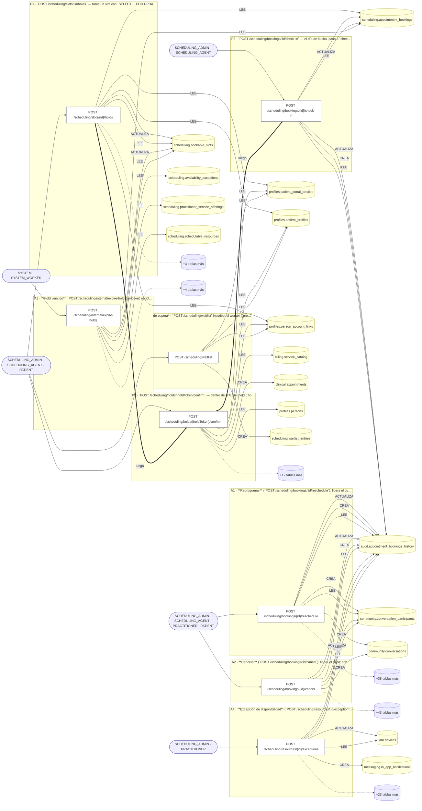

## Máquinas de estado

### Máquina de estados `BOOKING_TRANSITIONS`

Declarada en `src/modules/scheduling/domain/booking/booking-state-machine.ts:33`. Los estados llevan el nombre del identificador del código; no se resuelven al catálogo de conceptos.

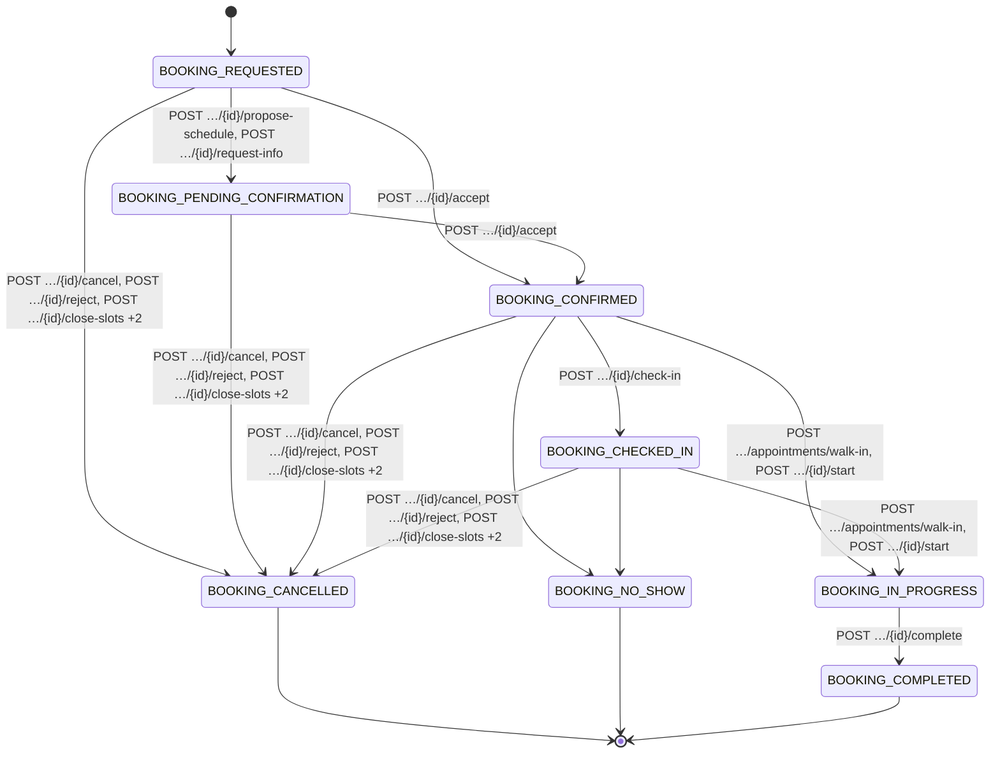

**Operaciones que ejercen esta máquina** _(POR_REFERENCIA: el handler alcanza un método que valida contra la tabla; «sin destino nombrado» significa que el estado de destino llega por el cuerpo de la petición)_:

| Operación | Estados de destino que nombra | A través de |
|---|---|---|
| POST /scheduling/appointments/walk-in | BOOKING_IN_PROGRESS | StartAppointmentUseCase.executeInTransaction → BookingTransitionRecorder.assertTransition |
| POST /scheduling/bookings/{id}/accept | BOOKING_CONFIRMED | AcceptBookingUseCase.execute → BookingTransitionRecorder.assertTransition |
| POST /scheduling/bookings/{id}/cancel | BOOKING_CANCELLED | CancelBookingUseCase.cancelInTransaction → BookingTransitionRecorder.assertTransition |
| POST /scheduling/bookings/{id}/check-in | BOOKING_CHECKED_IN | CheckInBookingUseCase.execute → BookingTransitionRecorder.assertTransition |
| POST /scheduling/bookings/{id}/complete | BOOKING_COMPLETED | CompleteAppointmentUseCase.execute → BookingTransitionRecorder.assertTransition |
| POST /scheduling/bookings/{id}/propose-schedule | BOOKING_PENDING_CONFIRMATION | ProposeScheduleUseCase.execute → BookingTransitionRecorder.assertTransition |
| POST /scheduling/bookings/{id}/reject | BOOKING_CANCELLED | CancelBookingUseCase.cancelInTransaction → BookingTransitionRecorder.assertTransition |
| POST /scheduling/bookings/{id}/request-info | BOOKING_PENDING_CONFIRMATION | RequestBookingInfoUseCase.execute → BookingTransitionRecorder.assertTransition |
| POST /scheduling/bookings/{id}/start | BOOKING_IN_PROGRESS | StartAppointmentUseCase.execute → BookingTransitionRecorder.assertTransition |
| POST /scheduling/resources/{id}/close-slots | BOOKING_CANCELLED | CancelBookingUseCase.cancelInTransaction → BookingTransitionRecorder.assertTransition |
| POST /scheduling/resources/{id}/exceptions | BOOKING_CANCELLED | CancelBookingUseCase.cancelInTransaction → BookingTransitionRecorder.assertTransition |
| DELETE /scheduling/templates/{id} | BOOKING_CANCELLED | CancelBookingUseCase.cancelInTransaction → BookingTransitionRecorder.assertTransition |

## Árbol de decisión por operación

Cada árbol se deriva del código del handler y de los métodos que invoca (hasta 4 niveles). Una rama que no decide, no escribe y no falla se poda. Los accesos y los efectos consecutivos se agrupan en un solo nodo.

### Operaciones con decisiones propias

#### 1. POST /scheduling/appointments/direct

Asignar una cita puntual a un paciente (nace confirmada)

| HTTP | Código | Cuándo |
|---|---|---|
| 201 | — | Éxito |
| 400 | `VALIDATION_FAILED` | El cuerpo cumple el DTO (sin propiedades extra) |
| 401 | `UNAUTHENTICATED` | Hay una sesión válida (JWT) |
| 403 | `FORBIDDEN` | El rol está permitido; El tenant se resuelve y pertenece al actor; ForbiddenException: La agenda indicada pertenece a otra organización.; ForbiddenException: Un profesional solo puede asignar citas en su propia agenda.; ForbiddenException: La reconsulta se agenda en su propia agenda, no en la de otro profesional. |
| 404 | `NOT_FOUND` | ResourceNotFoundException: Recurso no encontrado; ResourceNotFoundException: La cita de la que sale esta reconsulta no existe; ResourceNotFoundException: Paciente no encontrado |
| 409 | `CONFLICT` | ConflictException: Esta consulta ya tiene una reconsulta agendada |
| 422 | `PRECONDITION_FAILED` | PreconditionFailedException: Ese horario no atiende por telemedicina. Habilítela en la franja de su horario de atención o elija otra modalidad.; PreconditionFailedException: La reconsulta es para el paciente de la cita de origen; PreconditionFailedException: Una reconsulta se agenda para más adelante; PreconditionFailedException: Su vínculo con esta organización todavía está pendiente de aprobación, así que todavía no puede comprometer citas suyas. / Su vínculo con esta organización ya…; PreconditionFailedException: El profesional ya tiene {who} de {localTime( first.startAt, fir…} a {localTime( first.endAt, first…}{first.resourceName ? ` en «${…}. No puede estar en dos lug…; PreconditionFailedException: El paciente ya tiene una cita confirmada en ese rato{clash.resourceName ? ` en «${…}. |
| 429 | `RATE_LIMITED` | No se supera el límite de solicitudes |

```mermaid
flowchart TD
  n1(("Solicitud")):::inicio
  n2{{"Acceso: sesión (401) · rol (403) · tenant (403) · cuerpo válido (400) · límite de tasa (429)"}}:::acceso
  n1 --> n2
  n3["Llama a SchedulingBookingsService.createDirectAppointment"]:::llamada
  n2 --> n3
  n4["Llama a CreateDirectAppointmentUseCase.execute"]:::llamada
  n3 --> n4
  n5["Llama a CreateDirectAppointmentUseCase.executeInTransaction"]:::llamada
  n4 --> n5
  n6["Llama a SchedulingCatalogRepository.findResourceById"]:::llamada
  n5 --> n6
  n7[("LEE scheduling.schedulable_resources")]:::efecto
  n6 --> n7
  n8{"!resource"}:::decision
  n7 --> n8
  n9(["404 NOT_FOUND Recurso no encontrado"]):::error
  n8 -->|"sí"| n9
  n10["Llama a BookingAccess.assertResourceInActiveTenant"]:::llamada
  n8 -->|"no"| n10
  n11{"!withinScope"}:::decision
  n10 --> n11
  n12(["403 FORBIDDEN La agenda indicada pertenece a otra organización."]):::error
  n11 -->|"sí"| n12
  n13{"!operatesAnyAgenda(actor) && !isOwnAgenda"}:::decision
  n11 -->|"no"| n13
  n14(["403 FORBIDDEN Un profesional solo puede asignar citas en su propia agenda."]):::error
  n13 -->|"sí"| n14
  n15{"dto.channel === 'TELECONSULTA'"}:::decision
  n13 -->|"no"| n15
  n16["Llama a CreateDirectAppointmentUseCase.assertTelemedicineEnabled"]:::llamada
  n15 -->|"sí"| n16
  n17{"!startsInTelemedicineBand(startAt, bands, resource.timeZone ?? 'UTC')"}:::decision
  n16 --> n17
  n18(["422 PRECONDITION_FAILED Ese horario no atiende por telemedicina. Habilítela en la franja de su horario de ate…"]):::error
  n17 -->|"sí"| n18
  n19["Llama a CreateDirectAppointmentUseCase.validateFollowUp"]:::llamada
  n17 -->|"no"| n19
  n15 -->|"no"| n19
  n20{"!isOwnAgenda"}:::decision
  n19 --> n20
  n21(["403 FORBIDDEN La reconsulta se agenda en su propia agenda, no en la de otro profesional."]):::error
  n20 -->|"sí"| n21
  n22{"!originBooking"}:::decision
  n20 -->|"no"| n22
  n23(["404 NOT_FOUND La cita de la que sale esta reconsulta no existe"]):::error
  n22 -->|"sí"| n23
  n24{"originBooking.patientProfileId !== dto.patientProfileId"}:::decision
  n22 -->|"no"| n24
  n25(["422 PRECONDITION_FAILED La reconsulta es para el paciente de la cita de origen"]):::error
  n24 -->|"sí"| n25
  n26{"startAt.getTime() ‹= now.getTime()"}:::decision
  n24 -->|"no"| n26
  n27(["422 PRECONDITION_FAILED Una reconsulta se agenda para más adelante"]):::error
  n26 -->|"sí"| n27
  n28{"upcoming"}:::decision
  n26 -->|"no"| n28
  n29(["409 CONFLICT Esta consulta ya tiene una reconsulta agendada"]):::error
  n28 -->|"sí"| n29
  n30["Llama a BookingAccess.assertAffiliationCurrent"]:::llamada
  n28 -->|"no"| n30
  n31(["422 PRECONDITION_FAILED Su vínculo con esta organización todavía está pendiente de aprobación, así que todaví…"]):::error
  n30 --> n31
  n32["Llama a SchedulingBookingsRepository.findPatientNames"]:::llamada
  n33[("LEE profiles.patient_profiles · LEE profiles.persons")]:::efecto
  n32 --> n33
  n34{"!names.has(dto.patientProfileId)"}:::decision
  n33 --> n34
  n35(["404 NOT_FOUND Paciente no encontrado"]):::error
  n34 -->|"sí"| n35
  n36{"PRACTITIONER_PROFILE_TABLES.includes(resource.resourceRefType)"}:::decision
  n34 -->|"no"| n36
  n37["Llama a SchedulingProfessionalTimeService.assertRangeFree"]:::llamada
  n36 -->|"sí"| n37
  n38(["422 PRECONDITION_FAILED El profesional ya tiene {who} de {localTime( first.startAt, fir…} a {localTime( first…"]):::error
  n37 --> n38
  n39["Llama a SchedulingBookingsRepository.findPatientBookingsOverlapping"]:::llamada
  n36 -->|"no"| n39
  n40[("LEE scheduling.appointment_bookings · LEE scheduling.bookable_slots · LEE scheduling.schedulable_resources")]:::efecto
  n39 --> n40
  n41{"alreadyCommitted.length › 0"}:::decision
  n40 --> n41
  n42(["422 PRECONDITION_FAILED El paciente ya tiene una cita confirmada en ese rato{clash.resourceName ? ` en «${…}."]):::error
  n41 -->|"sí"| n42
  n43{"PRACTITIONER_PROFILE_TABLES.includes(resource.resourceRefType)"}:::decision
  n41 -->|"no"| n43
  n44["Llama a SchedulingCatalogRepository.findOpenSlotsOfProfessionalInWindow"]:::llamada
  n43 -->|"sí"| n44
  n45[("LEE scheduling.schedulable_resources · LEE scheduling.bookable_slots")]:::efecto
  n44 --> n45
  n46["Repite: por cada const free de freeOnes"]:::bucle
  n45 --> n46
  n47[("ACTUALIZA scheduling.bookable_slots")]:::efecto
  n46 -->|"cada elemento"| n47
  n48["Llama a SchedulingCatalogRepository.createSlot"]:::llamada
  n47 --> n48
  n46 -->|"al terminar"| n48
  n43 -->|"no"| n48
  n49[("CREA scheduling.bookable_slots")]:::efecto
  n48 --> n49
  n50["Llama a SchedulingBookingsRepository.createBooking"]:::llamada
  n49 --> n50
  n51[("CREA scheduling.appointment_bookings")]:::efecto
  n50 --> n51
  n52["Repite: por cada const offset de DEFAULT_REMINDER_OFFSETS"]:::bucle
  n51 --> n52
  n53["Llama a SchedulingBookingsRepository.createReminder"]:::llamada
  n52 -->|"cada elemento"| n53
  n54[("CREA scheduling.appointment_reminders")]:::efecto
  n53 --> n54
  n55["Llama a BookingChangeNotifier.notifyChange"]:::llamada
  n54 --> n55
  n52 -->|"al terminar"| n55
  n56["Llama a SchedulingNoticeRepository.describeBooking"]:::llamada
  n55 --> n56
  n57[("LEE scheduling.appointment_bookings · LEE scheduling.bookable_slots")]:::efecto
  n56 --> n57
  n58["Llama a SchedulingNoticeRepository.findResourceAccount"]:::llamada
  n57 --> n58
  n59[("LEE scheduling.schedulable_resources")]:::efecto
  n58 --> n59
  n60(("201 Responde con éxito")):::ok
  n59 --> n60
  classDef acceso fill:#eef,stroke:#66a
  classDef error fill:#fee,stroke:#c33
  classDef ok fill:#efe,stroke:#3a3
  classDef efecto fill:#ffd,stroke:#aa3
  classDef decision fill:#fff,stroke:#555
  classDef corte fill:#eee,stroke:#999,stroke-dasharray: 4
```

#### 2. POST /scheduling/appointments/walk-in

Turno de mostrador atómico (walk-in)

| HTTP | Código | Cuándo |
|---|---|---|
| 201 | — | Éxito |
| 400 | `VALIDATION_FAILED` | El cuerpo cumple el DTO (sin propiedades extra) |
| 401 | `UNAUTHENTICATED` | Hay una sesión válida (JWT) |
| 403 | `FORBIDDEN` | El rol está permitido; El tenant se resuelve y pertenece al actor; ForbiddenException: La agenda indicada pertenece a otra organización.; ForbiddenException: Un profesional solo puede asignar citas en su propia agenda.; ForbiddenException: La reconsulta se agenda en su propia agenda, no en la de otro profesional. |
| 404 | `NOT_FOUND` | ResourceNotFoundException: Recurso no encontrado; ResourceNotFoundException: La cita de la que sale esta reconsulta no existe; ResourceNotFoundException: Paciente no encontrado |
| 409 | `CONFLICT` | ConflictException: Esta consulta ya tiene una reconsulta agendada |
| 422 | `PRECONDITION_FAILED` | PreconditionFailedException: Ese horario no atiende por telemedicina. Habilítela en la franja de su horario de atención o elija otra modalidad.; PreconditionFailedException: La reconsulta es para el paciente de la cita de origen; PreconditionFailedException: Una reconsulta se agenda para más adelante; PreconditionFailedException: Su vínculo con esta organización todavía está pendiente de aprobación, así que todavía no puede comprometer citas suyas. / Su vínculo con esta organización ya…; PreconditionFailedException: El profesional ya tiene {who} de {localTime( first.startAt, fir…} a {localTime( first.endAt, first…}{first.resourceName ? ` en «${…}. No puede estar en dos lug…; PreconditionFailedException: El paciente ya tiene una cita confirmada en ese rato{clash.resourceName ? ` en «${…}.; PreconditionFailedException: Transición de estado de cita no permitida |
| 429 | `RATE_LIMITED` | No se supera el límite de solicitudes |

```mermaid
flowchart TD
  n1(("Solicitud")):::inicio
  n2{{"Acceso: sesión (401) · rol (403) · tenant (403) · cuerpo válido (400) · límite de tasa (429)"}}:::acceso
  n1 --> n2
  n3["Llama a SchedulingWalkInService.createWalkInAppointment"]:::llamada
  n2 --> n3
  n4["Transacción: transactional(…)"]:::transaccion
  n3 --> n4
  n5["Llama a SchedulingBookingsService.createDirectAppointmentInTransaction"]:::llamada
  n4 --> n5
  n6["Llama a CreateDirectAppointmentUseCase.executeInTransaction"]:::llamada
  n5 --> n6
  n7["Llama a SchedulingCatalogRepository.findResourceById"]:::llamada
  n6 --> n7
  n8[("LEE scheduling.schedulable_resources")]:::efecto
  n7 --> n8
  n9{"!resource"}:::decision
  n8 --> n9
  n10(["404 NOT_FOUND Recurso no encontrado"]):::error
  n9 -->|"sí"| n10
  n11["Llama a BookingAccess.assertResourceInActiveTenant"]:::llamada
  n9 -->|"no"| n11
  n12{"!withinScope"}:::decision
  n11 --> n12
  n13(["403 FORBIDDEN La agenda indicada pertenece a otra organización."]):::error
  n12 -->|"sí"| n13
  n14{"!operatesAnyAgenda(actor) && !isOwnAgenda"}:::decision
  n12 -->|"no"| n14
  n15(["403 FORBIDDEN Un profesional solo puede asignar citas en su propia agenda."]):::error
  n14 -->|"sí"| n15
  n16{"dto.channel === 'TELECONSULTA'"}:::decision
  n14 -->|"no"| n16
  n17["Llama a CreateDirectAppointmentUseCase.assertTelemedicineEnabled"]:::llamada
  n16 -->|"sí"| n17
  n18{"!startsInTelemedicineBand(startAt, bands, resource.timeZone ?? 'UTC')"}:::decision
  n17 --> n18
  n19(["422 PRECONDITION_FAILED Ese horario no atiende por telemedicina. Habilítela en la franja de su horario de ate…"]):::error
  n18 -->|"sí"| n19
  n20["Llama a CreateDirectAppointmentUseCase.validateFollowUp"]:::llamada
  n18 -->|"no"| n20
  n16 -->|"no"| n20
  n21{"!isOwnAgenda"}:::decision
  n20 --> n21
  n22(["403 FORBIDDEN La reconsulta se agenda en su propia agenda, no en la de otro profesional."]):::error
  n21 -->|"sí"| n22
  n23{"!originBooking"}:::decision
  n21 -->|"no"| n23
  n24(["404 NOT_FOUND La cita de la que sale esta reconsulta no existe"]):::error
  n23 -->|"sí"| n24
  n25{"originBooking.patientProfileId !== dto.patientProfileId"}:::decision
  n23 -->|"no"| n25
  n26(["422 PRECONDITION_FAILED La reconsulta es para el paciente de la cita de origen"]):::error
  n25 -->|"sí"| n26
  n27{"startAt.getTime() ‹= now.getTime()"}:::decision
  n25 -->|"no"| n27
  n28(["422 PRECONDITION_FAILED Una reconsulta se agenda para más adelante"]):::error
  n27 -->|"sí"| n28
  n29{"upcoming"}:::decision
  n27 -->|"no"| n29
  n30(["409 CONFLICT Esta consulta ya tiene una reconsulta agendada"]):::error
  n29 -->|"sí"| n30
  n31["Llama a BookingAccess.assertAffiliationCurrent"]:::llamada
  n29 -->|"no"| n31
  n32(["422 PRECONDITION_FAILED Su vínculo con esta organización todavía está pendiente de aprobación, así que todaví…"]):::error
  n31 --> n32
  n33["Llama a SchedulingBookingsRepository.findPatientNames"]:::llamada
  n34[("LEE profiles.patient_profiles · LEE profiles.persons")]:::efecto
  n33 --> n34
  n35{"!names.has(dto.patientProfileId)"}:::decision
  n34 --> n35
  n36(["404 NOT_FOUND Paciente no encontrado"]):::error
  n35 -->|"sí"| n36
  n37{"PRACTITIONER_PROFILE_TABLES.includes(resource.resourceRefType)"}:::decision
  n35 -->|"no"| n37
  n38["Llama a SchedulingProfessionalTimeService.assertRangeFree"]:::llamada
  n37 -->|"sí"| n38
  n39(["422 PRECONDITION_FAILED El profesional ya tiene {who} de {localTime( first.startAt, fir…} a {localTime( first…"]):::error
  n38 --> n39
  n40["Llama a SchedulingBookingsRepository.findPatientBookingsOverlapping"]:::llamada
  n37 -->|"no"| n40
  n41[("LEE scheduling.appointment_bookings · LEE scheduling.bookable_slots · LEE scheduling.schedulable_resources")]:::efecto
  n40 --> n41
  n42{"alreadyCommitted.length › 0"}:::decision
  n41 --> n42
  n43(["422 PRECONDITION_FAILED El paciente ya tiene una cita confirmada en ese rato{clash.resourceName ? ` en «${…}."]):::error
  n42 -->|"sí"| n43
  n44{"PRACTITIONER_PROFILE_TABLES.includes(resource.resourceRefType)"}:::decision
  n42 -->|"no"| n44
  n45["Llama a SchedulingCatalogRepository.findOpenSlotsOfProfessionalInWindow"]:::llamada
  n44 -->|"sí"| n45
  n46[("LEE scheduling.schedulable_resources · LEE scheduling.bookable_slots")]:::efecto
  n45 --> n46
  n47["Repite: por cada const free de freeOnes"]:::bucle
  n46 --> n47
  n48[("ACTUALIZA scheduling.bookable_slots")]:::efecto
  n47 -->|"cada elemento"| n48
  n49["Llama a SchedulingCatalogRepository.createSlot"]:::llamada
  n48 --> n49
  n47 -->|"al terminar"| n49
  n44 -->|"no"| n49
  n50[("CREA scheduling.bookable_slots")]:::efecto
  n49 --> n50
  n51["Llama a SchedulingBookingsRepository.createBooking"]:::llamada
  n50 --> n51
  n52[("CREA scheduling.appointment_bookings")]:::efecto
  n51 --> n52
  n53["Repite: por cada const offset de DEFAULT_REMINDER_OFFSETS"]:::bucle
  n52 --> n53
  n54["Llama a SchedulingBookingsRepository.createReminder"]:::llamada
  n53 -->|"cada elemento"| n54
  n55[("CREA scheduling.appointment_reminders")]:::efecto
  n54 --> n55
  n56["Llama a ClinicalEncountersAdapter.open"]:::llamada
  n55 --> n56
  n53 -->|"al terminar"| n56
  n57["Llama a EncountersRepository.create"]:::llamada
  n56 --> n57
  n58[("CREA clinical.encounters")]:::efecto
  n57 --> n58
  n59{"appointment.practitionerProfileId"}:::decision
  n58 --> n59
  n60["Llama a ClinicalEncountersAdapter.addParticipant"]:::llamada
  n59 -->|"sí"| n60
  n61["Llama a EncountersRepository.createParticipant"]:::llamada
  n60 --> n61
  n62[("CREA clinical.encounter_participants")]:::efecto
  n61 --> n62
  n63["Llama a SchedulingBookingsService.startInTransaction"]:::llamada
  n62 --> n63
  n59 -->|"no"| n63
  n64["Llama a StartAppointmentUseCase.executeInTransaction"]:::llamada
  n63 --> n64
  n65["Llama a BookingTransitionRecorder.assertTransition"]:::llamada
  n64 --> n65
  n66{"!isValidBookingTransition(from, to)"}:::decision
  n65 --> n66
  n67(["422 PRECONDITION_FAILED Transición de estado de cita no permitida"]):::error
  n66 -->|"sí"| n67
  n68[("ACTUALIZA scheduling.appointment_bookings")]:::efecto
  n66 -->|"no"| n68
  n69(("201 Responde con éxito")):::ok
  n68 --> n69
  classDef acceso fill:#eef,stroke:#66a
  classDef error fill:#fee,stroke:#c33
  classDef ok fill:#efe,stroke:#3a3
  classDef efecto fill:#ffd,stroke:#aa3
  classDef decision fill:#fff,stroke:#555
  classDef corte fill:#eee,stroke:#999,stroke-dasharray: 4
```

#### 3. POST /scheduling/booking-policies

Definir una política de reserva

| HTTP | Código | Cuándo |
|---|---|---|
| 201 | — | Éxito |
| 400 | `VALIDATION_FAILED` | El cuerpo cumple el DTO (sin propiedades extra) |
| 401 | `UNAUTHENTICATED` | Hay una sesión válida (JWT) |
| 403 | `FORBIDDEN` | El rol está permitido; El tenant se resuelve y pertenece al actor; ForbiddenException: El tenant indicado no es uno de los del actor. |
| 409 | `CONFLICT` | ConflictException: Ya existe una política con ese código |
| 429 | `RATE_LIMITED` | No se supera el límite de solicitudes |

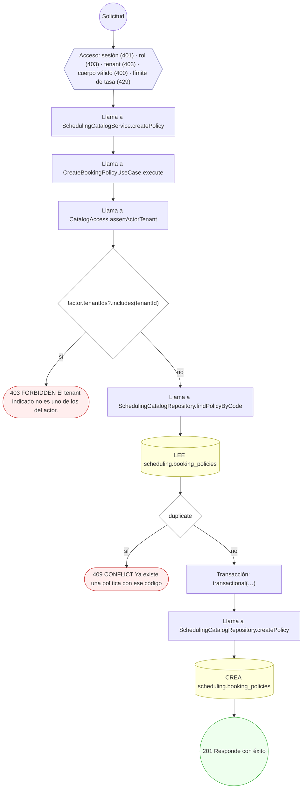

#### 4. GET /scheduling/bookings

UC-41-15: lista citas por paciente, recurso y/o ventana

| HTTP | Código | Cuándo |
|---|---|---|
| 200 | — | Éxito |
| 401 | `UNAUTHENTICATED` | Hay una sesión válida (JWT) |
| 403 | `FORBIDDEN` | El rol está permitido; El tenant se resuelve y pertenece al actor; ForbiddenException: Esta agenda es de otro profesional: solo se lista desde su propia cuenta.; ForbiddenException: Esta cuenta no tiene un perfil de paciente con citas que listar. |
| 422 | `PRECONDITION_FAILED` | PreconditionFailedException: Indique al menos patientProfileId o resourceId para listar citas; PreconditionFailedException: La ventana debe empezar antes de terminar |
| 429 | `RATE_LIMITED` | No se supera el límite de solicitudes |

```mermaid
flowchart TD
  n1(("Solicitud")):::inicio
  n2{{"Acceso: sesión (401) · rol (403) · tenant (403) · límite de tasa (429)"}}:::acceso
  n1 --> n2
  n3["Llama a SchedulingBookingsService.searchBookings"]:::llamada
  n2 --> n3
  n4["Llama a SearchBookingsUseCase.execute"]:::llamada
  n3 --> n4
  n5{"!filters.patientProfileId && !filters.resourceId"}:::decision
  n4 --> n5
  n6(["422 PRECONDITION_FAILED Indique al menos patientProfileId o resourceId para listar citas"]):::error
  n5 -->|"sí"| n6
  n7{"filters.from && filters.to && !(filters.from ‹ filters.to)"}:::decision
  n5 -->|"no"| n7
  n8(["422 PRECONDITION_FAILED La ventana debe empezar antes de terminar"]):::error
  n7 -->|"sí"| n8
  n9{"filters.resourceId"}:::decision
  n7 -->|"no"| n9
  n10["Llama a SchedulingCatalogRepository.findResourceById"]:::llamada
  n9 -->|"sí"| n10
  n11[("LEE scheduling.schedulable_resources")]:::efecto
  n10 --> n11
  n12{"actor && !operatesAnyAgenda(actor)"}:::decision
  n11 --> n12
  n13{"actor.practitionerProfileId !== undefined"}:::decision
  n12 -->|"sí"| n13
  n14{"resource.resourceRefId !== actor.practitionerProfileId"}:::decision
  n13 -->|"sí"| n14
  n15(["403 FORBIDDEN Esta agenda es de otro profesional: solo se lista desde su propia cuenta."]):::error
  n14 -->|"sí"| n15
  n16{"!filters.patientProfileId"}:::decision
  n13 -->|"no"| n16
  n17{"patientProfileIds.length === 0"}:::decision
  n16 -->|"sí"| n17
  n18(["403 FORBIDDEN Esta cuenta no tiene un perfil de paciente con citas que listar."]):::error
  n17 -->|"sí"| n18
  n19["Llama a SchedulingBookingsRepository.findBookings"]:::llamada
  n14 -->|"no"| n19
  n17 -->|"no"| n19
  n16 -->|"no"| n19
  n12 -->|"no"| n19
  n9 -->|"no"| n19
  n20[("LEE scheduling.appointment_bookings · LEE scheduling.bookable_slots")]:::efecto
  n19 --> n20
  n21["Llama a AuditBookingHistoryAdapter.latestByBooking"]:::llamada
  n20 --> n21
  n22[("LEE audit.appointment_bookings_history")]:::efecto
  n21 --> n22
  n23["Llama a AuditBookingHistoryAdapter.latestByBooking"]:::llamada
  n22 --> n23
  n24[("LEE audit.appointment_bookings_history")]:::efecto
  n23 --> n24
  n25["Llama a SchedulingBookingsRepository.latestRescheduleOrigins"]:::llamada
  n24 --> n25
  n26[("LEE scheduling.booking_reschedules · LEE scheduling.bookable_slots")]:::efecto
  n25 --> n26
  n27{"actor?.practitionerProfileId !== undefined"}:::decision
  n26 --> n27
  n28["Repite: por cada const id de ids"]:::bucle
  n27 -->|"sí"| n28
  n29["Llama a SchedulingCatalogRepository.findResourceById"]:::llamada
  n28 -->|"cada elemento"| n29
  n30[("LEE scheduling.schedulable_resources")]:::efecto
  n29 --> n30
  n31["Llama a ClinicalAppointmentsAdapter.findTypesByIds"]:::llamada
  n30 --> n31
  n28 -->|"al terminar"| n31
  n27 -->|"no"| n31
  n32["Llama a AppointmentsRepository.findTypesByIds"]:::llamada
  n31 --> n32
  n33[("LEE clinical.appointments")]:::efecto
  n32 --> n33
  n34["Llama a ClinicalAppointmentsAdapter.findLatestEncounterIds"]:::llamada
  n33 --> n34
  n35["Llama a EncountersRepository.findLatestIdsByAppointmentIds"]:::llamada
  n34 --> n35
  n36[("LEE clinical.encounters")]:::efecto
  n35 --> n36
  n37["Llama a SchedulingBookingsRepository.findPatientNames"]:::llamada
  n36 --> n37
  n38[("LEE profiles.patient_profiles · LEE profiles.persons")]:::efecto
  n37 --> n38
  n39["Llama a SchedulingBookingsRepository.findPaymentStatesForBookings"]:::llamada
  n38 --> n39
  n40[("LEE scheduling.appointment_payment_states")]:::efecto
  n39 --> n40
  n41["Llama a InsuranceReadAdapter.findActiveCarriersByPatients"]:::llamada
  n40 --> n41
  n42["Llama a CoverageRepository.findActiveCarriersByPatients"]:::llamada
  n41 --> n42
  n43[("LEE insurance.patient_coverages · LEE insurance.insurance_plans · LEE insurance.insurance_products · LEE insu…")]:::efecto
  n42 --> n43
  n44["Llama a BookingItemAssembler.followUpLinks"]:::llamada
  n43 --> n44
  n45["Llama a SchedulingBookingsRepository.findBookingsWithSlotsByIds"]:::llamada
  n44 --> n45
  n46[("LEE scheduling.appointment_bookings")]:::efecto
  n45 --> n46
  n47["Llama a SchedulingBookingsRepository.findFollowUpsOf"]:::llamada
  n46 --> n47
  n48[("LEE scheduling.appointment_bookings")]:::efecto
  n47 --> n48
  n49(("200 Responde con éxito")):::ok
  n48 --> n49
  classDef acceso fill:#eef,stroke:#66a
  classDef error fill:#fee,stroke:#c33
  classDef ok fill:#efe,stroke:#3a3
  classDef efecto fill:#ffd,stroke:#aa3
  classDef decision fill:#fff,stroke:#555
  classDef corte fill:#eee,stroke:#999,stroke-dasharray: 4
```

#### 5. GET /scheduling/bookings/{id}

UC-41-15: consulta una cita

| HTTP | Código | Cuándo |
|---|---|---|
| 200 | — | Éxito |
| 400 | `VALIDATION_FAILED` | Los parámetros de ruta son UUID válidos |
| 401 | `UNAUTHENTICATED` | Hay una sesión válida (JWT) |
| 403 | `FORBIDDEN` | El rol está permitido; El tenant se resuelve y pertenece al actor; ForbiddenException: Esta cita es de otra agenda: solo la opera quien atiende en ella. |
| 404 | `NOT_FOUND` | ResourceNotFoundException: Cita no encontrada |
| 429 | `RATE_LIMITED` | No se supera el límite de solicitudes |

```mermaid
flowchart TD
  n1(("Solicitud")):::inicio
  n2{{"Acceso: sesión (401) · rol (403) · tenant (403) · parámetros de ruta (400) · límite de tasa (429)"}}:::acceso
  n1 --> n2
  n3["Llama a SchedulingBookingsService.getBookingById"]:::llamada
  n2 --> n3
  n4["Llama a GetBookingUseCase.execute"]:::llamada
  n3 --> n4
  n5["Llama a SchedulingBookingsRepository.findBookingById"]:::llamada
  n4 --> n5
  n6[("LEE scheduling.appointment_bookings")]:::efecto
  n5 --> n6
  n7{"!booking"}:::decision
  n6 --> n7
  n8(["404 NOT_FOUND Cita no encontrada"]):::error
  n7 -->|"sí"| n8
  n9["Llama a SchedulingBookingsRepository.findSlotById"]:::llamada
  n7 -->|"no"| n9
  n10[("LEE scheduling.bookable_slots")]:::efecto
  n9 --> n10
  n11["Llama a AuditBookingHistoryAdapter.latestByBooking"]:::llamada
  n10 --> n11
  n12[("LEE audit.appointment_bookings_history")]:::efecto
  n11 --> n12
  n13["Llama a AuditBookingHistoryAdapter.latestByBooking"]:::llamada
  n12 --> n13
  n14[("LEE audit.appointment_bookings_history")]:::efecto
  n13 --> n14
  n15["Llama a SchedulingBookingsRepository.latestRescheduleOrigins"]:::llamada
  n14 --> n15
  n16[("LEE scheduling.booking_reschedules · LEE scheduling.bookable_slots")]:::efecto
  n15 --> n16
  n17["Llama a SchedulingCatalogRepository.findResourceById"]:::llamada
  n16 --> n17
  n18[("LEE scheduling.schedulable_resources")]:::efecto
  n17 --> n18
  n19{"isPatientActor(actor)"}:::decision
  n18 --> n19
  n20{"actor && !operatesAnyAgenda(actor)"}:::decision
  n19 -->|"no"| n20
  n21{"!isOwnAgenda"}:::decision
  n20 -->|"sí"| n21
  n22(["403 FORBIDDEN Esta cita es de otra agenda: solo la opera quien atiende en ella."]):::error
  n21 -->|"sí"| n22
  n23["Llama a ClinicalAppointmentsAdapter.findTypesByIds"]:::llamada
  n19 -->|"sí"| n23
  n21 -->|"no"| n23
  n20 -->|"no"| n23
  n24["Llama a AppointmentsRepository.findTypesByIds"]:::llamada
  n23 --> n24
  n25[("LEE clinical.appointments")]:::efecto
  n24 --> n25
  n26["Llama a ClinicalAppointmentsAdapter.findLatestEncounterIds"]:::llamada
  n25 --> n26
  n27["Llama a EncountersRepository.findLatestIdsByAppointmentIds"]:::llamada
  n26 --> n27
  n28[("LEE clinical.encounters")]:::efecto
  n27 --> n28
  n29["Llama a BookingItemAssembler.followUpLinks"]:::llamada
  n28 --> n29
  n30["Llama a SchedulingBookingsRepository.findBookingsWithSlotsByIds"]:::llamada
  n29 --> n30
  n31[("LEE scheduling.appointment_bookings")]:::efecto
  n30 --> n31
  n32["Llama a SchedulingBookingsRepository.findFollowUpsOf"]:::llamada
  n31 --> n32
  n33[("LEE scheduling.appointment_bookings")]:::efecto
  n32 --> n33
  n34(("200 Responde con éxito")):::ok
  n33 --> n34
  classDef acceso fill:#eef,stroke:#66a
  classDef error fill:#fee,stroke:#c33
  classDef ok fill:#efe,stroke:#3a3
  classDef efecto fill:#ffd,stroke:#aa3
  classDef decision fill:#fff,stroke:#555
  classDef corte fill:#eee,stroke:#999,stroke-dasharray: 4
```

#### 6. POST /scheduling/bookings/{id}/accept

Aceptar la solicitud de cita

| HTTP | Código | Cuándo |
|---|---|---|
| 200 | — | Éxito |
| 400 | `VALIDATION_FAILED` | Los parámetros de ruta son UUID válidos; El cuerpo cumple el DTO (sin propiedades extra) |
| 401 | `UNAUTHENTICATED` | Hay una sesión válida (JWT) |
| 403 | `FORBIDDEN` | El rol está permitido; El tenant se resuelve y pertenece al actor; ForbiddenException: Esta cita es de otra agenda: solo la opera quien atiende en ella. |
| 404 | `NOT_FOUND` | ResourceNotFoundException: Cita no encontrada |
| 422 | `PRECONDITION_FAILED` | PreconditionFailedException: Su vínculo con esta organización todavía está pendiente de aprobación, así que todavía no puede comprometer citas suyas. / Su vínculo con esta organización ya…; PreconditionFailedException: Transición de estado de cita no permitida; PreconditionFailedException: El profesional ya tiene {who} de {localTime( first.startAt, fir…} a {localTime( first.endAt, first…}{first.resourceName ? ` en «${…}. No puede estar en dos lug… |
| 429 | `RATE_LIMITED` | No se supera el límite de solicitudes |

```mermaid
flowchart TD
  n1(("Solicitud")):::inicio
  n2{{"Acceso: sesión (401) · rol (403) · tenant (403) · parámetros de ruta (400) · cuerpo válido (400) · límite de…"}}:::acceso
  n1 --> n2
  n3["Llama a SchedulingBookingsService.accept"]:::llamada
  n2 --> n3
  n4["Llama a AcceptBookingUseCase.execute"]:::llamada
  n3 --> n4
  n5["Transacción: transactional(…)"]:::transaccion
  n4 --> n5
  n6["Llama a BookingAccess.loadForOperation"]:::llamada
  n5 --> n6
  n7["Llama a SchedulingBookingsRepository.findBookingByIdForUpdate"]:::llamada
  n6 --> n7
  n8[("LEE scheduling.appointment_bookings")]:::efecto
  n7 --> n8
  n9{"!booking"}:::decision
  n8 --> n9
  n10(["404 NOT_FOUND Cita no encontrada"]):::error
  n9 -->|"sí"| n10
  n11["Llama a SchedulingCatalogRepository.findResourceById"]:::llamada
  n9 -->|"no"| n11
  n12[("LEE scheduling.schedulable_resources")]:::efecto
  n11 --> n12
  n13{"!isOwnAgenda"}:::decision
  n12 --> n13
  n14(["403 FORBIDDEN Esta cita es de otra agenda: solo la opera quien atiende en ella."]):::error
  n13 -->|"sí"| n14
  n15["Llama a BookingAccess.assertAffiliationCurrent"]:::llamada
  n13 -->|"no"| n15
  n16(["422 PRECONDITION_FAILED Su vínculo con esta organización todavía está pendiente de aprobación, así que todaví…"]):::error
  n15 --> n16
  n17["Llama a BookingTransitionRecorder.assertTransition"]:::llamada
  n18{"!isValidBookingTransition(from, to)"}:::decision
  n17 --> n18
  n19(["422 PRECONDITION_FAILED Transición de estado de cita no permitida"]):::error
  n18 -->|"sí"| n19
  n20["Llama a SchedulingCatalogRepository.findResourceById"]:::llamada
  n18 -->|"no"| n20
  n21[("LEE scheduling.schedulable_resources")]:::efecto
  n20 --> n21
  n22{"bookingResource && PRACTITIONER_PROFILE_TABLES.includes(bookingResource.resourceRefType)"}:::decision
  n21 --> n22
  n23["Llama a SchedulingBookingsRepository.findSlotById"]:::llamada
  n22 -->|"sí"| n23
  n24[("LEE scheduling.bookable_slots")]:::efecto
  n23 --> n24
  n25{"bookingSlot"}:::decision
  n24 --> n25
  n26["Llama a SchedulingProfessionalTimeService.assertRangeFree"]:::llamada
  n25 -->|"sí"| n26
  n27{"first.kind === 'ocupado'"}:::decision
  n26 --> n27
  n28{"first.patientProfileId"}:::decision
  n27 -->|"no"| n28
  n29["Llama a SchedulingBookingsRepository.findPatientNames"]:::llamada
  n28 -->|"sí"| n29
  n30[("LEE profiles.patient_profiles · LEE profiles.persons")]:::efecto
  n29 --> n30
  n31(["422 PRECONDITION_FAILED El profesional ya tiene {who} de {localTime( first.startAt, fir…} a {localTime( first…"]):::error
  n27 -->|"sí"| n31
  n30 --> n31
  n28 -->|"no"| n31
  n32[("ACTUALIZA scheduling.appointment_bookings · ACTUALIZA scheduling.appointment_bookings")]:::efecto
  n25 -->|"no"| n32
  n22 -->|"no"| n32
  n33["Llama a ClinicalAppointmentSync.syncClinicalAppointment"]:::llamada
  n32 --> n33
  n34["Llama a ClinicalAppointmentsAdapter.updateStatus"]:::llamada
  n33 --> n34
  n35[("ACTUALIZA clinical.appointments")]:::efecto
  n34 --> n35
  n36["Llama a BookingTransitionRecorder.recordTransition"]:::llamada
  n35 --> n36
  n37["Llama a AuditBookingHistoryAdapter.append"]:::llamada
  n36 --> n37
  n38[("LEE audit.appointment_bookings_history · ACTUALIZA audit.appointment_bookings_history · CREA audit.appointmen…")]:::efecto
  n37 --> n38
  n39["Llama a SchedulingBookingsRepository.findSlotById"]:::llamada
  n38 --> n39
  n40[("LEE scheduling.bookable_slots")]:::efecto
  n39 --> n40
  n41["Repite: por cada const offset de offsets"]:::bucle
  n40 --> n41
  n42["Llama a SchedulingBookingsRepository.createReminder"]:::llamada
  n41 -->|"cada elemento"| n42
  n43[("CREA scheduling.appointment_reminders")]:::efecto
  n42 --> n43
  n44["Llama a DisplacedRequestsCanceller.cancelConflictingPending"]:::llamada
  n43 --> n44
  n41 -->|"al terminar"| n44
  n45["Llama a SchedulingBookingsRepository.findSlotById"]:::llamada
  n44 --> n45
  n46[("LEE scheduling.bookable_slots")]:::efecto
  n45 --> n46
  n47["Llama a SchedulingBookingsRepository.findPatientBookingsOverlapping"]:::llamada
  n46 --> n47
  n48[("LEE scheduling.appointment_bookings · LEE scheduling.bookable_slots · LEE scheduling.schedulable_resources")]:::efecto
  n47 --> n48
  n49["Repite: por cada const other de clashing"]:::bucle
  n48 --> n49
  n50["Llama a SchedulingBookingsRepository.findBookingByIdForUpdate"]:::llamada
  n49 -->|"cada elemento"| n50
  n51[("LEE scheduling.appointment_bookings")]:::efecto
  n50 --> n51
  n52["Llama a SchedulingBookingsRepository.createCancellation"]:::llamada
  n51 --> n52
  n53[("CREA scheduling.booking_cancellations")]:::efecto
  n52 --> n53
  n54[("ACTUALIZA scheduling.appointment_bookings")]:::efecto
  n53 --> n54
  n55["Llama a SchedulingBookingsRepository.findSlotForUpdate"]:::llamada
  n54 --> n55
  n56[("LEE scheduling.bookable_slots")]:::efecto
  n55 --> n56
  n57{"ownSlot"}:::decision
  n56 --> n57
  n58[("ACTUALIZA scheduling.bookable_slots")]:::efecto
  n57 -->|"sí"| n58
  n59{"await this.serviceSlots.isOneOffOnDemand(tx, ownSlot)"}:::decision
  n58 --> n59
  n60["Llama a ServiceSlotLifecycle.discardOneOffSlot"]:::llamada
  n59 -->|"sí"| n60
  n61[("ACTUALIZA scheduling.bookable_slots")]:::efecto
  n60 --> n61
  n62{"ownSlot.statusConceptId === CONCEPTS.SLOT_HELD"}:::decision
  n59 -->|"no"| n62
  n63[("ACTUALIZA scheduling.bookable_slots")]:::efecto
  n62 -->|"sí"| n63
  n64["Llama a BookingChangeNotifier.notifyChange"]:::llamada
  n61 --> n64
  n63 --> n64
  n62 -->|"no"| n64
  n57 -->|"no"| n64
  n49 -->|"al terminar"| n64
  n65["Llama a SchedulingNoticeRepository.describeBooking"]:::llamada
  n64 --> n65
  n66[("LEE scheduling.appointment_bookings · LEE scheduling.bookable_slots")]:::efecto
  n65 --> n66
  n67["Llama a SchedulingNoticeRepository.findResourceAccount"]:::llamada
  n66 --> n67
  n68[("LEE scheduling.schedulable_resources")]:::efecto
  n67 --> n68
  n69["Repite: por cada const id de result.desplazadas"]:::bucle
  n68 --> n69
  n70["Llama a BookingChangeNotifier.notifyChange"]:::llamada
  n69 -->|"cada elemento"| n70
  n71["… el resto del árbol (5 nodos) está en el JSON del inventario"]:::corte
  n70 --> n71
  classDef acceso fill:#eef,stroke:#66a
  classDef error fill:#fee,stroke:#c33
  classDef ok fill:#efe,stroke:#3a3
  classDef efecto fill:#ffd,stroke:#aa3
  classDef decision fill:#fff,stroke:#555
  classDef corte fill:#eee,stroke:#999,stroke-dasharray: 4
```

#### 7. POST /scheduling/bookings/{id}/cancel

Cancelar la cita y liberar el cupo

| HTTP | Código | Cuándo |
|---|---|---|
| 200 | — | Éxito |
| 400 | `VALIDATION_FAILED` | Los parámetros de ruta son UUID válidos; El cuerpo cumple el DTO (sin propiedades extra) |
| 401 | `UNAUTHENTICATED` | Hay una sesión válida (JWT) |
| 403 | `FORBIDDEN` | El rol está permitido; El tenant se resuelve y pertenece al actor |
| 404 | `NOT_FOUND` | ResourceNotFoundException: Cita no encontrada; ResourceNotFoundException: Slot no encontrado |
| 409 | `CONFLICT` | ConflictException: La cita ya está cancelada |
| 422 | `PRECONDITION_FAILED` | PreconditionFailedException: Transición de estado de cita no permitida; PreconditionFailedException: Puede cancelar hasta {Math.round(windowMinutes / 60)} horas antes del turno. Si ya no puede asistir, comuníquese con el consultorio. |
| 429 | `RATE_LIMITED` | No se supera el límite de solicitudes |

```mermaid
flowchart TD
  n1(("Solicitud")):::inicio
  n2{{"Acceso: sesión (401) · rol (403) · tenant (403) · parámetros de ruta (400) · cuerpo válido (400) · límite de…"}}:::acceso
  n1 --> n2
  n3["Llama a SchedulingBookingsService.cancel"]:::llamada
  n2 --> n3
  n4["Llama a CancelBookingUseCase.execute"]:::llamada
  n3 --> n4
  n5["Llama a CancelBookingUseCase.cancelInTransaction"]:::llamada
  n4 --> n5
  n6["Llama a SchedulingBookingsRepository.findBookingByIdForUpdate"]:::llamada
  n5 --> n6
  n7[("LEE scheduling.appointment_bookings")]:::efecto
  n6 --> n7
  n8{"!booking"}:::decision
  n7 --> n8
  n9(["404 NOT_FOUND Cita no encontrada"]):::error
  n8 -->|"sí"| n9
  n10{"booking.statusConceptId === CONCEPTS.BOOKING_CANCELLED"}:::decision
  n8 -->|"no"| n10
  n11(["409 CONFLICT La cita ya está cancelada"]):::error
  n10 -->|"sí"| n11
  n12["Llama a BookingTransitionRecorder.assertTransition"]:::llamada
  n10 -->|"no"| n12
  n13{"!isValidBookingTransition(from, to)"}:::decision
  n12 --> n13
  n14(["422 PRECONDITION_FAILED Transición de estado de cita no permitida"]):::error
  n13 -->|"sí"| n14
  n15{"feeSource === undefined && !snapshot && booking.bookingPolicyId"}:::decision
  n13 -->|"no"| n15
  n16["Llama a SchedulingCatalogRepository.findPolicyById"]:::llamada
  n15 -->|"sí"| n16
  n17[("LEE scheduling.booking_policies")]:::efecto
  n16 --> n17
  n18["Llama a SchedulingBookingsRepository.findSlotForUpdate"]:::llamada
  n17 --> n18
  n15 -->|"no"| n18
  n19[("LEE scheduling.bookable_slots")]:::efecto
  n18 --> n19
  n20{"blocksHolderCancellation(isHolderPatient, withinWindow, isNoShow)"}:::decision
  n19 --> n20
  n21(["422 PRECONDITION_FAILED Puede cancelar hasta {Math.round(windowMinutes / 60)} horas antes del turno. Si ya no…"]):::error
  n20 -->|"sí"| n21
  n22["Llama a SchedulingBookingsRepository.createCancellation"]:::llamada
  n20 -->|"no"| n22
  n23[("CREA scheduling.booking_cancellations")]:::efecto
  n22 --> n23
  n24[("ACTUALIZA scheduling.appointment_bookings")]:::efecto
  n23 --> n24
  n25{"slot"}:::decision
  n24 --> n25
  n26[("ACTUALIZA scheduling.bookable_slots")]:::efecto
  n25 -->|"sí"| n26
  n27{"slot.scheduleTemplateId === undefined || slot.scheduleTemplateId === null || // P36: el turno de un horario f…"}:::decision
  n26 --> n27
  n28["Llama a ServiceSlotLifecycle.discardOneOffSlot"]:::llamada
  n27 -->|"sí"| n28
  n29[("ACTUALIZA scheduling.bookable_slots")]:::efecto
  n28 --> n29
  n30{"slot.statusConceptId !== CONCEPTS.SLOT_BLOCKED"}:::decision
  n27 -->|"no"| n30
  n31[("ACTUALIZA scheduling.bookable_slots")]:::efecto
  n30 -->|"sí"| n31
  n32["Llama a CancelBookingUseCase.promoteWaitlistFor"]:::llamada
  n29 --> n32
  n31 --> n32
  n30 -->|"no"| n32
  n25 -->|"no"| n32
  n33["Intenta"]:::intento
  n32 --> n33
  n34["Llama a SchedulingWaitlistService.promoteWaitlist"]:::llamada
  n33 --> n34
  n35["Transacción: transaction(…)"]:::transaccion
  n34 --> n35
  n36{"!slot"}:::decision
  n35 --> n36
  n37(["404 NOT_FOUND Slot no encontrado"]):::error
  n36 -->|"sí"| n37
  n38(("200 Responde con éxito")):::ok
  n36 -->|"no"| n38
  classDef acceso fill:#eef,stroke:#66a
  classDef error fill:#fee,stroke:#c33
  classDef ok fill:#efe,stroke:#3a3
  classDef efecto fill:#ffd,stroke:#aa3
  classDef decision fill:#fff,stroke:#555
  classDef corte fill:#eee,stroke:#999,stroke-dasharray: 4
```

#### 8. POST /scheduling/bookings/{id}/check-in

Registrar la llegada del paciente

| HTTP | Código | Cuándo |
|---|---|---|
| 200 | — | Éxito |
| 400 | `VALIDATION_FAILED` | Los parámetros de ruta son UUID válidos |
| 401 | `UNAUTHENTICATED` | Hay una sesión válida (JWT) |
| 403 | `FORBIDDEN` | El rol está permitido; El tenant se resuelve y pertenece al actor |
| 404 | `NOT_FOUND` | ResourceNotFoundException: Cita no encontrada |
| 422 | `PRECONDITION_FAILED` | PreconditionFailedException: Transición de estado de cita no permitida |
| 429 | `RATE_LIMITED` | No se supera el límite de solicitudes |

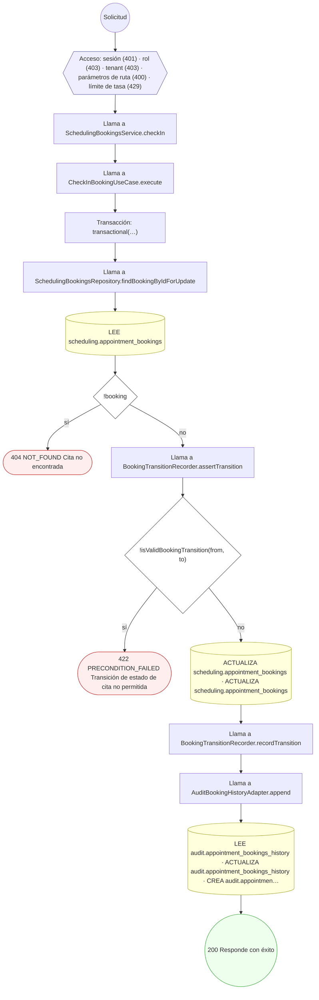

#### 9. POST /scheduling/bookings/{id}/complete

Completar la atención

| HTTP | Código | Cuándo |
|---|---|---|
| 200 | — | Éxito |
| 400 | `VALIDATION_FAILED` | Los parámetros de ruta son UUID válidos |
| 401 | `UNAUTHENTICATED` | Hay una sesión válida (JWT) |
| 403 | `FORBIDDEN` | El rol está permitido; El tenant se resuelve y pertenece al actor; ForbiddenException: Esta cita es de otra agenda: solo la opera quien atiende en ella. |
| 404 | `NOT_FOUND` | ResourceNotFoundException: Cita no encontrada |
| 422 | `PRECONDITION_FAILED` | PreconditionFailedException: Transición de estado de cita no permitida |
| 429 | `RATE_LIMITED` | No se supera el límite de solicitudes |

```mermaid
flowchart TD
  n1(("Solicitud")):::inicio
  n2{{"Acceso: sesión (401) · rol (403) · tenant (403) · parámetros de ruta (400) · límite de tasa (429)"}}:::acceso
  n1 --> n2
  n3["Llama a SchedulingBookingsService.complete"]:::llamada
  n2 --> n3
  n4["Llama a CompleteAppointmentUseCase.execute"]:::llamada
  n3 --> n4
  n5["Transacción: transactional(…)"]:::transaccion
  n4 --> n5
  n6["Llama a BookingAccess.loadForOperation"]:::llamada
  n5 --> n6
  n7["Llama a SchedulingBookingsRepository.findBookingByIdForUpdate"]:::llamada
  n6 --> n7
  n8[("LEE scheduling.appointment_bookings")]:::efecto
  n7 --> n8
  n9{"!booking"}:::decision
  n8 --> n9
  n10(["404 NOT_FOUND Cita no encontrada"]):::error
  n9 -->|"sí"| n10
  n11["Llama a SchedulingCatalogRepository.findResourceById"]:::llamada
  n9 -->|"no"| n11
  n12[("LEE scheduling.schedulable_resources")]:::efecto
  n11 --> n12
  n13{"!isOwnAgenda"}:::decision
  n12 --> n13
  n14(["403 FORBIDDEN Esta cita es de otra agenda: solo la opera quien atiende en ella."]):::error
  n13 -->|"sí"| n14
  n15["Llama a BookingTransitionRecorder.assertTransition"]:::llamada
  n13 -->|"no"| n15
  n16{"!isValidBookingTransition(from, to)"}:::decision
  n15 --> n16
  n17(["422 PRECONDITION_FAILED Transición de estado de cita no permitida"]):::error
  n16 -->|"sí"| n17
  n18[("ACTUALIZA scheduling.appointment_bookings")]:::efecto
  n16 -->|"no"| n18
  n19["Llama a ServiceSlotLifecycle.releaseServiceLeftover"]:::llamada
  n18 --> n19
  n20["Llama a SchedulingBookingsRepository.findSlotForUpdate"]:::llamada
  n19 --> n20
  n21[("LEE scheduling.bookable_slots")]:::efecto
  n20 --> n21
  n22[("ACTUALIZA scheduling.bookable_slots")]:::efecto
  n21 --> n22
  n23["Llama a ClinicalAppointmentSync.syncClinicalAppointment"]:::llamada
  n22 --> n23
  n24["Llama a ClinicalAppointmentsAdapter.updateStatus"]:::llamada
  n23 --> n24
  n25[("ACTUALIZA clinical.appointments")]:::efecto
  n24 --> n25
  n26["Llama a BookingTransitionRecorder.recordTransition"]:::llamada
  n25 --> n26
  n27["Llama a AuditBookingHistoryAdapter.append"]:::llamada
  n26 --> n27
  n28[("LEE audit.appointment_bookings_history · ACTUALIZA audit.appointment_bookings_history · CREA audit.appointmen…")]:::efecto
  n27 --> n28
  n29(("200 Responde con éxito")):::ok
  n28 --> n29
  classDef acceso fill:#eef,stroke:#66a
  classDef error fill:#fee,stroke:#c33
  classDef ok fill:#efe,stroke:#3a3
  classDef efecto fill:#ffd,stroke:#aa3
  classDef decision fill:#fff,stroke:#555
  classDef corte fill:#eee,stroke:#999,stroke-dasharray: 4
```

#### 10. POST /scheduling/bookings/{id}/delay

Informar una demora sobre una cita

| HTTP | Código | Cuándo |
|---|---|---|
| 200 | — | Éxito |
| 400 | `VALIDATION_FAILED` | Los parámetros de ruta son UUID válidos; El cuerpo cumple el DTO (sin propiedades extra) |
| 401 | `UNAUTHENTICATED` | Hay una sesión válida (JWT) |
| 403 | `FORBIDDEN` | El rol está permitido; El tenant se resuelve y pertenece al actor; ForbiddenException: Esta agenda es de otro profesional: sólo avisa su demora quien atiende en ella. |
| 404 | `NOT_FOUND` | ResourceNotFoundException: Cita no encontrada |
| 422 | `PRECONDITION_FAILED` | PreconditionFailedException: Una demora mayor a cuatro horas se resuelve reprogramando la cita, no avisando |
| 429 | `RATE_LIMITED` | No se supera el límite de solicitudes |
| 500 | `INTERNAL` | Error: Entidad de historial no registrada: {entity} |

```mermaid
flowchart TD
  n1(("Solicitud")):::inicio
  n2{{"Acceso: sesión (401) · rol (403) · tenant (403) · parámetros de ruta (400) · cuerpo válido (400) · límite de…"}}:::acceso
  n1 --> n2
  n3["Llama a SchedulingDelayService.delayBooking"]:::llamada
  n2 --> n3
  n4["Llama a SchedulingDelayService.assertMinutes"]:::llamada
  n3 --> n4
  n5{"minutes › MAX_DELAY_MINUTES"}:::decision
  n4 --> n5
  n6(["422 PRECONDITION_FAILED Una demora mayor a cuatro horas se resuelve reprogramando la cita, no avisando"]):::error
  n5 -->|"sí"| n6
  n7["Llama a SchedulingNoticeRepository.describeBooking"]:::llamada
  n5 -->|"no"| n7
  n8[("LEE scheduling.appointment_bookings · LEE scheduling.bookable_slots")]:::efecto
  n7 --> n8
  n9["Llama a SchedulingNoticeRepository.describeResource"]:::llamada
  n8 --> n9
  n10[("LEE scheduling.schedulable_resources")]:::efecto
  n9 --> n10
  n11{"PRACTITIONER_PROFILE_TABLES.includes(resource.resourceRefType)"}:::decision
  n10 --> n11
  n12["Llama a SchedulingNoticeRepository.findDisplayNameForProfile"]:::llamada
  n11 -->|"sí"| n12
  n13[("LEE profiles.persons")]:::efecto
  n12 --> n13
  n14["Llama a SchedulingNoticeRepository.describeSite"]:::llamada
  n13 --> n14
  n11 -->|"no"| n14
  n15[("LEE scheduling.schedulable_resources · LEE practice.practices")]:::efecto
  n14 --> n15
  n16{"!booking"}:::decision
  n15 --> n16
  n17(["404 NOT_FOUND Cita no encontrada"]):::error
  n16 -->|"sí"| n17
  n18["Llama a SchedulingDelayService.assertOperatesAgenda"]:::llamada
  n16 -->|"no"| n18
  n19["Llama a SchedulingCatalogRepository.findResourceById"]:::llamada
  n18 --> n19
  n20[("LEE scheduling.schedulable_resources")]:::efecto
  n19 --> n20
  n21{"!isOwnAgenda"}:::decision
  n20 --> n21
  n22(["403 FORBIDDEN Esta agenda es de otro profesional: sólo avisa su demora quien atiende en ella."]):::error
  n21 -->|"sí"| n22
  n23["Llama a SchedulingDelayService.recordDelay"]:::llamada
  n21 -->|"no"| n23
  n24["Transacción: transactional(…)"]:::transaccion
  n23 --> n24
  n25["Llama a AuditBookingHistoryAdapter.append"]:::llamada
  n24 --> n25
  n26["Llama a HistoryRepository.append"]:::llamada
  n25 --> n26
  n27{"!binding"}:::decision
  n26 --> n27
  n28(["500 INTERNAL Entidad de historial no registrada: {entity}"]):::error
  n27 -->|"sí"| n28
  n29[("LEE audit.appointment_bookings_history · ACTUALIZA audit.appointment_bookings_history · CREA audit.appointmen…")]:::efecto
  n27 -->|"no"| n29
  n30(("200 Responde con éxito")):::ok
  n29 --> n30
  classDef acceso fill:#eef,stroke:#66a
  classDef error fill:#fee,stroke:#c33
  classDef ok fill:#efe,stroke:#3a3
  classDef efecto fill:#ffd,stroke:#aa3
  classDef decision fill:#fff,stroke:#555
  classDef corte fill:#eee,stroke:#999,stroke-dasharray: 4
```

#### 11. GET /scheduling/bookings/{id}/payment-receipts

Listar los comprobantes de pago de una cita

| HTTP | Código | Cuándo |
|---|---|---|
| 200 | — | Éxito |
| 400 | `VALIDATION_FAILED` | Los parámetros de ruta son UUID válidos |
| 401 | `UNAUTHENTICATED` | Hay una sesión válida (JWT) |
| 403 | `FORBIDDEN` | El rol está permitido; El tenant se resuelve y pertenece al actor |
| 429 | `RATE_LIMITED` | No se supera el límite de solicitudes |

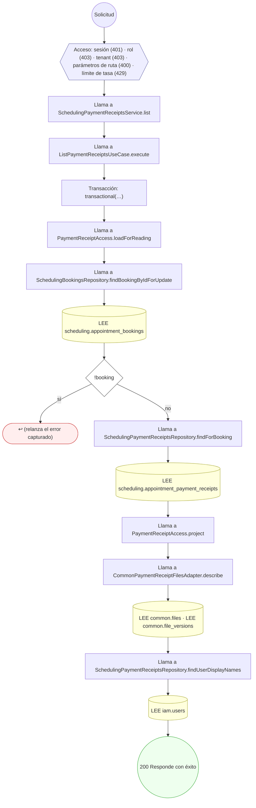

#### 12. POST /scheduling/bookings/{id}/payment-receipts

Subir el comprobante de pago de una cita

| HTTP | Código | Cuándo |
|---|---|---|
| 201 | — | Éxito |
| 400 | `VALIDATION_FAILED` | Los parámetros de ruta son UUID válidos; El cuerpo cumple el DTO (sin propiedades extra) |
| 401 | `UNAUTHENTICATED` | Hay una sesión válida (JWT) |
| 403 | `FORBIDDEN` | El rol está permitido; El tenant se resuelve y pertenece al actor; ForbiddenException: {labels.subject} no le pertenece |
| 404 | `NOT_FOUND` | ResourceNotFoundException: {labels.notFound} |
| 409 | `CONFLICT` | ConflictException: La cita ya está pagada: no hace falta otro comprobante. |
| 422 | `PRECONDITION_FAILED` | PreconditionFailedException: Una cita cancelada o rechazada no lleva pago: no hay comprobante que subir.; PreconditionFailedException: {labels.subject} está borrado; PreconditionFailedException: {labels.subject} no tiene una versión vigente; PreconditionFailedException: El comprobante supera los 5 MB; PreconditionFailedException: El comprobante no es un archivo suyo que se pueda adjuntar |
| 429 | `RATE_LIMITED` | No se supera el límite de solicitudes |

```mermaid
flowchart TD
  n1(("Solicitud")):::inicio
  n2{{"Acceso: sesión (401) · rol (403) · tenant (403) · parámetros de ruta (400) · cuerpo válido (400) · límite de…"}}:::acceso
  n1 --> n2
  n3["Llama a SchedulingPaymentReceiptsService.upload"]:::llamada
  n2 --> n3
  n4["Llama a UploadPaymentReceiptUseCase.execute"]:::llamada
  n3 --> n4
  n5["Transacción: transactional(…)"]:::transaccion
  n4 --> n5
  n6["Llama a PaymentReceiptAccess.loadForPatient"]:::llamada
  n5 --> n6
  n7["Llama a SchedulingBookingsRepository.findBookingByIdForUpdate"]:::llamada
  n6 --> n7
  n8[("LEE scheduling.appointment_bookings")]:::efecto
  n7 --> n8
  n9{"!booking"}:::decision
  n8 --> n9
  n10(["↩ (relanza el error capturado)"]):::error
  n9 -->|"sí"| n10
  n11{"!(await this.representation.representsPatient( booking.patientProfileId, actor, tx, ))"}:::decision
  n9 -->|"no"| n11
  n12(["↩ (relanza el error capturado)"]):::error
  n11 -->|"sí"| n12
  n13{"STATES_WITHOUT_PAYMENT.includes(booking.statusConceptId)"}:::decision
  n11 -->|"no"| n13
  n14(["422 PRECONDITION_FAILED Una cita cancelada o rechazada no lleva pago: no hay comprobante que subir."]):::error
  n13 -->|"sí"| n14
  n15["Llama a SchedulingBookingsRepository.findPaymentStateForUpdate"]:::llamada
  n13 -->|"no"| n15
  n16[("LEE scheduling.appointment_payment_states")]:::efecto
  n15 --> n16
  n17{"payment?.statusConceptId === SCHED.PAYMENT_PAID"}:::decision
  n16 --> n17
  n18(["409 CONFLICT La cita ya está pagada: no hace falta otro comprobante."]):::error
  n17 -->|"sí"| n18
  n19["Llama a CommonPaymentReceiptFilesAdapter.assertAttachable"]:::llamada
  n17 -->|"no"| n19
  n20["Intenta"]:::intento
  n19 --> n20
  n21["Llama a AttachableFileService.assertUsableBy"]:::llamada
  n20 --> n21
  n22{"!file"}:::decision
  n21 --> n22
  n23(["404 NOT_FOUND {labels.notFound}"]):::error
  n22 -->|"sí"| n23
  n24{"file.createdByUserId !== actor.id && !enAllowlist"}:::decision
  n22 -->|"no"| n24
  n25(["403 FORBIDDEN {labels.subject} no le pertenece"]):::error
  n24 -->|"sí"| n25
  n26{"file.deletedAt || file.lifecycleStatusConceptId === CONCEPTS.FILE_DELETED"}:::decision
  n24 -->|"no"| n26
  n27(["422 PRECONDITION_FAILED {labels.subject} está borrado"]):::error
  n26 -->|"sí"| n27
  n28{"!file.currentVersionId"}:::decision
  n26 -->|"no"| n28
  n29(["422 PRECONDITION_FAILED {labels.subject} no tiene una versión vigente"]):::error
  n28 -->|"sí"| n29
  n30{"Number(version.sizeBytes) › PAYMENT_RECEIPT_MAX_BYTES"}:::decision
  n28 -->|"no"| n30
  n31(["422 PRECONDITION_FAILED El comprobante supera los 5 MB"]):::error
  n30 -->|"sí"| n31
  n32{"error instanceof ResourceNotFoundException || error instanceof ForbiddenException"}:::decision
  n20 -->|"si falla"| n32
  n33(["422 PRECONDITION_FAILED El comprobante no es un archivo suyo que se pueda adjuntar"]):::error
  n32 -->|"sí"| n33
  n34(["↩ (relanza el error capturado)"]):::error
  n32 -->|"no"| n34
  n35[("CREA scheduling.appointment_payment_receipts · GUARDA scheduling.appointment_payment_receipts")]:::efecto
  n30 -->|"no"| n35
  n36["Llama a PaymentReceiptAccess.project"]:::llamada
  n35 --> n36
  n37["Llama a CommonPaymentReceiptFilesAdapter.describe"]:::llamada
  n36 --> n37
  n38[("LEE common.files · LEE common.file_versions")]:::efecto
  n37 --> n38
  n39["Llama a SchedulingPaymentReceiptsRepository.findUserDisplayNames"]:::llamada
  n38 --> n39
  n40[("LEE iam.users")]:::efecto
  n39 --> n40
  n41["Llama a BookingChangeNotifier.notifyReceiptUploaded"]:::llamada
  n40 --> n41
  n42["Transacción: safely(…)"]:::transaccion
  n41 --> n42
  n43["Llama a SchedulingNoticeRepository.describeBooking"]:::llamada
  n42 --> n43
  n44[("LEE scheduling.appointment_bookings · LEE scheduling.bookable_slots")]:::efecto
  n43 --> n44
  n45["Llama a SchedulingNoticeRepository.findResourceAccount"]:::llamada
  n44 --> n45
  n46[("LEE scheduling.schedulable_resources")]:::efecto
  n45 --> n46
  n47["Llama a SchedulingNoticeRepository.findDisplayNameForProfile"]:::llamada
  n46 --> n47
  n48[("LEE profiles.persons")]:::efecto
  n47 --> n48
  n49(("201 Responde con éxito")):::ok
  n48 --> n49
  classDef acceso fill:#eef,stroke:#66a
  classDef error fill:#fee,stroke:#c33
  classDef ok fill:#efe,stroke:#3a3
  classDef efecto fill:#ffd,stroke:#aa3
  classDef decision fill:#fff,stroke:#555
  classDef corte fill:#eee,stroke:#999,stroke-dasharray: 4
```

#### 13. POST /scheduling/bookings/{id}/payment-receipts/{receiptId}/confirm

Confirmar un comprobante de pago

| HTTP | Código | Cuándo |
|---|---|---|
| 200 | — | Éxito |
| 400 | `VALIDATION_FAILED` | Los parámetros de ruta son UUID válidos |
| 401 | `UNAUTHENTICATED` | Hay una sesión válida (JWT) |
| 403 | `FORBIDDEN` | El rol está permitido; El tenant se resuelve y pertenece al actor; ForbiddenException: Esta cita es de otra agenda: solo la opera quien atiende en ella.; ForbiddenException: La agenda indicada pertenece a otra organización. |
| 404 | `NOT_FOUND` | ResourceNotFoundException: Cita no encontrada; ResourceNotFoundException: Comprobante no encontrado |
| 409 | `CONFLICT` | ConflictException: Ese comprobante ya se rechazó: no se puede confirmar. |
| 422 | `PRECONDITION_FAILED` | PreconditionFailedException: Una cita cancelada o rechazada no lleva estado de pago: no hubo atención que cobrar. |
| 429 | `RATE_LIMITED` | No se supera el límite de solicitudes |

```mermaid
flowchart TD
  n1(("Solicitud")):::inicio
  n2{{"Acceso: sesión (401) · rol (403) · tenant (403) · parámetros de ruta (400) · límite de tasa (429)"}}:::acceso
  n1 --> n2
  n3["Llama a SchedulingPaymentReceiptsService.confirm"]:::llamada
  n2 --> n3
  n4["Llama a ConfirmPaymentReceiptUseCase.execute"]:::llamada
  n3 --> n4
  n5["Transacción: transactional(…)"]:::transaccion
  n4 --> n5
  n6["Llama a PaymentReceiptAccess.loadForReviewer"]:::llamada
  n5 --> n6
  n7["Transacción: hideForbidden(…)"]:::transaccion
  n6 --> n7
  n8["Llama a BookingAccess.loadForOperation"]:::llamada
  n7 --> n8
  n9{"!booking"}:::decision
  n8 --> n9
  n10(["404 NOT_FOUND Cita no encontrada"]):::error
  n9 -->|"sí"| n10
  n11{"!isOwnAgenda"}:::decision
  n9 -->|"no"| n11
  n12(["403 FORBIDDEN Esta cita es de otra agenda: solo la opera quien atiende en ella."]):::error
  n11 -->|"sí"| n12
  n13{"operatesAnyAgenda(actor)"}:::decision
  n11 -->|"no"| n13
  n14["Llama a BookingAccess.assertResourceInActiveTenant"]:::llamada
  n13 -->|"sí"| n14
  n15{"!withinScope"}:::decision
  n14 --> n15
  n16(["403 FORBIDDEN La agenda indicada pertenece a otra organización."]):::error
  n15 -->|"sí"| n16
  n17["Llama a PaymentReceiptAccess.receiptOf"]:::llamada
  n15 -->|"no"| n17
  n13 -->|"no"| n17
  n18["Llama a SchedulingPaymentReceiptsRepository.findOfBookingForUpdate"]:::llamada
  n17 --> n18
  n19[("LEE scheduling.appointment_payment_receipts")]:::efecto
  n18 --> n19
  n20["Llama a SchedulingPaymentReceiptsRepository.findOfBooking"]:::llamada
  n19 --> n20
  n21[("LEE scheduling.appointment_payment_receipts")]:::efecto
  n20 --> n21
  n22{"!receipt"}:::decision
  n21 --> n22
  n23(["404 NOT_FOUND Comprobante no encontrado"]):::error
  n22 -->|"sí"| n23
  n24{"receipt.reviewStatusConceptId === SCHED.RECEIPT_REJECTED"}:::decision
  n22 -->|"no"| n24
  n25(["409 CONFLICT Ese comprobante ya se rechazó: no se puede confirmar."]):::error
  n24 -->|"sí"| n25
  n26{"receipt.reviewStatusConceptId === SCHED.RECEIPT_CONFIRMED"}:::decision
  n24 -->|"no"| n26
  n27["Llama a SchedulingBookingsRepository.findPaymentState"]:::llamada
  n26 -->|"sí"| n27
  n28[("LEE scheduling.appointment_payment_states")]:::efecto
  n27 --> n28
  n29["Llama a PaymentReceiptAccess.project"]:::llamada
  n28 --> n29
  n30["Llama a CommonPaymentReceiptFilesAdapter.describe"]:::llamada
  n29 --> n30
  n31[("LEE common.files · LEE common.file_versions")]:::efecto
  n30 --> n31
  n32["Llama a SchedulingPaymentReceiptsRepository.findUserDisplayNames"]:::llamada
  n31 --> n32
  n33[("LEE iam.users")]:::efecto
  n32 --> n33
  n34{"STATES_WITHOUT_PAYMENT.includes(booking.statusConceptId)"}:::decision
  n33 --> n34
  n26 -->|"no"| n34
  n35(["422 PRECONDITION_FAILED Una cita cancelada o rechazada no lleva estado de pago: no hubo atención que cobrar."]):::error
  n34 -->|"sí"| n35
  n36[("ACTUALIZA scheduling.appointment_payment_receipts · ACTUALIZA scheduling.appointment_payment_receipts · ACTUA…")]:::efecto
  n34 -->|"no"| n36
  n37["Llama a PaymentReceiptAccess.project"]:::llamada
  n36 --> n37
  n38["Llama a CommonPaymentReceiptFilesAdapter.describe"]:::llamada
  n37 --> n38
  n39[("LEE common.files · LEE common.file_versions")]:::efecto
  n38 --> n39
  n40["Llama a SchedulingPaymentReceiptsRepository.findUserDisplayNames"]:::llamada
  n39 --> n40
  n41[("LEE iam.users")]:::efecto
  n40 --> n41
  n42{"changed"}:::decision
  n41 --> n42
  n43["Llama a BookingChangeNotifier.notifyReceiptReviewed"]:::llamada
  n42 -->|"sí"| n43
  n44["Transacción: safely(…)"]:::transaccion
  n43 --> n44
  n45["Llama a SchedulingNoticeRepository.describeBooking"]:::llamada
  n44 --> n45
  n46[("LEE scheduling.appointment_bookings · LEE scheduling.bookable_slots")]:::efecto
  n45 --> n46
  n47(("200 Responde con éxito")):::ok
  n46 --> n47
  n42 -->|"no"| n47
  classDef acceso fill:#eef,stroke:#66a
  classDef error fill:#fee,stroke:#c33
  classDef ok fill:#efe,stroke:#3a3
  classDef efecto fill:#ffd,stroke:#aa3
  classDef decision fill:#fff,stroke:#555
  classDef corte fill:#eee,stroke:#999,stroke-dasharray: 4
```

#### 14. GET /scheduling/bookings/{id}/payment-receipts/{receiptId}/content

Descargar el archivo de un comprobante de pago

| HTTP | Código | Cuándo |
|---|---|---|
| 200 | — | Éxito |
| 400 | `VALIDATION_FAILED` | Los parámetros de ruta son UUID válidos |
| 401 | `UNAUTHENTICATED` | Hay una sesión válida (JWT) |
| 403 | `FORBIDDEN` | El rol está permitido; El tenant se resuelve y pertenece al actor |
| 404 | `NOT_FOUND` | ResourceNotFoundException: Comprobante no encontrado; ResourceNotFoundException: Archivo no encontrado |
| 422 | `PRECONDITION_FAILED` | PreconditionFailedException: El archivo del comprobante ya no es de un formato que se pueda mostrar |
| 429 | `RATE_LIMITED` | No se supera el límite de solicitudes |

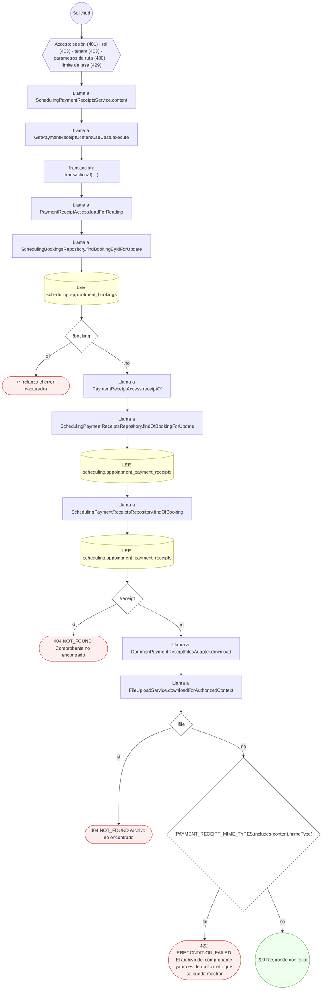

#### 15. POST /scheduling/bookings/{id}/payment-receipts/{receiptId}/reject

Rechazar un comprobante de pago

| HTTP | Código | Cuándo |
|---|---|---|
| 200 | — | Éxito |
| 400 | `VALIDATION_FAILED` | Los parámetros de ruta son UUID válidos; El cuerpo cumple el DTO (sin propiedades extra) |
| 401 | `UNAUTHENTICATED` | Hay una sesión válida (JWT) |
| 403 | `FORBIDDEN` | El rol está permitido; El tenant se resuelve y pertenece al actor; ForbiddenException: Esta cita es de otra agenda: solo la opera quien atiende en ella.; ForbiddenException: La agenda indicada pertenece a otra organización. |
| 404 | `NOT_FOUND` | ResourceNotFoundException: Cita no encontrada; ResourceNotFoundException: Comprobante no encontrado |
| 409 | `CONFLICT` | ConflictException: Ese comprobante ya se confirmó: no se puede rechazar. |
| 429 | `RATE_LIMITED` | No se supera el límite de solicitudes |

```mermaid
flowchart TD
  n1(("Solicitud")):::inicio
  n2{{"Acceso: sesión (401) · rol (403) · tenant (403) · parámetros de ruta (400) · cuerpo válido (400) · límite de…"}}:::acceso
  n1 --> n2
  n3["Llama a SchedulingPaymentReceiptsService.reject"]:::llamada
  n2 --> n3
  n4["Llama a RejectPaymentReceiptUseCase.execute"]:::llamada
  n3 --> n4
  n5["Transacción: transactional(…)"]:::transaccion
  n4 --> n5
  n6["Llama a PaymentReceiptAccess.loadForReviewer"]:::llamada
  n5 --> n6
  n7["Transacción: hideForbidden(…)"]:::transaccion
  n6 --> n7
  n8["Llama a BookingAccess.loadForOperation"]:::llamada
  n7 --> n8
  n9{"!booking"}:::decision
  n8 --> n9
  n10(["404 NOT_FOUND Cita no encontrada"]):::error
  n9 -->|"sí"| n10
  n11{"!isOwnAgenda"}:::decision
  n9 -->|"no"| n11
  n12(["403 FORBIDDEN Esta cita es de otra agenda: solo la opera quien atiende en ella."]):::error
  n11 -->|"sí"| n12
  n13{"operatesAnyAgenda(actor)"}:::decision
  n11 -->|"no"| n13
  n14["Llama a BookingAccess.assertResourceInActiveTenant"]:::llamada
  n13 -->|"sí"| n14
  n15{"!withinScope"}:::decision
  n14 --> n15
  n16(["403 FORBIDDEN La agenda indicada pertenece a otra organización."]):::error
  n15 -->|"sí"| n16
  n17["Llama a PaymentReceiptAccess.receiptOf"]:::llamada
  n15 -->|"no"| n17
  n13 -->|"no"| n17
  n18["Llama a SchedulingPaymentReceiptsRepository.findOfBookingForUpdate"]:::llamada
  n17 --> n18
  n19[("LEE scheduling.appointment_payment_receipts")]:::efecto
  n18 --> n19
  n20["Llama a SchedulingPaymentReceiptsRepository.findOfBooking"]:::llamada
  n19 --> n20
  n21[("LEE scheduling.appointment_payment_receipts")]:::efecto
  n20 --> n21
  n22{"!receipt"}:::decision
  n21 --> n22
  n23(["404 NOT_FOUND Comprobante no encontrado"]):::error
  n22 -->|"sí"| n23
  n24{"row.reviewStatusConceptId === SCHED.RECEIPT_CONFIRMED"}:::decision
  n22 -->|"no"| n24
  n25(["409 CONFLICT Ese comprobante ya se confirmó: no se puede rechazar."]):::error
  n24 -->|"sí"| n25
  n26[("ACTUALIZA scheduling.appointment_payment_receipts · ACTUALIZA scheduling.appointment_payment_receipts · ACTUA…")]:::efecto
  n24 -->|"no"| n26
  n27["Llama a PaymentReceiptAccess.project"]:::llamada
  n26 --> n27
  n28["Llama a CommonPaymentReceiptFilesAdapter.describe"]:::llamada
  n27 --> n28
  n29[("LEE common.files · LEE common.file_versions")]:::efecto
  n28 --> n29
  n30["Llama a SchedulingPaymentReceiptsRepository.findUserDisplayNames"]:::llamada
  n29 --> n30
  n31[("LEE iam.users")]:::efecto
  n30 --> n31
  n32["Llama a BookingChangeNotifier.notifyReceiptReviewed"]:::llamada
  n31 --> n32
  n33["Transacción: safely(…)"]:::transaccion
  n32 --> n33
  n34["Llama a SchedulingNoticeRepository.describeBooking"]:::llamada
  n33 --> n34
  n35[("LEE scheduling.appointment_bookings · LEE scheduling.bookable_slots")]:::efecto
  n34 --> n35
  n36(("200 Responde con éxito")):::ok
  n35 --> n36
  classDef acceso fill:#eef,stroke:#66a
  classDef error fill:#fee,stroke:#c33
  classDef ok fill:#efe,stroke:#3a3
  classDef efecto fill:#ffd,stroke:#aa3
  classDef decision fill:#fff,stroke:#555
  classDef corte fill:#eee,stroke:#999,stroke-dasharray: 4
```

#### 16. GET /scheduling/bookings/{id}/payment-state

Leer el estado de pago de una cita

| HTTP | Código | Cuándo |
|---|---|---|
| 200 | — | Éxito |
| 400 | `VALIDATION_FAILED` | Los parámetros de ruta son UUID válidos |
| 401 | `UNAUTHENTICATED` | Hay una sesión válida (JWT) |
| 403 | `FORBIDDEN` | El rol está permitido; El tenant se resuelve y pertenece al actor; ForbiddenException: Esta cita es de otra agenda: solo la opera quien atiende en ella. |
| 404 | `NOT_FOUND` | ResourceNotFoundException: Cita no encontrada |
| 429 | `RATE_LIMITED` | No se supera el límite de solicitudes |

```mermaid
flowchart TD
  n1(("Solicitud")):::inicio
  n2{{"Acceso: sesión (401) · rol (403) · tenant (403) · parámetros de ruta (400) · límite de tasa (429)"}}:::acceso
  n1 --> n2
  n3["Llama a SchedulingBookingsService.getPaymentState"]:::llamada
  n2 --> n3
  n4["Llama a GetPaymentStateUseCase.execute"]:::llamada
  n3 --> n4
  n5["Transacción: transactional(…)"]:::transaccion
  n4 --> n5
  n6["Llama a BookingAccess.loadForOperation"]:::llamada
  n5 --> n6
  n7["Llama a SchedulingBookingsRepository.findBookingByIdForUpdate"]:::llamada
  n6 --> n7
  n8[("LEE scheduling.appointment_bookings")]:::efecto
  n7 --> n8
  n9{"!booking"}:::decision
  n8 --> n9
  n10(["404 NOT_FOUND Cita no encontrada"]):::error
  n9 -->|"sí"| n10
  n11["Llama a SchedulingCatalogRepository.findResourceById"]:::llamada
  n9 -->|"no"| n11
  n12[("LEE scheduling.schedulable_resources")]:::efecto
  n11 --> n12
  n13{"!isOwnAgenda"}:::decision
  n12 --> n13
  n14(["403 FORBIDDEN Esta cita es de otra agenda: solo la opera quien atiende en ella."]):::error
  n13 -->|"sí"| n14
  n15["Llama a SchedulingBookingsRepository.findPaymentState"]:::llamada
  n13 -->|"no"| n15
  n16[("LEE scheduling.appointment_payment_states")]:::efecto
  n15 --> n16
  n17(("200 Responde con éxito")):::ok
  n16 --> n17
  classDef acceso fill:#eef,stroke:#66a
  classDef error fill:#fee,stroke:#c33
  classDef ok fill:#efe,stroke:#3a3
  classDef efecto fill:#ffd,stroke:#aa3
  classDef decision fill:#fff,stroke:#555
  classDef corte fill:#eee,stroke:#999,stroke-dasharray: 4
```

#### 17. PUT /scheduling/bookings/{id}/payment-state

Marcar el estado de pago de una cita

| HTTP | Código | Cuándo |
|---|---|---|
| 200 | — | Éxito |
| 400 | `VALIDATION_FAILED` | Los parámetros de ruta son UUID válidos; El cuerpo cumple el DTO (sin propiedades extra) |
| 401 | `UNAUTHENTICATED` | Hay una sesión válida (JWT) |
| 403 | `FORBIDDEN` | El rol está permitido; El tenant se resuelve y pertenece al actor; ForbiddenException: Esta cita es de otra agenda: solo la opera quien atiende en ella. |
| 404 | `NOT_FOUND` | ResourceNotFoundException: Cita no encontrada |
| 422 | `PRECONDITION_FAILED` | PreconditionFailedException: Una cita cancelada o rechazada no lleva estado de pago: no hubo atención que cobrar. |
| 429 | `RATE_LIMITED` | No se supera el límite de solicitudes |

```mermaid
flowchart TD
  n1(("Solicitud")):::inicio
  n2{{"Acceso: sesión (401) · rol (403) · tenant (403) · parámetros de ruta (400) · cuerpo válido (400) · límite de…"}}:::acceso
  n1 --> n2
  n3["Llama a SchedulingBookingsService.setPaymentState"]:::llamada
  n2 --> n3
  n4["Llama a SetPaymentStateUseCase.execute"]:::llamada
  n3 --> n4
  n5["Transacción: transactional(…)"]:::transaccion
  n4 --> n5
  n6["Llama a BookingAccess.loadForOperation"]:::llamada
  n5 --> n6
  n7["Llama a SchedulingBookingsRepository.findBookingByIdForUpdate"]:::llamada
  n6 --> n7
  n8[("LEE scheduling.appointment_bookings")]:::efecto
  n7 --> n8
  n9{"!booking"}:::decision
  n8 --> n9
  n10(["404 NOT_FOUND Cita no encontrada"]):::error
  n9 -->|"sí"| n10
  n11["Llama a SchedulingCatalogRepository.findResourceById"]:::llamada
  n9 -->|"no"| n11
  n12[("LEE scheduling.schedulable_resources")]:::efecto
  n11 --> n12
  n13{"!isOwnAgenda"}:::decision
  n12 --> n13
  n14(["403 FORBIDDEN Esta cita es de otra agenda: solo la opera quien atiende en ella."]):::error
  n13 -->|"sí"| n14
  n15{"STATES_WITHOUT_PAYMENT.includes(booking.statusConceptId)"}:::decision
  n13 -->|"no"| n15
  n16(["422 PRECONDITION_FAILED Una cita cancelada o rechazada no lleva estado de pago: no hubo atención que cobrar."]):::error
  n15 -->|"sí"| n16
  n17(("200 Responde con éxito")):::ok
  n15 -->|"no"| n17
  classDef acceso fill:#eef,stroke:#66a
  classDef error fill:#fee,stroke:#c33
  classDef ok fill:#efe,stroke:#3a3
  classDef efecto fill:#ffd,stroke:#aa3
  classDef decision fill:#fff,stroke:#555
  classDef corte fill:#eee,stroke:#999,stroke-dasharray: 4
```

#### 18. POST /scheduling/bookings/{id}/propose-schedule

Proponer otro horario para la solicitud

| HTTP | Código | Cuándo |
|---|---|---|
| 200 | — | Éxito |
| 400 | `VALIDATION_FAILED` | Los parámetros de ruta son UUID válidos; El cuerpo cumple el DTO (sin propiedades extra) |
| 401 | `UNAUTHENTICATED` | Hay una sesión válida (JWT) |
| 403 | `FORBIDDEN` | El rol está permitido; El tenant se resuelve y pertenece al actor; ForbiddenException: Esta cita es de otra agenda: solo la opera quien atiende en ella. |
| 404 | `NOT_FOUND` | ResourceNotFoundException: Cita no encontrada; ResourceNotFoundException: Cupo propuesto no encontrado |
| 409 | `CONFLICT` | ConflictException: El cupo propuesto no tiene lugar |
| 422 | `PRECONDITION_FAILED` | PreconditionFailedException: Sólo se opera así sobre una solicitud pendiente; PreconditionFailedException: Todavía no se puede {action} un servicio: cancele la reserva y pida otro horario.; PreconditionFailedException: Todavía no se puede {action} un turno de horario flexible: cancele la reserva y pida otra hora.; PreconditionFailedException: El horario propuesto es el que ya tiene la solicitud; PreconditionFailedException: Transición de estado de cita no permitida |
| 429 | `RATE_LIMITED` | No se supera el límite de solicitudes |

```mermaid
flowchart TD
  n1(("Solicitud")):::inicio
  n2{{"Acceso: sesión (401) · rol (403) · tenant (403) · parámetros de ruta (400) · cuerpo válido (400) · límite de…"}}:::acceso
  n1 --> n2
  n3["Llama a SchedulingBookingsService.proposeSchedule"]:::llamada
  n2 --> n3
  n4["Llama a ProposeScheduleUseCase.execute"]:::llamada
  n3 --> n4
  n5["Transacción: transactional(…)"]:::transaccion
  n4 --> n5
  n6["Llama a BookingAccess.loadForOperation"]:::llamada
  n5 --> n6
  n7["Llama a SchedulingBookingsRepository.findBookingByIdForUpdate"]:::llamada
  n6 --> n7
  n8[("LEE scheduling.appointment_bookings")]:::efecto
  n7 --> n8
  n9{"!booking"}:::decision
  n8 --> n9
  n10(["404 NOT_FOUND Cita no encontrada"]):::error
  n9 -->|"sí"| n10
  n11["Llama a SchedulingCatalogRepository.findResourceById"]:::llamada
  n9 -->|"no"| n11
  n12[("LEE scheduling.schedulable_resources")]:::efecto
  n11 --> n12
  n13{"!isOwnAgenda"}:::decision
  n12 --> n13
  n14(["403 FORBIDDEN Esta cita es de otra agenda: solo la opera quien atiende en ella."]):::error
  n13 -->|"sí"| n14
  n15["Llama a BookingTransitionRecorder.assertPending"]:::llamada
  n13 -->|"no"| n15
  n16{"!PENDING_DECISION_STATES.includes(fromState)"}:::decision
  n15 --> n16
  n17(["422 PRECONDITION_FAILED Sólo se opera así sobre una solicitud pendiente"]):::error
  n16 -->|"sí"| n17
  n18["Llama a ServiceSlotLifecycle.assertNotAService"]:::llamada
  n16 -->|"no"| n18
  n19["Llama a SchedulingBookingsRepository.findSlotById"]:::llamada
  n18 --> n19
  n20[("LEE scheduling.bookable_slots")]:::efecto
  n19 --> n20
  n21{"slot?.practitionerServiceOfferingId"}:::decision
  n20 --> n21
  n22(["422 PRECONDITION_FAILED Todavía no se puede {action} un servicio: cancele la reserva y pida otro horario."]):::error
  n21 -->|"sí"| n22
  n23{"slot && (await this.isFlexible(tx, slot))"}:::decision
  n21 -->|"no"| n23
  n24(["422 PRECONDITION_FAILED Todavía no se puede {action} un turno de horario flexible: cancele la reserva y pida…"]):::error
  n23 -->|"sí"| n24
  n25{"dto.proposedSlotId === originId"}:::decision
  n23 -->|"no"| n25
  n26(["422 PRECONDITION_FAILED El horario propuesto es el que ya tiene la solicitud"]):::error
  n25 -->|"sí"| n26
  n27["Llama a SchedulingBookingsRepository.findSlotForUpdate"]:::llamada
  n25 -->|"no"| n27
  n28[("LEE scheduling.bookable_slots")]:::efecto
  n27 --> n28
  n29{"!target"}:::decision
  n28 --> n29
  n30(["404 NOT_FOUND Cupo propuesto no encontrado"]):::error
  n29 -->|"sí"| n30
  n31{"target.remainingCapacity ‹= 0"}:::decision
  n29 -->|"no"| n31
  n32(["409 CONFLICT El cupo propuesto no tiene lugar"]):::error
  n31 -->|"sí"| n32
  n33["Llama a SchedulingBookingsRepository.findSlotForUpdate"]:::llamada
  n31 -->|"no"| n33
  n34[("LEE scheduling.bookable_slots")]:::efecto
  n33 --> n34
  n35{"originBooking"}:::decision
  n34 --> n35
  n36[("ACTUALIZA scheduling.bookable_slots")]:::efecto
  n35 -->|"sí"| n36
  n37{"originBooking.statusConceptId !== CONCEPTS.SLOT_BLOCKED"}:::decision
  n36 --> n37
  n38[("ACTUALIZA scheduling.bookable_slots")]:::efecto
  n37 -->|"sí"| n38
  n39[("ACTUALIZA scheduling.bookable_slots")]:::efecto
  n38 --> n39
  n37 -->|"no"| n39
  n35 -->|"no"| n39
  n40{"target.remainingCapacity === 0"}:::decision
  n39 --> n40
  n41[("ACTUALIZA scheduling.bookable_slots")]:::efecto
  n40 -->|"sí"| n41
  n42[("ACTUALIZA scheduling.appointment_bookings")]:::efecto
  n41 --> n42
  n40 -->|"no"| n42
  n43{"fromState !== SCHED.BOOKING_PENDING_CONFIRMATION"}:::decision
  n42 --> n43
  n44["Llama a BookingTransitionRecorder.assertTransition"]:::llamada
  n43 -->|"sí"| n44
  n45{"!isValidBookingTransition(from, to)"}:::decision
  n44 --> n45
  n46(["422 PRECONDITION_FAILED Transición de estado de cita no permitida"]):::error
  n45 -->|"sí"| n46
  n47[("ACTUALIZA scheduling.appointment_bookings")]:::efecto
  n45 -->|"no"| n47
  n48["Llama a SchedulingBookingsRepository.recordReschedule"]:::llamada
  n47 --> n48
  n43 -->|"no"| n48
  n49[("CREA scheduling.booking_reschedules")]:::efecto
  n48 --> n49
  n50["Llama a BookingTransitionRecorder.recordTransition"]:::llamada
  n49 --> n50
  n51["Llama a AuditBookingHistoryAdapter.append"]:::llamada
  n50 --> n51
  n52[("LEE audit.appointment_bookings_history · ACTUALIZA audit.appointment_bookings_history · CREA audit.appointmen…")]:::efecto
  n51 --> n52
  n53(("200 Responde con éxito")):::ok
  n52 --> n53
  classDef acceso fill:#eef,stroke:#66a
  classDef error fill:#fee,stroke:#c33
  classDef ok fill:#efe,stroke:#3a3
  classDef efecto fill:#ffd,stroke:#aa3
  classDef decision fill:#fff,stroke:#555
  classDef corte fill:#eee,stroke:#999,stroke-dasharray: 4
```

#### 19. POST /scheduling/bookings/{id}/reject

Rechazar la solicitud de cita

| HTTP | Código | Cuándo |
|---|---|---|
| 200 | — | Éxito |
| 400 | `VALIDATION_FAILED` | Los parámetros de ruta son UUID válidos; El cuerpo cumple el DTO (sin propiedades extra) |
| 401 | `UNAUTHENTICATED` | Hay una sesión válida (JWT) |
| 403 | `FORBIDDEN` | El rol está permitido; El tenant se resuelve y pertenece al actor |
| 404 | `NOT_FOUND` | ResourceNotFoundException: Cita no encontrada |
| 409 | `CONFLICT` | ConflictException: La cita ya está cancelada |
| 422 | `PRECONDITION_FAILED` | PreconditionFailedException: Puede cancelar hasta {Math.round(windowMinutes / 60)} horas antes del turno. Si ya no puede asistir, comuníquese con el consultorio. |
| 429 | `RATE_LIMITED` | No se supera el límite de solicitudes |

```mermaid
flowchart TD
  n1(("Solicitud")):::inicio
  n2{{"Acceso: sesión (401) · rol (403) · tenant (403) · parámetros de ruta (400) · cuerpo válido (400) · límite de…"}}:::acceso
  n1 --> n2
  n3["Llama a SchedulingBookingsService.reject"]:::llamada
  n2 --> n3
  n4["Llama a RejectBookingUseCase.execute"]:::llamada
  n3 --> n4
  n5["Llama a CancelBookingUseCase.execute"]:::llamada
  n4 --> n5
  n6["Llama a CancelBookingUseCase.cancelInTransaction"]:::llamada
  n5 --> n6
  n7{"!booking"}:::decision
  n6 --> n7
  n8(["404 NOT_FOUND Cita no encontrada"]):::error
  n7 -->|"sí"| n8
  n9{"booking.statusConceptId === CONCEPTS.BOOKING_CANCELLED"}:::decision
  n7 -->|"no"| n9
  n10(["409 CONFLICT La cita ya está cancelada"]):::error
  n9 -->|"sí"| n10
  n11{"blocksHolderCancellation(isHolderPatient, withinWindow, isNoShow)"}:::decision
  n9 -->|"no"| n11
  n12(["422 PRECONDITION_FAILED Puede cancelar hasta {Math.round(windowMinutes / 60)} horas antes del turno. Si ya no…"]):::error
  n11 -->|"sí"| n12
  n13[("ACTUALIZA scheduling.appointment_bookings")]:::efecto
  n11 -->|"no"| n13
  n14{"slot"}:::decision
  n13 --> n14
  n15[("ACTUALIZA scheduling.bookable_slots")]:::efecto
  n14 -->|"sí"| n15
  n16{"slot.scheduleTemplateId === undefined || slot.scheduleTemplateId === null || // P36: el turno de un horario f…"}:::decision
  n15 --> n16
  n17{"slot.statusConceptId !== CONCEPTS.SLOT_BLOCKED"}:::decision
  n16 -->|"no"| n17
  n18[("ACTUALIZA scheduling.bookable_slots")]:::efecto
  n17 -->|"sí"| n18
  n19(("200 Responde con éxito")):::ok
  n16 -->|"sí"| n19
  n18 --> n19
  n17 -->|"no"| n19
  n14 -->|"no"| n19
  classDef acceso fill:#eef,stroke:#66a
  classDef error fill:#fee,stroke:#c33
  classDef ok fill:#efe,stroke:#3a3
  classDef efecto fill:#ffd,stroke:#aa3
  classDef decision fill:#fff,stroke:#555
  classDef corte fill:#eee,stroke:#999,stroke-dasharray: 4
```

#### 20. POST /scheduling/bookings/{id}/reminders

Programar recordatorios para la cita

| HTTP | Código | Cuándo |
|---|---|---|
| 201 | — | Éxito |
| 400 | `VALIDATION_FAILED` | Los parámetros de ruta son UUID válidos; El cuerpo cumple el DTO (sin propiedades extra) |
| 401 | `UNAUTHENTICATED` | Hay una sesión válida (JWT) |
| 403 | `FORBIDDEN` | El rol está permitido; El tenant se resuelve y pertenece al actor |
| 404 | `NOT_FOUND` | ResourceNotFoundException: Cita no encontrada |
| 429 | `RATE_LIMITED` | No se supera el límite de solicitudes |

```mermaid
flowchart TD
  n1(("Solicitud")):::inicio
  n2{{"Acceso: sesión (401) · rol (403) · tenant (403) · parámetros de ruta (400) · cuerpo válido (400) · límite de…"}}:::acceso
  n1 --> n2
  n3["Llama a SchedulingWaitlistService.scheduleReminders"]:::llamada
  n2 --> n3
  n4["Llama a RoutedPersistenceSession.transaction"]:::llamada
  n3 --> n4
  n5["Llama a PostgresTransactionManager.execute"]:::llamada
  n4 --> n5
  n6{"!(connection instanceof PostgresDataConnection)"}:::decision
  n5 --> n6
  n7(["↩ (relanza el error capturado)"]):::error
  n6 -->|"sí"| n7
  n8["Intenta"]:::intento
  n6 -->|"no"| n8
  n9(["↩ (relanza el error capturado)"]):::error
  n8 -->|"si falla"| n9
  n10["Transacción: transaction(…)"]:::transaccion
  n8 --> n10
  n11["Llama a PostgresWaitlistAdapter.findBookingScheduleForUpdate"]:::llamada
  n10 --> n11
  n12["Transacción: write(…)"]:::transaccion
  n11 --> n12
  n13["Llama a SchedulingBookingsRepository.findBookingByIdForUpdate"]:::llamada
  n12 --> n13
  n14[("LEE scheduling.appointment_bookings")]:::efecto
  n13 --> n14
  n15["Llama a SchedulingBookingsRepository.findSlotById"]:::llamada
  n14 --> n15
  n16[("LEE scheduling.bookable_slots")]:::efecto
  n15 --> n16
  n17{"!schedule"}:::decision
  n16 --> n17
  n18(["404 NOT_FOUND Cita no encontrada"]):::error
  n17 -->|"sí"| n18
  n19["Llama a PostgresWaitlistAdapter.scheduleReminders"]:::llamada
  n17 -->|"no"| n19
  n20["Transacción: write(…)"]:::transaccion
  n19 --> n20
  n21["Repite: por cada const offset de input.offsetsMinutes"]:::bucle
  n20 --> n21
  n22["Llama a SchedulingBookingsRepository.createReminder"]:::llamada
  n21 -->|"cada elemento"| n22
  n23[("CREA scheduling.appointment_reminders")]:::efecto
  n22 --> n23
  n24(("201 Responde con éxito")):::ok
  n23 --> n24
  n21 -->|"al terminar"| n24
  classDef acceso fill:#eef,stroke:#66a
  classDef error fill:#fee,stroke:#c33
  classDef ok fill:#efe,stroke:#3a3
  classDef efecto fill:#ffd,stroke:#aa3
  classDef decision fill:#fff,stroke:#555
  classDef corte fill:#eee,stroke:#999,stroke-dasharray: 4
```

#### 21. POST /scheduling/bookings/{id}/request-info

Pedir documentación u orden médica antes de aceptar

| HTTP | Código | Cuándo |
|---|---|---|
| 200 | — | Éxito |
| 400 | `VALIDATION_FAILED` | Los parámetros de ruta son UUID válidos; El cuerpo cumple el DTO (sin propiedades extra) |
| 401 | `UNAUTHENTICATED` | Hay una sesión válida (JWT) |
| 403 | `FORBIDDEN` | El rol está permitido; El tenant se resuelve y pertenece al actor; ForbiddenException: Esta cita es de otra agenda: solo la opera quien atiende en ella. |
| 404 | `NOT_FOUND` | ResourceNotFoundException: Cita no encontrada |
| 422 | `PRECONDITION_FAILED` | PreconditionFailedException: Sólo se opera así sobre una solicitud pendiente; PreconditionFailedException: Transición de estado de cita no permitida |
| 429 | `RATE_LIMITED` | No se supera el límite de solicitudes |

```mermaid
flowchart TD
  n1(("Solicitud")):::inicio
  n2{{"Acceso: sesión (401) · rol (403) · tenant (403) · parámetros de ruta (400) · cuerpo válido (400) · límite de…"}}:::acceso
  n1 --> n2
  n3["Llama a SchedulingBookingsService.requestInfo"]:::llamada
  n2 --> n3
  n4["Llama a RequestBookingInfoUseCase.execute"]:::llamada
  n3 --> n4
  n5["Transacción: transactional(…)"]:::transaccion
  n4 --> n5
  n6["Llama a BookingAccess.loadForOperation"]:::llamada
  n5 --> n6
  n7["Llama a SchedulingBookingsRepository.findBookingByIdForUpdate"]:::llamada
  n6 --> n7
  n8[("LEE scheduling.appointment_bookings")]:::efecto
  n7 --> n8
  n9{"!booking"}:::decision
  n8 --> n9
  n10(["404 NOT_FOUND Cita no encontrada"]):::error
  n9 -->|"sí"| n10
  n11["Llama a SchedulingCatalogRepository.findResourceById"]:::llamada
  n9 -->|"no"| n11
  n12[("LEE scheduling.schedulable_resources")]:::efecto
  n11 --> n12
  n13{"!isOwnAgenda"}:::decision
  n12 --> n13
  n14(["403 FORBIDDEN Esta cita es de otra agenda: solo la opera quien atiende en ella."]):::error
  n13 -->|"sí"| n14
  n15["Llama a BookingTransitionRecorder.assertPending"]:::llamada
  n13 -->|"no"| n15
  n16{"!PENDING_DECISION_STATES.includes(fromState)"}:::decision
  n15 --> n16
  n17(["422 PRECONDITION_FAILED Sólo se opera así sobre una solicitud pendiente"]):::error
  n16 -->|"sí"| n17
  n18{"fromState !== SCHED.BOOKING_PENDING_CONFIRMATION"}:::decision
  n16 -->|"no"| n18
  n19["Llama a BookingTransitionRecorder.assertTransition"]:::llamada
  n18 -->|"sí"| n19
  n20{"!isValidBookingTransition(from, to)"}:::decision
  n19 --> n20
  n21(["422 PRECONDITION_FAILED Transición de estado de cita no permitida"]):::error
  n20 -->|"sí"| n21
  n22[("ACTUALIZA scheduling.appointment_bookings")]:::efecto
  n20 -->|"no"| n22
  n23["Llama a BookingTransitionRecorder.recordTransition"]:::llamada
  n22 --> n23
  n18 -->|"no"| n23
  n24["Llama a AuditBookingHistoryAdapter.append"]:::llamada
  n23 --> n24
  n25[("LEE audit.appointment_bookings_history · ACTUALIZA audit.appointment_bookings_history · CREA audit.appointmen…")]:::efecto
  n24 --> n25
  n26(("200 Responde con éxito")):::ok
  n25 --> n26
  classDef acceso fill:#eef,stroke:#66a
  classDef error fill:#fee,stroke:#c33
  classDef ok fill:#efe,stroke:#3a3
  classDef efecto fill:#ffd,stroke:#aa3
  classDef decision fill:#fff,stroke:#555
  classDef corte fill:#eee,stroke:#999,stroke-dasharray: 4
```

#### 22. POST /scheduling/bookings/{id}/reschedule

Reprogramar la cita a otro slot

| HTTP | Código | Cuándo |
|---|---|---|
| 200 | — | Éxito |
| 400 | `VALIDATION_FAILED` | Los parámetros de ruta son UUID válidos; El cuerpo cumple el DTO (sin propiedades extra) |
| 401 | `UNAUTHENTICATED` | Hay una sesión válida (JWT) |
| 403 | `FORBIDDEN` | El rol está permitido; El tenant se resuelve y pertenece al actor |
| 404 | `NOT_FOUND` | ResourceNotFoundException: Cita no encontrada; ResourceNotFoundException: Slot destino no encontrado |
| 409 | `CONFLICT` | ConflictException: El slot destino no tiene cupos |
| 422 | `PRECONDITION_FAILED` | PreconditionFailedException: Solo se reprograma una cita vigente; PreconditionFailedException: Todavía no se puede {action} un servicio: cancele la reserva y pida otro horario.; PreconditionFailedException: Todavía no se puede {action} un turno de horario flexible: cancele la reserva y pida otra hora.; PreconditionFailedException: El slot destino es el mismo que el actual; PreconditionFailedException: El paciente ya tiene una cita confirmada a esa hora{clash.resourceName ? ` en «${…}.; PreconditionFailedException: El profesional ya tiene {who} de {localTime( first.startAt, fir…} a {localTime( first.endAt, first…}{first.resourceName ? ` en «${…}. No puede estar en dos lug… |
| 429 | `RATE_LIMITED` | No se supera el límite de solicitudes |
| 500 | `INTERNAL` | Error: Entidad de historial no registrada: {entity} |

```mermaid
flowchart TD
  n1(("Solicitud")):::inicio
  n2{{"Acceso: sesión (401) · rol (403) · tenant (403) · parámetros de ruta (400) · cuerpo válido (400) · límite de…"}}:::acceso
  n1 --> n2
  n3["Llama a SchedulingBookingsService.reschedule"]:::llamada
  n2 --> n3
  n4["Llama a RescheduleBookingUseCase.execute"]:::llamada
  n3 --> n4
  n5["Transacción: transactional(…)"]:::transaccion
  n4 --> n5
  n6["Llama a SchedulingBookingsRepository.findBookingByIdForUpdate"]:::llamada
  n5 --> n6
  n7[("LEE scheduling.appointment_bookings")]:::efecto
  n6 --> n7
  n8{"!booking"}:::decision
  n7 --> n8
  n9(["404 NOT_FOUND Cita no encontrada"]):::error
  n8 -->|"sí"| n9
  n10{"!ACTIVE_BOOKING_STATES.includes(booking.statusConceptId)"}:::decision
  n8 -->|"no"| n10
  n11(["422 PRECONDITION_FAILED Solo se reprograma una cita vigente"]):::error
  n10 -->|"sí"| n11
  n12["Llama a ServiceSlotLifecycle.assertNotAService"]:::llamada
  n10 -->|"no"| n12
  n13["Llama a SchedulingBookingsRepository.findSlotById"]:::llamada
  n12 --> n13
  n14[("LEE scheduling.bookable_slots")]:::efecto
  n13 --> n14
  n15{"slot?.practitionerServiceOfferingId"}:::decision
  n14 --> n15
  n16(["422 PRECONDITION_FAILED Todavía no se puede {action} un servicio: cancele la reserva y pida otro horario."]):::error
  n15 -->|"sí"| n16
  n17{"slot && (await this.isFlexible(tx, slot))"}:::decision
  n15 -->|"no"| n17
  n18(["422 PRECONDITION_FAILED Todavía no se puede {action} un turno de horario flexible: cancele la reserva y pida…"]):::error
  n17 -->|"sí"| n18
  n19{"fromSlotId === dto.toSlotId"}:::decision
  n17 -->|"no"| n19
  n20(["422 PRECONDITION_FAILED El slot destino es el mismo que el actual"]):::error
  n19 -->|"sí"| n20
  n21["Llama a SchedulingBookingsRepository.findSlotForUpdate"]:::llamada
  n19 -->|"no"| n21
  n22[("LEE scheduling.bookable_slots")]:::efecto
  n21 --> n22
  n23{"!target"}:::decision
  n22 --> n23
  n24(["404 NOT_FOUND Slot destino no encontrado"]):::error
  n23 -->|"sí"| n24
  n25{"target.remainingCapacity ‹= 0"}:::decision
  n23 -->|"no"| n25
  n26(["409 CONFLICT El slot destino no tiene cupos"]):::error
  n25 -->|"sí"| n26
  n27["Llama a SchedulingBookingsRepository.findPatientBookingsOverlapping"]:::llamada
  n25 -->|"no"| n27
  n28[("LEE scheduling.appointment_bookings · LEE scheduling.bookable_slots · LEE scheduling.schedulable_resources")]:::efecto
  n27 --> n28
  n29{"patientClash.length › 0"}:::decision
  n28 --> n29
  n30(["422 PRECONDITION_FAILED El paciente ya tiene una cita confirmada a esa hora{clash.resourceName ? ` en «${…}."]):::error
  n29 -->|"sí"| n30
  n31["Llama a SchedulingCatalogRepository.findResourceById"]:::llamada
  n29 -->|"no"| n31
  n32[("LEE scheduling.schedulable_resources")]:::efecto
  n31 --> n32
  n33{"targetResource && PRACTITIONER_PROFILE_TABLES.includes(targetResource.resourceRefType)"}:::decision
  n32 --> n33
  n34["Llama a SchedulingProfessionalTimeService.assertRangeFree"]:::llamada
  n33 -->|"sí"| n34
  n35{"first.kind === 'ocupado'"}:::decision
  n34 --> n35
  n36{"first.patientProfileId"}:::decision
  n35 -->|"no"| n36
  n37["Llama a SchedulingBookingsRepository.findPatientNames"]:::llamada
  n36 -->|"sí"| n37
  n38[("LEE profiles.patient_profiles · LEE profiles.persons")]:::efecto
  n37 --> n38
  n39(["422 PRECONDITION_FAILED El profesional ya tiene {who} de {localTime( first.startAt, fir…} a {localTime( first…"]):::error
  n35 -->|"sí"| n39
  n38 --> n39
  n36 -->|"no"| n39
  n40["Llama a SchedulingBookingsRepository.findSlotForUpdate"]:::llamada
  n33 -->|"no"| n40
  n41[("LEE scheduling.bookable_slots")]:::efecto
  n40 --> n41
  n42{"origin"}:::decision
  n41 --> n42
  n43[("ACTUALIZA scheduling.bookable_slots")]:::efecto
  n42 -->|"sí"| n43
  n44{"origin.statusConceptId !== CONCEPTS.SLOT_BLOCKED"}:::decision
  n43 --> n44
  n45[("ACTUALIZA scheduling.bookable_slots")]:::efecto
  n44 -->|"sí"| n45
  n46[("ACTUALIZA scheduling.bookable_slots")]:::efecto
  n45 --> n46
  n44 -->|"no"| n46
  n42 -->|"no"| n46
  n47{"target.remainingCapacity === 0"}:::decision
  n46 --> n47
  n48[("ACTUALIZA scheduling.bookable_slots")]:::efecto
  n47 -->|"sí"| n48
  n49[("ACTUALIZA scheduling.appointment_bookings · ACTUALIZA scheduling.appointment_bookings")]:::efecto
  n48 --> n49
  n47 -->|"no"| n49
  n50["Llama a SchedulingBookingsRepository.recordReschedule"]:::llamada
  n49 --> n50
  n51[("CREA scheduling.booking_reschedules")]:::efecto
  n50 --> n51
  n52["Llama a AuditBookingHistoryAdapter.append"]:::llamada
  n51 --> n52
  n53["Llama a HistoryRepository.append"]:::llamada
  n52 --> n53
  n54{"!binding"}:::decision
  n53 --> n54
  n55(["500 INTERNAL Entidad de historial no registrada: {entity}"]):::error
  n54 -->|"sí"| n55
  n56[("LEE audit.appointment_bookings_history · ACTUALIZA audit.appointment_bookings_history · CREA audit.appointmen…")]:::efecto
  n54 -->|"no"| n56
  n57["Llama a BookingChangeNotifier.notifyChange"]:::llamada
  n56 --> n57
  n58["Llama a SchedulingNoticeRepository.describeBooking"]:::llamada
  n57 --> n58
  n59[("LEE scheduling.appointment_bookings · LEE scheduling.bookable_slots")]:::efecto
  n58 --> n59
  n60["Llama a SchedulingNoticeRepository.findResourceAccount"]:::llamada
  n59 --> n60
  n61[("LEE scheduling.schedulable_resources")]:::efecto
  n60 --> n61
  n62(("200 Responde con éxito")):::ok
  n61 --> n62
  classDef acceso fill:#eef,stroke:#66a
  classDef error fill:#fee,stroke:#c33
  classDef ok fill:#efe,stroke:#3a3
  classDef efecto fill:#ffd,stroke:#aa3
  classDef decision fill:#fff,stroke:#555
  classDef corte fill:#eee,stroke:#999,stroke-dasharray: 4
```

#### 23. POST /scheduling/bookings/{id}/start

Iniciar la atención

| HTTP | Código | Cuándo |
|---|---|---|
| 200 | — | Éxito |
| 400 | `VALIDATION_FAILED` | Los parámetros de ruta son UUID válidos |
| 401 | `UNAUTHENTICATED` | Hay una sesión válida (JWT) |
| 403 | `FORBIDDEN` | El rol está permitido; El tenant se resuelve y pertenece al actor; ForbiddenException: Esta cita es de otra agenda: solo la opera quien atiende en ella. |
| 404 | `NOT_FOUND` | ResourceNotFoundException: Cita no encontrada |
| 422 | `PRECONDITION_FAILED` | PreconditionFailedException: Transición de estado de cita no permitida |
| 429 | `RATE_LIMITED` | No se supera el límite de solicitudes |

```mermaid
flowchart TD
  n1(("Solicitud")):::inicio
  n2{{"Acceso: sesión (401) · rol (403) · tenant (403) · parámetros de ruta (400) · límite de tasa (429)"}}:::acceso
  n1 --> n2
  n3["Llama a SchedulingBookingsService.start"]:::llamada
  n2 --> n3
  n4["Llama a StartAppointmentUseCase.execute"]:::llamada
  n3 --> n4
  n5["Transacción: transactional(…)"]:::transaccion
  n4 --> n5
  n6["Llama a BookingAccess.loadForOperation"]:::llamada
  n5 --> n6
  n7["Llama a SchedulingBookingsRepository.findBookingByIdForUpdate"]:::llamada
  n6 --> n7
  n8[("LEE scheduling.appointment_bookings")]:::efecto
  n7 --> n8
  n9{"!booking"}:::decision
  n8 --> n9
  n10(["404 NOT_FOUND Cita no encontrada"]):::error
  n9 -->|"sí"| n10
  n11["Llama a SchedulingCatalogRepository.findResourceById"]:::llamada
  n9 -->|"no"| n11
  n12[("LEE scheduling.schedulable_resources")]:::efecto
  n11 --> n12
  n13{"!isOwnAgenda"}:::decision
  n12 --> n13
  n14(["403 FORBIDDEN Esta cita es de otra agenda: solo la opera quien atiende en ella."]):::error
  n13 -->|"sí"| n14
  n15["Llama a BookingTransitionRecorder.assertTransition"]:::llamada
  n13 -->|"no"| n15
  n16{"!isValidBookingTransition(from, to)"}:::decision
  n15 --> n16
  n17(["422 PRECONDITION_FAILED Transición de estado de cita no permitida"]):::error
  n16 -->|"sí"| n17
  n18[("ACTUALIZA scheduling.appointment_bookings")]:::efecto
  n16 -->|"no"| n18
  n19["Llama a ClinicalAppointmentSync.syncClinicalAppointment"]:::llamada
  n18 --> n19
  n20["Llama a ClinicalAppointmentsAdapter.updateStatus"]:::llamada
  n19 --> n20
  n21[("ACTUALIZA clinical.appointments")]:::efecto
  n20 --> n21
  n22["Llama a BookingTransitionRecorder.recordTransition"]:::llamada
  n21 --> n22
  n23["Llama a AuditBookingHistoryAdapter.append"]:::llamada
  n22 --> n23
  n24[("LEE audit.appointment_bookings_history · ACTUALIZA audit.appointment_bookings_history · CREA audit.appointmen…")]:::efecto
  n23 --> n24
  n25(("200 Responde con éxito")):::ok
  n24 --> n25
  classDef acceso fill:#eef,stroke:#66a
  classDef error fill:#fee,stroke:#c33
  classDef ok fill:#efe,stroke:#3a3
  classDef efecto fill:#ffd,stroke:#aa3
  classDef decision fill:#fff,stroke:#555
  classDef corte fill:#eee,stroke:#999,stroke-dasharray: 4
```

#### 24. POST /scheduling/confirmation-rules/{id}/activate

Reactivar una regla desactivada

| HTTP | Código | Cuándo |
|---|---|---|
| 200 | — | Éxito |
| 400 | `VALIDATION_FAILED` | Los parámetros de ruta son UUID válidos |
| 401 | `UNAUTHENTICATED` | Hay una sesión válida (JWT) |
| 403 | `FORBIDDEN` | El rol está permitido; El tenant se resuelve y pertenece al actor |
| 404 | `NOT_FOUND` | ResourceNotFoundException: Regla no encontrada |
| 429 | `RATE_LIMITED` | No se supera el límite de solicitudes |

```mermaid
flowchart TD
  n1(("Solicitud")):::inicio
  n2{{"Acceso: sesión (401) · rol (403) · tenant (403) · parámetros de ruta (400) · límite de tasa (429)"}}:::acceso
  n1 --> n2
  n3["Llama a SchedulingConfirmationService.activateRule"]:::llamada
  n2 --> n3
  n4["Llama a SchedulingConfirmationService.setEnabled"]:::llamada
  n3 --> n4
  n5["Transacción: transactional(…)"]:::transaccion
  n4 --> n5
  n6["Llama a SchedulingConfirmationRepository.findRuleByIdForUpdate"]:::llamada
  n5 --> n6
  n7[("LEE scheduling.booking_confirmation_rules")]:::efecto
  n6 --> n7
  n8{"!rule"}:::decision
  n7 --> n8
  n9(["404 NOT_FOUND Regla no encontrada"]):::error
  n8 -->|"sí"| n9
  n10[("ACTUALIZA scheduling.booking_confirmation_rules · ACTUALIZA scheduling.booking_confirmation_rules")]:::efecto
  n8 -->|"no"| n10
  n11(("200 Responde con éxito")):::ok
  n10 --> n11
  classDef acceso fill:#eef,stroke:#66a
  classDef error fill:#fee,stroke:#c33
  classDef ok fill:#efe,stroke:#3a3
  classDef efecto fill:#ffd,stroke:#aa3
  classDef decision fill:#fff,stroke:#555
  classDef corte fill:#eee,stroke:#999,stroke-dasharray: 4
```

#### 25. POST /scheduling/confirmation-rules/{id}/deactivate

Desactivar una regla (sin borrado duro)

| HTTP | Código | Cuándo |
|---|---|---|
| 200 | — | Éxito |
| 400 | `VALIDATION_FAILED` | Los parámetros de ruta son UUID válidos |
| 401 | `UNAUTHENTICATED` | Hay una sesión válida (JWT) |
| 403 | `FORBIDDEN` | El rol está permitido; El tenant se resuelve y pertenece al actor |
| 404 | `NOT_FOUND` | ResourceNotFoundException: Regla no encontrada |
| 429 | `RATE_LIMITED` | No se supera el límite de solicitudes |

```mermaid
flowchart TD
  n1(("Solicitud")):::inicio
  n2{{"Acceso: sesión (401) · rol (403) · tenant (403) · parámetros de ruta (400) · límite de tasa (429)"}}:::acceso
  n1 --> n2
  n3["Llama a SchedulingConfirmationService.deactivateRule"]:::llamada
  n2 --> n3
  n4["Llama a SchedulingConfirmationService.setEnabled"]:::llamada
  n3 --> n4
  n5["Transacción: transactional(…)"]:::transaccion
  n4 --> n5
  n6["Llama a SchedulingConfirmationRepository.findRuleByIdForUpdate"]:::llamada
  n5 --> n6
  n7[("LEE scheduling.booking_confirmation_rules")]:::efecto
  n6 --> n7
  n8{"!rule"}:::decision
  n7 --> n8
  n9(["404 NOT_FOUND Regla no encontrada"]):::error
  n8 -->|"sí"| n9
  n10[("ACTUALIZA scheduling.booking_confirmation_rules · ACTUALIZA scheduling.booking_confirmation_rules")]:::efecto
  n8 -->|"no"| n10
  n11(("200 Responde con éxito")):::ok
  n10 --> n11
  classDef acceso fill:#eef,stroke:#66a
  classDef error fill:#fee,stroke:#c33
  classDef ok fill:#efe,stroke:#3a3
  classDef efecto fill:#ffd,stroke:#aa3
  classDef decision fill:#fff,stroke:#555
  classDef corte fill:#eee,stroke:#999,stroke-dasharray: 4
```

#### 26. DELETE /scheduling/exceptions/{id}

Eliminar una excepción de disponibilidad

| HTTP | Código | Cuándo |
|---|---|---|
| 204 | — | Éxito |
| 400 | `VALIDATION_FAILED` | Los parámetros de ruta son UUID válidos |
| 401 | `UNAUTHENTICATED` | Hay una sesión válida (JWT) |
| 403 | `FORBIDDEN` | El rol está permitido; El tenant se resuelve y pertenece al actor; ForbiddenException: Esta agenda es de otro profesional: solo la administra quien atiende en ella. |
| 404 | `NOT_FOUND` | ResourceNotFoundException: Excepción no encontrada |
| 429 | `RATE_LIMITED` | No se supera el límite de solicitudes |

```mermaid
flowchart TD
  n1(("Solicitud")):::inicio
  n2{{"Acceso: sesión (401) · rol (403) · tenant (403) · parámetros de ruta (400) · límite de tasa (429)"}}:::acceso
  n1 --> n2
  n3["Llama a SchedulingCatalogService.removeException"]:::llamada
  n2 --> n3
  n4["Llama a RemoveExceptionUseCase.execute"]:::llamada
  n3 --> n4
  n5["Transacción: transactional(…)"]:::transaccion
  n4 --> n5
  n6["Llama a SchedulingCatalogRepository.findExceptionById"]:::llamada
  n5 --> n6
  n7[("LEE scheduling.availability_exceptions")]:::efecto
  n6 --> n7
  n8{"!exception"}:::decision
  n7 --> n8
  n9(["404 NOT_FOUND Excepción no encontrada"]):::error
  n8 -->|"sí"| n9
  n10["Llama a SchedulingCatalogRepository.findResourceById"]:::llamada
  n8 -->|"no"| n10
  n11[("LEE scheduling.schedulable_resources")]:::efecto
  n10 --> n11
  n12["Llama a CatalogAccess.assertActorResource"]:::llamada
  n11 --> n12
  n13{"!isOwnAgenda"}:::decision
  n12 --> n13
  n14(["403 FORBIDDEN Esta agenda es de otro profesional: solo la administra quien atiende en ella."]):::error
  n13 -->|"sí"| n14
  n15{"resource"}:::decision
  n13 -->|"no"| n15
  n16["Llama a CatalogAccess.assertActorResource"]:::llamada
  n15 -->|"sí"| n16
  n17{"!isOwnAgenda"}:::decision
  n16 --> n17
  n18(["403 FORBIDDEN Esta agenda es de otro profesional: solo la administra quien atiende en ella."]):::error
  n17 -->|"sí"| n18
  n19["Llama a SchedulingCatalogRepository.removeException"]:::llamada
  n17 -->|"no"| n19
  n15 -->|"no"| n19
  n20[("BORRA scheduling.availability_exceptions")]:::efecto
  n19 --> n20
  n21(("204 Responde con éxito")):::ok
  n20 --> n21
  classDef acceso fill:#eef,stroke:#66a
  classDef error fill:#fee,stroke:#c33
  classDef ok fill:#efe,stroke:#3a3
  classDef efecto fill:#ffd,stroke:#aa3
  classDef decision fill:#fff,stroke:#555
  classDef corte fill:#eee,stroke:#999,stroke-dasharray: 4
```

#### 27. PATCH /scheduling/exceptions/{id}

Editar una excepción de disponibilidad

| HTTP | Código | Cuándo |
|---|---|---|
| 200 | — | Éxito |
| 400 | `VALIDATION_FAILED` | Los parámetros de ruta son UUID válidos; El cuerpo cumple el DTO (sin propiedades extra) |
| 401 | `UNAUTHENTICATED` | Hay una sesión válida (JWT) |
| 403 | `FORBIDDEN` | El rol está permitido; El tenant se resuelve y pertenece al actor; ForbiddenException: Esta agenda es de otro profesional: solo la administra quien atiende en ella. |
| 404 | `NOT_FOUND` | ResourceNotFoundException: Excepción no encontrada |
| 422 | `PRECONDITION_FAILED` | PreconditionFailedException: El bloqueo termina antes de empezar; PreconditionFailedException: Eligió «Otro» como motivo: escriba cuál es |
| 429 | `RATE_LIMITED` | No se supera el límite de solicitudes |

```mermaid
flowchart TD
  n1(("Solicitud")):::inicio
  n2{{"Acceso: sesión (401) · rol (403) · tenant (403) · parámetros de ruta (400) · cuerpo válido (400) · límite de…"}}:::acceso
  n1 --> n2
  n3["Llama a SchedulingCatalogService.updateException"]:::llamada
  n2 --> n3
  n4["Llama a UpdateExceptionUseCase.execute"]:::llamada
  n3 --> n4
  n5["Transacción: transactional(…)"]:::transaccion
  n4 --> n5
  n6["Llama a SchedulingCatalogRepository.findExceptionById"]:::llamada
  n5 --> n6
  n7[("LEE scheduling.availability_exceptions")]:::efecto
  n6 --> n7
  n8{"!exception"}:::decision
  n7 --> n8
  n9(["404 NOT_FOUND Excepción no encontrada"]):::error
  n8 -->|"sí"| n9
  n10["Llama a SchedulingCatalogRepository.findResourceById"]:::llamada
  n8 -->|"no"| n10
  n11[("LEE scheduling.schedulable_resources")]:::efecto
  n10 --> n11
  n12["Llama a CatalogAccess.assertActorResource"]:::llamada
  n11 --> n12
  n13{"!isOwnAgenda"}:::decision
  n12 --> n13
  n14(["403 FORBIDDEN Esta agenda es de otro profesional: solo la administra quien atiende en ella."]):::error
  n13 -->|"sí"| n14
  n15{"resource"}:::decision
  n13 -->|"no"| n15
  n16["Llama a CatalogAccess.assertActorResource"]:::llamada
  n15 -->|"sí"| n16
  n17{"!isOwnAgenda"}:::decision
  n16 --> n17
  n18(["403 FORBIDDEN Esta agenda es de otro profesional: solo la administra quien atiende en ella."]):::error
  n17 -->|"sí"| n18
  n19{"endAt !== undefined && endAt !== null && startAt ›= endAt"}:::decision
  n17 -->|"no"| n19
  n15 -->|"no"| n19
  n20(["422 PRECONDITION_FAILED El bloqueo termina antes de empezar"]):::error
  n19 -->|"sí"| n20
  n21{"finalType === REASON_REQUIRING_TEXT && (finalText === undefined || finalText.trim() === '')"}:::decision
  n19 -->|"no"| n21
  n22(["422 PRECONDITION_FAILED Eligió «Otro» como motivo: escriba cuál es"]):::error
  n21 -->|"sí"| n22
  n23{"finalType !== undefined"}:::decision
  n21 -->|"no"| n23
  n24[("ACTUALIZA scheduling.availability_exceptions")]:::efecto
  n23 -->|"sí"| n24
  n25[("ACTUALIZA scheduling.availability_exceptions")]:::efecto
  n24 --> n25
  n23 -->|"no"| n25
  n26{"dto.reason !== undefined"}:::decision
  n25 --> n26
  n27[("ACTUALIZA scheduling.availability_exceptions")]:::efecto
  n26 -->|"sí"| n27
  n28[("ACTUALIZA scheduling.availability_exceptions · ACTUALIZA scheduling.availability_exceptions")]:::efecto
  n27 --> n28
  n26 -->|"no"| n28
  n29{"endAt !== undefined && endAt !== null"}:::decision
  n28 --> n29
  n30[("ACTUALIZA scheduling.availability_exceptions")]:::efecto
  n29 -->|"sí"| n30
  n31{"grew && exception.isAvailable !== true"}:::decision
  n30 --> n31
  n29 -->|"no"| n31
  n32["Llama a SchedulingCatalogRepository.findOpenSlotsInWindow"]:::llamada
  n31 -->|"sí"| n32
  n33[("LEE scheduling.bookable_slots")]:::efecto
  n32 --> n33
  n34["Repite: por cada const slot de reached"]:::bucle
  n33 --> n34
  n35{"slot.statusConceptId === CONCEPTS.SLOT_OPEN && untouched"}:::decision
  n34 -->|"cada elemento"| n35
  n36[("ACTUALIZA scheduling.bookable_slots")]:::efecto
  n35 -->|"sí"| n36
  n37(("200 Responde con éxito")):::ok
  n36 --> n37
  n35 -->|"no"| n37
  n34 -->|"al terminar"| n37
  n31 -->|"no"| n37
  classDef acceso fill:#eef,stroke:#66a
  classDef error fill:#fee,stroke:#c33
  classDef ok fill:#efe,stroke:#3a3
  classDef efecto fill:#ffd,stroke:#aa3
  classDef decision fill:#fff,stroke:#555
  classDef corte fill:#eee,stroke:#999,stroke-dasharray: 4
```

#### 28. POST /scheduling/holds/{holdToken}/confirm

Confirmar la cita a partir de la reserva temporal

| HTTP | Código | Cuándo |
|---|---|---|
| 201 | — | Éxito |
| 400 | `VALIDATION_FAILED` | Los parámetros de ruta son UUID válidos; El cuerpo cumple el DTO (sin propiedades extra) |
| 401 | `UNAUTHENTICATED` | Hay una sesión válida (JWT) |
| 403 | `FORBIDDEN` | El rol está permitido; El tenant se resuelve y pertenece al actor |
| 404 | `NOT_FOUND` | ResourceNotFoundException: Reserva temporal no encontrada; ResourceNotFoundException: Slot no encontrado |
| 409 | `CONFLICT` | ConflictException: La reserva temporal ya fue consumida o liberada; ConflictException: La reserva temporal expiró |
| 422 | `PRECONDITION_FAILED` | PreconditionFailedException: Ese horario ya pasó.; PreconditionFailedException: Ya tiene una cita confirmada ese día a esa hora{clash.resourceName ? ` en «${…}. Cancélelo primero si quiere cambiarlo por éste.; PreconditionFailedException: El profesional ya tiene {who} de {localTime( first.startAt, fir…} a {localTime( first.endAt, first…}{first.resourceName ? ` en «${…}. No puede estar en dos lug… |
| 429 | `RATE_LIMITED` | No se supera el límite de solicitudes |

```mermaid
flowchart TD
  n1(("Solicitud")):::inicio
  n2{{"Acceso: sesión (401) · rol (403) · tenant (403) · parámetros de ruta (400) · cuerpo válido (400) · límite de…"}}:::acceso
  n1 --> n2
  n3["Llama a SchedulingBookingsService.confirmBooking"]:::llamada
  n2 --> n3
  n4["Llama a ConfirmBookingUseCase.execute"]:::llamada
  n3 --> n4
  n5["Llama a BookingMaterializer.materializeBooking"]:::llamada
  n4 --> n5
  n6["Transacción: transactional(…)"]:::transaccion
  n5 --> n6
  n7["Llama a SchedulingBookingsRepository.findHoldByTokenForUpdate"]:::llamada
  n6 --> n7
  n8[("LEE scheduling.slot_holds")]:::efecto
  n7 --> n8
  n9{"!hold"}:::decision
  n8 --> n9
  n10(["404 NOT_FOUND Reserva temporal no encontrada"]):::error
  n9 -->|"sí"| n10
  n11{"hold.statusConceptId !== CONCEPTS.HOLD_ACTIVE"}:::decision
  n9 -->|"no"| n11
  n12(["409 CONFLICT La reserva temporal ya fue consumida o liberada"]):::error
  n11 -->|"sí"| n12
  n13{"hold.expiresAt.getTime() ‹= Date.now()"}:::decision
  n11 -->|"no"| n13
  n14(["409 CONFLICT La reserva temporal expiró"]):::error
  n13 -->|"sí"| n14
  n15["Llama a SchedulingBookingsRepository.findSlotForUpdate"]:::llamada
  n13 -->|"no"| n15
  n16[("LEE scheduling.bookable_slots")]:::efecto
  n15 --> n16
  n17{"!slot"}:::decision
  n16 --> n17
  n18(["404 NOT_FOUND Slot no encontrado"]):::error
  n17 -->|"sí"| n18
  n19{"slot.startAt.getTime() ‹= Date.now()"}:::decision
  n17 -->|"no"| n19
  n20(["422 PRECONDITION_FAILED Ese horario ya pasó."]):::error
  n19 -->|"sí"| n20
  n21["Llama a SchedulingBookingsRepository.findPatientBookingsOverlapping"]:::llamada
  n19 -->|"no"| n21
  n22[("LEE scheduling.appointment_bookings · LEE scheduling.bookable_slots · LEE scheduling.schedulable_resources")]:::efecto
  n21 --> n22
  n23{"alreadyCommitted.length › 0"}:::decision
  n22 --> n23
  n24(["422 PRECONDITION_FAILED Ya tiene una cita confirmada ese día a esa hora{clash.resourceName ? ` en «${…}. Canc…"]):::error
  n23 -->|"sí"| n24
  n25["Llama a SchedulingCatalogRepository.findResourceById"]:::llamada
  n23 -->|"no"| n25
  n26[("LEE scheduling.schedulable_resources")]:::efecto
  n25 --> n26
  n27{"resource && PRACTITIONER_PROFILE_TABLES.includes(resource.resourceRefType)"}:::decision
  n26 --> n27
  n28["Llama a SchedulingProfessionalTimeService.assertRangeFree"]:::llamada
  n27 -->|"sí"| n28
  n29(["422 PRECONDITION_FAILED El profesional ya tiene {who} de {localTime( first.startAt, fir…} a {localTime( first…"]):::error
  n28 --> n29
  n30["Llama a SchedulingBookingsRepository.createBooking"]:::llamada
  n27 -->|"no"| n30
  n31[("CREA scheduling.appointment_bookings")]:::efecto
  n30 --> n31
  n32[("ACTUALIZA scheduling.slot_holds")]:::efecto
  n31 --> n32
  n33{"slot.remainingCapacity === 0"}:::decision
  n32 --> n33
  n34[("ACTUALIZA scheduling.bookable_slots")]:::efecto
  n33 -->|"sí"| n34
  n35["Repite: por cada const offset de offsets"]:::bucle
  n34 --> n35
  n33 -->|"no"| n35
  n36["Llama a SchedulingBookingsRepository.createReminder"]:::llamada
  n35 -->|"cada elemento"| n36
  n37[("CREA scheduling.appointment_reminders")]:::efecto
  n36 --> n37
  n38(("201 Responde con éxito")):::ok
  n37 --> n38
  n35 -->|"al terminar"| n38
  classDef acceso fill:#eef,stroke:#66a
  classDef error fill:#fee,stroke:#c33
  classDef ok fill:#efe,stroke:#3a3
  classDef efecto fill:#ffd,stroke:#aa3
  classDef decision fill:#fff,stroke:#555
  classDef corte fill:#eee,stroke:#999,stroke-dasharray: 4
```

#### 29. POST /scheduling/holds/{holdToken}/request

Solicitar la cita a partir de la reserva temporal

| HTTP | Código | Cuándo |
|---|---|---|
| 201 | — | Éxito |
| 400 | `VALIDATION_FAILED` | Los parámetros de ruta son UUID válidos; El cuerpo cumple el DTO (sin propiedades extra) |
| 401 | `UNAUTHENTICATED` | Hay una sesión válida (JWT) |
| 403 | `FORBIDDEN` | El rol está permitido; El tenant se resuelve y pertenece al actor |
| 404 | `NOT_FOUND` | ResourceNotFoundException: Reserva temporal no encontrada; ResourceNotFoundException: Slot no encontrado |
| 409 | `CONFLICT` | ConflictException: La reserva temporal ya fue consumida o liberada; ConflictException: La reserva temporal expiró |
| 422 | `PRECONDITION_FAILED` | PreconditionFailedException: Ese horario ya pasó.; PreconditionFailedException: Ya tiene una cita confirmada ese día a esa hora{clash.resourceName ? ` en «${…}. Cancélelo primero si quiere cambiarlo por éste.; PreconditionFailedException: El profesional ya tiene {who} de {localTime( first.startAt, fir…} a {localTime( first.endAt, first…}{first.resourceName ? ` en «${…}. No puede estar en dos lug… |
| 429 | `RATE_LIMITED` | No se supera el límite de solicitudes |

```mermaid
flowchart TD
  n1(("Solicitud")):::inicio
  n2{{"Acceso: sesión (401) · rol (403) · tenant (403) · parámetros de ruta (400) · cuerpo válido (400) · límite de…"}}:::acceso
  n1 --> n2
  n3["Llama a SchedulingBookingsService.requestBooking"]:::llamada
  n2 --> n3
  n4["Llama a RequestBookingUseCase.execute"]:::llamada
  n3 --> n4
  n5["Llama a BookingMaterializer.materializeBooking"]:::llamada
  n4 --> n5
  n6["Transacción: transactional(…)"]:::transaccion
  n5 --> n6
  n7["Llama a SchedulingBookingsRepository.findHoldByTokenForUpdate"]:::llamada
  n6 --> n7
  n8[("LEE scheduling.slot_holds")]:::efecto
  n7 --> n8
  n9{"!hold"}:::decision
  n8 --> n9
  n10(["404 NOT_FOUND Reserva temporal no encontrada"]):::error
  n9 -->|"sí"| n10
  n11{"hold.statusConceptId !== CONCEPTS.HOLD_ACTIVE"}:::decision
  n9 -->|"no"| n11
  n12(["409 CONFLICT La reserva temporal ya fue consumida o liberada"]):::error
  n11 -->|"sí"| n12
  n13{"hold.expiresAt.getTime() ‹= Date.now()"}:::decision
  n11 -->|"no"| n13
  n14(["409 CONFLICT La reserva temporal expiró"]):::error
  n13 -->|"sí"| n14
  n15["Llama a SchedulingBookingsRepository.findSlotForUpdate"]:::llamada
  n13 -->|"no"| n15
  n16[("LEE scheduling.bookable_slots")]:::efecto
  n15 --> n16
  n17{"!slot"}:::decision
  n16 --> n17
  n18(["404 NOT_FOUND Slot no encontrado"]):::error
  n17 -->|"sí"| n18
  n19{"slot.startAt.getTime() ‹= Date.now()"}:::decision
  n17 -->|"no"| n19
  n20(["422 PRECONDITION_FAILED Ese horario ya pasó."]):::error
  n19 -->|"sí"| n20
  n21["Llama a SchedulingBookingsRepository.findPatientBookingsOverlapping"]:::llamada
  n19 -->|"no"| n21
  n22[("LEE scheduling.appointment_bookings · LEE scheduling.bookable_slots · LEE scheduling.schedulable_resources")]:::efecto
  n21 --> n22
  n23{"alreadyCommitted.length › 0"}:::decision
  n22 --> n23
  n24(["422 PRECONDITION_FAILED Ya tiene una cita confirmada ese día a esa hora{clash.resourceName ? ` en «${…}. Canc…"]):::error
  n23 -->|"sí"| n24
  n25["Llama a SchedulingCatalogRepository.findResourceById"]:::llamada
  n23 -->|"no"| n25
  n26[("LEE scheduling.schedulable_resources")]:::efecto
  n25 --> n26
  n27{"resource && PRACTITIONER_PROFILE_TABLES.includes(resource.resourceRefType)"}:::decision
  n26 --> n27
  n28["Llama a SchedulingProfessionalTimeService.assertRangeFree"]:::llamada
  n27 -->|"sí"| n28
  n29(["422 PRECONDITION_FAILED El profesional ya tiene {who} de {localTime( first.startAt, fir…} a {localTime( first…"]):::error
  n28 --> n29
  n30["Llama a SchedulingBookingsRepository.createBooking"]:::llamada
  n27 -->|"no"| n30
  n31[("CREA scheduling.appointment_bookings")]:::efecto
  n30 --> n31
  n32[("ACTUALIZA scheduling.slot_holds")]:::efecto
  n31 --> n32
  n33{"slot.remainingCapacity === 0"}:::decision
  n32 --> n33
  n34[("ACTUALIZA scheduling.bookable_slots")]:::efecto
  n33 -->|"sí"| n34
  n35["Repite: por cada const offset de offsets"]:::bucle
  n34 --> n35
  n33 -->|"no"| n35
  n36["Llama a SchedulingBookingsRepository.createReminder"]:::llamada
  n35 -->|"cada elemento"| n36
  n37[("CREA scheduling.appointment_reminders")]:::efecto
  n36 --> n37
  n38["Llama a BookingChangeNotifier.notifyRequest"]:::llamada
  n37 --> n38
  n35 -->|"al terminar"| n38
  n39["Llama a SchedulingNoticeRepository.describeBooking"]:::llamada
  n38 --> n39
  n40[("LEE scheduling.appointment_bookings · LEE scheduling.bookable_slots")]:::efecto
  n39 --> n40
  n41["Llama a SchedulingNoticeRepository.findResourceAccount"]:::llamada
  n40 --> n41
  n42[("LEE scheduling.schedulable_resources")]:::efecto
  n41 --> n42
  n43{"practitioner === null"}:::decision
  n42 --> n43
  n44["Llama a SchedulingNoticeRepository.findDisplayNameForProfile"]:::llamada
  n43 -->|"no"| n44
  n45[("LEE profiles.persons")]:::efecto
  n44 --> n45
  n46(("201 Responde con éxito")):::ok
  n43 -->|"sí"| n46
  n45 --> n46
  classDef acceso fill:#eef,stroke:#66a
  classDef error fill:#fee,stroke:#c33
  classDef ok fill:#efe,stroke:#3a3
  classDef efecto fill:#ffd,stroke:#aa3
  classDef decision fill:#fff,stroke:#555
  classDef corte fill:#eee,stroke:#999,stroke-dasharray: 4
```

#### 30. POST /scheduling/internal/dispatch-reminders

Despachar los recordatorios cuya hora ya llegó

| HTTP | Código | Cuándo |
|---|---|---|
| 200 | — | Éxito |
| 400 | `VALIDATION_FAILED` | El cuerpo cumple el DTO (sin propiedades extra) |
| 401 | `UNAUTHENTICATED` | Hay una sesión válida (JWT) |
| 403 | `FORBIDDEN` | El rol está permitido; El tenant se resuelve y pertenece al actor |
| 429 | `RATE_LIMITED` | No se supera el límite de solicitudes |

```mermaid
flowchart TD
  n1(("Solicitud")):::inicio
  n2{{"Acceso: sesión (401) · rol (403) · tenant (403) · cuerpo válido (400) · límite de tasa (429)"}}:::acceso
  n1 --> n2
  n3["Llama a SchedulingWaitlistService.dispatchReminders"]:::llamada
  n2 --> n3
  n4["Llama a RoutedPersistenceSession.transaction"]:::llamada
  n3 --> n4
  n5["Llama a PostgresTransactionManager.execute"]:::llamada
  n4 --> n5
  n6{"!(connection instanceof PostgresDataConnection)"}:::decision
  n5 --> n6
  n7(["↩ (relanza el error capturado)"]):::error
  n6 -->|"sí"| n7
  n8["Intenta"]:::intento
  n6 -->|"no"| n8
  n9(["↩ (relanza el error capturado)"]):::error
  n8 -->|"si falla"| n9
  n10["Transacción: transaction(…)"]:::transaccion
  n8 --> n10
  n11["Llama a PostgresWaitlistAdapter.findDueReminders"]:::llamada
  n10 --> n11
  n12["Transacción: write(…)"]:::transaccion
  n11 --> n12
  n13["Llama a SchedulingBookingsRepository.findDueReminders"]:::llamada
  n12 --> n13
  n14[("LEE scheduling.appointment_reminders")]:::efecto
  n13 --> n14
  n15["Llama a PostgresWaitlistAdapter.markRemindersSent"]:::llamada
  n14 --> n15
  n16["Transacción: write(…)"]:::transaccion
  n15 --> n16
  n17[("LEE scheduling.appointment_reminders")]:::efecto
  n16 --> n17
  n18["Repite: por cada const reminder de reminders"]:::bucle
  n17 --> n18
  n19[("ACTUALIZA scheduling.appointment_reminders · ACTUALIZA scheduling.appointment_reminders")]:::efecto
  n18 -->|"cada elemento"| n19
  n20["Llama a SchedulingAgendaNoticesService.notifyReminders"]:::llamada
  n19 --> n20
  n18 -->|"al terminar"| n20
  n21["Llama a SchedulingNoticeRepository.findBookingIdsForReminders"]:::llamada
  n20 --> n21
  n22[("LEE scheduling.appointment_reminders")]:::efecto
  n21 --> n22
  n23["Repite: por cada const reminder de reminders"]:::bucle
  n22 --> n23
  n24["Llama a SchedulingNoticeRepository.describeBooking"]:::llamada
  n23 -->|"cada elemento"| n24
  n25[("LEE scheduling.appointment_bookings · LEE scheduling.bookable_slots")]:::efecto
  n24 --> n25
  n26["Llama a SchedulingNoticeRepository.describeResource"]:::llamada
  n25 --> n26
  n27[("LEE scheduling.schedulable_resources")]:::efecto
  n26 --> n27
  n28["Llama a SchedulingNoticeRepository.describeSite"]:::llamada
  n27 --> n28
  n29[("LEE scheduling.schedulable_resources · LEE practice.practices")]:::efecto
  n28 --> n29
  n30(("200 Responde con éxito")):::ok
  n29 --> n30
  n23 -->|"al terminar"| n30
  classDef acceso fill:#eef,stroke:#66a
  classDef error fill:#fee,stroke:#c33
  classDef ok fill:#efe,stroke:#3a3
  classDef efecto fill:#ffd,stroke:#aa3
  classDef decision fill:#fff,stroke:#555
  classDef corte fill:#eee,stroke:#999,stroke-dasharray: 4
```

#### 31. POST /scheduling/internal/expire-holds

Liberar las reservas temporales vencidas

| HTTP | Código | Cuándo |
|---|---|---|
| 200 | — | Éxito |
| 400 | `VALIDATION_FAILED` | El cuerpo cumple el DTO (sin propiedades extra) |
| 401 | `UNAUTHENTICATED` | Hay una sesión válida (JWT) |
| 403 | `FORBIDDEN` | El rol está permitido; El tenant se resuelve y pertenece al actor |
| 429 | `RATE_LIMITED` | No se supera el límite de solicitudes |

```mermaid
flowchart TD
  n1(("Solicitud")):::inicio
  n2{{"Acceso: sesión (401) · rol (403) · tenant (403) · cuerpo válido (400) · límite de tasa (429)"}}:::acceso
  n1 --> n2
  n3["Llama a SchedulingBookingsService.expireHolds"]:::llamada
  n2 --> n3
  n4["Llama a ExpireHoldsUseCase.execute"]:::llamada
  n3 --> n4
  n5["Transacción: transactional(…)"]:::transaccion
  n4 --> n5
  n6["Llama a SchedulingBookingsRepository.findExpiredHolds"]:::llamada
  n5 --> n6
  n7[("LEE scheduling.slot_holds")]:::efecto
  n6 --> n7
  n8["Repite: por cada const hold de expired"]:::bucle
  n7 --> n8
  n9[("ACTUALIZA scheduling.slot_holds · ACTUALIZA scheduling.slot_holds")]:::efecto
  n8 -->|"cada elemento"| n9
  n10["Llama a SchedulingBookingsRepository.findSlotForUpdate"]:::llamada
  n9 --> n10
  n11[("LEE scheduling.bookable_slots")]:::efecto
  n10 --> n11
  n12[("ACTUALIZA scheduling.bookable_slots")]:::efecto
  n11 --> n12
  n13{"await this.serviceSlots.isOneOffOnDemand(tx, slot)"}:::decision
  n12 --> n13
  n14["Llama a ServiceSlotLifecycle.discardOneOffSlot"]:::llamada
  n13 -->|"sí"| n14
  n15[("ACTUALIZA scheduling.bookable_slots")]:::efecto
  n14 --> n15
  n16{"slot.statusConceptId === CONCEPTS.SLOT_HELD"}:::decision
  n15 --> n16
  n13 -->|"no"| n16
  n17[("ACTUALIZA scheduling.bookable_slots")]:::efecto
  n16 -->|"sí"| n17
  n18(("200 Responde con éxito")):::ok
  n17 --> n18
  n16 -->|"no"| n18
  n8 -->|"al terminar"| n18
  classDef acceso fill:#eef,stroke:#66a
  classDef error fill:#fee,stroke:#c33
  classDef ok fill:#efe,stroke:#3a3
  classDef efecto fill:#ffd,stroke:#aa3
  classDef decision fill:#fff,stroke:#555
  classDef corte fill:#eee,stroke:#999,stroke-dasharray: 4
```

#### 32. POST /scheduling/internal/promote-waitlist/{slotId}

Promover candidatos de la lista de espera a un slot con cupo

| HTTP | Código | Cuándo |
|---|---|---|
| 200 | — | Éxito |
| 400 | `VALIDATION_FAILED` | Los parámetros de ruta son UUID válidos; El cuerpo cumple el DTO (sin propiedades extra) |
| 401 | `UNAUTHENTICATED` | Hay una sesión válida (JWT) |
| 403 | `FORBIDDEN` | El rol está permitido; El tenant se resuelve y pertenece al actor |
| 404 | `NOT_FOUND` | ResourceNotFoundException: Slot no encontrado |
| 429 | `RATE_LIMITED` | No se supera el límite de solicitudes |

```mermaid
flowchart TD
  n1(("Solicitud")):::inicio
  n2{{"Acceso: sesión (401) · rol (403) · tenant (403) · parámetros de ruta (400) · cuerpo válido (400) · límite de…"}}:::acceso
  n1 --> n2
  n3["Llama a SchedulingWaitlistService.promoteWaitlist"]:::llamada
  n2 --> n3
  n4["Llama a RoutedPersistenceSession.transaction"]:::llamada
  n3 --> n4
  n5["Llama a PostgresTransactionManager.execute"]:::llamada
  n4 --> n5
  n6{"!(connection instanceof PostgresDataConnection)"}:::decision
  n5 --> n6
  n7(["↩ (relanza el error capturado)"]):::error
  n6 -->|"sí"| n7
  n8["Intenta"]:::intento
  n6 -->|"no"| n8
  n9(["↩ (relanza el error capturado)"]):::error
  n8 -->|"si falla"| n9
  n10["Transacción: transaction(…)"]:::transaccion
  n8 --> n10
  n11["Llama a PostgresWaitlistAdapter.findSlotCapacity"]:::llamada
  n10 --> n11
  n12["Transacción: write(…)"]:::transaccion
  n11 --> n12
  n13["Llama a SchedulingBookingsRepository.findSlotById"]:::llamada
  n12 --> n13
  n14[("LEE scheduling.bookable_slots")]:::efecto
  n13 --> n14
  n15{"!slot"}:::decision
  n14 --> n15
  n16(["404 NOT_FOUND Slot no encontrado"]):::error
  n15 -->|"sí"| n16
  n17["Llama a PostgresWaitlistAdapter.findActiveCandidates"]:::llamada
  n15 -->|"no"| n17
  n18["Transacción: write(…)"]:::transaccion
  n17 --> n18
  n19["Llama a SchedulingBookingsRepository.findWaitlistCandidates"]:::llamada
  n18 --> n19
  n20[("LEE scheduling.waitlist_entries")]:::efecto
  n19 --> n20
  n21["Llama a PostgresWaitlistAdapter.markCandidatesFulfilled"]:::llamada
  n20 --> n21
  n22["Transacción: write(…)"]:::transaccion
  n21 --> n22
  n23[("LEE scheduling.waitlist_entries")]:::efecto
  n22 --> n23
  n24["Repite: por cada const row de rows"]:::bucle
  n23 --> n24
  n25[("ACTUALIZA scheduling.waitlist_entries")]:::efecto
  n24 -->|"cada elemento"| n25
  n26["Llama a SchedulingAgendaNoticesService.notifySlotReleased"]:::llamada
  n25 --> n26
  n24 -->|"al terminar"| n26
  n27["Llama a SchedulingNoticeRepository.describeSlot"]:::llamada
  n26 --> n27
  n28[("LEE scheduling.bookable_slots")]:::efecto
  n27 --> n28
  n29["Llama a SchedulingNoticeRepository.describeResource"]:::llamada
  n28 --> n29
  n30[("LEE scheduling.schedulable_resources")]:::efecto
  n29 --> n30
  n31["Llama a SchedulingNoticeRepository.findWaitlistPatients"]:::llamada
  n30 --> n31
  n32[("LEE scheduling.waitlist_entries")]:::efecto
  n31 --> n32
  n33(("200 Responde con éxito")):::ok
  n32 --> n33
  classDef acceso fill:#eef,stroke:#66a
  classDef error fill:#fee,stroke:#c33
  classDef ok fill:#efe,stroke:#3a3
  classDef efecto fill:#ffd,stroke:#aa3
  classDef decision fill:#fff,stroke:#555
  classDef corte fill:#eee,stroke:#999,stroke-dasharray: 4
```

#### 33. GET /scheduling/resources

Listar los recursos agendables de un tenant

| HTTP | Código | Cuándo |
|---|---|---|
| 200 | — | Éxito |
| 400 | `VALIDATION_FAILED` | Están los parámetros de consulta obligatorios |
| 401 | `UNAUTHENTICATED` | Hay una sesión válida (JWT) |
| 403 | `FORBIDDEN` | El rol está permitido; El tenant se resuelve y pertenece al actor |
| 429 | `RATE_LIMITED` | No se supera el límite de solicitudes |

```mermaid
flowchart TD
  n1(("Solicitud")):::inicio
  n2{{"Acceso: sesión (401) · rol (403) · tenant (403) · parámetros de consulta (400) · límite de tasa (429)"}}:::acceso
  n1 --> n2
  n3["Llama a SchedulingAgendaService.listResources"]:::llamada
  n2 --> n3
  n4["Llama a SchedulingAgendaRepository.findResources"]:::llamada
  n3 --> n4
  n5[("LEE scheduling.schedulable_resources")]:::efecto
  n4 --> n5
  n6["Intenta"]:::intento
  n5 --> n6
  n7["Llama a PracticeProfilesDirectoryAdapter.resolveSitesForResources"]:::llamada
  n6 --> n7
  n8["Llama a PractitionerSitesService.resolveSitesForResources"]:::llamada
  n7 --> n8
  n9["Llama a PractitionerRoleAssignmentsRepository.findCurrentWithSite"]:::llamada
  n8 --> n9
  n10[("LEE practice.practitioner_role_assignments")]:::efecto
  n9 --> n10
  n11["Repite: por cada const spaceId de spaceIds"]:::bucle
  n10 --> n11
  n12["Llama a CareSpacesRepository.findById"]:::llamada
  n11 -->|"cada elemento"| n12
  n13[("LEE practice.care_spaces")]:::efecto
  n12 --> n13
  n14(("200 Responde con éxito")):::ok
  n13 --> n14
  n11 -->|"al terminar"| n14
  classDef acceso fill:#eef,stroke:#66a
  classDef error fill:#fee,stroke:#c33
  classDef ok fill:#efe,stroke:#3a3
  classDef efecto fill:#ffd,stroke:#aa3
  classDef decision fill:#fff,stroke:#555
  classDef corte fill:#eee,stroke:#999,stroke-dasharray: 4
```

#### 34. POST /scheduling/resources

Dar de alta un recurso agendable

| HTTP | Código | Cuándo |
|---|---|---|
| 201 | — | Éxito |
| 400 | `VALIDATION_FAILED` | El cuerpo cumple el DTO (sin propiedades extra) |
| 401 | `UNAUTHENTICATED` | Hay una sesión válida (JWT) |
| 403 | `FORBIDDEN` | El rol está permitido; El tenant se resuelve y pertenece al actor; ForbiddenException: Un profesional solo puede publicar su propia agenda: el recurso debe apuntar a su perfil profesional.; ForbiddenException: El tenant indicado no es uno de los del actor. |
| 422 | `PRECONDITION_FAILED` | PreconditionFailedException: Su vínculo con esta organización todavía está pendiente de aprobación. Cuando la acepten va a poder publicar su agenda acá. / Su vínculo con esta organización… |
| 429 | `RATE_LIMITED` | No se supera el límite de solicitudes |

```mermaid
flowchart TD
  n1(("Solicitud")):::inicio
  n2{{"Acceso: sesión (401) · rol (403) · tenant (403) · cuerpo válido (400) · límite de tasa (429)"}}:::acceso
  n1 --> n2
  n3["Llama a SchedulingCatalogService.createResource"]:::llamada
  n2 --> n3
  n4["Llama a CreateResourceUseCase.execute"]:::llamada
  n3 --> n4
  n5["Llama a CatalogAccess.assertMayCreateResource"]:::llamada
  n4 --> n5
  n6{"!isOwnProfile"}:::decision
  n5 --> n6
  n7(["403 FORBIDDEN Un profesional solo puede publicar su propia agenda: el recurso debe apuntar a su perfil profes…"]):::error
  n6 -->|"sí"| n7
  n8["Llama a CatalogAccess.assertActorTenant"]:::llamada
  n6 -->|"no"| n8
  n9{"!actor.tenantIds?.includes(tenantId)"}:::decision
  n8 --> n9
  n10(["403 FORBIDDEN El tenant indicado no es uno de los del actor."]):::error
  n9 -->|"sí"| n10
  n11["Llama a CatalogAccess.assertAffiliationWithOrganization"]:::llamada
  n9 -->|"no"| n11
  n12(["422 PRECONDITION_FAILED Su vínculo con esta organización todavía está pendiente de aprobación. Cuando la acep…"]):::error
  n11 --> n12
  n13["Transacción: transactional(…)"]:::transaccion
  n14["Llama a SchedulingCatalogRepository.createResource"]:::llamada
  n13 --> n14
  n15[("CREA scheduling.schedulable_resources")]:::efecto
  n14 --> n15
  n16(("201 Responde con éxito")):::ok
  n15 --> n16
  classDef acceso fill:#eef,stroke:#66a
  classDef error fill:#fee,stroke:#c33
  classDef ok fill:#efe,stroke:#3a3
  classDef efecto fill:#ffd,stroke:#aa3
  classDef decision fill:#fff,stroke:#555
  classDef corte fill:#eee,stroke:#999,stroke-dasharray: 4
```

#### 35. POST /scheduling/resources/{id}/close-slots

Cerrar cupos sueltos, dejando el bloqueo que impide regenerarlos

| HTTP | Código | Cuándo |
|---|---|---|
| 200 | — | Éxito |
| 400 | `VALIDATION_FAILED` | Los parámetros de ruta son UUID válidos; El cuerpo cumple el DTO (sin propiedades extra) |
| 401 | `UNAUTHENTICATED` | Hay una sesión válida (JWT) |
| 403 | `FORBIDDEN` | El rol está permitido; El tenant se resuelve y pertenece al actor; ForbiddenException: Esta agenda es de otro profesional: solo la administra quien atiende en ella.; ForbiddenException: Esta agenda es de otra organización: no puede ver ni cancelar sus citas. |
| 404 | `NOT_FOUND` | ResourceNotFoundException: Recurso no encontrado; ResourceNotFoundException: Ninguno de esos cupos es de esta agenda; ResourceNotFoundException: Cita no encontrada |
| 409 | `CONFLICT` | ConflictException: Esos ratos tienen pacientes citados: confirme para cancelar cada cita y avisar a cada persona; ConflictException: La cita ya está cancelada |
| 422 | `PRECONDITION_FAILED` | PreconditionFailedException: Eligió «Otro» como motivo: escriba cuál es; PreconditionFailedException: Hay un paciente ya recibido en ese rato. Atiéndalo o cancele su cita desde la agenda antes de bloquear.; PreconditionFailedException: Puede cancelar hasta {Math.round(windowMinutes / 60)} horas antes del turno. Si ya no puede asistir, comuníquese con el consultorio. |
| 429 | `RATE_LIMITED` | No se supera el límite de solicitudes |

```mermaid
flowchart TD
  n1(("Solicitud")):::inicio
  n2{{"Acceso: sesión (401) · rol (403) · tenant (403) · parámetros de ruta (400) · cuerpo válido (400) · límite de…"}}:::acceso
  n1 --> n2
  n3["Llama a SchedulingCatalogService.closeSlots"]:::llamada
  n2 --> n3
  n4["Llama a CloseSlotsUseCase.execute"]:::llamada
  n3 --> n4
  n5{"dto.exceptionType === REASON_REQUIRING_TEXT && (dto.reason === undefined || dto.reason.trim() === '')"}:::decision
  n4 --> n5
  n6(["422 PRECONDITION_FAILED Eligió «Otro» como motivo: escriba cuál es"]):::error
  n5 -->|"sí"| n6
  n7["Transacción: transactional(…)"]:::transaccion
  n5 -->|"no"| n7
  n8["Llama a SchedulingCatalogRepository.findResourceById"]:::llamada
  n7 --> n8
  n9[("LEE scheduling.schedulable_resources")]:::efecto
  n8 --> n9
  n10{"!resource"}:::decision
  n9 --> n10
  n11(["404 NOT_FOUND Recurso no encontrado"]):::error
  n10 -->|"sí"| n11
  n12["Llama a CatalogAccess.assertActorResource"]:::llamada
  n10 -->|"no"| n12
  n13{"!isOwnAgenda"}:::decision
  n12 --> n13
  n14(["403 FORBIDDEN Esta agenda es de otro profesional: solo la administra quien atiende en ella."]):::error
  n13 -->|"sí"| n14
  n15["Llama a SchedulingCatalogRepository.findSlotsOfResourceForUpdate"]:::llamada
  n13 -->|"no"| n15
  n16[("LEE scheduling.bookable_slots")]:::efecto
  n15 --> n16
  n17{"slots.length === 0"}:::decision
  n16 --> n17
  n18(["404 NOT_FOUND Ninguno de esos cupos es de esta agenda"]):::error
  n17 -->|"sí"| n18
  n19["Llama a BlockedBookingsCanceller.describe"]:::llamada
  n17 -->|"no"| n19
  n20["Llama a SchedulingCatalogRepository.findBookingsOfSlots"]:::llamada
  n19 --> n20
  n21[("LEE scheduling.appointment_bookings")]:::efecto
  n20 --> n21
  n22["Llama a SchedulingCatalogRepository.findBookingsOfSlots"]:::llamada
  n21 --> n22
  n23[("LEE scheduling.appointment_bookings")]:::efecto
  n22 --> n23
  n24["Llama a SchedulingNoticeRepository.findDisplayNameForProfile"]:::llamada
  n23 --> n24
  n25[("LEE profiles.persons")]:::efecto
  n24 --> n25
  n26["Llama a CatalogAccess.assertMayReadAgendaBookings"]:::llamada
  n25 --> n26
  n27{"!actor.tenantIds?.includes(resource.tenantId)"}:::decision
  n26 --> n27
  n28(["403 FORBIDDEN Esta agenda es de otra organización: no puede ver ni cancelar sus citas."]):::error
  n27 -->|"sí"| n28
  n29["Llama a BlockedBookingsCanceller.assertNobodyPresent"]:::llamada
  n27 -->|"no"| n29
  n30(["422 PRECONDITION_FAILED Hay un paciente ya recibido en ese rato. Atiéndalo o cancele su cita desde la agenda…"]):::error
  n29 --> n30
  n31{"affected.cancellable.length › 0 && dto.cancelAffectedBookings !== true"}:::decision
  n32(["409 CONFLICT Esos ratos tienen pacientes citados: confirme para cancelar cada cita y avisar a cada persona"]):::error
  n31 -->|"sí"| n32
  n33{"affected.cancellable.length › 0"}:::decision
  n31 -->|"no"| n33
  n34["Llama a BlockedBookingsCanceller.cancelAll"]:::llamada
  n33 -->|"sí"| n34
  n35["Repite: por cada const booking de affected"]:::bucle
  n34 --> n35
  n36["Llama a CancelBookingUseCase.cancelInTransaction"]:::llamada
  n35 -->|"cada elemento"| n36
  n37{"!booking"}:::decision
  n36 --> n37
  n38(["404 NOT_FOUND Cita no encontrada"]):::error
  n37 -->|"sí"| n38
  n39{"booking.statusConceptId === CONCEPTS.BOOKING_CANCELLED"}:::decision
  n37 -->|"no"| n39
  n40(["409 CONFLICT La cita ya está cancelada"]):::error
  n39 -->|"sí"| n40
  n41{"blocksHolderCancellation(isHolderPatient, withinWindow, isNoShow)"}:::decision
  n39 -->|"no"| n41
  n42(["422 PRECONDITION_FAILED Puede cancelar hasta {Math.round(windowMinutes / 60)} horas antes del turno. Si ya no…"]):::error
  n41 -->|"sí"| n42
  n43[("ACTUALIZA scheduling.appointment_bookings")]:::efecto
  n41 -->|"no"| n43
  n44{"slot"}:::decision
  n43 --> n44
  n45[("ACTUALIZA scheduling.bookable_slots")]:::efecto
  n44 -->|"sí"| n45
  n46{"slot.scheduleTemplateId === undefined || slot.scheduleTemplateId === null || // P36: el turno de un horario f…"}:::decision
  n45 --> n46
  n47{"slot.statusConceptId !== CONCEPTS.SLOT_BLOCKED"}:::decision
  n46 -->|"no"| n47
  n48[("ACTUALIZA scheduling.bookable_slots")]:::efecto
  n47 -->|"sí"| n48
  n49["Repite: por cada const slot de slots"]:::bucle
  n46 -->|"sí"| n49
  n48 --> n49
  n47 -->|"no"| n49
  n44 -->|"no"| n49
  n35 -->|"al terminar"| n49
  n33 -->|"no"| n49
  n50[("ACTUALIZA scheduling.bookable_slots")]:::efecto
  n49 -->|"cada elemento"| n50
  n51["Llama a SchedulingCatalogRepository.createException"]:::llamada
  n50 --> n51
  n49 -->|"al terminar"| n51
  n52[("CREA scheduling.availability_exceptions")]:::efecto
  n51 --> n52
  n53(("200 Responde con éxito")):::ok
  n52 --> n53
  classDef acceso fill:#eef,stroke:#66a
  classDef error fill:#fee,stroke:#c33
  classDef ok fill:#efe,stroke:#3a3
  classDef efecto fill:#ffd,stroke:#aa3
  classDef decision fill:#fff,stroke:#555
  classDef corte fill:#eee,stroke:#999,stroke-dasharray: 4
```

#### 36. POST /scheduling/resources/{id}/delay

Informar una demora que alcanza a toda la agenda del recurso

| HTTP | Código | Cuándo |
|---|---|---|
| 200 | — | Éxito |
| 400 | `VALIDATION_FAILED` | Los parámetros de ruta son UUID válidos; El cuerpo cumple el DTO (sin propiedades extra) |
| 401 | `UNAUTHENTICATED` | Hay una sesión válida (JWT) |
| 403 | `FORBIDDEN` | El rol está permitido; El tenant se resuelve y pertenece al actor; ForbiddenException: Esta agenda es de otro profesional: sólo avisa su demora quien atiende en ella. |
| 404 | `NOT_FOUND` | ResourceNotFoundException: Recurso no encontrado |
| 422 | `PRECONDITION_FAILED` | PreconditionFailedException: Una demora mayor a cuatro horas se resuelve reprogramando la cita, no avisando; PreconditionFailedException: La ventana de la demora termina antes de empezar |
| 429 | `RATE_LIMITED` | No se supera el límite de solicitudes |
| 500 | `INTERNAL` | Error: Entidad de historial no registrada: {entity} |

```mermaid
flowchart TD
  n1(("Solicitud")):::inicio
  n2{{"Acceso: sesión (401) · rol (403) · tenant (403) · parámetros de ruta (400) · cuerpo válido (400) · límite de…"}}:::acceso
  n1 --> n2
  n3["Llama a SchedulingDelayService.delayResource"]:::llamada
  n2 --> n3
  n4["Llama a SchedulingDelayService.assertMinutes"]:::llamada
  n3 --> n4
  n5{"minutes › MAX_DELAY_MINUTES"}:::decision
  n4 --> n5
  n6(["422 PRECONDITION_FAILED Una demora mayor a cuatro horas se resuelve reprogramando la cita, no avisando"]):::error
  n5 -->|"sí"| n6
  n7["Llama a SchedulingCatalogRepository.findResourceById"]:::llamada
  n5 -->|"no"| n7
  n8[("LEE scheduling.schedulable_resources")]:::efecto
  n7 --> n8
  n9{"!resource"}:::decision
  n8 --> n9
  n10(["404 NOT_FOUND Recurso no encontrado"]):::error
  n9 -->|"sí"| n10
  n11["Llama a SchedulingDelayService.assertOperatesAgenda"]:::llamada
  n9 -->|"no"| n11
  n12["Llama a SchedulingCatalogRepository.findResourceById"]:::llamada
  n11 --> n12
  n13[("LEE scheduling.schedulable_resources")]:::efecto
  n12 --> n13
  n14{"!isOwnAgenda"}:::decision
  n13 --> n14
  n15(["403 FORBIDDEN Esta agenda es de otro profesional: sólo avisa su demora quien atiende en ella."]):::error
  n14 -->|"sí"| n15
  n16{"to.getTime() ‹ from.getTime()"}:::decision
  n14 -->|"no"| n16
  n17(["422 PRECONDITION_FAILED La ventana de la demora termina antes de empezar"]):::error
  n16 -->|"sí"| n17
  n18["Llama a SchedulingNoticeRepository.findAffectedBookings"]:::llamada
  n16 -->|"no"| n18
  n19[("LEE scheduling.bookable_slots · LEE scheduling.appointment_bookings")]:::efecto
  n18 --> n19
  n20["Llama a SchedulingNoticeRepository.describeResource"]:::llamada
  n19 --> n20
  n21[("LEE scheduling.schedulable_resources")]:::efecto
  n20 --> n21
  n22{"PRACTITIONER_PROFILE_TABLES.includes(resource.resourceRefType)"}:::decision
  n21 --> n22
  n23["Llama a SchedulingNoticeRepository.findDisplayNameForProfile"]:::llamada
  n22 -->|"sí"| n23
  n24[("LEE profiles.persons")]:::efecto
  n23 --> n24
  n25["Repite: por cada const booking de affected"]:::bucle
  n24 --> n25
  n22 -->|"no"| n25
  n26["Llama a SchedulingDelayService.recordDelay"]:::llamada
  n25 -->|"cada elemento"| n26
  n27["Transacción: transactional(…)"]:::transaccion
  n26 --> n27
  n28["Llama a AuditBookingHistoryAdapter.append"]:::llamada
  n27 --> n28
  n29["Llama a HistoryRepository.append"]:::llamada
  n28 --> n29
  n30{"!binding"}:::decision
  n29 --> n30
  n31(["500 INTERNAL Entidad de historial no registrada: {entity}"]):::error
  n30 -->|"sí"| n31
  n32[("LEE audit.appointment_bookings_history · ACTUALIZA audit.appointment_bookings_history · CREA audit.appointmen…")]:::efecto
  n30 -->|"no"| n32
  n33(("200 Responde con éxito")):::ok
  n32 --> n33
  n25 -->|"al terminar"| n33
  classDef acceso fill:#eef,stroke:#66a
  classDef error fill:#fee,stroke:#c33
  classDef ok fill:#efe,stroke:#3a3
  classDef efecto fill:#ffd,stroke:#aa3
  classDef decision fill:#fff,stroke:#555
  classDef corte fill:#eee,stroke:#999,stroke-dasharray: 4
```

#### 37. GET /scheduling/resources/{id}/exceptions

Listar las excepciones de disponibilidad de un recurso

| HTTP | Código | Cuándo |
|---|---|---|
| 200 | — | Éxito |
| 400 | `VALIDATION_FAILED` | Están los parámetros de consulta obligatorios; Los parámetros de ruta son UUID válidos |
| 401 | `UNAUTHENTICATED` | Hay una sesión válida (JWT) |
| 403 | `FORBIDDEN` | El rol está permitido; El tenant se resuelve y pertenece al actor; ForbiddenException: Esta agenda es de otro profesional: solo la administra quien atiende en ella.; ForbiddenException: No puede ver los bloqueos de esta agenda |
| 404 | `NOT_FOUND` | ResourceNotFoundException: Recurso no encontrado |
| 422 | `PRECONDITION_FAILED` | PreconditionFailedException: La ventana no es una fecha válida; PreconditionFailedException: La ventana debe empezar antes de terminar |
| 429 | `RATE_LIMITED` | No se supera el límite de solicitudes |

```mermaid
flowchart TD
  n1(("Solicitud")):::inicio
  n2{{"Acceso: sesión (401) · rol (403) · tenant (403) · parámetros de consulta (400) · parámetros de consulta (400)…"}}:::acceso
  n1 --> n2
  n3["Llama a SchedulingCatalogService.listExceptions"]:::llamada
  n2 --> n3
  n4["Llama a ListExceptionsUseCase.execute"]:::llamada
  n3 --> n4
  n5{"Number.isNaN(from.getTime()) || Number.isNaN(to.getTime())"}:::decision
  n4 --> n5
  n6(["422 PRECONDITION_FAILED La ventana no es una fecha válida"]):::error
  n5 -->|"sí"| n6
  n7{"!(from ‹ to)"}:::decision
  n5 -->|"no"| n7
  n8(["422 PRECONDITION_FAILED La ventana debe empezar antes de terminar"]):::error
  n7 -->|"sí"| n8
  n9["Llama a SchedulingCatalogRepository.findResourceById"]:::llamada
  n7 -->|"no"| n9
  n10[("LEE scheduling.schedulable_resources")]:::efecto
  n9 --> n10
  n11{"!resource"}:::decision
  n10 --> n11
  n12(["404 NOT_FOUND Recurso no encontrado"]):::error
  n11 -->|"sí"| n12
  n13["Llama a CatalogAccess.mayAdministerResource"]:::llamada
  n11 -->|"no"| n13
  n14["Intenta"]:::intento
  n13 --> n14
  n15["Llama a CatalogAccess.assertActorResource"]:::llamada
  n14 --> n15
  n16{"!isOwnAgenda"}:::decision
  n15 --> n16
  n17(["403 FORBIDDEN Esta agenda es de otro profesional: solo la administra quien atiende en ella."]):::error
  n16 -->|"sí"| n17
  n18{"!mayRead && actor.patientProfileId !== undefined"}:::decision
  n16 -->|"no"| n18
  n19["Llama a SchedulingCatalogRepository.patientHasBookingWithResource"]:::llamada
  n18 -->|"sí"| n19
  n20[("LEE scheduling.appointment_bookings")]:::efecto
  n19 --> n20
  n21{"!mayRead"}:::decision
  n20 --> n21
  n18 -->|"no"| n21
  n22(["403 FORBIDDEN No puede ver los bloqueos de esta agenda"]):::error
  n21 -->|"sí"| n22
  n23["Llama a SchedulingCatalogRepository.findExceptionsByResourceInRange"]:::llamada
  n21 -->|"no"| n23
  n24[("LEE scheduling.availability_exceptions")]:::efecto
  n23 --> n24
  n25(("200 Responde con éxito")):::ok
  n24 --> n25
  classDef acceso fill:#eef,stroke:#66a
  classDef error fill:#fee,stroke:#c33
  classDef ok fill:#efe,stroke:#3a3
  classDef efecto fill:#ffd,stroke:#aa3
  classDef decision fill:#fff,stroke:#555
  classDef corte fill:#eee,stroke:#999,stroke-dasharray: 4
```

#### 38. POST /scheduling/resources/{id}/exceptions

Registrar una excepción de disponibilidad

| HTTP | Código | Cuándo |
|---|---|---|
| 201 | — | Éxito |
| 400 | `VALIDATION_FAILED` | Los parámetros de ruta son UUID válidos; El cuerpo cumple el DTO (sin propiedades extra) |
| 401 | `UNAUTHENTICATED` | Hay una sesión válida (JWT) |
| 403 | `FORBIDDEN` | El rol está permitido; El tenant se resuelve y pertenece al actor; ForbiddenException: Esta agenda es de otro profesional: solo la administra quien atiende en ella.; ForbiddenException: Esta agenda es de otra organización: no puede ver ni cancelar sus citas. |
| 404 | `NOT_FOUND` | ResourceNotFoundException: Recurso no encontrado |
| 422 | `PRECONDITION_FAILED` | PreconditionFailedException: Eligió «Otro» como motivo: escriba cuál es; PreconditionFailedException: La excepción debe empezar antes de terminar; PreconditionFailedException: Hay un paciente ya recibido en ese rato. Atiéndalo o cancele su cita desde la agenda antes de bloquear.; PreconditionFailedException: Tiene una cita confirmada en ese rato{first.resourceName ? ` en «${…}. Reprográmela primero o elija otro horario.; PreconditionFailedException: Ese rato tiene {n} {n === 1 ? 'cita' : 'citas'} con paciente. Confirme para cancelarlas y avisar a cada persona. |
| 429 | `RATE_LIMITED` | No se supera el límite de solicitudes |

```mermaid
flowchart TD
  n1(("Solicitud")):::inicio
  n2{{"Acceso: sesión (401) · rol (403) · tenant (403) · parámetros de ruta (400) · cuerpo válido (400) · límite de…"}}:::acceso
  n1 --> n2
  n3["Llama a SchedulingCatalogService.createException"]:::llamada
  n2 --> n3
  n4["Llama a CreateExceptionUseCase.execute"]:::llamada
  n3 --> n4
  n5{"dto.exceptionType === REASON_REQUIRING_TEXT && (dto.reason === undefined || dto.reason.trim() === '')"}:::decision
  n4 --> n5
  n6(["422 PRECONDITION_FAILED Eligió «Otro» como motivo: escriba cuál es"]):::error
  n5 -->|"sí"| n6
  n7{"startAt ›= endAt"}:::decision
  n5 -->|"no"| n7
  n8(["422 PRECONDITION_FAILED La excepción debe empezar antes de terminar"]):::error
  n7 -->|"sí"| n8
  n9["Transacción: transactional(…)"]:::transaccion
  n7 -->|"no"| n9
  n10["Llama a SchedulingCatalogRepository.findResourceById"]:::llamada
  n9 --> n10
  n11[("LEE scheduling.schedulable_resources")]:::efecto
  n10 --> n11
  n12{"!resource"}:::decision
  n11 --> n12
  n13(["404 NOT_FOUND Recurso no encontrado"]):::error
  n12 -->|"sí"| n13
  n14["Llama a CatalogAccess.assertActorResource"]:::llamada
  n12 -->|"no"| n14
  n15{"!isOwnAgenda"}:::decision
  n14 --> n15
  n16(["403 FORBIDDEN Esta agenda es de otro profesional: solo la administra quien atiende en ella."]):::error
  n15 -->|"sí"| n16
  n17{"!isAvailable && PRACTITIONER_PROFILE_TABLES.includes(resource.resourceRefType)"}:::decision
  n15 -->|"no"| n17
  n18["Llama a CreateExceptionUseCase.cancelBookingsOfBlock"]:::llamada
  n17 -->|"sí"| n18
  n19["Llama a SchedulingCatalogRepository.findSlotsOverlappingForUpdate"]:::llamada
  n18 --> n19
  n20[("LEE scheduling.bookable_slots")]:::efecto
  n19 --> n20
  n21["Llama a CatalogAccess.assertMayReadAgendaBookings"]:::llamada
  n20 --> n21
  n22{"!actor.tenantIds?.includes(resource.tenantId)"}:::decision
  n21 --> n22
  n23(["403 FORBIDDEN Esta agenda es de otra organización: no puede ver ni cancelar sus citas."]):::error
  n22 -->|"sí"| n23
  n24["Llama a BlockedBookingsCanceller.assertNobodyPresent"]:::llamada
  n22 -->|"no"| n24
  n25(["422 PRECONDITION_FAILED Hay un paciente ya recibido en ese rato. Atiéndalo o cancele su cita desde la agenda…"]):::error
  n24 --> n25
  n26{"elsewhere.length › 0"}:::decision
  n27(["422 PRECONDITION_FAILED Tiene una cita confirmada en ese rato{first.resourceName ? ` en «${…}. Reprográmela p…"]):::error
  n26 -->|"sí"| n27
  n28["Llama a BlockedBookingsCanceller.assertConfirmed"]:::llamada
  n26 -->|"no"| n28
  n29(["422 PRECONDITION_FAILED Ese rato tiene {n} {n === 1 ? 'cita' : 'citas'} con paciente. Confirme para cancelarl…"]):::error
  n28 --> n29
  n30["Llama a SchedulingCatalogRepository.createException"]:::llamada
  n17 -->|"no"| n30
  n31[("CREA scheduling.availability_exceptions")]:::efecto
  n30 --> n31
  n32{"!isAvailable"}:::decision
  n31 --> n32
  n33["Llama a SchedulingCatalogRepository.findOpenSlotsInWindow"]:::llamada
  n32 -->|"sí"| n33
  n34[("LEE scheduling.bookable_slots")]:::efecto
  n33 --> n34
  n35["Repite: por cada const slot de overlapping"]:::bucle
  n34 --> n35
  n36{"slot.statusConceptId === CONCEPTS.SLOT_OPEN && untouched"}:::decision
  n35 -->|"cada elemento"| n36
  n37[("ACTUALIZA scheduling.bookable_slots")]:::efecto
  n36 -->|"sí"| n37
  n38(("201 Responde con éxito")):::ok
  n37 --> n38
  n36 -->|"no"| n38
  n35 -->|"al terminar"| n38
  n32 -->|"no"| n38
  classDef acceso fill:#eef,stroke:#66a
  classDef error fill:#fee,stroke:#c33
  classDef ok fill:#efe,stroke:#3a3
  classDef efecto fill:#ffd,stroke:#aa3
  classDef decision fill:#fff,stroke:#555
  classDef corte fill:#eee,stroke:#999,stroke-dasharray: 4
```

#### 39. GET /scheduling/resources/{id}/flexible-availability

Horas que se pueden pedir en un horario flexible

| HTTP | Código | Cuándo |
|---|---|---|
| 200 | — | Éxito |
| 400 | `VALIDATION_FAILED` | Están los parámetros de consulta obligatorios; Los parámetros de ruta son UUID válidos |
| 401 | `UNAUTHENTICATED` | Hay una sesión válida (JWT) |
| 403 | `FORBIDDEN` | El rol está permitido; El tenant se resuelve y pertenece al actor; ForbiddenException: La agenda indicada pertenece a otra organización. |
| 404 | `NOT_FOUND` | ResourceNotFoundException: Agenda no encontrada |
| 422 | `PRECONDITION_FAILED` | PreconditionFailedException: La ventana debe empezar antes de terminar.; PreconditionFailedException: Se pueden mirar hasta {MAX_QUERY_DAYS} días de una vez. |
| 429 | `RATE_LIMITED` | No se supera el límite de solicitudes |

```mermaid
flowchart TD
  n1(("Solicitud")):::inicio
  n2{{"Acceso: sesión (401) · rol (403) · tenant (403) · parámetros de consulta (400) · parámetros de consulta (400)…"}}:::acceso
  n1 --> n2
  n3["Llama a SchedulingFlexibleBookingService.availability"]:::llamada
  n2 --> n3
  n4{"!(to.getTime() › from.getTime())"}:::decision
  n3 --> n4
  n5(["422 PRECONDITION_FAILED La ventana debe empezar antes de terminar."]):::error
  n4 -->|"sí"| n5
  n6{"to.getTime() - from.getTime() › MAX_QUERY_DAYS * MS_PER_DAY"}:::decision
  n4 -->|"no"| n6
  n7(["422 PRECONDITION_FAILED Se pueden mirar hasta {MAX_QUERY_DAYS} días de una vez."]):::error
  n6 -->|"sí"| n7
  n8["Transacción: transactional(…)"]:::transaccion
  n6 -->|"no"| n8
  n9["Llama a SchedulingFlexibleBookingService.practitionerSite"]:::llamada
  n8 --> n9
  n10["Llama a SchedulingCatalogRepository.findResourceById"]:::llamada
  n9 --> n10
  n11[("LEE scheduling.schedulable_resources")]:::efecto
  n10 --> n11
  n12{"site === null || !PRACTITIONER_PROFILE_TABLES.includes(site.resourceRefType)"}:::decision
  n11 --> n12
  n13(["404 NOT_FOUND Agenda no encontrada"]):::error
  n12 -->|"sí"| n13
  n14{"!this.siteInScope(site, actor)"}:::decision
  n12 -->|"no"| n14
  n15(["403 FORBIDDEN La agenda indicada pertenece a otra organización."]):::error
  n14 -->|"sí"| n15
  n16["Llama a SchedulingFlexibleBookingService.offersOf"]:::llamada
  n14 -->|"no"| n16
  n17["Llama a SchedulingCatalogRepository.findFlexibleTemplatesOfResource"]:::llamada
  n16 --> n17
  n18[("LEE scheduling.schedule_templates · LEE scheduling.schedule_rules")]:::efecto
  n17 --> n18
  n19["Repite: por cada const { template, rules } de templates"]:::bucle
  n18 --> n19
  n20["Llama a SchedulingCatalogRepository.findPolicyById"]:::llamada
  n19 -->|"cada elemento"| n20
  n21[("LEE scheduling.booking_policies")]:::efecto
  n20 --> n21
  n22["Llama a SchedulingServiceAgendaService.practitionerBusyTime"]:::llamada
  n21 --> n22
  n19 -->|"al terminar"| n22
  n23["Llama a SchedulingOfferingsRepository.findLiveHoldsOfProfessional"]:::llamada
  n22 --> n23
  n24[("LEE scheduling.slot_holds · LEE scheduling.bookable_slots · LEE scheduling.schedulable_resources")]:::efecto
  n23 --> n24
  n25["Llama a SchedulingOfferingsRepository.findLiveServiceSlotsOfProfessional"]:::llamada
  n24 --> n25
  n26[("LEE scheduling.bookable_slots · LEE scheduling.schedulable_resources · LEE scheduling.practitioner_service_of…")]:::efecto
  n25 --> n26
  n27["Llama a SchedulingOfferingsRepository.findLiveFlexibleSlotsOfProfessional"]:::llamada
  n26 --> n27
  n28[("LEE scheduling.bookable_slots · LEE scheduling.schedulable_resources · LEE scheduling.schedule_templates · LE…")]:::efecto
  n27 --> n28
  n29(("200 Responde con éxito")):::ok
  n28 --> n29
  classDef acceso fill:#eef,stroke:#66a
  classDef error fill:#fee,stroke:#c33
  classDef ok fill:#efe,stroke:#3a3
  classDef efecto fill:#ffd,stroke:#aa3
  classDef decision fill:#fff,stroke:#555
  classDef corte fill:#eee,stroke:#999,stroke-dasharray: 4
```

#### 40. POST /scheduling/resources/{id}/flexible-holds

Retener una hora de un horario flexible

| HTTP | Código | Cuándo |
|---|---|---|
| 201 | — | Éxito |
| 400 | `VALIDATION_FAILED` | Los parámetros de ruta son UUID válidos; El cuerpo cumple el DTO (sin propiedades extra) |
| 401 | `UNAUTHENTICATED` | Hay una sesión válida (JWT) |
| 403 | `FORBIDDEN` | El rol está permitido; El tenant se resuelve y pertenece al actor; ForbiddenException: No cuenta con autorización de tutoría sobre el paciente indicado; ForbiddenException: La agenda indicada pertenece a otra organización. |
| 404 | `NOT_FOUND` | ResourceNotFoundException: Agenda no encontrada |
| 409 | `CONFLICT` | ConflictException: Esa hora ya no está disponible. Elija otra.; ConflictException: El paciente alcanzó el máximo de citas activas |
| 422 | `PRECONDITION_FAILED` | PreconditionFailedException: La hora pedida tiene que caer en un minuto entero.; PreconditionFailedException: Ese horario ya pasó.; PreconditionFailedException: Su vínculo con esta organización todavía está pendiente de aprobación. / Su vínculo con esta organización ya no está vigente.; PreconditionFailedException: Esa hora no está dentro del horario que atiende este profesional.; PreconditionFailedException: Esa cita empieza demasiado pronto: hay que pedirla con al menos {notice} minutos de anticipación.; PreconditionFailedException: Sólo se puede pedir con hasta {advance} días de anticipación. |
| 429 | `RATE_LIMITED` | No se supera el límite de solicitudes |

```mermaid
flowchart TD
  n1(("Solicitud")):::inicio
  n2{{"Acceso: sesión (401) · rol (403) · tenant (403) · parámetros de ruta (400) · cuerpo válido (400) · límite de…"}}:::acceso
  n1 --> n2
  n3["Llama a SchedulingFlexibleBookingService.placeHold"]:::llamada
  n2 --> n3
  n4{"dto.patientProfileId !== undefined && this.isPatientActor(actor)"}:::decision
  n3 --> n4
  n5["Llama a ProfilesPatientRepresentationAdapter.assertMayActForPatient"]:::llamada
  n4 -->|"sí"| n5
  n6["Llama a PatientRepresentationService.assertMayActForPatient"]:::llamada
  n5 --> n6
  n7(["403 FORBIDDEN No cuenta con autorización de tutoría sobre el paciente indicado"]):::error
  n6 --> n7
  n8{"!isWholeMinute(startAt)"}:::decision
  n4 -->|"no"| n8
  n9(["422 PRECONDITION_FAILED La hora pedida tiene que caer en un minuto entero."]):::error
  n8 -->|"sí"| n9
  n10["Transacción: transactional(…)"]:::transaccion
  n8 -->|"no"| n10
  n11["Llama a SchedulingFlexibleBookingService.practitionerSite"]:::llamada
  n10 --> n11
  n12["Llama a SchedulingCatalogRepository.findResourceById"]:::llamada
  n11 --> n12
  n13[("LEE scheduling.schedulable_resources")]:::efecto
  n12 --> n13
  n14{"site === null || !PRACTITIONER_PROFILE_TABLES.includes(site.resourceRefType)"}:::decision
  n13 --> n14
  n15(["404 NOT_FOUND Agenda no encontrada"]):::error
  n14 -->|"sí"| n15
  n16{"!this.siteInScope(site, actor)"}:::decision
  n14 -->|"no"| n16
  n17(["403 FORBIDDEN La agenda indicada pertenece a otra organización."]):::error
  n16 -->|"sí"| n17
  n18{"startAt.getTime() ‹= now.getTime()"}:::decision
  n16 -->|"no"| n18
  n19(["422 PRECONDITION_FAILED Ese horario ya pasó."]):::error
  n18 -->|"sí"| n19
  n20["Llama a SchedulingFlexibleBookingService.assertAffiliationCurrent"]:::llamada
  n18 -->|"no"| n20
  n21["Llama a PractitionerAffiliationGateService.evaluate"]:::llamada
  n20 --> n21
  n22["Llama a ProfilesAffiliationsAdapter.findOfPractitioner"]:::llamada
  n21 --> n22
  n23[("LEE profiles.practitioner_affiliations")]:::efecto
  n22 --> n23
  n24["Llama a ProfilesAffiliationsAdapter.tenantsOfSites"]:::llamada
  n23 --> n24
  n25[("LEE practice.practice_sites · LEE practice.practices")]:::efecto
  n24 --> n25
  n26(["422 PRECONDITION_FAILED Su vínculo con esta organización todavía está pendiente de aprobación. / Su vínculo c…"]):::error
  n25 --> n26
  n27["Llama a SchedulingFlexibleBookingService.offersOf"]:::llamada
  n28["Llama a SchedulingCatalogRepository.findFlexibleTemplatesOfResource"]:::llamada
  n27 --> n28
  n29[("LEE scheduling.schedule_templates · LEE scheduling.schedule_rules")]:::efecto
  n28 --> n29
  n30["Repite: por cada const { template, rules } de templates"]:::bucle
  n29 --> n30
  n31["Llama a SchedulingCatalogRepository.findPolicyById"]:::llamada
  n30 -->|"cada elemento"| n31
  n32[("LEE scheduling.booking_policies")]:::efecto
  n31 --> n32
  n33{"inBand.length === 0"}:::decision
  n32 --> n33
  n30 -->|"al terminar"| n33
  n34(["422 PRECONDITION_FAILED Esa hora no está dentro del horario que atiende este profesional."]):::error
  n33 -->|"sí"| n34
  n35["Llama a SchedulingServiceAgendaService.practitionerBusyTime"]:::llamada
  n33 -->|"no"| n35
  n36["Llama a SchedulingOfferingsRepository.findLiveHoldsOfProfessional"]:::llamada
  n35 --> n36
  n37[("LEE scheduling.slot_holds · LEE scheduling.bookable_slots · LEE scheduling.schedulable_resources")]:::efecto
  n36 --> n37
  n38["Llama a SchedulingOfferingsRepository.findLiveServiceSlotsOfProfessional"]:::llamada
  n37 --> n38
  n39[("LEE scheduling.bookable_slots · LEE scheduling.schedulable_resources · LEE scheduling.practitioner_service_of…")]:::efecto
  n38 --> n39
  n40["Llama a SchedulingOfferingsRepository.findLiveFlexibleSlotsOfProfessional"]:::llamada
  n39 --> n40
  n41[("LEE scheduling.bookable_slots · LEE scheduling.schedulable_resources · LEE scheduling.schedule_templates · LE…")]:::efecto
  n40 --> n41
  n42{"offer === undefined"}:::decision
  n41 --> n42
  n43(["409 CONFLICT Esa hora ya no está disponible. Elija otra."]):::error
  n42 -->|"sí"| n43
  n44["Llama a SchedulingFlexibleBookingService.assertPolicy"]:::llamada
  n42 -->|"no"| n44
  n45{"startAt.getTime() ‹ now.getTime() + notice * MS_PER_MINUTE"}:::decision
  n44 --> n45
  n46(["422 PRECONDITION_FAILED Esa cita empieza demasiado pronto: hay que pedirla con al menos {notice} minutos de a…"]):::error
  n45 -->|"sí"| n46
  n47{"advance !== undefined && startAt.getTime() › now.getTime() + advance * MS_PER_DAY"}:::decision
  n45 -->|"no"| n47
  n48(["422 PRECONDITION_FAILED Sólo se puede pedir con hasta {advance} días de anticipación."]):::error
  n47 -->|"sí"| n48
  n49["Llama a SchedulingFlexibleBookingService.assertPatientBelowCap"]:::llamada
  n47 -->|"no"| n49
  n50["Llama a SchedulingBookingsRepository.countActiveBookingsForPatient"]:::llamada
  n49 --> n50
  n51[("LEE scheduling.appointment_bookings")]:::efecto
  n50 --> n51
  n52{"active ›= policy.maxActivePerPatient"}:::decision
  n51 --> n52
  n53(["409 CONFLICT El paciente alcanzó el máximo de citas activas"]):::error
  n52 -->|"sí"| n53
  n54["Llama a SchedulingCatalogRepository.createSlot"]:::llamada
  n52 -->|"no"| n54
  n55[("CREA scheduling.bookable_slots")]:::efecto
  n54 --> n55
  n56["Llama a SchedulingBookingsRepository.createHold"]:::llamada
  n55 --> n56
  n57[("CREA scheduling.slot_holds")]:::efecto
  n56 --> n57
  n58(("201 Responde con éxito")):::ok
  n57 --> n58
  classDef acceso fill:#eef,stroke:#66a
  classDef error fill:#fee,stroke:#c33
  classDef ok fill:#efe,stroke:#3a3
  classDef efecto fill:#ffd,stroke:#aa3
  classDef decision fill:#fff,stroke:#555
  classDef corte fill:#eee,stroke:#999,stroke-dasharray: 4
```

#### 41. POST /scheduling/resources/{id}/shift-slots

Correr los cupos de una agenda N minutos

| HTTP | Código | Cuándo |
|---|---|---|
| 200 | — | Éxito |
| 400 | `VALIDATION_FAILED` | Los parámetros de ruta son UUID válidos; El cuerpo cumple el DTO (sin propiedades extra) |
| 401 | `UNAUTHENTICATED` | Hay una sesión válida (JWT) |
| 403 | `FORBIDDEN` | El rol está permitido; El tenant se resuelve y pertenece al actor; ForbiddenException: Esta agenda es de otro profesional: solo la administra quien atiende en ella. |
| 404 | `NOT_FOUND` | ResourceNotFoundException: Recurso no encontrado |
| 422 | `PRECONDITION_FAILED` | PreconditionFailedException: La ventana termina antes de empezar; PreconditionFailedException: Mover cero minutos no cambia nada: elija cuánto correr la agenda |
| 429 | `RATE_LIMITED` | No se supera el límite de solicitudes |

```mermaid
flowchart TD
  n1(("Solicitud")):::inicio
  n2{{"Acceso: sesión (401) · rol (403) · tenant (403) · parámetros de ruta (400) · cuerpo válido (400) · límite de…"}}:::acceso
  n1 --> n2
  n3["Llama a SchedulingCatalogService.shiftSlots"]:::llamada
  n2 --> n3
  n4["Llama a ShiftSlotsUseCase.execute"]:::llamada
  n3 --> n4
  n5{"from ›= to"}:::decision
  n4 --> n5
  n6(["422 PRECONDITION_FAILED La ventana termina antes de empezar"]):::error
  n5 -->|"sí"| n6
  n7{"dto.shiftMinutes === 0"}:::decision
  n5 -->|"no"| n7
  n8(["422 PRECONDITION_FAILED Mover cero minutos no cambia nada: elija cuánto correr la agenda"]):::error
  n7 -->|"sí"| n8
  n9["Transacción: transactional(…)"]:::transaccion
  n7 -->|"no"| n9
  n10["Llama a SchedulingCatalogRepository.findResourceById"]:::llamada
  n9 --> n10
  n11[("LEE scheduling.schedulable_resources")]:::efecto
  n10 --> n11
  n12{"!resource"}:::decision
  n11 --> n12
  n13(["404 NOT_FOUND Recurso no encontrado"]):::error
  n12 -->|"sí"| n13
  n14["Llama a CatalogAccess.assertActorResource"]:::llamada
  n12 -->|"no"| n14
  n15{"!isOwnAgenda"}:::decision
  n14 --> n15
  n16(["403 FORBIDDEN Esta agenda es de otro profesional: solo la administra quien atiende en ella."]):::error
  n15 -->|"sí"| n16
  n17["Llama a SchedulingCatalogRepository.findSlotsOfResourceForUpdate"]:::llamada
  n15 -->|"no"| n17
  n18[("LEE scheduling.bookable_slots")]:::efecto
  n17 --> n18
  n19["Repite: por cada const slot de slots"]:::bucle
  n18 --> n19
  n20[("ACTUALIZA scheduling.bookable_slots")]:::efecto
  n19 -->|"cada elemento"| n20
  n21{"slot.endAt !== undefined && slot.endAt !== null"}:::decision
  n20 --> n21
  n22[("ACTUALIZA scheduling.bookable_slots")]:::efecto
  n21 -->|"sí"| n22
  n23["Llama a SlotMoveNotifier.notifyOfMove"]:::llamada
  n22 --> n23
  n21 -->|"no"| n23
  n19 -->|"al terminar"| n23
  n24["Llama a SchedulingCatalogRepository.findBookingsOfSlots"]:::llamada
  n23 --> n24
  n25[("LEE scheduling.appointment_bookings")]:::efecto
  n24 --> n25
  n26["Repite: por cada const booking de bookings"]:::bucle
  n25 --> n26
  n27["Intenta"]:::intento
  n26 -->|"cada elemento"| n27
  n28["Llama a SchedulingNoticeRepository.describeBooking"]:::llamada
  n27 --> n28
  n29[("LEE scheduling.appointment_bookings · LEE scheduling.bookable_slots")]:::efecto
  n28 --> n29
  n30["Llama a SchedulingNoticeRepository.findAccountForProfile"]:::llamada
  n29 --> n30
  n31[("LEE profiles.person_account_links")]:::efecto
  n30 --> n31
  n32(("200 Responde con éxito")):::ok
  n31 --> n32
  n26 -->|"al terminar"| n32
  classDef acceso fill:#eef,stroke:#66a
  classDef error fill:#fee,stroke:#c33
  classDef ok fill:#efe,stroke:#3a3
  classDef efecto fill:#ffd,stroke:#aa3
  classDef decision fill:#fff,stroke:#555
  classDef corte fill:#eee,stroke:#999,stroke-dasharray: 4
```

#### 42. GET /scheduling/resources/{id}/slots

UC-41-14: agenda publicada del recurso en una ventana

| HTTP | Código | Cuándo |
|---|---|---|
| 200 | — | Éxito |
| 400 | `VALIDATION_FAILED` | Están los parámetros de consulta obligatorios; Los parámetros de ruta son UUID válidos |
| 401 | `UNAUTHENTICATED` | Hay una sesión válida (JWT) |
| 403 | `FORBIDDEN` | El rol está permitido; El tenant se resuelve y pertenece al actor |
| 404 | `NOT_FOUND` | ResourceNotFoundException: Recurso no encontrado |
| 422 | `PRECONDITION_FAILED` | PreconditionFailedException: Indique la ventana con from y to (ISO 8601); PreconditionFailedException: La ventana debe empezar antes de terminar |
| 429 | `RATE_LIMITED` | No se supera el límite de solicitudes |

```mermaid
flowchart TD
  n1(("Solicitud")):::inicio
  n2{{"Acceso: sesión (401) · rol (403) · tenant (403) · parámetros de consulta (400) · parámetros de consulta (400)…"}}:::acceso
  n1 --> n2
  n3{"!from || !to"}:::decision
  n2 --> n3
  n4(["422 PRECONDITION_FAILED Indique la ventana con from y to (ISO 8601)"]):::error
  n3 -->|"sí"| n4
  n5["Llama a SchedulingCatalogService.getResourceAgenda"]:::llamada
  n3 -->|"no"| n5
  n6["Llama a GetResourceAgendaUseCase.execute"]:::llamada
  n5 --> n6
  n7{"!(options.from ‹ options.to)"}:::decision
  n6 --> n7
  n8(["422 PRECONDITION_FAILED La ventana debe empezar antes de terminar"]):::error
  n7 -->|"sí"| n8
  n9["Llama a SchedulingCatalogRepository.findResourceById"]:::llamada
  n7 -->|"no"| n9
  n10[("LEE scheduling.schedulable_resources")]:::efecto
  n9 --> n10
  n11{"!resource"}:::decision
  n10 --> n11
  n12(["404 NOT_FOUND Recurso no encontrado"]):::error
  n11 -->|"sí"| n12
  n13["Llama a SchedulingCatalogRepository.findSlotsByResourceInRange"]:::llamada
  n11 -->|"no"| n13
  n14[("LEE scheduling.bookable_slots")]:::efecto
  n13 --> n14
  n15(("200 Responde con éxito")):::ok
  n14 --> n15
  classDef acceso fill:#eef,stroke:#66a
  classDef error fill:#fee,stroke:#c33
  classDef ok fill:#efe,stroke:#3a3
  classDef efecto fill:#ffd,stroke:#aa3
  classDef decision fill:#fff,stroke:#555
  classDef corte fill:#eee,stroke:#999,stroke-dasharray: 4
```

#### 43. GET /scheduling/resources/{id}/templates

Listar las plantillas de agenda de un recurso

| HTTP | Código | Cuándo |
|---|---|---|
| 200 | — | Éxito |
| 400 | `VALIDATION_FAILED` | Los parámetros de ruta son UUID válidos |
| 401 | `UNAUTHENTICATED` | Hay una sesión válida (JWT) |
| 403 | `FORBIDDEN` | El rol está permitido; El tenant se resuelve y pertenece al actor; ForbiddenException: Esta agenda es de otro profesional: solo la administra quien atiende en ella. |
| 404 | `NOT_FOUND` | ResourceNotFoundException: Recurso no encontrado |
| 429 | `RATE_LIMITED` | No se supera el límite de solicitudes |

```mermaid
flowchart TD
  n1(("Solicitud")):::inicio
  n2{{"Acceso: sesión (401) · rol (403) · tenant (403) · parámetros de ruta (400) · límite de tasa (429)"}}:::acceso
  n1 --> n2
  n3["Llama a SchedulingCatalogService.listTemplates"]:::llamada
  n2 --> n3
  n4["Llama a ListTemplatesUseCase.execute"]:::llamada
  n3 --> n4
  n5["Llama a SchedulingCatalogRepository.findResourceById"]:::llamada
  n4 --> n5
  n6[("LEE scheduling.schedulable_resources")]:::efecto
  n5 --> n6
  n7{"!resource"}:::decision
  n6 --> n7
  n8(["404 NOT_FOUND Recurso no encontrado"]):::error
  n7 -->|"sí"| n8
  n9["Llama a CatalogAccess.assertActorResource"]:::llamada
  n7 -->|"no"| n9
  n10{"!isOwnAgenda"}:::decision
  n9 --> n10
  n11(["403 FORBIDDEN Esta agenda es de otro profesional: solo la administra quien atiende en ella."]):::error
  n10 -->|"sí"| n11
  n12["Llama a SchedulingCatalogRepository.findTemplatesByResource"]:::llamada
  n10 -->|"no"| n12
  n13[("LEE scheduling.schedule_templates")]:::efecto
  n12 --> n13
  n14["Llama a SchedulingCatalogRepository.findRulesByTemplates"]:::llamada
  n13 --> n14
  n15[("LEE scheduling.schedule_rules")]:::efecto
  n14 --> n15
  n16(("200 Responde con éxito")):::ok
  n15 --> n16
  classDef acceso fill:#eef,stroke:#66a
  classDef error fill:#fee,stroke:#c33
  classDef ok fill:#efe,stroke:#3a3
  classDef efecto fill:#ffd,stroke:#aa3
  classDef decision fill:#fff,stroke:#555
  classDef corte fill:#eee,stroke:#999,stroke-dasharray: 4
```

#### 44. POST /scheduling/resources/{id}/templates

Publicar una plantilla de agenda con sus franjas

| HTTP | Código | Cuándo |
|---|---|---|
| 201 | — | Éxito |
| 400 | `VALIDATION_FAILED` | Los parámetros de ruta son UUID válidos; El cuerpo cumple el DTO (sin propiedades extra) |
| 401 | `UNAUTHENTICATED` | Hay una sesión válida (JWT) |
| 403 | `FORBIDDEN` | El rol está permitido; El tenant se resuelve y pertenece al actor; ForbiddenException: Esta agenda es de otro profesional: solo la administra quien atiende en ella. |
| 404 | `NOT_FOUND` | ResourceNotFoundException: Recurso no encontrado |
| 422 | `PRECONDITION_FAILED` | PreconditionFailedException: La franja debe empezar antes de terminar; PreconditionFailedException: Dos franjas de esta agenda se solapan entre sí; PreconditionFailedException: Ya tiene «{other.resourceName}» el {existing.label}, que se cruza con estehorario. Cambie el horario o el día, o edite esa otra agenda. |
| 429 | `RATE_LIMITED` | No se supera el límite de solicitudes |

```mermaid
flowchart TD
  n1(("Solicitud")):::inicio
  n2{{"Acceso: sesión (401) · rol (403) · tenant (403) · parámetros de ruta (400) · cuerpo válido (400) · límite de…"}}:::acceso
  n1 --> n2
  n3["Llama a SchedulingCatalogService.createTemplate"]:::llamada
  n2 --> n3
  n4["Llama a CreateTemplateUseCase.execute"]:::llamada
  n3 --> n4
  n5["Repite: por cada const rule de dto.rules"]:::bucle
  n4 --> n5
  n6{"rule.startTime ›= rule.endTime"}:::decision
  n5 -->|"cada elemento"| n6
  n7(["422 PRECONDITION_FAILED La franja debe empezar antes de terminar"]):::error
  n6 -->|"sí"| n7
  n8["Transacción: transactional(…)"]:::transaccion
  n6 -->|"no"| n8
  n5 -->|"al terminar"| n8
  n9["Llama a SchedulingCatalogRepository.findResourceById"]:::llamada
  n8 --> n9
  n10[("LEE scheduling.schedulable_resources")]:::efecto
  n9 --> n10
  n11{"!resource"}:::decision
  n10 --> n11
  n12(["404 NOT_FOUND Recurso no encontrado"]):::error
  n11 -->|"sí"| n12
  n13["Llama a CatalogAccess.assertActorResource"]:::llamada
  n11 -->|"no"| n13
  n14{"!isOwnAgenda"}:::decision
  n13 --> n14
  n15(["403 FORBIDDEN Esta agenda es de otro profesional: solo la administra quien atiende en ella."]):::error
  n14 -->|"sí"| n15
  n16["Llama a AgendaOverlapGuard.assertNoOverlapWithOtherAgendas"]:::llamada
  n14 -->|"no"| n16
  n17["Repite: ciclo for"]:::bucle
  n16 --> n17
  n18["Repite: ciclo for"]:::bucle
  n17 -->|"cada elemento"| n18
  n19{"overlap(newOnes[i], newOnes[j])"}:::decision
  n18 -->|"cada elemento"| n19
  n20(["422 PRECONDITION_FAILED Dos franjas de esta agenda se solapan entre sí"]):::error
  n19 -->|"sí"| n20
  n21["Llama a SchedulingCatalogRepository.findRulesByResourceOwner"]:::llamada
  n19 -->|"no"| n21
  n18 -->|"al terminar"| n21
  n17 -->|"al terminar"| n21
  n22[("LEE scheduling.schedulable_resources · LEE scheduling.schedule_templates · LEE scheduling.schedule_rules")]:::efecto
  n21 --> n22
  n23["Repite: por cada const other de foreignOnes"]:::bucle
  n22 --> n23
  n24{"clash"}:::decision
  n23 -->|"cada elemento"| n24
  n25(["422 PRECONDITION_FAILED Ya tiene «{other.resourceName}» el {existing.label}, que se cruza con estehorario. Ca…"]):::error
  n24 -->|"sí"| n25
  n26["Llama a SchedulingCatalogRepository.createTemplate"]:::llamada
  n24 -->|"no"| n26
  n23 -->|"al terminar"| n26
  n27[("CREA scheduling.schedule_templates")]:::efecto
  n26 --> n27
  n28["Repite: por cada const rule de dto.rules"]:::bucle
  n27 --> n28
  n29["Llama a SchedulingCatalogRepository.createRule"]:::llamada
  n28 -->|"cada elemento"| n29
  n30[("CREA scheduling.schedule_rules")]:::efecto
  n29 --> n30
  n31(("201 Responde con éxito")):::ok
  n30 --> n31
  n28 -->|"al terminar"| n31
  classDef acceso fill:#eef,stroke:#66a
  classDef error fill:#fee,stroke:#c33
  classDef ok fill:#efe,stroke:#3a3
  classDef efecto fill:#ffd,stroke:#aa3
  classDef decision fill:#fff,stroke:#555
  classDef corte fill:#eee,stroke:#999,stroke-dasharray: 4
```

#### 45. GET /scheduling/resources/{resourceId}/waitlist

Listar quiénes esperan turno en una agenda

| HTTP | Código | Cuándo |
|---|---|---|
| 200 | — | Éxito |
| 400 | `VALIDATION_FAILED` | Los parámetros de ruta son UUID válidos |
| 401 | `UNAUTHENTICATED` | Hay una sesión válida (JWT) |
| 403 | `FORBIDDEN` | El rol está permitido; El tenant se resuelve y pertenece al actor; ForbiddenException: Esta agenda es de otro profesional: sólo ve quién la espera quien atiende en ella. |
| 429 | `RATE_LIMITED` | No se supera el límite de solicitudes |

```mermaid
flowchart TD
  n1(("Solicitud")):::inicio
  n2{{"Acceso: sesión (401) · rol (403) · tenant (403) · parámetros de ruta (400) · límite de tasa (429)"}}:::acceso
  n1 --> n2
  n3["Llama a SchedulingWaitlistService.listForResource"]:::llamada
  n2 --> n3
  n4["Llama a SchedulingWaitlistService.assertOperatesAgenda"]:::llamada
  n3 --> n4
  n5["Llama a PostgresWaitlistAdapter.findResourcePractitioner"]:::llamada
  n4 --> n5
  n6["Llama a SchedulingNoticeRepository.findResourcePractitionerProfileId"]:::llamada
  n5 --> n6
  n7[("LEE scheduling.schedulable_resources")]:::efecto
  n6 --> n7
  n8(["403 FORBIDDEN Esta agenda es de otro profesional: sólo ve quién la espera quien atiende en ella."]):::error
  n7 --> n8
  n9["Llama a PostgresWaitlistAdapter.findEntriesForResource"]:::llamada
  n10["Llama a SchedulingNoticeRepository.findWaitlistByResource"]:::llamada
  n9 --> n10
  n11[("LEE scheduling.waitlist_entries · LEE profiles.persons")]:::efecto
  n10 --> n11
  n12["Llama a SchedulingNoticeRepository.describeResource"]:::llamada
  n11 --> n12
  n13[("LEE scheduling.schedulable_resources")]:::efecto
  n12 --> n13
  n14(("200 Responde con éxito")):::ok
  n13 --> n14
  classDef acceso fill:#eef,stroke:#66a
  classDef error fill:#fee,stroke:#c33
  classDef ok fill:#efe,stroke:#3a3
  classDef efecto fill:#ffd,stroke:#aa3
  classDef decision fill:#fff,stroke:#555
  classDef corte fill:#eee,stroke:#999,stroke-dasharray: 4
```

#### 46. GET /scheduling/service-availability

Horarios donde cabe un servicio

| HTTP | Código | Cuándo |
|---|---|---|
| 200 | — | Éxito |
| 400 | `VALIDATION_FAILED` | Están los parámetros de consulta obligatorios |
| 401 | `UNAUTHENTICATED` | Hay una sesión válida (JWT) |
| 403 | `FORBIDDEN` | El rol está permitido; El tenant se resuelve y pertenece al actor |
| 422 | `PRECONDITION_FAILED` | PreconditionFailedException: La ventana debe empezar antes de terminar.; PreconditionFailedException: Se pueden mirar hasta {MAX_QUERY_DAYS} días de una vez. |
| 429 | `RATE_LIMITED` | No se supera el límite de solicitudes |

```mermaid
flowchart TD
  n1(("Solicitud")):::inicio
  n2{{"Acceso: sesión (401) · rol (403) · tenant (403) · parámetros de consulta (400) · parámetros de consulta (400)…"}}:::acceso
  n1 --> n2
  n3["Llama a SchedulingServiceBookingService.availability"]:::llamada
  n2 --> n3
  n4{"!(to.getTime() › from.getTime())"}:::decision
  n3 --> n4
  n5(["422 PRECONDITION_FAILED La ventana debe empezar antes de terminar."]):::error
  n4 -->|"sí"| n5
  n6{"to.getTime() - from.getTime() › MAX_QUERY_DAYS * MS_PER_DAY"}:::decision
  n4 -->|"no"| n6
  n7(["422 PRECONDITION_FAILED Se pueden mirar hasta {MAX_QUERY_DAYS} días de una vez."]):::error
  n6 -->|"sí"| n7
  n8["Transacción: transactional(…)"]:::transaccion
  n6 -->|"no"| n8
  n9["Llama a SchedulingServiceBookingService.visibleOffering"]:::llamada
  n8 --> n9
  n10["Llama a SchedulingOfferingsRepository.findOfferingById"]:::llamada
  n9 --> n10
  n11[("LEE scheduling.practitioner_service_offerings")]:::efecto
  n10 --> n11
  n12{"offering === null"}:::decision
  n11 --> n12
  n13(["↩ (relanza el error capturado)"]):::error
  n12 -->|"sí"| n13
  n14{"offering.statusConceptId !== SCHED.OFFERING_ACTIVE || !offering.isPatientBookable"}:::decision
  n12 -->|"no"| n14
  n15(["↩ (relanza el error capturado)"]):::error
  n14 -->|"sí"| n15
  n16["Llama a SchedulingOfferingsRepository.findCatalogItem"]:::llamada
  n14 -->|"no"| n16
  n17[("LEE billing.service_catalog")]:::efecto
  n16 --> n17
  n18{"catalog === null || !catalog.isActive"}:::decision
  n17 --> n18
  n19(["↩ (relanza el error capturado)"]):::error
  n18 -->|"sí"| n19
  n20["Llama a SchedulingOfferingsRepository.findResourcesOfProfessional"]:::llamada
  n18 -->|"no"| n20
  n21[("LEE scheduling.schedulable_resources")]:::efecto
  n20 --> n21
  n22["Llama a SchedulingServiceAgendaService.bandsOfServices"]:::llamada
  n21 --> n22
  n23["Llama a SchedulingCatalogRepository.findRulesByResourceOwner"]:::llamada
  n22 --> n23
  n24[("LEE scheduling.schedulable_resources · LEE scheduling.schedule_templates · LEE scheduling.schedule_rules")]:::efecto
  n23 --> n24
  n25["Repite: por cada const { rule, resourceId, validTo: vali… de rules"]:::bucle
  n24 --> n25
  n26{"group === undefined"}:::decision
  n25 -->|"cada elemento"| n26
  n27["Llama a SchedulingServiceAgendaService.policyOf"]:::llamada
  n26 -->|"sí"| n27
  n28["Llama a SchedulingCatalogRepository.findTemplateById"]:::llamada
  n27 --> n28
  n29[("LEE scheduling.schedule_templates")]:::efecto
  n28 --> n29
  n30["Llama a SchedulingCatalogRepository.findPolicyById"]:::llamada
  n29 --> n30
  n31[("LEE scheduling.booking_policies")]:::efecto
  n30 --> n31
  n32["Llama a SchedulingServiceAgendaService.practitionerBusyTime"]:::llamada
  n31 --> n32
  n26 -->|"no"| n32
  n25 -->|"al terminar"| n32
  n33["Llama a SchedulingOfferingsRepository.findLiveHoldsOfProfessional"]:::llamada
  n32 --> n33
  n34[("LEE scheduling.slot_holds · LEE scheduling.bookable_slots · LEE scheduling.schedulable_resources")]:::efecto
  n33 --> n34
  n35["Llama a SchedulingOfferingsRepository.findLiveServiceSlotsOfProfessional"]:::llamada
  n34 --> n35
  n36[("LEE scheduling.bookable_slots · LEE scheduling.schedulable_resources · LEE scheduling.practitioner_service_of…")]:::efecto
  n35 --> n36
  n37["Llama a SchedulingOfferingsRepository.findLiveFlexibleSlotsOfProfessional"]:::llamada
  n36 --> n37
  n38[("LEE scheduling.bookable_slots · LEE scheduling.schedulable_resources · LEE scheduling.schedule_templates · LE…")]:::efecto
  n37 --> n38
  n39(("200 Responde con éxito")):::ok
  n38 --> n39
  classDef acceso fill:#eef,stroke:#66a
  classDef error fill:#fee,stroke:#c33
  classDef ok fill:#efe,stroke:#3a3
  classDef efecto fill:#ffd,stroke:#aa3
  classDef decision fill:#fff,stroke:#555
  classDef corte fill:#eee,stroke:#999,stroke-dasharray: 4
```

#### 47. GET /scheduling/service-offerings

Los servicios que ofrece un profesional

| HTTP | Código | Cuándo |
|---|---|---|
| 200 | — | Éxito |
| 401 | `UNAUTHENTICATED` | Hay una sesión válida (JWT) |
| 403 | `FORBIDDEN` | El rol está permitido; El tenant se resuelve y pertenece al actor |
| 422 | `PRECONDITION_FAILED` | PreconditionFailedException: Indique de qué profesional quiere ver los servicios. |
| 429 | `RATE_LIMITED` | No se supera el límite de solicitudes |

```mermaid
flowchart TD
  n1(("Solicitud")):::inicio
  n2{{"Acceso: sesión (401) · rol (403) · tenant (403) · límite de tasa (429)"}}:::acceso
  n1 --> n2
  n3["Llama a SchedulingServiceOfferingsService.list"]:::llamada
  n2 --> n3
  n4{"goal === undefined"}:::decision
  n3 --> n4
  n5(["422 PRECONDITION_FAILED Indique de qué profesional quiere ver los servicios."]):::error
  n4 -->|"sí"| n5
  n6["Transacción: transactional(…)"]:::transaccion
  n4 -->|"no"| n6
  n7["Llama a SchedulingOfferingsRepository.listOfferings"]:::llamada
  n6 --> n7
  n8[("LEE scheduling.practitioner_service_offerings")]:::efecto
  n7 --> n8
  n9["Llama a SchedulingOfferingsRepository.findCatalogItems"]:::llamada
  n8 --> n9
  n10[("LEE billing.service_catalog")]:::efecto
  n9 --> n10
  n11(("200 Responde con éxito")):::ok
  n10 --> n11
  classDef acceso fill:#eef,stroke:#66a
  classDef error fill:#fee,stroke:#c33
  classDef ok fill:#efe,stroke:#3a3
  classDef efecto fill:#ffd,stroke:#aa3
  classDef decision fill:#fff,stroke:#555
  classDef corte fill:#eee,stroke:#999,stroke-dasharray: 4
```

#### 48. POST /scheduling/service-offerings

Declarar cómo ofrezco un servicio

| HTTP | Código | Cuándo |
|---|---|---|
| 201 | — | Éxito |
| 400 | `VALIDATION_FAILED` | El cuerpo cumple el DTO (sin propiedades extra) |
| 401 | `UNAUTHENTICATED` | Hay una sesión válida (JWT) |
| 403 | `FORBIDDEN` | El rol está permitido; El tenant se resuelve y pertenece al actor; ForbiddenException: Sólo puede crear ofertas para usted.; ForbiddenException: Sólo un profesional ofrece servicios. |
| 409 | `CONFLICT` | ConflictException: Ya ofrece ese servicio. Edite la oferta que ya tiene. |
| 422 | `PRECONDITION_FAILED` | PreconditionFailedException: Indique de qué profesional es la oferta.; PreconditionFailedException: Ese servicio está inactivo en el catálogo. |
| 429 | `RATE_LIMITED` | No se supera el límite de solicitudes |

```mermaid
flowchart TD
  n1(("Solicitud")):::inicio
  n2{{"Acceso: sesión (401) · rol (403) · tenant (403) · cuerpo válido (400) · límite de tasa (429)"}}:::acceso
  n1 --> n2
  n3["Llama a SchedulingServiceOfferingsService.create"]:::llamada
  n2 --> n3
  n4["Llama a SchedulingServiceOfferingsService.offeringOwner"]:::llamada
  n3 --> n4
  n5{"requested !== undefined && requested !== own"}:::decision
  n4 --> n5
  n6{"!administers"}:::decision
  n5 -->|"sí"| n6
  n7(["403 FORBIDDEN Sólo puede crear ofertas para usted."]):::error
  n6 -->|"sí"| n7
  n8{"administers"}:::decision
  n6 -->|"no"| n8
  n5 -->|"no"| n8
  n9(["422 PRECONDITION_FAILED Indique de qué profesional es la oferta."]):::error
  n8 -->|"sí"| n9
  n10(["403 FORBIDDEN Sólo un profesional ofrece servicios."]):::error
  n8 -->|"no"| n10
  n11["Transacción: transactional(…)"]:::transaccion
  n12["Llama a SchedulingOfferingsRepository.findCatalogItem"]:::llamada
  n11 --> n12
  n13[("LEE billing.service_catalog")]:::efecto
  n12 --> n13
  n14["Llama a SchedulingServiceOfferingsService.assertServiceReachable"]:::llamada
  n13 --> n14
  n15{"service === null"}:::decision
  n14 --> n15
  n16(["↩ (relanza el error capturado)"]):::error
  n15 -->|"sí"| n16
  n17{"!ownOnes.includes(service.practiceId)"}:::decision
  n15 -->|"no"| n17
  n18(["↩ (relanza el error capturado)"]):::error
  n17 -->|"sí"| n18
  n19{"service === null || !service.isActive"}:::decision
  n17 -->|"no"| n19
  n20(["422 PRECONDITION_FAILED Ese servicio está inactivo en el catálogo."]):::error
  n19 -->|"sí"| n20
  n21["Llama a SchedulingOfferingsRepository.findOfferingOf"]:::llamada
  n19 -->|"no"| n21
  n22[("LEE scheduling.practitioner_service_offerings")]:::efecto
  n21 --> n22
  n23{"existing !== null"}:::decision
  n22 --> n23
  n24(["409 CONFLICT Ya ofrece ese servicio. Edite la oferta que ya tiene."]):::error
  n23 -->|"sí"| n24
  n25["Llama a SchedulingOfferingsRepository.createOffering"]:::llamada
  n23 -->|"no"| n25
  n26[("CREA scheduling.practitioner_service_offerings")]:::efecto
  n25 --> n26
  n27(("201 Responde con éxito")):::ok
  n26 --> n27
  classDef acceso fill:#eef,stroke:#66a
  classDef error fill:#fee,stroke:#c33
  classDef ok fill:#efe,stroke:#3a3
  classDef efecto fill:#ffd,stroke:#aa3
  classDef decision fill:#fff,stroke:#555
  classDef corte fill:#eee,stroke:#999,stroke-dasharray: 4
```

#### 49. PATCH /scheduling/service-offerings/{id}

Editar o apagar la oferta de un servicio

| HTTP | Código | Cuándo |
|---|---|---|
| 200 | — | Éxito |
| 400 | `VALIDATION_FAILED` | Los parámetros de ruta son UUID válidos; El cuerpo cumple el DTO (sin propiedades extra) |
| 401 | `UNAUTHENTICATED` | Hay una sesión válida (JWT) |
| 403 | `FORBIDDEN` | El rol está permitido; El tenant se resuelve y pertenece al actor |
| 404 | `NOT_FOUND` | ResourceNotFoundException: Oferta no encontrada |
| 429 | `RATE_LIMITED` | No se supera el límite de solicitudes |

```mermaid
flowchart TD
  n1(("Solicitud")):::inicio
  n2{{"Acceso: sesión (401) · rol (403) · tenant (403) · parámetros de ruta (400) · cuerpo válido (400) · límite de…"}}:::acceso
  n1 --> n2
  n3["Llama a SchedulingServiceOfferingsService.update"]:::llamada
  n2 --> n3
  n4["Transacción: transactional(…)"]:::transaccion
  n3 --> n4
  n5["Llama a SchedulingOfferingsRepository.findOfferingById"]:::llamada
  n4 --> n5
  n6[("LEE scheduling.practitioner_service_offerings")]:::efecto
  n5 --> n6
  n7{"offering === null"}:::decision
  n6 --> n7
  n8(["404 NOT_FOUND Oferta no encontrada"]):::error
  n7 -->|"sí"| n8
  n9["Llama a SchedulingServiceOfferingsService.assertIsOwn"]:::llamada
  n7 -->|"no"| n9
  n10(["404 NOT_FOUND Oferta no encontrada"]):::error
  n9 --> n10
  n11[("ACTUALIZA scheduling.practitioner_service_offerings · ACTUALIZA scheduling.practitioner_service_offerings · A…")]:::efecto
  n12{"dto.prepMinutes !== undefined"}:::decision
  n11 --> n12
  n13[("ACTUALIZA scheduling.practitioner_service_offerings")]:::efecto
  n12 -->|"sí"| n13
  n14{"dto.cleanupMinutes !== undefined"}:::decision
  n13 --> n14
  n12 -->|"no"| n14
  n15[("ACTUALIZA scheduling.practitioner_service_offerings")]:::efecto
  n14 -->|"sí"| n15
  n16{"dto.isPatientBookable !== undefined"}:::decision
  n15 --> n16
  n14 -->|"no"| n16
  n17[("ACTUALIZA scheduling.practitioner_service_offerings")]:::efecto
  n16 -->|"sí"| n17
  n18{"dto.requiresApproval !== undefined"}:::decision
  n17 --> n18
  n16 -->|"no"| n18
  n19[("ACTUALIZA scheduling.practitioner_service_offerings")]:::efecto
  n18 -->|"sí"| n19
  n20{"dto.channel !== undefined"}:::decision
  n19 --> n20
  n18 -->|"no"| n20
  n21[("ACTUALIZA scheduling.practitioner_service_offerings")]:::efecto
  n20 -->|"sí"| n21
  n22{"dto.isActive !== undefined"}:::decision
  n21 --> n22
  n20 -->|"no"| n22
  n23[("ACTUALIZA scheduling.practitioner_service_offerings")]:::efecto
  n22 -->|"sí"| n23
  n24["Llama a SchedulingOfferingsRepository.findCatalogItem"]:::llamada
  n23 --> n24
  n22 -->|"no"| n24
  n25[("LEE billing.service_catalog")]:::efecto
  n24 --> n25
  n26(("200 Responde con éxito")):::ok
  n25 --> n26
  classDef acceso fill:#eef,stroke:#66a
  classDef error fill:#fee,stroke:#c33
  classDef ok fill:#efe,stroke:#3a3
  classDef efecto fill:#ffd,stroke:#aa3
  classDef decision fill:#fff,stroke:#555
  classDef corte fill:#eee,stroke:#999,stroke-dasharray: 4
```

#### 50. POST /scheduling/service-offerings/{id}/holds

Retener el turno de un servicio

| HTTP | Código | Cuándo |
|---|---|---|
| 201 | — | Éxito |
| 400 | `VALIDATION_FAILED` | Los parámetros de ruta son UUID válidos; El cuerpo cumple el DTO (sin propiedades extra) |
| 401 | `UNAUTHENTICATED` | Hay una sesión válida (JWT) |
| 403 | `FORBIDDEN` | El rol está permitido; El tenant se resuelve y pertenece al actor; ForbiddenException: No cuenta con autorización de tutoría sobre el paciente indicado; ForbiddenException: La agenda indicada pertenece a otra organización. |
| 404 | `NOT_FOUND` | ResourceNotFoundException: Agenda no encontrada |
| 409 | `CONFLICT` | ConflictException: Ese horario ya no está disponible para este servicio. Elija otro. |
| 422 | `PRECONDITION_FAILED` | PreconditionFailedException: Ese horario ya pasó.; PreconditionFailedException: Su vínculo con esta organización todavía está pendiente de aprobación. / Su vínculo con esta organización ya no está vigente.; PreconditionFailedException: Esa cita empieza demasiado pronto: hay que pedirla con al menos {group.minNoticeMinutes} minutos de anticipación.; PreconditionFailedException: Sólo se puede pedir con hasta {group.maxAdvanceDays} días de anticipación. |
| 429 | `RATE_LIMITED` | No se supera el límite de solicitudes |

```mermaid
flowchart TD
  n1(("Solicitud")):::inicio
  n2{{"Acceso: sesión (401) · rol (403) · tenant (403) · parámetros de ruta (400) · cuerpo válido (400) · límite de…"}}:::acceso
  n1 --> n2
  n3["Llama a SchedulingServiceBookingService.placeHold"]:::llamada
  n2 --> n3
  n4{"dto.patientProfileId !== undefined && this.isPatientActor(actor)"}:::decision
  n3 --> n4
  n5["Llama a ProfilesPatientRepresentationAdapter.assertMayActForPatient"]:::llamada
  n4 -->|"sí"| n5
  n6["Llama a PatientRepresentationService.assertMayActForPatient"]:::llamada
  n5 --> n6
  n7(["403 FORBIDDEN No cuenta con autorización de tutoría sobre el paciente indicado"]):::error
  n6 --> n7
  n8["Transacción: transactional(…)"]:::transaccion
  n4 -->|"no"| n8
  n9["Llama a SchedulingServiceBookingService.visibleOffering"]:::llamada
  n8 --> n9
  n10["Llama a SchedulingOfferingsRepository.findOfferingById"]:::llamada
  n9 --> n10
  n11[("LEE scheduling.practitioner_service_offerings")]:::efecto
  n10 --> n11
  n12{"offering === null"}:::decision
  n11 --> n12
  n13(["↩ (relanza el error capturado)"]):::error
  n12 -->|"sí"| n13
  n14{"offering.statusConceptId !== SCHED.OFFERING_ACTIVE || !offering.isPatientBookable"}:::decision
  n12 -->|"no"| n14
  n15(["↩ (relanza el error capturado)"]):::error
  n14 -->|"sí"| n15
  n16["Llama a SchedulingOfferingsRepository.findCatalogItem"]:::llamada
  n14 -->|"no"| n16
  n17[("LEE billing.service_catalog")]:::efecto
  n16 --> n17
  n18{"catalog === null || !catalog.isActive"}:::decision
  n17 --> n18
  n19(["↩ (relanza el error capturado)"]):::error
  n18 -->|"sí"| n19
  n20["Llama a SchedulingCatalogRepository.findResourceById"]:::llamada
  n18 -->|"no"| n20
  n21[("LEE scheduling.schedulable_resources")]:::efecto
  n20 --> n21
  n22{"site === null || !this.isPractitionerSite(site, offering)"}:::decision
  n21 --> n22
  n23(["404 NOT_FOUND Agenda no encontrada"]):::error
  n22 -->|"sí"| n23
  n24["Llama a SchedulingServiceBookingService.assertSiteInScope"]:::llamada
  n22 -->|"no"| n24
  n25{"!this.siteInScope(site, actor)"}:::decision
  n24 --> n25
  n26(["403 FORBIDDEN La agenda indicada pertenece a otra organización."]):::error
  n25 -->|"sí"| n26
  n27{"startAt.getTime() ‹= now.getTime()"}:::decision
  n25 -->|"no"| n27
  n28(["422 PRECONDITION_FAILED Ese horario ya pasó."]):::error
  n27 -->|"sí"| n28
  n29["Llama a SchedulingServiceBookingService.assertAffiliationCurrent"]:::llamada
  n27 -->|"no"| n29
  n30["Llama a PractitionerAffiliationGateService.evaluate"]:::llamada
  n29 --> n30
  n31["Llama a ProfilesAffiliationsAdapter.findOfPractitioner"]:::llamada
  n30 --> n31
  n32[("LEE profiles.practitioner_affiliations")]:::efecto
  n31 --> n32
  n33["Llama a ProfilesAffiliationsAdapter.tenantsOfSites"]:::llamada
  n32 --> n33
  n34[("LEE practice.practice_sites · LEE practice.practices")]:::efecto
  n33 --> n34
  n35(["422 PRECONDITION_FAILED Su vínculo con esta organización todavía está pendiente de aprobación. / Su vínculo c…"]):::error
  n34 --> n35
  n36["Llama a SchedulingServiceAgendaService.bandsOfServices"]:::llamada
  n37["Llama a SchedulingCatalogRepository.findRulesByResourceOwner"]:::llamada
  n36 --> n37
  n38[("LEE scheduling.schedulable_resources · LEE scheduling.schedule_templates · LEE scheduling.schedule_rules")]:::efecto
  n37 --> n38
  n39["Repite: por cada const { rule, resourceId, validTo: vali… de rules"]:::bucle
  n38 --> n39
  n40{"group === undefined"}:::decision
  n39 -->|"cada elemento"| n40
  n41["Llama a SchedulingServiceAgendaService.policyOf"]:::llamada
  n40 -->|"sí"| n41
  n42["Llama a SchedulingCatalogRepository.findTemplateById"]:::llamada
  n41 --> n42
  n43[("LEE scheduling.schedule_templates")]:::efecto
  n42 --> n43
  n44["Llama a SchedulingCatalogRepository.findPolicyById"]:::llamada
  n43 --> n44
  n45[("LEE scheduling.booking_policies")]:::efecto
  n44 --> n45
  n46["Llama a SchedulingServiceAgendaService.practitionerBusyTime"]:::llamada
  n45 --> n46
  n40 -->|"no"| n46
  n39 -->|"al terminar"| n46
  n47["Llama a SchedulingOfferingsRepository.findLiveHoldsOfProfessional"]:::llamada
  n46 --> n47
  n48[("LEE scheduling.slot_holds · LEE scheduling.bookable_slots · LEE scheduling.schedulable_resources")]:::efecto
  n47 --> n48
  n49["Llama a SchedulingOfferingsRepository.findLiveServiceSlotsOfProfessional"]:::llamada
  n48 --> n49
  n50[("LEE scheduling.bookable_slots · LEE scheduling.schedulable_resources · LEE scheduling.practitioner_service_of…")]:::efecto
  n49 --> n50
  n51["Llama a SchedulingOfferingsRepository.findLiveFlexibleSlotsOfProfessional"]:::llamada
  n50 --> n51
  n52[("LEE scheduling.bookable_slots · LEE scheduling.schedulable_resources · LEE scheduling.schedule_templates · LE…")]:::efecto
  n51 --> n52
  n53{"availableGroup === undefined"}:::decision
  n52 --> n53
  n54(["409 CONFLICT Ese horario ya no está disponible para este servicio. Elija otro."]):::error
  n53 -->|"sí"| n54
  n55["Llama a SchedulingServiceBookingService.assertPolicy"]:::llamada
  n53 -->|"no"| n55
  n56{"startAt.getTime() ‹ now.getTime() + group.minNoticeMinutes * MS_PER_MINUTE"}:::decision
  n55 --> n56
  n57(["422 PRECONDITION_FAILED Esa cita empieza demasiado pronto: hay que pedirla con al menos {group.minNoticeMinut…"]):::error
  n56 -->|"sí"| n57
  n58{"group.maxAdvanceDays !== undefined && startAt.getTime() › now.getTime() + group.maxAdvanceDays * MS_PER_DAY"}:::decision
  n56 -->|"no"| n58
  n59(["422 PRECONDITION_FAILED Sólo se puede pedir con hasta {group.maxAdvanceDays} días de anticipación."]):::error
  n58 -->|"sí"| n59
  n60["Llama a SchedulingOfferingsRepository.findCatalogItem"]:::llamada
  n58 -->|"no"| n60
  n61[("LEE billing.service_catalog")]:::efecto
  n60 --> n61
  n62["Llama a SchedulingServiceAgendaService.retract"]:::llamada
  n61 --> n62
  n63["Llama a SchedulingCatalogRepository.findOpenSlotsOfProfessionalInWindow"]:::llamada
  n62 --> n63
  n64[("LEE scheduling.schedulable_resources · LEE scheduling.bookable_slots")]:::efecto
  n63 --> n64
  n65["Repite: por cada const free de freeOnes"]:::bucle
  n64 --> n65
  n66[("ACTUALIZA scheduling.bookable_slots")]:::efecto
  n65 -->|"cada elemento"| n66
  n67["Llama a SchedulingCatalogRepository.createSlot"]:::llamada
  n66 --> n67
  n65 -->|"al terminar"| n67
  n68[("CREA scheduling.bookable_slots")]:::efecto
  n67 --> n68
  n69["Llama a SchedulingBookingsRepository.createHold"]:::llamada
  n68 --> n69
  n70[("CREA scheduling.slot_holds")]:::efecto
  n69 --> n70
  n71["… el resto del árbol (1 nodos) está en el JSON del inventario"]:::corte
  n70 --> n71
  classDef acceso fill:#eef,stroke:#66a
  classDef error fill:#fee,stroke:#c33
  classDef ok fill:#efe,stroke:#3a3
  classDef efecto fill:#ffd,stroke:#aa3
  classDef decision fill:#fff,stroke:#555
  classDef corte fill:#eee,stroke:#999,stroke-dasharray: 4
```

#### 51. GET /scheduling/slots

Consultar los cupos de una ventana

| HTTP | Código | Cuándo |
|---|---|---|
| 200 | — | Éxito |
| 400 | `VALIDATION_FAILED` | Están los parámetros de consulta obligatorios |
| 401 | `UNAUTHENTICATED` | Hay una sesión válida (JWT) |
| 403 | `FORBIDDEN` | El rol está permitido; El tenant se resuelve y pertenece al actor |
| 422 | `PRECONDITION_FAILED` | PreconditionFailedException: La ventana debe empezar antes de terminar; PreconditionFailedException: La ventana no puede superar {MAX_WINDOW_DAYS} días |
| 429 | `RATE_LIMITED` | No se supera el límite de solicitudes |

```mermaid
flowchart TD
  n1(("Solicitud")):::inicio
  n2{{"Acceso: sesión (401) · rol (403) · tenant (403) · parámetros de consulta (400) · parámetros de consulta (400)…"}}:::acceso
  n1 --> n2
  n3["Llama a SchedulingAgendaService.listSlots"]:::llamada
  n2 --> n3
  n4["Llama a SchedulingAgendaService.assertWindow"]:::llamada
  n3 --> n4
  n5{"from ›= to"}:::decision
  n4 --> n5
  n6(["422 PRECONDITION_FAILED La ventana debe empezar antes de terminar"]):::error
  n5 -->|"sí"| n6
  n7{"to.getTime() - from.getTime() › MAX_WINDOW_MS"}:::decision
  n5 -->|"no"| n7
  n8(["422 PRECONDITION_FAILED La ventana no puede superar {MAX_WINDOW_DAYS} días"]):::error
  n7 -->|"sí"| n8
  n9["Llama a SchedulingAgendaRepository.findSlots"]:::llamada
  n7 -->|"no"| n9
  n10[("LEE scheduling.bookable_slots")]:::efecto
  n9 --> n10
  n11(("200 Responde con éxito")):::ok
  n10 --> n11
  classDef acceso fill:#eef,stroke:#66a
  classDef error fill:#fee,stroke:#c33
  classDef ok fill:#efe,stroke:#3a3
  classDef efecto fill:#ffd,stroke:#aa3
  classDef decision fill:#fff,stroke:#555
  classDef corte fill:#eee,stroke:#999,stroke-dasharray: 4
```

#### 52. POST /scheduling/slots/{id}/holds

Reservar temporalmente un cupo del slot

| HTTP | Código | Cuándo |
|---|---|---|
| 201 | — | Éxito |
| 400 | `VALIDATION_FAILED` | Los parámetros de ruta son UUID válidos; El cuerpo cumple el DTO (sin propiedades extra) |
| 401 | `UNAUTHENTICATED` | Hay una sesión válida (JWT) |
| 403 | `FORBIDDEN` | El rol está permitido; El tenant se resuelve y pertenece al actor |
| 404 | `NOT_FOUND` | ResourceNotFoundException: Slot no encontrado |
| 409 | `CONFLICT` | ConflictException: El slot no tiene cupos disponibles; ConflictException: El paciente alcanzó el máximo de citas activas |
| 422 | `PRECONDITION_FAILED` | PreconditionFailedException: El slot está bloqueado; PreconditionFailedException: Ese horario ya no está disponible.; PreconditionFailedException: Ese horario ya pasó. / Esa cita empieza demasiado pronto: hay que pedirla con al menos {noticeMinutes} minutos de anticipación. |
| 429 | `RATE_LIMITED` | No se supera el límite de solicitudes |

```mermaid
flowchart TD
  n1(("Solicitud")):::inicio
  n2{{"Acceso: sesión (401) · rol (403) · tenant (403) · parámetros de ruta (400) · cuerpo válido (400) · límite de…"}}:::acceso
  n1 --> n2
  n3["Llama a SchedulingBookingsService.placeHold"]:::llamada
  n2 --> n3
  n4["Llama a PlaceHoldUseCase.execute"]:::llamada
  n3 --> n4
  n5["Transacción: transactional(…)"]:::transaccion
  n4 --> n5
  n6["Llama a SchedulingBookingsRepository.findSlotForUpdate"]:::llamada
  n5 --> n6
  n7[("LEE scheduling.bookable_slots")]:::efecto
  n6 --> n7
  n8{"!slot"}:::decision
  n7 --> n8
  n9(["404 NOT_FOUND Slot no encontrado"]):::error
  n8 -->|"sí"| n9
  n10{"refusal === 'BLOCKED'"}:::decision
  n8 -->|"no"| n10
  n11(["422 PRECONDITION_FAILED El slot está bloqueado"]):::error
  n10 -->|"sí"| n11
  n12{"refusal === 'RETRACTED'"}:::decision
  n10 -->|"no"| n12
  n13(["422 PRECONDITION_FAILED Ese horario ya no está disponible."]):::error
  n12 -->|"sí"| n13
  n14{"refusal === 'NO_CAPACITY'"}:::decision
  n12 -->|"no"| n14
  n15(["409 CONFLICT El slot no tiene cupos disponibles"]):::error
  n14 -->|"sí"| n15
  n16["Llama a SlotPolicyResolver.resolvePolicy"]:::llamada
  n14 -->|"no"| n16
  n17["Llama a SchedulingCatalogRepository.findTemplateById"]:::llamada
  n16 --> n17
  n18[("LEE scheduling.schedule_templates")]:::efecto
  n17 --> n18
  n19["Llama a SchedulingCatalogRepository.findPolicyById"]:::llamada
  n18 --> n19
  n20[("LEE scheduling.booking_policies")]:::efecto
  n19 --> n20
  n21{"timing !== null"}:::decision
  n20 --> n21
  n22(["422 PRECONDITION_FAILED Ese horario ya pasó. / Esa cita empieza demasiado pronto: hay que pedirla con al meno…"]):::error
  n21 -->|"sí"| n22
  n23{"policy?.maxActivePerPatient && dto.patientProfileId"}:::decision
  n21 -->|"no"| n23
  n24["Llama a SchedulingBookingsRepository.countActiveBookingsForPatient"]:::llamada
  n23 -->|"sí"| n24
  n25[("LEE scheduling.appointment_bookings")]:::efecto
  n24 --> n25
  n26{"active ›= policy.maxActivePerPatient"}:::decision
  n25 --> n26
  n27(["409 CONFLICT El paciente alcanzó el máximo de citas activas"]):::error
  n26 -->|"sí"| n27
  n28["Llama a SchedulingBookingsRepository.createHold"]:::llamada
  n26 -->|"no"| n28
  n23 -->|"no"| n28
  n29[("CREA scheduling.slot_holds")]:::efecto
  n28 --> n29
  n30[("ACTUALIZA scheduling.bookable_slots")]:::efecto
  n29 --> n30
  n31{"slot.remainingCapacity === 0"}:::decision
  n30 --> n31
  n32[("ACTUALIZA scheduling.bookable_slots")]:::efecto
  n31 -->|"sí"| n32
  n33(("201 Responde con éxito")):::ok
  n32 --> n33
  n31 -->|"no"| n33
  classDef acceso fill:#eef,stroke:#66a
  classDef error fill:#fee,stroke:#c33
  classDef ok fill:#efe,stroke:#3a3
  classDef efecto fill:#ffd,stroke:#aa3
  classDef decision fill:#fff,stroke:#555
  classDef corte fill:#eee,stroke:#999,stroke-dasharray: 4
```

#### 53. DELETE /scheduling/templates/{id}

Retirar una plantilla de agenda y soltar sus cupos libres

| HTTP | Código | Cuándo |
|---|---|---|
| 200 | — | Éxito |
| 400 | `VALIDATION_FAILED` | Los parámetros de ruta son UUID válidos |
| 401 | `UNAUTHENTICATED` | Hay una sesión válida (JWT) |
| 403 | `FORBIDDEN` | El rol está permitido; El tenant se resuelve y pertenece al actor; ForbiddenException: Esta agenda es de otro profesional: solo la administra quien atiende en ella.; ForbiddenException: Esta agenda es de otra organización: no puede ver ni cancelar sus citas. |
| 404 | `NOT_FOUND` | ResourceNotFoundException: Plantilla no encontrada; ResourceNotFoundException: Recurso de la plantilla no encontrado; ResourceNotFoundException: Cita no encontrada |
| 409 | `CONFLICT` | ConflictException: La cita ya está cancelada |
| 422 | `PRECONDITION_FAILED` | PreconditionFailedException: Hay un paciente ya recibido en ese rato. Atiéndalo o cancele su cita desde la agenda antes de bloquear.; PreconditionFailedException: Puede cancelar hasta {Math.round(windowMinutes / 60)} horas antes del turno. Si ya no puede asistir, comuníquese con el consultorio. |
| 429 | `RATE_LIMITED` | No se supera el límite de solicitudes |

```mermaid
flowchart TD
  n1(("Solicitud")):::inicio
  n2{{"Acceso: sesión (401) · rol (403) · tenant (403) · parámetros de ruta (400) · límite de tasa (429)"}}:::acceso
  n1 --> n2
  n3["Llama a SchedulingCatalogService.retireTemplate"]:::llamada
  n2 --> n3
  n4["Llama a RetireTemplateUseCase.execute"]:::llamada
  n3 --> n4
  n5["Transacción: transactional(…)"]:::transaccion
  n4 --> n5
  n6["Llama a SchedulingCatalogRepository.findTemplateById"]:::llamada
  n5 --> n6
  n7[("LEE scheduling.schedule_templates")]:::efecto
  n6 --> n7
  n8{"!template"}:::decision
  n7 --> n8
  n9(["404 NOT_FOUND Plantilla no encontrada"]):::error
  n8 -->|"sí"| n9
  n10["Llama a SchedulingCatalogRepository.findResourceById"]:::llamada
  n8 -->|"no"| n10
  n11[("LEE scheduling.schedulable_resources")]:::efecto
  n10 --> n11
  n12{"!resource"}:::decision
  n11 --> n12
  n13(["404 NOT_FOUND Recurso de la plantilla no encontrado"]):::error
  n12 -->|"sí"| n13
  n14["Llama a CatalogAccess.assertActorResource"]:::llamada
  n12 -->|"no"| n14
  n15{"!isOwnAgenda"}:::decision
  n14 --> n15
  n16(["403 FORBIDDEN Esta agenda es de otro profesional: solo la administra quien atiende en ella."]):::error
  n15 -->|"sí"| n16
  n17{"options.cancelAffectedBookings"}:::decision
  n15 -->|"no"| n17
  n18["Llama a CatalogAccess.assertMayReadAgendaBookings"]:::llamada
  n17 -->|"sí"| n18
  n19{"!actor.tenantIds?.includes(resource.tenantId)"}:::decision
  n18 --> n19
  n20(["403 FORBIDDEN Esta agenda es de otra organización: no puede ver ni cancelar sus citas."]):::error
  n19 -->|"sí"| n20
  n21["Llama a SchedulingCatalogRepository.findSlotsOfTemplateForUpdate"]:::llamada
  n19 -->|"no"| n21
  n22[("LEE scheduling.bookable_slots")]:::efecto
  n21 --> n22
  n23["Llama a BlockedBookingsCanceller.describe"]:::llamada
  n22 --> n23
  n24["Llama a SchedulingCatalogRepository.findBookingsOfSlots"]:::llamada
  n23 --> n24
  n25[("LEE scheduling.appointment_bookings")]:::efecto
  n24 --> n25
  n26["Llama a SchedulingCatalogRepository.findBookingsOfSlots"]:::llamada
  n25 --> n26
  n27[("LEE scheduling.appointment_bookings")]:::efecto
  n26 --> n27
  n28["Llama a SchedulingNoticeRepository.findDisplayNameForProfile"]:::llamada
  n27 --> n28
  n29[("LEE profiles.persons")]:::efecto
  n28 --> n29
  n30["Llama a BlockedBookingsCanceller.assertNobodyPresent"]:::llamada
  n29 --> n30
  n31(["422 PRECONDITION_FAILED Hay un paciente ya recibido en ese rato. Atiéndalo o cancele su cita desde la agenda…"]):::error
  n30 --> n31
  n32{"affected.cancellable.length › 0"}:::decision
  n33["Llama a BlockedBookingsCanceller.cancelAll"]:::llamada
  n32 -->|"sí"| n33
  n34["Repite: por cada const booking de affected"]:::bucle
  n33 --> n34
  n35["Llama a CancelBookingUseCase.cancelInTransaction"]:::llamada
  n34 -->|"cada elemento"| n35
  n36{"!booking"}:::decision
  n35 --> n36
  n37(["404 NOT_FOUND Cita no encontrada"]):::error
  n36 -->|"sí"| n37
  n38{"booking.statusConceptId === CONCEPTS.BOOKING_CANCELLED"}:::decision
  n36 -->|"no"| n38
  n39(["409 CONFLICT La cita ya está cancelada"]):::error
  n38 -->|"sí"| n39
  n40{"blocksHolderCancellation(isHolderPatient, withinWindow, isNoShow)"}:::decision
  n38 -->|"no"| n40
  n41(["422 PRECONDITION_FAILED Puede cancelar hasta {Math.round(windowMinutes / 60)} horas antes del turno. Si ya no…"]):::error
  n40 -->|"sí"| n41
  n42[("ACTUALIZA scheduling.appointment_bookings")]:::efecto
  n40 -->|"no"| n42
  n43{"slot"}:::decision
  n42 --> n43
  n44[("ACTUALIZA scheduling.bookable_slots")]:::efecto
  n43 -->|"sí"| n44
  n45{"slot.scheduleTemplateId === undefined || slot.scheduleTemplateId === null || // P36: el turno de un horario f…"}:::decision
  n44 --> n45
  n46{"slot.statusConceptId !== CONCEPTS.SLOT_BLOCKED"}:::decision
  n45 -->|"no"| n46
  n47[("ACTUALIZA scheduling.bookable_slots")]:::efecto
  n46 -->|"sí"| n47
  n48["Llama a SchedulingCatalogRepository.findBookingsOfTemplate"]:::llamada
  n45 -->|"sí"| n48
  n47 --> n48
  n46 -->|"no"| n48
  n43 -->|"no"| n48
  n34 -->|"al terminar"| n48
  n32 -->|"no"| n48
  n17 -->|"no"| n48
  n49[("LEE scheduling.bookable_slots · LEE scheduling.appointment_bookings · LEE scheduling.appointment_bookings · L…")]:::efecto
  n48 --> n49
  n50["Llama a SchedulingCatalogRepository.retireTemplate"]:::llamada
  n49 --> n50
  n51["Llama a SchedulingCatalogRepository.findSlotsOfTemplateForUpdate"]:::llamada
  n50 --> n51
  n52[("LEE scheduling.bookable_slots")]:::efecto
  n51 --> n52
  n53{"slots.length › 0"}:::decision
  n52 --> n53
  n54[("LEE scheduling.appointment_bookings · LEE scheduling.booking_reschedules")]:::efecto
  n53 -->|"sí"| n54
  n55["Repite: por cada const slot de slots"]:::bucle
  n54 --> n55
  n56{"untouchable.has(slot.id) && slot.statusConceptId !== keptSlotStatusConceptId"}:::decision
  n55 -->|"cada elemento"| n56
  n57[("ACTUALIZA scheduling.bookable_slots")]:::efecto
  n56 -->|"sí"| n57
  n58{"freeOnes.length › 0"}:::decision
  n57 --> n58
  n56 -->|"no"| n58
  n55 -->|"al terminar"| n58
  n59[("BORRA scheduling.slot_holds · BORRA scheduling.bookable_slots")]:::efecto
  n58 -->|"sí"| n59
  n60[("LEE scheduling.schedule_templates")]:::efecto
  n59 --> n60
  n58 -->|"no"| n60
  n53 -->|"no"| n60
  n61{"template"}:::decision
  n60 --> n61
  n62[("ACTUALIZA scheduling.schedule_templates")]:::efecto
  n61 -->|"sí"| n62
  n63(("200 Responde con éxito")):::ok
  n62 --> n63
  n61 -->|"no"| n63
  classDef acceso fill:#eef,stroke:#66a
  classDef error fill:#fee,stroke:#c33
  classDef ok fill:#efe,stroke:#3a3
  classDef efecto fill:#ffd,stroke:#aa3
  classDef decision fill:#fff,stroke:#555
  classDef corte fill:#eee,stroke:#999,stroke-dasharray: 4
```

#### 54. PATCH /scheduling/templates/{id}

Editar una plantilla de agenda ya publicada

| HTTP | Código | Cuándo |
|---|---|---|
| 200 | — | Éxito |
| 400 | `VALIDATION_FAILED` | Los parámetros de ruta son UUID válidos; El cuerpo cumple el DTO (sin propiedades extra) |
| 401 | `UNAUTHENTICATED` | Hay una sesión válida (JWT) |
| 403 | `FORBIDDEN` | El rol está permitido; El tenant se resuelve y pertenece al actor; ForbiddenException: Esta agenda es de otro profesional: solo la administra quien atiende en ella. |
| 404 | `NOT_FOUND` | ResourceNotFoundException: Plantilla no encontrada; ResourceNotFoundException: Recurso no encontrado |
| 422 | `PRECONDITION_FAILED` | PreconditionFailedException: La franja debe empezar antes de terminar |
| 429 | `RATE_LIMITED` | No se supera el límite de solicitudes |

```mermaid
flowchart TD
  n1(("Solicitud")):::inicio
  n2{{"Acceso: sesión (401) · rol (403) · tenant (403) · parámetros de ruta (400) · cuerpo válido (400) · límite de…"}}:::acceso
  n1 --> n2
  n3["Llama a SchedulingCatalogService.updateTemplate"]:::llamada
  n2 --> n3
  n4["Llama a UpdateTemplateUseCase.execute"]:::llamada
  n3 --> n4
  n5["Transacción: transactional(…)"]:::transaccion
  n4 --> n5
  n6["Llama a SchedulingCatalogRepository.findTemplateById"]:::llamada
  n5 --> n6
  n7[("LEE scheduling.schedule_templates")]:::efecto
  n6 --> n7
  n8{"!template"}:::decision
  n7 --> n8
  n9(["404 NOT_FOUND Plantilla no encontrada"]):::error
  n8 -->|"sí"| n9
  n10["Llama a SchedulingCatalogRepository.findResourceById"]:::llamada
  n8 -->|"no"| n10
  n11[("LEE scheduling.schedulable_resources")]:::efecto
  n10 --> n11
  n12{"!resource"}:::decision
  n11 --> n12
  n13(["404 NOT_FOUND Recurso no encontrado"]):::error
  n12 -->|"sí"| n13
  n14["Llama a CatalogAccess.assertActorResource"]:::llamada
  n12 -->|"no"| n14
  n15{"!isOwnAgenda"}:::decision
  n14 --> n15
  n16(["403 FORBIDDEN Esta agenda es de otro profesional: solo la administra quien atiende en ella."]):::error
  n15 -->|"sí"| n16
  n17[("ACTUALIZA scheduling.schedule_templates")]:::efecto
  n15 -->|"no"| n17
  n18{"dto.name !== undefined"}:::decision
  n17 --> n18
  n19[("ACTUALIZA scheduling.schedule_templates")]:::efecto
  n18 -->|"sí"| n19
  n20{"dto.slotMinutes !== undefined"}:::decision
  n19 --> n20
  n18 -->|"no"| n20
  n21[("ACTUALIZA scheduling.schedule_templates")]:::efecto
  n20 -->|"sí"| n21
  n22{"dto.bookingPolicyId !== undefined"}:::decision
  n21 --> n22
  n20 -->|"no"| n22
  n23[("ACTUALIZA scheduling.schedule_templates")]:::efecto
  n22 -->|"sí"| n23
  n24{"dto.validFrom !== undefined"}:::decision
  n23 --> n24
  n22 -->|"no"| n24
  n25[("ACTUALIZA scheduling.schedule_templates")]:::efecto
  n24 -->|"sí"| n25
  n26[("ACTUALIZA scheduling.schedule_templates")]:::efecto
  n25 --> n26
  n24 -->|"no"| n26
  n27{"dto.validTo !== undefined"}:::decision
  n26 --> n27
  n28[("ACTUALIZA scheduling.schedule_templates")]:::efecto
  n27 -->|"sí"| n28
  n29["Llama a SchedulingCatalogRepository.findRulesByTemplate"]:::llamada
  n28 --> n29
  n27 -->|"no"| n29
  n30[("LEE scheduling.schedule_rules")]:::efecto
  n29 --> n30
  n31{"dto.rules !== undefined"}:::decision
  n30 --> n31
  n32["Repite: por cada const rule de dto.rules"]:::bucle
  n31 -->|"sí"| n32
  n33{"rule.startTime ›= rule.endTime"}:::decision
  n32 -->|"cada elemento"| n33
  n34(["422 PRECONDITION_FAILED La franja debe empezar antes de terminar"]):::error
  n33 -->|"sí"| n34
  n35["Llama a SchedulingCatalogRepository.deleteRulesByTemplate"]:::llamada
  n33 -->|"no"| n35
  n32 -->|"al terminar"| n35
  n36[("BORRA scheduling.schedule_rules")]:::efecto
  n35 --> n36
  n37["Repite: por cada const rule de dto.rules"]:::bucle
  n36 --> n37
  n38["Llama a SchedulingCatalogRepository.createRule"]:::llamada
  n37 -->|"cada elemento"| n38
  n39[("CREA scheduling.schedule_rules")]:::efecto
  n38 --> n39
  n40(("200 Responde con éxito")):::ok
  n39 --> n40
  n37 -->|"al terminar"| n40
  n31 -->|"no"| n40
  classDef acceso fill:#eef,stroke:#66a
  classDef error fill:#fee,stroke:#c33
  classDef ok fill:#efe,stroke:#3a3
  classDef efecto fill:#ffd,stroke:#aa3
  classDef decision fill:#fff,stroke:#555
  classDef corte fill:#eee,stroke:#999,stroke-dasharray: 4
```

#### 55. POST /scheduling/templates/{id}/generate-slots

Materializar los slots de la plantilla en una ventana

| HTTP | Código | Cuándo |
|---|---|---|
| 201 | — | Éxito |
| 400 | `VALIDATION_FAILED` | Los parámetros de ruta son UUID válidos; El cuerpo cumple el DTO (sin propiedades extra) |
| 401 | `UNAUTHENTICATED` | Hay una sesión válida (JWT) |
| 403 | `FORBIDDEN` | El rol está permitido; El tenant se resuelve y pertenece al actor; ForbiddenException: Esta agenda es de otro profesional: solo la administra quien atiende en ella. |
| 404 | `NOT_FOUND` | ResourceNotFoundException: Plantilla no encontrada |
| 422 | `PRECONDITION_FAILED` | PreconditionFailedException: La ventana debe empezar antes de terminar |
| 429 | `RATE_LIMITED` | No se supera el límite de solicitudes |

```mermaid
flowchart TD
  n1(("Solicitud")):::inicio
  n2{{"Acceso: sesión (401) · rol (403) · tenant (403) · parámetros de ruta (400) · cuerpo válido (400) · límite de…"}}:::acceso
  n1 --> n2
  n3["Llama a SchedulingCatalogService.generateSlots"]:::llamada
  n2 --> n3
  n4["Llama a GenerateSlotsUseCase.execute"]:::llamada
  n3 --> n4
  n5{"from ›= to"}:::decision
  n4 --> n5
  n6(["422 PRECONDITION_FAILED La ventana debe empezar antes de terminar"]):::error
  n5 -->|"sí"| n6
  n7["Transacción: transactional(…)"]:::transaccion
  n5 -->|"no"| n7
  n8["Llama a SchedulingCatalogRepository.findTemplateById"]:::llamada
  n7 --> n8
  n9[("LEE scheduling.schedule_templates")]:::efecto
  n8 --> n9
  n10{"!template"}:::decision
  n9 --> n10
  n11(["404 NOT_FOUND Plantilla no encontrada"]):::error
  n10 -->|"sí"| n11
  n12["Llama a SchedulingCatalogRepository.findResourceById"]:::llamada
  n10 -->|"no"| n12
  n13[("LEE scheduling.schedulable_resources")]:::efecto
  n12 --> n13
  n14["Llama a CatalogAccess.assertActorResource"]:::llamada
  n13 --> n14
  n15{"!isOwnAgenda"}:::decision
  n14 --> n15
  n16(["403 FORBIDDEN Esta agenda es de otro profesional: solo la administra quien atiende en ella."]):::error
  n15 -->|"sí"| n16
  n17{"resource"}:::decision
  n15 -->|"no"| n17
  n18["Llama a CatalogAccess.assertActorResource"]:::llamada
  n17 -->|"sí"| n18
  n19{"!isOwnAgenda"}:::decision
  n18 --> n19
  n20(["403 FORBIDDEN Esta agenda es de otro profesional: solo la administra quien atiende en ella."]):::error
  n19 -->|"sí"| n20
  n21["Llama a SchedulingCatalogRepository.findRulesByTemplate"]:::llamada
  n19 -->|"no"| n21
  n17 -->|"no"| n21
  n22[("LEE scheduling.schedule_rules")]:::efecto
  n21 --> n22
  n23["Llama a SchedulingCatalogRepository.findSlotsByTemplateInRange"]:::llamada
  n22 --> n23
  n24[("LEE scheduling.bookable_slots")]:::efecto
  n23 --> n24
  n25["Repite: por cada const rule de rules"]:::bucle
  n24 --> n25
  n26["Repite: por cada const day de matchingLocalDays(from, to, rule.dayOfWeek, zone)"]:::bucle
  n25 -->|"cada elemento"| n26
  n27["Repite: ciclo for"]:::bucle
  n26 -->|"cada elemento"| n27
  n28["Llama a SchedulingCatalogRepository.createSlot"]:::llamada
  n27 -->|"cada elemento"| n28
  n29[("CREA scheduling.bookable_slots")]:::efecto
  n28 --> n29
  n30(("201 Responde con éxito")):::ok
  n29 --> n30
  n27 -->|"al terminar"| n30
  n26 -->|"al terminar"| n30
  n25 -->|"al terminar"| n30
  classDef acceso fill:#eef,stroke:#66a
  classDef error fill:#fee,stroke:#c33
  classDef ok fill:#efe,stroke:#3a3
  classDef efecto fill:#ffd,stroke:#aa3
  classDef decision fill:#fff,stroke:#555
  classDef corte fill:#eee,stroke:#999,stroke-dasharray: 4
```

#### 56. GET /scheduling/templates/{id}/live-bookings

Listar las citas vivas de una plantilla antes de retirarla

| HTTP | Código | Cuándo |
|---|---|---|
| 200 | — | Éxito |
| 400 | `VALIDATION_FAILED` | Los parámetros de ruta son UUID válidos |
| 401 | `UNAUTHENTICATED` | Hay una sesión válida (JWT) |
| 403 | `FORBIDDEN` | El rol está permitido; El tenant se resuelve y pertenece al actor; ForbiddenException: Esta agenda es de otro profesional: solo la administra quien atiende en ella.; ForbiddenException: Esta agenda es de otra organización: no puede ver ni cancelar sus citas. |
| 404 | `NOT_FOUND` | ResourceNotFoundException: Plantilla no encontrada; ResourceNotFoundException: Recurso de la plantilla no encontrado |
| 429 | `RATE_LIMITED` | No se supera el límite de solicitudes |

```mermaid
flowchart TD
  n1(("Solicitud")):::inicio
  n2{{"Acceso: sesión (401) · rol (403) · tenant (403) · parámetros de ruta (400) · límite de tasa (429)"}}:::acceso
  n1 --> n2
  n3["Llama a SchedulingCatalogService.listTemplateLiveBookings"]:::llamada
  n2 --> n3
  n4["Llama a ListTemplateLiveBookingsUseCase.execute"]:::llamada
  n3 --> n4
  n5["Llama a SchedulingCatalogRepository.findTemplateById"]:::llamada
  n4 --> n5
  n6[("LEE scheduling.schedule_templates")]:::efecto
  n5 --> n6
  n7{"!template"}:::decision
  n6 --> n7
  n8(["404 NOT_FOUND Plantilla no encontrada"]):::error
  n7 -->|"sí"| n8
  n9["Llama a SchedulingCatalogRepository.findResourceById"]:::llamada
  n7 -->|"no"| n9
  n10[("LEE scheduling.schedulable_resources")]:::efecto
  n9 --> n10
  n11{"!resource"}:::decision
  n10 --> n11
  n12(["404 NOT_FOUND Recurso de la plantilla no encontrado"]):::error
  n11 -->|"sí"| n12
  n13["Llama a CatalogAccess.assertActorResource"]:::llamada
  n11 -->|"no"| n13
  n14{"!isOwnAgenda"}:::decision
  n13 --> n14
  n15(["403 FORBIDDEN Esta agenda es de otro profesional: solo la administra quien atiende en ella."]):::error
  n14 -->|"sí"| n15
  n16["Llama a CatalogAccess.assertMayReadAgendaBookings"]:::llamada
  n14 -->|"no"| n16
  n17{"!actor.tenantIds?.includes(resource.tenantId)"}:::decision
  n16 --> n17
  n18(["403 FORBIDDEN Esta agenda es de otra organización: no puede ver ni cancelar sus citas."]):::error
  n17 -->|"sí"| n18
  n19["Llama a SchedulingCatalogRepository.findSlotsOfTemplate"]:::llamada
  n17 -->|"no"| n19
  n20[("LEE scheduling.bookable_slots")]:::efecto
  n19 --> n20
  n21["Llama a BlockedBookingsCanceller.describe"]:::llamada
  n20 --> n21
  n22["Llama a SchedulingCatalogRepository.findBookingsOfSlots"]:::llamada
  n21 --> n22
  n23[("LEE scheduling.appointment_bookings")]:::efecto
  n22 --> n23
  n24["Llama a SchedulingCatalogRepository.findBookingsOfSlots"]:::llamada
  n23 --> n24
  n25[("LEE scheduling.appointment_bookings")]:::efecto
  n24 --> n25
  n26["Llama a SchedulingNoticeRepository.findDisplayNameForProfile"]:::llamada
  n25 --> n26
  n27[("LEE profiles.persons")]:::efecto
  n26 --> n27
  n28(("200 Responde con éxito")):::ok
  n27 --> n28
  classDef acceso fill:#eef,stroke:#66a
  classDef error fill:#fee,stroke:#c33
  classDef ok fill:#efe,stroke:#3a3
  classDef efecto fill:#ffd,stroke:#aa3
  classDef decision fill:#fff,stroke:#555
  classDef corte fill:#eee,stroke:#999,stroke-dasharray: 4
```

#### 57. POST /scheduling/templates/{id}/reactivate

Reactivar un horario retirado

| HTTP | Código | Cuándo |
|---|---|---|
| 200 | — | Éxito |
| 400 | `VALIDATION_FAILED` | Los parámetros de ruta son UUID válidos |
| 401 | `UNAUTHENTICATED` | Hay una sesión válida (JWT) |
| 403 | `FORBIDDEN` | El rol está permitido; El tenant se resuelve y pertenece al actor; ForbiddenException: Esta agenda es de otro profesional: solo la administra quien atiende en ella. |
| 404 | `NOT_FOUND` | ResourceNotFoundException: Plantilla no encontrada; ResourceNotFoundException: Recurso de la plantilla no encontrado |
| 429 | `RATE_LIMITED` | No se supera el límite de solicitudes |

```mermaid
flowchart TD
  n1(("Solicitud")):::inicio
  n2{{"Acceso: sesión (401) · rol (403) · tenant (403) · parámetros de ruta (400) · límite de tasa (429)"}}:::acceso
  n1 --> n2
  n3["Llama a SchedulingCatalogService.reactivateTemplate"]:::llamada
  n2 --> n3
  n4["Llama a ReactivateTemplateUseCase.execute"]:::llamada
  n3 --> n4
  n5["Transacción: transactional(…)"]:::transaccion
  n4 --> n5
  n6["Llama a SchedulingCatalogRepository.findTemplateById"]:::llamada
  n5 --> n6
  n7[("LEE scheduling.schedule_templates")]:::efecto
  n6 --> n7
  n8{"!template"}:::decision
  n7 --> n8
  n9(["404 NOT_FOUND Plantilla no encontrada"]):::error
  n8 -->|"sí"| n9
  n10["Llama a SchedulingCatalogRepository.findResourceById"]:::llamada
  n8 -->|"no"| n10
  n11[("LEE scheduling.schedulable_resources")]:::efecto
  n10 --> n11
  n12{"!resource"}:::decision
  n11 --> n12
  n13(["404 NOT_FOUND Recurso de la plantilla no encontrado"]):::error
  n12 -->|"sí"| n13
  n14["Llama a CatalogAccess.assertActorResource"]:::llamada
  n12 -->|"no"| n14
  n15{"!isOwnAgenda"}:::decision
  n14 --> n15
  n16(["403 FORBIDDEN Esta agenda es de otro profesional: solo la administra quien atiende en ella."]):::error
  n15 -->|"sí"| n16
  n17["Llama a SchedulingCatalogRepository.reactivateTemplate"]:::llamada
  n15 -->|"no"| n17
  n18[("LEE scheduling.schedule_templates")]:::efecto
  n17 --> n18
  n19{"template"}:::decision
  n18 --> n19
  n20[("ACTUALIZA scheduling.schedule_templates")]:::efecto
  n19 -->|"sí"| n20
  n21(("200 Responde con éxito")):::ok
  n20 --> n21
  n19 -->|"no"| n21
  classDef acceso fill:#eef,stroke:#66a
  classDef error fill:#fee,stroke:#c33
  classDef ok fill:#efe,stroke:#3a3
  classDef efecto fill:#ffd,stroke:#aa3
  classDef decision fill:#fff,stroke:#555
  classDef corte fill:#eee,stroke:#999,stroke-dasharray: 4
```

#### 58. GET /scheduling/waitlist

Listar las entradas de lista de espera de un paciente

| HTTP | Código | Cuándo |
|---|---|---|
| 200 | — | Éxito |
| 400 | `VALIDATION_FAILED` | Están los parámetros de consulta obligatorios |
| 401 | `UNAUTHENTICATED` | Hay una sesión válida (JWT) |
| 403 | `FORBIDDEN` | El rol está permitido; El tenant se resuelve y pertenece al actor; ForbiddenException: Sólo el titular y el personal de agenda pueden ver esta lista de espera. |
| 429 | `RATE_LIMITED` | No se supera el límite de solicitudes |

```mermaid
flowchart TD
  n1(("Solicitud")):::inicio
  n2{{"Acceso: sesión (401) · rol (403) · tenant (403) · parámetros de consulta (400) · límite de tasa (429)"}}:::acceso
  n1 --> n2
  n3["Llama a SchedulingWaitlistService.listForPatient"]:::llamada
  n2 --> n3
  n4["Llama a SchedulingWaitlistService.assertMaySeePatient"]:::llamada
  n3 --> n4
  n5(["403 FORBIDDEN Sólo el titular y el personal de agenda pueden ver esta lista de espera."]):::error
  n4 --> n5
  n6["Llama a PostgresWaitlistAdapter.findEntriesForPatient"]:::llamada
  n7["Llama a SchedulingNoticeRepository.findWaitlistByPatient"]:::llamada
  n6 --> n7
  n8[("LEE scheduling.waitlist_entries")]:::efecto
  n7 --> n8
  n9["Repite: por cada const row de rows"]:::bucle
  n8 --> n9
  n10["Llama a SchedulingNoticeRepository.describeResource"]:::llamada
  n9 -->|"cada elemento"| n10
  n11[("LEE scheduling.schedulable_resources")]:::efecto
  n10 --> n11
  n12(("200 Responde con éxito")):::ok
  n11 --> n12
  n9 -->|"al terminar"| n12
  classDef acceso fill:#eef,stroke:#66a
  classDef error fill:#fee,stroke:#c33
  classDef ok fill:#efe,stroke:#3a3
  classDef efecto fill:#ffd,stroke:#aa3
  classDef decision fill:#fff,stroke:#555
  classDef corte fill:#eee,stroke:#999,stroke-dasharray: 4
```

#### 59. POST /scheduling/waitlist

Inscribir a un paciente en la lista de espera

| HTTP | Código | Cuándo |
|---|---|---|
| 201 | — | Éxito |
| 400 | `VALIDATION_FAILED` | El cuerpo cumple el DTO (sin propiedades extra) |
| 401 | `UNAUTHENTICATED` | Hay una sesión válida (JWT) |
| 403 | `FORBIDDEN` | El rol está permitido; El tenant se resuelve y pertenece al actor; ForbiddenException: Sólo el titular y el personal de agenda pueden ver esta lista de espera. |
| 429 | `RATE_LIMITED` | No se supera el límite de solicitudes |

```mermaid
flowchart TD
  n1(("Solicitud")):::inicio
  n2{{"Acceso: sesión (401) · rol (403) · tenant (403) · cuerpo válido (400) · límite de tasa (429)"}}:::acceso
  n1 --> n2
  n3["Llama a SchedulingWaitlistService.enroll"]:::llamada
  n2 --> n3
  n4["Llama a SchedulingWaitlistService.assertMaySeePatient"]:::llamada
  n3 --> n4
  n5(["403 FORBIDDEN Sólo el titular y el personal de agenda pueden ver esta lista de espera."]):::error
  n4 --> n5
  n6["Transacción: transaction(…)"]:::transaccion
  n7["Llama a PostgresWaitlistAdapter.enroll"]:::llamada
  n6 --> n7
  n8["Transacción: write(…)"]:::transaccion
  n7 --> n8
  n9["Llama a SchedulingBookingsRepository.createWaitlistEntry"]:::llamada
  n8 --> n9
  n10[("CREA scheduling.waitlist_entries")]:::efecto
  n9 --> n10
  n11(("201 Responde con éxito")):::ok
  n10 --> n11
  classDef acceso fill:#eef,stroke:#66a
  classDef error fill:#fee,stroke:#c33
  classDef ok fill:#efe,stroke:#3a3
  classDef efecto fill:#ffd,stroke:#aa3
  classDef decision fill:#fff,stroke:#555
  classDef corte fill:#eee,stroke:#999,stroke-dasharray: 4
```

#### 60. GET /tenants/{tenantId}/agenda

La agenda de la organización

| HTTP | Código | Cuándo |
|---|---|---|
| 200 | — | Éxito |
| 400 | `VALIDATION_FAILED` | Están los parámetros de consulta obligatorios; Los parámetros de ruta son UUID válidos |
| 401 | `UNAUTHENTICATED` | Hay una sesión válida (JWT) |
| 403 | `FORBIDDEN` | El rol está permitido; El tenant se resuelve y pertenece al actor; ForbiddenException: Se requiere pertenecer a la organización, o ser administrador de la plataforma |
| 422 | `PRECONDITION_FAILED` | PreconditionFailedException: La ventana no es una fecha válida; PreconditionFailedException: La ventana debe empezar antes de terminar; PreconditionFailedException: El rango no puede superar los {MAX_AGENDA_RANGE_DAYS} días |
| 429 | `RATE_LIMITED` | No se supera el límite de solicitudes |

```mermaid
flowchart TD
  n1(("Solicitud")):::inicio
  n2{{"Acceso: sesión (401) · rol (403) · tenant (403) · parámetros de consulta (400) · parámetros de consulta (400)…"}}:::acceso
  n1 --> n2
  n3["Llama a SchedulingTenantAgendaService.list"]:::llamada
  n2 --> n3
  n4["Llama a DirectoryTenantDirectoryAdapter.assertCanRead"]:::llamada
  n3 --> n4
  n5["Llama a TenantAdministrationService.assertCanRead"]:::llamada
  n4 --> n5
  n6(["403 FORBIDDEN Se requiere pertenecer a la organización, o ser administrador de la plataforma"]):::error
  n5 --> n6
  n7{"Number.isNaN(from.getTime()) || Number.isNaN(to.getTime())"}:::decision
  n8(["422 PRECONDITION_FAILED La ventana no es una fecha válida"]):::error
  n7 -->|"sí"| n8
  n9{"from ›= to"}:::decision
  n7 -->|"no"| n9
  n10(["422 PRECONDITION_FAILED La ventana debe empezar antes de terminar"]):::error
  n9 -->|"sí"| n10
  n11{"to.getTime() - from.getTime() › MAX_AGENDA_RANGE_DAYS * ONE_DAY_MS"}:::decision
  n9 -->|"no"| n11
  n12(["422 PRECONDITION_FAILED El rango no puede superar los {MAX_AGENDA_RANGE_DAYS} días"]):::error
  n11 -->|"sí"| n12
  n13["Llama a SchedulingAgendaRepository.findResources"]:::llamada
  n11 -->|"no"| n13
  n14[("LEE scheduling.schedulable_resources")]:::efecto
  n13 --> n14
  n15["Llama a SchedulingBookingsRepository.findTenantAgenda"]:::llamada
  n14 --> n15
  n16[("LEE scheduling.appointment_bookings · LEE scheduling.bookable_slots")]:::efecto
  n15 --> n16
  n17["Llama a SchedulingTenantAgendaService.project"]:::llamada
  n16 --> n17
  n18["Llama a DirectoryTenantDirectoryAdapter.findDisplayNames"]:::llamada
  n17 --> n18
  n19[("LEE profiles.persons")]:::efecto
  n18 --> n19
  n20(("200 Responde con éxito")):::ok
  n19 --> n20
  classDef acceso fill:#eef,stroke:#66a
  classDef error fill:#fee,stroke:#c33
  classDef ok fill:#efe,stroke:#3a3
  classDef efecto fill:#ffd,stroke:#aa3
  classDef decision fill:#fff,stroke:#555
  classDef corte fill:#eee,stroke:#999,stroke-dasharray: 4
```

### Operaciones sin decisiones propias

Sólo comprueban el acceso y leen o escriben: no tienen ramas que dibujar. Su detalle está en la ficha de endpoints.

| Operación | Respuestas posibles | Tablas |
|---|---|---|
| GET /scheduling/activity-types | 200, 401, 403, 429 | 0 |
| GET /scheduling/confirmation-rules | 200, 400, 401, 403, 429 | 1 |
| POST /scheduling/confirmation-rules | 201, 400, 401, 403, 429 | 1 |
| POST /scheduling/confirmation-rules/evaluate | 200, 400, 401, 403, 429 | 1 |
| GET /scheduling/exception-types | 200, 401, 403, 429 | 0 |
| GET /scheduling/internal/waitlist-candidates | 200, 401, 403, 429 | 2 |
