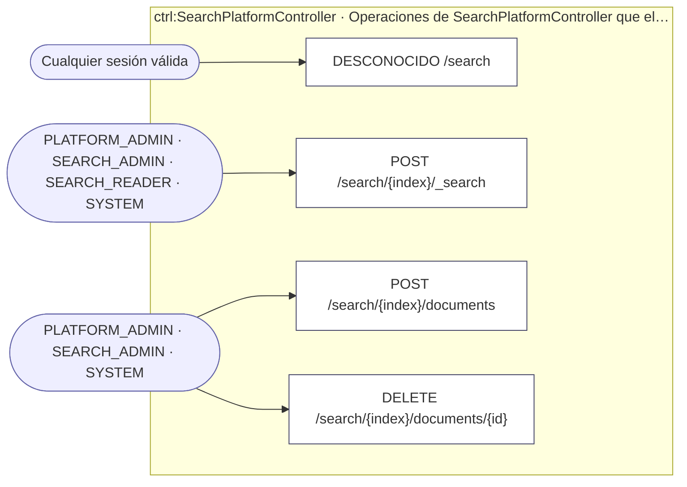
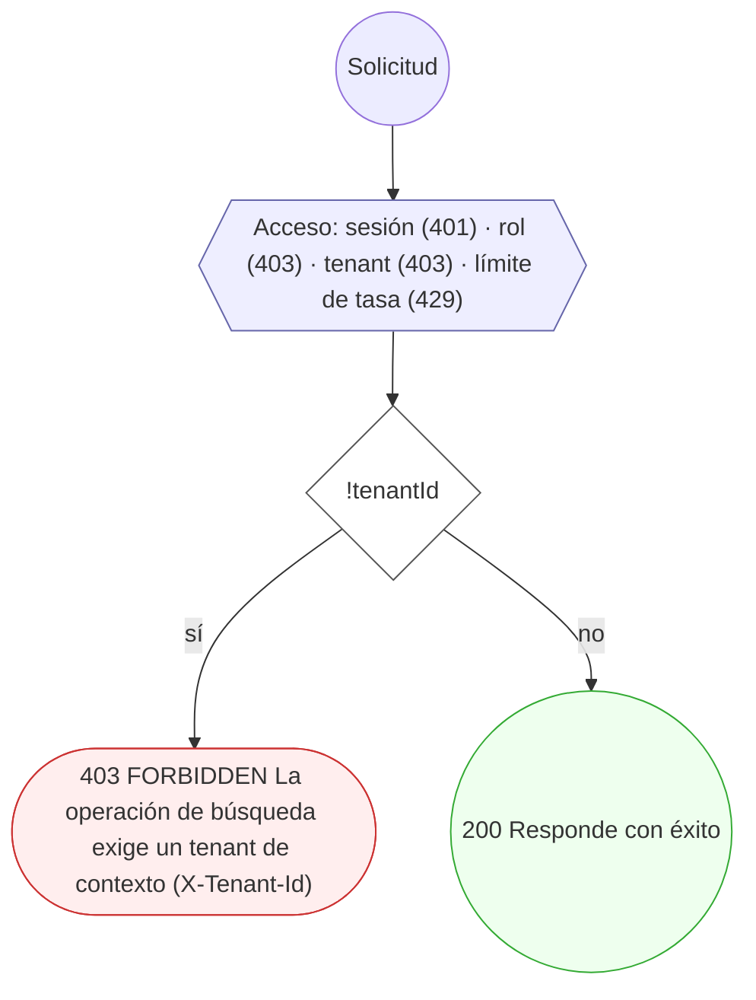
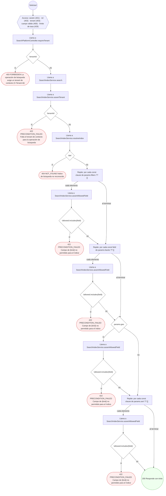
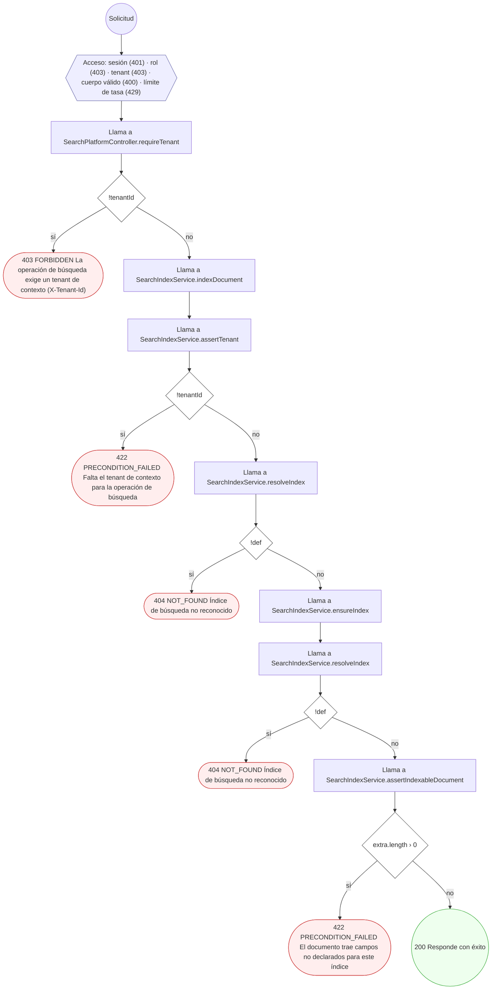
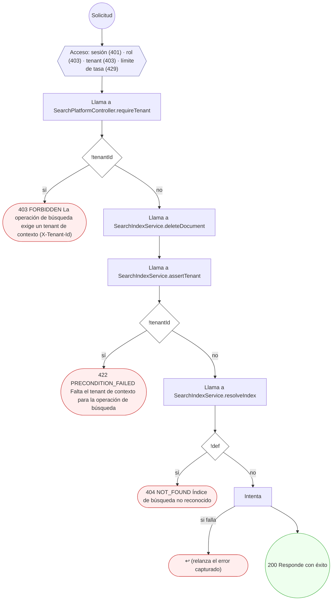

<!-- AUTOGENERADO por tools/inventario/flujos.mjs. No editar manualmente. -->

# Flujos del módulo `search_platform`

- **Procesos:** 1 · **Máquinas de estado:** 0
- **Operaciones:** 4 (4 con decisiones propias, 0 sin ellas)
- Inventario de endpoints del módulo: [search_platform](../endpoints/search_platform.md)

## Proceso: Módulo 57 — Plataforma de búsqueda (`search_platform`)

- **Código:** `search_platform` · **Agrupación:** AGRUPACION_POR_CONTROLADOR · **Operaciones:** 4
- **Actores:** Cualquier sesión válida · PLATFORM_ADMIN · SEARCH_ADMIN · SEARCH_READER · SYSTEM
- **Revisión:** AUTO_DETECTADA
- **Fuentes:** `src/modules/search_platform/README.md`

### Para qué sirve

Búsqueda de texto completo y facetada sobre **OpenSearch real** (contenedor `mantra-redesa-opensearch-1`, `OPENSEARCH_NODE`), para las entidades de negocio consultables: directorio de profesionales/organizaciones, catálogo de servicios y publicaciones. El aislamiento por tenant se aplica **a nivel de consulta**: no hay forma de que un tenant vea documentos de otro aunque el índice físico sea común.

_Fuente: `src/modules/search_platform/README.md:3`_

### Etapas y operaciones

| Etapa | Descripción | Operación | Quién actúa | Riesgo | Tablas |
|---|---|---|---|---|---|
| `ctrl:SearchPlatformController` | Operaciones de SearchPlatformController que el README no asigna a un caso de uso | DESCONOCIDO /search | Cualquier sesión válida | BAJO | 0 |
|  |  | POST /search/{index}/_search | PLATFORM_ADMIN · SEARCH_ADMIN · SEARCH_READER · SYSTEM | BAJO | 0 |
|  |  | POST /search/{index}/documents | PLATFORM_ADMIN · SEARCH_ADMIN · SYSTEM | BAJO | 0 |
|  |  | DELETE /search/{index}/documents/{id} | PLATFORM_ADMIN · SEARCH_ADMIN · SYSTEM | BAJO | 0 |

### Diagrama — etapas `ctrl:SearchPlatformController`

## Árbol de decisión por operación

Cada árbol se deriva del código del handler y de los métodos que invoca (hasta 4 niveles). Una rama que no decide, no escribe y no falla se poda. Los accesos y los efectos consecutivos se agrupan en un solo nodo.

### Operaciones con decisiones propias

#### 1. DESCONOCIDO /search

Exige tenant de contexto (fail-closed).

| HTTP | Código | Cuándo |
|---|---|---|
| 200 | — | Éxito |
| 401 | `UNAUTHENTICATED` | Hay una sesión válida (JWT) |
| 403 | `FORBIDDEN` | El rol está permitido; El tenant se resuelve y pertenece al actor; ForbiddenException: La operación de búsqueda exige un tenant de contexto (X-Tenant-Id) |
| 429 | `RATE_LIMITED` | No se supera el límite de solicitudes |

#### 2. POST /search/{index}/_search

Buscar documentos

| HTTP | Código | Cuándo |
|---|---|---|
| 200 | — | Éxito |
| 400 | `VALIDATION_FAILED` | El cuerpo cumple el DTO (sin propiedades extra) |
| 401 | `UNAUTHENTICATED` | Hay una sesión válida (JWT) |
| 403 | `FORBIDDEN` | El rol está permitido; El tenant se resuelve y pertenece al actor; ForbiddenException: La operación de búsqueda exige un tenant de contexto (X-Tenant-Id) |
| 404 | `NOT_FOUND` | ResourceNotFoundException: Índice de búsqueda no reconocido |
| 422 | `PRECONDITION_FAILED` | PreconditionFailedException: Falta el tenant de contexto para la operación de búsqueda; PreconditionFailedException: Campo de {kind} no permitido para el índice |
| 429 | `RATE_LIMITED` | No se supera el límite de solicitudes |

#### 3. POST /search/{index}/documents

Indexar un documento

| HTTP | Código | Cuándo |
|---|---|---|
| 200 | — | Éxito |
| 400 | `VALIDATION_FAILED` | El cuerpo cumple el DTO (sin propiedades extra) |
| 401 | `UNAUTHENTICATED` | Hay una sesión válida (JWT) |
| 403 | `FORBIDDEN` | El rol está permitido; El tenant se resuelve y pertenece al actor; ForbiddenException: La operación de búsqueda exige un tenant de contexto (X-Tenant-Id) |
| 404 | `NOT_FOUND` | ResourceNotFoundException: Índice de búsqueda no reconocido |
| 422 | `PRECONDITION_FAILED` | PreconditionFailedException: Falta el tenant de contexto para la operación de búsqueda; PreconditionFailedException: El documento trae campos no declarados para este índice |
| 429 | `RATE_LIMITED` | No se supera el límite de solicitudes |

#### 4. DELETE /search/{index}/documents/{id}

Eliminar un documento

| HTTP | Código | Cuándo |
|---|---|---|
| 200 | — | Éxito |
| 401 | `UNAUTHENTICATED` | Hay una sesión válida (JWT) |
| 403 | `FORBIDDEN` | El rol está permitido; El tenant se resuelve y pertenece al actor; ForbiddenException: La operación de búsqueda exige un tenant de contexto (X-Tenant-Id) |
| 404 | `NOT_FOUND` | ResourceNotFoundException: Índice de búsqueda no reconocido |
| 422 | `PRECONDITION_FAILED` | PreconditionFailedException: Falta el tenant de contexto para la operación de búsqueda |
| 429 | `RATE_LIMITED` | No se supera el límite de solicitudes |

