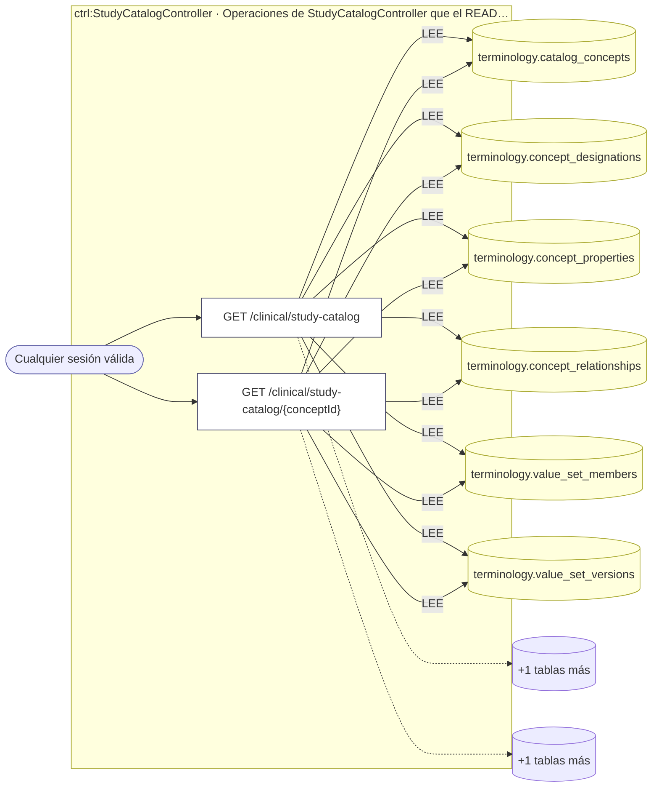

```mermaid
flowchart TD
  n1(("Solicitud")):::inicio
  n2{{"Acceso: sesión (401) · rol (403) · tenant (403) · límite de tasa (429)"}}:::acceso
  n1 --> n2
  n3["Llama a StudyCatalogService.detail"]:::llamada
  n2 --> n3
  n4["Llama a StudyCatalogRepository.findOne"]:::llamada
  n3 --> n4
  n5[("LEE terminology.value_set_members · LEE terminology.value_set_versions · LEE terminology.value_sets · LEE ter…")]:::efecto
  n4 --> n5
  n6{"!row"}:::decision
  n5 --> n6
  n7(["404 NOT_FOUND Estudio no encontrado en el catálogo"]):::error
  n6 -->|"sí"| n7
  n8["Llama a StudyCatalogService.toItems"]:::llamada
  n6 -->|"no"| n8
  n9["Llama a StudyCatalogRepository.countComponents"]:::llamada
  n8 --> n9
  n10[("LEE terminology.concept_relationships")]:::efecto
  n9 --> n10
  n11["Llama a StudyCatalogRepository.findTargets"]:::llamada
  n10 --> n11
  n12[("LEE terminology.concept_relationships")]:::efecto
  n11 --> n12
  n13["Llama a StudyCatalogRepository.findTargets"]:::llamada
  n12 --> n13
  n14[("LEE terminology.concept_relationships")]:::efecto
  n13 --> n14
  n15["Llama a StudyCatalogRepository.findComponentNames"]:::llamada
  n14 --> n15
  n16[("LEE terminology.concept_relationships · LEE terminology.catalog_concepts · LEE terminology.concept_designatio…")]:::efecto
  n15 --> n16
  n17["Llama a StudyCatalogRepository.findComponents"]:::llamada
  n16 --> n17
  n18[("LEE terminology.concept_relationships · LEE terminology.catalog_concepts · LEE terminology.concept_designatio…")]:::efecto
  n17 --> n18
  n19{"family === 'LAB' || family === 'PATHOLOGY'"}:::decision
  n18 --> n19
  n20["Llama a StudyCatalogRepository.findValueSetOptions"]:::llamada
  n19 -->|"sí"| n20
  n21[("LEE terminology.value_sets · LEE terminology.value_set_versions · LEE terminology.value_set_members · LEE ter…")]:::efecto
  n20 --> n21
  n22["Llama a StudyCatalogRepository.findTargets"]:::llamada
  n21 --> n22
  n23[("LEE terminology.concept_relationships")]:::efecto
  n22 --> n23
  n24{"family === 'IMAGING'"}:::decision
  n23 --> n24
  n19 -->|"no"| n24
  n25{"base.modalityConceptId"}:::decision
  n24 -->|"sí"| n25
  n26["Llama a StudyCatalogRepository.findConceptsWithCode"]:::llamada
  n25 -->|"sí"| n26
  n27[("LEE terminology.concept_properties · LEE terminology.catalog_concepts")]:::efecto
  n26 --> n27
  n28{"base.bodySiteConceptId"}:::decision
  n27 --> n28
  n25 -->|"no"| n28
  n29["Llama a StudyCatalogRepository.findBodySiteTree"]:::llamada
  n28 -->|"sí"| n29
  n30[("LEE terminology.catalog_concepts · LEE terminology.concept_relationships · LEE terminology.concept_properties")]:::efecto
  n29 --> n30
  n31["Llama a StudyCatalogRepository.findValueSetOptions"]:::llamada
  n30 --> n31
  n28 -->|"no"| n31
  n32[("LEE terminology.value_sets · LEE terminology.value_set_versions · LEE terminology.value_set_members · LEE ter…")]:::efecto
  n31 --> n32
  n33["Llama a StudyCatalogRepository.findValueSetOptions"]:::llamada
  n32 --> n33
  n34[("LEE terminology.value_sets · LEE terminology.value_set_versions · LEE terminology.value_set_members · LEE ter…")]:::efecto
  n33 --> n34
  n35(("200 Responde con éxito")):::ok
  n34 --> n35
  n24 -->|"no"| n35
  classDef acceso fill:#eef,stroke:#66a
  classDef error fill:#fee,stroke:#c33
  classDef ok fill:#efe,stroke:#3a3
  classDef efecto fill:#ffd,stroke:#aa3
  classDef decision fill:#fff,stroke:#555
  classDef corte fill:#eee,stroke:#999,stroke-dasharray: 4
```

<!-- AUTOGENERADO por tools/inventario/flujos.mjs. No editar manualmente. -->

# Flujos del módulo `study_catalog`

- **Procesos:** 1 · **Máquinas de estado:** 0
- **Operaciones:** 2 (2 con decisiones propias, 0 sin ellas)
- Inventario de endpoints del módulo: [study_catalog](../endpoints/study_catalog.md)

## Proceso: study_catalog

- **Código:** `study_catalog` · **Agrupación:** AGRUPACION_POR_CONTROLADOR · **Operaciones:** 2
- **Actores:** Cualquier sesión válida
- **Revisión:** AUTO_DETECTADA
- **Fuentes:** —

### Para qué sirve

_Sin fuente: ni el README del módulo ni el modelo lo describen._

### Etapas y operaciones

| Etapa | Descripción | Operación | Quién actúa | Riesgo | Tablas |
|---|---|---|---|---|---|
| `ctrl:StudyCatalogController` | Operaciones de StudyCatalogController que el README no asigna a un caso de uso | GET /clinical/study-catalog | Cualquier sesión válida | BAJO | 7 |
|  |  | GET /clinical/study-catalog/{conceptId} | Cualquier sesión válida | BAJO | 7 |

### Diagrama — etapas `ctrl:StudyCatalogController`

## Árbol de decisión por operación

Cada árbol se deriva del código del handler y de los métodos que invoca (hasta 4 niveles). Una rama que no decide, no escribe y no falla se poda. Los accesos y los efectos consecutivos se agrupan en un solo nodo.

### Operaciones con decisiones propias

#### 1. GET /clinical/study-catalog

Catálogo de estudios pedibles, con búsqueda y paginación

| HTTP | Código | Cuándo |
|---|---|---|
| 200 | — | Éxito |
| 401 | `UNAUTHENTICATED` | Hay una sesión válida (JWT) |
| 403 | `FORBIDDEN` | El rol está permitido; El tenant se resuelve y pertenece al actor |
| 429 | `RATE_LIMITED` | No se supera el límite de solicitudes |

```mermaid
flowchart TD
  n1(("Solicitud")):::inicio
  n2{{"Acceso: sesión (401) · rol (403) · tenant (403) · límite de tasa (429)"}}:::acceso
  n1 --> n2
  n3["Llama a StudyCatalogService.list"]:::llamada
  n2 --> n3
  n4["Llama a StudyCatalogRepository.findPage"]:::llamada
  n3 --> n4
  n5["Repite: por cada const token de filter.tokens"]:::bucle
  n4 --> n5
  n6[("LEE terminology.concept_designations · LEE terminology.concept_relationships")]:::efecto
  n5 -->|"cada elemento"| n6
  n7[("LEE terminology.value_set_members · LEE terminology.value_set_versions · LEE terminology.value_sets · LEE ter…")]:::efecto
  n6 --> n7
  n5 -->|"al terminar"| n7
  n8["Llama a StudyCatalogService.toItems"]:::llamada
  n7 --> n8
  n9["Llama a StudyCatalogRepository.countComponents"]:::llamada
  n8 --> n9
  n10[("LEE terminology.concept_relationships")]:::efecto
  n9 --> n10
  n11["Llama a StudyCatalogRepository.findTargets"]:::llamada
  n10 --> n11
  n12[("LEE terminology.concept_relationships")]:::efecto
  n11 --> n12
  n13["Llama a StudyCatalogRepository.findTargets"]:::llamada
  n12 --> n13
  n14[("LEE terminology.concept_relationships")]:::efecto
  n13 --> n14
  n15["Llama a StudyCatalogRepository.findComponentNames"]:::llamada
  n14 --> n15
  n16[("LEE terminology.concept_relationships · LEE terminology.catalog_concepts · LEE terminology.concept_designatio…")]:::efecto
  n15 --> n16
  n17(("200 Responde con éxito")):::ok
  n16 --> n17
  classDef acceso fill:#eef,stroke:#66a
  classDef error fill:#fee,stroke:#c33
  classDef ok fill:#efe,stroke:#3a3
  classDef efecto fill:#ffd,stroke:#aa3
  classDef decision fill:#fff,stroke:#555
  classDef corte fill:#eee,stroke:#999,stroke-dasharray: 4
```

#### 2. GET /clinical/study-catalog/{conceptId}

Detalle de un estudio del catálogo

| HTTP | Código | Cuándo |
|---|---|---|
| 200 | — | Éxito |
| 401 | `UNAUTHENTICATED` | Hay una sesión válida (JWT) |
| 403 | `FORBIDDEN` | El rol está permitido; El tenant se resuelve y pertenece al actor |
| 404 | `NOT_FOUND` | ResourceNotFoundException: Estudio no encontrado en el catálogo |
| 429 | `RATE_LIMITED` | No se supera el límite de solicitudes |

