<!-- AUTOGENERADO por tools/inventario/flujos.mjs. No editar manualmente. -->

# Flujos del módulo `surveys`

- **Procesos:** 1 · **Máquinas de estado:** 0
- **Operaciones:** 18 (18 con decisiones propias, 0 sin ellas)
- Inventario de endpoints del módulo: [surveys](../endpoints/surveys.md)

## Proceso: Módulo Surveys — Cuestionarios y encuestas de satisfacción

- **Código:** `surveys` · **Agrupación:** AGRUPACION_POR_CONTROLADOR · **Operaciones:** 18
- **Actores:** CLINICIAN · Cualquier sesión válida · PRACTITIONER
- **Revisión:** AUTO_DETECTADA
- **Fuentes:** `src/modules/surveys/README.md`

### Para qué sirve

Instrumento de satisfacción dirigido: plantilla con versiones inmutables y vigencia, preguntas con tipo de respuesta y obligatoriedad, asociación a la cosa evaluada, invitación contra una atención completada y respuestas **privadas** del paciente con lectura para el profesional dueño.

_Fuente: `src/modules/surveys/README.md:3`_

### Etapas y operaciones

| Etapa | Descripción | Operación | Quién actúa | Riesgo | Tablas |
|---|---|---|---|---|---|
| `ctrl:SurveysAssignmentsController` | Operaciones de SurveysAssignmentsController que el README no asigna a un caso de uso | POST /surveys/assignments | PRACTITIONER · CLINICIAN | MEDIO | 10 |
|  |  | POST /surveys/invitations | PRACTITIONER · CLINICIAN | MEDIO | 16 |
| `ctrl:SurveysInsightsController` | Operaciones de SurveysInsightsController que el README no asigna a un caso de uso | GET /surveys/insights | PRACTITIONER · CLINICIAN | BAJO | 11 |
| `ctrl:SurveysPatientController` | Operaciones de SurveysPatientController que el README no asigna a un caso de uso | GET /surveys/me/invitations | Cualquier sesión válida | BAJO | 3 |
|  |  | GET /surveys/me/invitations/{id} | Cualquier sesión válida | BAJO | 4 |
|  |  | POST /surveys/me/invitations/{id}/responses | Cualquier sesión válida | ALTO | 5 |
| `ctrl:SurveysTemplatesController` | Operaciones de SurveysTemplatesController que el README no asigna a un caso de uso | GET /surveys/templates | PRACTITIONER · CLINICIAN | BAJO | 3 |
|  |  | POST /surveys/templates | PRACTITIONER · CLINICIAN | MEDIO | 2 |
|  |  | GET /surveys/templates/{id} | PRACTITIONER · CLINICIAN | BAJO | 5 |
|  |  | PATCH /surveys/templates/{id} | PRACTITIONER · CLINICIAN | MEDIO | 4 |
|  |  | POST /surveys/templates/{id}/deactivate | PRACTITIONER · CLINICIAN | MEDIO | 2 |
|  |  | POST /surveys/templates/{id}/questions | PRACTITIONER · CLINICIAN | MEDIO | 4 |
|  |  | DELETE /surveys/templates/{id}/questions/{questionId} | PRACTITIONER · CLINICIAN | ALTO | 4 |
|  |  | PATCH /surveys/templates/{id}/questions/{questionId} | PRACTITIONER · CLINICIAN | MEDIO | 4 |
|  |  | PUT /surveys/templates/{id}/questions/order | PRACTITIONER · CLINICIAN | BAJO | 3 |
|  |  | GET /surveys/templates/{id}/responses | PRACTITIONER · CLINICIAN | BAJO | 6 |
|  |  | POST /surveys/templates/{id}/versions | PRACTITIONER · CLINICIAN | MEDIO | 3 |
|  |  | POST /surveys/templates/{id}/versions/{versionNumber}/publish | PRACTITIONER · CLINICIAN | MEDIO | 5 |

### Diagrama — etapas `ctrl:SurveysAssignmentsController`, `ctrl:SurveysInsightsController`, `ctrl:SurveysPatientController`…

```mermaid
flowchart LR
  a2(["PRACTITIONER · CLINICIAN"]):::actor
  a17(["Cualquier sesión válida"]):::actor
  t3[("billing.service_catalog")]:::tabla
  t4[("practice.practices")]:::tabla
  t5[("scheduling.appointment_bookings")]:::tabla
  t6[("scheduling.bookable_slots")]:::tabla
  t7[("scheduling.practitioner_service_offerings")]:::tabla
  t8[("scheduling.schedulable_resources")]:::tabla
  t11[("surveys.survey_assignments")]:::tabla
  t14[("surveys.survey_answers")]:::tabla
  t18[("surveys.survey_invitations")]:::tabla
  t19[("surveys.survey_templates")]:::tabla
  t20[("surveys.survey_versions")]:::tabla
  t22[("surveys.survey_questions")]:::tabla
  t24[("surveys.survey_responses")]:::tabla
  t9[("+4 tablas más")]
  t12[("+10 tablas más")]
  subgraph s0["ctrl:SurveysAssignmentsController · Operaciones de SurveysAssignmentsController…"]
    o1["POST /surveys/assignments"]:::op
    o10["POST /surveys/invitations"]:::op
  end
  t15[("+5 tablas más")]
  subgraph s1["ctrl:SurveysInsightsController · Operaciones de SurveysInsightsController que e…"]
    o13["GET /surveys/insights"]:::op
  end
  subgraph s2["ctrl:SurveysPatientController · Operaciones de SurveysPatientController que el…"]
    o16["GET /surveys/me/invitations"]:::op
    o21["GET /surveys/me/invitations/{id}"]:::op
    o23["POST /surveys/me/invitations/{id}/responses"]:::op
  end
  subgraph s3["ctrl:SurveysTemplatesController · Operaciones de SurveysTemplatesController que…"]
    o25["GET /surveys/templates"]:::op
    o26["POST /surveys/templates"]:::op
    o27["GET /surveys/templates/{id}"]:::op
    o28["PATCH /surveys/templates/{id}"]:::op
    o29["POST /surveys/templates/{id}/deactivate"]:::op
    o30["POST /surveys/templates/{id}/questions"]:::op
    o31["DELETE /surveys/templates/{id}/questions/{questionId}"]:::op
    o32["PATCH /surveys/templates/{id}/questions/{questionId}"]:::op
    o33["PUT /surveys/templates/{id}/questions/order"]:::op
    o34["GET /surveys/templates/{id}/responses"]:::op
    o35["POST /surveys/templates/{id}/versions"]:::op
    o36["POST /surveys/templates/{id}/versions/{versionNumber}/publish"]:::op
  end
  a2 --> o1
  o1 -->|"LEE"| t3
  o1 -->|"LEE"| t4
  o1 -->|"LEE"| t5
  o1 -->|"LEE"| t6
  o1 -->|"LEE"| t7
  o1 -->|"LEE"| t8
  o1 -.-> t9
  a2 --> o10
  o10 -->|"LEE"| t5
  o10 -->|"LEE"| t6
  o10 -->|"LEE"| t7
  o10 -->|"LEE"| t8
  o10 -->|"CREA"| t11
  o10 -->|"LEE"| t11
  o10 -.-> t12
  a2 --> o13
  o13 -->|"LEE"| t5
  o13 -->|"LEE"| t6
  o13 -->|"LEE"| t7
  o13 -->|"LEE"| t8
  o13 -->|"LEE"| t14
  o13 -->|"LEE"| t11
  o13 -.-> t15
  a17 --> o16
  o16 -->|"LEE"| t18
  o16 -->|"LEE"| t19
  o16 -->|"LEE"| t20
  a17 --> o21
  o21 -->|"LEE"| t18
  o21 -->|"LEE"| t22
  o21 -->|"LEE"| t19
  o21 -->|"LEE"| t20
  a17 --> o23
  o23 -->|"CREA"| t14
  o23 -->|"ACTUALIZA"| t18
  o23 -->|"LEE"| t18
  o23 -->|"LEE"| t22
  o23 -->|"CREA"| t24
  a2 --> o25
  o25 -->|"LEE"| t22
  o25 -->|"LEE"| t19
  o25 -->|"LEE"| t20
  a2 --> o26
  o26 -->|"CREA"| t19
  o26 -->|"CREA"| t20
  a2 --> o27
  o27 -->|"LEE"| t3
  o27 -->|"LEE"| t11
  o27 -->|"LEE"| t22
  o27 -->|"LEE"| t19
  o27 -->|"LEE"| t20
  a2 --> o28
  o28 -->|"ACTUALIZA"| t19
  o28 -->|"LEE"| t19
  o28 -->|"ACTUALIZA"| t20
  o28 -->|"LEE"| t20
  a2 --> o29
  o29 -->|"ACTUALIZA"| t19
  o29 -->|"LEE"| t19
  a2 --> o30
  o30 -->|"CREA"| t22
  o30 -->|"LEE"| t22
  o30 -->|"LEE"| t19
  o30 -->|"LEE"| t20
  a2 --> o31
  o31 -->|"BORRA"| t22
  o31 -->|"LEE"| t22
  o31 -->|"LEE"| t19
  o31 -->|"LEE"| t20
  a2 --> o32
  o32 -->|"ACTUALIZA"| t22
  o32 -->|"LEE"| t22
  o32 -->|"LEE"| t19
  o32 -->|"LEE"| t20
  a2 --> o33
  o33 -->|"LEE"| t22
  o33 -->|"LEE"| t19
  o33 -->|"LEE"| t20
  a2 --> o34
  o34 -->|"LEE"| t14
  o34 -->|"LEE"| t18
  o34 -->|"LEE"| t22
  o34 -->|"LEE"| t24
  o34 -->|"LEE"| t19
  o34 -->|"LEE"| t20
  a2 --> o35
  o35 -->|"LEE"| t19
  o35 -->|"CREA"| t20
  o35 -->|"LEE"| t20
  a2 --> o36
  o36 -->|"LEE"| t22
  o36 -->|"ACTUALIZA"| t19
  o36 -->|"LEE"| t19
  o36 -->|"ACTUALIZA"| t20
  o36 -->|"LEE"| t20
  classDef op fill:#fff,stroke:#446
  classDef actor fill:#eef,stroke:#66a
  classDef tabla fill:#ffd,stroke:#aa3
  classDef evento fill:#efe,stroke:#3a3
```

## Árbol de decisión por operación

Cada árbol se deriva del código del handler y de los métodos que invoca (hasta 4 niveles). Una rama que no decide, no escribe y no falla se poda. Los accesos y los efectos consecutivos se agrupan en un solo nodo.

### Operaciones con decisiones propias

#### 1. POST /surveys/assignments

Asociar una encuesta a una consulta o servicio

| HTTP | Código | Cuándo |
|---|---|---|
| 201 | — | Éxito |
| 400 | `VALIDATION_FAILED` | El cuerpo cumple el DTO (sin propiedades extra) |
| 401 | `UNAUTHENTICATED` | Hay una sesión válida (JWT) |
| 403 | `FORBIDDEN` | El rol está permitido; El tenant se resuelve y pertenece al actor |
| 409 | `CONFLICT` | ConflictException: Ya existe una asignación activa de esa versión a ese destino |
| 422 | `PRECONDITION_FAILED` | PreconditionFailedException: El único tipo de atención que se puede asociar es «consulta»: asigne la encuesta por servicio, por cita concreta o a todas sus consultas; PreconditionFailedException: Usted no ofrece ese servicio: declárelo en sus servicios antes de asociarle una encuesta |
| 429 | `RATE_LIMITED` | No se supera el límite de solicitudes |

```mermaid
flowchart TD
  n1(("Solicitud")):::inicio
  n2{{"Acceso: sesión (401) · rol (403) · tenant (403) · cuerpo válido (400) · límite de tasa (429)"}}:::acceso
  n1 --> n2
  n3["Llama a SurveysAssignmentsService.createAssignment"]:::llamada
  n2 --> n3
  n4["Llama a SurveysAssignmentsService.resolveTargetId"]:::llamada
  n3 --> n4
  n5{"dto.targetId !== undefined && dto.targetId !== SURVEYS.CARE_TYPE_CONSULTATION"}:::decision
  n4 --> n5
  n6(["422 PRECONDITION_FAILED El único tipo de atención que se puede asociar es «consulta»: asigne la encuesta por…"]):::error
  n5 -->|"sí"| n6
  n7["Llama a TemplatesRepository.findVersionById"]:::llamada
  n5 -->|"no"| n7
  n8[("LEE surveys.survey_versions")]:::efecto
  n7 --> n8
  n9["Llama a TemplatesRepository.findTemplateById"]:::llamada
  n8 --> n9
  n10[("LEE surveys.survey_templates")]:::efecto
  n9 --> n10
  n11["Llama a SurveysAssignmentsService.assertTargetUsable"]:::llamada
  n10 --> n11
  n12{"targetType === 'APPOINTMENT'"}:::decision
  n11 --> n12
  n13["Llama a TargetsRepository.findBooking"]:::llamada
  n12 -->|"sí"| n13
  n14[("LEE scheduling.appointment_bookings")]:::efecto
  n13 --> n14
  n15{"!booking || booking.tenantId !== tenantId"}:::decision
  n14 --> n15
  n16(["↩ (relanza el error capturado)"]):::error
  n15 -->|"sí"| n16
  n17["Llama a TargetsRepository.findPractitionerOfBooking"]:::llamada
  n15 -->|"no"| n17
  n18{"booking.practitionerServiceOfferingId"}:::decision
  n17 --> n18
  n19["Llama a TargetsRepository.findOffering"]:::llamada
  n18 -->|"sí"| n19
  n20[("LEE scheduling.practitioner_service_offerings")]:::efecto
  n19 --> n20
  n21{"!resourceId"}:::decision
  n20 --> n21
  n18 -->|"no"| n21
  n22[("LEE scheduling.bookable_slots")]:::efecto
  n21 -->|"sí"| n22
  n23[("LEE scheduling.schedulable_resources")]:::efecto
  n22 --> n23
  n21 -->|"no"| n23
  n24{"attendedBy === null || attendedBy !== practitionerProfileId"}:::decision
  n23 --> n24
  n25(["↩ (relanza el error capturado)"]):::error
  n24 -->|"sí"| n25
  n26["Llama a TargetsRepository.findServiceCatalog"]:::llamada
  n24 -->|"no"| n26
  n12 -->|"no"| n26
  n27[("LEE billing.service_catalog")]:::efecto
  n26 --> n27
  n28["Llama a TargetsRepository.findTenantOfPractice"]:::llamada
  n27 --> n28
  n29[("LEE practice.practices")]:::efecto
  n28 --> n29
  n30{"!service || (await this.targetsRepo.findTenantOfPractice(tx, service.practiceId)) !== tenantId"}:::decision
  n29 --> n30
  n31(["↩ (relanza el error capturado)"]):::error
  n30 -->|"sí"| n31
  n32["Llama a TargetsRepository.findOfferingOf"]:::llamada
  n30 -->|"no"| n32
  n33[("LEE scheduling.practitioner_service_offerings")]:::efecto
  n32 --> n33
  n34{"!offering"}:::decision
  n33 --> n34
  n35(["422 PRECONDITION_FAILED Usted no ofrece ese servicio: declárelo en sus servicios antes de asociarle una encue…"]):::error
  n34 -->|"sí"| n35
  n36["Llama a TemplatesRepository.lockVersion"]:::llamada
  n34 -->|"no"| n36
  n37[("LEE surveys.survey_versions")]:::efecto
  n36 --> n37
  n38["Llama a AssignmentsRepository.findActiveDuplicate"]:::llamada
  n37 --> n38
  n39[("LEE surveys.survey_assignments")]:::efecto
  n38 --> n39
  n40["Llama a AssignmentsRepository.create"]:::llamada
  n39 --> n40
  n41[("CREA surveys.survey_assignments")]:::efecto
  n40 --> n41
  n42["Transacción: catch(…)"]:::transaccion
  n41 --> n42
  n43{"error instanceof UniqueConstraintViolationException"}:::decision
  n42 --> n43
  n44(["409 CONFLICT Ya existe una asignación activa de esa versión a ese destino"]):::error
  n43 -->|"sí"| n44
  n45(["↩ (relanza el error capturado)"]):::error
  n43 -->|"no"| n45
  n46(("201 Responde con éxito")):::ok
  classDef acceso fill:#eef,stroke:#66a
  classDef error fill:#fee,stroke:#c33
  classDef ok fill:#efe,stroke:#3a3
  classDef efecto fill:#ffd,stroke:#aa3
  classDef decision fill:#fff,stroke:#555
  classDef corte fill:#eee,stroke:#999,stroke-dasharray: 4
```

#### 2. GET /surveys/insights

Resumen general de mis encuestas (agregado, sin pacientes)

| HTTP | Código | Cuándo |
|---|---|---|
| 200 | — | Éxito |
| 400 | `VALIDATION_FAILED` | BadRequestException: to debe ser el último día de un mes (por ejemplo 2026-10-31); BadRequestException: from debe ser el primer día de un mes (por ejemplo 2026-10-01); BadRequestException: El inicio del periodo debe ser anterior o igual a su fin; BadRequestException: El periodo no puede superar {MAX_RANGE_MONTHS} meses |
| 401 | `UNAUTHENTICATED` | Hay una sesión válida (JWT) |
| 403 | `FORBIDDEN` | El rol está permitido; El tenant se resuelve y pertenece al actor; ForbiddenException: Solo un profesional puede ver el resumen de sus encuestas |
| 429 | `RATE_LIMITED` | No se supera el límite de solicitudes |

```mermaid
flowchart TD
  n1(("Solicitud")):::inicio
  n2{{"Acceso: sesión (401) · rol (403) · tenant (403) · límite de tasa (429)"}}:::acceso
  n1 --> n2
  n3["Llama a SurveysInsightsService.getInsights"]:::llamada
  n2 --> n3
  n4{"!actor.practitionerProfileId"}:::decision
  n3 --> n4
  n5(["403 FORBIDDEN Solo un profesional puede ver el resumen de sus encuestas"]):::error
  n4 -->|"sí"| n5
  n6["Llama a SurveysInsightsService.resolvePeriod"]:::llamada
  n4 -->|"no"| n6
  n7{"query.to"}:::decision
  n6 --> n7
  n8{"nextDay.getUTCDate() !== 1"}:::decision
  n7 -->|"sí"| n8
  n9(["400 VALIDATION_FAILED to debe ser el último día de un mes (por ejemplo 2026-10-31)"]):::error
  n8 -->|"sí"| n9
  n10{"query.from"}:::decision
  n8 -->|"no"| n10
  n7 -->|"no"| n10
  n11{"!MONTH_START_PATTERN.test(query.from)"}:::decision
  n10 -->|"sí"| n11
  n12(["400 VALIDATION_FAILED from debe ser el primer día de un mes (por ejemplo 2026-10-01)"]):::error
  n11 -->|"sí"| n12
  n13{"from › toDay"}:::decision
  n11 -->|"no"| n13
  n10 -->|"no"| n13
  n14(["400 VALIDATION_FAILED El inicio del periodo debe ser anterior o igual a su fin"]):::error
  n13 -->|"sí"| n14
  n15{"monthIndex(toDay) - monthIndex(from) + 1 › MAX_RANGE_MONTHS"}:::decision
  n13 -->|"no"| n15
  n16(["400 VALIDATION_FAILED El periodo no puede superar {MAX_RANGE_MONTHS} meses"]):::error
  n15 -->|"sí"| n16
  n17["Llama a InsightsRepository.countInvitationsByBucket"]:::llamada
  n15 -->|"no"| n17
  n18["Llama a InsightsRepository.buildScope"]:::llamada
  n17 --> n18
  n19{"scope.serviceId"}:::decision
  n18 --> n19
  n20[("LEE scheduling.appointment_bookings · LEE scheduling.practitioner_service_offerings · LEE surveys.survey_assi…")]:::efecto
  n19 -->|"sí"| n20
  n21[("LEE surveys.survey_invitations · LEE surveys.survey_versions · LEE surveys.survey_templates · LEE scheduling.…")]:::efecto
  n20 --> n21
  n19 -->|"no"| n21
  n22["Llama a InsightsRepository.countAnswersByQuestion"]:::llamada
  n21 --> n22
  n23["Llama a InsightsRepository.buildScope"]:::llamada
  n22 --> n23
  n24{"scope.serviceId"}:::decision
  n23 --> n24
  n25[("LEE scheduling.appointment_bookings · LEE scheduling.practitioner_service_offerings · LEE surveys.survey_assi…")]:::efecto
  n24 -->|"sí"| n25
  n26[("LEE surveys.survey_invitations · LEE surveys.survey_versions · LEE surveys.survey_templates · LEE scheduling.…")]:::efecto
  n25 --> n26
  n24 -->|"no"| n26
  n27[("LEE surveys.survey_questions · LEE surveys.survey_versions · LEE surveys.survey_templates · LEE surveys.surve…")]:::efecto
  n26 --> n27
  n28["Llama a InsightsRepository.countAnswerValues"]:::llamada
  n27 --> n28
  n29["Llama a InsightsRepository.buildScope"]:::llamada
  n28 --> n29
  n30{"scope.serviceId"}:::decision
  n29 --> n30
  n31[("LEE scheduling.appointment_bookings · LEE scheduling.practitioner_service_offerings · LEE surveys.survey_assi…")]:::efecto
  n30 -->|"sí"| n31
  n32[("LEE surveys.survey_invitations · LEE surveys.survey_versions · LEE surveys.survey_templates · LEE scheduling.…")]:::efecto
  n31 --> n32
  n30 -->|"no"| n32
  n33[("LEE surveys.survey_responses · LEE surveys.survey_answers · LEE surveys.survey_questions")]:::efecto
  n32 --> n33
  n34["Llama a InsightsRepository.listRecentComments"]:::llamada
  n33 --> n34
  n35["Llama a InsightsRepository.buildScope"]:::llamada
  n34 --> n35
  n36{"scope.serviceId"}:::decision
  n35 --> n36
  n37[("LEE scheduling.appointment_bookings · LEE scheduling.practitioner_service_offerings · LEE surveys.survey_assi…")]:::efecto
  n36 -->|"sí"| n37
  n38[("LEE surveys.survey_invitations · LEE surveys.survey_versions · LEE surveys.survey_templates · LEE scheduling.…")]:::efecto
  n37 --> n38
  n36 -->|"no"| n38
  n39[("LEE surveys.survey_responses · LEE surveys.survey_answers · LEE surveys.survey_questions")]:::efecto
  n38 --> n39
  n40(("200 Responde con éxito")):::ok
  n39 --> n40
  classDef acceso fill:#eef,stroke:#66a
  classDef error fill:#fee,stroke:#c33
  classDef ok fill:#efe,stroke:#3a3
  classDef efecto fill:#ffd,stroke:#aa3
  classDef decision fill:#fff,stroke:#555
  classDef corte fill:#eee,stroke:#999,stroke-dasharray: 4
```

#### 3. POST /surveys/invitations

Emitir los cuestionarios de una atención completada

| HTTP | Código | Cuándo |
|---|---|---|
| 201 | — | Éxito |
| 400 | `VALIDATION_FAILED` | El cuerpo cumple el DTO (sin propiedades extra) |
| 401 | `UNAUTHENTICATED` | Hay una sesión válida (JWT) |
| 403 | `FORBIDDEN` | El rol está permitido; El tenant se resuelve y pertenece al actor |
| 404 | `NOT_FOUND` | ResourceNotFoundException: Reserva no encontrada |
| 422 | `PRECONDITION_FAILED` | PreconditionFailedException: Solo se emiten cuestionarios sobre una atención completada |
| 429 | `RATE_LIMITED` | No se supera el límite de solicitudes |
| 500 | `INTERNAL` | Error: La encuesta base {kind} del tenant no quedó materializada (plantilla {ids.templateId}) |

```mermaid
flowchart TD
  n1(("Solicitud")):::inicio
  n2{{"Acceso: sesión (401) · rol (403) · tenant (403) · cuerpo válido (400) · límite de tasa (429)"}}:::acceso
  n1 --> n2
  n3["Llama a SurveysAssignmentsService.issueForBooking"]:::llamada
  n2 --> n3
  n4["Llama a SurveysAssignmentsService.issue"]:::llamada
  n3 --> n4
  n5["Llama a TargetsRepository.findBooking"]:::llamada
  n4 --> n5
  n6[("LEE scheduling.appointment_bookings")]:::efecto
  n5 --> n6
  n7["Llama a SurveysAssignmentsService.assertIssuable"]:::llamada
  n6 --> n7
  n8{"!booking || booking.tenantId !== tenantId"}:::decision
  n7 --> n8
  n9(["404 NOT_FOUND Reserva no encontrada"]):::error
  n8 -->|"sí"| n9
  n10{"booking.statusConceptId !== SCHED.BOOKING_COMPLETED"}:::decision
  n8 -->|"no"| n10
  n11(["422 PRECONDITION_FAILED Solo se emiten cuestionarios sobre una atención completada"]):::error
  n10 -->|"sí"| n11
  n12["Llama a SurveysSystemTemplatesService.ensureSystemTemplate"]:::llamada
  n10 -->|"no"| n12
  n13["Intenta"]:::intento
  n12 --> n13
  n14["Llama a SurveysSystemTemplatesService.materialize"]:::llamada
  n13 --> n14
  n15{"!template"}:::decision
  n14 --> n15
  n16[("ACTUALIZA surveys.survey_templates · ACTUALIZA surveys.survey_templates")]:::efecto
  n15 -->|"no"| n16
  n17["Repite: por cada const old de await this.templatesRepo.listVersions(tx, templat…"]:::bucle
  n15 -->|"sí"| n17
  n16 --> n17
  n18{"old.id !== ids.versionId && old.publicationStatusConceptId === SURVEYS.VERSION_PUBLISHED"}:::decision
  n17 -->|"cada elemento"| n18
  n19[("ACTUALIZA surveys.survey_versions · ACTUALIZA surveys.survey_versions")]:::efecto
  n18 -->|"sí"| n19
  n20{"!(error instanceof UniqueConstraintViolationException)"}:::decision
  n13 -->|"si falla"| n20
  n21(["↩ (relanza el error capturado)"]):::error
  n20 -->|"sí"| n21
  n22{"!created"}:::decision
  n19 --> n22
  n18 -->|"no"| n22
  n17 -->|"al terminar"| n22
  n20 -->|"no"| n22
  n23(["500 INTERNAL La encuesta base {kind} del tenant no quedó materializada (plantilla {ids.templateId})"]):::error
  n22 -->|"sí"| n23
  n24[("LEE scheduling.appointment_bookings")]:::efecto
  n22 -->|"no"| n24
  n25["Llama a SurveysAssignmentsService.assertIssuable"]:::llamada
  n24 --> n25
  n26{"!booking || booking.tenantId !== tenantId"}:::decision
  n25 --> n26
  n27(["404 NOT_FOUND Reserva no encontrada"]):::error
  n26 -->|"sí"| n27
  n28{"booking.statusConceptId !== SCHED.BOOKING_COMPLETED"}:::decision
  n26 -->|"no"| n28
  n29(["422 PRECONDITION_FAILED Solo se emiten cuestionarios sobre una atención completada"]):::error
  n28 -->|"sí"| n29
  n30["Llama a SurveysAssignmentsService.resolveTargets"]:::llamada
  n28 -->|"no"| n30
  n31{"!serviceConceptId"}:::decision
  n30 --> n31
  n32[("LEE scheduling.bookable_slots")]:::efecto
  n31 -->|"sí"| n32
  n33["Llama a TargetsRepository.findPractitionerOfBooking"]:::llamada
  n32 --> n33
  n31 -->|"no"| n33
  n34{"!resourceId"}:::decision
  n33 --> n34
  n35[("LEE scheduling.bookable_slots")]:::efecto
  n34 -->|"sí"| n35
  n36[("LEE scheduling.schedulable_resources")]:::efecto
  n35 --> n36
  n34 -->|"no"| n36
  n37["Llama a AssignmentsRepository.listActiveByTargets"]:::llamada
  n36 --> n37
  n38[("LEE surveys.survey_assignments")]:::efecto
  n37 --> n38
  n39["Llama a InvitationsRepository.listByBooking"]:::llamada
  n38 --> n39
  n40[("LEE surveys.survey_invitations")]:::efecto
  n39 --> n40
  n41["Llama a SurveysAssignmentsService.hasInvitationOfTemplate"]:::llamada
  n40 --> n41
  n42["Repite: por cada const invitation de invitations"]:::bucle
  n41 --> n42
  n43["Llama a TemplatesRepository.findVersionById"]:::llamada
  n42 -->|"cada elemento"| n43
  n44[("LEE surveys.survey_versions")]:::efecto
  n43 --> n44
  n45["Llama a SurveysAssignmentsService.practitionerCandidates"]:::llamada
  n44 --> n45
  n42 -->|"al terminar"| n45
  n46["Repite: por cada const assignment de ordered"]:::bucle
  n45 --> n46
  n47["Llama a TemplatesRepository.findVersionById"]:::llamada
  n46 -->|"cada elemento"| n47
  n48[("LEE surveys.survey_versions")]:::efecto
  n47 --> n48
  n49["Llama a TemplatesRepository.findTemplateById"]:::llamada
  n48 --> n49
  n50[("LEE surveys.survey_templates")]:::efecto
  n49 --> n50
  n51["Llama a InvitationsRepository.create"]:::llamada
  n50 --> n51
  n46 -->|"al terminar"| n51
  n52[("CREA surveys.survey_invitations")]:::efecto
  n51 --> n52
  n53["Llama a InvitationsRepository.create"]:::llamada
  n52 --> n53
  n54[("CREA surveys.survey_invitations")]:::efecto
  n53 --> n54
  n55["Transacción: catch(…)"]:::transaccion
  n54 --> n55
  n56{"!(error instanceof UniqueConstraintViolationException)"}:::decision
  n55 --> n56
  n57(["↩ (relanza el error capturado)"]):::error
  n56 -->|"sí"| n57
  n58["Llama a InvitationsRepository.listByBooking"]:::llamada
  n56 -->|"no"| n58
  n59[("LEE surveys.survey_invitations")]:::efecto
  n58 --> n59
  n60(("201 Responde con éxito")):::ok
  n59 --> n60
  classDef acceso fill:#eef,stroke:#66a
  classDef error fill:#fee,stroke:#c33
  classDef ok fill:#efe,stroke:#3a3
  classDef efecto fill:#ffd,stroke:#aa3
  classDef decision fill:#fff,stroke:#555
  classDef corte fill:#eee,stroke:#999,stroke-dasharray: 4
```

#### 4. GET /surveys/me/invitations

Ver mis cuestionarios

| HTTP | Código | Cuándo |
|---|---|---|
| 200 | — | Éxito |
| 401 | `UNAUTHENTICATED` | Hay una sesión válida (JWT) |
| 403 | `FORBIDDEN` | El rol está permitido; El tenant se resuelve y pertenece al actor; ForbiddenException: Solo un paciente puede ver sus cuestionarios |
| 429 | `RATE_LIMITED` | No se supera el límite de solicitudes |

#### 5. GET /surveys/me/invitations/{id}

Abrir un cuestionario para responderlo

| HTTP | Código | Cuándo |
|---|---|---|
| 200 | — | Éxito |
| 400 | `VALIDATION_FAILED` | Los parámetros de ruta son UUID válidos |
| 401 | `UNAUTHENTICATED` | Hay una sesión válida (JWT) |
| 403 | `FORBIDDEN` | El rol está permitido; El tenant se resuelve y pertenece al actor; ForbiddenException: Solo un paciente puede ver sus cuestionarios |
| 404 | `NOT_FOUND` | ResourceNotFoundException: Cuestionario no encontrado |
| 429 | `RATE_LIMITED` | No se supera el límite de solicitudes |

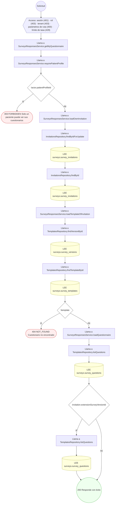

#### 6. POST /surveys/me/invitations/{id}/responses

Responder el cuestionario

| HTTP | Código | Cuándo |
|---|---|---|
| 201 | — | Éxito |
| 400 | `VALIDATION_FAILED` | Los parámetros de ruta son UUID válidos; El cuerpo cumple el DTO (sin propiedades extra) |
| 401 | `UNAUTHENTICATED` | Hay una sesión válida (JWT) |
| 403 | `FORBIDDEN` | El rol está permitido; El tenant se resuelve y pertenece al actor; ForbiddenException: Solo un paciente puede ver sus cuestionarios |
| 409 | `CONFLICT` | ConflictException: La respuesta ya fue registrada para este cuestionario |
| 422 | `PRECONDITION_FAILED` | PreconditionFailedException: Hay más de una respuesta para la misma pregunta; PreconditionFailedException: La respuesta no corresponde a una pregunta de este cuestionario; PreconditionFailedException: Esta pregunta espera una respuesta de texto; PreconditionFailedException: Esta pregunta espera un valor numérico; PreconditionFailedException: El valor está fuera de la escala de la pregunta; PreconditionFailedException: Esta pregunta espera sí o no; PreconditionFailedException: Esta pregunta espera al menos una opción; PreconditionFailedException: Esta pregunta admite una sola opción; PreconditionFailedException: Se eligieron opciones que la pregunta no ofrece; PreconditionFailedException: Hay opciones repetidas en la respuesta; PreconditionFailedException: Tipo de pregunta desconocido; PreconditionFailedException: Faltan respuestas a preguntas obligatorias; PreconditionFailedException: El plazo para responder este cuestionario venció |
| 429 | `RATE_LIMITED` | No se supera el límite de solicitudes |

```mermaid
flowchart TD
  n1(("Solicitud")):::inicio
  n2{{"Acceso: sesión (401) · rol (403) · tenant (403) · parámetros de ruta (400) · cuerpo válido (400) · límite de…"}}:::acceso
  n1 --> n2
  n3["Llama a SurveysResponsesService.submitResponse"]:::llamada
  n2 --> n3
  n4["Llama a SurveysResponsesService.requirePatientProfile"]:::llamada
  n3 --> n4
  n5{"!actor.patientProfileId"}:::decision
  n4 --> n5
  n6(["403 FORBIDDEN Solo un paciente puede ver sus cuestionarios"]):::error
  n5 -->|"sí"| n6
  n7["Llama a SurveysResponsesService.loadOwnInvitation"]:::llamada
  n5 -->|"no"| n7
  n8["Llama a InvitationsRepository.findByIdForUpdate"]:::llamada
  n7 --> n8
  n9[("LEE surveys.survey_invitations")]:::efecto
  n8 --> n9
  n10["Llama a InvitationsRepository.findById"]:::llamada
  n9 --> n10
  n11[("LEE surveys.survey_invitations")]:::efecto
  n10 --> n11
  n12[("ACTUALIZA surveys.survey_invitations")]:::efecto
  n11 --> n12
  n13["Llama a SurveysResponsesService.loadQuestionnaire"]:::llamada
  n12 --> n13
  n14["Llama a TemplatesRepository.listQuestions"]:::llamada
  n13 --> n14
  n15[("LEE surveys.survey_questions")]:::efecto
  n14 --> n15
  n16{"invitation.extensionSurveyVersionId"}:::decision
  n15 --> n16
  n17["Llama a TemplatesRepository.listQuestions"]:::llamada
  n16 -->|"sí"| n17
  n18[("LEE surveys.survey_questions")]:::efecto
  n17 --> n18
  n19["Llama a SurveysResponsesService.validateAnswers"]:::llamada
  n18 --> n19
  n16 -->|"no"| n19
  n20["Repite: por cada const answer de answers"]:::bucle
  n19 --> n20
  n21{"seen.has(answer.questionId)"}:::decision
  n20 -->|"cada elemento"| n21
  n22(["422 PRECONDITION_FAILED Hay más de una respuesta para la misma pregunta"]):::error
  n21 -->|"sí"| n22
  n23{"!item"}:::decision
  n21 -->|"no"| n23
  n24(["422 PRECONDITION_FAILED La respuesta no corresponde a una pregunta de este cuestionario"]):::error
  n23 -->|"sí"| n24
  n25["Llama a SurveysResponsesService.validateAnswerValue"]:::llamada
  n23 -->|"no"| n25
  n26{"según type"}:::decision
  n25 --> n26
  n27{"typeof answer.valueText !== 'string' || answer.valueText.trim() === ''"}:::decision
  n26 -->|"'TEXT'"| n27
  n28(["422 PRECONDITION_FAILED Esta pregunta espera una respuesta de texto"]):::error
  n27 -->|"sí"| n28
  n29{"typeof answer.valueNumber !== 'number'"}:::decision
  n26 -->|"'SCALE'"| n29
  n30(["422 PRECONDITION_FAILED Esta pregunta espera un valor numérico"]):::error
  n29 -->|"sí"| n30
  n31{"answer.valueNumber ‹ min || answer.valueNumber › max"}:::decision
  n29 -->|"no"| n31
  n32(["422 PRECONDITION_FAILED El valor está fuera de la escala de la pregunta"]):::error
  n31 -->|"sí"| n32
  n33{"typeof answer.valueBoolean !== 'boolean'"}:::decision
  n26 -->|"'BOOLEAN'"| n33
  n34(["422 PRECONDITION_FAILED Esta pregunta espera sí o no"]):::error
  n33 -->|"sí"| n34
  n35{"chosen.length === 0"}:::decision
  n26 -->|"'MULTIPLE_CHOICE'"| n35
  n36(["422 PRECONDITION_FAILED Esta pregunta espera al menos una opción"]):::error
  n35 -->|"sí"| n36
  n37{"type === 'SINGLE_CHOICE' && chosen.length › 1"}:::decision
  n35 -->|"no"| n37
  n38(["422 PRECONDITION_FAILED Esta pregunta admite una sola opción"]):::error
  n37 -->|"sí"| n38
  n39{"invalid.length › 0"}:::decision
  n37 -->|"no"| n39
  n40(["422 PRECONDITION_FAILED Se eligieron opciones que la pregunta no ofrece"]):::error
  n39 -->|"sí"| n40
  n41{"new Set(chosen).size !== chosen.length"}:::decision
  n39 -->|"no"| n41
  n42(["422 PRECONDITION_FAILED Hay opciones repetidas en la respuesta"]):::error
  n41 -->|"sí"| n42
  n43(["422 PRECONDITION_FAILED Tipo de pregunta desconocido"]):::error
  n26 -->|"por defecto"| n43
  n44{"missing.length › 0"}:::decision
  n27 -->|"no"| n44
  n31 -->|"no"| n44
  n33 -->|"no"| n44
  n41 -->|"no"| n44
  n20 -->|"al terminar"| n44
  n45(["422 PRECONDITION_FAILED Faltan respuestas a preguntas obligatorias"]):::error
  n44 -->|"sí"| n45
  n46["Llama a ResponsesRepository.createResponse"]:::llamada
  n44 -->|"no"| n46
  n47[("CREA surveys.survey_responses")]:::efecto
  n46 --> n47
  n48["Llama a ResponsesRepository.createAnswer"]:::llamada
  n47 --> n48
  n49[("CREA surveys.survey_answers")]:::efecto
  n48 --> n49
  n50["Transacción: catch(…)"]:::transaccion
  n49 --> n50
  n51{"error instanceof UniqueConstraintViolationException"}:::decision
  n50 --> n51
  n52(["409 CONFLICT La respuesta ya fue registrada para este cuestionario"]):::error
  n51 -->|"sí"| n52
  n53(["↩ (relanza el error capturado)"]):::error
  n51 -->|"no"| n53
  n54{"'expiredAt' in outcome"}:::decision
  n55(["422 PRECONDITION_FAILED El plazo para responder este cuestionario venció"]):::error
  n54 -->|"sí"| n55
  n56(("201 Responde con éxito")):::ok
  n54 -->|"no"| n56
  classDef acceso fill:#eef,stroke:#66a
  classDef error fill:#fee,stroke:#c33
  classDef ok fill:#efe,stroke:#3a3
  classDef efecto fill:#ffd,stroke:#aa3
  classDef decision fill:#fff,stroke:#555
  classDef corte fill:#eee,stroke:#999,stroke-dasharray: 4
```

#### 7. GET /surveys/templates

Listar mis encuestas

| HTTP | Código | Cuándo |
|---|---|---|
| 200 | — | Éxito |
| 401 | `UNAUTHENTICATED` | Hay una sesión válida (JWT) |
| 403 | `FORBIDDEN` | El rol está permitido; El tenant se resuelve y pertenece al actor |
| 422 | `PRECONDITION_FAILED` | PreconditionFailedException: La sesión no tiene perfil profesional asociado |
| 429 | `RATE_LIMITED` | No se supera el límite de solicitudes |

#### 8. POST /surveys/templates

Crear una encuesta para pacientes

| HTTP | Código | Cuándo |
|---|---|---|
| 201 | — | Éxito |
| 400 | `VALIDATION_FAILED` | El cuerpo cumple el DTO (sin propiedades extra) |
| 401 | `UNAUTHENTICATED` | Hay una sesión válida (JWT) |
| 403 | `FORBIDDEN` | El rol está permitido; El tenant se resuelve y pertenece al actor |
| 422 | `PRECONDITION_FAILED` | PreconditionFailedException: La sesión no tiene perfil profesional asociado |
| 429 | `RATE_LIMITED` | No se supera el límite de solicitudes |

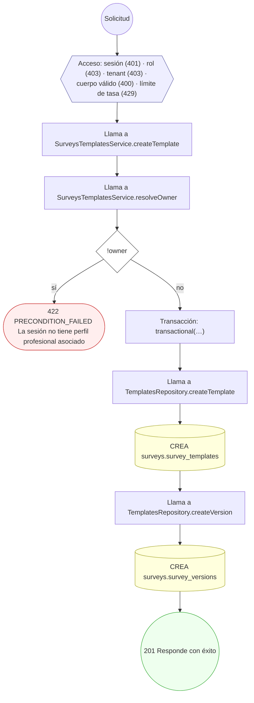

#### 9. GET /surveys/templates/{id}

Ver una encuesta y su cuestionario

| HTTP | Código | Cuándo |
|---|---|---|
| 200 | — | Éxito |
| 400 | `VALIDATION_FAILED` | Los parámetros de ruta son UUID válidos |
| 401 | `UNAUTHENTICATED` | Hay una sesión válida (JWT) |
| 403 | `FORBIDDEN` | El rol está permitido; El tenant se resuelve y pertenece al actor |
| 404 | `NOT_FOUND` | ResourceNotFoundException: Plantilla no encontrada; ResourceNotFoundException: La plantilla no tiene versiones |
| 422 | `PRECONDITION_FAILED` | PreconditionFailedException: La sesión no tiene perfil profesional asociado |
| 429 | `RATE_LIMITED` | No se supera el límite de solicitudes |

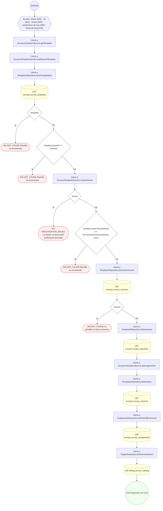

#### 10. PATCH /surveys/templates/{id}

Corregir título, consigna y plazo del borrador

| HTTP | Código | Cuándo |
|---|---|---|
| 200 | — | Éxito |
| 400 | `VALIDATION_FAILED` | Los parámetros de ruta son UUID válidos; El cuerpo cumple el DTO (sin propiedades extra) |
| 401 | `UNAUTHENTICATED` | Hay una sesión válida (JWT) |
| 403 | `FORBIDDEN` | El rol está permitido; El tenant se resuelve y pertenece al actor |
| 404 | `NOT_FOUND` | ResourceNotFoundException: Plantilla no encontrada; ResourceNotFoundException: La plantilla no tiene versiones |
| 422 | `PRECONDITION_FAILED` | PreconditionFailedException: La sesión no tiene perfil profesional asociado; PreconditionFailedException: La versión ya está publicada: cree una versión nueva para modificar el cuestionario |
| 429 | `RATE_LIMITED` | No se supera el límite de solicitudes |

```mermaid
flowchart TD
  n1(("Solicitud")):::inicio
  n2{{"Acceso: sesión (401) · rol (403) · tenant (403) · parámetros de ruta (400) · cuerpo válido (400) · límite de…"}}:::acceso
  n1 --> n2
  n3["Llama a SurveysTemplatesService.updateTemplate"]:::llamada
  n2 --> n3
  n4["Transacción: transactional(…)"]:::transaccion
  n3 --> n4
  n5["Llama a SurveysTemplatesService.loadMutableTemplate"]:::llamada
  n4 --> n5
  n6["Llama a TemplatesRepository.findTemplateById"]:::llamada
  n5 --> n6
  n7[("LEE surveys.survey_templates")]:::efecto
  n6 --> n7
  n8["Llama a SurveysTemplatesService.loadOwnedTemplate"]:::llamada
  n7 --> n8
  n9["Llama a TemplatesRepository.findTemplateById"]:::llamada
  n8 --> n9
  n10[("LEE surveys.survey_templates")]:::efecto
  n9 --> n10
  n11{"!template"}:::decision
  n10 --> n11
  n12(["404 NOT_FOUND Plantilla no encontrada"]):::error
  n11 -->|"sí"| n12
  n13{"template.tenantId !== tenantId"}:::decision
  n11 -->|"no"| n13
  n14(["404 NOT_FOUND Plantilla no encontrada"]):::error
  n13 -->|"sí"| n14
  n15["Llama a SurveysTemplatesService.resolveOwner"]:::llamada
  n13 -->|"no"| n15
  n16{"!owner"}:::decision
  n15 --> n16
  n17(["422 PRECONDITION_FAILED La sesión no tiene perfil profesional asociado"]):::error
  n16 -->|"sí"| n17
  n18{"template.ownerPractitionerId !== this.resolveOwner(undefined, actor)"}:::decision
  n16 -->|"no"| n18
  n19(["404 NOT_FOUND Plantilla no encontrada"]):::error
  n18 -->|"sí"| n19
  n20["Llama a SurveysTemplatesService.loadDraftVersion"]:::llamada
  n18 -->|"no"| n20
  n21["Llama a TemplatesRepository.findLatestVersion"]:::llamada
  n20 --> n21
  n22[("LEE surveys.survey_versions")]:::efecto
  n21 --> n22
  n23{"!version"}:::decision
  n22 --> n23
  n24(["404 NOT_FOUND La plantilla no tiene versiones"]):::error
  n23 -->|"sí"| n24
  n25{"version.publicationStatusConceptId !== SURVEYS.VERSION_DRAFT"}:::decision
  n23 -->|"no"| n25
  n26(["422 PRECONDITION_FAILED La versión ya está publicada: cree una versión nueva para modificar el cuestionario"]):::error
  n25 -->|"sí"| n26
  n27[("ACTUALIZA surveys.survey_templates")]:::efecto
  n25 -->|"no"| n27
  n28{"dto.title !== undefined"}:::decision
  n27 --> n28
  n29[("ACTUALIZA surveys.survey_templates")]:::efecto
  n28 -->|"sí"| n29
  n30{"dto.description !== undefined"}:::decision
  n29 --> n30
  n28 -->|"no"| n30
  n31[("ACTUALIZA surveys.survey_templates")]:::efecto
  n30 -->|"sí"| n31
  n32{"dto.responseWindowDays !== undefined"}:::decision
  n31 --> n32
  n30 -->|"no"| n32
  n33[("ACTUALIZA surveys.survey_versions")]:::efecto
  n32 -->|"sí"| n33
  n34(("200 Responde con éxito")):::ok
  n33 --> n34
  n32 -->|"no"| n34
  classDef acceso fill:#eef,stroke:#66a
  classDef error fill:#fee,stroke:#c33
  classDef ok fill:#efe,stroke:#3a3
  classDef efecto fill:#ffd,stroke:#aa3
  classDef decision fill:#fff,stroke:#555
  classDef corte fill:#eee,stroke:#999,stroke-dasharray: 4
```

#### 11. POST /surveys/templates/{id}/deactivate

Desactivar la encuesta

| HTTP | Código | Cuándo |
|---|---|---|
| 200 | — | Éxito |
| 400 | `VALIDATION_FAILED` | Los parámetros de ruta son UUID válidos |
| 401 | `UNAUTHENTICATED` | Hay una sesión válida (JWT) |
| 403 | `FORBIDDEN` | El rol está permitido; El tenant se resuelve y pertenece al actor |
| 404 | `NOT_FOUND` | ResourceNotFoundException: Plantilla no encontrada |
| 409 | `CONFLICT` | ConflictException: La plantilla ya está desactivada |
| 422 | `PRECONDITION_FAILED` | PreconditionFailedException: La sesión no tiene perfil profesional asociado |
| 429 | `RATE_LIMITED` | No se supera el límite de solicitudes |

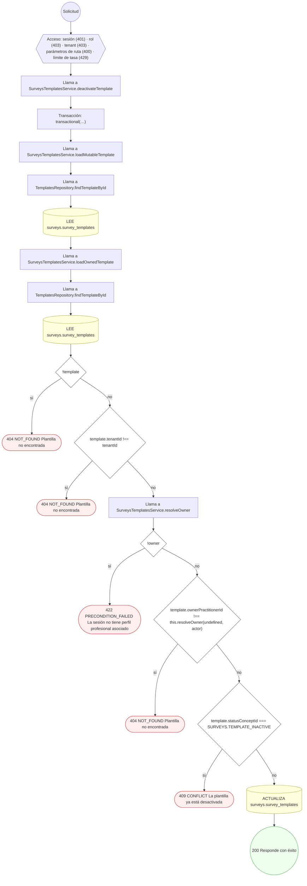

#### 12. POST /surveys/templates/{id}/questions

Configurar una pregunta y su tipo de respuesta

| HTTP | Código | Cuándo |
|---|---|---|
| 201 | — | Éxito |
| 400 | `VALIDATION_FAILED` | Los parámetros de ruta son UUID válidos; El cuerpo cumple el DTO (sin propiedades extra) |
| 401 | `UNAUTHENTICATED` | Hay una sesión válida (JWT) |
| 403 | `FORBIDDEN` | El rol está permitido; El tenant se resuelve y pertenece al actor |
| 404 | `NOT_FOUND` | ResourceNotFoundException: Plantilla no encontrada; ResourceNotFoundException: La plantilla no tiene versiones |
| 422 | `PRECONDITION_FAILED` | PreconditionFailedException: Las preguntas de elección requieren al menos dos opciones; PreconditionFailedException: Este tipo de pregunta no admite opciones; PreconditionFailedException: Las opciones no pueden repetirse; PreconditionFailedException: El máximo de la escala debe ser mayor que el mínimo; PreconditionFailedException: La sesión no tiene perfil profesional asociado; PreconditionFailedException: La versión ya está publicada: cree una versión nueva para modificar el cuestionario |
| 429 | `RATE_LIMITED` | No se supera el límite de solicitudes |

```mermaid
flowchart TD
  n1(("Solicitud")):::inicio
  n2{{"Acceso: sesión (401) · rol (403) · tenant (403) · parámetros de ruta (400) · cuerpo válido (400) · límite de…"}}:::acceso
  n1 --> n2
  n3["Llama a SurveysTemplatesService.addQuestion"]:::llamada
  n2 --> n3
  n4["Llama a SurveysTemplatesService.validateQuestionShape"]:::llamada
  n3 --> n4
  n5{"needsOptions && (!dto.options || dto.options.length ‹ 2)"}:::decision
  n4 --> n5
  n6(["422 PRECONDITION_FAILED Las preguntas de elección requieren al menos dos opciones"]):::error
  n5 -->|"sí"| n6
  n7{"!needsOptions && dto.options && dto.options.length › 0"}:::decision
  n5 -->|"no"| n7
  n8(["422 PRECONDITION_FAILED Este tipo de pregunta no admite opciones"]):::error
  n7 -->|"sí"| n8
  n9{"needsOptions && dto.options"}:::decision
  n7 -->|"no"| n9
  n10{"unique.size !== dto.options.length"}:::decision
  n9 -->|"sí"| n10
  n11(["422 PRECONDITION_FAILED Las opciones no pueden repetirse"]):::error
  n10 -->|"sí"| n11
  n12{"dto.answerType === 'SCALE'"}:::decision
  n10 -->|"no"| n12
  n9 -->|"no"| n12
  n13{"max ‹= min"}:::decision
  n12 -->|"sí"| n13
  n14(["422 PRECONDITION_FAILED El máximo de la escala debe ser mayor que el mínimo"]):::error
  n13 -->|"sí"| n14
  n15["Transacción: transactional(…)"]:::transaccion
  n13 -->|"no"| n15
  n12 -->|"no"| n15
  n16["Llama a SurveysTemplatesService.loadMutableTemplate"]:::llamada
  n15 --> n16
  n17["Llama a TemplatesRepository.findTemplateById"]:::llamada
  n16 --> n17
  n18[("LEE surveys.survey_templates")]:::efecto
  n17 --> n18
  n19["Llama a SurveysTemplatesService.loadOwnedTemplate"]:::llamada
  n18 --> n19
  n20["Llama a TemplatesRepository.findTemplateById"]:::llamada
  n19 --> n20
  n21[("LEE surveys.survey_templates")]:::efecto
  n20 --> n21
  n22{"!template"}:::decision
  n21 --> n22
  n23(["404 NOT_FOUND Plantilla no encontrada"]):::error
  n22 -->|"sí"| n23
  n24{"template.tenantId !== tenantId"}:::decision
  n22 -->|"no"| n24
  n25(["404 NOT_FOUND Plantilla no encontrada"]):::error
  n24 -->|"sí"| n25
  n26["Llama a SurveysTemplatesService.resolveOwner"]:::llamada
  n24 -->|"no"| n26
  n27{"!owner"}:::decision
  n26 --> n27
  n28(["422 PRECONDITION_FAILED La sesión no tiene perfil profesional asociado"]):::error
  n27 -->|"sí"| n28
  n29{"template.ownerPractitionerId !== this.resolveOwner(undefined, actor)"}:::decision
  n27 -->|"no"| n29
  n30(["404 NOT_FOUND Plantilla no encontrada"]):::error
  n29 -->|"sí"| n30
  n31["Llama a SurveysTemplatesService.loadDraftVersion"]:::llamada
  n29 -->|"no"| n31
  n32["Llama a TemplatesRepository.findLatestVersion"]:::llamada
  n31 --> n32
  n33[("LEE surveys.survey_versions")]:::efecto
  n32 --> n33
  n34{"!version"}:::decision
  n33 --> n34
  n35(["404 NOT_FOUND La plantilla no tiene versiones"]):::error
  n34 -->|"sí"| n35
  n36{"version.publicationStatusConceptId !== SURVEYS.VERSION_DRAFT"}:::decision
  n34 -->|"no"| n36
  n37(["422 PRECONDITION_FAILED La versión ya está publicada: cree una versión nueva para modificar el cuestionario"]):::error
  n36 -->|"sí"| n37
  n38["Llama a TemplatesRepository.countQuestions"]:::llamada
  n36 -->|"no"| n38
  n39[("LEE surveys.survey_questions")]:::efecto
  n38 --> n39
  n40["Llama a TemplatesRepository.createQuestion"]:::llamada
  n39 --> n40
  n41[("CREA surveys.survey_questions")]:::efecto
  n40 --> n41
  n42(("201 Responde con éxito")):::ok
  n41 --> n42
  classDef acceso fill:#eef,stroke:#66a
  classDef error fill:#fee,stroke:#c33
  classDef ok fill:#efe,stroke:#3a3
  classDef efecto fill:#ffd,stroke:#aa3
  classDef decision fill:#fff,stroke:#555
  classDef corte fill:#eee,stroke:#999,stroke-dasharray: 4
```

#### 13. DELETE /surveys/templates/{id}/questions/{questionId}

Quitar una pregunta del borrador

| HTTP | Código | Cuándo |
|---|---|---|
| 200 | — | Éxito |
| 400 | `VALIDATION_FAILED` | Los parámetros de ruta son UUID válidos |
| 401 | `UNAUTHENTICATED` | Hay una sesión válida (JWT) |
| 403 | `FORBIDDEN` | El rol está permitido; El tenant se resuelve y pertenece al actor |
| 404 | `NOT_FOUND` | ResourceNotFoundException: Plantilla no encontrada; ResourceNotFoundException: La plantilla no tiene versiones; ResourceNotFoundException: Pregunta no encontrada |
| 422 | `PRECONDITION_FAILED` | PreconditionFailedException: La sesión no tiene perfil profesional asociado; PreconditionFailedException: La versión ya está publicada: cree una versión nueva para modificar el cuestionario |
| 429 | `RATE_LIMITED` | No se supera el límite de solicitudes |

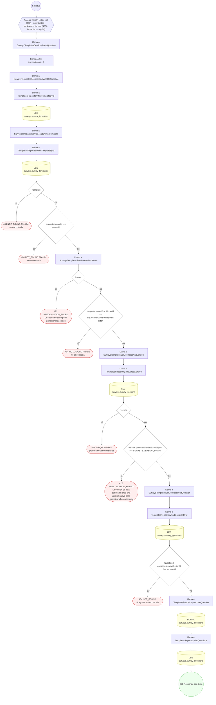

#### 14. PATCH /surveys/templates/{id}/questions/{questionId}

Corregir una pregunta del borrador

| HTTP | Código | Cuándo |
|---|---|---|
| 200 | — | Éxito |
| 400 | `VALIDATION_FAILED` | Los parámetros de ruta son UUID válidos; El cuerpo cumple el DTO (sin propiedades extra) |
| 401 | `UNAUTHENTICATED` | Hay una sesión válida (JWT) |
| 403 | `FORBIDDEN` | El rol está permitido; El tenant se resuelve y pertenece al actor |
| 404 | `NOT_FOUND` | ResourceNotFoundException: Plantilla no encontrada; ResourceNotFoundException: La plantilla no tiene versiones; ResourceNotFoundException: Pregunta no encontrada |
| 422 | `PRECONDITION_FAILED` | PreconditionFailedException: La sesión no tiene perfil profesional asociado; PreconditionFailedException: La versión ya está publicada: cree una versión nueva para modificar el cuestionario; PreconditionFailedException: Las preguntas de elección requieren al menos dos opciones; PreconditionFailedException: Este tipo de pregunta no admite opciones; PreconditionFailedException: Las opciones no pueden repetirse; PreconditionFailedException: El máximo de la escala debe ser mayor que el mínimo |
| 429 | `RATE_LIMITED` | No se supera el límite de solicitudes |

```mermaid
flowchart TD
  n1(("Solicitud")):::inicio
  n2{{"Acceso: sesión (401) · rol (403) · tenant (403) · parámetros de ruta (400) · cuerpo válido (400) · límite de…"}}:::acceso
  n1 --> n2
  n3["Llama a SurveysTemplatesService.updateQuestion"]:::llamada
  n2 --> n3
  n4["Transacción: transactional(…)"]:::transaccion
  n3 --> n4
  n5["Llama a SurveysTemplatesService.loadMutableTemplate"]:::llamada
  n4 --> n5
  n6["Llama a TemplatesRepository.findTemplateById"]:::llamada
  n5 --> n6
  n7[("LEE surveys.survey_templates")]:::efecto
  n6 --> n7
  n8["Llama a SurveysTemplatesService.loadOwnedTemplate"]:::llamada
  n7 --> n8
  n9["Llama a TemplatesRepository.findTemplateById"]:::llamada
  n8 --> n9
  n10[("LEE surveys.survey_templates")]:::efecto
  n9 --> n10
  n11{"!template"}:::decision
  n10 --> n11
  n12(["404 NOT_FOUND Plantilla no encontrada"]):::error
  n11 -->|"sí"| n12
  n13{"template.tenantId !== tenantId"}:::decision
  n11 -->|"no"| n13
  n14(["404 NOT_FOUND Plantilla no encontrada"]):::error
  n13 -->|"sí"| n14
  n15["Llama a SurveysTemplatesService.resolveOwner"]:::llamada
  n13 -->|"no"| n15
  n16{"!owner"}:::decision
  n15 --> n16
  n17(["422 PRECONDITION_FAILED La sesión no tiene perfil profesional asociado"]):::error
  n16 -->|"sí"| n17
  n18{"template.ownerPractitionerId !== this.resolveOwner(undefined, actor)"}:::decision
  n16 -->|"no"| n18
  n19(["404 NOT_FOUND Plantilla no encontrada"]):::error
  n18 -->|"sí"| n19
  n20["Llama a SurveysTemplatesService.loadDraftVersion"]:::llamada
  n18 -->|"no"| n20
  n21["Llama a TemplatesRepository.findLatestVersion"]:::llamada
  n20 --> n21
  n22[("LEE surveys.survey_versions")]:::efecto
  n21 --> n22
  n23{"!version"}:::decision
  n22 --> n23
  n24(["404 NOT_FOUND La plantilla no tiene versiones"]):::error
  n23 -->|"sí"| n24
  n25{"version.publicationStatusConceptId !== SURVEYS.VERSION_DRAFT"}:::decision
  n23 -->|"no"| n25
  n26(["422 PRECONDITION_FAILED La versión ya está publicada: cree una versión nueva para modificar el cuestionario"]):::error
  n25 -->|"sí"| n26
  n27["Llama a SurveysTemplatesService.loadDraftQuestion"]:::llamada
  n25 -->|"no"| n27
  n28["Llama a TemplatesRepository.findQuestionById"]:::llamada
  n27 --> n28
  n29[("LEE surveys.survey_questions")]:::efecto
  n28 --> n29
  n30{"!question || question.surveyVersionId !== version.id"}:::decision
  n29 --> n30
  n31(["404 NOT_FOUND Pregunta no encontrada"]):::error
  n30 -->|"sí"| n31
  n32["Llama a SurveysTemplatesService.validateQuestionShape"]:::llamada
  n30 -->|"no"| n32
  n33{"needsOptions && (!dto.options || dto.options.length ‹ 2)"}:::decision
  n32 --> n33
  n34(["422 PRECONDITION_FAILED Las preguntas de elección requieren al menos dos opciones"]):::error
  n33 -->|"sí"| n34
  n35{"!needsOptions && dto.options && dto.options.length › 0"}:::decision
  n33 -->|"no"| n35
  n36(["422 PRECONDITION_FAILED Este tipo de pregunta no admite opciones"]):::error
  n35 -->|"sí"| n36
  n37{"needsOptions && dto.options"}:::decision
  n35 -->|"no"| n37
  n38{"unique.size !== dto.options.length"}:::decision
  n37 -->|"sí"| n38
  n39(["422 PRECONDITION_FAILED Las opciones no pueden repetirse"]):::error
  n38 -->|"sí"| n39
  n40{"dto.answerType === 'SCALE'"}:::decision
  n38 -->|"no"| n40
  n37 -->|"no"| n40
  n41{"max ‹= min"}:::decision
  n40 -->|"sí"| n41
  n42(["422 PRECONDITION_FAILED El máximo de la escala debe ser mayor que el mínimo"]):::error
  n41 -->|"sí"| n42
  n43{"dto.questionText !== undefined"}:::decision
  n41 -->|"no"| n43
  n40 -->|"no"| n43
  n44[("ACTUALIZA surveys.survey_questions")]:::efecto
  n43 -->|"sí"| n44
  n45[("ACTUALIZA surveys.survey_questions · ACTUALIZA surveys.survey_questions · ACTUALIZA surveys.survey_questions…")]:::efecto
  n44 --> n45
  n43 -->|"no"| n45
  n46(("200 Responde con éxito")):::ok
  n45 --> n46
  classDef acceso fill:#eef,stroke:#66a
  classDef error fill:#fee,stroke:#c33
  classDef ok fill:#efe,stroke:#3a3
  classDef efecto fill:#ffd,stroke:#aa3
  classDef decision fill:#fff,stroke:#555
  classDef corte fill:#eee,stroke:#999,stroke-dasharray: 4
```

#### 15. PUT /surveys/templates/{id}/questions/order

Reordenar el cuestionario del borrador

| HTTP | Código | Cuándo |
|---|---|---|
| 200 | — | Éxito |
| 400 | `VALIDATION_FAILED` | Los parámetros de ruta son UUID válidos; El cuerpo cumple el DTO (sin propiedades extra) |
| 401 | `UNAUTHENTICATED` | Hay una sesión válida (JWT) |
| 403 | `FORBIDDEN` | El rol está permitido; El tenant se resuelve y pertenece al actor |
| 404 | `NOT_FOUND` | ResourceNotFoundException: Plantilla no encontrada; ResourceNotFoundException: La plantilla no tiene versiones |
| 422 | `PRECONDITION_FAILED` | PreconditionFailedException: La sesión no tiene perfil profesional asociado; PreconditionFailedException: La versión ya está publicada: cree una versión nueva para modificar el cuestionario; PreconditionFailedException: Hay preguntas que no pertenecen a la versión en borrador |
| 429 | `RATE_LIMITED` | No se supera el límite de solicitudes |

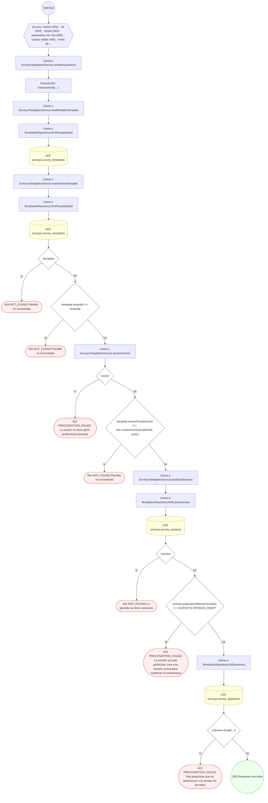

#### 16. GET /surveys/templates/{id}/responses

Revisar las respuestas de los pacientes

| HTTP | Código | Cuándo |
|---|---|---|
| 200 | — | Éxito |
| 400 | `VALIDATION_FAILED` | Los parámetros de ruta son UUID válidos |
| 401 | `UNAUTHENTICATED` | Hay una sesión válida (JWT) |
| 403 | `FORBIDDEN` | El rol está permitido; El tenant se resuelve y pertenece al actor |
| 404 | `NOT_FOUND` | ResourceNotFoundException: Plantilla no encontrada |
| 429 | `RATE_LIMITED` | No se supera el límite de solicitudes |

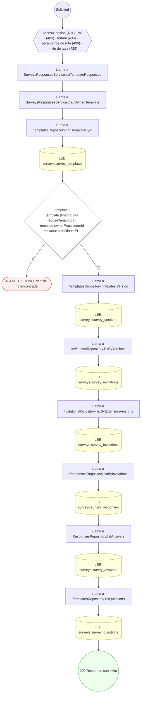

#### 17. POST /surveys/templates/{id}/versions

Abrir una versión nueva del cuestionario

| HTTP | Código | Cuándo |
|---|---|---|
| 201 | — | Éxito |
| 400 | `VALIDATION_FAILED` | Los parámetros de ruta son UUID válidos |
| 401 | `UNAUTHENTICATED` | Hay una sesión válida (JWT) |
| 403 | `FORBIDDEN` | El rol está permitido; El tenant se resuelve y pertenece al actor |
| 404 | `NOT_FOUND` | ResourceNotFoundException: Plantilla no encontrada |
| 409 | `CONFLICT` | ConflictException: Otra solicitud abrió la versión siguiente; vuelva a consultar la plantilla |
| 422 | `PRECONDITION_FAILED` | PreconditionFailedException: La sesión no tiene perfil profesional asociado |
| 429 | `RATE_LIMITED` | No se supera el límite de solicitudes |

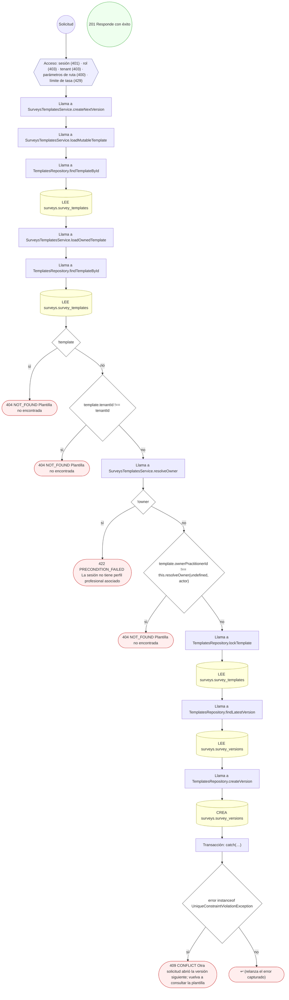

#### 18. POST /surveys/templates/{id}/versions/{versionNumber}/publish

Publicar la encuesta y configurar su vigencia

| HTTP | Código | Cuándo |
|---|---|---|
| 200 | — | Éxito |
| 400 | `VALIDATION_FAILED` | Los parámetros de ruta son UUID válidos; El cuerpo cumple el DTO (sin propiedades extra) |
| 401 | `UNAUTHENTICATED` | Hay una sesión válida (JWT) |
| 403 | `FORBIDDEN` | El rol está permitido; El tenant se resuelve y pertenece al actor |
| 404 | `NOT_FOUND` | ResourceNotFoundException: Plantilla no encontrada; ResourceNotFoundException: Versión no encontrada |
| 409 | `CONFLICT` | ConflictException: La versión ya fue publicada |
| 422 | `PRECONDITION_FAILED` | PreconditionFailedException: La sesión no tiene perfil profesional asociado; PreconditionFailedException: No se puede publicar un cuestionario sin preguntas; PreconditionFailedException: El fin de vigencia debe ser posterior al inicio |
| 429 | `RATE_LIMITED` | No se supera el límite de solicitudes |

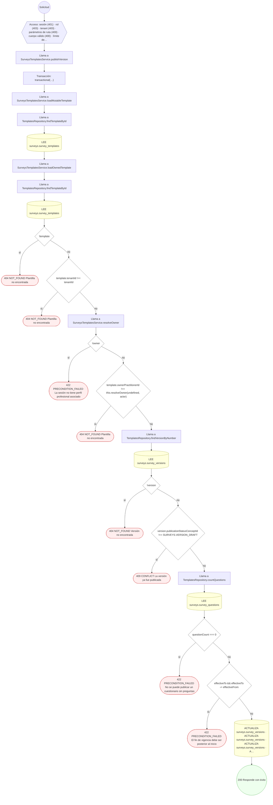

