<!-- AUTOGENERADO por tools/inventario/flujos.mjs. No editar manualmente. -->

# Flujos del módulo `surveys`

- **Procesos:** 1 · **Máquinas de estado:** 0
- **Operaciones:** 12 (12 con decisiones propias, 0 sin ellas)
- Inventario de endpoints del módulo: [surveys](../endpoints/surveys.md)

## Proceso: Módulo Surveys — Cuestionarios y encuestas de satisfacción

- **Código:** `surveys` · **Agrupación:** AGRUPACION_POR_CONTROLADOR · **Operaciones:** 12
- **Actores:** CLINICIAN · Cualquier sesión válida · PRACTITIONER
- **Revisión:** AUTO_DETECTADA
- **Fuentes:** `src/modules/surveys/README.md`

### Para qué sirve

Instrumento de satisfacción dirigido: plantilla con versiones inmutables y vigencia, preguntas con tipo de respuesta y obligatoriedad, asociación a la cosa evaluada, invitación contra una atención completada y respuestas **privadas** del paciente con lectura para el profesional dueño.

_Fuente: `src/modules/surveys/README.md:3`_

### Etapas y operaciones

| Etapa | Descripción | Operación | Quién actúa | Riesgo | Tablas |
|---|---|---|---|---|---|
| `ctrl:SurveysAssignmentsController` | Operaciones de SurveysAssignmentsController que el README no asigna a un caso de uso | POST /surveys/assignments | PRACTITIONER · CLINICIAN | MEDIO | 4 |
|  |  | POST /surveys/invitations | PRACTITIONER · CLINICIAN | MEDIO | 7 |
| `ctrl:SurveysPatientController` | Operaciones de SurveysPatientController que el README no asigna a un caso de uso | GET /surveys/me/invitations | Cualquier sesión válida | BAJO | 3 |
|  |  | GET /surveys/me/invitations/{id} | Cualquier sesión válida | BAJO | 4 |
|  |  | POST /surveys/me/invitations/{id}/responses | Cualquier sesión válida | ALTO | 5 |
| `ctrl:SurveysTemplatesController` | Operaciones de SurveysTemplatesController que el README no asigna a un caso de uso | GET /surveys/templates | PRACTITIONER · CLINICIAN | BAJO | 3 |
|  |  | POST /surveys/templates | PRACTITIONER · CLINICIAN | MEDIO | 2 |
|  |  | GET /surveys/templates/{id} | PRACTITIONER · CLINICIAN | BAJO | 3 |
|  |  | POST /surveys/templates/{id}/deactivate | PRACTITIONER · CLINICIAN | MEDIO | 2 |
|  |  | POST /surveys/templates/{id}/questions | PRACTITIONER · CLINICIAN | MEDIO | 4 |
|  |  | GET /surveys/templates/{id}/responses | PRACTITIONER · CLINICIAN | BAJO | 6 |
|  |  | POST /surveys/templates/{id}/versions/{versionNumber}/publish | PRACTITIONER · CLINICIAN | MEDIO | 5 |

### Diagrama — etapas `ctrl:SurveysAssignmentsController`, `ctrl:SurveysPatientController`, `ctrl:SurveysTemplatesController`

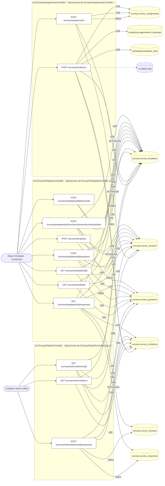

## Árbol de decisión por operación

Cada árbol se deriva del código del handler y de los métodos que invoca (hasta 4 niveles). Una rama que no decide, no escribe y no falla se poda. Los accesos y los efectos consecutivos se agrupan en un solo nodo.

### Operaciones con decisiones propias

#### 1. POST /surveys/assignments

Asociar una encuesta a una consulta o servicio

| HTTP | Código | Cuándo |
|---|---|---|
| 201 | — | Éxito |
| 400 | `VALIDATION_FAILED` | El cuerpo cumple el DTO (sin propiedades extra) |
| 401 | `UNAUTHENTICATED` | Hay una sesión válida (JWT) |
| 403 | `FORBIDDEN` | El rol está permitido; El tenant se resuelve y pertenece al actor |
| 404 | `NOT_FOUND` | ResourceNotFoundException: Versión no encontrada |
| 409 | `CONFLICT` | ConflictException: Ya existe una asignación activa de esa versión a ese destino |
| 422 | `PRECONDITION_FAILED` | PreconditionFailedException: El modelo de agenda no lleva tipo de atención en la reserva: asigná la encuesta por servicio o por cita concreta; PreconditionFailedException: Solo se puede asignar una versión publicada |
| 429 | `RATE_LIMITED` | No se supera el límite de solicitudes |

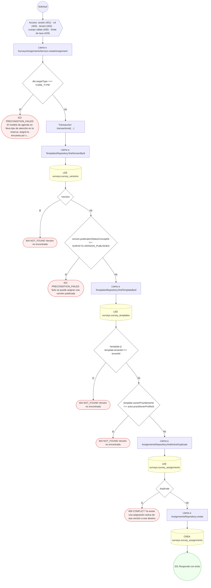

#### 2. POST /surveys/invitations

Emitir los cuestionarios de una atención completada

| HTTP | Código | Cuándo |
|---|---|---|
| 201 | — | Éxito |
| 400 | `VALIDATION_FAILED` | El cuerpo cumple el DTO (sin propiedades extra) |
| 401 | `UNAUTHENTICATED` | Hay una sesión válida (JWT) |
| 403 | `FORBIDDEN` | El rol está permitido; El tenant se resuelve y pertenece al actor |
| 404 | `NOT_FOUND` | ResourceNotFoundException: Reserva no encontrada |
| 422 | `PRECONDITION_FAILED` | PreconditionFailedException: Solo se emiten cuestionarios sobre una atención completada |
| 429 | `RATE_LIMITED` | No se supera el límite de solicitudes |

```mermaid
flowchart TD
  n1(("Solicitud")):::inicio
  n2{{"Acceso: sesión (401) · rol (403) · tenant (403) · cuerpo válido (400) · límite de tasa (429)"}}:::acceso
  n1 --> n2
  n3["Llama a SurveysAssignmentsService.issueForBooking"]:::llamada
  n2 --> n3
  n4["Transacción: transactional(…)"]:::transaccion
  n3 --> n4
  n5[("LEE scheduling.appointment_bookings")]:::efecto
  n4 --> n5
  n6{"!booking || booking.tenantId !== tenantId"}:::decision
  n5 --> n6
  n7(["404 NOT_FOUND Reserva no encontrada"]):::error
  n6 -->|"sí"| n7
  n8{"booking.statusConceptId !== SCHED.BOOKING_COMPLETED"}:::decision
  n6 -->|"no"| n8
  n9(["422 PRECONDITION_FAILED Solo se emiten cuestionarios sobre una atención completada"]):::error
  n8 -->|"sí"| n9
  n10["Llama a SurveysAssignmentsService.resolveTargets"]:::llamada
  n8 -->|"no"| n10
  n11{"!serviceConceptId"}:::decision
  n10 --> n11
  n12[("LEE scheduling.bookable_slots")]:::efecto
  n11 -->|"sí"| n12
  n13["Llama a AssignmentsRepository.listActiveByTargets"]:::llamada
  n12 --> n13
  n11 -->|"no"| n13
  n14[("LEE surveys.survey_assignments")]:::efecto
  n13 --> n14
  n15["Llama a InvitationsRepository.listByBooking"]:::llamada
  n14 --> n15
  n16[("LEE surveys.survey_invitations")]:::efecto
  n15 --> n16
  n17["Repite: por cada const assignment de assignments"]:::bucle
  n16 --> n17
  n18["Llama a TemplatesRepository.findVersionById"]:::llamada
  n17 -->|"cada elemento"| n18
  n19[("LEE surveys.survey_versions")]:::efecto
  n18 --> n19
  n20["Llama a TemplatesRepository.findTemplateById"]:::llamada
  n19 --> n20
  n21[("LEE surveys.survey_templates")]:::efecto
  n20 --> n21
  n22["Llama a InvitationsRepository.create"]:::llamada
  n21 --> n22
  n23[("CREA surveys.survey_invitations")]:::efecto
  n22 --> n23
  n24(("201 Responde con éxito")):::ok
  n23 --> n24
  n17 -->|"al terminar"| n24
  classDef acceso fill:#eef,stroke:#66a
  classDef error fill:#fee,stroke:#c33
  classDef ok fill:#efe,stroke:#3a3
  classDef efecto fill:#ffd,stroke:#aa3
  classDef decision fill:#fff,stroke:#555
  classDef corte fill:#eee,stroke:#999,stroke-dasharray: 4
```

#### 3. GET /surveys/me/invitations

Ver mis cuestionarios

| HTTP | Código | Cuándo |
|---|---|---|
| 200 | — | Éxito |
| 401 | `UNAUTHENTICATED` | Hay una sesión válida (JWT) |
| 403 | `FORBIDDEN` | El rol está permitido; El tenant se resuelve y pertenece al actor; ForbiddenException: Solo un paciente puede ver sus cuestionarios |
| 429 | `RATE_LIMITED` | No se supera el límite de solicitudes |

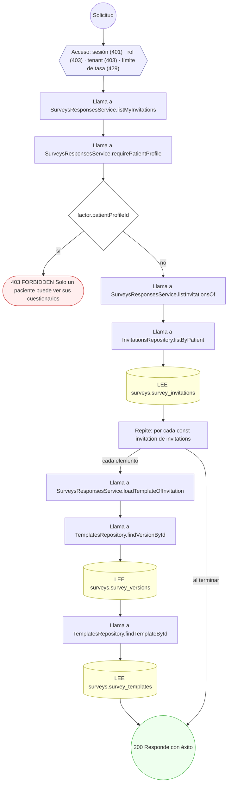

#### 4. GET /surveys/me/invitations/{id}

Abrir un cuestionario para responderlo

| HTTP | Código | Cuándo |
|---|---|---|
| 200 | — | Éxito |
| 400 | `VALIDATION_FAILED` | Los parámetros de ruta son UUID válidos |
| 401 | `UNAUTHENTICATED` | Hay una sesión válida (JWT) |
| 403 | `FORBIDDEN` | El rol está permitido; El tenant se resuelve y pertenece al actor; ForbiddenException: Solo un paciente puede ver sus cuestionarios |
| 404 | `NOT_FOUND` | ResourceNotFoundException: Cuestionario no encontrado |
| 429 | `RATE_LIMITED` | No se supera el límite de solicitudes |

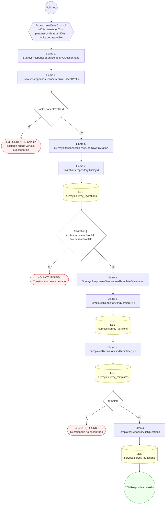

#### 5. POST /surveys/me/invitations/{id}/responses

Responder el cuestionario

| HTTP | Código | Cuándo |
|---|---|---|
| 201 | — | Éxito |
| 400 | `VALIDATION_FAILED` | Los parámetros de ruta son UUID válidos; El cuerpo cumple el DTO (sin propiedades extra) |
| 401 | `UNAUTHENTICATED` | Hay una sesión válida (JWT) |
| 403 | `FORBIDDEN` | El rol está permitido; El tenant se resuelve y pertenece al actor; ForbiddenException: Solo un paciente puede ver sus cuestionarios |
| 404 | `NOT_FOUND` | ResourceNotFoundException: Cuestionario no encontrado |
| 409 | `CONFLICT` | ConflictException: Este cuestionario ya fue respondido |
| 422 | `PRECONDITION_FAILED` | PreconditionFailedException: El plazo para responder este cuestionario venció; PreconditionFailedException: Hay más de una respuesta para la misma pregunta; PreconditionFailedException: La respuesta no corresponde a una pregunta de este cuestionario; PreconditionFailedException: Esta pregunta espera una respuesta de texto; PreconditionFailedException: Esta pregunta espera un valor numérico; PreconditionFailedException: El valor está fuera de la escala de la pregunta; PreconditionFailedException: Esta pregunta espera sí o no; PreconditionFailedException: Esta pregunta espera al menos una opción; PreconditionFailedException: Esta pregunta admite una sola opción; PreconditionFailedException: Se eligieron opciones que la pregunta no ofrece; PreconditionFailedException: Hay opciones repetidas en la respuesta; PreconditionFailedException: Tipo de pregunta desconocido; PreconditionFailedException: Faltan respuestas a preguntas obligatorias |
| 429 | `RATE_LIMITED` | No se supera el límite de solicitudes |

```mermaid
flowchart TD
  n1(("Solicitud")):::inicio
  n2{{"Acceso: sesión (401) · rol (403) · tenant (403) · parámetros de ruta (400) · cuerpo válido (400) · límite de…"}}:::acceso
  n1 --> n2
  n3["Llama a SurveysResponsesService.submitResponse"]:::llamada
  n2 --> n3
  n4["Llama a SurveysResponsesService.requirePatientProfile"]:::llamada
  n3 --> n4
  n5{"!actor.patientProfileId"}:::decision
  n4 --> n5
  n6(["403 FORBIDDEN Solo un paciente puede ver sus cuestionarios"]):::error
  n5 -->|"sí"| n6
  n7["Transacción: transactional(…)"]:::transaccion
  n5 -->|"no"| n7
  n8["Llama a SurveysResponsesService.loadOwnInvitation"]:::llamada
  n7 --> n8
  n9["Llama a InvitationsRepository.findById"]:::llamada
  n8 --> n9
  n10[("LEE surveys.survey_invitations")]:::efecto
  n9 --> n10
  n11{"!invitation || invitation.patientProfileId !== patientProfileId"}:::decision
  n10 --> n11
  n12(["404 NOT_FOUND Cuestionario no encontrado"]):::error
  n11 -->|"sí"| n12
  n13{"invitation.statusConceptId === SURVEYS.INVITATION_ANSWERED"}:::decision
  n11 -->|"no"| n13
  n14(["409 CONFLICT Este cuestionario ya fue respondido"]):::error
  n13 -->|"sí"| n14
  n15{"now › invitation.expiresAt"}:::decision
  n13 -->|"no"| n15
  n16[("ACTUALIZA surveys.survey_invitations")]:::efecto
  n15 -->|"sí"| n16
  n17(["422 PRECONDITION_FAILED El plazo para responder este cuestionario venció"]):::error
  n16 --> n17
  n18["Llama a TemplatesRepository.listQuestions"]:::llamada
  n15 -->|"no"| n18
  n19[("LEE surveys.survey_questions")]:::efecto
  n18 --> n19
  n20["Llama a SurveysResponsesService.validateAnswers"]:::llamada
  n19 --> n20
  n21["Repite: por cada const answer de answers"]:::bucle
  n20 --> n21
  n22{"seen.has(answer.questionId)"}:::decision
  n21 -->|"cada elemento"| n22
  n23(["422 PRECONDITION_FAILED Hay más de una respuesta para la misma pregunta"]):::error
  n22 -->|"sí"| n23
  n24{"!question"}:::decision
  n22 -->|"no"| n24
  n25(["422 PRECONDITION_FAILED La respuesta no corresponde a una pregunta de este cuestionario"]):::error
  n24 -->|"sí"| n25
  n26["Llama a SurveysResponsesService.validateAnswerValue"]:::llamada
  n24 -->|"no"| n26
  n27{"según type"}:::decision
  n26 --> n27
  n28{"typeof answer.valueText !== 'string' || answer.valueText.trim() === ''"}:::decision
  n27 -->|"'TEXT'"| n28
  n29(["422 PRECONDITION_FAILED Esta pregunta espera una respuesta de texto"]):::error
  n28 -->|"sí"| n29
  n30{"typeof answer.valueNumber !== 'number'"}:::decision
  n27 -->|"'SCALE'"| n30
  n31(["422 PRECONDITION_FAILED Esta pregunta espera un valor numérico"]):::error
  n30 -->|"sí"| n31
  n32{"answer.valueNumber ‹ min || answer.valueNumber › max"}:::decision
  n30 -->|"no"| n32
  n33(["422 PRECONDITION_FAILED El valor está fuera de la escala de la pregunta"]):::error
  n32 -->|"sí"| n33
  n34{"typeof answer.valueBoolean !== 'boolean'"}:::decision
  n27 -->|"'BOOLEAN'"| n34
  n35(["422 PRECONDITION_FAILED Esta pregunta espera sí o no"]):::error
  n34 -->|"sí"| n35
  n36{"chosen.length === 0"}:::decision
  n27 -->|"'MULTIPLE_CHOICE'"| n36
  n37(["422 PRECONDITION_FAILED Esta pregunta espera al menos una opción"]):::error
  n36 -->|"sí"| n37
  n38{"type === 'SINGLE_CHOICE' && chosen.length › 1"}:::decision
  n36 -->|"no"| n38
  n39(["422 PRECONDITION_FAILED Esta pregunta admite una sola opción"]):::error
  n38 -->|"sí"| n39
  n40{"invalid.length › 0"}:::decision
  n38 -->|"no"| n40
  n41(["422 PRECONDITION_FAILED Se eligieron opciones que la pregunta no ofrece"]):::error
  n40 -->|"sí"| n41
  n42{"new Set(chosen).size !== chosen.length"}:::decision
  n40 -->|"no"| n42
  n43(["422 PRECONDITION_FAILED Hay opciones repetidas en la respuesta"]):::error
  n42 -->|"sí"| n43
  n44(["422 PRECONDITION_FAILED Tipo de pregunta desconocido"]):::error
  n27 -->|"por defecto"| n44
  n45{"missing.length › 0"}:::decision
  n28 -->|"no"| n45
  n32 -->|"no"| n45
  n34 -->|"no"| n45
  n42 -->|"no"| n45
  n21 -->|"al terminar"| n45
  n46(["422 PRECONDITION_FAILED Faltan respuestas a preguntas obligatorias"]):::error
  n45 -->|"sí"| n46
  n47["Llama a ResponsesRepository.createResponse"]:::llamada
  n45 -->|"no"| n47
  n48[("CREA surveys.survey_responses")]:::efecto
  n47 --> n48
  n49["Repite: por cada const answer de dto.answers"]:::bucle
  n48 --> n49
  n50["Llama a ResponsesRepository.createAnswer"]:::llamada
  n49 -->|"cada elemento"| n50
  n51[("CREA surveys.survey_answers")]:::efecto
  n50 --> n51
  n52[("ACTUALIZA surveys.survey_invitations · ACTUALIZA surveys.survey_invitations")]:::efecto
  n51 --> n52
  n49 -->|"al terminar"| n52
  n53(("201 Responde con éxito")):::ok
  n52 --> n53
  classDef acceso fill:#eef,stroke:#66a
  classDef error fill:#fee,stroke:#c33
  classDef ok fill:#efe,stroke:#3a3
  classDef efecto fill:#ffd,stroke:#aa3
  classDef decision fill:#fff,stroke:#555
  classDef corte fill:#eee,stroke:#999,stroke-dasharray: 4
```

#### 6. GET /surveys/templates

Listar mis encuestas

| HTTP | Código | Cuándo |
|---|---|---|
| 200 | — | Éxito |
| 401 | `UNAUTHENTICATED` | Hay una sesión válida (JWT) |
| 403 | `FORBIDDEN` | El rol está permitido; El tenant se resuelve y pertenece al actor |
| 422 | `PRECONDITION_FAILED` | PreconditionFailedException: La sesión no tiene perfil profesional asociado |
| 429 | `RATE_LIMITED` | No se supera el límite de solicitudes |

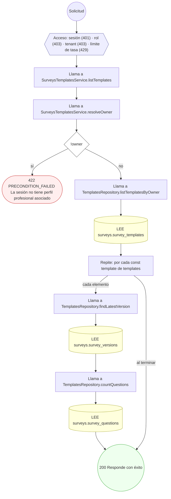

#### 7. POST /surveys/templates

Crear una encuesta para pacientes

| HTTP | Código | Cuándo |
|---|---|---|
| 201 | — | Éxito |
| 400 | `VALIDATION_FAILED` | El cuerpo cumple el DTO (sin propiedades extra) |
| 401 | `UNAUTHENTICATED` | Hay una sesión válida (JWT) |
| 403 | `FORBIDDEN` | El rol está permitido; El tenant se resuelve y pertenece al actor |
| 422 | `PRECONDITION_FAILED` | PreconditionFailedException: La sesión no tiene perfil profesional asociado |
| 429 | `RATE_LIMITED` | No se supera el límite de solicitudes |

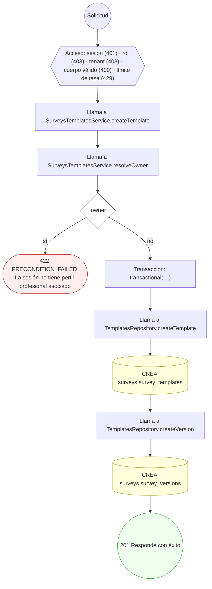

#### 8. GET /surveys/templates/{id}

Ver una encuesta y su cuestionario

| HTTP | Código | Cuándo |
|---|---|---|
| 200 | — | Éxito |
| 400 | `VALIDATION_FAILED` | Los parámetros de ruta son UUID válidos |
| 401 | `UNAUTHENTICATED` | Hay una sesión válida (JWT) |
| 403 | `FORBIDDEN` | El rol está permitido; El tenant se resuelve y pertenece al actor |
| 404 | `NOT_FOUND` | ResourceNotFoundException: Plantilla no encontrada; ResourceNotFoundException: La plantilla no tiene versiones |
| 422 | `PRECONDITION_FAILED` | PreconditionFailedException: La sesión no tiene perfil profesional asociado |
| 429 | `RATE_LIMITED` | No se supera el límite de solicitudes |

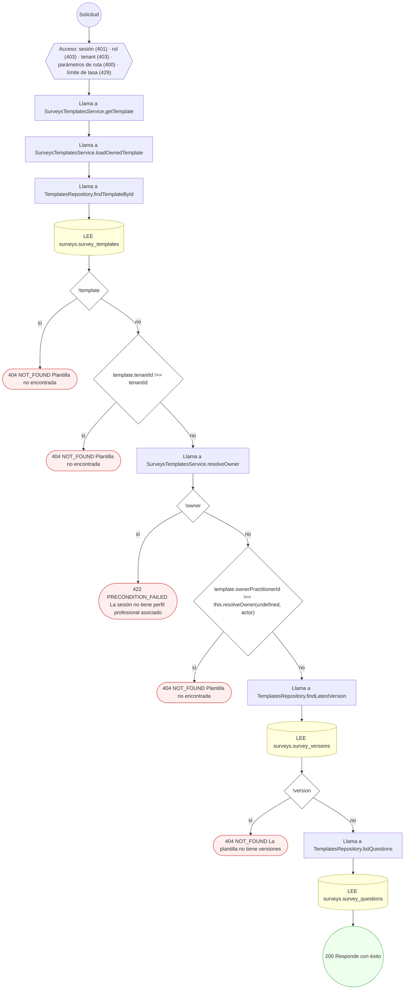

#### 9. POST /surveys/templates/{id}/deactivate

Desactivar la encuesta

| HTTP | Código | Cuándo |
|---|---|---|
| 200 | — | Éxito |
| 400 | `VALIDATION_FAILED` | Los parámetros de ruta son UUID válidos |
| 401 | `UNAUTHENTICATED` | Hay una sesión válida (JWT) |
| 403 | `FORBIDDEN` | El rol está permitido; El tenant se resuelve y pertenece al actor |
| 404 | `NOT_FOUND` | ResourceNotFoundException: Plantilla no encontrada |
| 409 | `CONFLICT` | ConflictException: La plantilla ya está desactivada |
| 422 | `PRECONDITION_FAILED` | PreconditionFailedException: La sesión no tiene perfil profesional asociado |
| 429 | `RATE_LIMITED` | No se supera el límite de solicitudes |

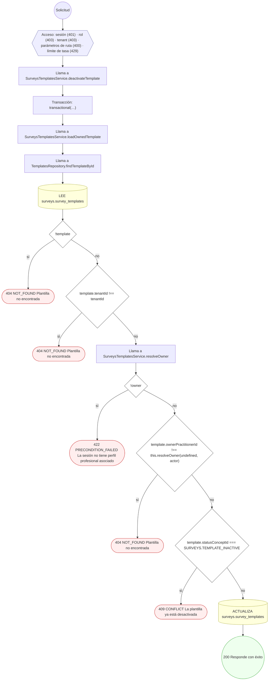

#### 10. POST /surveys/templates/{id}/questions

Configurar una pregunta y su tipo de respuesta

| HTTP | Código | Cuándo |
|---|---|---|
| 201 | — | Éxito |
| 400 | `VALIDATION_FAILED` | Los parámetros de ruta son UUID válidos; El cuerpo cumple el DTO (sin propiedades extra) |
| 401 | `UNAUTHENTICATED` | Hay una sesión válida (JWT) |
| 403 | `FORBIDDEN` | El rol está permitido; El tenant se resuelve y pertenece al actor |
| 404 | `NOT_FOUND` | ResourceNotFoundException: Plantilla no encontrada; ResourceNotFoundException: La plantilla no tiene versiones |
| 422 | `PRECONDITION_FAILED` | PreconditionFailedException: Las preguntas de elección requieren al menos dos opciones; PreconditionFailedException: Este tipo de pregunta no admite opciones; PreconditionFailedException: Las opciones no pueden repetirse; PreconditionFailedException: El máximo de la escala debe ser mayor que el mínimo; PreconditionFailedException: La sesión no tiene perfil profesional asociado; PreconditionFailedException: La versión ya está publicada: cree una versión nueva para modificar el cuestionario |
| 429 | `RATE_LIMITED` | No se supera el límite de solicitudes |

```mermaid
flowchart TD
  n1(("Solicitud")):::inicio
  n2{{"Acceso: sesión (401) · rol (403) · tenant (403) · parámetros de ruta (400) · cuerpo válido (400) · límite de…"}}:::acceso
  n1 --> n2
  n3["Llama a SurveysTemplatesService.addQuestion"]:::llamada
  n2 --> n3
  n4["Llama a SurveysTemplatesService.validateQuestionShape"]:::llamada
  n3 --> n4
  n5{"needsOptions && (!dto.options || dto.options.length ‹ 2)"}:::decision
  n4 --> n5
  n6(["422 PRECONDITION_FAILED Las preguntas de elección requieren al menos dos opciones"]):::error
  n5 -->|"sí"| n6
  n7{"!needsOptions && dto.options && dto.options.length › 0"}:::decision
  n5 -->|"no"| n7
  n8(["422 PRECONDITION_FAILED Este tipo de pregunta no admite opciones"]):::error
  n7 -->|"sí"| n8
  n9{"needsOptions && dto.options"}:::decision
  n7 -->|"no"| n9
  n10{"unique.size !== dto.options.length"}:::decision
  n9 -->|"sí"| n10
  n11(["422 PRECONDITION_FAILED Las opciones no pueden repetirse"]):::error
  n10 -->|"sí"| n11
  n12{"dto.answerType === 'SCALE'"}:::decision
  n10 -->|"no"| n12
  n9 -->|"no"| n12
  n13{"max ‹= min"}:::decision
  n12 -->|"sí"| n13
  n14(["422 PRECONDITION_FAILED El máximo de la escala debe ser mayor que el mínimo"]):::error
  n13 -->|"sí"| n14
  n15["Transacción: transactional(…)"]:::transaccion
  n13 -->|"no"| n15
  n12 -->|"no"| n15
  n16["Llama a SurveysTemplatesService.loadOwnedTemplate"]:::llamada
  n15 --> n16
  n17["Llama a TemplatesRepository.findTemplateById"]:::llamada
  n16 --> n17
  n18[("LEE surveys.survey_templates")]:::efecto
  n17 --> n18
  n19{"!template"}:::decision
  n18 --> n19
  n20(["404 NOT_FOUND Plantilla no encontrada"]):::error
  n19 -->|"sí"| n20
  n21{"template.tenantId !== tenantId"}:::decision
  n19 -->|"no"| n21
  n22(["404 NOT_FOUND Plantilla no encontrada"]):::error
  n21 -->|"sí"| n22
  n23["Llama a SurveysTemplatesService.resolveOwner"]:::llamada
  n21 -->|"no"| n23
  n24{"!owner"}:::decision
  n23 --> n24
  n25(["422 PRECONDITION_FAILED La sesión no tiene perfil profesional asociado"]):::error
  n24 -->|"sí"| n25
  n26{"template.ownerPractitionerId !== this.resolveOwner(undefined, actor)"}:::decision
  n24 -->|"no"| n26
  n27(["404 NOT_FOUND Plantilla no encontrada"]):::error
  n26 -->|"sí"| n27
  n28["Llama a TemplatesRepository.findLatestVersion"]:::llamada
  n26 -->|"no"| n28
  n29[("LEE surveys.survey_versions")]:::efecto
  n28 --> n29
  n30{"!version"}:::decision
  n29 --> n30
  n31(["404 NOT_FOUND La plantilla no tiene versiones"]):::error
  n30 -->|"sí"| n31
  n32{"version.publicationStatusConceptId !== SURVEYS.VERSION_DRAFT"}:::decision
  n30 -->|"no"| n32
  n33(["422 PRECONDITION_FAILED La versión ya está publicada: cree una versión nueva para modificar el cuestionario"]):::error
  n32 -->|"sí"| n33
  n34["Llama a TemplatesRepository.countQuestions"]:::llamada
  n32 -->|"no"| n34
  n35[("LEE surveys.survey_questions")]:::efecto
  n34 --> n35
  n36["Llama a TemplatesRepository.createQuestion"]:::llamada
  n35 --> n36
  n37[("CREA surveys.survey_questions")]:::efecto
  n36 --> n37
  n38(("201 Responde con éxito")):::ok
  n37 --> n38
  classDef acceso fill:#eef,stroke:#66a
  classDef error fill:#fee,stroke:#c33
  classDef ok fill:#efe,stroke:#3a3
  classDef efecto fill:#ffd,stroke:#aa3
  classDef decision fill:#fff,stroke:#555
  classDef corte fill:#eee,stroke:#999,stroke-dasharray: 4
```

#### 11. GET /surveys/templates/{id}/responses

Revisar las respuestas de los pacientes

| HTTP | Código | Cuándo |
|---|---|---|
| 200 | — | Éxito |
| 400 | `VALIDATION_FAILED` | Los parámetros de ruta son UUID válidos |
| 401 | `UNAUTHENTICATED` | Hay una sesión válida (JWT) |
| 403 | `FORBIDDEN` | El rol está permitido; El tenant se resuelve y pertenece al actor |
| 404 | `NOT_FOUND` | ResourceNotFoundException: Plantilla no encontrada |
| 429 | `RATE_LIMITED` | No se supera el límite de solicitudes |

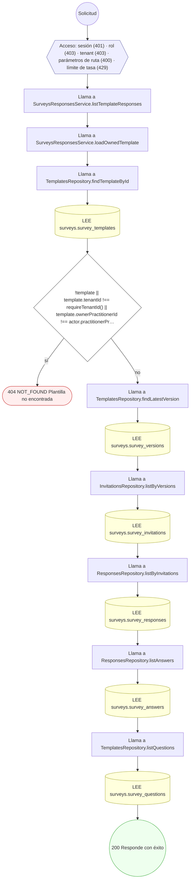

#### 12. POST /surveys/templates/{id}/versions/{versionNumber}/publish

Publicar la encuesta y configurar su vigencia

| HTTP | Código | Cuándo |
|---|---|---|
| 200 | — | Éxito |
| 400 | `VALIDATION_FAILED` | Los parámetros de ruta son UUID válidos; El cuerpo cumple el DTO (sin propiedades extra) |
| 401 | `UNAUTHENTICATED` | Hay una sesión válida (JWT) |
| 403 | `FORBIDDEN` | El rol está permitido; El tenant se resuelve y pertenece al actor |
| 404 | `NOT_FOUND` | ResourceNotFoundException: Plantilla no encontrada; ResourceNotFoundException: Versión no encontrada |
| 409 | `CONFLICT` | ConflictException: La versión ya fue publicada |
| 422 | `PRECONDITION_FAILED` | PreconditionFailedException: La sesión no tiene perfil profesional asociado; PreconditionFailedException: No se puede publicar un cuestionario sin preguntas; PreconditionFailedException: El fin de vigencia debe ser posterior al inicio |
| 429 | `RATE_LIMITED` | No se supera el límite de solicitudes |

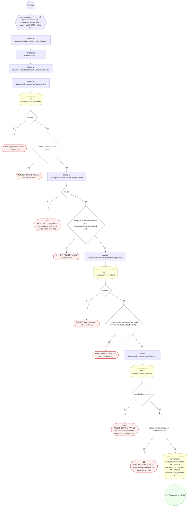

