<!-- AUTOGENERADO por tools/inventario/flujos.mjs. No editar manualmente. -->

# Flujos del módulo `system_context`

- **Procesos:** 1 · **Máquinas de estado:** 0
- **Operaciones:** 13 (12 con decisiones propias, 1 sin ellas)
- Inventario de endpoints del módulo: [system_context](../endpoints/system_context.md)

## Proceso: Módulo 45 — Contexto de Sistema y Enumeraciones Dinámicas

- **Código:** `system_context` · **Agrupación:** MIXTO · **Operaciones:** 13
- **Actores:** Cualquier sesión válida · GOVERNANCE · MODULE_OWNER · PLATFORM_ADMIN · SYSTEM · TERMINOLOGY_ENGINEER · WRITE_SERVICE
- **Revisión:** AUTO_DETECTADA
- **Fuentes:** `src/modules/system_context/README.md`

### Para qué sirve

Enumeraciones gobernadas por filas versionadas —sin tipos `ENUM` nativos de PostgreSQL—, con snapshot inmutable de opciones, publicación que invalida caché, binding a campos y validación en escritura; y contextos de sistema versionados con refresco idempotente, procedencia, promoción, binding a consumidores y vuelta atrás.

_Fuente: `src/modules/system_context/README.md:3`_

### Flujo general declarado en el README

```text
definición (draft)
   └─ versions ──> versión draft + snapshot ordenado de opciones (inmutable)
        └─ publish ──> versión published + cacheToken nuevo
                       la anterior queda superseded  ⇒ definición pasa a active
   └─ bindings ──> el campo destino queda gobernado por la enumeración
        └─ resolve ──> STRICT: fuera del conjunto se rechaza
                       LENIENT: fuera del conjunto cae al concepto de reserva
   └─ retire ──> definición retired + bindings disabled  (un campo obligatorio lo bloquea)

contexto (active) + versión 1 (draft)
   └─ refresh (idempotente por clave)
        ├─ entrada obligatoria ausente ──> run failed, sin versión
        ├─ contenido idéntico al último ─> run unchanged, sin versión
        └─ contenido nuevo ─────────────> versión draft + entradas de procedencia
   └─ activate ──> versión active; la anterior superseded; current_version_id avanza
   └─ rollback ──> una versión superseded vuelve a active; la actual pasa a superseded
   └─ bindings ──> el consumidor recibe el contexto en su ventana de validez
```

_Fuente: `src/modules/system_context/README.md:40`_

### Etapas y operaciones

| Etapa | Descripción | Operación | Quién actúa | Riesgo | Tablas |
|---|---|---|---|---|---|
| `UC-45-01` | Definir enumeración ligada a un value set | POST /system-context/dynamic-enums/definitions | TERMINOLOGY_ENGINEER · PLATFORM_ADMIN | MEDIO | 2 |
| `UC-45-02` | Redactar versión + snapshot de opciones | POST /system-context/dynamic-enums/definitions/{defId}/versions | TERMINOLOGY_ENGINEER · PLATFORM_ADMIN | MEDIO | 4 |
| `UC-45-03` | Publicar e invalidar caché | POST /system-context/dynamic-enums/definitions/{defId}/versions/{version}/publish | TERMINOLOGY_ENGINEER · PLATFORM_ADMIN | MEDIO | 5 |
| `UC-45-04` | Vincular el enum a un campo | POST /system-context/dynamic-enums/definitions/{defId}/bindings | MODULE_OWNER · PLATFORM_ADMIN | MEDIO | 3 |
| `UC-45-05` | Resolver y validar un valor en escritura | POST /system-context/dynamic-enums/resolve | WRITE_SERVICE · MODULE_OWNER · PLATFORM_ADMIN | BAJO | 3 |
| `UC-45-06` | Definir contexto + versión inicial | POST /system-context/contexts | PLATFORM_ADMIN · GOVERNANCE | MEDIO | 4 |
| `UC-45-07` | Refresco idempotente con nueva versión | POST /system-context/contexts/{id}/refresh | SYSTEM · PLATFORM_ADMIN | MEDIO | 7 |
| `UC-45-09` | Promover versión vigente | POST /system-context/contexts/{id}/versions/{version}/activate | PLATFORM_ADMIN | MEDIO | 4 |
| `UC-45-10` | Vincular contexto a un consumidor | POST /system-context/contexts/{id}/bindings | MODULE_OWNER · PLATFORM_ADMIN | MEDIO | 3 |
| `UC-45-11` | Retiro gobernado de la definición | POST /system-context/dynamic-enums/definitions/{defId}/retire | PLATFORM_ADMIN | MEDIO | 4 |
| `UC-45-12` | Volver a una versión anterior | POST /system-context/contexts/{id}/rollback | PLATFORM_ADMIN | MEDIO | 4 |
| `ctrl:SystemContextController` | Operaciones de SystemContextController que el README no asigna a un caso de uso | GET /system-context/dynamic-enums | Cualquier sesión válida | BAJO | 4 |
|  |  | GET /system-context/dynamic-enums/bindings | Cualquier sesión válida | BAJO | 2 |

### Diagrama — etapas `UC-45-01`, `UC-45-02`, `UC-45-03`…

```mermaid
flowchart LR
  a2(["TERMINOLOGY_ENGINEER · PLATFORM_ADMIN"]):::actor
  a9(["MODULE_OWNER · PLATFORM_ADMIN"]):::actor
  a12(["WRITE_SERVICE · MODULE_OWNER · PLATFORM_ADMIN"]):::actor
  a14(["PLATFORM_ADMIN · GOVERNANCE"]):::actor
  a18(["SYSTEM · PLATFORM_ADMIN"]):::actor
  a23(["PLATFORM_ADMIN"]):::actor
  a29(["Cualquier sesión válida"]):::actor
  t3[("system_context.dynamic_enum_definitions")]:::tabla
  t5[("system_context.dynamic_enum_options")]:::tabla
  t6[("system_context.dynamic_enum_versions")]:::tabla
  t10[("system_context.dynamic_enum_bindings")]:::tabla
  t15[("system_context.system_context_versions")]:::tabla
  t16[("system_context.system_contexts")]:::tabla
  t19[("system_context.system_context_inputs")]:::tabla
  t20[("system_context.system_context_refresh_runs")]:::tabla
  t25[("system_context.system_context_bindings")]:::tabla
  subgraph s0["UC-45-01 · Definir enumeración ligada a un value set"]
    o1["POST /system-context/dynamic-enums/definitions"]:::op
  end
  subgraph s1["UC-45-02 · Redactar versión + snapshot de opciones"]
    o4["POST /system-context/dynamic-enums/definitions/{defId}/versions"]:::op
  end
  subgraph s2["UC-45-03 · Publicar e invalidar caché"]
    o7["POST /system-context/dynamic-enums/definitions/{defId}/versions/{vers…"]:::op
  end
  subgraph s3["UC-45-04 · Vincular el enum a un campo"]
    o8["POST /system-context/dynamic-enums/definitions/{defId}/bindings"]:::op
  end
  subgraph s4["UC-45-05 · Resolver y validar un valor en escritura"]
    o11["POST /system-context/dynamic-enums/resolve"]:::op
  end
  subgraph s5["UC-45-06 · Definir contexto + versión inicial"]
    o13["POST /system-context/contexts"]:::op
  end
  t21[("+1 tablas más")]
  subgraph s6["UC-45-07 · Refresco idempotente con nueva versión"]
    o17["POST /system-context/contexts/{id}/refresh"]:::op
  end
  subgraph s7["UC-45-09 · Promover versión vigente"]
    o22["POST /system-context/contexts/{id}/versions/{version}/activate"]:::op
  end
  subgraph s8["UC-45-10 · Vincular contexto a un consumidor"]
    o24["POST /system-context/contexts/{id}/bindings"]:::op
  end
  subgraph s9["UC-45-11 · Retiro gobernado de la definición"]
    o26["POST /system-context/dynamic-enums/definitions/{defId}/retire"]:::op
  end
  subgraph s10["UC-45-12 · Volver a una versión anterior"]
    o27["POST /system-context/contexts/{id}/rollback"]:::op
  end
  subgraph s11["ctrl:SystemContextController · Operaciones de SystemContextController que el RE…"]
    o28["GET /system-context/dynamic-enums"]:::op
    o30["GET /system-context/dynamic-enums/bindings"]:::op
  end
  a2 --> o1
  o1 -->|"CREA"| t3
  o1 -->|"LEE"| t3
  a2 --> o4
  o4 -->|"LEE"| t3
  o4 -->|"CREA"| t5
  o4 -->|"CREA"| t6
  o4 -->|"LEE"| t6
  a2 --> o7
  o7 -->|"ACTUALIZA"| t3
  o7 -->|"LEE"| t3
  o7 -->|"LEE"| t5
  o7 -->|"ACTUALIZA"| t6
  o7 -->|"LEE"| t6
  a9 --> o8
  o8 -->|"CREA"| t10
  o8 -->|"LEE"| t10
  o8 -->|"LEE"| t3
  a12 --> o11
  o11 -->|"LEE"| t10
  o11 -->|"LEE"| t5
  o11 -->|"LEE"| t6
  a14 --> o13
  o13 -->|"CREA"| t15
  o13 -->|"ACTUALIZA"| t16
  o13 -->|"CREA"| t16
  o13 -->|"LEE"| t16
  a18 --> o17
  o17 -->|"CREA"| t19
  o17 -->|"ACTUALIZA"| t20
  o17 -->|"CREA"| t20
  o17 -->|"LEE"| t20
  o17 -->|"CREA"| t15
  o17 -->|"LEE"| t15
  o17 -.-> t21
  a23 --> o22
  o22 -->|"ACTUALIZA"| t15
  o22 -->|"LEE"| t15
  o22 -->|"ACTUALIZA"| t16
  o22 -->|"LEE"| t16
  a9 --> o24
  o24 -->|"CREA"| t25
  o24 -->|"LEE"| t25
  o24 -->|"LEE"| t16
  a23 --> o26
  o26 -->|"ACTUALIZA"| t10
  o26 -->|"LEE"| t10
  o26 -->|"ACTUALIZA"| t3
  o26 -->|"LEE"| t3
  a23 --> o27
  o27 -->|"ACTUALIZA"| t15
  o27 -->|"LEE"| t15
  o27 -->|"ACTUALIZA"| t16
  o27 -->|"LEE"| t16
  a29 --> o28
  o28 -->|"LEE"| t10
  o28 -->|"LEE"| t3
  o28 -->|"LEE"| t5
  o28 -->|"LEE"| t6
  a29 --> o30
  o30 -->|"LEE"| t10
  o30 -->|"LEE"| t3
  classDef op fill:#fff,stroke:#446
  classDef actor fill:#eef,stroke:#66a
  classDef tabla fill:#ffd,stroke:#aa3
  classDef evento fill:#efe,stroke:#3a3
```

## Árbol de decisión por operación

Cada árbol se deriva del código del handler y de los métodos que invoca (hasta 4 niveles). Una rama que no decide, no escribe y no falla se poda. Los accesos y los efectos consecutivos se agrupan en un solo nodo.

### Operaciones con decisiones propias

#### 1. POST /system-context/contexts

Definir un contexto de sistema con su versión inicial

| HTTP | Código | Cuándo |
|---|---|---|
| 201 | — | Éxito |
| 400 | `VALIDATION_FAILED` | El cuerpo cumple el DTO (sin propiedades extra) |
| 401 | `UNAUTHENTICATED` | Hay una sesión válida (JWT) |
| 403 | `FORBIDDEN` | El rol está permitido; El tenant se resuelve y pertenece al actor |
| 409 | `CONFLICT` | ConflictException: Ya existe un contexto con ese código |
| 429 | `RATE_LIMITED` | No se supera el límite de solicitudes |

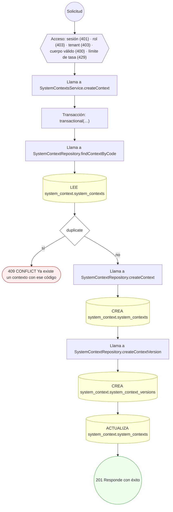

#### 2. POST /system-context/contexts/{id}/bindings

Vincular el contexto a un consumidor

| HTTP | Código | Cuándo |
|---|---|---|
| 201 | — | Éxito |
| 400 | `VALIDATION_FAILED` | Los parámetros de ruta son UUID válidos; El cuerpo cumple el DTO (sin propiedades extra) |
| 401 | `UNAUTHENTICATED` | Hay una sesión válida (JWT) |
| 403 | `FORBIDDEN` | El rol está permitido; El tenant se resuelve y pertenece al actor |
| 404 | `NOT_FOUND` | ResourceNotFoundException: Contexto no encontrado |
| 409 | `CONFLICT` | ConflictException: El consumidor ya tiene un binding en esa ventana |
| 422 | `PRECONDITION_FAILED` | PreconditionFailedException: La ventana de validez está invertida; PreconditionFailedException: El contexto no está activo |
| 429 | `RATE_LIMITED` | No se supera el límite de solicitudes |

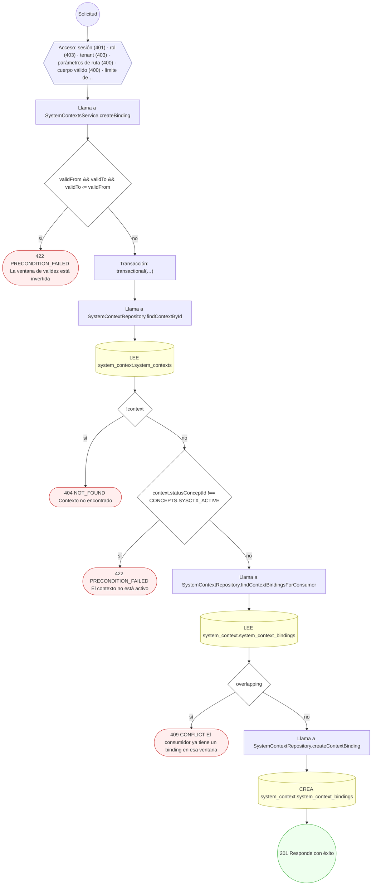

#### 3. POST /system-context/contexts/{id}/refresh

Refrescar el contexto y snapshotear su procedencia

| HTTP | Código | Cuándo |
|---|---|---|
| 201 | — | Éxito |
| 400 | `VALIDATION_FAILED` | Los parámetros de ruta son UUID válidos; El cuerpo cumple el DTO (sin propiedades extra) |
| 401 | `UNAUTHENTICATED` | Hay una sesión válida (JWT) |
| 403 | `FORBIDDEN` | El rol está permitido; El tenant se resuelve y pertenece al actor |
| 404 | `NOT_FOUND` | ResourceNotFoundException: Contexto no encontrado |
| 422 | `PRECONDITION_FAILED` | PreconditionFailedException: El contexto no está activo |
| 429 | `RATE_LIMITED` | No se supera el límite de solicitudes |

```mermaid
flowchart TD
  n1(("Solicitud")):::inicio
  n2{{"Acceso: sesión (401) · rol (403) · tenant (403) · parámetros de ruta (400) · cuerpo válido (400) · límite de…"}}:::acceso
  n1 --> n2
  n3["Llama a SystemContextsService.refreshContext"]:::llamada
  n2 --> n3
  n4["Transacción: transactional(…)"]:::transaccion
  n3 --> n4
  n5["Llama a SystemContextRepository.findRefreshRunByKey"]:::llamada
  n4 --> n5
  n6[("LEE system_context.system_context_refresh_runs")]:::efecto
  n5 --> n6
  n7["Llama a SystemContextRepository.findContextForUpdate"]:::llamada
  n6 --> n7
  n8[("LEE system_context.system_contexts")]:::efecto
  n7 --> n8
  n9{"!context"}:::decision
  n8 --> n9
  n10(["404 NOT_FOUND Contexto no encontrado"]):::error
  n9 -->|"sí"| n10
  n11{"context.statusConceptId !== CONCEPTS.SYSCTX_ACTIVE"}:::decision
  n9 -->|"no"| n11
  n12(["422 PRECONDITION_FAILED El contexto no está activo"]):::error
  n11 -->|"sí"| n12
  n13["Llama a SystemContextRepository.createRefreshRun"]:::llamada
  n11 -->|"no"| n13
  n14[("CREA system_context.system_context_refresh_runs")]:::efecto
  n13 --> n14
  n15{"missingRequired"}:::decision
  n14 --> n15
  n16[("ACTUALIZA system_context.system_context_refresh_runs · ACTUALIZA system_context.system_context_refresh_runs ·…")]:::efecto
  n15 -->|"sí"| n16
  n17["Llama a SystemContextRepository.findLatestContextVersion"]:::llamada
  n16 --> n17
  n15 -->|"no"| n17
  n18[("LEE system_context.system_context_versions")]:::efecto
  n17 --> n18
  n19{"latest?.contentHash === contentHash"}:::decision
  n18 --> n19
  n20[("ACTUALIZA system_context.system_context_refresh_runs · ACTUALIZA system_context.system_context_refresh_runs ·…")]:::efecto
  n19 -->|"sí"| n20
  n21["Llama a SystemContextRepository.createContextVersion"]:::llamada
  n20 --> n21
  n19 -->|"no"| n21
  n22[("CREA system_context.system_context_versions")]:::efecto
  n21 --> n22
  n23["Repite: forEach(…)"]:::bucle
  n22 --> n23
  n24["Llama a SystemContextRepository.createContextInput"]:::llamada
  n23 -->|"cada elemento"| n24
  n25[("CREA system_context.system_context_inputs")]:::efecto
  n24 --> n25
  n26[("ACTUALIZA system_context.system_context_refresh_runs · ACTUALIZA system_context.system_context_refresh_runs ·…")]:::efecto
  n25 --> n26
  n23 -->|"al terminar"| n26
  n27(("201 Responde con éxito")):::ok
  n26 --> n27
  classDef acceso fill:#eef,stroke:#66a
  classDef error fill:#fee,stroke:#c33
  classDef ok fill:#efe,stroke:#3a3
  classDef efecto fill:#ffd,stroke:#aa3
  classDef decision fill:#fff,stroke:#555
  classDef corte fill:#eee,stroke:#999,stroke-dasharray: 4
```

#### 4. POST /system-context/contexts/{id}/rollback

Volver a una versión anterior del contexto

| HTTP | Código | Cuándo |
|---|---|---|
| 200 | — | Éxito |
| 400 | `VALIDATION_FAILED` | Los parámetros de ruta son UUID válidos; El cuerpo cumple el DTO (sin propiedades extra) |
| 401 | `UNAUTHENTICATED` | Hay una sesión válida (JWT) |
| 403 | `FORBIDDEN` | El rol está permitido; El tenant se resuelve y pertenece al actor |
| 404 | `NOT_FOUND` | ResourceNotFoundException: Contexto no encontrado; ResourceNotFoundException: Versión objetivo no encontrada |
| 422 | `PRECONDITION_FAILED` | PreconditionFailedException: Sólo se puede volver a una versión que estuvo vigente; PreconditionFailedException: El contenido de la versión no es el esperado; PreconditionFailedException: El contexto no tiene versión vigente |
| 429 | `RATE_LIMITED` | No se supera el límite de solicitudes |

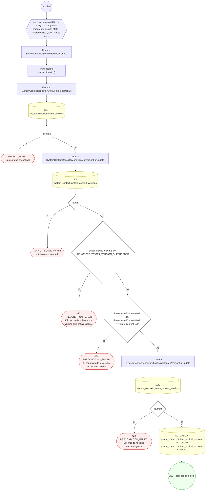

#### 5. POST /system-context/contexts/{id}/versions/{version}/activate

Promover la versión a vigente

| HTTP | Código | Cuándo |
|---|---|---|
| 200 | — | Éxito |
| 400 | `VALIDATION_FAILED` | Los parámetros de ruta son UUID válidos; El cuerpo cumple el DTO (sin propiedades extra) |
| 401 | `UNAUTHENTICATED` | Hay una sesión válida (JWT) |
| 403 | `FORBIDDEN` | El rol está permitido; El tenant se resuelve y pertenece al actor |
| 404 | `NOT_FOUND` | ResourceNotFoundException: Contexto no encontrado; ResourceNotFoundException: Versión del contexto no encontrada |
| 409 | `CONFLICT` | ConflictException: La versión ya es la vigente |
| 422 | `PRECONDITION_FAILED` | PreconditionFailedException: El contexto no está activo; PreconditionFailedException: La versión no está en borrador; PreconditionFailedException: El contenido de la versión no es el esperado |
| 429 | `RATE_LIMITED` | No se supera el límite de solicitudes |

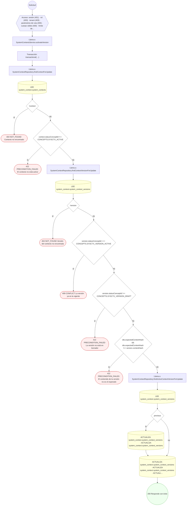

#### 6. GET /system-context/dynamic-enums

Leer las opciones publicadas de una enumeración

| HTTP | Código | Cuándo |
|---|---|---|
| 200 | — | Éxito |
| 400 | `VALIDATION_FAILED` | BadRequestException: Indique el campo destino (`target`) o el código de la enumeración (`code`); BadRequestException: El campo destino se escribe como `esquema.tabla.columna` |
| 401 | `UNAUTHENTICATED` | Hay una sesión válida (JWT) |
| 403 | `FORBIDDEN` | El rol está permitido; El tenant se resuelve y pertenece al actor |
| 404 | `NOT_FOUND` | ResourceNotFoundException: Enumeración no encontrada; ResourceNotFoundException: La enumeración está retirada |
| 422 | `PRECONDITION_FAILED` | PreconditionFailedException: La enumeración no tiene versión publicada |
| 429 | `RATE_LIMITED` | No se supera el límite de solicitudes |

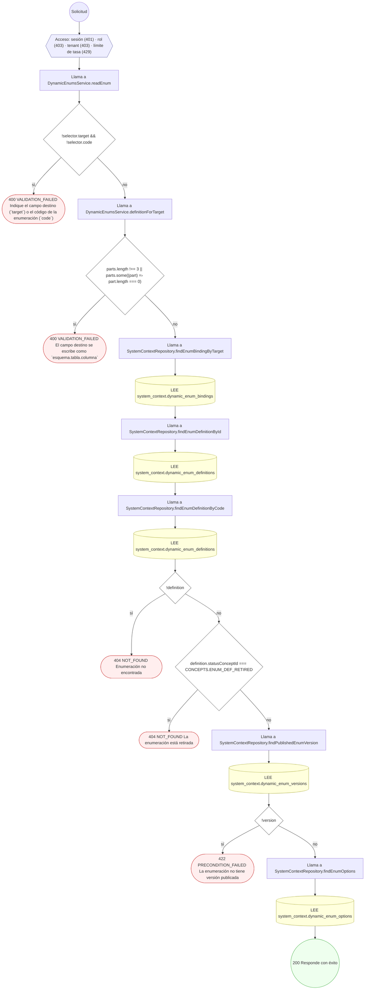

#### 7. POST /system-context/dynamic-enums/definitions

Definir una enumeración dinámica ligada a un value set

| HTTP | Código | Cuándo |
|---|---|---|
| 201 | — | Éxito |
| 400 | `VALIDATION_FAILED` | El cuerpo cumple el DTO (sin propiedades extra) |
| 401 | `UNAUTHENTICATED` | Hay una sesión válida (JWT) |
| 403 | `FORBIDDEN` | El rol está permitido; El tenant se resuelve y pertenece al actor |
| 409 | `CONFLICT` | ConflictException: Ya existe una enumeración con ese código |
| 429 | `RATE_LIMITED` | No se supera el límite de solicitudes |

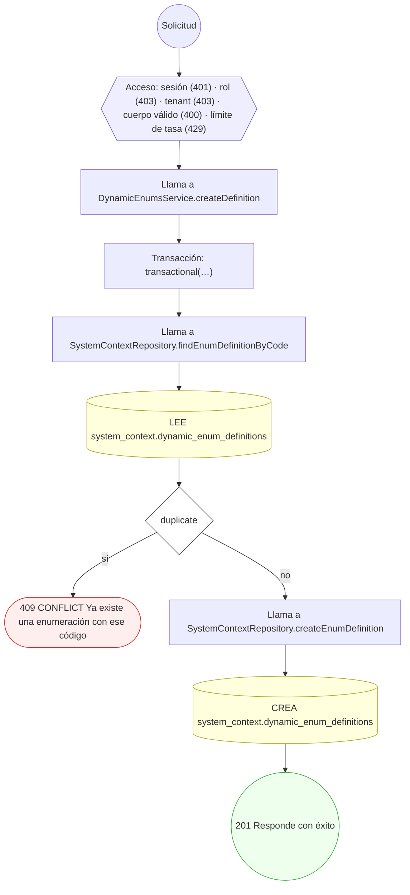

#### 8. POST /system-context/dynamic-enums/definitions/{defId}/bindings

Vincular la enumeración a un campo destino

| HTTP | Código | Cuándo |
|---|---|---|
| 201 | — | Éxito |
| 400 | `VALIDATION_FAILED` | Los parámetros de ruta son UUID válidos; El cuerpo cumple el DTO (sin propiedades extra) |
| 401 | `UNAUTHENTICATED` | Hay una sesión válida (JWT) |
| 403 | `FORBIDDEN` | El rol está permitido; El tenant se resuelve y pertenece al actor |
| 404 | `NOT_FOUND` | ResourceNotFoundException: Enumeración no encontrada |
| 409 | `CONFLICT` | ConflictException: El campo ya está gobernado por otra enumeración |
| 422 | `PRECONDITION_FAILED` | PreconditionFailedException: El modo permisivo exige un concepto de reserva; PreconditionFailedException: La enumeración está retirada |
| 429 | `RATE_LIMITED` | No se supera el límite de solicitudes |

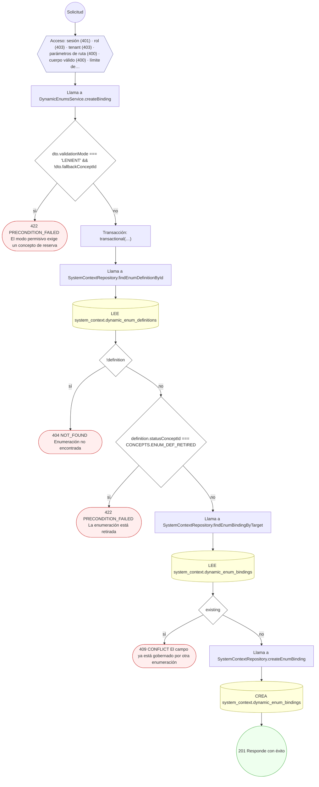

#### 9. POST /system-context/dynamic-enums/definitions/{defId}/retire

Retirar la definición (borrado lógico gobernado)

| HTTP | Código | Cuándo |
|---|---|---|
| 200 | — | Éxito |
| 400 | `VALIDATION_FAILED` | Los parámetros de ruta son UUID válidos; El cuerpo cumple el DTO (sin propiedades extra) |
| 401 | `UNAUTHENTICATED` | Hay una sesión válida (JWT) |
| 403 | `FORBIDDEN` | El rol está permitido; El tenant se resuelve y pertenece al actor |
| 404 | `NOT_FOUND` | ResourceNotFoundException: Enumeración no encontrada |
| 409 | `CONFLICT` | ConflictException: La enumeración ya está retirada |
| 422 | `PRECONDITION_FAILED` | PreconditionFailedException: Hay un campo obligatorio vinculado; migra su enumeración antes de retirarla |
| 429 | `RATE_LIMITED` | No se supera el límite de solicitudes |

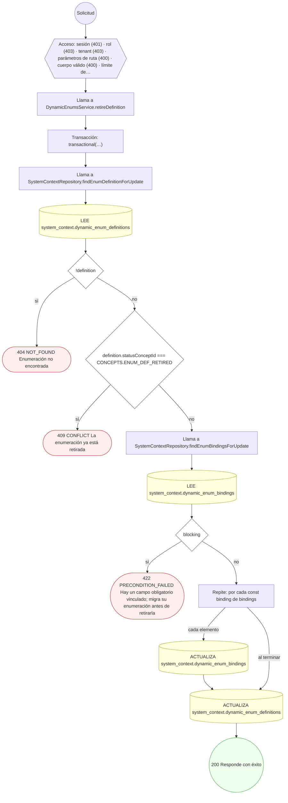

#### 10. POST /system-context/dynamic-enums/definitions/{defId}/versions

Redactar una versión con su snapshot de opciones

| HTTP | Código | Cuándo |
|---|---|---|
| 201 | — | Éxito |
| 400 | `VALIDATION_FAILED` | Los parámetros de ruta son UUID válidos; El cuerpo cumple el DTO (sin propiedades extra) |
| 401 | `UNAUTHENTICATED` | Hay una sesión válida (JWT) |
| 403 | `FORBIDDEN` | El rol está permitido; El tenant se resuelve y pertenece al actor |
| 404 | `NOT_FOUND` | ResourceNotFoundException: Enumeración no encontrada |
| 422 | `PRECONDITION_FAILED` | PreconditionFailedException: Sólo una opción puede ser la de por defecto; PreconditionFailedException: La opción por defecto no puede estar deshabilitada; PreconditionFailedException: El código de opción está repetido; PreconditionFailedException: El concepto está repetido en las opciones; PreconditionFailedException: La enumeración está retirada |
| 429 | `RATE_LIMITED` | No se supera el límite de solicitudes |

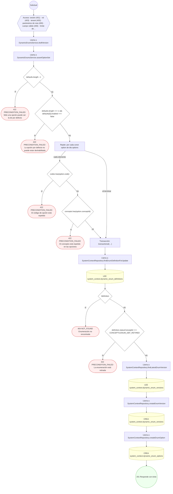

#### 11. POST /system-context/dynamic-enums/definitions/{defId}/versions/{version}/publish

Publicar la versión e invalidar la caché

| HTTP | Código | Cuándo |
|---|---|---|
| 200 | — | Éxito |
| 400 | `VALIDATION_FAILED` | Los parámetros de ruta son UUID válidos |
| 401 | `UNAUTHENTICATED` | Hay una sesión válida (JWT) |
| 403 | `FORBIDDEN` | El rol está permitido; El tenant se resuelve y pertenece al actor |
| 404 | `NOT_FOUND` | ResourceNotFoundException: Enumeración no encontrada; ResourceNotFoundException: Versión de la enumeración no encontrada |
| 422 | `PRECONDITION_FAILED` | PreconditionFailedException: La enumeración está retirada; PreconditionFailedException: La versión no está en borrador; PreconditionFailedException: La versión no tiene ninguna opción habilitada |
| 429 | `RATE_LIMITED` | No se supera el límite de solicitudes |

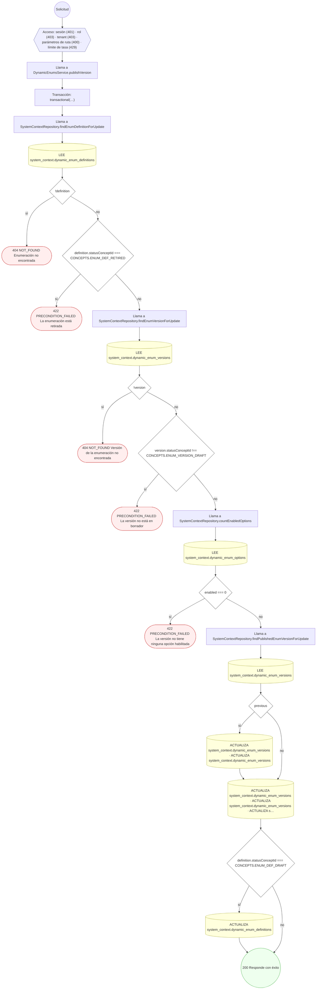

#### 12. POST /system-context/dynamic-enums/resolve

Resolver y validar un valor de enumeración antes de escribirlo

| HTTP | Código | Cuándo |
|---|---|---|
| 200 | — | Éxito |
| 400 | `VALIDATION_FAILED` | El cuerpo cumple el DTO (sin propiedades extra) |
| 401 | `UNAUTHENTICATED` | Hay una sesión válida (JWT) |
| 403 | `FORBIDDEN` | El rol está permitido; El tenant se resuelve y pertenece al actor |
| 404 | `NOT_FOUND` | ResourceNotFoundException: El campo no tiene enumeración vinculada |
| 422 | `PRECONDITION_FAILED` | PreconditionFailedException: La enumeración no tiene versión publicada |
| 429 | `RATE_LIMITED` | No se supera el límite de solicitudes |

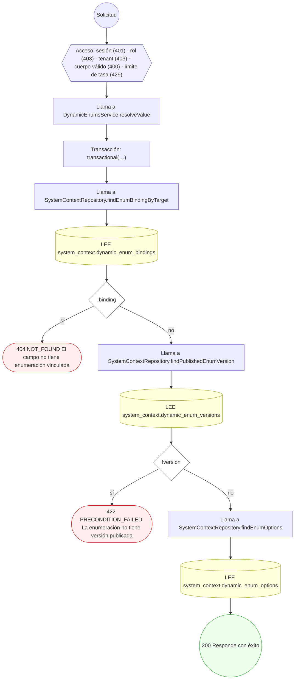

### Operaciones sin decisiones propias

Sólo comprueban el acceso y leen o escriben: no tienen ramas que dibujar. Su detalle está en la ficha de endpoints.

| Operación | Respuestas posibles | Tablas |
|---|---|---|
| GET /system-context/dynamic-enums/bindings | 200, 401, 403, 429 | 2 |
