<!-- AUTOGENERADO por tools/inventario/flujos.mjs. No editar manualmente. -->

# Flujos del módulo `system_ops`

- **Procesos:** 1 · **Máquinas de estado:** 0
- **Operaciones:** 24 (22 con decisiones propias, 2 sin ellas)
- Inventario de endpoints del módulo: [system_ops](../endpoints/system_ops.md)

## Proceso: Módulo `system_ops` (11) — Data Governance & System Operations

- **Código:** `system_ops` · **Agrupación:** CASO_DE_USO_README · **Operaciones:** 24
- **Actores:** SECURITY_ADMIN
- **Revisión:** AUTO_DETECTADA
- **Fuentes:** `src/modules/system_ops/README.md`

### Para qué sirve

Gobierno de datos y operaciones de sistema: catálogo de entidades/campos, políticas (escritura, retención, anonimización, residencia, backup), transferencias transfronterizas, legal holds, barridos de retención, frameworks/evaluaciones/ remediación y publicación de drafts genéricos.

_Fuente: `src/modules/system_ops/README.md:3`_

### Etapas y operaciones

| Etapa | Descripción | Operación | Quién actúa | Riesgo | Tablas |
|---|---|---|---|---|---|
| `UC-11-01` | Registrar dominio, clasificación y catalogar entidad + campos | POST /admin/governance/entity-registry | SECURITY_ADMIN | MEDIO | 7 |
| `UC-11-02` | Vincular política de escritura a una entidad | PATCH /admin/governance/entity-registry/{id}/write-policy | SECURITY_ADMIN | MEDIO | 4 |
|  |  | POST /admin/governance/write-policies | SECURITY_ADMIN | MEDIO | 3 |
| `UC-11-03` | Aplicar retención a una entidad (razón obligatoria) | PATCH /admin/governance/entity-registry/{id}/retention | SECURITY_ADMIN | MEDIO | 4 |
|  |  | POST /admin/governance/retention-policies | SECURITY_ADMIN | MEDIO | 3 |
| `UC-11-04` | Definir regla de anonimización | POST /admin/governance/anonymization-rules | SECURITY_ADMIN | MEDIO | 3 |
|  |  | PATCH /admin/governance/field-registry/{id} | SECURITY_ADMIN | MEDIO | 3 |
| `UC-11-05` | Ejecutar barrido de retención (excluye objetivos bajo legal hold) | POST /internal/governance/retention-executions/run | SECURITY_ADMIN | MEDIO | 6 |
| `UC-11-06` | Definir política de residencia | POST /admin/governance/residency-policies | SECURITY_ADMIN | MEDIO | 3 |
|  |  | POST /admin/governance/tenant-residency-bindings | SECURITY_ADMIN | MEDIO | 1 |
| `UC-11-07` | Registrar transferencia transfronteriza (append-only) | POST /admin/governance/cross-border-transfers | SECURITY_ADMIN | MEDIO | 2 |
| `UC-11-08` | Colocar legal hold | POST /admin/governance/legal-holds | SECURITY_ADMIN | MEDIO | 3 |
|  |  | POST /admin/governance/legal-holds/{id}/release | SECURITY_ADMIN | MEDIO | 3 |
| `UC-11-09` | Definir política de backup (RPO/RTO/inmutabilidad) | POST /admin/ops/backup-policies | SECURITY_ADMIN | MEDIO | 1 |
| `UC-11-10` | Registrar prueba de restauración con evidencia | POST /internal/ops/restore-test-runs | SECURITY_ADMIN | MEDIO | 2 |
| `UC-11-11` | Publicar framework con controles (jerárquicos) | POST /admin/governance/operational-frameworks | SECURITY_ADMIN | MEDIO | 3 |
| `UC-11-12` | Iniciar evaluación de workload | POST /admin/governance/workload-assessments | SECURITY_ADMIN | MEDIO | 2 |
|  |  | PUT /admin/governance/workload-assessments/{id}/control-results | SECURITY_ADMIN | MEDIO | 4 |
| `UC-11-13` | Abrir hallazgo | POST /admin/governance/assessments/{id}/findings | SECURITY_ADMIN | MEDIO | 3 |
|  |  | POST /admin/governance/assessments/{id}/remediation-plans | SECURITY_ADMIN | MEDIO | 5 |
| `UC-11-14` | Actualizar hallazgo | PATCH /admin/governance/findings/{id} | SECURITY_ADMIN | MEDIO | 2 |
|  |  | POST /admin/governance/remediation-actions/{id}/verify | SECURITY_ADMIN | MEDIO | 6 |
| `UC-11-15` | Guardar draft genérico | POST /admin/governance/drafts | SECURITY_ADMIN | MEDIO | 1 |
|  |  | POST /admin/governance/drafts/{id}/publish | SECURITY_ADMIN | MEDIO | 3 |

### Diagrama 1 de 2 — etapas `UC-11-01`, `UC-11-02`, `UC-11-03`…

```mermaid
flowchart LR
  a2(["SECURITY_ADMIN"]):::actor
  t3[("system_ops.data_classifications")]:::tabla
  t4[("system_ops.data_domains")]:::tabla
  t5[("system_ops.entity_registry")]:::tabla
  t6[("system_ops.field_registry")]:::tabla
  t9[("system_ops.governance_change_log")]:::tabla
  t10[("system_ops.write_policies")]:::tabla
  t13[("system_ops.retention_policies")]:::tabla
  t16[("system_ops.anonymization_rules")]:::tabla
  t19[("system_ops.legal_holds")]:::tabla
  t20[("system_ops.record_revisions")]:::tabla
  t21[("system_ops.retention_executions")]:::tabla
  t23[("system_ops.data_residency_policies")]:::tabla
  t25[("system_ops.tenant_residency_bindings")]:::tabla
  t27[("system_ops.cross_border_transfer_events")]:::tabla
  t31[("system_ops.backup_policies")]:::tabla
  t33[("system_ops.restore_test_runs")]:::tabla
  t35[("system_ops.operational_framework_controls")]:::tabla
  t36[("system_ops.operational_frameworks")]:::tabla
  t38[("system_ops.workload_assessments")]:::tabla
  t40[("system_ops.assessment_control_results")]:::tabla
  t42[("system_ops.assessment_findings")]:::tabla
  t44[("system_ops.remediation_actions")]:::tabla
  t45[("system_ops.remediation_plans")]:::tabla
  t7[("+1 tablas más")]
  subgraph s0["UC-11-01 · Registrar dominio, clasificación y catalogar entidad + campos"]
    o1["POST /admin/governance/entity-registry"]:::op
  end
  subgraph s1["UC-11-02 · Vincular política de escritura a una entidad"]
    o8["PATCH /admin/governance/entity-registry/{id}/write-policy"]:::op
    o11["POST /admin/governance/write-policies"]:::op
  end
  subgraph s2["UC-11-03 · Aplicar retención a una entidad (razón obligatoria)"]
    o12["PATCH /admin/governance/entity-registry/{id}/retention"]:::op
    o14["POST /admin/governance/retention-policies"]:::op
  end
  subgraph s3["UC-11-04 · Definir regla de anonimización"]
    o15["POST /admin/governance/anonymization-rules"]:::op
    o17["PATCH /admin/governance/field-registry/{id}"]:::op
  end
  subgraph s4["UC-11-05 · Ejecutar barrido de retención (excluye objetivos bajo legal hold)"]
    o18["POST /internal/governance/retention-executions/run"]:::op
  end
  subgraph s5["UC-11-06 · Definir política de residencia"]
    o22["POST /admin/governance/residency-policies"]:::op
    o24["POST /admin/governance/tenant-residency-bindings"]:::op
  end
  subgraph s6["UC-11-07 · Registrar transferencia transfronteriza (append-only)"]
    o26["POST /admin/governance/cross-border-transfers"]:::op
  end
  subgraph s7["UC-11-08 · Colocar legal hold"]
    o28["POST /admin/governance/legal-holds"]:::op
    o29["POST /admin/governance/legal-holds/{id}/release"]:::op
  end
  subgraph s8["UC-11-09 · Definir política de backup (RPO/RTO/inmutabilidad)"]
    o30["POST /admin/ops/backup-policies"]:::op
  end
  subgraph s9["UC-11-10 · Registrar prueba de restauración con evidencia"]
    o32["POST /internal/ops/restore-test-runs"]:::op
  end
  subgraph s10["UC-11-11 · Publicar framework con controles (jerárquicos)"]
    o34["POST /admin/governance/operational-frameworks"]:::op
  end
  subgraph s11["UC-11-12 · Iniciar evaluación de workload"]
    o37["POST /admin/governance/workload-assessments"]:::op
    o39["PUT /admin/governance/workload-assessments/{id}/control-results"]:::op
  end
  subgraph s12["UC-11-13 · Abrir hallazgo"]
    o41["POST /admin/governance/assessments/{id}/findings"]:::op
    o43["POST /admin/governance/assessments/{id}/remediation-plans"]:::op
  end
  a2 --> o1
  o1 -->|"CREA"| t3
  o1 -->|"LEE"| t3
  o1 -->|"CREA"| t4
  o1 -->|"LEE"| t4
  o1 -->|"CREA"| t5
  o1 -->|"CREA"| t6
  o1 -.-> t7
  a2 --> o8
  o8 -->|"ACTUALIZA"| t5
  o8 -->|"LEE"| t5
  o8 -->|"CREA"| t9
  o8 -->|"LEE"| t10
  a2 --> o11
  o11 -->|"CREA"| t9
  o11 -->|"CREA"| t10
  o11 -->|"LEE"| t10
  a2 --> o12
  o12 -->|"ACTUALIZA"| t5
  o12 -->|"LEE"| t5
  o12 -->|"CREA"| t9
  o12 -->|"LEE"| t13
  a2 --> o14
  o14 -->|"CREA"| t9
  o14 -->|"CREA"| t13
  o14 -->|"LEE"| t13
  a2 --> o15
  o15 -->|"CREA"| t16
  o15 -->|"LEE"| t16
  o15 -->|"CREA"| t9
  a2 --> o17
  o17 -->|"ACTUALIZA"| t6
  o17 -->|"LEE"| t6
  o17 -->|"CREA"| t9
  a2 --> o18
  o18 -->|"LEE"| t5
  o18 -->|"LEE"| t19
  o18 -->|"CREA"| t20
  o18 -->|"ACTUALIZA"| t21
  o18 -->|"CREA"| t21
  o18 -->|"LEE"| t13
  a2 --> o22
  o22 -->|"CREA"| t23
  o22 -->|"LEE"| t23
  o22 -->|"CREA"| t9
  a2 --> o24
  o24 -->|"CREA"| t25
  a2 --> o26
  o26 -->|"CREA"| t27
  o26 -->|"LEE"| t27
  a2 --> o28
  o28 -->|"CREA"| t9
  o28 -->|"CREA"| t19
  o28 -->|"LEE"| t19
  a2 --> o29
  o29 -->|"CREA"| t9
  o29 -->|"ACTUALIZA"| t19
  o29 -->|"LEE"| t19
  a2 --> o30
  o30 -->|"CREA"| t31
  a2 --> o32
  o32 -->|"LEE"| t31
  o32 -->|"CREA"| t33
  a2 --> o34
  o34 -->|"CREA"| t35
  o34 -->|"CREA"| t36
  o34 -->|"LEE"| t36
  a2 --> o37
  o37 -->|"LEE"| t36
  o37 -->|"CREA"| t38
  a2 --> o39
  o39 -->|"ACTUALIZA"| t40
  o39 -->|"CREA"| t40
  o39 -->|"LEE"| t40
  o39 -->|"LEE"| t38
  a2 --> o41
  o41 -->|"CREA"| t42
  o41 -->|"LEE"| t42
  o41 -->|"LEE"| t38
  a2 --> o43
  o43 -->|"LEE"| t42
  o43 -->|"CREA"| t44
  o43 -->|"CREA"| t45
  o43 -->|"LEE"| t45
  o43 -->|"LEE"| t38
  classDef op fill:#fff,stroke:#446
  classDef actor fill:#eef,stroke:#66a
  classDef tabla fill:#ffd,stroke:#aa3
  classDef evento fill:#efe,stroke:#3a3
```

### Diagrama 2 de 2 — etapas `UC-11-14`, `UC-11-15`

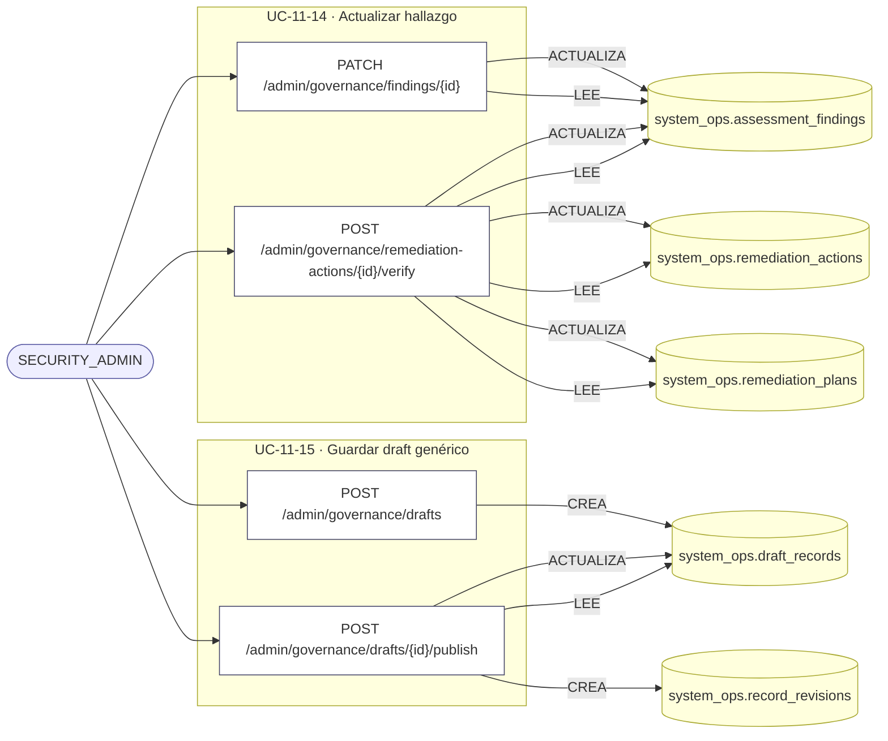

## Árbol de decisión por operación

Cada árbol se deriva del código del handler y de los métodos que invoca (hasta 4 niveles). Una rama que no decide, no escribe y no falla se poda. Los accesos y los efectos consecutivos se agrupan en un solo nodo.

### Operaciones con decisiones propias

#### 1. POST /admin/governance/anonymization-rules

Definir una regla de anonimización

| HTTP | Código | Cuándo |
|---|---|---|
| 201 | — | Éxito |
| 400 | `VALIDATION_FAILED` | El cuerpo cumple el DTO (sin propiedades extra) |
| 401 | `UNAUTHENTICATED` | Hay una sesión válida (JWT) |
| 403 | `FORBIDDEN` | El rol está permitido; El tenant se resuelve y pertenece al actor |
| 409 | `CONFLICT` | ConflictException: Ya existe una regla de anonimización con ese code |
| 429 | `RATE_LIMITED` | No se supera el límite de solicitudes |

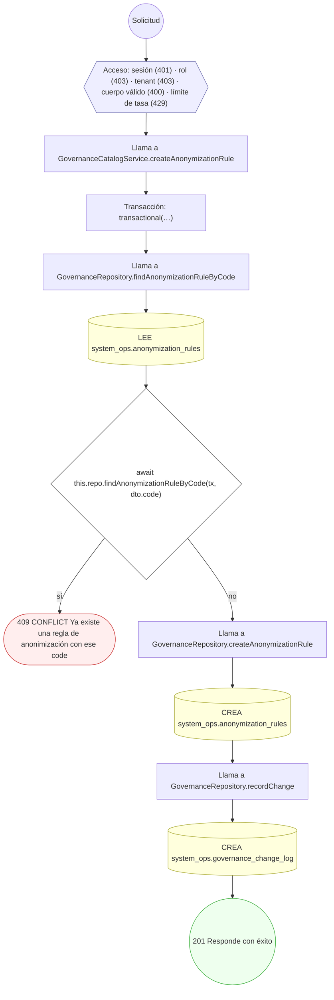

#### 2. POST /admin/governance/assessments/{id}/findings

Abrir un hallazgo sobre una evaluación

| HTTP | Código | Cuándo |
|---|---|---|
| 201 | — | Éxito |
| 400 | `VALIDATION_FAILED` | Los parámetros de ruta son UUID válidos; El cuerpo cumple el DTO (sin propiedades extra) |
| 401 | `UNAUTHENTICATED` | Hay una sesión válida (JWT) |
| 403 | `FORBIDDEN` | El rol está permitido; El tenant se resuelve y pertenece al actor |
| 404 | `NOT_FOUND` | ResourceNotFoundException: Evaluación no encontrada |
| 409 | `CONFLICT` | ConflictException: Ya existe un hallazgo con ese finding_code |
| 429 | `RATE_LIMITED` | No se supera el límite de solicitudes |

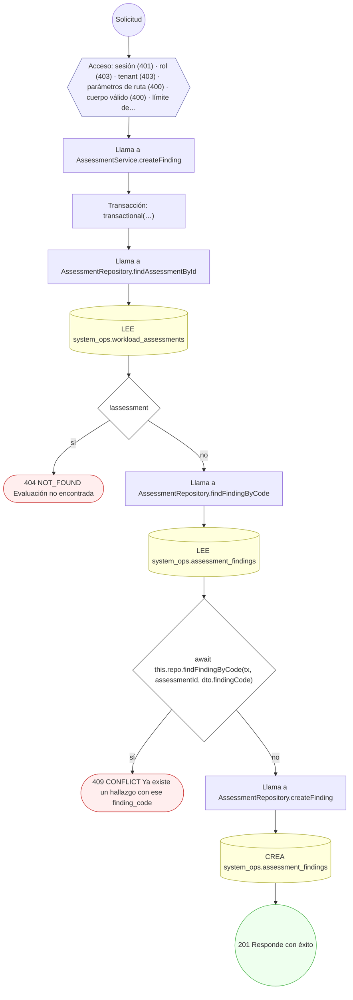

#### 3. POST /admin/governance/assessments/{id}/remediation-plans

Crear un plan de remediación con sus acciones

| HTTP | Código | Cuándo |
|---|---|---|
| 201 | — | Éxito |
| 400 | `VALIDATION_FAILED` | Los parámetros de ruta son UUID válidos; El cuerpo cumple el DTO (sin propiedades extra) |
| 401 | `UNAUTHENTICATED` | Hay una sesión válida (JWT) |
| 403 | `FORBIDDEN` | El rol está permitido; El tenant se resuelve y pertenece al actor |
| 404 | `NOT_FOUND` | ResourceNotFoundException: Evaluación no encontrada; ResourceNotFoundException: Hallazgo no encontrado |
| 409 | `CONFLICT` | ConflictException: Ya existe un plan con ese code para el tenant |
| 429 | `RATE_LIMITED` | No se supera el límite de solicitudes |

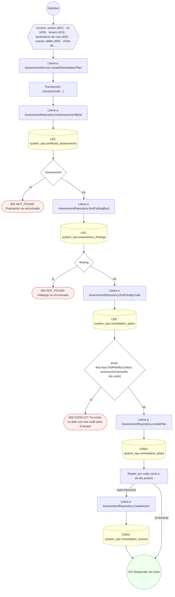

#### 4. POST /admin/governance/cross-border-transfers

Registrar una transferencia transfronteriza (append-only)

| HTTP | Código | Cuándo |
|---|---|---|
| 201 | — | Éxito |
| 400 | `VALIDATION_FAILED` | El cuerpo cumple el DTO (sin propiedades extra) |
| 401 | `UNAUTHENTICATED` | Hay una sesión válida (JWT) |
| 403 | `FORBIDDEN` | El rol está permitido; El tenant se resuelve y pertenece al actor |
| 409 | `CONFLICT` | ConflictException: La referencia de transferencia ya fue registrada |
| 429 | `RATE_LIMITED` | No se supera el límite de solicitudes |

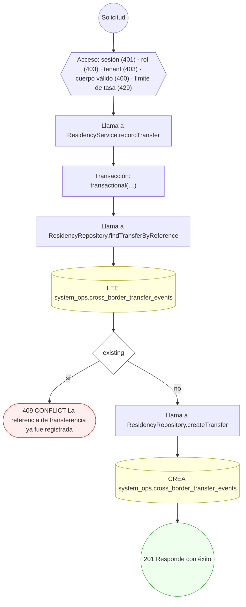

#### 5. POST /admin/governance/drafts/{id}/publish

Publicar un draft record y materializarlo

| HTTP | Código | Cuándo |
|---|---|---|
| 200 | — | Éxito |
| 400 | `VALIDATION_FAILED` | Los parámetros de ruta son UUID válidos; El cuerpo cumple el DTO (sin propiedades extra) |
| 401 | `UNAUTHENTICATED` | Hay una sesión válida (JWT) |
| 403 | `FORBIDDEN` | El rol está permitido; El tenant se resuelve y pertenece al actor |
| 404 | `NOT_FOUND` | ResourceNotFoundException: Borrador no encontrado |
| 422 | `PRECONDITION_FAILED` | PreconditionFailedException: Solo el dueño del borrador puede publicarlo; PreconditionFailedException: El borrador no está en estado DRAFT |
| 429 | `RATE_LIMITED` | No se supera el límite de solicitudes |


#### 6. POST /admin/governance/entity-registry

Registrar dominio, clasificación y catalogar entidad + campos

| HTTP | Código | Cuándo |
|---|---|---|
| 201 | — | Éxito |
| 400 | `VALIDATION_FAILED` | El cuerpo cumple el DTO (sin propiedades extra) |
| 401 | `UNAUTHENTICATED` | Hay una sesión válida (JWT) |
| 403 | `FORBIDDEN` | El rol está permitido; El tenant se resuelve y pertenece al actor |
| 429 | `RATE_LIMITED` | No se supera el límite de solicitudes |

```mermaid
flowchart TD
  n1(("Solicitud")):::inicio
  n2{{"Acceso: sesión (401) · rol (403) · tenant (403) · cuerpo válido (400) · límite de tasa (429)"}}:::acceso
  n1 --> n2
  n3["Llama a GovernanceCatalogService.catalogEntity"]:::llamada
  n2 --> n3
  n4["Transacción: transactional(…)"]:::transaccion
  n3 --> n4
  n5["Llama a GovernanceRepository.findDomainByCode"]:::llamada
  n4 --> n5
  n6[("LEE system_ops.data_domains")]:::efecto
  n5 --> n6
  n7{"!domain"}:::decision
  n6 --> n7
  n8["Llama a GovernanceRepository.createDomain"]:::llamada
  n7 -->|"sí"| n8
  n9[("CREA system_ops.data_domains")]:::efecto
  n8 --> n9
  n10["Llama a GovernanceRepository.findClassificationByCode"]:::llamada
  n9 --> n10
  n7 -->|"no"| n10
  n11[("LEE system_ops.data_classifications")]:::efecto
  n10 --> n11
  n12{"!classification"}:::decision
  n11 --> n12
  n13["Llama a GovernanceRepository.createClassification"]:::llamada
  n12 -->|"sí"| n13
  n14[("CREA system_ops.data_classifications")]:::efecto
  n13 --> n14
  n15["Llama a GovernanceRepository.createEntity"]:::llamada
  n14 --> n15
  n12 -->|"no"| n15
  n16[("CREA system_ops.entity_registry")]:::efecto
  n15 --> n16
  n17["Repite: por cada const f de dto.fields"]:::bucle
  n16 --> n17
  n18["Llama a GovernanceRepository.createField"]:::llamada
  n17 -->|"cada elemento"| n18
  n19[("CREA system_ops.field_registry")]:::efecto
  n18 --> n19
  n20["Llama a GovernanceRepository.recordChange"]:::llamada
  n19 --> n20
  n17 -->|"al terminar"| n20
  n21[("CREA system_ops.governance_change_log")]:::efecto
  n20 --> n21
  n22(("201 Responde con éxito")):::ok
  n21 --> n22
  classDef acceso fill:#eef,stroke:#66a
  classDef error fill:#fee,stroke:#c33
  classDef ok fill:#efe,stroke:#3a3
  classDef efecto fill:#ffd,stroke:#aa3
  classDef decision fill:#fff,stroke:#555
  classDef corte fill:#eee,stroke:#999,stroke-dasharray: 4
```

#### 7. PATCH /admin/governance/entity-registry/{id}/retention

Aplicar una política de retención a una entidad

| HTTP | Código | Cuándo |
|---|---|---|
| 200 | — | Éxito |
| 400 | `VALIDATION_FAILED` | Los parámetros de ruta son UUID válidos; El cuerpo cumple el DTO (sin propiedades extra) |
| 401 | `UNAUTHENTICATED` | Hay una sesión válida (JWT) |
| 403 | `FORBIDDEN` | El rol está permitido; El tenant se resuelve y pertenece al actor |
| 404 | `NOT_FOUND` | ResourceNotFoundException: Entidad no encontrada; ResourceNotFoundException: Política de retención no encontrada |
| 429 | `RATE_LIMITED` | No se supera el límite de solicitudes |


#### 8. PATCH /admin/governance/entity-registry/{id}/write-policy

Vincular una política de escritura a una entidad

| HTTP | Código | Cuándo |
|---|---|---|
| 200 | — | Éxito |
| 400 | `VALIDATION_FAILED` | Los parámetros de ruta son UUID válidos; El cuerpo cumple el DTO (sin propiedades extra) |
| 401 | `UNAUTHENTICATED` | Hay una sesión válida (JWT) |
| 403 | `FORBIDDEN` | El rol está permitido; El tenant se resuelve y pertenece al actor |
| 404 | `NOT_FOUND` | ResourceNotFoundException: Entidad no encontrada; ResourceNotFoundException: Política de escritura no encontrada |
| 429 | `RATE_LIMITED` | No se supera el límite de solicitudes |


#### 9. PATCH /admin/governance/field-registry/{id}

Asignar regla de anonimización / masking a un campo

| HTTP | Código | Cuándo |
|---|---|---|
| 200 | — | Éxito |
| 400 | `VALIDATION_FAILED` | Los parámetros de ruta son UUID válidos; El cuerpo cumple el DTO (sin propiedades extra) |
| 401 | `UNAUTHENTICATED` | Hay una sesión válida (JWT) |
| 403 | `FORBIDDEN` | El rol está permitido; El tenant se resuelve y pertenece al actor |
| 404 | `NOT_FOUND` | ResourceNotFoundException: Campo no encontrado |
| 429 | `RATE_LIMITED` | No se supera el límite de solicitudes |

```mermaid
flowchart TD
  n1(("Solicitud")):::inicio
  n2{{"Acceso: sesión (401) · rol (403) · tenant (403) · parámetros de ruta (400) · cuerpo válido (400) · límite de…"}}:::acceso
  n1 --> n2
  n3["Llama a GovernanceCatalogService.updateField"]:::llamada
  n2 --> n3
  n4["Transacción: transactional(…)"]:::transaccion
  n3 --> n4
  n5["Llama a GovernanceRepository.findFieldById"]:::llamada
  n4 --> n5
  n6[("LEE system_ops.field_registry")]:::efecto
  n5 --> n6
  n7{"!field"}:::decision
  n6 --> n7
  n8(["404 NOT_FOUND Campo no encontrado"]):::error
  n7 -->|"sí"| n8
  n9{"dto.anonymizationRuleId !== undefined"}:::decision
  n7 -->|"no"| n9
  n10[("ACTUALIZA system_ops.field_registry")]:::efecto
  n9 -->|"sí"| n10
  n11{"dto.maskingStrategyConceptId !== undefined"}:::decision
  n10 --> n11
  n9 -->|"no"| n11
  n12[("ACTUALIZA system_ops.field_registry")]:::efecto
  n11 -->|"sí"| n12
  n13[("ACTUALIZA system_ops.field_registry")]:::efecto
  n12 --> n13
  n11 -->|"no"| n13
  n14{"dto.isPii !== undefined"}:::decision
  n13 --> n14
  n15[("ACTUALIZA system_ops.field_registry")]:::efecto
  n14 -->|"sí"| n15
  n16[("ACTUALIZA system_ops.field_registry")]:::efecto
  n15 --> n16
  n14 -->|"no"| n16
  n17{"dto.isPhi !== undefined"}:::decision
  n16 --> n17
  n18[("ACTUALIZA system_ops.field_registry")]:::efecto
  n17 -->|"sí"| n18
  n19["Llama a GovernanceRepository.recordChange"]:::llamada
  n18 --> n19
  n17 -->|"no"| n19
  n20[("CREA system_ops.governance_change_log")]:::efecto
  n19 --> n20
  n21(("200 Responde con éxito")):::ok
  n20 --> n21
  classDef acceso fill:#eef,stroke:#66a
  classDef error fill:#fee,stroke:#c33
  classDef ok fill:#efe,stroke:#3a3
  classDef efecto fill:#ffd,stroke:#aa3
  classDef decision fill:#fff,stroke:#555
  classDef corte fill:#eee,stroke:#999,stroke-dasharray: 4
```

#### 10. PATCH /admin/governance/findings/{id}

Actualizar un hallazgo (estado / owner)

| HTTP | Código | Cuándo |
|---|---|---|
| 200 | — | Éxito |
| 400 | `VALIDATION_FAILED` | Los parámetros de ruta son UUID válidos; El cuerpo cumple el DTO (sin propiedades extra) |
| 401 | `UNAUTHENTICATED` | Hay una sesión válida (JWT) |
| 403 | `FORBIDDEN` | El rol está permitido; El tenant se resuelve y pertenece al actor |
| 404 | `NOT_FOUND` | ResourceNotFoundException: Hallazgo no encontrado |
| 429 | `RATE_LIMITED` | No se supera el límite de solicitudes |


#### 11. POST /admin/governance/legal-holds

Colocar un legal hold sobre un objetivo

| HTTP | Código | Cuándo |
|---|---|---|
| 201 | — | Éxito |
| 400 | `VALIDATION_FAILED` | El cuerpo cumple el DTO (sin propiedades extra) |
| 401 | `UNAUTHENTICATED` | Hay una sesión válida (JWT) |
| 403 | `FORBIDDEN` | El rol está permitido; El tenant se resuelve y pertenece al actor |
| 409 | `CONFLICT` | ConflictException: Ya existe un legal hold ACTIVE para ese objetivo |
| 429 | `RATE_LIMITED` | No se supera el límite de solicitudes |

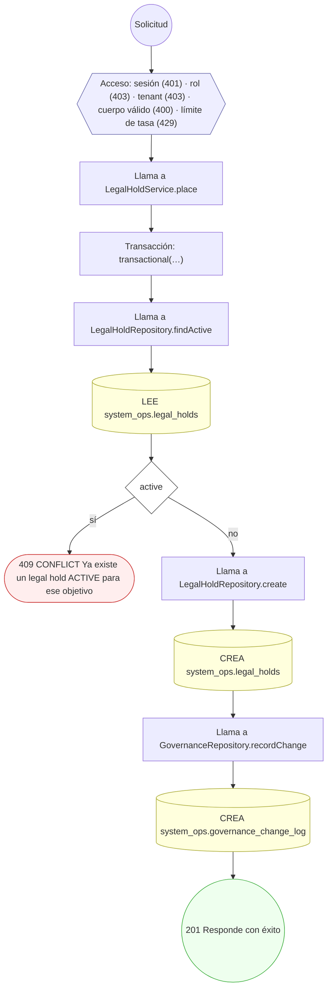

#### 12. POST /admin/governance/legal-holds/{id}/release

Levantar un legal hold ACTIVE

| HTTP | Código | Cuándo |
|---|---|---|
| 200 | — | Éxito |
| 400 | `VALIDATION_FAILED` | Los parámetros de ruta son UUID válidos; El cuerpo cumple el DTO (sin propiedades extra) |
| 401 | `UNAUTHENTICATED` | Hay una sesión válida (JWT) |
| 403 | `FORBIDDEN` | El rol está permitido; El tenant se resuelve y pertenece al actor |
| 404 | `NOT_FOUND` | ResourceNotFoundException: Legal hold no encontrado |
| 422 | `PRECONDITION_FAILED` | PreconditionFailedException: El legal hold no está ACTIVE |
| 429 | `RATE_LIMITED` | No se supera el límite de solicitudes |

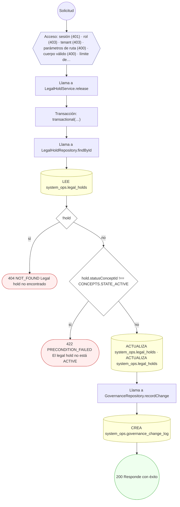

#### 13. POST /admin/governance/operational-frameworks

Publicar un framework operativo con sus controles

| HTTP | Código | Cuándo |
|---|---|---|
| 201 | — | Éxito |
| 400 | `VALIDATION_FAILED` | El cuerpo cumple el DTO (sin propiedades extra) |
| 401 | `UNAUTHENTICATED` | Hay una sesión válida (JWT) |
| 403 | `FORBIDDEN` | El rol está permitido; El tenant se resuelve y pertenece al actor |
| 409 | `CONFLICT` | ConflictException: Ya existe un framework con ese code+version |
| 422 | `PRECONDITION_FAILED` | PreconditionFailedException: parentControlCode no existe en el framework |
| 429 | `RATE_LIMITED` | No se supera el límite de solicitudes |


#### 14. POST /admin/governance/remediation-actions/{id}/verify

Verificar y cerrar una acción de remediación

| HTTP | Código | Cuándo |
|---|---|---|
| 200 | — | Éxito |
| 400 | `VALIDATION_FAILED` | Los parámetros de ruta son UUID válidos; El cuerpo cumple el DTO (sin propiedades extra) |
| 401 | `UNAUTHENTICATED` | Hay una sesión válida (JWT) |
| 403 | `FORBIDDEN` | El rol está permitido; El tenant se resuelve y pertenece al actor |
| 404 | `NOT_FOUND` | ResourceNotFoundException: Acción de remediación no encontrada |
| 422 | `PRECONDITION_FAILED` | PreconditionFailedException: La acción ya está verificada; PreconditionFailedException: El verificador no puede ser el asignado |
| 429 | `RATE_LIMITED` | No se supera el límite de solicitudes |

```mermaid
flowchart TD
  n1(("Solicitud")):::inicio
  n2{{"Acceso: sesión (401) · rol (403) · tenant (403) · parámetros de ruta (400) · cuerpo válido (400) · límite de…"}}:::acceso
  n1 --> n2
  n3["Llama a AssessmentService.verifyAction"]:::llamada
  n2 --> n3
  n4["Transacción: transactional(…)"]:::transaccion
  n3 --> n4
  n5["Llama a AssessmentRepository.findActionById"]:::llamada
  n4 --> n5
  n6[("LEE system_ops.remediation_actions")]:::efecto
  n5 --> n6
  n7{"!action"}:::decision
  n6 --> n7
  n8(["404 NOT_FOUND Acción de remediación no encontrada"]):::error
  n7 -->|"sí"| n8
  n9{"action.statusConceptId === SYSOPS.ACTION_VERIFIED"}:::decision
  n7 -->|"no"| n9
  n10(["422 PRECONDITION_FAILED La acción ya está verificada"]):::error
  n9 -->|"sí"| n10
  n11{"action.assignedUserId && action.assignedUserId === actor.id"}:::decision
  n9 -->|"no"| n11
  n12(["422 PRECONDITION_FAILED El verificador no puede ser el asignado"]):::error
  n11 -->|"sí"| n12
  n13[("ACTUALIZA system_ops.remediation_actions · ACTUALIZA system_ops.remediation_actions · ACTUALIZA system_ops.re…")]:::efecto
  n11 -->|"no"| n13
  n14["Llama a AssessmentRepository.countFindingActionsNotIn"]:::llamada
  n13 --> n14
  n15[("LEE system_ops.remediation_actions")]:::efecto
  n14 --> n15
  n16{"openFindingActions === 0"}:::decision
  n15 --> n16
  n17["Llama a AssessmentRepository.findFindingById"]:::llamada
  n16 -->|"sí"| n17
  n18[("LEE system_ops.assessment_findings")]:::efecto
  n17 --> n18
  n19{"finding && finding.statusConceptId !== SYSOPS.FINDING_CLOSED"}:::decision
  n18 --> n19
  n20[("ACTUALIZA system_ops.assessment_findings · ACTUALIZA system_ops.assessment_findings")]:::efecto
  n19 -->|"sí"| n20
  n21["Llama a AssessmentRepository.countActionsNotIn"]:::llamada
  n20 --> n21
  n19 -->|"no"| n21
  n16 -->|"no"| n21
  n22[("LEE system_ops.remediation_actions")]:::efecto
  n21 --> n22
  n23{"openPlanActions === 0"}:::decision
  n22 --> n23
  n24["Llama a AssessmentRepository.findPlanById"]:::llamada
  n23 -->|"sí"| n24
  n25[("LEE system_ops.remediation_plans")]:::efecto
  n24 --> n25
  n26{"plan && plan.statusConceptId !== SYSOPS.PLAN_COMPLETED"}:::decision
  n25 --> n26
  n27[("ACTUALIZA system_ops.remediation_plans · ACTUALIZA system_ops.remediation_plans · ACTUALIZA system_ops.remedi…")]:::efecto
  n26 -->|"sí"| n27
  n28(("200 Responde con éxito")):::ok
  n27 --> n28
  n26 -->|"no"| n28
  n23 -->|"no"| n28
  classDef acceso fill:#eef,stroke:#66a
  classDef error fill:#fee,stroke:#c33
  classDef ok fill:#efe,stroke:#3a3
  classDef efecto fill:#ffd,stroke:#aa3
  classDef decision fill:#fff,stroke:#555
  classDef corte fill:#eee,stroke:#999,stroke-dasharray: 4
```

#### 15. POST /admin/governance/residency-policies

Definir una política de residencia de datos

| HTTP | Código | Cuándo |
|---|---|---|
| 201 | — | Éxito |
| 400 | `VALIDATION_FAILED` | El cuerpo cumple el DTO (sin propiedades extra) |
| 401 | `UNAUTHENTICATED` | Hay una sesión válida (JWT) |
| 403 | `FORBIDDEN` | El rol está permitido; El tenant se resuelve y pertenece al actor |
| 409 | `CONFLICT` | ConflictException: Ya existe una política de residencia con ese code |
| 429 | `RATE_LIMITED` | No se supera el límite de solicitudes |

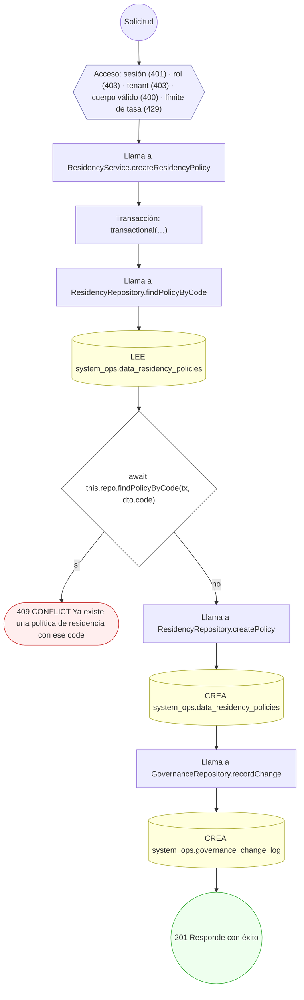

#### 16. POST /admin/governance/retention-policies

Definir una política de retención con base legal

| HTTP | Código | Cuándo |
|---|---|---|
| 201 | — | Éxito |
| 400 | `VALIDATION_FAILED` | El cuerpo cumple el DTO (sin propiedades extra) |
| 401 | `UNAUTHENTICATED` | Hay una sesión válida (JWT) |
| 403 | `FORBIDDEN` | El rol está permitido; El tenant se resuelve y pertenece al actor |
| 409 | `CONFLICT` | ConflictException: Ya existe una política de retención con ese code |
| 429 | `RATE_LIMITED` | No se supera el límite de solicitudes |

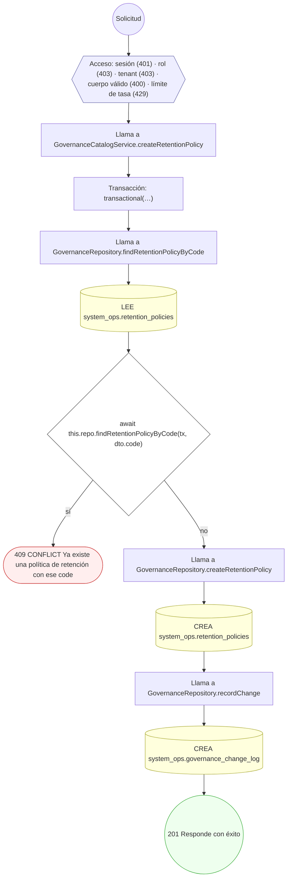

#### 17. POST /admin/governance/workload-assessments

Iniciar una evaluación de workload

| HTTP | Código | Cuándo |
|---|---|---|
| 201 | — | Éxito |
| 400 | `VALIDATION_FAILED` | El cuerpo cumple el DTO (sin propiedades extra) |
| 401 | `UNAUTHENTICATED` | Hay una sesión válida (JWT) |
| 403 | `FORBIDDEN` | El rol está permitido; El tenant se resuelve y pertenece al actor |
| 404 | `NOT_FOUND` | ResourceNotFoundException: Framework no encontrado |
| 422 | `PRECONDITION_FAILED` | PreconditionFailedException: El framework no está publicado (ACTIVE) |
| 429 | `RATE_LIMITED` | No se supera el límite de solicitudes |

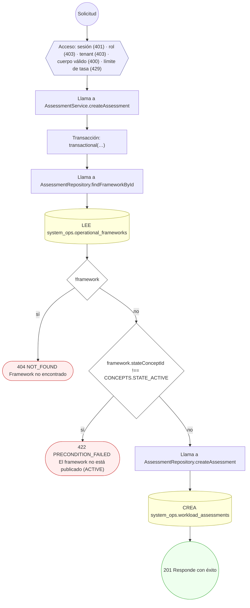

#### 18. PUT /admin/governance/workload-assessments/{id}/control-results

Registrar (UPSERT) resultados de control de una evaluación

| HTTP | Código | Cuándo |
|---|---|---|
| 200 | — | Éxito |
| 400 | `VALIDATION_FAILED` | Los parámetros de ruta son UUID válidos; El cuerpo cumple el DTO (sin propiedades extra) |
| 401 | `UNAUTHENTICATED` | Hay una sesión válida (JWT) |
| 403 | `FORBIDDEN` | El rol está permitido; El tenant se resuelve y pertenece al actor |
| 404 | `NOT_FOUND` | ResourceNotFoundException: Evaluación no encontrada |
| 429 | `RATE_LIMITED` | No se supera el límite de solicitudes |

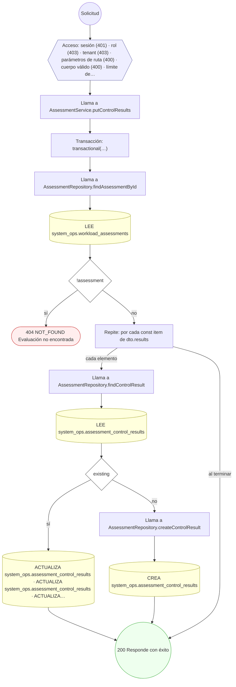

#### 19. POST /admin/governance/write-policies

Definir una política de escritura

| HTTP | Código | Cuándo |
|---|---|---|
| 201 | — | Éxito |
| 400 | `VALIDATION_FAILED` | El cuerpo cumple el DTO (sin propiedades extra) |
| 401 | `UNAUTHENTICATED` | Hay una sesión válida (JWT) |
| 403 | `FORBIDDEN` | El rol está permitido; El tenant se resuelve y pertenece al actor |
| 409 | `CONFLICT` | ConflictException: Ya existe una política de escritura con ese code |
| 429 | `RATE_LIMITED` | No se supera el límite de solicitudes |

```mermaid
flowchart TD
  n1(("Solicitud")):::inicio
  n2{{"Acceso: sesión (401) · rol (403) · tenant (403) · cuerpo válido (400) · límite de tasa (429)"}}:::acceso
  n1 --> n2
  n3["Llama a GovernanceCatalogService.createWritePolicy"]:::llamada
  n2 --> n3
  n4["Transacción: transactional(…)"]:::transaccion
  n3 --> n4
  n5["Llama a GovernanceRepository.findWritePolicyByCode"]:::llamada
  n4 --> n5
  n6[("LEE system_ops.write_policies")]:::efecto
  n5 --> n6
  n7{"await this.repo.findWritePolicyByCode(tx, dto.code)"}:::decision
  n6 --> n7
  n8(["409 CONFLICT Ya existe una política de escritura con ese code"]):::error
  n7 -->|"sí"| n8
  n9["Llama a GovernanceRepository.createWritePolicy"]:::llamada
  n7 -->|"no"| n9
  n10[("CREA system_ops.write_policies")]:::efecto
  n9 --> n10
  n11["Llama a GovernanceRepository.recordChange"]:::llamada
  n10 --> n11
  n12[("CREA system_ops.governance_change_log")]:::efecto
  n11 --> n12
  n13(("201 Responde con éxito")):::ok
  n12 --> n13
  classDef acceso fill:#eef,stroke:#66a
  classDef error fill:#fee,stroke:#c33
  classDef ok fill:#efe,stroke:#3a3
  classDef efecto fill:#ffd,stroke:#aa3
  classDef decision fill:#fff,stroke:#555
  classDef corte fill:#eee,stroke:#999,stroke-dasharray: 4
```

#### 20. POST /admin/ops/backup-policies

Definir una política de backup (RPO/RTO/inmutabilidad)

| HTTP | Código | Cuándo |
|---|---|---|
| 201 | — | Éxito |
| 400 | `VALIDATION_FAILED` | El cuerpo cumple el DTO (sin propiedades extra) |
| 401 | `UNAUTHENTICATED` | Hay una sesión válida (JWT) |
| 403 | `FORBIDDEN` | El rol está permitido; El tenant se resuelve y pertenece al actor |
| 422 | `PRECONDITION_FAILED` | PreconditionFailedException: El RPO no puede superar al RTO |
| 429 | `RATE_LIMITED` | No se supera el límite de solicitudes |

```mermaid
flowchart TD
  n1(("Solicitud")):::inicio
  n2{{"Acceso: sesión (401) · rol (403) · tenant (403) · cuerpo válido (400) · límite de tasa (429)"}}:::acceso
  n1 --> n2
  n3["Llama a BackupService.createPolicy"]:::llamada
  n2 --> n3
  n4{"dto.rpoSeconds › dto.rtoSeconds"}:::decision
  n3 --> n4
  n5(["422 PRECONDITION_FAILED El RPO no puede superar al RTO"]):::error
  n4 -->|"sí"| n5
  n6["Transacción: transactional(…)"]:::transaccion
  n4 -->|"no"| n6
  n7["Llama a BackupRepository.createPolicy"]:::llamada
  n6 --> n7
  n8[("CREA system_ops.backup_policies")]:::efecto
  n7 --> n8
  n9(("201 Responde con éxito")):::ok
  n8 --> n9
  classDef acceso fill:#eef,stroke:#66a
  classDef error fill:#fee,stroke:#c33
  classDef ok fill:#efe,stroke:#3a3
  classDef efecto fill:#ffd,stroke:#aa3
  classDef decision fill:#fff,stroke:#555
  classDef corte fill:#eee,stroke:#999,stroke-dasharray: 4
```

#### 21. POST /internal/governance/retention-executions/run

Ejecutar un barrido de retención (excluye objetivos bajo legal hold)

| HTTP | Código | Cuándo |
|---|---|---|
| 200 | — | Éxito |
| 400 | `VALIDATION_FAILED` | El cuerpo cumple el DTO (sin propiedades extra) |
| 401 | `UNAUTHENTICATED` | Hay una sesión válida (JWT) |
| 403 | `FORBIDDEN` | El rol está permitido; El tenant se resuelve y pertenece al actor |
| 404 | `NOT_FOUND` | ResourceNotFoundException: Política de retención no encontrada; ResourceNotFoundException: Entidad objetivo no encontrada |
| 422 | `PRECONDITION_FAILED` | PreconditionFailedException: La política de retención no está ACTIVE |
| 429 | `RATE_LIMITED` | No se supera el límite de solicitudes |

```mermaid
flowchart TD
  n1(("Solicitud")):::inicio
  n2{{"Acceso: sesión (401) · rol (403) · tenant (403) · cuerpo válido (400) · límite de tasa (429)"}}:::acceso
  n1 --> n2
  n3["Llama a RetentionExecutionService.run"]:::llamada
  n2 --> n3
  n4["Transacción: transactional(…)"]:::transaccion
  n3 --> n4
  n5["Llama a GovernanceRepository.findRetentionPolicyById"]:::llamada
  n4 --> n5
  n6[("LEE system_ops.retention_policies")]:::efecto
  n5 --> n6
  n7{"!policy"}:::decision
  n6 --> n7
  n8(["404 NOT_FOUND Política de retención no encontrada"]):::error
  n7 -->|"sí"| n8
  n9{"policy.stateConceptId !== CONCEPTS.STATE_ACTIVE"}:::decision
  n7 -->|"no"| n9
  n10(["422 PRECONDITION_FAILED La política de retención no está ACTIVE"]):::error
  n9 -->|"sí"| n10
  n11["Llama a GovernanceRepository.findEntityById"]:::llamada
  n9 -->|"no"| n11
  n12[("LEE system_ops.entity_registry")]:::efecto
  n11 --> n12
  n13{"!entity"}:::decision
  n12 --> n13
  n14(["404 NOT_FOUND Entidad objetivo no encontrada"]):::error
  n13 -->|"sí"| n14
  n15["Llama a RetentionExecutionRepository.createExecution"]:::llamada
  n13 -->|"no"| n15
  n16[("CREA system_ops.retention_executions")]:::efecto
  n15 --> n16
  n17["Llama a RetentionExecutionRepository.countActiveHoldsForTarget"]:::llamada
  n16 --> n17
  n18[("LEE system_ops.legal_holds")]:::efecto
  n17 --> n18
  n19{"activeHolds › 0"}:::decision
  n18 --> n19
  n20[("ACTUALIZA system_ops.retention_executions · ACTUALIZA system_ops.retention_executions · ACTUALIZA system_ops.…")]:::efecto
  n19 -->|"sí"| n20
  n21["Llama a RetentionExecutionRepository.createRevision"]:::llamada
  n20 --> n21
  n19 -->|"no"| n21
  n22[("CREA system_ops.record_revisions")]:::efecto
  n21 --> n22
  n23[("ACTUALIZA system_ops.retention_executions · ACTUALIZA system_ops.retention_executions · ACTUALIZA system_ops.…")]:::efecto
  n22 --> n23
  n24(("200 Responde con éxito")):::ok
  n23 --> n24
  classDef acceso fill:#eef,stroke:#66a
  classDef error fill:#fee,stroke:#c33
  classDef ok fill:#efe,stroke:#3a3
  classDef efecto fill:#ffd,stroke:#aa3
  classDef decision fill:#fff,stroke:#555
  classDef corte fill:#eee,stroke:#999,stroke-dasharray: 4
```

#### 22. POST /internal/ops/restore-test-runs

Registrar una prueba de restauración con evidencia

| HTTP | Código | Cuándo |
|---|---|---|
| 201 | — | Éxito |
| 400 | `VALIDATION_FAILED` | El cuerpo cumple el DTO (sin propiedades extra) |
| 401 | `UNAUTHENTICATED` | Hay una sesión válida (JWT) |
| 403 | `FORBIDDEN` | El rol está permitido; El tenant se resuelve y pertenece al actor |
| 404 | `NOT_FOUND` | ResourceNotFoundException: Política de backup no encontrada |
| 422 | `PRECONDITION_FAILED` | PreconditionFailedException: La política de backup no está ACTIVE |
| 429 | `RATE_LIMITED` | No se supera el límite de solicitudes |

```mermaid
flowchart TD
  n1(("Solicitud")):::inicio
  n2{{"Acceso: sesión (401) · rol (403) · tenant (403) · cuerpo válido (400) · límite de tasa (429)"}}:::acceso
  n1 --> n2
  n3["Llama a BackupService.recordRestoreTest"]:::llamada
  n2 --> n3
  n4["Transacción: transactional(…)"]:::transaccion
  n3 --> n4
  n5["Llama a BackupRepository.findPolicyById"]:::llamada
  n4 --> n5
  n6[("LEE system_ops.backup_policies")]:::efecto
  n5 --> n6
  n7{"!policy"}:::decision
  n6 --> n7
  n8(["404 NOT_FOUND Política de backup no encontrada"]):::error
  n7 -->|"sí"| n8
  n9{"policy.statusConceptId !== CONCEPTS.STATE_ACTIVE"}:::decision
  n7 -->|"no"| n9
  n10(["422 PRECONDITION_FAILED La política de backup no está ACTIVE"]):::error
  n9 -->|"sí"| n10
  n11["Llama a BackupRepository.createTestRun"]:::llamada
  n9 -->|"no"| n11
  n12[("CREA system_ops.restore_test_runs")]:::efecto
  n11 --> n12
  n13(("201 Responde con éxito")):::ok
  n12 --> n13
  classDef acceso fill:#eef,stroke:#66a
  classDef error fill:#fee,stroke:#c33
  classDef ok fill:#efe,stroke:#3a3
  classDef efecto fill:#ffd,stroke:#aa3
  classDef decision fill:#fff,stroke:#555
  classDef corte fill:#eee,stroke:#999,stroke-dasharray: 4
```

### Operaciones sin decisiones propias

Sólo comprueban el acceso y leen o escriben: no tienen ramas que dibujar. Su detalle está en la ficha de endpoints.

| Operación | Respuestas posibles | Tablas |
|---|---|---|
| POST /admin/governance/drafts | 201, 400, 401, 403, 429 | 1 |
| POST /admin/governance/tenant-residency-bindings | 201, 400, 401, 403, 429 | 1 |
