<!-- AUTOGENERADO por tools/inventario/flujos.mjs. No editar manualmente. -->

# Flujos del módulo `system_ops`

- **Procesos:** 1 · **Máquinas de estado:** 0
- **Operaciones:** 35 (31 con decisiones propias, 4 sin ellas)
- Inventario de endpoints del módulo: [system_ops](../endpoints/system_ops.md)

## Proceso: Módulo `system_ops` (11) — Data Governance & System Operations

- **Código:** `system_ops` · **Agrupación:** MIXTO · **Operaciones:** 35
- **Actores:** AUDITOR · DATA_GOVERNANCE_ADMIN · DATA_PLATFORM_ADMIN · DATA_STEWARD · DPO · GOVERNANCE_ADMIN · PLATFORM_ADMIN · SECURITY_ADMIN
- **Revisión:** AUTO_DETECTADA
- **Fuentes:** `src/modules/system_ops/README.md`

### Para qué sirve

Gobierno de datos y operaciones de sistema: catálogo de entidades/campos, políticas (escritura, retención, anonimización, residencia, backup), transferencias transfronterizas, legal holds, barridos de retención, frameworks/evaluaciones/ remediación y publicación de drafts genéricos.

_Fuente: `src/modules/system_ops/README.md:3`_

### Etapas y operaciones

| Etapa | Descripción | Operación | Quién actúa | Riesgo | Tablas |
|---|---|---|---|---|---|
| `UC-11-01` | Registrar dominio, clasificación y catalogar entidad + campos | POST /admin/governance/entity-registry | SECURITY_ADMIN | MEDIO | 7 |
| `UC-11-02` | Vincular política de escritura a una entidad | PATCH /admin/governance/entity-registry/{id}/write-policy | SECURITY_ADMIN | MEDIO | 4 |
|  |  | POST /admin/governance/write-policies | SECURITY_ADMIN | MEDIO | 3 |
| `UC-11-03` | Aplicar retención a una entidad (razón obligatoria) | PATCH /admin/governance/entity-registry/{id}/retention | SECURITY_ADMIN | MEDIO | 4 |
|  |  | POST /admin/governance/retention-policies | SECURITY_ADMIN | MEDIO | 3 |
| `UC-11-04` | Definir regla de anonimización | POST /admin/governance/anonymization-rules | SECURITY_ADMIN | MEDIO | 3 |
|  |  | PATCH /admin/governance/field-registry/{id} | SECURITY_ADMIN | MEDIO | 3 |
| `UC-11-05` | Ejecutar barrido de retención (excluye objetivos bajo legal hold) | POST /internal/governance/retention-executions/run | SECURITY_ADMIN | ALTO | 38 |
| `UC-11-06` | Definir política de residencia | POST /admin/governance/residency-policies | SECURITY_ADMIN | MEDIO | 3 |
|  |  | POST /admin/governance/tenant-residency-bindings | SECURITY_ADMIN | MEDIO | 4 |
| `UC-11-07` | Registrar transferencia transfronteriza (append-only) | POST /admin/governance/cross-border-transfers | SECURITY_ADMIN | MEDIO | 2 |
| `UC-11-08` | Colocar legal hold | POST /admin/governance/legal-holds | SECURITY_ADMIN | MEDIO | 3 |
|  |  | POST /admin/governance/legal-holds/{id}/release | SECURITY_ADMIN | MEDIO | 3 |
| `UC-11-09` | Definir política de backup (RPO/RTO/inmutabilidad) | POST /admin/ops/backup-policies | SECURITY_ADMIN | MEDIO | 1 |
| `UC-11-10` | Registrar prueba de restauración con evidencia | POST /internal/ops/restore-test-runs | SECURITY_ADMIN | MEDIO | 2 |
| `UC-11-11` | Publicar framework con controles (jerárquicos) | POST /admin/governance/operational-frameworks | SECURITY_ADMIN | MEDIO | 3 |
| `UC-11-12` | Iniciar evaluación de workload | POST /admin/governance/workload-assessments | SECURITY_ADMIN | MEDIO | 2 |
|  |  | PUT /admin/governance/workload-assessments/{id}/control-results | SECURITY_ADMIN | MEDIO | 4 |
| `UC-11-13` | Abrir hallazgo | POST /admin/governance/assessments/{id}/findings | SECURITY_ADMIN | MEDIO | 3 |
|  |  | POST /admin/governance/assessments/{id}/remediation-plans | SECURITY_ADMIN | MEDIO | 5 |
| `UC-11-14` | Actualizar hallazgo | PATCH /admin/governance/findings/{id} | SECURITY_ADMIN | MEDIO | 2 |
|  |  | POST /admin/governance/remediation-actions/{id}/verify | SECURITY_ADMIN | MEDIO | 6 |
| `UC-11-15` | Guardar draft genérico | POST /admin/governance/drafts | SECURITY_ADMIN | MEDIO | 1 |
|  |  | POST /admin/governance/drafts/{id}/publish | SECURITY_ADMIN | MEDIO | 3 |
| `ctrl:GovernanceOperationsReadController` | Operaciones de GovernanceOperationsReadController que el README no asigna a un caso de uso | GET /admin/governance/domains | SECURITY_ADMIN · PLATFORM_ADMIN · GOVERNANCE_ADMIN · DATA_GOVERNANCE_ADMIN · DATA_PLATFORM_ADMIN · DPO · AUDITOR · DATA_STEWARD | BAJO | 2 |
|  |  | GET /admin/governance/legal-holds | SECURITY_ADMIN · PLATFORM_ADMIN · GOVERNANCE_ADMIN · DATA_GOVERNANCE_ADMIN · DPO · AUDITOR | BAJO | 2 |
|  |  | GET /admin/governance/retention-executions | SECURITY_ADMIN · PLATFORM_ADMIN · GOVERNANCE_ADMIN · DATA_GOVERNANCE_ADMIN · DATA_PLATFORM_ADMIN · DPO · AUDITOR · DATA_STEWARD | BAJO | 4 |
| `ctrl:GovernanceReadController` | Operaciones de GovernanceReadController que el README no asigna a un caso de uso | GET /admin/governance/change-log | SECURITY_ADMIN · PLATFORM_ADMIN · GOVERNANCE_ADMIN · DATA_PLATFORM_ADMIN · DPO · AUDITOR · DATA_STEWARD | BAJO | 2 |
|  |  | GET /admin/governance/entity-registry | SECURITY_ADMIN · PLATFORM_ADMIN · GOVERNANCE_ADMIN · DATA_PLATFORM_ADMIN · DPO · AUDITOR · DATA_STEWARD | BAJO | 6 |
|  |  | GET /admin/governance/entity-registry/{id}/fields | SECURITY_ADMIN · PLATFORM_ADMIN · GOVERNANCE_ADMIN · DATA_PLATFORM_ADMIN · DPO · AUDITOR · DATA_STEWARD | BAJO | 5 |
|  |  | GET /admin/governance/policies | SECURITY_ADMIN · PLATFORM_ADMIN · GOVERNANCE_ADMIN · DATA_PLATFORM_ADMIN · DPO · AUDITOR · DATA_STEWARD | BAJO | 5 |
|  |  | GET /admin/governance/policies/{policyType}/{id} | SECURITY_ADMIN · PLATFORM_ADMIN · GOVERNANCE_ADMIN · DATA_PLATFORM_ADMIN · DPO · AUDITOR · DATA_STEWARD | BAJO | 8 |
| `ctrl:MutabilityController` | Operaciones de MutabilityController que el README no asigna a un caso de uso | GET /admin/governance/mutability | SECURITY_ADMIN · PLATFORM_ADMIN · GOVERNANCE_ADMIN · DATA_GOVERNANCE_ADMIN · DATA_PLATFORM_ADMIN · DPO · AUDITOR · DATA_STEWARD | BAJO | 1 |
|  |  | GET /admin/governance/mutability/{schema}/{table} | SECURITY_ADMIN · PLATFORM_ADMIN · GOVERNANCE_ADMIN · DATA_GOVERNANCE_ADMIN · DATA_PLATFORM_ADMIN · DPO · AUDITOR · DATA_STEWARD | BAJO | 1 |
|  |  | GET /admin/governance/mutability/summary | SECURITY_ADMIN · PLATFORM_ADMIN · GOVERNANCE_ADMIN · DATA_GOVERNANCE_ADMIN · DATA_PLATFORM_ADMIN · DPO · AUDITOR · DATA_STEWARD | BAJO | 1 |

### Diagrama 1 de 2 — etapas `UC-11-01`, `UC-11-02`, `UC-11-03`…

```mermaid
flowchart LR
  a2(["SECURITY_ADMIN"]):::actor
  t3[("system_ops.data_classifications")]:::tabla
  t4[("system_ops.data_domains")]:::tabla
  t5[("system_ops.entity_registry")]:::tabla
  t6[("system_ops.field_registry")]:::tabla
  t9[("system_ops.governance_change_log")]:::tabla
  t10[("system_ops.write_policies")]:::tabla
  t13[("system_ops.retention_policies")]:::tabla
  t16[("system_ops.anonymization_rules")]:::tabla
  t19[("audio_assets.audio_assets")]:::tabla
  t20[("common.file_derivatives")]:::tabla
  t21[("common.file_versions")]:::tabla
  t22[("common.files")]:::tabla
  t25[("system_ops.data_residency_policies")]:::tabla
  t27[("directory.tenants")]:::tabla
  t28[("polyglot_storage.residency_policies")]:::tabla
  t29[("system_ops.tenant_residency_bindings")]:::tabla
  t30[("terminology.catalog_concepts")]:::tabla
  t32[("system_ops.cross_border_transfer_events")]:::tabla
  t34[("system_ops.legal_holds")]:::tabla
  t37[("system_ops.backup_policies")]:::tabla
  t39[("system_ops.restore_test_runs")]:::tabla
  t41[("system_ops.operational_framework_controls")]:::tabla
  t42[("system_ops.operational_frameworks")]:::tabla
  t44[("system_ops.workload_assessments")]:::tabla
  t46[("system_ops.assessment_control_results")]:::tabla
  t48[("system_ops.assessment_findings")]:::tabla
  t50[("system_ops.remediation_actions")]:::tabla
  t51[("system_ops.remediation_plans")]:::tabla
  t7[("+1 tablas más")]
  subgraph s0["UC-11-01 · Registrar dominio, clasificación y catalogar entidad + campos"]
    o1["POST /admin/governance/entity-registry"]:::op
  end
  subgraph s1["UC-11-02 · Vincular política de escritura a una entidad"]
    o8["PATCH /admin/governance/entity-registry/{id}/write-policy"]:::op
    o11["POST /admin/governance/write-policies"]:::op
  end
  subgraph s2["UC-11-03 · Aplicar retención a una entidad (razón obligatoria)"]
    o12["PATCH /admin/governance/entity-registry/{id}/retention"]:::op
    o14["POST /admin/governance/retention-policies"]:::op
  end
  subgraph s3["UC-11-04 · Definir regla de anonimización"]
    o15["POST /admin/governance/anonymization-rules"]:::op
    o17["PATCH /admin/governance/field-registry/{id}"]:::op
  end
  t23[("+32 tablas más")]
  subgraph s4["UC-11-05 · Ejecutar barrido de retención (excluye objetivos bajo legal hold)"]
    o18["POST /internal/governance/retention-executions/run"]:::op
  end
  subgraph s5["UC-11-06 · Definir política de residencia"]
    o24["POST /admin/governance/residency-policies"]:::op
    o26["POST /admin/governance/tenant-residency-bindings"]:::op
  end
  subgraph s6["UC-11-07 · Registrar transferencia transfronteriza (append-only)"]
    o31["POST /admin/governance/cross-border-transfers"]:::op
  end
  subgraph s7["UC-11-08 · Colocar legal hold"]
    o33["POST /admin/governance/legal-holds"]:::op
    o35["POST /admin/governance/legal-holds/{id}/release"]:::op
  end
  subgraph s8["UC-11-09 · Definir política de backup (RPO/RTO/inmutabilidad)"]
    o36["POST /admin/ops/backup-policies"]:::op
  end
  subgraph s9["UC-11-10 · Registrar prueba de restauración con evidencia"]
    o38["POST /internal/ops/restore-test-runs"]:::op
  end
  subgraph s10["UC-11-11 · Publicar framework con controles (jerárquicos)"]
    o40["POST /admin/governance/operational-frameworks"]:::op
  end
  subgraph s11["UC-11-12 · Iniciar evaluación de workload"]
    o43["POST /admin/governance/workload-assessments"]:::op
    o45["PUT /admin/governance/workload-assessments/{id}/control-results"]:::op
  end
  subgraph s12["UC-11-13 · Abrir hallazgo"]
    o47["POST /admin/governance/assessments/{id}/findings"]:::op
    o49["POST /admin/governance/assessments/{id}/remediation-plans"]:::op
  end
  a2 --> o1
  o1 -->|"CREA"| t3
  o1 -->|"LEE"| t3
  o1 -->|"CREA"| t4
  o1 -->|"LEE"| t4
  o1 -->|"CREA"| t5
  o1 -->|"CREA"| t6
  o1 -.-> t7
  a2 --> o8
  o8 -->|"ACTUALIZA"| t5
  o8 -->|"LEE"| t5
  o8 -->|"CREA"| t9
  o8 -->|"LEE"| t10
  a2 --> o11
  o11 -->|"CREA"| t9
  o11 -->|"CREA"| t10
  o11 -->|"LEE"| t10
  a2 --> o12
  o12 -->|"ACTUALIZA"| t5
  o12 -->|"LEE"| t5
  o12 -->|"CREA"| t9
  o12 -->|"LEE"| t13
  a2 --> o14
  o14 -->|"CREA"| t9
  o14 -->|"CREA"| t13
  o14 -->|"LEE"| t13
  a2 --> o15
  o15 -->|"CREA"| t16
  o15 -->|"LEE"| t16
  o15 -->|"CREA"| t9
  a2 --> o17
  o17 -->|"ACTUALIZA"| t6
  o17 -->|"LEE"| t6
  o17 -->|"CREA"| t9
  a2 --> o18
  o18 -->|"LEE"| t19
  o18 -->|"BORRA"| t20
  o18 -->|"LEE"| t20
  o18 -->|"BORRA"| t21
  o18 -->|"LEE"| t21
  o18 -->|"BORRA"| t22
  o18 -.-> t23
  a2 --> o24
  o24 -->|"CREA"| t25
  o24 -->|"LEE"| t25
  o24 -->|"CREA"| t9
  a2 --> o26
  o26 -->|"LEE"| t27
  o26 -->|"LEE"| t28
  o26 -->|"CREA"| t29
  o26 -->|"LEE"| t30
  a2 --> o31
  o31 -->|"CREA"| t32
  o31 -->|"LEE"| t32
  a2 --> o33
  o33 -->|"CREA"| t9
  o33 -->|"CREA"| t34
  o33 -->|"LEE"| t34
  a2 --> o35
  o35 -->|"CREA"| t9
  o35 -->|"ACTUALIZA"| t34
  o35 -->|"LEE"| t34
  a2 --> o36
  o36 -->|"CREA"| t37
  a2 --> o38
  o38 -->|"LEE"| t37
  o38 -->|"CREA"| t39
  a2 --> o40
  o40 -->|"CREA"| t41
  o40 -->|"CREA"| t42
  o40 -->|"LEE"| t42
  a2 --> o43
  o43 -->|"LEE"| t42
  o43 -->|"CREA"| t44
  a2 --> o45
  o45 -->|"ACTUALIZA"| t46
  o45 -->|"CREA"| t46
  o45 -->|"LEE"| t46
  o45 -->|"LEE"| t44
  a2 --> o47
  o47 -->|"CREA"| t48
  o47 -->|"LEE"| t48
  o47 -->|"LEE"| t44
  a2 --> o49
  o49 -->|"LEE"| t48
  o49 -->|"CREA"| t50
  o49 -->|"CREA"| t51
  o49 -->|"LEE"| t51
  o49 -->|"LEE"| t44
  classDef op fill:#fff,stroke:#446
  classDef actor fill:#eef,stroke:#66a
  classDef tabla fill:#ffd,stroke:#aa3
  classDef evento fill:#efe,stroke:#3a3
```

### Diagrama 2 de 2 — etapas `UC-11-14`, `UC-11-15`, `ctrl:GovernanceOperationsReadController`…

```mermaid
flowchart LR
  a2(["SECURITY_ADMIN"]):::actor
  a12(["SECURITY_ADMIN · PLATFORM_ADMIN · GOVERNANCE_ADMIN · DATA_G…"]):::actor
  a16(["SECURITY_ADMIN · PLATFORM_ADMIN · GOVERNANCE_ADMIN · DATA_G…"]):::actor
  a23(["SECURITY_ADMIN · PLATFORM_ADMIN · GOVERNANCE_ADMIN · DATA_P…"]):::actor
  t3[("system_ops.assessment_findings")]:::tabla
  t5[("system_ops.remediation_actions")]:::tabla
  t6[("system_ops.remediation_plans")]:::tabla
  t8[("system_ops.draft_records")]:::tabla
  t10[("system_ops.record_revisions")]:::tabla
  t13[("system_ops.data_domains")]:::tabla
  t14[("system_ops.entity_registry")]:::tabla
  t17[("system_ops.legal_holds")]:::tabla
  t18[("terminology.catalog_concepts")]:::tabla
  t20[("system_ops.retention_executions")]:::tabla
  t21[("system_ops.retention_policies")]:::tabla
  t24[("system_ops.governance_change_log")]:::tabla
  t26[("system_ops.data_classifications")]:::tabla
  t27[("system_ops.field_registry")]:::tabla
  t28[("system_ops.write_policies")]:::tabla
  t30[("system_ops.anonymization_rules")]:::tabla
  t32[("system_ops.data_residency_policies")]:::tabla
  subgraph s0["UC-11-14 · Actualizar hallazgo"]
    o1["PATCH /admin/governance/findings/{id}"]:::op
    o4["POST /admin/governance/remediation-actions/{id}/verify"]:::op
  end
  subgraph s1["UC-11-15 · Guardar draft genérico"]
    o7["POST /admin/governance/drafts"]:::op
    o9["POST /admin/governance/drafts/{id}/publish"]:::op
  end
  subgraph s2["ctrl:GovernanceOperationsReadController · Operaciones de GovernanceOperationsRe…"]
    o11["GET /admin/governance/domains"]:::op
    o15["GET /admin/governance/legal-holds"]:::op
    o19["GET /admin/governance/retention-executions"]:::op
  end
  t34[("+2 tablas más")]
  subgraph s3["ctrl:GovernanceReadController · Operaciones de GovernanceReadController que el…"]
    o22["GET /admin/governance/change-log"]:::op
    o25["GET /admin/governance/entity-registry"]:::op
    o29["GET /admin/governance/entity-registry/{id}/fields"]:::op
    o31["GET /admin/governance/policies"]:::op
    o33["GET /admin/governance/policies/{policyType}/{id}"]:::op
  end
  subgraph s4["ctrl:MutabilityController · Operaciones de MutabilityController que el README n…"]
    o35["GET /admin/governance/mutability"]:::op
    o36["GET /admin/governance/mutability/{schema}/{table}"]:::op
    o37["GET /admin/governance/mutability/summary"]:::op
  end
  a2 --> o1
  o1 -->|"ACTUALIZA"| t3
  o1 -->|"LEE"| t3
  a2 --> o4
  o4 -->|"ACTUALIZA"| t3
  o4 -->|"LEE"| t3
  o4 -->|"ACTUALIZA"| t5
  o4 -->|"LEE"| t5
  o4 -->|"ACTUALIZA"| t6
  o4 -->|"LEE"| t6
  a2 --> o7
  o7 -->|"CREA"| t8
  a2 --> o9
  o9 -->|"ACTUALIZA"| t8
  o9 -->|"LEE"| t8
  o9 -->|"CREA"| t10
  a12 --> o11
  o11 -->|"LEE"| t13
  o11 -->|"LEE"| t14
  a16 --> o15
  o15 -->|"LEE"| t17
  o15 -->|"LEE"| t18
  a12 --> o19
  o19 -->|"LEE"| t14
  o19 -->|"LEE"| t20
  o19 -->|"LEE"| t21
  o19 -->|"LEE"| t18
  a23 --> o22
  o22 -->|"LEE"| t24
  o22 -->|"LEE"| t18
  a23 --> o25
  o25 -->|"LEE"| t26
  o25 -->|"LEE"| t13
  o25 -->|"LEE"| t14
  o25 -->|"LEE"| t27
  o25 -->|"LEE"| t21
  o25 -->|"LEE"| t28
  a23 --> o29
  o29 -->|"LEE"| t30
  o29 -->|"LEE"| t26
  o29 -->|"LEE"| t14
  o29 -->|"LEE"| t27
  o29 -->|"LEE"| t18
  a23 --> o31
  o31 -->|"LEE"| t30
  o31 -->|"LEE"| t32
  o31 -->|"LEE"| t21
  o31 -->|"LEE"| t28
  o31 -->|"LEE"| t18
  a23 --> o33
  o33 -->|"LEE"| t30
  o33 -->|"LEE"| t26
  o33 -->|"LEE"| t32
  o33 -->|"LEE"| t14
  o33 -->|"LEE"| t27
  o33 -->|"LEE"| t21
  o33 -.-> t34
  a12 --> o35
  o35 -->|"LEE"| t14
  a12 --> o36
  o36 -->|"LEE"| t14
  a12 --> o37
  o37 -->|"LEE"| t14
  classDef op fill:#fff,stroke:#446
  classDef actor fill:#eef,stroke:#66a
  classDef tabla fill:#ffd,stroke:#aa3
  classDef evento fill:#efe,stroke:#3a3
```

## Árbol de decisión por operación

Cada árbol se deriva del código del handler y de los métodos que invoca (hasta 4 niveles). Una rama que no decide, no escribe y no falla se poda. Los accesos y los efectos consecutivos se agrupan en un solo nodo.

### Operaciones con decisiones propias

#### 1. POST /admin/governance/anonymization-rules

Definir una regla de anonimización

| HTTP | Código | Cuándo |
|---|---|---|
| 201 | — | Éxito |
| 400 | `VALIDATION_FAILED` | El cuerpo cumple el DTO (sin propiedades extra) |
| 401 | `UNAUTHENTICATED` | Hay una sesión válida (JWT) |
| 403 | `FORBIDDEN` | El rol está permitido; El tenant se resuelve y pertenece al actor |
| 409 | `CONFLICT` | ConflictException: Ya existe una regla de anonimización con ese code |
| 429 | `RATE_LIMITED` | No se supera el límite de solicitudes |


#### 2. POST /admin/governance/assessments/{id}/findings

Abrir un hallazgo sobre una evaluación

| HTTP | Código | Cuándo |
|---|---|---|
| 201 | — | Éxito |
| 400 | `VALIDATION_FAILED` | Los parámetros de ruta son UUID válidos; El cuerpo cumple el DTO (sin propiedades extra) |
| 401 | `UNAUTHENTICATED` | Hay una sesión válida (JWT) |
| 403 | `FORBIDDEN` | El rol está permitido; El tenant se resuelve y pertenece al actor |
| 404 | `NOT_FOUND` | ResourceNotFoundException: Evaluación no encontrada |
| 409 | `CONFLICT` | ConflictException: Ya existe un hallazgo con ese finding_code |
| 429 | `RATE_LIMITED` | No se supera el límite de solicitudes |


#### 3. POST /admin/governance/assessments/{id}/remediation-plans

Crear un plan de remediación con sus acciones

| HTTP | Código | Cuándo |
|---|---|---|
| 201 | — | Éxito |
| 400 | `VALIDATION_FAILED` | Los parámetros de ruta son UUID válidos; El cuerpo cumple el DTO (sin propiedades extra) |
| 401 | `UNAUTHENTICATED` | Hay una sesión válida (JWT) |
| 403 | `FORBIDDEN` | El rol está permitido; El tenant se resuelve y pertenece al actor |
| 404 | `NOT_FOUND` | ResourceNotFoundException: Evaluación no encontrada; ResourceNotFoundException: Hallazgo no encontrado |
| 409 | `CONFLICT` | ConflictException: Ya existe un plan con ese code para el tenant |
| 429 | `RATE_LIMITED` | No se supera el límite de solicitudes |


#### 4. GET /admin/governance/change-log

Cambios de gobierno de datos: quién cambió qué y cuándo

| HTTP | Código | Cuándo |
|---|---|---|
| 200 | — | Éxito |
| 400 | `VALIDATION_FAILED` | BadRequestException: «to» debe ser posterior a «from» |
| 401 | `UNAUTHENTICATED` | Hay una sesión válida (JWT) |
| 403 | `FORBIDDEN` | El rol está permitido; El tenant se resuelve y pertenece al actor |
| 429 | `RATE_LIMITED` | No se supera el límite de solicitudes |

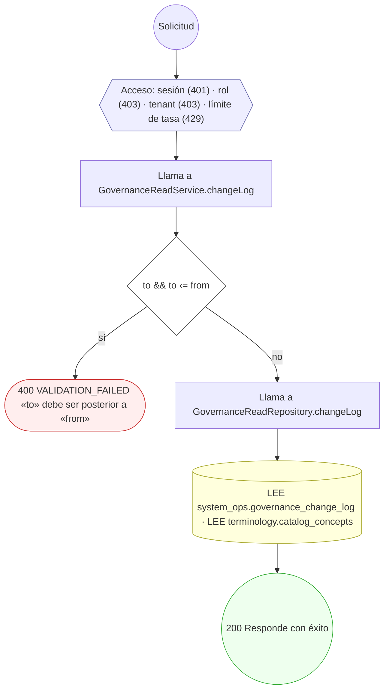

#### 5. POST /admin/governance/cross-border-transfers

Registrar una transferencia transfronteriza (append-only)

| HTTP | Código | Cuándo |
|---|---|---|
| 201 | — | Éxito |
| 400 | `VALIDATION_FAILED` | El cuerpo cumple el DTO (sin propiedades extra) |
| 401 | `UNAUTHENTICATED` | Hay una sesión válida (JWT) |
| 403 | `FORBIDDEN` | El rol está permitido; El tenant se resuelve y pertenece al actor |
| 409 | `CONFLICT` | ConflictException: La referencia de transferencia ya fue registrada |
| 429 | `RATE_LIMITED` | No se supera el límite de solicitudes |


#### 6. POST /admin/governance/drafts/{id}/publish

Publicar un draft record y materializarlo

| HTTP | Código | Cuándo |
|---|---|---|
| 200 | — | Éxito |
| 400 | `VALIDATION_FAILED` | Los parámetros de ruta son UUID válidos; El cuerpo cumple el DTO (sin propiedades extra) |
| 401 | `UNAUTHENTICATED` | Hay una sesión válida (JWT) |
| 403 | `FORBIDDEN` | El rol está permitido; El tenant se resuelve y pertenece al actor |
| 404 | `NOT_FOUND` | ResourceNotFoundException: Borrador no encontrado |
| 422 | `PRECONDITION_FAILED` | PreconditionFailedException: Solo el dueño del borrador puede publicarlo; PreconditionFailedException: El borrador no está en estado DRAFT |
| 429 | `RATE_LIMITED` | No se supera el límite de solicitudes |

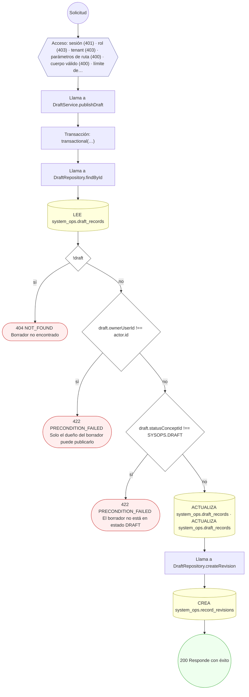

#### 7. POST /admin/governance/entity-registry

Registrar dominio, clasificación y catalogar entidad + campos

| HTTP | Código | Cuándo |
|---|---|---|
| 201 | — | Éxito |
| 400 | `VALIDATION_FAILED` | El cuerpo cumple el DTO (sin propiedades extra) |
| 401 | `UNAUTHENTICATED` | Hay una sesión válida (JWT) |
| 403 | `FORBIDDEN` | El rol está permitido; El tenant se resuelve y pertenece al actor |
| 429 | `RATE_LIMITED` | No se supera el límite de solicitudes |

```mermaid
flowchart TD
  n1(("Solicitud")):::inicio
  n2{{"Acceso: sesión (401) · rol (403) · tenant (403) · cuerpo válido (400) · límite de tasa (429)"}}:::acceso
  n1 --> n2
  n3["Llama a GovernanceCatalogService.catalogEntity"]:::llamada
  n2 --> n3
  n4["Transacción: transactional(…)"]:::transaccion
  n3 --> n4
  n5["Llama a GovernanceRepository.findDomainByCode"]:::llamada
  n4 --> n5
  n6[("LEE system_ops.data_domains")]:::efecto
  n5 --> n6
  n7{"!domain"}:::decision
  n6 --> n7
  n8["Llama a GovernanceRepository.createDomain"]:::llamada
  n7 -->|"sí"| n8
  n9[("CREA system_ops.data_domains")]:::efecto
  n8 --> n9
  n10["Llama a GovernanceRepository.findClassificationByCode"]:::llamada
  n9 --> n10
  n7 -->|"no"| n10
  n11[("LEE system_ops.data_classifications")]:::efecto
  n10 --> n11
  n12{"!classification"}:::decision
  n11 --> n12
  n13["Llama a GovernanceRepository.createClassification"]:::llamada
  n12 -->|"sí"| n13
  n14[("CREA system_ops.data_classifications")]:::efecto
  n13 --> n14
  n15["Llama a GovernanceRepository.createEntity"]:::llamada
  n14 --> n15
  n12 -->|"no"| n15
  n16[("CREA system_ops.entity_registry")]:::efecto
  n15 --> n16
  n17["Repite: por cada const f de dto.fields"]:::bucle
  n16 --> n17
  n18["Llama a GovernanceRepository.createField"]:::llamada
  n17 -->|"cada elemento"| n18
  n19[("CREA system_ops.field_registry")]:::efecto
  n18 --> n19
  n20["Llama a GovernanceRepository.recordChange"]:::llamada
  n19 --> n20
  n17 -->|"al terminar"| n20
  n21[("CREA system_ops.governance_change_log")]:::efecto
  n20 --> n21
  n22(("201 Responde con éxito")):::ok
  n21 --> n22
  classDef acceso fill:#eef,stroke:#66a
  classDef error fill:#fee,stroke:#c33
  classDef ok fill:#efe,stroke:#3a3
  classDef efecto fill:#ffd,stroke:#aa3
  classDef decision fill:#fff,stroke:#555
  classDef corte fill:#eee,stroke:#999,stroke-dasharray: 4
```

#### 8. GET /admin/governance/entity-registry/{id}/fields

Campos declarados de una entidad, con su marca PII/PHI y su enmascaramiento

| HTTP | Código | Cuándo |
|---|---|---|
| 200 | — | Éxito |
| 401 | `UNAUTHENTICATED` | Hay una sesión válida (JWT) |
| 403 | `FORBIDDEN` | El rol está permitido; El tenant se resuelve y pertenece al actor |
| 404 | `NOT_FOUND` | ResourceNotFoundException: Entidad del registro no encontrada |
| 429 | `RATE_LIMITED` | No se supera el límite de solicitudes |

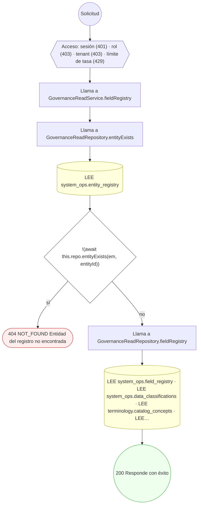

#### 9. PATCH /admin/governance/entity-registry/{id}/retention

Aplicar una política de retención a una entidad

| HTTP | Código | Cuándo |
|---|---|---|
| 200 | — | Éxito |
| 400 | `VALIDATION_FAILED` | Los parámetros de ruta son UUID válidos; El cuerpo cumple el DTO (sin propiedades extra) |
| 401 | `UNAUTHENTICATED` | Hay una sesión válida (JWT) |
| 403 | `FORBIDDEN` | El rol está permitido; El tenant se resuelve y pertenece al actor |
| 404 | `NOT_FOUND` | ResourceNotFoundException: Entidad no encontrada; ResourceNotFoundException: Política de retención no encontrada |
| 429 | `RATE_LIMITED` | No se supera el límite de solicitudes |

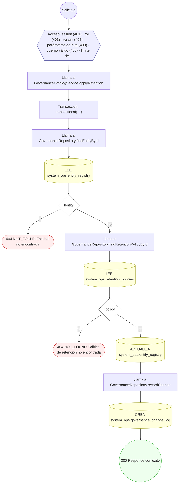

#### 10. PATCH /admin/governance/entity-registry/{id}/write-policy

Vincular una política de escritura a una entidad

| HTTP | Código | Cuándo |
|---|---|---|
| 200 | — | Éxito |
| 400 | `VALIDATION_FAILED` | Los parámetros de ruta son UUID válidos; El cuerpo cumple el DTO (sin propiedades extra) |
| 401 | `UNAUTHENTICATED` | Hay una sesión válida (JWT) |
| 403 | `FORBIDDEN` | El rol está permitido; El tenant se resuelve y pertenece al actor |
| 404 | `NOT_FOUND` | ResourceNotFoundException: Entidad no encontrada; ResourceNotFoundException: Política de escritura no encontrada |
| 429 | `RATE_LIMITED` | No se supera el límite de solicitudes |

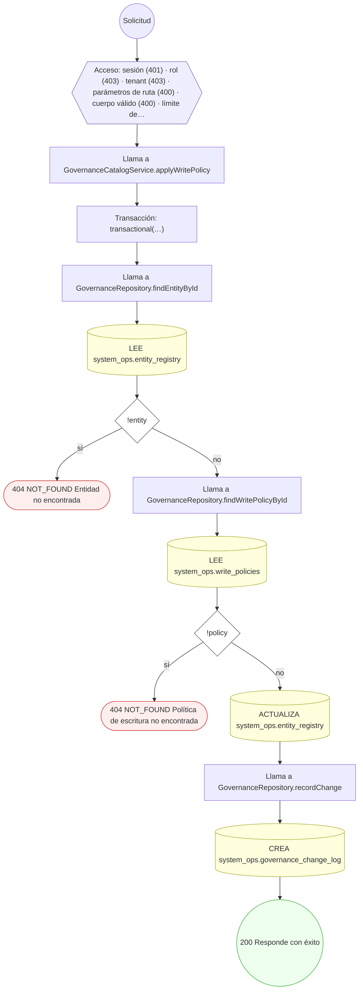

#### 11. PATCH /admin/governance/field-registry/{id}

Asignar regla de anonimización / masking a un campo

| HTTP | Código | Cuándo |
|---|---|---|
| 200 | — | Éxito |
| 400 | `VALIDATION_FAILED` | Los parámetros de ruta son UUID válidos; El cuerpo cumple el DTO (sin propiedades extra) |
| 401 | `UNAUTHENTICATED` | Hay una sesión válida (JWT) |
| 403 | `FORBIDDEN` | El rol está permitido; El tenant se resuelve y pertenece al actor |
| 404 | `NOT_FOUND` | ResourceNotFoundException: Campo no encontrado |
| 429 | `RATE_LIMITED` | No se supera el límite de solicitudes |


#### 12. PATCH /admin/governance/findings/{id}

Actualizar un hallazgo (estado / owner)

| HTTP | Código | Cuándo |
|---|---|---|
| 200 | — | Éxito |
| 400 | `VALIDATION_FAILED` | Los parámetros de ruta son UUID válidos; El cuerpo cumple el DTO (sin propiedades extra) |
| 401 | `UNAUTHENTICATED` | Hay una sesión válida (JWT) |
| 403 | `FORBIDDEN` | El rol está permitido; El tenant se resuelve y pertenece al actor |
| 404 | `NOT_FOUND` | ResourceNotFoundException: Hallazgo no encontrado |
| 429 | `RATE_LIMITED` | No se supera el límite de solicitudes |

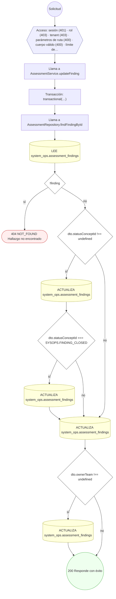

#### 13. POST /admin/governance/legal-holds

Colocar un legal hold sobre un objetivo

| HTTP | Código | Cuándo |
|---|---|---|
| 201 | — | Éxito |
| 400 | `VALIDATION_FAILED` | El cuerpo cumple el DTO (sin propiedades extra) |
| 401 | `UNAUTHENTICATED` | Hay una sesión válida (JWT) |
| 403 | `FORBIDDEN` | El rol está permitido; El tenant se resuelve y pertenece al actor |
| 409 | `CONFLICT` | ConflictException: Ya existe un legal hold ACTIVE para ese objetivo |
| 429 | `RATE_LIMITED` | No se supera el límite de solicitudes |


#### 14. POST /admin/governance/legal-holds/{id}/release

Levantar un legal hold ACTIVE

| HTTP | Código | Cuándo |
|---|---|---|
| 200 | — | Éxito |
| 400 | `VALIDATION_FAILED` | Los parámetros de ruta son UUID válidos; El cuerpo cumple el DTO (sin propiedades extra) |
| 401 | `UNAUTHENTICATED` | Hay una sesión válida (JWT) |
| 403 | `FORBIDDEN` | El rol está permitido; El tenant se resuelve y pertenece al actor |
| 404 | `NOT_FOUND` | ResourceNotFoundException: Legal hold no encontrado |
| 422 | `PRECONDITION_FAILED` | PreconditionFailedException: El legal hold no está ACTIVE |
| 429 | `RATE_LIMITED` | No se supera el límite de solicitudes |


#### 15. GET /admin/governance/mutability


| HTTP | Código | Cuándo |
|---|---|---|
| 200 | — | Éxito |
| 401 | `UNAUTHENTICATED` | Hay una sesión válida (JWT) |
| 403 | `FORBIDDEN` | El rol está permitido; El tenant se resuelve y pertenece al actor |
| 429 | `RATE_LIMITED` | No se supera el límite de solicitudes |

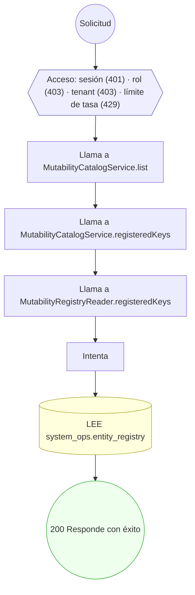

#### 16. GET /admin/governance/mutability/{schema}/{table}


| HTTP | Código | Cuándo |
|---|---|---|
| 200 | — | Éxito |
| 401 | `UNAUTHENTICATED` | Hay una sesión válida (JWT) |
| 403 | `FORBIDDEN` | El rol está permitido; El tenant se resuelve y pertenece al actor |
| 404 | `NOT_FOUND` | ResourceNotFoundException: La tabla no está en el catálogo de mutabilidad |
| 429 | `RATE_LIMITED` | No se supera el límite de solicitudes |

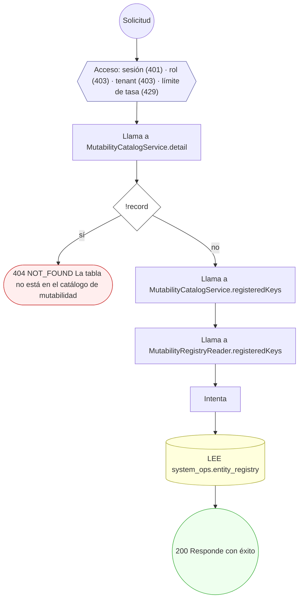

#### 17. GET /admin/governance/mutability/summary


| HTTP | Código | Cuándo |
|---|---|---|
| 200 | — | Éxito |
| 401 | `UNAUTHENTICATED` | Hay una sesión válida (JWT) |
| 403 | `FORBIDDEN` | El rol está permitido; El tenant se resuelve y pertenece al actor |
| 429 | `RATE_LIMITED` | No se supera el límite de solicitudes |

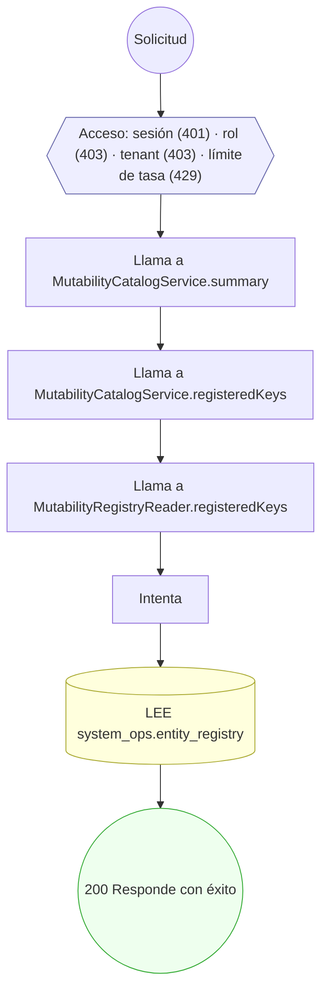

#### 18. POST /admin/governance/operational-frameworks

Publicar un framework operativo con sus controles

| HTTP | Código | Cuándo |
|---|---|---|
| 201 | — | Éxito |
| 400 | `VALIDATION_FAILED` | El cuerpo cumple el DTO (sin propiedades extra) |
| 401 | `UNAUTHENTICATED` | Hay una sesión válida (JWT) |
| 403 | `FORBIDDEN` | El rol está permitido; El tenant se resuelve y pertenece al actor |
| 409 | `CONFLICT` | ConflictException: Ya existe un framework con ese code+version |
| 422 | `PRECONDITION_FAILED` | PreconditionFailedException: parentControlCode no existe en el framework |
| 429 | `RATE_LIMITED` | No se supera el límite de solicitudes |

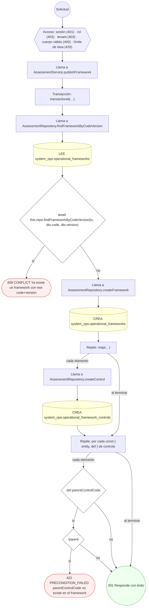

#### 19. GET /admin/governance/policies

Políticas de gobierno (escritura, retención, anonimización, residencia) en una lista paginada

| HTTP | Código | Cuándo |
|---|---|---|
| 200 | — | Éxito |
| 401 | `UNAUTHENTICATED` | Hay una sesión válida (JWT) |
| 403 | `FORBIDDEN` | El rol está permitido; El tenant se resuelve y pertenece al actor |
| 429 | `RATE_LIMITED` | No se supera el límite de solicitudes |

```mermaid
flowchart TD
  n1(("Solicitud")):::inicio
  n2{{"Acceso: sesión (401) · rol (403) · tenant (403) · límite de tasa (429)"}}:::acceso
  n1 --> n2
  n3["Llama a GovernanceReadService.policies"]:::llamada
  n2 --> n3
  n4{"q.cursor"}:::decision
  n3 --> n4
  n5{"k.m !== `${sort}:${order}`"}:::decision
  n4 -->|"sí"| n5
  n6(["↩ (relanza el error capturado)"]):::error
  n5 -->|"sí"| n6
  n7["Llama a GovernanceReadRepository.policies"]:::llamada
  n5 -->|"no"| n7
  n4 -->|"no"| n7
  n8["Llama a GovernanceReadRepository.policiesCte"]:::llamada
  n7 --> n8
  n9[("LEE system_ops.write_policies · LEE terminology.catalog_concepts · LEE system_ops.retention_policies · LEE sy…")]:::efecto
  n8 --> n9
  n10(("200 Responde con éxito")):::ok
  n9 --> n10
  classDef acceso fill:#eef,stroke:#66a
  classDef error fill:#fee,stroke:#c33
  classDef ok fill:#efe,stroke:#3a3
  classDef efecto fill:#ffd,stroke:#aa3
  classDef decision fill:#fff,stroke:#555
  classDef corte fill:#eee,stroke:#999,stroke-dasharray: 4
```

#### 20. GET /admin/governance/policies/{policyType}/{id}

Una política: ajustes, estado y a qué tablas o columnas se aplica

| HTTP | Código | Cuándo |
|---|---|---|
| 200 | — | Éxito |
| 401 | `UNAUTHENTICATED` | Hay una sesión válida (JWT) |
| 403 | `FORBIDDEN` | El rol está permitido; El tenant se resuelve y pertenece al actor |
| 404 | `NOT_FOUND` | ResourceNotFoundException: Política no encontrada |
| 429 | `RATE_LIMITED` | No se supera el límite de solicitudes |

```mermaid
flowchart TD
  n1(("Solicitud")):::inicio
  n2{{"Acceso: sesión (401) · rol (403) · tenant (403) · límite de tasa (429)"}}:::acceso
  n1 --> n2
  n3["Llama a GovernanceReadService.policy"]:::llamada
  n2 --> n3
  n4["Llama a GovernanceReadRepository.policyDetail"]:::llamada
  n3 --> n4
  n5[("LEE system_ops.write_policies · LEE terminology.catalog_concepts · LEE system_ops.retention_policies · LEE sy…")]:::efecto
  n4 --> n5
  n6{"!fila"}:::decision
  n5 --> n6
  n7(["404 NOT_FOUND Política no encontrada"]):::error
  n6 -->|"sí"| n7
  n8["Llama a GovernanceReadRepository.appliedTo"]:::llamada
  n6 -->|"no"| n8
  n9[("LEE system_ops.entity_registry · LEE system_ops.field_registry")]:::efecto
  n8 --> n9
  n10(("200 Responde con éxito")):::ok
  n9 --> n10
  classDef acceso fill:#eef,stroke:#66a
  classDef error fill:#fee,stroke:#c33
  classDef ok fill:#efe,stroke:#3a3
  classDef efecto fill:#ffd,stroke:#aa3
  classDef decision fill:#fff,stroke:#555
  classDef corte fill:#eee,stroke:#999,stroke-dasharray: 4
```

#### 21. POST /admin/governance/remediation-actions/{id}/verify

Verificar y cerrar una acción de remediación

| HTTP | Código | Cuándo |
|---|---|---|
| 200 | — | Éxito |
| 400 | `VALIDATION_FAILED` | Los parámetros de ruta son UUID válidos; El cuerpo cumple el DTO (sin propiedades extra) |
| 401 | `UNAUTHENTICATED` | Hay una sesión válida (JWT) |
| 403 | `FORBIDDEN` | El rol está permitido; El tenant se resuelve y pertenece al actor |
| 404 | `NOT_FOUND` | ResourceNotFoundException: Acción de remediación no encontrada |
| 422 | `PRECONDITION_FAILED` | PreconditionFailedException: La acción ya está verificada; PreconditionFailedException: El verificador no puede ser el asignado |
| 429 | `RATE_LIMITED` | No se supera el límite de solicitudes |

```mermaid
flowchart TD
  n1(("Solicitud")):::inicio
  n2{{"Acceso: sesión (401) · rol (403) · tenant (403) · parámetros de ruta (400) · cuerpo válido (400) · límite de…"}}:::acceso
  n1 --> n2
  n3["Llama a AssessmentService.verifyAction"]:::llamada
  n2 --> n3
  n4["Transacción: transactional(…)"]:::transaccion
  n3 --> n4
  n5["Llama a AssessmentRepository.findActionById"]:::llamada
  n4 --> n5
  n6[("LEE system_ops.remediation_actions")]:::efecto
  n5 --> n6
  n7{"!action"}:::decision
  n6 --> n7
  n8(["404 NOT_FOUND Acción de remediación no encontrada"]):::error
  n7 -->|"sí"| n8
  n9{"action.statusConceptId === SYSOPS.ACTION_VERIFIED"}:::decision
  n7 -->|"no"| n9
  n10(["422 PRECONDITION_FAILED La acción ya está verificada"]):::error
  n9 -->|"sí"| n10
  n11{"action.assignedUserId && action.assignedUserId === actor.id"}:::decision
  n9 -->|"no"| n11
  n12(["422 PRECONDITION_FAILED El verificador no puede ser el asignado"]):::error
  n11 -->|"sí"| n12
  n13[("ACTUALIZA system_ops.remediation_actions · ACTUALIZA system_ops.remediation_actions · ACTUALIZA system_ops.re…")]:::efecto
  n11 -->|"no"| n13
  n14["Llama a AssessmentRepository.countFindingActionsNotIn"]:::llamada
  n13 --> n14
  n15[("LEE system_ops.remediation_actions")]:::efecto
  n14 --> n15
  n16{"openFindingActions === 0"}:::decision
  n15 --> n16
  n17["Llama a AssessmentRepository.findFindingById"]:::llamada
  n16 -->|"sí"| n17
  n18[("LEE system_ops.assessment_findings")]:::efecto
  n17 --> n18
  n19{"finding && finding.statusConceptId !== SYSOPS.FINDING_CLOSED"}:::decision
  n18 --> n19
  n20[("ACTUALIZA system_ops.assessment_findings · ACTUALIZA system_ops.assessment_findings")]:::efecto
  n19 -->|"sí"| n20
  n21["Llama a AssessmentRepository.countActionsNotIn"]:::llamada
  n20 --> n21
  n19 -->|"no"| n21
  n16 -->|"no"| n21
  n22[("LEE system_ops.remediation_actions")]:::efecto
  n21 --> n22
  n23{"openPlanActions === 0"}:::decision
  n22 --> n23
  n24["Llama a AssessmentRepository.findPlanById"]:::llamada
  n23 -->|"sí"| n24
  n25[("LEE system_ops.remediation_plans")]:::efecto
  n24 --> n25
  n26{"plan && plan.statusConceptId !== SYSOPS.PLAN_COMPLETED"}:::decision
  n25 --> n26
  n27[("ACTUALIZA system_ops.remediation_plans · ACTUALIZA system_ops.remediation_plans · ACTUALIZA system_ops.remedi…")]:::efecto
  n26 -->|"sí"| n27
  n28(("200 Responde con éxito")):::ok
  n27 --> n28
  n26 -->|"no"| n28
  n23 -->|"no"| n28
  classDef acceso fill:#eef,stroke:#66a
  classDef error fill:#fee,stroke:#c33
  classDef ok fill:#efe,stroke:#3a3
  classDef efecto fill:#ffd,stroke:#aa3
  classDef decision fill:#fff,stroke:#555
  classDef corte fill:#eee,stroke:#999,stroke-dasharray: 4
```

#### 22. POST /admin/governance/residency-policies

Definir una política de residencia de datos

| HTTP | Código | Cuándo |
|---|---|---|
| 201 | — | Éxito |
| 400 | `VALIDATION_FAILED` | El cuerpo cumple el DTO (sin propiedades extra) |
| 401 | `UNAUTHENTICATED` | Hay una sesión válida (JWT) |
| 403 | `FORBIDDEN` | El rol está permitido; El tenant se resuelve y pertenece al actor |
| 409 | `CONFLICT` | ConflictException: Ya existe una política de residencia con ese code |
| 429 | `RATE_LIMITED` | No se supera el límite de solicitudes |

```mermaid
flowchart TD
  n1(("Solicitud")):::inicio
  n2{{"Acceso: sesión (401) · rol (403) · tenant (403) · cuerpo válido (400) · límite de tasa (429)"}}:::acceso
  n1 --> n2
  n3["Llama a ResidencyService.createResidencyPolicy"]:::llamada
  n2 --> n3
  n4["Transacción: transactional(…)"]:::transaccion
  n3 --> n4
  n5["Llama a ResidencyRepository.findPolicyByCode"]:::llamada
  n4 --> n5
  n6[("LEE system_ops.data_residency_policies")]:::efecto
  n5 --> n6
  n7{"await this.repo.findPolicyByCode(tx, dto.code)"}:::decision
  n6 --> n7
  n8(["409 CONFLICT Ya existe una política de residencia con ese code"]):::error
  n7 -->|"sí"| n8
  n9["Llama a ResidencyRepository.createPolicy"]:::llamada
  n7 -->|"no"| n9
  n10[("CREA system_ops.data_residency_policies")]:::efecto
  n9 --> n10
  n11["Llama a GovernanceRepository.recordChange"]:::llamada
  n10 --> n11
  n12[("CREA system_ops.governance_change_log")]:::efecto
  n11 --> n12
  n13(("201 Responde con éxito")):::ok
  n12 --> n13
  classDef acceso fill:#eef,stroke:#66a
  classDef error fill:#fee,stroke:#c33
  classDef ok fill:#efe,stroke:#3a3
  classDef efecto fill:#ffd,stroke:#aa3
  classDef decision fill:#fff,stroke:#555
  classDef corte fill:#eee,stroke:#999,stroke-dasharray: 4
```

#### 23. GET /admin/governance/retention-executions


| HTTP | Código | Cuándo |
|---|---|---|
| 200 | — | Éxito |
| 400 | `VALIDATION_FAILED` | BadRequestException: «to» debe ser posterior a «from» |
| 401 | `UNAUTHENTICATED` | Hay una sesión válida (JWT) |
| 403 | `FORBIDDEN` | El rol está permitido; El tenant se resuelve y pertenece al actor |
| 429 | `RATE_LIMITED` | No se supera el límite de solicitudes |

```mermaid
flowchart TD
  n1(("Solicitud")):::inicio
  n2{{"Acceso: sesión (401) · rol (403) · tenant (403) · límite de tasa (429)"}}:::acceso
  n1 --> n2
  n3["Llama a GovernanceOperationsReadService.retentionExecutions"]:::llamada
  n2 --> n3
  n4{"from && to && to ‹= from"}:::decision
  n3 --> n4
  n5(["400 VALIDATION_FAILED «to» debe ser posterior a «from»"]):::error
  n4 -->|"sí"| n5
  n6["Llama a GovernanceOperationsReadRepository.retentionExecutions"]:::llamada
  n4 -->|"no"| n6
  n7[("LEE system_ops.retention_executions · LEE system_ops.retention_policies · LEE system_ops.entity_registry · LE…")]:::efecto
  n6 --> n7
  n8(("200 Responde con éxito")):::ok
  n7 --> n8
  classDef acceso fill:#eef,stroke:#66a
  classDef error fill:#fee,stroke:#c33
  classDef ok fill:#efe,stroke:#3a3
  classDef efecto fill:#ffd,stroke:#aa3
  classDef decision fill:#fff,stroke:#555
  classDef corte fill:#eee,stroke:#999,stroke-dasharray: 4
```

#### 24. POST /admin/governance/retention-policies

Definir una política de retención con base legal

| HTTP | Código | Cuándo |
|---|---|---|
| 201 | — | Éxito |
| 400 | `VALIDATION_FAILED` | El cuerpo cumple el DTO (sin propiedades extra) |
| 401 | `UNAUTHENTICATED` | Hay una sesión válida (JWT) |
| 403 | `FORBIDDEN` | El rol está permitido; El tenant se resuelve y pertenece al actor |
| 409 | `CONFLICT` | ConflictException: Ya existe una política de retención con ese code |
| 429 | `RATE_LIMITED` | No se supera el límite de solicitudes |

```mermaid
flowchart TD
  n1(("Solicitud")):::inicio
  n2{{"Acceso: sesión (401) · rol (403) · tenant (403) · cuerpo válido (400) · límite de tasa (429)"}}:::acceso
  n1 --> n2
  n3["Llama a GovernanceCatalogService.createRetentionPolicy"]:::llamada
  n2 --> n3
  n4["Transacción: transactional(…)"]:::transaccion
  n3 --> n4
  n5["Llama a GovernanceRepository.findRetentionPolicyByCode"]:::llamada
  n4 --> n5
  n6[("LEE system_ops.retention_policies")]:::efecto
  n5 --> n6
  n7{"await this.repo.findRetentionPolicyByCode(tx, dto.code)"}:::decision
  n6 --> n7
  n8(["409 CONFLICT Ya existe una política de retención con ese code"]):::error
  n7 -->|"sí"| n8
  n9["Llama a GovernanceRepository.createRetentionPolicy"]:::llamada
  n7 -->|"no"| n9
  n10[("CREA system_ops.retention_policies")]:::efecto
  n9 --> n10
  n11["Llama a GovernanceRepository.recordChange"]:::llamada
  n10 --> n11
  n12[("CREA system_ops.governance_change_log")]:::efecto
  n11 --> n12
  n13(("201 Responde con éxito")):::ok
  n12 --> n13
  classDef acceso fill:#eef,stroke:#66a
  classDef error fill:#fee,stroke:#c33
  classDef ok fill:#efe,stroke:#3a3
  classDef efecto fill:#ffd,stroke:#aa3
  classDef decision fill:#fff,stroke:#555
  classDef corte fill:#eee,stroke:#999,stroke-dasharray: 4
```

#### 25. POST /admin/governance/tenant-residency-bindings

Vincular un tenant a una política de residencia

| HTTP | Código | Cuándo |
|---|---|---|
| 201 | — | Éxito |
| 400 | `VALIDATION_FAILED` | El cuerpo cumple el DTO (sin propiedades extra) |
| 401 | `UNAUTHENTICATED` | Hay una sesión válida (JWT) |
| 403 | `FORBIDDEN` | El rol está permitido; El tenant se resuelve y pertenece al actor |
| 404 | `NOT_FOUND` | ResourceNotFoundException: El tenant o la política de residencia no existen; ResourceNotFoundException: Una de las regiones indicadas no existe |
| 422 | `PRECONDITION_FAILED` | PreconditionFailedException: La política de residencia no está activa; PreconditionFailedException: Una de las regiones queda fuera de las que la política permite |
| 429 | `RATE_LIMITED` | No se supera el límite de solicitudes |

```mermaid
flowchart TD
  n1(("Solicitud")):::inicio
  n2{{"Acceso: sesión (401) · rol (403) · tenant (403) · cuerpo válido (400) · límite de tasa (429)"}}:::acceso
  n1 --> n2
  n3["Llama a ResidencyService.createBinding"]:::llamada
  n2 --> n3
  n4["Transacción: transactional(…)"]:::transaccion
  n3 --> n4
  n5["Llama a ResidencyRepository.findBindingPolicyById"]:::llamada
  n4 --> n5
  n6[("LEE polyglot_storage.residency_policies")]:::efecto
  n5 --> n6
  n7["Llama a ResidencyRepository.tenantExists"]:::llamada
  n6 --> n7
  n8[("LEE directory.tenants")]:::efecto
  n7 --> n8
  n9{"!policy || !(await this.repo.tenantExists(tx, dto.tenantId))"}:::decision
  n8 --> n9
  n10(["404 NOT_FOUND El tenant o la política de residencia no existen"]):::error
  n9 -->|"sí"| n10
  n11["Llama a ResidencyRepository.findConceptCodes"]:::llamada
  n9 -->|"no"| n11
  n12[("LEE terminology.catalog_concepts")]:::efecto
  n11 --> n12
  n13{"regionIds.some((id) =› !regionCodes.has(id))"}:::decision
  n12 --> n13
  n14(["404 NOT_FOUND Una de las regiones indicadas no existe"]):::error
  n13 -->|"sí"| n14
  n15{"policy.state !== POLICY_STATE.ACTIVE"}:::decision
  n13 -->|"no"| n15
  n16(["422 PRECONDITION_FAILED La política de residencia no está activa"]):::error
  n15 -->|"sí"| n16
  n17{"allowedRegions.length › 0 && regionIds.some( (id) =› !allowedRegions.includes(regionCodes.get(id)!.toLowerCas…"}:::decision
  n15 -->|"no"| n17
  n18(["422 PRECONDITION_FAILED Una de las regiones queda fuera de las que la política permite"]):::error
  n17 -->|"sí"| n18
  n19["Llama a ResidencyRepository.createBinding"]:::llamada
  n17 -->|"no"| n19
  n20[("CREA system_ops.tenant_residency_bindings")]:::efecto
  n19 --> n20
  n21(("201 Responde con éxito")):::ok
  n20 --> n21
  classDef acceso fill:#eef,stroke:#66a
  classDef error fill:#fee,stroke:#c33
  classDef ok fill:#efe,stroke:#3a3
  classDef efecto fill:#ffd,stroke:#aa3
  classDef decision fill:#fff,stroke:#555
  classDef corte fill:#eee,stroke:#999,stroke-dasharray: 4
```

#### 26. POST /admin/governance/workload-assessments

Iniciar una evaluación de workload

| HTTP | Código | Cuándo |
|---|---|---|
| 201 | — | Éxito |
| 400 | `VALIDATION_FAILED` | El cuerpo cumple el DTO (sin propiedades extra) |
| 401 | `UNAUTHENTICATED` | Hay una sesión válida (JWT) |
| 403 | `FORBIDDEN` | El rol está permitido; El tenant se resuelve y pertenece al actor |
| 404 | `NOT_FOUND` | ResourceNotFoundException: Framework no encontrado |
| 422 | `PRECONDITION_FAILED` | PreconditionFailedException: El framework no está publicado (ACTIVE) |
| 429 | `RATE_LIMITED` | No se supera el límite de solicitudes |

```mermaid
flowchart TD
  n1(("Solicitud")):::inicio
  n2{{"Acceso: sesión (401) · rol (403) · tenant (403) · cuerpo válido (400) · límite de tasa (429)"}}:::acceso
  n1 --> n2
  n3["Llama a AssessmentService.createAssessment"]:::llamada
  n2 --> n3
  n4["Transacción: transactional(…)"]:::transaccion
  n3 --> n4
  n5["Llama a AssessmentRepository.findFrameworkById"]:::llamada
  n4 --> n5
  n6[("LEE system_ops.operational_frameworks")]:::efecto
  n5 --> n6
  n7{"!framework"}:::decision
  n6 --> n7
  n8(["404 NOT_FOUND Framework no encontrado"]):::error
  n7 -->|"sí"| n8
  n9{"framework.stateConceptId !== CONCEPTS.STATE_ACTIVE"}:::decision
  n7 -->|"no"| n9
  n10(["422 PRECONDITION_FAILED El framework no está publicado (ACTIVE)"]):::error
  n9 -->|"sí"| n10
  n11["Llama a AssessmentRepository.createAssessment"]:::llamada
  n9 -->|"no"| n11
  n12[("CREA system_ops.workload_assessments")]:::efecto
  n11 --> n12
  n13(("201 Responde con éxito")):::ok
  n12 --> n13
  classDef acceso fill:#eef,stroke:#66a
  classDef error fill:#fee,stroke:#c33
  classDef ok fill:#efe,stroke:#3a3
  classDef efecto fill:#ffd,stroke:#aa3
  classDef decision fill:#fff,stroke:#555
  classDef corte fill:#eee,stroke:#999,stroke-dasharray: 4
```

#### 27. PUT /admin/governance/workload-assessments/{id}/control-results

Registrar (UPSERT) resultados de control de una evaluación

| HTTP | Código | Cuándo |
|---|---|---|
| 200 | — | Éxito |
| 400 | `VALIDATION_FAILED` | Los parámetros de ruta son UUID válidos; El cuerpo cumple el DTO (sin propiedades extra) |
| 401 | `UNAUTHENTICATED` | Hay una sesión válida (JWT) |
| 403 | `FORBIDDEN` | El rol está permitido; El tenant se resuelve y pertenece al actor |
| 404 | `NOT_FOUND` | ResourceNotFoundException: Evaluación no encontrada |
| 429 | `RATE_LIMITED` | No se supera el límite de solicitudes |

```mermaid
flowchart TD
  n1(("Solicitud")):::inicio
  n2{{"Acceso: sesión (401) · rol (403) · tenant (403) · parámetros de ruta (400) · cuerpo válido (400) · límite de…"}}:::acceso
  n1 --> n2
  n3["Llama a AssessmentService.putControlResults"]:::llamada
  n2 --> n3
  n4["Transacción: transactional(…)"]:::transaccion
  n3 --> n4
  n5["Llama a AssessmentRepository.findAssessmentById"]:::llamada
  n4 --> n5
  n6[("LEE system_ops.workload_assessments")]:::efecto
  n5 --> n6
  n7{"!assessment"}:::decision
  n6 --> n7
  n8(["404 NOT_FOUND Evaluación no encontrada"]):::error
  n7 -->|"sí"| n8
  n9["Repite: por cada const item de dto.results"]:::bucle
  n7 -->|"no"| n9
  n10["Llama a AssessmentRepository.findControlResult"]:::llamada
  n9 -->|"cada elemento"| n10
  n11[("LEE system_ops.assessment_control_results")]:::efecto
  n10 --> n11
  n12{"existing"}:::decision
  n11 --> n12
  n13[("ACTUALIZA system_ops.assessment_control_results · ACTUALIZA system_ops.assessment_control_results · ACTUALIZA…")]:::efecto
  n12 -->|"sí"| n13
  n14["Llama a AssessmentRepository.createControlResult"]:::llamada
  n12 -->|"no"| n14
  n15[("CREA system_ops.assessment_control_results")]:::efecto
  n14 --> n15
  n16(("200 Responde con éxito")):::ok
  n13 --> n16
  n15 --> n16
  n9 -->|"al terminar"| n16
  classDef acceso fill:#eef,stroke:#66a
  classDef error fill:#fee,stroke:#c33
  classDef ok fill:#efe,stroke:#3a3
  classDef efecto fill:#ffd,stroke:#aa3
  classDef decision fill:#fff,stroke:#555
  classDef corte fill:#eee,stroke:#999,stroke-dasharray: 4
```

#### 28. POST /admin/governance/write-policies

Definir una política de escritura

| HTTP | Código | Cuándo |
|---|---|---|
| 201 | — | Éxito |
| 400 | `VALIDATION_FAILED` | El cuerpo cumple el DTO (sin propiedades extra) |
| 401 | `UNAUTHENTICATED` | Hay una sesión válida (JWT) |
| 403 | `FORBIDDEN` | El rol está permitido; El tenant se resuelve y pertenece al actor |
| 409 | `CONFLICT` | ConflictException: Ya existe una política de escritura con ese code |
| 429 | `RATE_LIMITED` | No se supera el límite de solicitudes |

```mermaid
flowchart TD
  n1(("Solicitud")):::inicio
  n2{{"Acceso: sesión (401) · rol (403) · tenant (403) · cuerpo válido (400) · límite de tasa (429)"}}:::acceso
  n1 --> n2
  n3["Llama a GovernanceCatalogService.createWritePolicy"]:::llamada
  n2 --> n3
  n4["Transacción: transactional(…)"]:::transaccion
  n3 --> n4
  n5["Llama a GovernanceRepository.findWritePolicyByCode"]:::llamada
  n4 --> n5
  n6[("LEE system_ops.write_policies")]:::efecto
  n5 --> n6
  n7{"await this.repo.findWritePolicyByCode(tx, dto.code)"}:::decision
  n6 --> n7
  n8(["409 CONFLICT Ya existe una política de escritura con ese code"]):::error
  n7 -->|"sí"| n8
  n9["Llama a GovernanceRepository.createWritePolicy"]:::llamada
  n7 -->|"no"| n9
  n10[("CREA system_ops.write_policies")]:::efecto
  n9 --> n10
  n11["Llama a GovernanceRepository.recordChange"]:::llamada
  n10 --> n11
  n12[("CREA system_ops.governance_change_log")]:::efecto
  n11 --> n12
  n13(("201 Responde con éxito")):::ok
  n12 --> n13
  classDef acceso fill:#eef,stroke:#66a
  classDef error fill:#fee,stroke:#c33
  classDef ok fill:#efe,stroke:#3a3
  classDef efecto fill:#ffd,stroke:#aa3
  classDef decision fill:#fff,stroke:#555
  classDef corte fill:#eee,stroke:#999,stroke-dasharray: 4
```

#### 29. POST /admin/ops/backup-policies

Definir una política de backup (RPO/RTO/inmutabilidad)

| HTTP | Código | Cuándo |
|---|---|---|
| 201 | — | Éxito |
| 400 | `VALIDATION_FAILED` | El cuerpo cumple el DTO (sin propiedades extra) |
| 401 | `UNAUTHENTICATED` | Hay una sesión válida (JWT) |
| 403 | `FORBIDDEN` | El rol está permitido; El tenant se resuelve y pertenece al actor |
| 422 | `PRECONDITION_FAILED` | PreconditionFailedException: {rangeOutside.map((v) => v.mensaje).join('; ')} |
| 429 | `RATE_LIMITED` | No se supera el límite de solicitudes |

```mermaid
flowchart TD
  n1(("Solicitud")):::inicio
  n2{{"Acceso: sesión (401) · rol (403) · tenant (403) · cuerpo válido (400) · límite de tasa (429)"}}:::acceso
  n1 --> n2
  n3["Llama a BackupService.createPolicy"]:::llamada
  n2 --> n3
  n4{"rangeOutside.length › 0"}:::decision
  n3 --> n4
  n5(["422 PRECONDITION_FAILED {rangeOutside.map((v) =› v.mensaje).join('; ')}"]):::error
  n4 -->|"sí"| n5
  n6["Transacción: transactional(…)"]:::transaccion
  n4 -->|"no"| n6
  n7["Llama a BackupRepository.createPolicy"]:::llamada
  n6 --> n7
  n8[("CREA system_ops.backup_policies")]:::efecto
  n7 --> n8
  n9(("201 Responde con éxito")):::ok
  n8 --> n9
  classDef acceso fill:#eef,stroke:#66a
  classDef error fill:#fee,stroke:#c33
  classDef ok fill:#efe,stroke:#3a3
  classDef efecto fill:#ffd,stroke:#aa3
  classDef decision fill:#fff,stroke:#555
  classDef corte fill:#eee,stroke:#999,stroke-dasharray: 4
```

#### 30. POST /internal/governance/retention-executions/run

Ejecutar un barrido de retención (excluye objetivos bajo legal hold)

| HTTP | Código | Cuándo |
|---|---|---|
| 200 | — | Éxito |
| 400 | `VALIDATION_FAILED` | El cuerpo cumple el DTO (sin propiedades extra) |
| 401 | `UNAUTHENTICATED` | Hay una sesión válida (JWT) |
| 403 | `FORBIDDEN` | El rol está permitido; El tenant se resuelve y pertenece al actor |
| 404 | `NOT_FOUND` | ResourceNotFoundException: Política de retención no encontrada; ResourceNotFoundException: Entidad objetivo no encontrada |
| 422 | `PRECONDITION_FAILED` | PreconditionFailedException: La política de retención no está ACTIVE; PreconditionFailedException: La entidad no tiene un ejecutor de retención registrado; PreconditionFailedException: La política de retención no declara plazo y disposición ejecutables |
| 429 | `RATE_LIMITED` | No se supera el límite de solicitudes |
| 500 | `INTERNAL` | StorageLifecycleDenied: LIFECYCLE_WIRING_MISSING; StorageLifecycleDenied: EXTERNAL_REFERENCE_UNKNOWN; StorageLifecycleDenied: PHYSICAL_IDENTITY_UNKNOWN; StorageLifecycleDenied: PHYSICAL_METADATA_CONFLICT |

```mermaid
flowchart TD
  n1(("Solicitud")):::inicio
  n2{{"Acceso: sesión (401) · rol (403) · tenant (403) · cuerpo válido (400) · límite de tasa (429)"}}:::acceso
  n1 --> n2
  n3["Llama a RetentionExecutionService.run"]:::llamada
  n2 --> n3
  n4["Transacción: transactional(…)"]:::transaccion
  n3 --> n4
  n5["Llama a GovernanceRepository.findRetentionPolicyById"]:::llamada
  n4 --> n5
  n6[("LEE system_ops.retention_policies")]:::efecto
  n5 --> n6
  n7{"!policy"}:::decision
  n6 --> n7
  n8(["404 NOT_FOUND Política de retención no encontrada"]):::error
  n7 -->|"sí"| n8
  n9{"policy.stateConceptId !== CONCEPTS.STATE_ACTIVE"}:::decision
  n7 -->|"no"| n9
  n10(["422 PRECONDITION_FAILED La política de retención no está ACTIVE"]):::error
  n9 -->|"sí"| n10
  n11["Llama a GovernanceRepository.findEntityById"]:::llamada
  n9 -->|"no"| n11
  n12[("LEE system_ops.entity_registry")]:::efecto
  n11 --> n12
  n13{"!entity"}:::decision
  n12 --> n13
  n14(["404 NOT_FOUND Entidad objetivo no encontrada"]):::error
  n13 -->|"sí"| n14
  n15{"!isIdentityEvidence && !executor"}:::decision
  n13 -->|"no"| n15
  n16(["422 PRECONDITION_FAILED La entidad no tiene un ejecutor de retención registrado"]):::error
  n15 -->|"sí"| n16
  n17{"executor && (!disposition || !policy.retentionPeriodDays || policy.retentionPeriodDays ‹ 1)"}:::decision
  n15 -->|"no"| n17
  n18(["422 PRECONDITION_FAILED La política de retención no declara plazo y disposición ejecutables"]):::error
  n17 -->|"sí"| n18
  n19["Llama a RetentionExecutionRepository.createExecution"]:::llamada
  n17 -->|"no"| n19
  n20[("CREA system_ops.retention_executions")]:::efecto
  n19 --> n20
  n21{"isIdentityEvidence"}:::decision
  n20 --> n21
  n22{"!this.identityLifecycle"}:::decision
  n21 -->|"sí"| n22
  n23(["500 INTERNAL LIFECYCLE_WIRING_MISSING"]):::error
  n22 -->|"sí"| n23
  n24["Llama a IdentityEvidenceLifecycleService.scan"]:::llamada
  n22 -->|"no"| n24
  n25[("LEE terminology.catalog_concepts · LEE identity_assurance.identity_evidence_records")]:::efecto
  n24 --> n25
  n26["Repite: por cada const evidence de records"]:::bucle
  n25 --> n26
  n27["Repite: por cada const rule de rules.filter( (rule) =› rule.evidenceTypeConceptC…"]:::bucle
  n26 -->|"cada elemento"| n27
  n28["Llama a IdentityEvidenceLifecycleService.executeRule"]:::llamada
  n27 -->|"cada elemento"| n28
  n29["Llama a IdentityEvidenceLifecycleService.execute"]:::llamada
  n28 --> n29
  n30["Intenta"]:::intento
  n29 --> n30
  n31["Transacción: transactional(…)"]:::transaccion
  n30 --> n31
  n32{"graph.opaqueReference"}:::decision
  n31 --> n32
  n33(["500 INTERNAL EXTERNAL_REFERENCE_UNKNOWN"]):::error
  n32 -->|"sí"| n33
  n34["Repite: por cada const version de graph.versions"]:::bucle
  n32 -->|"no"| n34
  n35{"!isKnownPhysicalIdentity(identity)"}:::decision
  n34 -->|"cada elemento"| n35
  n36(["500 INTERNAL PHYSICAL_IDENTITY_UNKNOWN"]):::error
  n35 -->|"sí"| n36
  n37{"(version.objectKey && version.objectKey !== identity.exactObjectKey) || (version.bucketOrContainer && version…"}:::decision
  n35 -->|"no"| n37
  n38(["500 INTERNAL PHYSICAL_METADATA_CONFLICT"]):::error
  n37 -->|"sí"| n38
  n39{"contentByIdentity.has(key) && contentByIdentity.get(key) !== content"}:::decision
  n37 -->|"no"| n39
  n40(["500 INTERNAL PHYSICAL_METADATA_CONFLICT"]):::error
  n39 -->|"sí"| n40
  n41[("ACTUALIZA system_ops.retention_executions · ACTUALIZA system_ops.retention_executions · ACTUALIZA system_ops.…")]:::efecto
  n39 -->|"no"| n41
  n34 -->|"al terminar"| n41
  n27 -->|"al terminar"| n41
  n26 -->|"al terminar"| n41
  n42["Llama a RetentionExecutionRepository.countActiveHoldsForTarget"]:::llamada
  n41 --> n42
  n21 -->|"no"| n42
  n43[("LEE system_ops.legal_holds")]:::efecto
  n42 --> n43
  n44{"activeHolds › 0"}:::decision
  n43 --> n44
  n45[("ACTUALIZA system_ops.retention_executions · ACTUALIZA system_ops.retention_executions · ACTUALIZA system_ops.…")]:::efecto
  n44 -->|"sí"| n45
  n46["Llama a RetentionExecutionService.sweepBatch"]:::llamada
  n45 --> n46
  n44 -->|"no"| n46
  n47["Repite: por cada const record de batch"]:::bucle
  n46 --> n47
  n48["Llama a RetentionExecutionRepository.countActiveHoldsForTarget"]:::llamada
  n47 -->|"cada elemento"| n48
  n49[("LEE system_ops.legal_holds")]:::efecto
  n48 --> n49
  n50["Llama a RetentionExecutionRepository.createRevision"]:::llamada
  n49 --> n50
  n51[("CREA system_ops.record_revisions")]:::efecto
  n50 --> n51
  n52(("200 Responde con éxito")):::ok
  n51 --> n52
  n47 -->|"al terminar"| n52
  classDef acceso fill:#eef,stroke:#66a
  classDef error fill:#fee,stroke:#c33
  classDef ok fill:#efe,stroke:#3a3
  classDef efecto fill:#ffd,stroke:#aa3
  classDef decision fill:#fff,stroke:#555
  classDef corte fill:#eee,stroke:#999,stroke-dasharray: 4
```

#### 31. POST /internal/ops/restore-test-runs

Registrar una prueba de restauración con evidencia

| HTTP | Código | Cuándo |
|---|---|---|
| 201 | — | Éxito |
| 400 | `VALIDATION_FAILED` | El cuerpo cumple el DTO (sin propiedades extra) |
| 401 | `UNAUTHENTICATED` | Hay una sesión válida (JWT) |
| 403 | `FORBIDDEN` | El rol está permitido; El tenant se resuelve y pertenece al actor |
| 404 | `NOT_FOUND` | ResourceNotFoundException: Política de backup no encontrada |
| 422 | `PRECONDITION_FAILED` | PreconditionFailedException: La política de backup no está ACTIVE |
| 429 | `RATE_LIMITED` | No se supera el límite de solicitudes |

```mermaid
flowchart TD
  n1(("Solicitud")):::inicio
  n2{{"Acceso: sesión (401) · rol (403) · tenant (403) · cuerpo válido (400) · límite de tasa (429)"}}:::acceso
  n1 --> n2
  n3["Llama a BackupService.recordRestoreTest"]:::llamada
  n2 --> n3
  n4["Transacción: transactional(…)"]:::transaccion
  n3 --> n4
  n5["Llama a BackupRepository.findPolicyById"]:::llamada
  n4 --> n5
  n6[("LEE system_ops.backup_policies")]:::efecto
  n5 --> n6
  n7{"!policy"}:::decision
  n6 --> n7
  n8(["404 NOT_FOUND Política de backup no encontrada"]):::error
  n7 -->|"sí"| n8
  n9{"policy.statusConceptId !== CONCEPTS.STATE_ACTIVE"}:::decision
  n7 -->|"no"| n9
  n10(["422 PRECONDITION_FAILED La política de backup no está ACTIVE"]):::error
  n9 -->|"sí"| n10
  n11["Llama a BackupRepository.createTestRun"]:::llamada
  n9 -->|"no"| n11
  n12[("CREA system_ops.restore_test_runs")]:::efecto
  n11 --> n12
  n13(("201 Responde con éxito")):::ok
  n12 --> n13
  classDef acceso fill:#eef,stroke:#66a
  classDef error fill:#fee,stroke:#c33
  classDef ok fill:#efe,stroke:#3a3
  classDef efecto fill:#ffd,stroke:#aa3
  classDef decision fill:#fff,stroke:#555
  classDef corte fill:#eee,stroke:#999,stroke-dasharray: 4
```

### Operaciones sin decisiones propias

Sólo comprueban el acceso y leen o escriben: no tienen ramas que dibujar. Su detalle está en la ficha de endpoints.

| Operación | Respuestas posibles | Tablas |
|---|---|---|
| GET /admin/governance/domains | 200, 401, 403, 429 | 2 |
| POST /admin/governance/drafts | 201, 400, 401, 403, 429 | 1 |
| GET /admin/governance/entity-registry | 200, 401, 403, 429 | 6 |
| GET /admin/governance/legal-holds | 200, 401, 403, 429 | 2 |
