<!-- AUTOGENERADO por tools/inventario/flujos.mjs. No editar manualmente. -->

# Flujos del módulo `telemetry`

- **Procesos:** 1 · **Máquinas de estado:** 0
- **Operaciones:** 22 (19 con decisiones propias, 3 sin ellas)
- Inventario de endpoints del módulo: [telemetry](../endpoints/telemetry.md)

## Proceso: Módulo Telemetry (28)

- **Código:** `telemetry` · **Agrupación:** AGRUPACION_POR_CONTROLADOR · **Operaciones:** 22
- **Actores:** Cualquier sesión válida · DATA_PLATFORM_ADMIN · DPO · MARKETING_MANAGER · PLATFORM_ADMIN · SECURITY_ADMIN
- **Revisión:** AUTO_DETECTADA
- **Fuentes:** `src/modules/telemetry/README.md`

### Para qué sirve

Telemetría de producto: consentimiento de tracking, esquemas de eventos, actividad, contexto de cliente, Core Web Vitals, journeys, conversiones y analítica administrativa. Persiste en el esquema PostgreSQL `telemetry`. Puede reenviar, después del commit y por mejor esfuerzo, eventos minimizados a un proveedor externo.

_Fuente: `src/modules/telemetry/README.md:3`_

### Etapas y operaciones

| Etapa | Descripción | Operación | Quién actúa | Riesgo | Tablas |
|---|---|---|---|---|---|
| `ctrl:TelemetryAnalyticsController` | Operaciones de TelemetryAnalyticsController que el README no asigna a un caso de uso | GET /admin/analytics/funnels | PLATFORM_ADMIN · SECURITY_ADMIN · DATA_PLATFORM_ADMIN · MARKETING_MANAGER · DPO | BAJO | 3 |
|  |  | GET /admin/analytics/funnels/{funnelId}/report | PLATFORM_ADMIN · SECURITY_ADMIN · DATA_PLATFORM_ADMIN · MARKETING_MANAGER · DPO | BAJO | 5 |
|  |  | GET /admin/analytics/overview | PLATFORM_ADMIN · SECURITY_ADMIN · DATA_PLATFORM_ADMIN · MARKETING_MANAGER · DPO | BAJO | 1 |
|  |  | GET /admin/analytics/pipeline-health | PLATFORM_ADMIN · SECURITY_ADMIN · DATA_PLATFORM_ADMIN · MARKETING_MANAGER · DPO | BAJO | 2 |
|  |  | GET /admin/analytics/sessions | PLATFORM_ADMIN · SECURITY_ADMIN · DPO | BAJO | 1 |
|  |  | GET /admin/analytics/sessions/{id} | PLATFORM_ADMIN · SECURITY_ADMIN · DPO | BAJO | 3 |
|  |  | GET /admin/analytics/timeseries | PLATFORM_ADMIN · SECURITY_ADMIN · DATA_PLATFORM_ADMIN · MARKETING_MANAGER · DPO | BAJO | 1 |
|  |  | GET /admin/analytics/web-vitals | PLATFORM_ADMIN · SECURITY_ADMIN · DATA_PLATFORM_ADMIN · MARKETING_MANAGER · DPO | BAJO | 1 |
| `ctrl:TelemetryConsentController` | Operaciones de TelemetryConsentController que el README no asigna a un caso de uso | POST /telemetry/analytics-subjects | SECURITY_ADMIN | MEDIO | 2 |
|  |  | POST /telemetry/disclosure-acceptances | Cualquier sesión válida | ALTO | 3 |
|  |  | POST /telemetry/tracking-consents | Cualquier sesión válida | ALTO | 2 |
|  |  | POST /telemetry/tracking-consents/{id}/withdraw | Cualquier sesión válida | ALTO | 4 |
|  |  | GET /telemetry/tracking-consents/me | Cualquier sesión válida | BAJO | 1 |
| `ctrl:TelemetryEventsController` | Operaciones de TelemetryEventsController que el README no asigna a un caso de uso | POST /telemetry/activity-events | Cualquier sesión válida | ALTO | 8 |
|  |  | POST /telemetry/client-contexts | Cualquier sesión válida | ALTO | 4 |
|  |  | POST /telemetry/conversion-events | Cualquier sesión válida | ALTO | 6 |
|  |  | POST /telemetry/session-journeys/{id}/close | Cualquier sesión válida | ALTO | 2 |
|  |  | POST /telemetry/web-vitals | Cualquier sesión válida | ALTO | 2 |
| `ctrl:TelemetryGovernanceController` | Operaciones de TelemetryGovernanceController que el README no asigna a un caso de uso | POST /telemetry/disclosure-versions | SECURITY_ADMIN | MEDIO | 3 |
|  |  | POST /telemetry/event-schemas | SECURITY_ADMIN | MEDIO | 3 |
|  |  | POST /telemetry/funnels | SECURITY_ADMIN | MEDIO | 5 |
|  |  | POST /telemetry/tracking-purposes | SECURITY_ADMIN | MEDIO | 2 |

### Diagrama — etapas `ctrl:TelemetryAnalyticsController`, `ctrl:TelemetryConsentController`, `ctrl:TelemetryEventsController`…

```mermaid
flowchart LR
  a2(["PLATFORM_ADMIN · SECURITY_ADMIN · DATA_PLATFORM_ADMIN · MAR…"]):::actor
  a13(["PLATFORM_ADMIN · SECURITY_ADMIN · DPO"]):::actor
  a21(["SECURITY_ADMIN"]):::actor
  a24(["Cualquier sesión válida"]):::actor
  t3[("telemetry.activity_event_schema_definitions")]:::tabla
  t4[("telemetry.funnel_definitions")]:::tabla
  t5[("telemetry.funnel_steps")]:::tabla
  t7[("telemetry.conversion_events")]:::tabla
  t8[("telemetry.user_activity_events")]:::tabla
  t11[("telemetry.client_contexts")]:::tabla
  t14[("telemetry.session_journeys")]:::tabla
  t16[("telemetry.user_activity_event_properties")]:::tabla
  t19[("telemetry.web_vitals")]:::tabla
  t22[("telemetry.analytics_subjects")]:::tabla
  t25[("telemetry.tracking_disclosure_acceptances")]:::tabla
  t26[("telemetry.tracking_disclosure_versions")]:::tabla
  t28[("telemetry.tracking_consents")]:::tabla
  t29[("telemetry.tracking_purpose_definitions")]:::tabla
  subgraph s0["ctrl:TelemetryAnalyticsController · Operaciones de TelemetryAnalyticsController…"]
    o1["GET /admin/analytics/funnels"]:::op
    o6["GET /admin/analytics/funnels/{funnelId}/report"]:::op
    o9["GET /admin/analytics/overview"]:::op
    o10["GET /admin/analytics/pipeline-health"]:::op
    o12["GET /admin/analytics/sessions"]:::op
    o15["GET /admin/analytics/sessions/{id}"]:::op
    o17["GET /admin/analytics/timeseries"]:::op
    o18["GET /admin/analytics/web-vitals"]:::op
  end
  subgraph s1["ctrl:TelemetryConsentController · Operaciones de TelemetryConsentController que…"]
    o20["POST /telemetry/analytics-subjects"]:::op
    o23["POST /telemetry/disclosure-acceptances"]:::op
    o27["POST /telemetry/tracking-consents"]:::op
    o30["POST /telemetry/tracking-consents/{id}/withdraw"]:::op
    o31["GET /telemetry/tracking-consents/me"]:::op
  end
  t33[("+2 tablas más")]
  subgraph s2["ctrl:TelemetryEventsController · Operaciones de TelemetryEventsController que e…"]
    o32["POST /telemetry/activity-events"]:::op
    o34["POST /telemetry/client-contexts"]:::op
    o35["POST /telemetry/conversion-events"]:::op
    o36["POST /telemetry/session-journeys/{id}/close"]:::op
    o37["POST /telemetry/web-vitals"]:::op
  end
  subgraph s3["ctrl:TelemetryGovernanceController · Operaciones de TelemetryGovernanceControll…"]
    o38["POST /telemetry/disclosure-versions"]:::op
    o39["POST /telemetry/event-schemas"]:::op
    o40["POST /telemetry/funnels"]:::op
    o41["POST /telemetry/tracking-purposes"]:::op
  end
  a2 --> o1
  o1 -->|"LEE"| t3
  o1 -->|"LEE"| t4
  o1 -->|"LEE"| t5
  a2 --> o6
  o6 -->|"LEE"| t3
  o6 -->|"LEE"| t7
  o6 -->|"LEE"| t4
  o6 -->|"LEE"| t5
  o6 -->|"LEE"| t8
  a2 --> o9
  o9 -->|"LEE"| t8
  a2 --> o10
  o10 -->|"LEE"| t11
  o10 -->|"LEE"| t8
  a13 --> o12
  o12 -->|"LEE"| t14
  a13 --> o15
  o15 -->|"LEE"| t14
  o15 -->|"LEE"| t16
  o15 -->|"LEE"| t8
  a2 --> o17
  o17 -->|"LEE"| t8
  a2 --> o18
  o18 -->|"LEE"| t19
  a21 --> o20
  o20 -->|"CREA"| t22
  o20 -->|"LEE"| t22
  a24 --> o23
  o23 -->|"CREA"| t25
  o23 -->|"LEE"| t25
  o23 -->|"LEE"| t26
  a24 --> o27
  o27 -->|"CREA"| t28
  o27 -->|"LEE"| t29
  a24 --> o30
  o30 -->|"ACTUALIZA"| t22
  o30 -->|"LEE"| t22
  o30 -->|"CREA"| t28
  o30 -->|"LEE"| t28
  a24 --> o31
  o31 -->|"LEE"| t28
  a24 --> o32
  o32 -->|"LEE"| t3
  o32 -->|"ACTUALIZA"| t14
  o32 -->|"CREA"| t14
  o32 -->|"LEE"| t14
  o32 -->|"LEE"| t28
  o32 -->|"CREA"| t16
  o32 -.-> t33
  a24 --> o34
  o34 -->|"CREA"| t11
  o34 -->|"ACTUALIZA"| t14
  o34 -->|"CREA"| t14
  o34 -->|"LEE"| t14
  a24 --> o35
  o35 -->|"LEE"| t22
  o35 -->|"CREA"| t7
  o35 -->|"LEE"| t7
  o35 -->|"LEE"| t4
  o35 -->|"ACTUALIZA"| t14
  o35 -->|"LEE"| t14
  a24 --> o36
  o36 -->|"ACTUALIZA"| t14
  o36 -->|"LEE"| t14
  a24 --> o37
  o37 -->|"LEE"| t14
  o37 -->|"CREA"| t19
  a21 --> o38
  o38 -->|"ACTUALIZA"| t26
  o38 -->|"CREA"| t26
  o38 -->|"LEE"| t26
  a21 --> o39
  o39 -->|"CREA"| t3
  o39 -->|"LEE"| t3
  o39 -->|"LEE"| t29
  a21 --> o40
  o40 -->|"LEE"| t3
  o40 -->|"CREA"| t4
  o40 -->|"LEE"| t4
  o40 -->|"CREA"| t5
  o40 -->|"LEE"| t29
  a21 --> o41
  o41 -->|"CREA"| t29
  o41 -->|"LEE"| t29
  classDef op fill:#fff,stroke:#446
  classDef actor fill:#eef,stroke:#66a
  classDef tabla fill:#ffd,stroke:#aa3
  classDef evento fill:#efe,stroke:#3a3
```

## Árbol de decisión por operación

Cada árbol se deriva del código del handler y de los métodos que invoca (hasta 4 niveles). Una rama que no decide, no escribe y no falla se poda. Los accesos y los efectos consecutivos se agrupan en un solo nodo.

### Operaciones con decisiones propias

#### 1. GET /admin/analytics/funnels/{funnelId}/report

Embudo por sesión: denominador, conversión por paso y conversiones confirmadas por servidor

| HTTP | Código | Cuándo |
|---|---|---|
| 200 | — | Éxito |
| 400 | `VALIDATION_FAILED` | Los parámetros de ruta son UUID válidos |
| 401 | `UNAUTHENTICATED` | Hay una sesión válida (JWT) |
| 403 | `FORBIDDEN` | El rol está permitido; El tenant se resuelve y pertenece al actor |
| 404 | `NOT_FOUND` | ResourceNotFoundException: Embudo no encontrado |
| 429 | `RATE_LIMITED` | No se supera el límite de solicitudes |
| 500 | `INTERNAL` | DomainException: {HttpStatus.UNPROCESSABLE_ENTITY} |

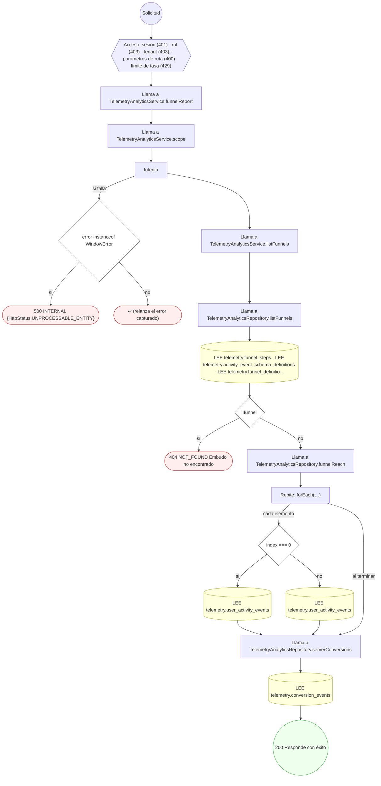

#### 2. GET /admin/analytics/overview

Totales, rutas y eventos principales de la ventana

| HTTP | Código | Cuándo |
|---|---|---|
| 200 | — | Éxito |
| 401 | `UNAUTHENTICATED` | Hay una sesión válida (JWT) |
| 403 | `FORBIDDEN` | El rol está permitido; El tenant se resuelve y pertenece al actor |
| 429 | `RATE_LIMITED` | No se supera el límite de solicitudes |
| 500 | `INTERNAL` | DomainException: {HttpStatus.UNPROCESSABLE_ENTITY} |

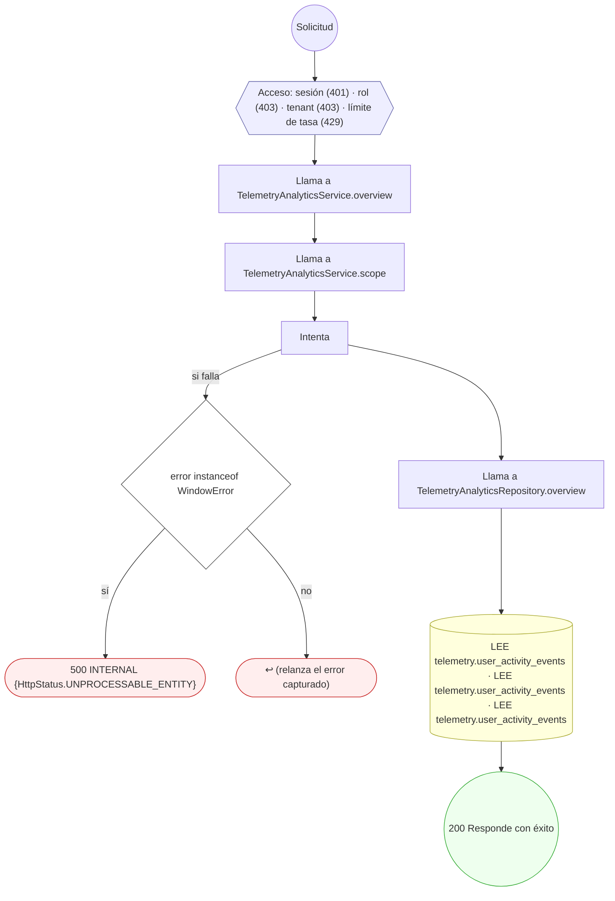

#### 3. GET /admin/analytics/pipeline-health

Frescura, latencia de ingesta, desfase de reloj; lo no medido se declara

| HTTP | Código | Cuándo |
|---|---|---|
| 200 | — | Éxito |
| 401 | `UNAUTHENTICATED` | Hay una sesión válida (JWT) |
| 403 | `FORBIDDEN` | El rol está permitido; El tenant se resuelve y pertenece al actor |
| 429 | `RATE_LIMITED` | No se supera el límite de solicitudes |
| 500 | `INTERNAL` | DomainException: {HttpStatus.UNPROCESSABLE_ENTITY} |

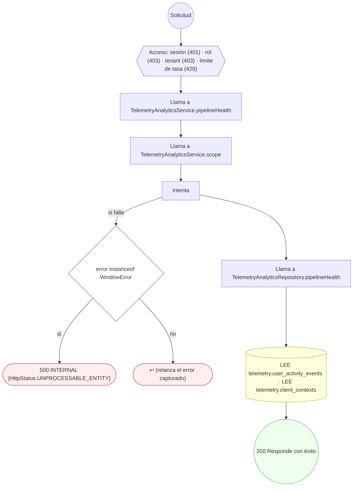

#### 4. GET /admin/analytics/sessions

Sesiones de la ventana (sin identificadores de sesión ni sujeto)

| HTTP | Código | Cuándo |
|---|---|---|
| 200 | — | Éxito |
| 401 | `UNAUTHENTICATED` | Hay una sesión válida (JWT) |
| 403 | `FORBIDDEN` | El rol está permitido; El tenant se resuelve y pertenece al actor |
| 429 | `RATE_LIMITED` | No se supera el límite de solicitudes |
| 500 | `INTERNAL` | DomainException: {HttpStatus.UNPROCESSABLE_ENTITY} |

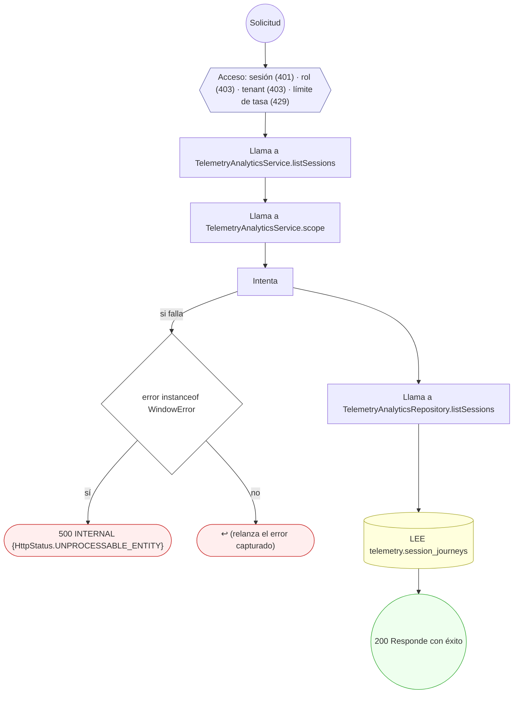

#### 5. GET /admin/analytics/sessions/{id}

Timeline de una sesión: eventos y nombres de propiedad, sin valores

| HTTP | Código | Cuándo |
|---|---|---|
| 200 | — | Éxito |
| 400 | `VALIDATION_FAILED` | Los parámetros de ruta son UUID válidos |
| 401 | `UNAUTHENTICATED` | Hay una sesión válida (JWT) |
| 403 | `FORBIDDEN` | El rol está permitido; El tenant se resuelve y pertenece al actor |
| 404 | `NOT_FOUND` | ResourceNotFoundException: Sesión no encontrada |
| 429 | `RATE_LIMITED` | No se supera el límite de solicitudes |

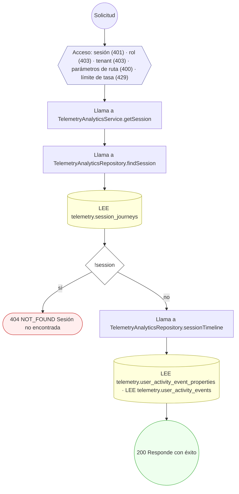

#### 6. GET /admin/analytics/timeseries

Eventos y sesiones por hora o día (UTC), cubos vacíos en 0

| HTTP | Código | Cuándo |
|---|---|---|
| 200 | — | Éxito |
| 401 | `UNAUTHENTICATED` | Hay una sesión válida (JWT) |
| 403 | `FORBIDDEN` | El rol está permitido; El tenant se resuelve y pertenece al actor |
| 429 | `RATE_LIMITED` | No se supera el límite de solicitudes |
| 500 | `INTERNAL` | DomainException: {HttpStatus.UNPROCESSABLE_ENTITY} |

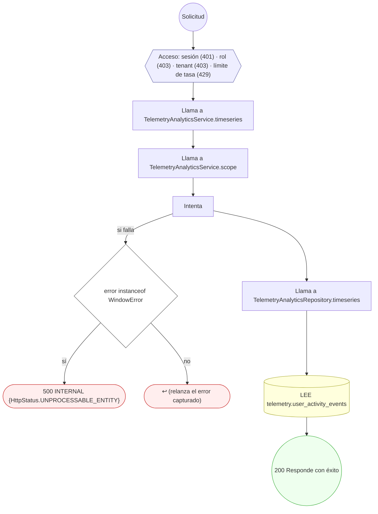

#### 7. GET /admin/analytics/web-vitals

p50/p75/p95 por métrica sobre la distribución, con tamaño de muestra

| HTTP | Código | Cuándo |
|---|---|---|
| 200 | — | Éxito |
| 401 | `UNAUTHENTICATED` | Hay una sesión válida (JWT) |
| 403 | `FORBIDDEN` | El rol está permitido; El tenant se resuelve y pertenece al actor |
| 429 | `RATE_LIMITED` | No se supera el límite de solicitudes |
| 500 | `INTERNAL` | DomainException: {HttpStatus.UNPROCESSABLE_ENTITY} |

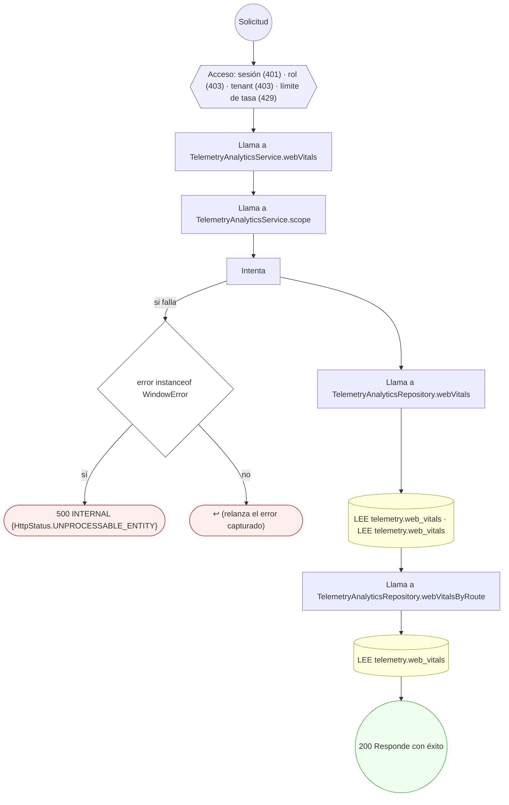

#### 8. POST /telemetry/activity-events

Capturar evento(s) de actividad consent-aware (batch)

| HTTP | Código | Cuándo |
|---|---|---|
| 201 | — | Éxito |
| 400 | `VALIDATION_FAILED` | El cuerpo cumple el DTO (sin propiedades extra) |
| 401 | `UNAUTHENTICATED` | Hay una sesión válida (JWT) |
| 403 | `FORBIDDEN` | El rol está permitido; El tenant se resuelve y pertenece al actor |
| 404 | `NOT_FOUND` | ResourceNotFoundException: Esquema de evento no encontrado; ResourceNotFoundException: Journey de sesión no encontrado |
| 429 | `RATE_LIMITED` | No se supera el límite de solicitudes |

#### 9. POST /telemetry/client-contexts

Registrar contexto de cliente/dispositivo + journey

| HTTP | Código | Cuándo |
|---|---|---|
| 201 | — | Éxito |
| 400 | `VALIDATION_FAILED` | El cuerpo cumple el DTO (sin propiedades extra) |
| 401 | `UNAUTHENTICATED` | Hay una sesión válida (JWT) |
| 403 | `FORBIDDEN` | El rol está permitido; El tenant se resuelve y pertenece al actor |
| 404 | `NOT_FOUND` | ResourceNotFoundException: Journey de sesión no encontrado |
| 429 | `RATE_LIMITED` | No se supera el límite de solicitudes |

#### 10. POST /telemetry/conversion-events

Registrar evento de conversión con atribución

| HTTP | Código | Cuándo |
|---|---|---|
| 201 | — | Éxito |
| 400 | `VALIDATION_FAILED` | El cuerpo cumple el DTO (sin propiedades extra) |
| 401 | `UNAUTHENTICATED` | Hay una sesión válida (JWT) |
| 403 | `FORBIDDEN` | El rol está permitido; El tenant se resuelve y pertenece al actor |
| 404 | `NOT_FOUND` | ResourceNotFoundException: Funnel no encontrado; ResourceNotFoundException: Sujeto de analítica no encontrado |
| 429 | `RATE_LIMITED` | No se supera el límite de solicitudes |

#### 11. POST /telemetry/disclosure-acceptances

Registrar aceptación de disclosure por usuario/sesión

| HTTP | Código | Cuándo |
|---|---|---|
| 201 | — | Éxito |
| 400 | `VALIDATION_FAILED` | El cuerpo cumple el DTO (sin propiedades extra) |
| 401 | `UNAUTHENTICATED` | Hay una sesión válida (JWT) |
| 403 | `FORBIDDEN` | El rol está permitido; El tenant se resuelve y pertenece al actor |
| 404 | `NOT_FOUND` | ResourceNotFoundException: Versión de disclosure no encontrada |
| 429 | `RATE_LIMITED` | No se supera el límite de solicitudes |

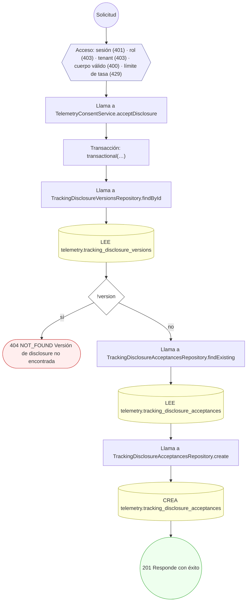

#### 12. POST /telemetry/disclosure-versions

Publicar versión de disclosure de tracking

| HTTP | Código | Cuándo |
|---|---|---|
| 201 | — | Éxito |
| 400 | `VALIDATION_FAILED` | El cuerpo cumple el DTO (sin propiedades extra) |
| 401 | `UNAUTHENTICATED` | Hay una sesión válida (JWT) |
| 403 | `FORBIDDEN` | El rol está permitido; El tenant se resuelve y pertenece al actor |
| 409 | `CONFLICT` | ConflictException: Ya existe esa versión del documento |
| 429 | `RATE_LIMITED` | No se supera el límite de solicitudes |

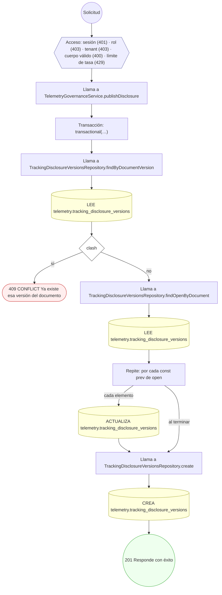

#### 13. POST /telemetry/event-schemas

Registrar esquema de evento de actividad (versionado)

| HTTP | Código | Cuándo |
|---|---|---|
| 201 | — | Éxito |
| 400 | `VALIDATION_FAILED` | El cuerpo cumple el DTO (sin propiedades extra) |
| 401 | `UNAUTHENTICATED` | Hay una sesión válida (JWT) |
| 403 | `FORBIDDEN` | El rol está permitido; El tenant se resuelve y pertenece al actor |
| 404 | `NOT_FOUND` | ResourceNotFoundException: Propósito de tracking no encontrado |
| 409 | `CONFLICT` | ConflictException: Ya existe un esquema con ese nombre y versión |
| 422 | `PRECONDITION_FAILED` | PreconditionFailedException: El propósito de tracking no está activo |
| 429 | `RATE_LIMITED` | No se supera el límite de solicitudes |

#### 14. POST /telemetry/funnels

Definir funnel y sus pasos

| HTTP | Código | Cuándo |
|---|---|---|
| 201 | — | Éxito |
| 400 | `VALIDATION_FAILED` | El cuerpo cumple el DTO (sin propiedades extra) |
| 401 | `UNAUTHENTICATED` | Hay una sesión válida (JWT) |
| 403 | `FORBIDDEN` | El rol está permitido; El tenant se resuelve y pertenece al actor |
| 404 | `NOT_FOUND` | ResourceNotFoundException: Propósito de tracking no encontrado |
| 409 | `CONFLICT` | ConflictException: El código de funnel ya existe |
| 422 | `PRECONDITION_FAILED` | PreconditionFailedException: Esquema de evento de un paso no existe |
| 429 | `RATE_LIMITED` | No se supera el límite de solicitudes |

#### 15. POST /telemetry/session-journeys/{id}/close

Cerrar journey de sesión y consolidar métricas

| HTTP | Código | Cuándo |
|---|---|---|
| 200 | — | Éxito |
| 400 | `VALIDATION_FAILED` | Los parámetros de ruta son UUID válidos; El cuerpo cumple el DTO (sin propiedades extra) |
| 401 | `UNAUTHENTICATED` | Hay una sesión válida (JWT) |
| 403 | `FORBIDDEN` | El rol está permitido; El tenant se resuelve y pertenece al actor |
| 404 | `NOT_FOUND` | ResourceNotFoundException: Journey de sesión no encontrado |
| 422 | `PRECONDITION_FAILED` | PreconditionFailedException: El journey ya está cerrado |
| 429 | `RATE_LIMITED` | No se supera el límite de solicitudes |

#### 16. POST /telemetry/tracking-consents

Otorgar consentimiento de tracking por propósito

| HTTP | Código | Cuándo |
|---|---|---|
| 201 | — | Éxito |
| 400 | `VALIDATION_FAILED` | El cuerpo cumple el DTO (sin propiedades extra) |
| 401 | `UNAUTHENTICATED` | Hay una sesión válida (JWT) |
| 403 | `FORBIDDEN` | El rol está permitido; El tenant se resuelve y pertenece al actor |
| 404 | `NOT_FOUND` | ResourceNotFoundException: Propósito de tracking no encontrado |
| 422 | `PRECONDITION_FAILED` | PreconditionFailedException: El propósito no requiere consentimiento |
| 429 | `RATE_LIMITED` | No se supera el límite de solicitudes |

#### 17. POST /telemetry/tracking-consents/{id}/withdraw

Retirar consentimiento y desactivar sujeto (cascada)

| HTTP | Código | Cuándo |
|---|---|---|
| 200 | — | Éxito |
| 400 | `VALIDATION_FAILED` | Los parámetros de ruta son UUID válidos |
| 401 | `UNAUTHENTICATED` | Hay una sesión válida (JWT) |
| 403 | `FORBIDDEN` | El rol está permitido; El tenant se resuelve y pertenece al actor |
| 404 | `NOT_FOUND` | ResourceNotFoundException: Consentimiento no encontrado |
| 422 | `PRECONDITION_FAILED` | PreconditionFailedException: No hay un consentimiento vigente que retirar |
| 429 | `RATE_LIMITED` | No se supera el límite de solicitudes |

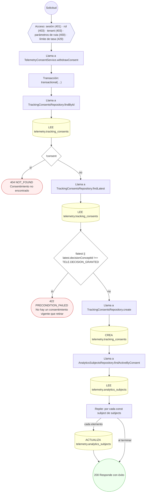

#### 18. POST /telemetry/tracking-purposes

Definir propósito de tracking y base legal

| HTTP | Código | Cuándo |
|---|---|---|
| 201 | — | Éxito |
| 400 | `VALIDATION_FAILED` | El cuerpo cumple el DTO (sin propiedades extra) |
| 401 | `UNAUTHENTICATED` | Hay una sesión válida (JWT) |
| 403 | `FORBIDDEN` | El rol está permitido; El tenant se resuelve y pertenece al actor |
| 409 | `CONFLICT` | ConflictException: El código de propósito ya existe |
| 429 | `RATE_LIMITED` | No se supera el límite de solicitudes |

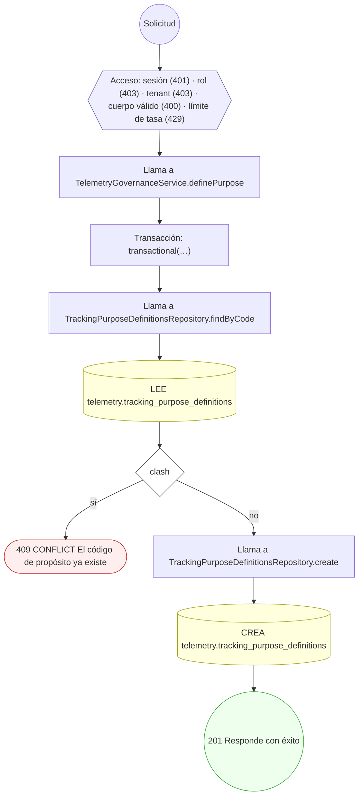

#### 19. POST /telemetry/web-vitals

Registrar métricas Core Web Vitals por ruta (batch)

| HTTP | Código | Cuándo |
|---|---|---|
| 201 | — | Éxito |
| 400 | `VALIDATION_FAILED` | El cuerpo cumple el DTO (sin propiedades extra) |
| 401 | `UNAUTHENTICATED` | Hay una sesión válida (JWT) |
| 403 | `FORBIDDEN` | El rol está permitido; El tenant se resuelve y pertenece al actor |
| 404 | `NOT_FOUND` | ResourceNotFoundException: Journey de sesión no encontrado |
| 429 | `RATE_LIMITED` | No se supera el límite de solicitudes |

### Operaciones sin decisiones propias

Sólo comprueban el acceso y leen o escriben: no tienen ramas que dibujar. Su detalle está en la ficha de endpoints.

| Operación | Respuestas posibles | Tablas |
|---|---|---|
| GET /admin/analytics/funnels | 200, 401, 403, 429 | 3 |
| POST /telemetry/analytics-subjects | 201, 400, 401, 403, 429 | 2 |
| GET /telemetry/tracking-consents/me | 200, 400, 401, 403, 429 | 1 |
