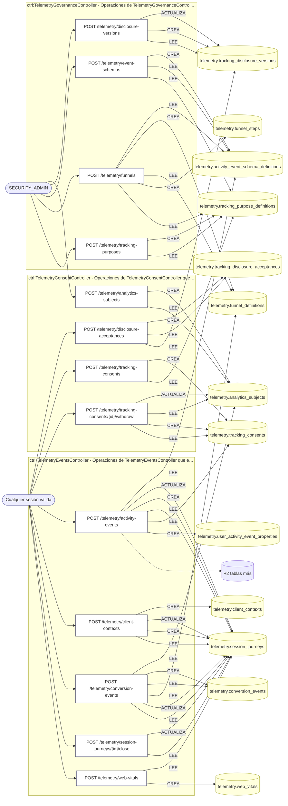
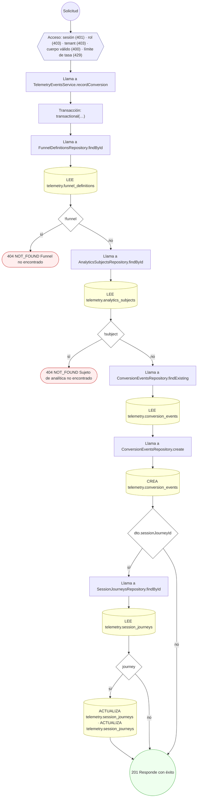
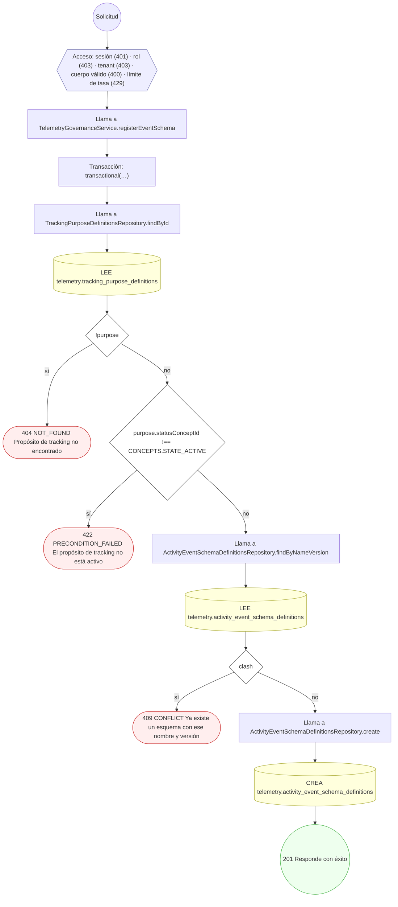
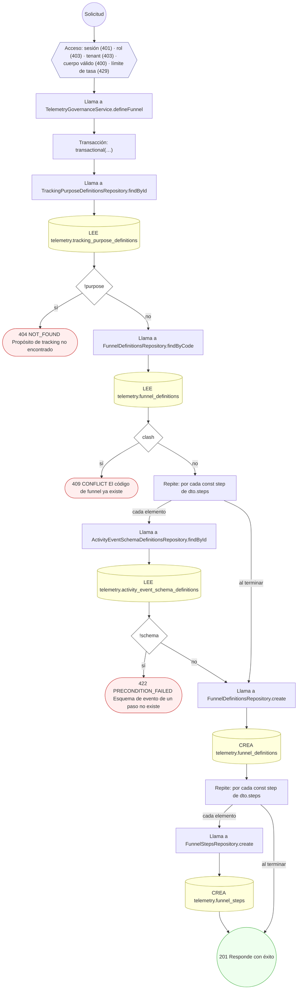
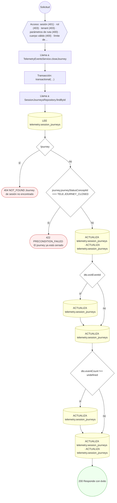
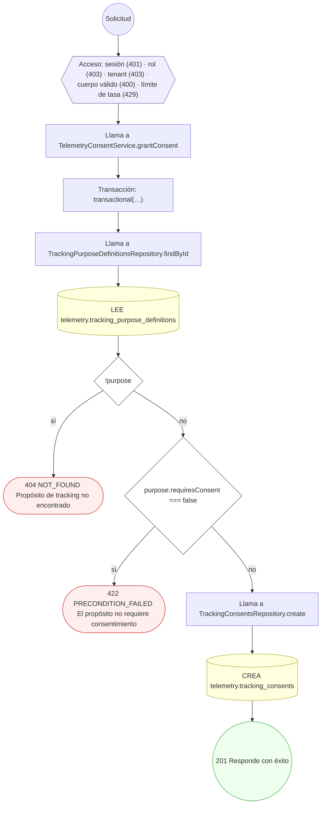
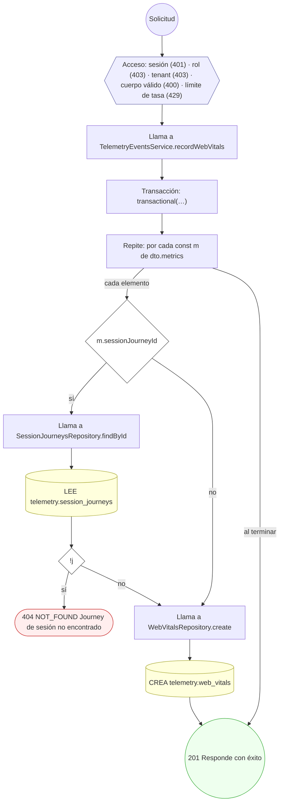

<!-- AUTOGENERADO por tools/inventario/flujos.mjs. No editar manualmente. -->

# Flujos del módulo `telemetry`

- **Procesos:** 1 · **Máquinas de estado:** 0
- **Operaciones:** 13 (12 con decisiones propias, 1 sin ellas)
- Inventario de endpoints del módulo: [telemetry](../endpoints/telemetry.md)

## Proceso: src / modules / telemetry

- **Código:** `telemetry` · **Agrupación:** AGRUPACION_POR_CONTROLADOR · **Operaciones:** 13
- **Actores:** Cualquier sesión válida · SECURITY_ADMIN
- **Revisión:** AUTO_DETECTADA
- **Fuentes:** `src/modules/telemetry/README.md`

### Para qué sirve

Agrupa los componentes relacionados con **telemetry** y mantiene cohesionada esta responsabilidad del sistema.

_Fuente: `src/modules/telemetry/README.md:3`_

### Etapas y operaciones

| Etapa | Descripción | Operación | Quién actúa | Riesgo | Tablas |
|---|---|---|---|---|---|
| `ctrl:TelemetryConsentController` | Operaciones de TelemetryConsentController que el README no asigna a un caso de uso | POST /telemetry/analytics-subjects | SECURITY_ADMIN | MEDIO | 2 |
|  |  | POST /telemetry/disclosure-acceptances | Cualquier sesión válida | ALTO | 3 |
|  |  | POST /telemetry/tracking-consents | Cualquier sesión válida | ALTO | 2 |
|  |  | POST /telemetry/tracking-consents/{id}/withdraw | Cualquier sesión válida | ALTO | 4 |
| `ctrl:TelemetryEventsController` | Operaciones de TelemetryEventsController que el README no asigna a un caso de uso | POST /telemetry/activity-events | Cualquier sesión válida | ALTO | 8 |
|  |  | POST /telemetry/client-contexts | Cualquier sesión válida | ALTO | 4 |
|  |  | POST /telemetry/conversion-events | Cualquier sesión válida | ALTO | 6 |
|  |  | POST /telemetry/session-journeys/{id}/close | Cualquier sesión válida | ALTO | 2 |
|  |  | POST /telemetry/web-vitals | Cualquier sesión válida | ALTO | 2 |
| `ctrl:TelemetryGovernanceController` | Operaciones de TelemetryGovernanceController que el README no asigna a un caso de uso | POST /telemetry/disclosure-versions | SECURITY_ADMIN | MEDIO | 3 |
|  |  | POST /telemetry/event-schemas | SECURITY_ADMIN | MEDIO | 3 |
|  |  | POST /telemetry/funnels | SECURITY_ADMIN | MEDIO | 5 |
|  |  | POST /telemetry/tracking-purposes | SECURITY_ADMIN | MEDIO | 2 |

### Diagrama — etapas `ctrl:TelemetryConsentController`, `ctrl:TelemetryEventsController`, `ctrl:TelemetryGovernanceController`

## Árbol de decisión por operación

Cada árbol se deriva del código del handler y de los métodos que invoca (hasta 4 niveles). Una rama que no decide, no escribe y no falla se poda. Los accesos y los efectos consecutivos se agrupan en un solo nodo.

### Operaciones con decisiones propias

#### 1. POST /telemetry/activity-events

Capturar evento(s) de actividad consent-aware (batch)

| HTTP | Código | Cuándo |
|---|---|---|
| 201 | — | Éxito |
| 400 | `VALIDATION_FAILED` | El cuerpo cumple el DTO (sin propiedades extra) |
| 401 | `UNAUTHENTICATED` | Hay una sesión válida (JWT) |
| 403 | `FORBIDDEN` | El rol está permitido; El tenant se resuelve y pertenece al actor |
| 404 | `NOT_FOUND` | ResourceNotFoundException: Esquema de evento no encontrado; ResourceNotFoundException: Journey de sesión no encontrado |
| 429 | `RATE_LIMITED` | No se supera el límite de solicitudes |

```mermaid
flowchart TD
  n1(("Solicitud")):::inicio
  n2{{"Acceso: sesión (401) · rol (403) · tenant (403) · cuerpo válido (400) · límite de tasa (429)"}}:::acceso
  n1 --> n2
  n3["Llama a TelemetryEventsService.captureActivityEvents"]:::llamada
  n2 --> n3
  n4["Transacción: transactional(…)"]:::transaccion
  n3 --> n4
  n5["Repite: por cada const item de dto.events"]:::bucle
  n4 --> n5
  n6["Llama a ActivityEventSchemaDefinitionsRepository.findById"]:::llamada
  n5 -->|"cada elemento"| n6
  n7[("LEE telemetry.activity_event_schema_definitions")]:::efecto
  n6 --> n7
  n8{"!schema"}:::decision
  n7 --> n8
  n9(["404 NOT_FOUND Esquema de evento no encontrado"]):::error
  n8 -->|"sí"| n9
  n10["Llama a TelemetryEventsService.consentAllows"]:::llamada
  n8 -->|"no"| n10
  n11["Llama a TrackingConsentsRepository.findLatest"]:::llamada
  n10 --> n11
  n12[("LEE telemetry.tracking_consents")]:::efecto
  n11 --> n12
  n13{"item.eventIdempotencyKey"}:::decision
  n12 --> n13
  n14["Llama a UserActivityEventsRepository.findByIdempotencyKey"]:::llamada
  n13 -->|"sí"| n14
  n15[("LEE telemetry.user_activity_events")]:::efecto
  n14 --> n15
  n16["Llama a TelemetryEventsService.resolveJourney"]:::llamada
  n15 --> n16
  n13 -->|"no"| n16
  n17{"opts.sessionJourneyId"}:::decision
  n16 --> n17
  n18["Llama a SessionJourneysRepository.findById"]:::llamada
  n17 -->|"sí"| n18
  n19[("LEE telemetry.session_journeys")]:::efecto
  n18 --> n19
  n20{"!found"}:::decision
  n19 --> n20
  n21(["404 NOT_FOUND Journey de sesión no encontrado"]):::error
  n20 -->|"sí"| n21
  n22{"opts.sessionId"}:::decision
  n20 -->|"no"| n22
  n17 -->|"no"| n22
  n23["Llama a SessionJourneysRepository.findOpenBySession"]:::llamada
  n22 -->|"sí"| n23
  n24[("LEE telemetry.session_journeys")]:::efecto
  n23 --> n24
  n25["Llama a SessionJourneysRepository.create"]:::llamada
  n24 --> n25
  n22 -->|"no"| n25
  n26[("CREA telemetry.session_journeys")]:::efecto
  n25 --> n26
  n27["Llama a UserActivityEventsRepository.create"]:::llamada
  n26 --> n27
  n28[("CREA telemetry.user_activity_events")]:::efecto
  n27 --> n28
  n29["Repite: por cada const prop de item.properties ?? []"]:::bucle
  n28 --> n29
  n30["Llama a UserActivityEventPropertiesRepository.create"]:::llamada
  n29 -->|"cada elemento"| n30
  n31[("CREA telemetry.user_activity_event_properties")]:::efecto
  n30 --> n31
  n32{"journey"}:::decision
  n31 --> n32
  n29 -->|"al terminar"| n32
  n33[("ACTUALIZA telemetry.session_journeys")]:::efecto
  n32 -->|"sí"| n33
  n34{"!journey.entryEventId"}:::decision
  n33 --> n34
  n35[("ACTUALIZA telemetry.session_journeys")]:::efecto
  n34 -->|"sí"| n35
  n36[("ACTUALIZA telemetry.session_journeys · ACTUALIZA telemetry.session_journeys · ACTUALIZA telemetry.session_jou…")]:::efecto
  n35 --> n36
  n34 -->|"no"| n36
  n37(("201 Responde con éxito")):::ok
  n36 --> n37
  n32 -->|"no"| n37
  n5 -->|"al terminar"| n37
  classDef acceso fill:#eef,stroke:#66a
  classDef error fill:#fee,stroke:#c33
  classDef ok fill:#efe,stroke:#3a3
  classDef efecto fill:#ffd,stroke:#aa3
  classDef decision fill:#fff,stroke:#555
  classDef corte fill:#eee,stroke:#999,stroke-dasharray: 4
```

#### 2. POST /telemetry/client-contexts

Registrar contexto de cliente/dispositivo + journey

| HTTP | Código | Cuándo |
|---|---|---|
| 201 | — | Éxito |
| 400 | `VALIDATION_FAILED` | El cuerpo cumple el DTO (sin propiedades extra) |
| 401 | `UNAUTHENTICATED` | Hay una sesión válida (JWT) |
| 403 | `FORBIDDEN` | El rol está permitido; El tenant se resuelve y pertenece al actor |
| 404 | `NOT_FOUND` | ResourceNotFoundException: Journey de sesión no encontrado |
| 429 | `RATE_LIMITED` | No se supera el límite de solicitudes |

```mermaid
flowchart TD
  n1(("Solicitud")):::inicio
  n2{{"Acceso: sesión (401) · rol (403) · tenant (403) · cuerpo válido (400) · límite de tasa (429)"}}:::acceso
  n1 --> n2
  n3["Llama a TelemetryEventsService.captureClientContext"]:::llamada
  n2 --> n3
  n4["Transacción: transactional(…)"]:::transaccion
  n3 --> n4
  n5["Llama a TelemetryEventsService.resolveJourney"]:::llamada
  n4 --> n5
  n6{"opts.sessionJourneyId"}:::decision
  n5 --> n6
  n7["Llama a SessionJourneysRepository.findById"]:::llamada
  n6 -->|"sí"| n7
  n8[("LEE telemetry.session_journeys")]:::efecto
  n7 --> n8
  n9{"!found"}:::decision
  n8 --> n9
  n10(["404 NOT_FOUND Journey de sesión no encontrado"]):::error
  n9 -->|"sí"| n10
  n11{"opts.sessionId"}:::decision
  n9 -->|"no"| n11
  n6 -->|"no"| n11
  n12["Llama a SessionJourneysRepository.findOpenBySession"]:::llamada
  n11 -->|"sí"| n12
  n13[("LEE telemetry.session_journeys")]:::efecto
  n12 --> n13
  n14["Llama a SessionJourneysRepository.create"]:::llamada
  n13 --> n14
  n11 -->|"no"| n14
  n15[("CREA telemetry.session_journeys")]:::efecto
  n14 --> n15
  n16["Llama a ClientContextsRepository.create"]:::llamada
  n15 --> n16
  n17[("CREA telemetry.client_contexts")]:::efecto
  n16 --> n17
  n18{"journey"}:::decision
  n17 --> n18
  n19[("ACTUALIZA telemetry.session_journeys")]:::efecto
  n18 -->|"sí"| n19
  n20{"!journey.startedAt"}:::decision
  n19 --> n20
  n21[("ACTUALIZA telemetry.session_journeys")]:::efecto
  n20 -->|"sí"| n21
  n22[("ACTUALIZA telemetry.session_journeys")]:::efecto
  n21 --> n22
  n20 -->|"no"| n22
  n23(("201 Responde con éxito")):::ok
  n22 --> n23
  n18 -->|"no"| n23
  classDef acceso fill:#eef,stroke:#66a
  classDef error fill:#fee,stroke:#c33
  classDef ok fill:#efe,stroke:#3a3
  classDef efecto fill:#ffd,stroke:#aa3
  classDef decision fill:#fff,stroke:#555
  classDef corte fill:#eee,stroke:#999,stroke-dasharray: 4
```

#### 3. POST /telemetry/conversion-events

Registrar evento de conversión con atribución

| HTTP | Código | Cuándo |
|---|---|---|
| 201 | — | Éxito |
| 400 | `VALIDATION_FAILED` | El cuerpo cumple el DTO (sin propiedades extra) |
| 401 | `UNAUTHENTICATED` | Hay una sesión válida (JWT) |
| 403 | `FORBIDDEN` | El rol está permitido; El tenant se resuelve y pertenece al actor |
| 404 | `NOT_FOUND` | ResourceNotFoundException: Funnel no encontrado; ResourceNotFoundException: Sujeto de analítica no encontrado |
| 429 | `RATE_LIMITED` | No se supera el límite de solicitudes |

#### 4. POST /telemetry/disclosure-acceptances

Registrar aceptación de disclosure por usuario/sesión

| HTTP | Código | Cuándo |
|---|---|---|
| 201 | — | Éxito |
| 400 | `VALIDATION_FAILED` | El cuerpo cumple el DTO (sin propiedades extra) |
| 401 | `UNAUTHENTICATED` | Hay una sesión válida (JWT) |
| 403 | `FORBIDDEN` | El rol está permitido; El tenant se resuelve y pertenece al actor |
| 404 | `NOT_FOUND` | ResourceNotFoundException: Versión de disclosure no encontrada |
| 429 | `RATE_LIMITED` | No se supera el límite de solicitudes |

#### 5. POST /telemetry/disclosure-versions

Publicar versión de disclosure de tracking

| HTTP | Código | Cuándo |
|---|---|---|
| 201 | — | Éxito |
| 400 | `VALIDATION_FAILED` | El cuerpo cumple el DTO (sin propiedades extra) |
| 401 | `UNAUTHENTICATED` | Hay una sesión válida (JWT) |
| 403 | `FORBIDDEN` | El rol está permitido; El tenant se resuelve y pertenece al actor |
| 409 | `CONFLICT` | ConflictException: Ya existe esa versión del documento |
| 429 | `RATE_LIMITED` | No se supera el límite de solicitudes |

#### 6. POST /telemetry/event-schemas

Registrar esquema de evento de actividad (versionado)

| HTTP | Código | Cuándo |
|---|---|---|
| 201 | — | Éxito |
| 400 | `VALIDATION_FAILED` | El cuerpo cumple el DTO (sin propiedades extra) |
| 401 | `UNAUTHENTICATED` | Hay una sesión válida (JWT) |
| 403 | `FORBIDDEN` | El rol está permitido; El tenant se resuelve y pertenece al actor |
| 404 | `NOT_FOUND` | ResourceNotFoundException: Propósito de tracking no encontrado |
| 409 | `CONFLICT` | ConflictException: Ya existe un esquema con ese nombre y versión |
| 422 | `PRECONDITION_FAILED` | PreconditionFailedException: El propósito de tracking no está activo |
| 429 | `RATE_LIMITED` | No se supera el límite de solicitudes |

#### 7. POST /telemetry/funnels

Definir funnel y sus pasos

| HTTP | Código | Cuándo |
|---|---|---|
| 201 | — | Éxito |
| 400 | `VALIDATION_FAILED` | El cuerpo cumple el DTO (sin propiedades extra) |
| 401 | `UNAUTHENTICATED` | Hay una sesión válida (JWT) |
| 403 | `FORBIDDEN` | El rol está permitido; El tenant se resuelve y pertenece al actor |
| 404 | `NOT_FOUND` | ResourceNotFoundException: Propósito de tracking no encontrado |
| 409 | `CONFLICT` | ConflictException: El código de funnel ya existe |
| 422 | `PRECONDITION_FAILED` | PreconditionFailedException: Esquema de evento de un paso no existe |
| 429 | `RATE_LIMITED` | No se supera el límite de solicitudes |

#### 8. POST /telemetry/session-journeys/{id}/close

Cerrar journey de sesión y consolidar métricas

| HTTP | Código | Cuándo |
|---|---|---|
| 200 | — | Éxito |
| 400 | `VALIDATION_FAILED` | Los parámetros de ruta son UUID válidos; El cuerpo cumple el DTO (sin propiedades extra) |
| 401 | `UNAUTHENTICATED` | Hay una sesión válida (JWT) |
| 403 | `FORBIDDEN` | El rol está permitido; El tenant se resuelve y pertenece al actor |
| 404 | `NOT_FOUND` | ResourceNotFoundException: Journey de sesión no encontrado |
| 422 | `PRECONDITION_FAILED` | PreconditionFailedException: El journey ya está cerrado |
| 429 | `RATE_LIMITED` | No se supera el límite de solicitudes |

#### 9. POST /telemetry/tracking-consents

Otorgar consentimiento de tracking por propósito

| HTTP | Código | Cuándo |
|---|---|---|
| 201 | — | Éxito |
| 400 | `VALIDATION_FAILED` | El cuerpo cumple el DTO (sin propiedades extra) |
| 401 | `UNAUTHENTICATED` | Hay una sesión válida (JWT) |
| 403 | `FORBIDDEN` | El rol está permitido; El tenant se resuelve y pertenece al actor |
| 404 | `NOT_FOUND` | ResourceNotFoundException: Propósito de tracking no encontrado |
| 422 | `PRECONDITION_FAILED` | PreconditionFailedException: El propósito no requiere consentimiento |
| 429 | `RATE_LIMITED` | No se supera el límite de solicitudes |

#### 10. POST /telemetry/tracking-consents/{id}/withdraw

Retirar consentimiento y desactivar sujeto (cascada)

| HTTP | Código | Cuándo |
|---|---|---|
| 200 | — | Éxito |
| 400 | `VALIDATION_FAILED` | Los parámetros de ruta son UUID válidos |
| 401 | `UNAUTHENTICATED` | Hay una sesión válida (JWT) |
| 403 | `FORBIDDEN` | El rol está permitido; El tenant se resuelve y pertenece al actor |
| 404 | `NOT_FOUND` | ResourceNotFoundException: Consentimiento no encontrado |
| 422 | `PRECONDITION_FAILED` | PreconditionFailedException: No hay un consentimiento vigente que retirar |
| 429 | `RATE_LIMITED` | No se supera el límite de solicitudes |

#### 11. POST /telemetry/tracking-purposes

Definir propósito de tracking y base legal

| HTTP | Código | Cuándo |
|---|---|---|
| 201 | — | Éxito |
| 400 | `VALIDATION_FAILED` | El cuerpo cumple el DTO (sin propiedades extra) |
| 401 | `UNAUTHENTICATED` | Hay una sesión válida (JWT) |
| 403 | `FORBIDDEN` | El rol está permitido; El tenant se resuelve y pertenece al actor |
| 409 | `CONFLICT` | ConflictException: El código de propósito ya existe |
| 429 | `RATE_LIMITED` | No se supera el límite de solicitudes |

#### 12. POST /telemetry/web-vitals

Registrar métricas Core Web Vitals por ruta (batch)

| HTTP | Código | Cuándo |
|---|---|---|
| 201 | — | Éxito |
| 400 | `VALIDATION_FAILED` | El cuerpo cumple el DTO (sin propiedades extra) |
| 401 | `UNAUTHENTICATED` | Hay una sesión válida (JWT) |
| 403 | `FORBIDDEN` | El rol está permitido; El tenant se resuelve y pertenece al actor |
| 404 | `NOT_FOUND` | ResourceNotFoundException: Journey de sesión no encontrado |
| 429 | `RATE_LIMITED` | No se supera el límite de solicitudes |

### Operaciones sin decisiones propias

Sólo comprueban el acceso y leen o escriben: no tienen ramas que dibujar. Su detalle está en la ficha de endpoints.

| Operación | Respuestas posibles | Tablas |
|---|---|---|
| POST /telemetry/analytics-subjects | 201, 400, 401, 403, 429 | 2 |
