<!-- AUTOGENERADO por tools/inventario/flujos.mjs. No editar manualmente. -->

# Flujos del módulo `terminology`

- **Procesos:** 1 · **Máquinas de estado:** 0
- **Operaciones:** 25 (21 con decisiones propias, 4 sin ellas)
- Inventario de endpoints del módulo: [terminology](../endpoints/terminology.md)

## Proceso: Terminology module

- **Código:** `terminology` · **Agrupación:** AGRUPACION_POR_CONTROLADOR · **Operaciones:** 25
- **Actores:** Cualquier sesión válida · Público (sin sesión) · SECURITY_ADMIN
- **Revisión:** AUTO_DETECTADA
- **Fuentes:** `src/modules/terminology/README.md`

### Para qué sirve

Administración de los catálogos de terminología de la plataforma: fuentes, sistemas de códigos y sus versiones, conceptos (con designaciones, propiedades y relaciones), conjuntos de valores con su expansión, mapeos entre sistemas y la política de catálogo de cada tenant. El esquema es *concept-driven*: estados y tipos no son enums de columna sino filas de `terminology.catalog_concepts` referenciadas por FK (`*_concept_id`), resueltas desde `CONCEPTS` (`src/common`).

_Fuente: `src/modules/terminology/README.md:3`_

### Etapas y operaciones

| Etapa | Descripción | Operación | Quién actúa | Riesgo | Tablas |
|---|---|---|---|---|---|
| `ctrl:TerminologyCodeSystemsController` | Operaciones de TerminologyCodeSystemsController que el README no asigna a un caso de uso | GET /terminology/code-systems | SECURITY_ADMIN | BAJO | 1 |
|  |  | POST /terminology/code-systems | SECURITY_ADMIN | MEDIO | 4 |
|  |  | GET /terminology/code-systems/{id}/versions | SECURITY_ADMIN | BAJO | 1 |
|  |  | POST /terminology/code-systems/{id}/versions | SECURITY_ADMIN | MEDIO | 3 |
| `ctrl:TerminologyConceptsController` | Operaciones de TerminologyConceptsController que el README no asigna a un caso de uso | GET /terminology/concepts | Cualquier sesión válida | BAJO | 7 |
|  |  | GET /terminology/concepts/{conceptId} | Cualquier sesión válida | BAJO | 7 |
|  |  | POST /terminology/concepts/{conceptId}/$deprecate | SECURITY_ADMIN | MEDIO | 4 |
|  |  | POST /terminology/concepts/{conceptId}/designations | SECURITY_ADMIN | MEDIO | 5 |
|  |  | GET /terminology/concepts/{conceptId}/glossary-article | Cualquier sesión válida | BAJO | 1 |
|  |  | GET /terminology/concepts/{conceptId}/glossary-neighborhood | Cualquier sesión válida | BAJO | 7 |
|  |  | POST /terminology/concepts/{conceptId}/properties | SECURITY_ADMIN | MEDIO | 4 |
|  |  | POST /terminology/concepts/{conceptId}/relationships | SECURITY_ADMIN | MEDIO | 3 |
|  |  | GET /terminology/concepts/glossary-graph | Cualquier sesión válida | BAJO | 7 |
| `ctrl:TerminologyFhirController` | Operaciones de TerminologyFhirController que el README no asigna a un caso de uso | GET /terminology/CodeSystem/$lookup | Cualquier sesión válida | BAJO | 5 |
|  |  | POST /terminology/ConceptMap/$translate | Cualquier sesión válida | ALTO | 4 |
|  |  | POST /terminology/ValueSet/{id}/$expand | SECURITY_ADMIN | ALTO | 10 |
| `ctrl:TerminologyImportTemplateController` | Operaciones de TerminologyImportTemplateController que el README no asigna a un caso de uso | GET /terminology/import-template | SECURITY_ADMIN | BAJO | 0 |
| `ctrl:TerminologyTenantCatalogController` | Operaciones de TerminologyTenantCatalogController que el README no asigna a un caso de uso | PUT /terminology/tenants/{tenantId}/catalog-policies | SECURITY_ADMIN | MEDIO | 8 |
| `ctrl:TerminologyValueSetsController` | Operaciones de TerminologyValueSetsController que el README no asigna a un caso de uso | GET /terminology/value-sets | Público (sin sesión) | BAJO | 3 |
|  |  | POST /terminology/value-sets | SECURITY_ADMIN | MEDIO | 4 |
|  |  | GET /terminology/value-sets/{id}/$expand | Público (sin sesión) | BAJO | 5 |
|  |  | GET /terminology/value-sets/$glossary-facets | Público (sin sesión) | BAJO | 5 |
| `ctrl:TerminologyVersionsController` | Operaciones de TerminologyVersionsController que el README no asigna a un caso de uso | POST /terminology/versions/{versionId}/import | SECURITY_ADMIN | MEDIO | 3 |
|  |  | POST /terminology/versions/{versionId}/import-file | SECURITY_ADMIN | MEDIO | 7 |
|  |  | POST /terminology/versions/{versionId}/publish | SECURITY_ADMIN | MEDIO | 4 |

### Diagrama — etapas `ctrl:TerminologyCodeSystemsController`, `ctrl:TerminologyConceptsController`, `ctrl:TerminologyFhirController`…

```mermaid
flowchart LR
  a2(["SECURITY_ADMIN"]):::actor
  a10(["Cualquier sesión válida"]):::actor
  a40(["Público (sin sesión)"]):::actor
  t3[("terminology.code_systems")]:::tabla
  t5[("terminology.terminology_sources")]:::tabla
  t7[("terminology.code_system_versions")]:::tabla
  t11[("terminology.catalog_concepts")]:::tabla
  t12[("terminology.concept_designations")]:::tabla
  t13[("terminology.concept_properties")]:::tabla
  t14[("terminology.concept_relationships")]:::tabla
  t15[("terminology.value_set_members")]:::tabla
  t16[("terminology.value_set_versions")]:::tabla
  t31[("terminology.concept_maps")]:::tabla
  t36[("terminology.tenant_catalog_policies")]:::tabla
  t37[("terminology.tenant_concept_config")]:::tabla
  t41[("terminology.value_sets")]:::tabla
  t43[("terminology.value_set_rules")]:::tabla
  t48[("terminology.catalog_import_batches")]:::tabla
  subgraph s0["ctrl:TerminologyCodeSystemsController · Operaciones de TerminologyCodeSystemsCo…"]
    o1["GET /terminology/code-systems"]:::op
    o4["POST /terminology/code-systems"]:::op
    o6["GET /terminology/code-systems/{id}/versions"]:::op
    o8["POST /terminology/code-systems/{id}/versions"]:::op
  end
  t17[("+1 tablas más")]
  t19[("+1 tablas más")]
  t24[("+1 tablas más")]
  t28[("+1 tablas más")]
  subgraph s1["ctrl:TerminologyConceptsController · Operaciones de TerminologyConceptsControll…"]
    o9["GET /terminology/concepts"]:::op
    o18["GET /terminology/concepts/{conceptId}"]:::op
    o20["POST /terminology/concepts/{conceptId}/$deprecate"]:::op
    o21["POST /terminology/concepts/{conceptId}/designations"]:::op
    o22["GET /terminology/concepts/{conceptId}/glossary-article"]:::op
    o23["GET /terminology/concepts/{conceptId}/glossary-neighborhood"]:::op
    o25["POST /terminology/concepts/{conceptId}/properties"]:::op
    o26["POST /terminology/concepts/{conceptId}/relationships"]:::op
    o27["GET /terminology/concepts/glossary-graph"]:::op
  end
  t33[("+4 tablas más")]
  subgraph s2["ctrl:TerminologyFhirController · Operaciones de TerminologyFhirController que e…"]
    o29["GET /terminology/CodeSystem/$lookup"]:::op
    o30["POST /terminology/ConceptMap/$translate"]:::op
    o32["POST /terminology/ValueSet/{id}/$expand"]:::op
  end
  subgraph s3["ctrl:TerminologyImportTemplateController · Operaciones de TerminologyImportTemp…"]
    o34["GET /terminology/import-template"]:::op
  end
  t38[("+2 tablas más")]
  subgraph s4["ctrl:TerminologyTenantCatalogController · Operaciones de TerminologyTenantCatal…"]
    o35["PUT /terminology/tenants/{tenantId}/catalog-policies"]:::op
  end
  subgraph s5["ctrl:TerminologyValueSetsController · Operaciones de TerminologyValueSetsContro…"]
    o39["GET /terminology/value-sets"]:::op
    o42["POST /terminology/value-sets"]:::op
    o44["GET /terminology/value-sets/{id}/$expand"]:::op
    o45["GET /terminology/value-sets/$glossary-facets"]:::op
  end
  t49[("+1 tablas más")]
  subgraph s6["ctrl:TerminologyVersionsController · Operaciones de TerminologyVersionsControll…"]
    o46["POST /terminology/versions/{versionId}/import"]:::op
    o47["POST /terminology/versions/{versionId}/import-file"]:::op
    o50["POST /terminology/versions/{versionId}/publish"]:::op
  end
  a2 --> o1
  o1 -->|"LEE"| t3
  a2 --> o4
  o4 -->|"CREA"| t3
  o4 -->|"LEE"| t3
  o4 -->|"CREA"| t5
  o4 -->|"LEE"| t5
  a2 --> o6
  o6 -->|"LEE"| t7
  a2 --> o8
  o8 -->|"CREA"| t7
  o8 -->|"LEE"| t7
  o8 -->|"LEE"| t3
  a10 --> o9
  o9 -->|"LEE"| t11
  o9 -->|"LEE"| t12
  o9 -->|"LEE"| t13
  o9 -->|"LEE"| t14
  o9 -->|"LEE"| t15
  o9 -->|"LEE"| t16
  o9 -.-> t17
  a10 --> o18
  o18 -->|"LEE"| t11
  o18 -->|"LEE"| t12
  o18 -->|"LEE"| t13
  o18 -->|"LEE"| t14
  o18 -->|"LEE"| t15
  o18 -->|"LEE"| t16
  o18 -.-> t19
  a2 --> o20
  o20 -->|"ACTUALIZA"| t11
  o20 -->|"LEE"| t11
  o20 -->|"ACTUALIZA"| t15
  o20 -->|"LEE"| t15
  a2 --> o21
  o21 -->|"LEE"| t11
  o21 -->|"ACTUALIZA"| t12
  o21 -->|"CREA"| t12
  o21 -->|"LEE"| t12
  o21 -->|"CREA"| t13
  a10 --> o22
  o22 -->|"LEE"| t13
  a10 --> o23
  o23 -->|"LEE"| t11
  o23 -->|"LEE"| t12
  o23 -->|"LEE"| t13
  o23 -->|"LEE"| t14
  o23 -->|"LEE"| t15
  o23 -->|"LEE"| t16
  o23 -.-> t24
  a2 --> o25
  o25 -->|"LEE"| t11
  o25 -->|"ACTUALIZA"| t13
  o25 -->|"CREA"| t13
  o25 -->|"LEE"| t13
  a2 --> o26
  o26 -->|"LEE"| t11
  o26 -->|"CREA"| t14
  o26 -->|"LEE"| t14
  a10 --> o27
  o27 -->|"LEE"| t11
  o27 -->|"LEE"| t12
  o27 -->|"LEE"| t13
  o27 -->|"LEE"| t14
  o27 -->|"LEE"| t15
  o27 -->|"LEE"| t16
  o27 -.-> t28
  a10 --> o29
  o29 -->|"LEE"| t11
  o29 -->|"LEE"| t7
  o29 -->|"LEE"| t3
  o29 -->|"LEE"| t12
  o29 -->|"LEE"| t13
  a10 --> o30
  o30 -->|"LEE"| t11
  o30 -->|"ACTUALIZA"| t31
  o30 -->|"CREA"| t31
  o30 -->|"LEE"| t31
  a2 --> o32
  o32 -->|"LEE"| t11
  o32 -->|"LEE"| t7
  o32 -->|"LEE"| t13
  o32 -->|"LEE"| t14
  o32 -->|"BORRA"| t15
  o32 -->|"CREA"| t15
  o32 -.-> t33
  a2 --> o34
  a2 --> o35
  o35 -->|"LEE"| t11
  o35 -->|"ACTUALIZA"| t36
  o35 -->|"CREA"| t36
  o35 -->|"LEE"| t36
  o35 -->|"ACTUALIZA"| t37
  o35 -->|"CREA"| t37
  o35 -.-> t38
  a40 --> o39
  o39 -->|"LEE"| t15
  o39 -->|"LEE"| t16
  o39 -->|"LEE"| t41
  a2 --> o42
  o42 -->|"CREA"| t43
  o42 -->|"CREA"| t16
  o42 -->|"CREA"| t41
  o42 -->|"LEE"| t41
  a40 --> o44
  o44 -->|"LEE"| t11
  o44 -->|"LEE"| t13
  o44 -->|"LEE"| t15
  o44 -->|"LEE"| t16
  o44 -->|"LEE"| t41
  a40 --> o45
  o45 -->|"LEE"| t11
  o45 -->|"LEE"| t12
  o45 -->|"LEE"| t15
  o45 -->|"LEE"| t16
  o45 -->|"LEE"| t41
  a2 --> o46
  o46 -->|"CREA"| t11
  o46 -->|"LEE"| t11
  o46 -->|"LEE"| t7
  a2 --> o47
  o47 -->|"CREA"| t11
  o47 -->|"LEE"| t11
  o47 -->|"CREA"| t48
  o47 -->|"ACTUALIZA"| t48
  o47 -->|"LEE"| t48
  o47 -->|"LEE"| t7
  o47 -.-> t49
  a2 --> o50
  o50 -->|"ACTUALIZA"| t11
  o50 -->|"LEE"| t11
  o50 -->|"ACTUALIZA"| t7
  o50 -->|"LEE"| t7
  classDef op fill:#fff,stroke:#446
  classDef actor fill:#eef,stroke:#66a
  classDef tabla fill:#ffd,stroke:#aa3
  classDef evento fill:#efe,stroke:#3a3
```

## Árbol de decisión por operación

Cada árbol se deriva del código del handler y de los métodos que invoca (hasta 4 niveles). Una rama que no decide, no escribe y no falla se poda. Los accesos y los efectos consecutivos se agrupan en un solo nodo.

### Operaciones con decisiones propias

#### 1. POST /terminology/code-systems

UC-03-01: crea un sistema de códigos y su fuente

| HTTP | Código | Cuándo |
|---|---|---|
| 201 | — | Éxito |
| 400 | `VALIDATION_FAILED` | El cuerpo cumple el DTO (sin propiedades extra) |
| 401 | `UNAUTHENTICATED` | Hay una sesión válida (JWT) |
| 403 | `FORBIDDEN` | El rol está permitido; El tenant se resuelve y pertenece al actor |
| 409 | `CONFLICT` | ConflictException: Ya existe un sistema de códigos con ese código interno |
| 429 | `RATE_LIMITED` | No se supera el límite de solicitudes |

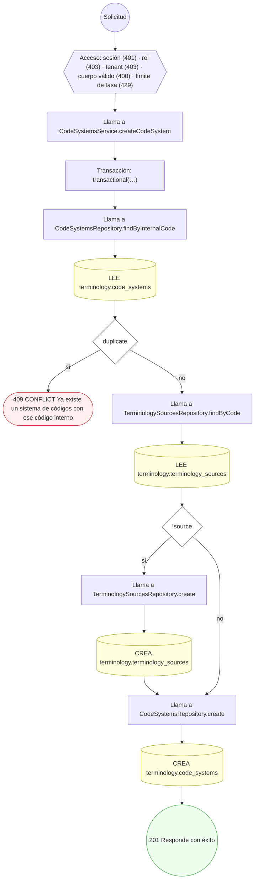

#### 2. POST /terminology/code-systems/{id}/versions

UC-03-02: crea una versión (borrador) de un sistema de códigos

| HTTP | Código | Cuándo |
|---|---|---|
| 201 | — | Éxito |
| 400 | `VALIDATION_FAILED` | Los parámetros de ruta son UUID válidos; El cuerpo cumple el DTO (sin propiedades extra) |
| 401 | `UNAUTHENTICATED` | Hay una sesión válida (JWT) |
| 403 | `FORBIDDEN` | El rol está permitido; El tenant se resuelve y pertenece al actor |
| 404 | `NOT_FOUND` | ResourceNotFoundException: Sistema de códigos no encontrado |
| 409 | `CONFLICT` | ConflictException: Ya existe esa versión para el sistema de códigos |
| 429 | `RATE_LIMITED` | No se supera el límite de solicitudes |

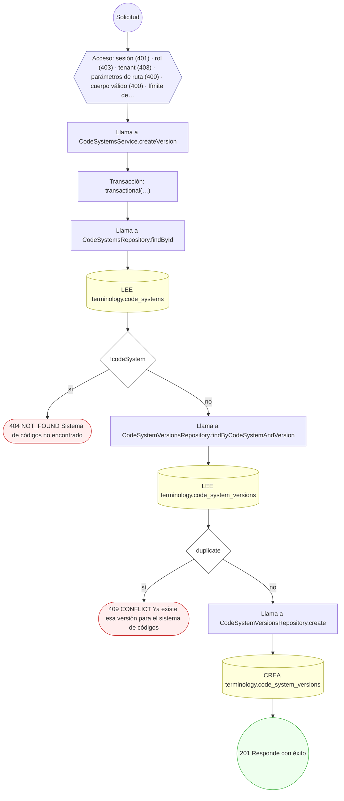

#### 3. GET /terminology/CodeSystem/$lookup

UC-03-11: resuelve un concepto por sistema y código

| HTTP | Código | Cuándo |
|---|---|---|
| 200 | — | Éxito |
| 400 | `VALIDATION_FAILED` | Están los parámetros de consulta obligatorios; BadRequestException: $lookup exige los parámetros system y code |
| 401 | `UNAUTHENTICATED` | Hay una sesión válida (JWT) |
| 403 | `FORBIDDEN` | El rol está permitido; El tenant se resuelve y pertenece al actor |
| 404 | `NOT_FOUND` | ResourceNotFoundException: Sistema de códigos no encontrado; ResourceNotFoundException: El sistema de códigos no tiene versión vigente publicada; ResourceNotFoundException: Código no encontrado en la versión vigente |
| 429 | `RATE_LIMITED` | No se supera el límite de solicitudes |

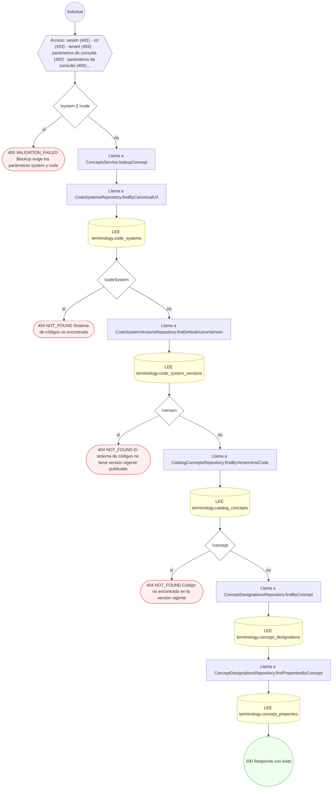

#### 4. POST /terminology/ConceptMap/$translate

UC-03-09: cura o consulta un mapeo entre conceptos

| HTTP | Código | Cuándo |
|---|---|---|
| 200 | — | Éxito |
| 400 | `VALIDATION_FAILED` | El cuerpo cumple el DTO (sin propiedades extra) |
| 401 | `UNAUTHENTICATED` | Hay una sesión válida (JWT) |
| 403 | `FORBIDDEN` | El rol está permitido; El tenant se resuelve y pertenece al actor; ForbiddenException: Curar un mapeo exige un rol de terminología |
| 404 | `NOT_FOUND` | ResourceNotFoundException: Concepto origen no encontrado; ResourceNotFoundException: Concepto destino no encontrado; ResourceNotFoundException: El mapeo dejó de existir durante el curado |
| 422 | `PRECONDITION_FAILED` | PreconditionFailedException: Curar un mapeo exige declarar la equivalencia; PreconditionFailedException: Un concepto no puede mapearse a sí mismo; PreconditionFailedException: Los conceptos del mapeo tienen que estar activos |
| 429 | `RATE_LIMITED` | No se supera el límite de solicitudes |

```mermaid
flowchart TD
  n1(("Solicitud")):::inicio
  n2{{"Acceso: sesión (401) · rol (403) · tenant (403) · cuerpo válido (400) · límite de tasa (429)"}}:::acceso
  n1 --> n2
  n3["Llama a ConceptMapsService.translate"]:::llamada
  n2 --> n3
  n4["Llama a ConceptMapsService.curate"]:::llamada
  n3 --> n4
  n5{"!actor.roles.some((role) =› CURATOR_ROLES.includes(role))"}:::decision
  n4 --> n5
  n6(["403 FORBIDDEN Curar un mapeo exige un rol de terminología"]):::error
  n5 -->|"sí"| n6
  n7{"!dto.equivalence"}:::decision
  n5 -->|"no"| n7
  n8(["422 PRECONDITION_FAILED Curar un mapeo exige declarar la equivalencia"]):::error
  n7 -->|"sí"| n8
  n9{"targetConceptId === dto.sourceConceptId"}:::decision
  n7 -->|"no"| n9
  n10(["422 PRECONDITION_FAILED Un concepto no puede mapearse a sí mismo"]):::error
  n9 -->|"sí"| n10
  n11["Transacción: transactional(…)"]:::transaccion
  n9 -->|"no"| n11
  n12["Llama a CatalogConceptsRepository.findById"]:::llamada
  n11 --> n12
  n13[("LEE terminology.catalog_concepts")]:::efecto
  n12 --> n13
  n14{"!source"}:::decision
  n13 --> n14
  n15(["404 NOT_FOUND Concepto origen no encontrado"]):::error
  n14 -->|"sí"| n15
  n16["Llama a CatalogConceptsRepository.findById"]:::llamada
  n14 -->|"no"| n16
  n17[("LEE terminology.catalog_concepts")]:::efecto
  n16 --> n17
  n18{"!target"}:::decision
  n17 --> n18
  n19(["404 NOT_FOUND Concepto destino no encontrado"]):::error
  n18 -->|"sí"| n19
  n20["Repite: por cada const [concept, field] de [ [source, 'sourceConceptId'], [target, 'targetCo…"]:::bucle
  n18 -->|"no"| n20
  n21{"concept.stateConceptId !== CONCEPTS.TERM_ACTIVE"}:::decision
  n20 -->|"cada elemento"| n21
  n22(["422 PRECONDITION_FAILED Los conceptos del mapeo tienen que estar activos"]):::error
  n21 -->|"sí"| n22
  n23["Llama a ConceptMapsRepository.findEquivalent"]:::llamada
  n21 -->|"no"| n23
  n20 -->|"al terminar"| n23
  n24[("LEE terminology.concept_maps")]:::efecto
  n23 --> n24
  n25{"duplicate"}:::decision
  n24 --> n25
  n26["Llama a ConceptMapsRepository.findByIdForUpdate"]:::llamada
  n25 -->|"sí"| n26
  n27[("LEE terminology.concept_maps")]:::efecto
  n26 --> n27
  n28{"!locked"}:::decision
  n27 --> n28
  n29(["404 NOT_FOUND El mapeo dejó de existir durante el curado"]):::error
  n28 -->|"sí"| n29
  n30[("ACTUALIZA terminology.concept_maps · ACTUALIZA terminology.concept_maps")]:::efecto
  n28 -->|"no"| n30
  n31["Llama a ConceptMapsRepository.create"]:::llamada
  n25 -->|"no"| n31
  n32[("CREA terminology.concept_maps")]:::efecto
  n31 --> n32
  n33["Llama a ConceptMapsService.lookup"]:::llamada
  n30 --> n33
  n32 --> n33
  n34["Llama a CatalogConceptsRepository.findById"]:::llamada
  n33 --> n34
  n35[("LEE terminology.catalog_concepts")]:::efecto
  n34 --> n35
  n36{"!source"}:::decision
  n35 --> n36
  n37(["404 NOT_FOUND Concepto origen no encontrado"]):::error
  n36 -->|"sí"| n37
  n38["Llama a ConceptMapsRepository.findTranslations"]:::llamada
  n36 -->|"no"| n38
  n39[("LEE terminology.concept_maps")]:::efecto
  n38 --> n39
  n40(("200 Responde con éxito")):::ok
  n39 --> n40
  classDef acceso fill:#eef,stroke:#66a
  classDef error fill:#fee,stroke:#c33
  classDef ok fill:#efe,stroke:#3a3
  classDef efecto fill:#ffd,stroke:#aa3
  classDef decision fill:#fff,stroke:#555
  classDef corte fill:#eee,stroke:#999,stroke-dasharray: 4
```

#### 5. GET /terminology/concepts

UC-03-13: busca conceptos por código/denominación, o resuelve ids a etiqueta

| HTTP | Código | Cuándo |
|---|---|---|
| 200 | — | Éxito |
| 401 | `UNAUTHENTICATED` | Hay una sesión válida (JWT) |
| 403 | `FORBIDDEN` | El rol está permitido; El tenant se resuelve y pertenece al actor |
| 404 | `NOT_FOUND` | ResourceNotFoundException: El conjunto de valores no existe o no tiene versión vigente; ResourceNotFoundException: La etiqueta no existe o no tiene versión vigente |
| 429 | `RATE_LIMITED` | No se supera el límite de solicitudes |

```mermaid
flowchart TD
  n1(("Solicitud")):::inicio
  n2{{"Acceso: sesión (401) · rol (403) · tenant (403) · límite de tasa (429)"}}:::acceso
  n1 --> n2
  n3["Llama a ConceptsService.searchConcepts"]:::llamada
  n2 --> n3
  n4{"scopingValueSetId === undefined && options.includeValueSets === true"}:::decision
  n3 --> n4
  n5["Llama a ValueSetsRepository.findByInternalCode"]:::llamada
  n4 -->|"sí"| n5
  n6[("LEE terminology.value_sets")]:::efecto
  n5 --> n6
  n7{"scopingValueSetId !== undefined"}:::decision
  n6 --> n7
  n4 -->|"no"| n7
  n8["Llama a ConceptsService.searchGlossaryPage"]:::llamada
  n7 -->|"sí"| n8
  n9["Llama a ValueSetsRepository.findById"]:::llamada
  n8 --> n9
  n10[("LEE terminology.value_sets")]:::efecto
  n9 --> n10
  n11["Llama a ValueSetsRepository.findDefaultVersion"]:::llamada
  n10 --> n11
  n12[("LEE terminology.value_set_versions")]:::efecto
  n11 --> n12
  n13{"version === null"}:::decision
  n12 --> n13
  n14(["404 NOT_FOUND El conjunto de valores no existe o no tiene versión vigente"]):::error
  n13 -->|"sí"| n14
  n15{"options.tagValueSetId !== undefined"}:::decision
  n13 -->|"no"| n15
  n16["Llama a ValueSetsRepository.findDefaultVersion"]:::llamada
  n15 -->|"sí"| n16
  n17[("LEE terminology.value_set_versions")]:::efecto
  n16 --> n17
  n18{"tagVersion === null"}:::decision
  n17 --> n18
  n19(["404 NOT_FOUND La etiqueta no existe o no tiene versión vigente"]):::error
  n18 -->|"sí"| n19
  n20["Llama a CatalogConceptsRepository.searchGlossaryPage"]:::llamada
  n18 -->|"no"| n20
  n15 -->|"no"| n20
  n21{"filters.tagValueSetVersionId !== undefined"}:::decision
  n20 --> n21
  n22[("LEE terminology.value_set_members")]:::efecto
  n21 -->|"sí"| n22
  n23{"normalized !== ''"}:::decision
  n22 --> n23
  n21 -->|"no"| n23
  n24[("LEE terminology.concept_designations")]:::efecto
  n23 -->|"sí"| n24
  n25[("LEE terminology.value_set_members · LEE terminology.catalog_concepts · LEE terminology.concept_designations")]:::efecto
  n24 --> n25
  n23 -->|"no"| n25
  n26["Llama a CatalogConceptsRepository.findByIds"]:::llamada
  n25 --> n26
  n27[("LEE terminology.catalog_concepts")]:::efecto
  n26 --> n27
  n28["Llama a ConceptsService.buildSearchItems"]:::llamada
  n27 --> n28
  n29["Llama a ValueSetsRepository.findValueSetsByConceptIds"]:::llamada
  n28 --> n29
  n30[("LEE terminology.value_set_members · LEE terminology.value_set_versions · LEE terminology.value_sets")]:::efecto
  n29 --> n30
  n31["Llama a ConceptDesignationsRepository.findPropertyForConcepts"]:::llamada
  n30 --> n31
  n32[("LEE terminology.concept_properties")]:::efecto
  n31 --> n32
  n33{"scopingValueSetId !== undefined"}:::decision
  n32 --> n33
  n7 -->|"no"| n33
  n34["Llama a ValueSetsRepository.findIncludedConceptIdsByValueSet"]:::llamada
  n33 -->|"sí"| n34
  n35["Llama a ValueSetsRepository.findDefaultVersion"]:::llamada
  n34 --> n35
  n36[("LEE terminology.value_set_versions")]:::efecto
  n35 --> n36
  n37[("LEE terminology.value_set_members")]:::efecto
  n36 --> n37
  n38{"members === null"}:::decision
  n37 --> n38
  n39{"requestedValueSetId !== undefined"}:::decision
  n38 -->|"sí"| n39
  n40(["404 NOT_FOUND El conjunto de valores no existe o no tiene versión vigente"]):::error
  n39 -->|"sí"| n40
  n41["Llama a CatalogConceptsRepository.search"]:::llamada
  n39 -->|"no"| n41
  n38 -->|"no"| n41
  n33 -->|"no"| n41
  n42[("LEE terminology.catalog_concepts")]:::efecto
  n41 --> n42
  n43["Llama a ConceptsService.buildSearchItems"]:::llamada
  n42 --> n43
  n44["Llama a ConceptsService.resolveTexts"]:::llamada
  n43 --> n44
  n45["Llama a ConceptDesignationsRepository.findPreferredByLanguageForConcepts"]:::llamada
  n44 --> n45
  n46[("LEE terminology.concept_designations")]:::efecto
  n45 --> n46
  n47["Llama a ConceptDesignationsRepository.findPropertyForConcepts"]:::llamada
  n46 --> n47
  n48[("LEE terminology.concept_properties")]:::efecto
  n47 --> n48
  n49["Llama a ValueSetsRepository.findValueSetsByConceptIds"]:::llamada
  n48 --> n49
  n50[("LEE terminology.value_set_members · LEE terminology.value_set_versions · LEE terminology.value_sets")]:::efecto
  n49 --> n50
  n51["Llama a ConceptsService.resolveGlossaryTexts"]:::llamada
  n50 --> n51
  n52["Llama a ConceptDesignationsRepository.findPropertyForConcepts"]:::llamada
  n51 --> n52
  n53[("LEE terminology.concept_properties")]:::efecto
  n52 --> n53
  n54["Llama a ConceptDesignationsRepository.findPropertyForConcepts"]:::llamada
  n53 --> n54
  n55[("LEE terminology.concept_properties")]:::efecto
  n54 --> n55
  n56["Llama a ConceptDesignationsRepository.findPropertyForConcepts"]:::llamada
  n55 --> n56
  n57[("LEE terminology.concept_properties")]:::efecto
  n56 --> n57
  n58["Llama a ConceptsService.resolveGlossaryRelations"]:::llamada
  n57 --> n58
  n59["Llama a ConceptRelationshipsRepository.findByTypesForSources"]:::llamada
  n58 --> n59
  n60[("LEE terminology.concept_relationships")]:::efecto
  n59 --> n60
  n61["Llama a ConceptDesignationsRepository.findPropertyForConcepts"]:::llamada
  n60 --> n61
  n62[("LEE terminology.concept_properties")]:::efecto
  n61 --> n62
  n63(("200 Responde con éxito")):::ok
  n62 --> n63
  classDef acceso fill:#eef,stroke:#66a
  classDef error fill:#fee,stroke:#c33
  classDef ok fill:#efe,stroke:#3a3
  classDef efecto fill:#ffd,stroke:#aa3
  classDef decision fill:#fff,stroke:#555
  classDef corte fill:#eee,stroke:#999,stroke-dasharray: 4
```

#### 6. GET /terminology/concepts/{conceptId}

Lee la ficha de un concepto: textos en el idioma pedido, conjuntos de valores a los que pertenece y denominaciones alternativas

| HTTP | Código | Cuándo |
|---|---|---|
| 200 | — | Éxito |
| 400 | `VALIDATION_FAILED` | Los parámetros de ruta son UUID válidos |
| 401 | `UNAUTHENTICATED` | Hay una sesión válida (JWT) |
| 403 | `FORBIDDEN` | El rol está permitido; El tenant se resuelve y pertenece al actor |
| 404 | `NOT_FOUND` | ResourceNotFoundException: Concepto no encontrado |
| 429 | `RATE_LIMITED` | No se supera el límite de solicitudes |

```mermaid
flowchart TD
  n1(("Solicitud")):::inicio
  n2{{"Acceso: sesión (401) · rol (403) · tenant (403) · parámetros de ruta (400) · límite de tasa (429)"}}:::acceso
  n1 --> n2
  n3["Llama a ConceptsService.readConcept"]:::llamada
  n2 --> n3
  n4["Llama a CatalogConceptsRepository.findById"]:::llamada
  n3 --> n4
  n5[("LEE terminology.catalog_concepts")]:::efecto
  n4 --> n5
  n6{"!concept"}:::decision
  n5 --> n6
  n7(["404 NOT_FOUND Concepto no encontrado"]):::error
  n6 -->|"sí"| n7
  n8["Llama a ConceptsService.resolveTexts"]:::llamada
  n6 -->|"no"| n8
  n9["Llama a ConceptDesignationsRepository.findPreferredByLanguageForConcepts"]:::llamada
  n8 --> n9
  n10[("LEE terminology.concept_designations")]:::efecto
  n9 --> n10
  n11["Llama a ConceptDesignationsRepository.findPropertyForConcepts"]:::llamada
  n10 --> n11
  n12[("LEE terminology.concept_properties")]:::efecto
  n11 --> n12
  n13["Llama a ValueSetsRepository.findValueSetsByConceptIds"]:::llamada
  n12 --> n13
  n14[("LEE terminology.value_set_members · LEE terminology.value_set_versions · LEE terminology.value_sets")]:::efecto
  n13 --> n14
  n15["Llama a ConceptDesignationsRepository.findByConcept"]:::llamada
  n14 --> n15
  n16[("LEE terminology.concept_designations")]:::efecto
  n15 --> n16
  n17["Llama a ConceptsService.resolveGlossaryTexts"]:::llamada
  n16 --> n17
  n18["Llama a ConceptDesignationsRepository.findPropertyForConcepts"]:::llamada
  n17 --> n18
  n19[("LEE terminology.concept_properties")]:::efecto
  n18 --> n19
  n20["Llama a ConceptDesignationsRepository.findPropertyForConcepts"]:::llamada
  n19 --> n20
  n21[("LEE terminology.concept_properties")]:::efecto
  n20 --> n21
  n22["Llama a ConceptDesignationsRepository.findPropertyForConcepts"]:::llamada
  n21 --> n22
  n23[("LEE terminology.concept_properties")]:::efecto
  n22 --> n23
  n24["Llama a ConceptsService.resolveGlossaryRelations"]:::llamada
  n23 --> n24
  n25["Llama a ConceptRelationshipsRepository.findByTypesForSources"]:::llamada
  n24 --> n25
  n26[("LEE terminology.concept_relationships")]:::efecto
  n25 --> n26
  n27["Llama a ConceptsService.resolveGlossaryTerms"]:::llamada
  n26 --> n27
  n28["Llama a CatalogConceptsRepository.findByIds"]:::llamada
  n27 --> n28
  n29[("LEE terminology.catalog_concepts")]:::efecto
  n28 --> n29
  n30["Llama a ConceptDesignationsRepository.findPropertyForConcepts"]:::llamada
  n29 --> n30
  n31[("LEE terminology.concept_properties")]:::efecto
  n30 --> n31
  n32["Llama a ConceptDesignationsRepository.findPropertiesByConcept"]:::llamada
  n31 --> n32
  n33[("LEE terminology.concept_properties")]:::efecto
  n32 --> n33
  n34{"isGlossaryTerm && concept.stateConceptId !== CONCEPTS.TERM_ACTIVE"}:::decision
  n33 --> n34
  n35(["404 NOT_FOUND Concepto no encontrado"]):::error
  n34 -->|"sí"| n35
  n36(("200 Responde con éxito")):::ok
  n34 -->|"no"| n36
  classDef acceso fill:#eef,stroke:#66a
  classDef error fill:#fee,stroke:#c33
  classDef ok fill:#efe,stroke:#3a3
  classDef efecto fill:#ffd,stroke:#aa3
  classDef decision fill:#fff,stroke:#555
  classDef corte fill:#eee,stroke:#999,stroke-dasharray: 4
```

#### 7. POST /terminology/concepts/{conceptId}/$deprecate

UC-03-10: retira el concepto y lo excluye de las expansiones

| HTTP | Código | Cuándo |
|---|---|---|
| 200 | — | Éxito |
| 400 | `VALIDATION_FAILED` | Los parámetros de ruta son UUID válidos; El cuerpo cumple el DTO (sin propiedades extra) |
| 401 | `UNAUTHENTICATED` | Hay una sesión válida (JWT) |
| 403 | `FORBIDDEN` | El rol está permitido; El tenant se resuelve y pertenece al actor |
| 404 | `NOT_FOUND` | ResourceNotFoundException: Concepto no encontrado; ResourceNotFoundException: Concepto de reemplazo no encontrado |
| 409 | `CONFLICT` | ConflictException: Un concepto no puede reemplazarse a sí mismo |
| 422 | `PRECONDITION_FAILED` | PreconditionFailedException: El concepto de reemplazo está retirado |
| 429 | `RATE_LIMITED` | No se supera el límite de solicitudes |

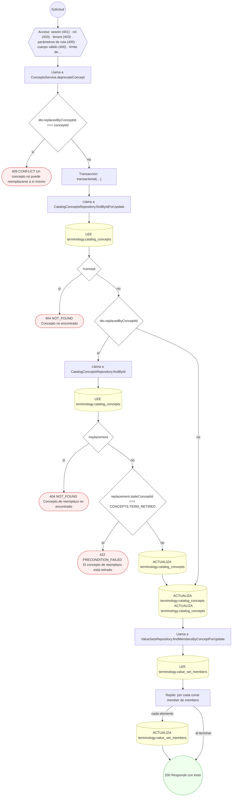

#### 8. POST /terminology/concepts/{conceptId}/designations

UC-03-05: añade una designación (y opcionalmente propiedades)

| HTTP | Código | Cuándo |
|---|---|---|
| 201 | — | Éxito |
| 400 | `VALIDATION_FAILED` | Los parámetros de ruta son UUID válidos; El cuerpo cumple el DTO (sin propiedades extra) |
| 401 | `UNAUTHENTICATED` | Hay una sesión válida (JWT) |
| 403 | `FORBIDDEN` | El rol está permitido; El tenant se resuelve y pertenece al actor |
| 404 | `NOT_FOUND` | ResourceNotFoundException: Concepto no encontrado |
| 429 | `RATE_LIMITED` | No se supera el límite de solicitudes |

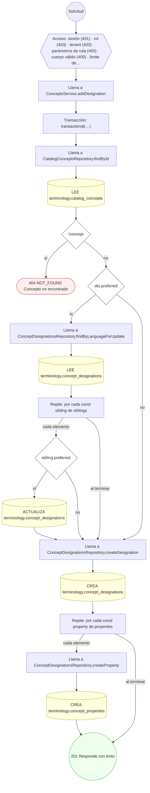

#### 9. GET /terminology/concepts/{conceptId}/glossary-article

Lee el artículo enciclopédico de un término del glosario

| HTTP | Código | Cuándo |
|---|---|---|
| 200 | — | Éxito |
| 400 | `VALIDATION_FAILED` | Los parámetros de ruta son UUID válidos |
| 401 | `UNAUTHENTICATED` | Hay una sesión válida (JWT) |
| 403 | `FORBIDDEN` | El rol está permitido; El tenant se resuelve y pertenece al actor |
| 404 | `NOT_FOUND` | ResourceNotFoundException: Artículo del glosario no encontrado |
| 429 | `RATE_LIMITED` | No se supera el límite de solicitudes |

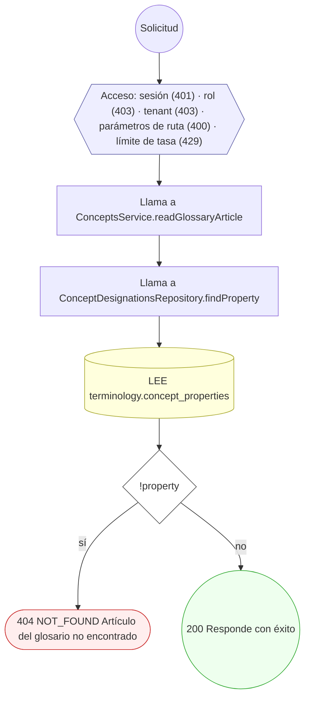

#### 10. GET /terminology/concepts/{conceptId}/glossary-neighborhood

Lee el vecindario de un término del glosario: relaciones salientes y entrantes agrupadas por tipo

| HTTP | Código | Cuándo |
|---|---|---|
| 200 | — | Éxito |
| 400 | `VALIDATION_FAILED` | Los parámetros de ruta son UUID válidos |
| 401 | `UNAUTHENTICATED` | Hay una sesión válida (JWT) |
| 403 | `FORBIDDEN` | El rol está permitido; El tenant se resuelve y pertenece al actor |
| 429 | `RATE_LIMITED` | No se supera el límite de solicitudes |

```mermaid
flowchart TD
  n1(("Solicitud")):::inicio
  n2{{"Acceso: sesión (401) · rol (403) · tenant (403) · parámetros de ruta (400) · límite de tasa (429)"}}:::acceso
  n1 --> n2
  n3["Llama a ConceptsService.readGlossaryNeighborhood"]:::llamada
  n2 --> n3
  n4["Llama a ConceptsService.readGlossaryFocus"]:::llamada
  n3 --> n4
  n5["Llama a CatalogConceptsRepository.findById"]:::llamada
  n4 --> n5
  n6[("LEE terminology.catalog_concepts")]:::efecto
  n5 --> n6
  n7{"!concept"}:::decision
  n6 --> n7
  n8(["↩ (relanza el error capturado)"]):::error
  n7 -->|"sí"| n8
  n9["Llama a ConceptsService.resolveTexts"]:::llamada
  n7 -->|"no"| n9
  n10["Llama a ConceptDesignationsRepository.findPreferredByLanguageForConcepts"]:::llamada
  n9 --> n10
  n11[("LEE terminology.concept_designations")]:::efecto
  n10 --> n11
  n12["Llama a ConceptDesignationsRepository.findPropertyForConcepts"]:::llamada
  n11 --> n12
  n13[("LEE terminology.concept_properties")]:::efecto
  n12 --> n13
  n14["Llama a ValueSetsRepository.findValueSetsByConceptIds"]:::llamada
  n13 --> n14
  n15[("LEE terminology.value_set_members · LEE terminology.value_set_versions · LEE terminology.value_sets")]:::efecto
  n14 --> n15
  n16["Llama a ConceptsService.resolveGlossaryTexts"]:::llamada
  n15 --> n16
  n17["Llama a ConceptDesignationsRepository.findPropertyForConcepts"]:::llamada
  n16 --> n17
  n18[("LEE terminology.concept_properties")]:::efecto
  n17 --> n18
  n19["Llama a ConceptDesignationsRepository.findPropertyForConcepts"]:::llamada
  n18 --> n19
  n20[("LEE terminology.concept_properties")]:::efecto
  n19 --> n20
  n21["Llama a ConceptDesignationsRepository.findPropertyForConcepts"]:::llamada
  n20 --> n21
  n22[("LEE terminology.concept_properties")]:::efecto
  n21 --> n22
  n23{"!isGlossaryTerm || concept.stateConceptId !== CONCEPTS.TERM_ACTIVE || glossaryText?.slug === undefined"}:::decision
  n22 --> n23
  n24(["↩ (relanza el error capturado)"]):::error
  n23 -->|"sí"| n24
  n25["Llama a ConceptRelationshipsRepository.countNeighborsByType"]:::llamada
  n23 -->|"no"| n25
  n26["Llama a ConceptRelationshipsRepository.countNeighborsInDirection"]:::llamada
  n25 --> n26
  n27[("LEE terminology.concept_relationships · LEE terminology.catalog_concepts · LEE terminology.concept_properties")]:::efecto
  n26 --> n27
  n28["Llama a ConceptRelationshipsRepository.countNeighborsInDirection"]:::llamada
  n27 --> n28
  n29[("LEE terminology.concept_relationships · LEE terminology.catalog_concepts · LEE terminology.concept_properties")]:::efecto
  n28 --> n29
  n30["Llama a ConceptsService.collectSortedNeighbors"]:::llamada
  n29 --> n30
  n31["Llama a ConceptRelationshipsRepository.findByTypesForSources"]:::llamada
  n30 --> n31
  n32[("LEE terminology.concept_relationships")]:::efecto
  n31 --> n32
  n33["Llama a ConceptRelationshipsRepository.findByTypesForTargets"]:::llamada
  n32 --> n33
  n34[("LEE terminology.concept_relationships")]:::efecto
  n33 --> n34
  n35["Llama a ConceptsService.resolveGlossaryTerms"]:::llamada
  n34 --> n35
  n36["Llama a CatalogConceptsRepository.findByIds"]:::llamada
  n35 --> n36
  n37[("LEE terminology.catalog_concepts")]:::efecto
  n36 --> n37
  n38["Llama a ConceptDesignationsRepository.findPropertyForConcepts"]:::llamada
  n37 --> n38
  n39[("LEE terminology.concept_properties")]:::efecto
  n38 --> n39
  n40["Llama a ConceptsService.resolveTexts"]:::llamada
  n39 --> n40
  n41["Llama a ConceptDesignationsRepository.findPreferredByLanguageForConcepts"]:::llamada
  n40 --> n41
  n42[("LEE terminology.concept_designations")]:::efecto
  n41 --> n42
  n43["Llama a ConceptDesignationsRepository.findPropertyForConcepts"]:::llamada
  n42 --> n43
  n44[("LEE terminology.concept_properties")]:::efecto
  n43 --> n44
  n45["Llama a ConceptsService.resolveNeighborCategories"]:::llamada
  n44 --> n45
  n46["Llama a ValueSetsRepository.findValueSetsByConceptIds"]:::llamada
  n45 --> n46
  n47[("LEE terminology.value_set_members · LEE terminology.value_set_versions · LEE terminology.value_sets")]:::efecto
  n46 --> n47
  n48(("200 Responde con éxito")):::ok
  n47 --> n48
  classDef acceso fill:#eef,stroke:#66a
  classDef error fill:#fee,stroke:#c33
  classDef ok fill:#efe,stroke:#3a3
  classDef efecto fill:#ffd,stroke:#aa3
  classDef decision fill:#fff,stroke:#555
  classDef corte fill:#eee,stroke:#999,stroke-dasharray: 4
```

#### 11. POST /terminology/concepts/{conceptId}/properties

UC-03-05: alta o actualización de propiedades del concepto

| HTTP | Código | Cuándo |
|---|---|---|
| 200 | — | Éxito |
| 400 | `VALIDATION_FAILED` | Los parámetros de ruta son UUID válidos; El cuerpo cumple el DTO (sin propiedades extra) |
| 401 | `UNAUTHENTICATED` | Hay una sesión válida (JWT) |
| 403 | `FORBIDDEN` | El rol está permitido; El tenant se resuelve y pertenece al actor |
| 404 | `NOT_FOUND` | ResourceNotFoundException: Concepto no encontrado |
| 429 | `RATE_LIMITED` | No se supera el límite de solicitudes |

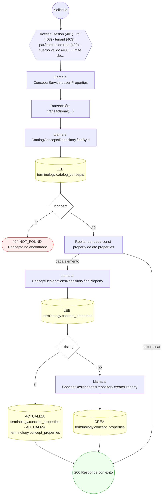

#### 12. POST /terminology/concepts/{conceptId}/relationships

UC-03-06: crea una relación dirigida entre conceptos

| HTTP | Código | Cuándo |
|---|---|---|
| 201 | — | Éxito |
| 400 | `VALIDATION_FAILED` | Los parámetros de ruta son UUID válidos; El cuerpo cumple el DTO (sin propiedades extra) |
| 401 | `UNAUTHENTICATED` | Hay una sesión válida (JWT) |
| 403 | `FORBIDDEN` | El rol está permitido; El tenant se resuelve y pertenece al actor |
| 404 | `NOT_FOUND` | ResourceNotFoundException: Concepto origen no encontrado; ResourceNotFoundException: Concepto destino no encontrado |
| 409 | `CONFLICT` | ConflictException: Un concepto no puede relacionarse consigo mismo; ConflictException: Ya existe una relación equivalente entre esos conceptos |
| 429 | `RATE_LIMITED` | No se supera el límite de solicitudes |

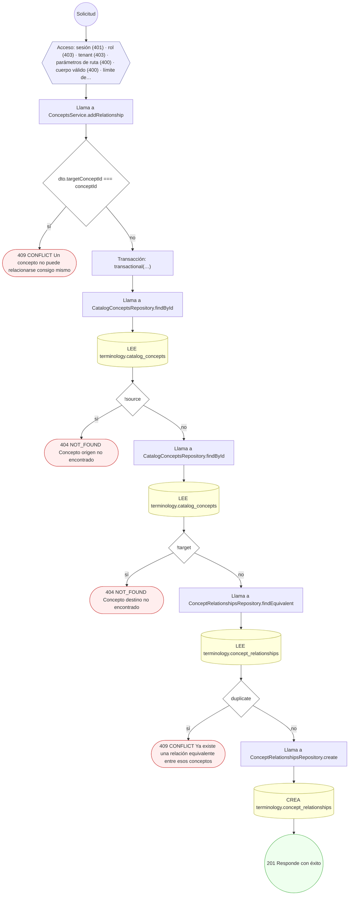

#### 13. GET /terminology/concepts/glossary-graph

Lee el grafo de términos publicados del glosario médico

| HTTP | Código | Cuándo |
|---|---|---|
| 200 | — | Éxito |
| 401 | `UNAUTHENTICATED` | Hay una sesión válida (JWT) |
| 403 | `FORBIDDEN` | El rol está permitido; El tenant se resuelve y pertenece al actor |
| 404 | `NOT_FOUND` | ResourceNotFoundException: El conjunto de valores no existe o no tiene versión vigente; ResourceNotFoundException: La etiqueta no existe o no tiene versión vigente |
| 429 | `RATE_LIMITED` | No se supera el límite de solicitudes |

```mermaid
flowchart TD
  n1(("Solicitud")):::inicio
  n2{{"Acceso: sesión (401) · rol (403) · tenant (403) · límite de tasa (429)"}}:::acceso
  n1 --> n2
  n3["Llama a ConceptsService.readGlossaryGraph"]:::llamada
  n2 --> n3
  n4["Llama a ConceptsService.searchConcepts"]:::llamada
  n3 --> n4
  n5{"scopingValueSetId === undefined && options.includeValueSets === true"}:::decision
  n4 --> n5
  n6["Llama a ValueSetsRepository.findByInternalCode"]:::llamada
  n5 -->|"sí"| n6
  n7[("LEE terminology.value_sets")]:::efecto
  n6 --> n7
  n8{"scopingValueSetId !== undefined"}:::decision
  n7 --> n8
  n5 -->|"no"| n8
  n9["Llama a ConceptsService.searchGlossaryPage"]:::llamada
  n8 -->|"sí"| n9
  n10["Llama a ValueSetsRepository.findById"]:::llamada
  n9 --> n10
  n11[("LEE terminology.value_sets")]:::efecto
  n10 --> n11
  n12["Llama a ValueSetsRepository.findDefaultVersion"]:::llamada
  n11 --> n12
  n13[("LEE terminology.value_set_versions")]:::efecto
  n12 --> n13
  n14{"version === null"}:::decision
  n13 --> n14
  n15(["404 NOT_FOUND El conjunto de valores no existe o no tiene versión vigente"]):::error
  n14 -->|"sí"| n15
  n16{"options.tagValueSetId !== undefined"}:::decision
  n14 -->|"no"| n16
  n17["Llama a ValueSetsRepository.findDefaultVersion"]:::llamada
  n16 -->|"sí"| n17
  n18[("LEE terminology.value_set_versions")]:::efecto
  n17 --> n18
  n19{"tagVersion === null"}:::decision
  n18 --> n19
  n20(["404 NOT_FOUND La etiqueta no existe o no tiene versión vigente"]):::error
  n19 -->|"sí"| n20
  n21["Llama a CatalogConceptsRepository.searchGlossaryPage"]:::llamada
  n19 -->|"no"| n21
  n16 -->|"no"| n21
  n22{"filters.tagValueSetVersionId !== undefined"}:::decision
  n21 --> n22
  n23[("LEE terminology.value_set_members")]:::efecto
  n22 -->|"sí"| n23
  n24{"normalized !== ''"}:::decision
  n23 --> n24
  n22 -->|"no"| n24
  n25[("LEE terminology.concept_designations")]:::efecto
  n24 -->|"sí"| n25
  n26[("LEE terminology.value_set_members · LEE terminology.catalog_concepts · LEE terminology.concept_designations")]:::efecto
  n25 --> n26
  n24 -->|"no"| n26
  n27["Llama a CatalogConceptsRepository.findByIds"]:::llamada
  n26 --> n27
  n28[("LEE terminology.catalog_concepts")]:::efecto
  n27 --> n28
  n29{"scopingValueSetId !== undefined"}:::decision
  n28 --> n29
  n8 -->|"no"| n29
  n30["Llama a ValueSetsRepository.findIncludedConceptIdsByValueSet"]:::llamada
  n29 -->|"sí"| n30
  n31["Llama a ValueSetsRepository.findDefaultVersion"]:::llamada
  n30 --> n31
  n32[("LEE terminology.value_set_versions")]:::efecto
  n31 --> n32
  n33[("LEE terminology.value_set_members")]:::efecto
  n32 --> n33
  n34{"members === null"}:::decision
  n33 --> n34
  n35{"requestedValueSetId !== undefined"}:::decision
  n34 -->|"sí"| n35
  n36(["404 NOT_FOUND El conjunto de valores no existe o no tiene versión vigente"]):::error
  n35 -->|"sí"| n36
  n37["Llama a CatalogConceptsRepository.search"]:::llamada
  n35 -->|"no"| n37
  n34 -->|"no"| n37
  n29 -->|"no"| n37
  n38[("LEE terminology.catalog_concepts")]:::efecto
  n37 --> n38
  n39["Llama a ConceptsService.buildSearchItems"]:::llamada
  n38 --> n39
  n40["Llama a ValueSetsRepository.findValueSetsByConceptIds"]:::llamada
  n39 --> n40
  n41[("LEE terminology.value_set_members · LEE terminology.value_set_versions · LEE terminology.value_sets")]:::efecto
  n40 --> n41
  n42["Llama a ConceptDesignationsRepository.findPropertyForConcepts"]:::llamada
  n41 --> n42
  n43[("LEE terminology.concept_properties")]:::efecto
  n42 --> n43
  n44["Llama a ConceptsService.resolveGlossaryRelations"]:::llamada
  n43 --> n44
  n45["Llama a ConceptRelationshipsRepository.findByTypesForSources"]:::llamada
  n44 --> n45
  n46[("LEE terminology.concept_relationships")]:::efecto
  n45 --> n46
  n47["Llama a ConceptsService.resolveGlossaryTerms"]:::llamada
  n46 --> n47
  n48["Llama a CatalogConceptsRepository.findByIds"]:::llamada
  n47 --> n48
  n49[("LEE terminology.catalog_concepts")]:::efecto
  n48 --> n49
  n50["Llama a ConceptDesignationsRepository.findPropertyForConcepts"]:::llamada
  n49 --> n50
  n51[("LEE terminology.concept_properties")]:::efecto
  n50 --> n51
  n52(("200 Responde con éxito")):::ok
  n51 --> n52
  classDef acceso fill:#eef,stroke:#66a
  classDef error fill:#fee,stroke:#c33
  classDef ok fill:#efe,stroke:#3a3
  classDef efecto fill:#ffd,stroke:#aa3
  classDef decision fill:#fff,stroke:#555
  classDef corte fill:#eee,stroke:#999,stroke-dasharray: 4
```

#### 14. GET /terminology/import-template

UC-03-03: descarga la plantilla de importación de un perfil

| HTTP | Código | Cuándo |
|---|---|---|
| 200 | — | Éxito |
| 401 | `UNAUTHENTICATED` | Hay una sesión válida (JWT) |
| 403 | `FORBIDDEN` | El rol está permitido; El tenant se resuelve y pertenece al actor |
| 429 | `RATE_LIMITED` | No se supera el límite de solicitudes |
| 500 | `INTERNAL` | ImportFileRejectedException: {ErrorCode.IMPORT_PROFILE_UNKNOWN}; ImportFileRejectedException: {ErrorCode.IMPORT_FORMAT_UNSUPPORTED} |

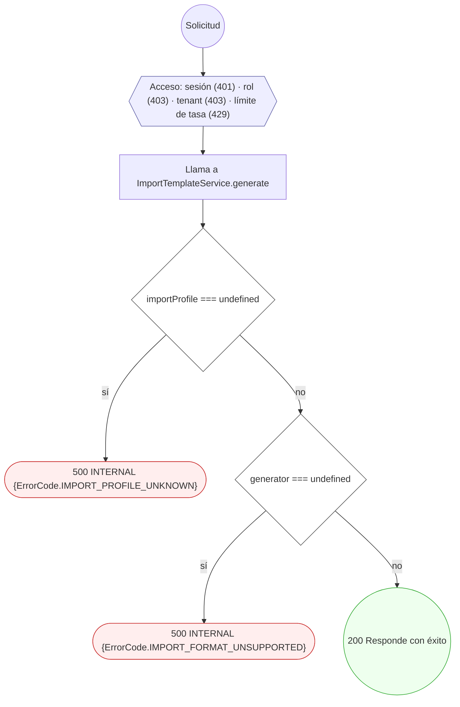

#### 15. PUT /terminology/tenants/{tenantId}/catalog-policies

UC-03-12: define la política de catálogo del tenant

| HTTP | Código | Cuándo |
|---|---|---|
| 200 | — | Éxito |
| 400 | `VALIDATION_FAILED` | Los parámetros de ruta son UUID válidos; El cuerpo cumple el DTO (sin propiedades extra) |
| 401 | `UNAUTHENTICATED` | Hay una sesión válida (JWT) |
| 403 | `FORBIDDEN` | El rol está permitido; El tenant se resuelve y pertenece al actor |
| 404 | `NOT_FOUND` | ResourceNotFoundException: Conjunto de valores no encontrado; ResourceNotFoundException: Concepto no encontrado |
| 422 | `PRECONDITION_FAILED` | PreconditionFailedException: La política no permite renombrar conceptos; PreconditionFailedException: Sólo un concepto puede ser el valor por omisión |
| 429 | `RATE_LIMITED` | No se supera el límite de solicitudes |

```mermaid
flowchart TD
  n1(("Solicitud")):::inicio
  n2{{"Acceso: sesión (401) · rol (403) · tenant (403) · parámetros de ruta (400) · cuerpo válido (400) · límite de…"}}:::acceso
  n1 --> n2
  n3["Llama a TenantCatalogService.upsertPolicy"]:::llamada
  n2 --> n3
  n4{"aliasWithoutPermission"}:::decision
  n3 --> n4
  n5(["422 PRECONDITION_FAILED La política no permite renombrar conceptos"]):::error
  n4 -->|"sí"| n5
  n6{"defaults.length › 1"}:::decision
  n4 -->|"no"| n6
  n7(["422 PRECONDITION_FAILED Sólo un concepto puede ser el valor por omisión"]):::error
  n6 -->|"sí"| n7
  n8["Transacción: transactional(…)"]:::transaccion
  n6 -->|"no"| n8
  n9["Llama a ValueSetsRepository.findById"]:::llamada
  n8 --> n9
  n10[("LEE terminology.value_sets")]:::efecto
  n9 --> n10
  n11{"!valueSet"}:::decision
  n10 --> n11
  n12(["404 NOT_FOUND Conjunto de valores no encontrado"]):::error
  n11 -->|"sí"| n12
  n13["Llama a TenantCatalogRepository.findPolicyForUpdate"]:::llamada
  n11 -->|"no"| n13
  n14[("LEE terminology.tenant_catalog_policies")]:::efecto
  n13 --> n14
  n15{"existing"}:::decision
  n14 --> n15
  n16[("ACTUALIZA terminology.tenant_catalog_policies · ACTUALIZA terminology.tenant_catalog_policies · ACTUALIZA ter…")]:::efecto
  n15 -->|"sí"| n16
  n17["Llama a TenantCatalogRepository.createPolicy"]:::llamada
  n15 -->|"no"| n17
  n18[("CREA terminology.tenant_catalog_policies")]:::efecto
  n17 --> n18
  n19{"defaults.length === 1"}:::decision
  n16 --> n19
  n18 --> n19
  n20["Llama a TenantCatalogRepository.findDefaultsForUpdate"]:::llamada
  n19 -->|"sí"| n20
  n21[("LEE terminology.tenant_concept_config")]:::efecto
  n20 --> n21
  n22["Repite: por cada const config de previous"]:::bucle
  n21 --> n22
  n23{"config.conceptId !== defaults[0].conceptId"}:::decision
  n22 -->|"cada elemento"| n23
  n24[("ACTUALIZA terminology.tenant_concept_config")]:::efecto
  n23 -->|"sí"| n24
  n25["Repite: por cada const input de concepts"]:::bucle
  n24 --> n25
  n23 -->|"no"| n25
  n22 -->|"al terminar"| n25
  n19 -->|"no"| n25
  n26["Llama a CatalogConceptsRepository.findById"]:::llamada
  n25 -->|"cada elemento"| n26
  n27[("LEE terminology.catalog_concepts")]:::efecto
  n26 --> n27
  n28{"!concept"}:::decision
  n27 --> n28
  n29(["404 NOT_FOUND Concepto no encontrado"]):::error
  n28 -->|"sí"| n29
  n30["Llama a TenantCatalogRepository.findConfig"]:::llamada
  n28 -->|"no"| n30
  n31[("LEE terminology.tenant_concept_config")]:::efecto
  n30 --> n31
  n32{"config"}:::decision
  n31 --> n32
  n33[("ACTUALIZA terminology.tenant_concept_config · ACTUALIZA terminology.tenant_concept_config · ACTUALIZA termino…")]:::efecto
  n32 -->|"sí"| n33
  n34["Llama a TenantCatalogRepository.createConfig"]:::llamada
  n32 -->|"no"| n34
  n35[("CREA terminology.tenant_concept_config")]:::efecto
  n34 --> n35
  n36(("200 Responde con éxito")):::ok
  n33 --> n36
  n35 --> n36
  n25 -->|"al terminar"| n36
  classDef acceso fill:#eef,stroke:#66a
  classDef error fill:#fee,stroke:#c33
  classDef ok fill:#efe,stroke:#3a3
  classDef efecto fill:#ffd,stroke:#aa3
  classDef decision fill:#fff,stroke:#555
  classDef corte fill:#eee,stroke:#999,stroke-dasharray: 4
```

#### 16. POST /terminology/value-sets

UC-03-07: crea un conjunto de valores con versión y reglas

| HTTP | Código | Cuándo |
|---|---|---|
| 201 | — | Éxito |
| 400 | `VALIDATION_FAILED` | El cuerpo cumple el DTO (sin propiedades extra) |
| 401 | `UNAUTHENTICATED` | Hay una sesión válida (JWT) |
| 403 | `FORBIDDEN` | El rol está permitido; El tenant se resuelve y pertenece al actor |
| 409 | `CONFLICT` | ConflictException: Ya existe un conjunto de valores con ese código interno |
| 429 | `RATE_LIMITED` | No se supera el límite de solicitudes |

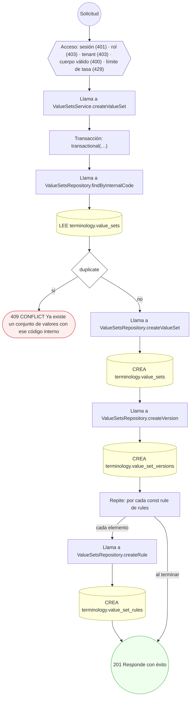

#### 17. GET /terminology/value-sets/{id}/$expand

UC-03-08: lee la expansión vigente de un conjunto de valores

| HTTP | Código | Cuándo |
|---|---|---|
| 200 | — | Éxito |
| 400 | `VALIDATION_FAILED` | Los parámetros de ruta son UUID válidos |
| 401 | `UNAUTHENTICATED` | Hay una sesión válida (JWT) |
| 404 | `NOT_FOUND` | ResourceNotFoundException: Conjunto de valores no encontrado; ResourceNotFoundException: Versión del conjunto de valores no encontrada / El conjunto de valores no tiene una versión vigente |
| 409 | `CONFLICT` | ConflictException: La versión no pertenece a ese conjunto de valores |
| 429 | `RATE_LIMITED` | No se supera el límite de solicitudes |

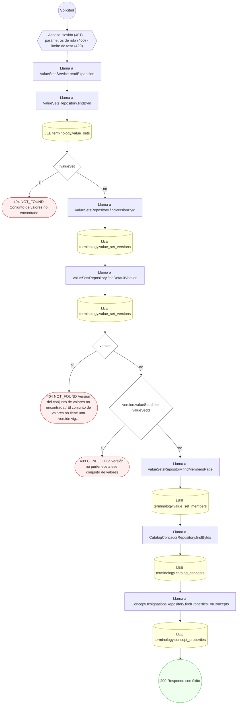

#### 18. POST /terminology/ValueSet/{id}/$expand

UC-03-08: materializa los miembros de la expansión

| HTTP | Código | Cuándo |
|---|---|---|
| 200 | — | Éxito |
| 400 | `VALIDATION_FAILED` | Los parámetros de ruta son UUID válidos; El cuerpo cumple el DTO (sin propiedades extra) |
| 401 | `UNAUTHENTICATED` | Hay una sesión válida (JWT) |
| 403 | `FORBIDDEN` | El rol está permitido; El tenant se resuelve y pertenece al actor |
| 404 | `NOT_FOUND` | ResourceNotFoundException: Conjunto de valores no encontrado; ResourceNotFoundException: Versión del conjunto de valores no encontrada |
| 409 | `CONFLICT` | ConflictException: La versión no pertenece a ese conjunto de valores |
| 422 | `PRECONDITION_FAILED` | PreconditionFailedException: Sólo se expanden versiones en borrador o activas |
| 429 | `RATE_LIMITED` | No se supera el límite de solicitudes |

```mermaid
flowchart TD
  n1(("Solicitud")):::inicio
  n2{{"Acceso: sesión (401) · rol (403) · tenant (403) · parámetros de ruta (400) · cuerpo válido (400) · límite de…"}}:::acceso
  n1 --> n2
  n3["Llama a ValueSetsService.expandValueSet"]:::llamada
  n2 --> n3
  n4["Transacción: transactional(…)"]:::transaccion
  n3 --> n4
  n5["Llama a ValueSetsRepository.findById"]:::llamada
  n4 --> n5
  n6[("LEE terminology.value_sets")]:::efecto
  n5 --> n6
  n7{"!valueSet"}:::decision
  n6 --> n7
  n8(["404 NOT_FOUND Conjunto de valores no encontrado"]):::error
  n7 -->|"sí"| n8
  n9["Llama a ValueSetsRepository.findVersionForUpdate"]:::llamada
  n7 -->|"no"| n9
  n10[("LEE terminology.value_set_versions")]:::efecto
  n9 --> n10
  n11{"!version"}:::decision
  n10 --> n11
  n12(["404 NOT_FOUND Versión del conjunto de valores no encontrada"]):::error
  n11 -->|"sí"| n12
  n13{"version.valueSetId !== valueSetId"}:::decision
  n11 -->|"no"| n13
  n14(["409 CONFLICT La versión no pertenece a ese conjunto de valores"]):::error
  n13 -->|"sí"| n14
  n15{"version.stateConceptId && !EXPANDABLE_STATES.has(version.stateConceptId)"}:::decision
  n13 -->|"no"| n15
  n16(["422 PRECONDITION_FAILED Sólo se expanden versiones en borrador o activas"]):::error
  n15 -->|"sí"| n16
  n17["Llama a ValueSetsRepository.findRulesByVersion"]:::llamada
  n15 -->|"no"| n17
  n18[("LEE terminology.value_set_rules")]:::efecto
  n17 --> n18
  n19["Llama a ValueSetsService.evaluateRules"]:::llamada
  n18 --> n19
  n20["Repite: por cada const rule de rules"]:::bucle
  n19 --> n20
  n21["Llama a ValueSetsService.evaluateRule"]:::llamada
  n20 -->|"cada elemento"| n21
  n22["Llama a CodeSystemVersionsRepository.findDefaultActiveVersion"]:::llamada
  n21 --> n22
  n23[("LEE terminology.code_system_versions")]:::efecto
  n22 --> n23
  n24["Llama a CatalogConceptsRepository.findByVersion"]:::llamada
  n23 --> n24
  n25[("LEE terminology.catalog_concepts")]:::efecto
  n24 --> n25
  n26["Llama a ValueSetsRepository.deleteMembersByVersion"]:::llamada
  n25 --> n26
  n20 -->|"al terminar"| n26
  n27[("BORRA terminology.value_set_members")]:::efecto
  n26 --> n27
  n28["Repite: por cada const conceptId de selected"]:::bucle
  n27 --> n28
  n29["Llama a ValueSetsRepository.createMember"]:::llamada
  n28 -->|"cada elemento"| n29
  n30[("CREA terminology.value_set_members")]:::efecto
  n29 --> n30
  n31{"dto.activate !== false"}:::decision
  n30 --> n31
  n28 -->|"al terminar"| n31
  n32[("ACTUALIZA terminology.value_set_versions")]:::efecto
  n31 -->|"sí"| n32
  n33{"dto.makeDefault"}:::decision
  n32 --> n33
  n31 -->|"no"| n33
  n34["Llama a ValueSetsRepository.findDefaultVersionsForUpdate"]:::llamada
  n33 -->|"sí"| n34
  n35[("LEE terminology.value_set_versions")]:::efecto
  n34 --> n35
  n36["Repite: por cada const other de previous"]:::bucle
  n35 --> n36
  n37{"other.id !== version.id"}:::decision
  n36 -->|"cada elemento"| n37
  n38[("ACTUALIZA terminology.value_set_versions")]:::efecto
  n37 -->|"sí"| n38
  n39[("ACTUALIZA terminology.value_set_versions")]:::efecto
  n38 --> n39
  n37 -->|"no"| n39
  n36 -->|"al terminar"| n39
  n40(("200 Responde con éxito")):::ok
  n39 --> n40
  n33 -->|"no"| n40
  classDef acceso fill:#eef,stroke:#66a
  classDef error fill:#fee,stroke:#c33
  classDef ok fill:#efe,stroke:#3a3
  classDef efecto fill:#ffd,stroke:#aa3
  classDef decision fill:#fff,stroke:#555
  classDef corte fill:#eee,stroke:#999,stroke-dasharray: 4
```

#### 19. POST /terminology/versions/{versionId}/import

UC-03-03: importa conceptos en una versión en borrador

| HTTP | Código | Cuándo |
|---|---|---|
| 201 | — | Éxito |
| 400 | `VALIDATION_FAILED` | Los parámetros de ruta son UUID válidos; El cuerpo cumple el DTO (sin propiedades extra) |
| 401 | `UNAUTHENTICATED` | Hay una sesión válida (JWT) |
| 403 | `FORBIDDEN` | El rol está permitido; El tenant se resuelve y pertenece al actor |
| 404 | `NOT_FOUND` | ResourceNotFoundException: Versión no encontrada |
| 422 | `PRECONDITION_FAILED` | PreconditionFailedException: No se puede importar en una versión que no está en borrador |
| 429 | `RATE_LIMITED` | No se supera el límite de solicitudes |

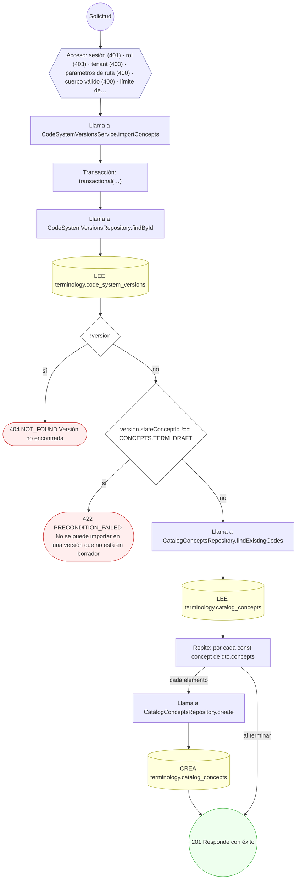

#### 20. POST /terminology/versions/{versionId}/import-file

UC-03-03: importa filas desde un archivo, o las valida sin escribir

| HTTP | Código | Cuándo |
|---|---|---|
| 201 | — | Éxito |
| 400 | `VALIDATION_FAILED` | Los parámetros de ruta son UUID válidos; El cuerpo cumple el DTO (sin propiedades extra) |
| 401 | `UNAUTHENTICATED` | Hay una sesión válida (JWT) |
| 403 | `FORBIDDEN` | El rol está permitido; El tenant se resuelve y pertenece al actor |
| 404 | `NOT_FOUND` | ResourceNotFoundException: Versión no encontrada; ResourceNotFoundException: El sistema de codificación de la versión no existe |
| 422 | `PRECONDITION_FAILED` | PreconditionFailedException: Falta el archivo; PreconditionFailedException: Solo se puede importar en una versión en borrador |
| 429 | `RATE_LIMITED` | No se supera el límite de solicitudes |
| 500 | `INTERNAL` | ImportFileRejectedException: {ErrorCode.IMPORT_PROFILE_UNKNOWN}; ImportFileRejectedException: {ErrorCode.IMPORT_EMPTY_FILE}; ImportFileRejectedException: {ErrorCode.IMPORT_FORMAT_UNSUPPORTED} |

```mermaid
flowchart TD
  n1(("Solicitud")):::inicio
  n2{{"Acceso: sesión (401) · rol (403) · tenant (403) · parámetros de ruta (400) · cuerpo válido (400) · límite de…"}}:::acceso
  n1 --> n2
  n3{"!file"}:::decision
  n2 --> n3
  n4(["422 PRECONDITION_FAILED Falta el archivo"]):::error
  n3 -->|"sí"| n4
  n5["Llama a ConceptFileImportService.importFromFile"]:::llamada
  n3 -->|"no"| n5
  n6["Llama a ConceptFileImportService.requireProfile"]:::llamada
  n5 --> n6
  n7{"profile === undefined"}:::decision
  n6 --> n7
  n8(["500 INTERNAL {ErrorCode.IMPORT_PROFILE_UNKNOWN}"]):::error
  n7 -->|"sí"| n8
  n9{"withoutContent(buffer)"}:::decision
  n7 -->|"no"| n9
  n10(["500 INTERNAL {ErrorCode.IMPORT_EMPTY_FILE}"]):::error
  n9 -->|"sí"| n10
  n11["Llama a ConceptFileImportService.requireFormat"]:::llamada
  n9 -->|"no"| n11
  n12["Intenta"]:::intento
  n11 --> n12
  n13{"error instanceof FormatoNoAdmitidoError"}:::decision
  n12 -->|"si falla"| n13
  n14(["500 INTERNAL {ErrorCode.IMPORT_FORMAT_UNSUPPORTED}"]):::error
  n13 -->|"sí"| n14
  n15(["↩ (relanza el error capturado)"]):::error
  n13 -->|"no"| n15
  n16{"parser === undefined"}:::decision
  n12 --> n16
  n17(["500 INTERNAL {ErrorCode.IMPORT_FORMAT_UNSUPPORTED}"]):::error
  n16 -->|"sí"| n17
  n18["Llama a ConceptFileImportService.requireVersionInDraft"]:::llamada
  n16 -->|"no"| n18
  n19["Llama a CodeSystemVersionsRepository.findById"]:::llamada
  n18 --> n19
  n20[("LEE terminology.code_system_versions")]:::efecto
  n19 --> n20
  n21{"!version"}:::decision
  n20 --> n21
  n22(["404 NOT_FOUND Versión no encontrada"]):::error
  n21 -->|"sí"| n22
  n23{"version.stateConceptId != null && version.stateConceptId !== CONCEPTS.TERM_DRAFT"}:::decision
  n21 -->|"no"| n23
  n24(["422 PRECONDITION_FAILED Solo se puede importar en una versión en borrador"]):::error
  n23 -->|"sí"| n24
  n25["Llama a CodeSystemsRepository.findById"]:::llamada
  n23 -->|"no"| n25
  n26[("LEE terminology.code_systems")]:::efecto
  n25 --> n26
  n27{"!codeSystem"}:::decision
  n26 --> n27
  n28(["404 NOT_FOUND El sistema de codificación de la versión no existe"]):::error
  n27 -->|"sí"| n28
  n29["Llama a ConceptFileImportService.readWithParser"]:::llamada
  n27 -->|"no"| n29
  n30["Intenta"]:::intento
  n29 --> n30
  n31(["500 INTERNAL {ErrorCode.IMPORT_FORMAT_UNSUPPORTED}"]):::error
  n30 -->|"si falla"| n31
  n32{"totalRead === 0"}:::decision
  n30 --> n32
  n33(["500 INTERNAL {ErrorCode.IMPORT_EMPTY_FILE}"]):::error
  n32 -->|"sí"| n33
  n34["Llama a ConceptFileImportService.openBatch"]:::llamada
  n32 -->|"no"| n34
  n35[("CREA terminology.catalog_import_batches")]:::efecto
  n34 --> n35
  n36["Llama a ConceptFileImportService.write"]:::llamada
  n35 --> n36
  n37["Repite: ciclo for"]:::bucle
  n36 --> n37
  n38["Transacción: transactional(…)"]:::transaccion
  n37 -->|"cada elemento"| n38
  n39["Llama a CatalogConceptsRepository.findExistingCodes"]:::llamada
  n38 --> n39
  n40[("LEE terminology.catalog_concepts")]:::efecto
  n39 --> n40
  n41["Repite: por cada const row de batch"]:::bucle
  n40 --> n41
  n42["Llama a CatalogConceptsRepository.create"]:::llamada
  n41 -->|"cada elemento"| n42
  n43[("CREA terminology.catalog_concepts")]:::efecto
  n42 --> n43
  n44["Llama a ConceptFileImportService.closeBatch"]:::llamada
  n43 --> n44
  n41 -->|"al terminar"| n44
  n37 -->|"al terminar"| n44
  n45[("LEE terminology.catalog_import_batches · ACTUALIZA terminology.catalog_import_batches")]:::efecto
  n44 --> n45
  n46(("201 Responde con éxito")):::ok
  n45 --> n46
  classDef acceso fill:#eef,stroke:#66a
  classDef error fill:#fee,stroke:#c33
  classDef ok fill:#efe,stroke:#3a3
  classDef efecto fill:#ffd,stroke:#aa3
  classDef decision fill:#fff,stroke:#555
  classDef corte fill:#eee,stroke:#999,stroke-dasharray: 4
```

#### 21. POST /terminology/versions/{versionId}/publish

UC-03-04: publica una versión (borrador → activa)

| HTTP | Código | Cuándo |
|---|---|---|
| 200 | — | Éxito |
| 400 | `VALIDATION_FAILED` | Los parámetros de ruta son UUID válidos |
| 401 | `UNAUTHENTICATED` | Hay una sesión válida (JWT) |
| 403 | `FORBIDDEN` | El rol está permitido; El tenant se resuelve y pertenece al actor |
| 404 | `NOT_FOUND` | ResourceNotFoundException: Versión no encontrada |
| 409 | `CONFLICT` | ConflictException: La versión ya está publicada |
| 422 | `PRECONDITION_FAILED` | PreconditionFailedException: Solo se puede publicar una versión en borrador |
| 429 | `RATE_LIMITED` | No se supera el límite de solicitudes |

```mermaid
flowchart TD
  n1(("Solicitud")):::inicio
  n2{{"Acceso: sesión (401) · rol (403) · tenant (403) · parámetros de ruta (400) · límite de tasa (429)"}}:::acceso
  n1 --> n2
  n3["Llama a CodeSystemVersionsService.publishVersion"]:::llamada
  n2 --> n3
  n4["Transacción: transactional(…)"]:::transaccion
  n3 --> n4
  n5["Llama a CodeSystemVersionsRepository.findById"]:::llamada
  n4 --> n5
  n6[("LEE terminology.code_system_versions")]:::efecto
  n5 --> n6
  n7{"!version"}:::decision
  n6 --> n7
  n8(["404 NOT_FOUND Versión no encontrada"]):::error
  n7 -->|"sí"| n8
  n9{"version.stateConceptId === CONCEPTS.TERM_ACTIVE"}:::decision
  n7 -->|"no"| n9
  n10(["409 CONFLICT La versión ya está publicada"]):::error
  n9 -->|"sí"| n10
  n11{"version.stateConceptId != null && version.stateConceptId !== CONCEPTS.TERM_DRAFT"}:::decision
  n9 -->|"no"| n11
  n12(["422 PRECONDITION_FAILED Solo se puede publicar una versión en borrador"]):::error
  n11 -->|"sí"| n12
  n13[("ACTUALIZA terminology.code_system_versions · ACTUALIZA terminology.code_system_versions")]:::efecto
  n11 -->|"no"| n13
  n14["Llama a CatalogConceptsRepository.findPromotableByVersion"]:::llamada
  n13 --> n14
  n15[("LEE terminology.catalog_concepts")]:::efecto
  n14 --> n15
  n16["Repite: por cada const concept de promoted"]:::bucle
  n15 --> n16
  n17[("ACTUALIZA terminology.catalog_concepts")]:::efecto
  n16 -->|"cada elemento"| n17
  n18(("200 Responde con éxito")):::ok
  n17 --> n18
  n16 -->|"al terminar"| n18
  classDef acceso fill:#eef,stroke:#66a
  classDef error fill:#fee,stroke:#c33
  classDef ok fill:#efe,stroke:#3a3
  classDef efecto fill:#ffd,stroke:#aa3
  classDef decision fill:#fff,stroke:#555
  classDef corte fill:#eee,stroke:#999,stroke-dasharray: 4
```

### Operaciones sin decisiones propias

Sólo comprueban el acceso y leen o escriben: no tienen ramas que dibujar. Su detalle está en la ficha de endpoints.

| Operación | Respuestas posibles | Tablas |
|---|---|---|
| GET /terminology/code-systems | 200, 401, 403, 429 | 1 |
| GET /terminology/code-systems/{id}/versions | 200, 400, 401, 403, 429 | 1 |
| GET /terminology/value-sets | 200, 401, 429 | 3 |
| GET /terminology/value-sets/$glossary-facets | 200, 401, 429 | 5 |
