<!-- AUTOGENERADO por tools/inventario/flujos.mjs. No editar manualmente. -->

# Flujos del módulo `time_series`

- **Procesos:** 1 · **Máquinas de estado:** 0
- **Operaciones:** 14 (14 con decisiones propias, 0 sin ellas)
- Inventario de endpoints del módulo: [time_series](../endpoints/time_series.md)

## Proceso: Módulo 58 — Series temporales de alto volumen y analítica de eventos

- **Código:** `time_series` · **Agrupación:** CASO_DE_USO_README · **Operaciones:** 14
- **Actores:** ANALYST · DATA_PLATFORM_ADMIN · DEVICE · INGEST_GATEWAY · PLATFORM_ADMIN · SYSTEM
- **Revisión:** AUTO_DETECTADA
- **Fuentes:** `src/modules/time_series/README.md`

### Para qué sirve

Doce flujos de medición append-only sobre TimescaleDB: ingesta por lote, normalización de lecturas de dispositivo con promoción al registro clínico, administración física de las particiones (chunks, compresión, retención), agregados continuos y consulta de rango con downsampling.

_Fuente: `src/modules/time_series/README.md:3`_

### Flujo general declarado en el README

```text
INGESTA (append-only, el lote entra entero o no entra)
  series/:id/points/batch-ingest ──> quality_state = received
  devices/:id/readings/ingest ─────> UK (tenant, dispositivo, canal, secuencia) descarta el reenvío
  ads/events/batch-ingest ─────────> UK (tenant, cuenta, evento, nombre) descarta el reenvío
  metrics/:dataset/batch-ingest ───> ai_runtime · ingestion_pipeline · service_sli
  location/pings/batch-ingest ─────> exige consentimiento vigente
        └─ todas emiten una métrica en ingestion_pipeline_metric_series

NORMALIZACIÓN
  normalize/run ──> lee la cruda FOR UPDATE
                    ├─ ya normalizada ──────> devuelve la de antes
                    ├─ rechazada / sin valor > rechazo
                    └─ crea la vital validated
                         └─ promoteToClinical ──> INSERT en clinical.observations
                                                  + enlace en la vital, misma tx

ADMINISTRACIÓN FÍSICA
  admin/hypertables ────────> create_hypertable + dimensión de espacio + anchura de chunk
  admin/compression/run ────> comprime N chunks más antiguos que el umbral, uno a uno
  admin/retention/policies ─> drop_chunks (metadata, no fila a fila)
  admin/rollups/:name/refresh ─> ensure + refresh FUERA de transacción, después métrica

CONSULTA
  series/:id/query ──> bucket < 1 h  ó serie sin rollup ──> crudo
                       bucket múltiplo de 1 h / 1 día  ──> continuous_sli_hourly / _daily
```

_Fuente: `src/modules/time_series/README.md:44`_

### Etapas y operaciones

| Etapa | Descripción | Operación | Quién actúa | Riesgo | Tablas |
|---|---|---|---|---|---|
| `UC-58-01` | Lote append-only de puntos | POST /ts/series/{seriesId}/points/batch-ingest | INGEST_GATEWAY · SYSTEM · PLATFORM_ADMIN | MEDIO | 4 |
| `UC-58-02` | Lectura de dispositivo médico | POST /ts/devices/{deviceId}/readings/ingest | INGEST_GATEWAY · DEVICE · SYSTEM · PLATFORM_ADMIN | MEDIO | 6 |
| `UC-58-03` | Normalizar y promover a clinical.observations | POST /ts/normalize/run | SYSTEM · PLATFORM_ADMIN | MEDIO | 9 |
| `UC-58-04` | Hypertable y chunks | POST /ts/admin/hypertables | DATA_PLATFORM_ADMIN · PLATFORM_ADMIN | BAJO | 0 |
|  |  | PATCH /ts/admin/hypertables/{table} | DATA_PLATFORM_ADMIN · PLATFORM_ADMIN | BAJO | 0 |
| `UC-58-05` | Comprimir chunks antiguos | POST /ts/admin/compression/run | SYSTEM · DATA_PLATFORM_ADMIN · PLATFORM_ADMIN | MEDIO | 4 |
| `UC-58-06` | Descartar chunks fuera de ventana | POST /ts/admin/retention/policies | SYSTEM · DATA_PLATFORM_ADMIN · PLATFORM_ADMIN | MEDIO | 4 |
| `UC-58-07` | Materializar agregado continuo | POST /ts/admin/rollups/{name}/refresh | SYSTEM · DATA_PLATFORM_ADMIN · PLATFORM_ADMIN | MEDIO | 4 |
| `UC-58-08` | Rollup de conteos de auditoría | POST /ts/admin/rollups/audit-daily/refresh | SYSTEM · DATA_PLATFORM_ADMIN · PLATFORM_ADMIN | MEDIO | 4 |
| `UC-58-09` | Rango con downsampling | GET /ts/series/{seriesId}/query | ANALYST · DATA_PLATFORM_ADMIN · SYSTEM · PLATFORM_ADMIN | BAJO | 0 |
| `UC-58-10` | Eventos de publicidad con dedupe | POST /ts/ads/events/batch-ingest | INGEST_GATEWAY · SYSTEM · PLATFORM_ADMIN | MEDIO | 6 |
| `UC-58-11` | Métricas de runtime y pipeline | POST /ts/metrics/{dataset}/batch-ingest | INGEST_GATEWAY · SYSTEM · PLATFORM_ADMIN | MEDIO | 4 |
| `UC-58-12` | Corrección append-only gobernada | POST /ts/series/{seriesId}/backfill/governed | DATA_PLATFORM_ADMIN · PLATFORM_ADMIN | MEDIO | 4 |
| `UC-58-13` | Pings de ubicación con consentimiento | POST /ts/location/pings/batch-ingest | INGEST_GATEWAY · SYSTEM · PLATFORM_ADMIN | MEDIO | 5 |

### Diagrama — etapas `UC-58-01`, `UC-58-02`, `UC-58-03`…

```mermaid
flowchart LR
  a2(["INGEST_GATEWAY · SYSTEM · PLATFORM_ADMIN"]):::actor
  a8(["INGEST_GATEWAY · DEVICE · SYSTEM · PLATFORM_ADMIN"]):::actor
  a12(["SYSTEM · PLATFORM_ADMIN"]):::actor
  a17(["DATA_PLATFORM_ADMIN · PLATFORM_ADMIN"]):::actor
  a20(["SYSTEM · DATA_PLATFORM_ADMIN · PLATFORM_ADMIN"]):::actor
  a28(["ANALYST · DATA_PLATFORM_ADMIN · SYSTEM · PLATFORM_ADMIN"]):::actor
  t3[("messaging.domain_events")]:::tabla
  t4[("messaging.outbox_messages")]:::tabla
  t5[("time_series.ingestion_pipeline_metric_series")]:::tabla
  e6>"SeriesBatchIngested"]:::evento
  t9[("time_series.device_raw_reading_series")]:::tabla
  e10>"DeviceRawReadingReceived"]:::evento
  t13[("clinical.observations")]:::tabla
  e15>"VitalNormalizedAndPromoted"]:::evento
  e21>"ChunksCompressed"]:::evento
  e23>"ChunksDropped"]:::evento
  e25>"~name === 'continuous_audit_daily' ? 'AuditDailyR…"]:::evento
  t30[("time_series.ads_delivery_event_series")]:::tabla
  e31>"AdsEventsIngested"]:::evento
  e33>"RuntimeMetricsIngested"]:::evento
  e35>"GovernedBackfillApplied"]:::evento
  t37[("time_series.location_ping_series")]:::tabla
  e38>"LocationPingsIngested"]:::evento
  subgraph s0["UC-58-01 · Lote append-only de puntos"]
    o1["POST /ts/series/{seriesId}/points/batch-ingest"]:::op
  end
  subgraph s1["UC-58-02 · Lectura de dispositivo médico"]
    o7["POST /ts/devices/{deviceId}/readings/ingest"]:::op
  end
  t14[("+3 tablas más")]
  subgraph s2["UC-58-03 · Normalizar y promover a clinical.observations"]
    o11["POST /ts/normalize/run"]:::op
  end
  subgraph s3["UC-58-04 · Hypertable y chunks"]
    o16["POST /ts/admin/hypertables"]:::op
    o18["PATCH /ts/admin/hypertables/{table}"]:::op
  end
  subgraph s4["UC-58-05 · Comprimir chunks antiguos"]
    o19["POST /ts/admin/compression/run"]:::op
  end
  subgraph s5["UC-58-06 · Descartar chunks fuera de ventana"]
    o22["POST /ts/admin/retention/policies"]:::op
  end
  subgraph s6["UC-58-07 · Materializar agregado continuo"]
    o24["POST /ts/admin/rollups/{name}/refresh"]:::op
  end
  subgraph s7["UC-58-08 · Rollup de conteos de auditoría"]
    o26["POST /ts/admin/rollups/audit-daily/refresh"]:::op
  end
  subgraph s8["UC-58-09 · Rango con downsampling"]
    o27["GET /ts/series/{seriesId}/query"]:::op
  end
  subgraph s9["UC-58-10 · Eventos de publicidad con dedupe"]
    o29["POST /ts/ads/events/batch-ingest"]:::op
  end
  subgraph s10["UC-58-11 · Métricas de runtime y pipeline"]
    o32["POST /ts/metrics/{dataset}/batch-ingest"]:::op
  end
  subgraph s11["UC-58-12 · Corrección append-only gobernada"]
    o34["POST /ts/series/{seriesId}/backfill/governed"]:::op
  end
  subgraph s12["UC-58-13 · Pings de ubicación con consentimiento"]
    o36["POST /ts/location/pings/batch-ingest"]:::op
  end
  a2 --> o1
  o1 -->|"CREA"| t3
  o1 -->|"CREA"| t4
  o1 -->|"LEE"| t4
  o1 -->|"CREA"| t5
  o1 -->|"evento"| e6
  a8 --> o7
  o7 -->|"CREA"| t3
  o7 -->|"CREA"| t4
  o7 -->|"LEE"| t4
  o7 -->|"CREA"| t9
  o7 -->|"LEE"| t9
  o7 -->|"CREA"| t5
  o7 -->|"evento"| e10
  a12 --> o11
  o11 -->|"CREA"| t13
  o11 -->|"CREA"| t3
  o11 -->|"CREA"| t4
  o11 -->|"LEE"| t4
  o11 -->|"LEE"| t9
  o11 -->|"CREA"| t5
  o11 -.-> t14
  o11 -->|"evento"| e15
  a17 --> o16
  a17 --> o18
  a20 --> o19
  o19 -->|"CREA"| t3
  o19 -->|"CREA"| t4
  o19 -->|"LEE"| t4
  o19 -->|"CREA"| t5
  o19 -->|"evento"| e21
  a20 --> o22
  o22 -->|"CREA"| t3
  o22 -->|"CREA"| t4
  o22 -->|"LEE"| t4
  o22 -->|"CREA"| t5
  o22 -->|"evento"| e23
  a20 --> o24
  o24 -->|"CREA"| t3
  o24 -->|"CREA"| t4
  o24 -->|"LEE"| t4
  o24 -->|"CREA"| t5
  o24 -->|"evento"| e25
  a20 --> o26
  o26 -->|"CREA"| t3
  o26 -->|"CREA"| t4
  o26 -->|"LEE"| t4
  o26 -->|"CREA"| t5
  o26 -->|"evento"| e25
  a28 --> o27
  a2 --> o29
  o29 -->|"CREA"| t3
  o29 -->|"CREA"| t4
  o29 -->|"LEE"| t4
  o29 -->|"CREA"| t30
  o29 -->|"LEE"| t30
  o29 -->|"CREA"| t5
  o29 -->|"evento"| e31
  a2 --> o32
  o32 -->|"CREA"| t3
  o32 -->|"CREA"| t4
  o32 -->|"LEE"| t4
  o32 -->|"CREA"| t5
  o32 -->|"evento"| e33
  a17 --> o34
  o34 -->|"CREA"| t3
  o34 -->|"CREA"| t4
  o34 -->|"LEE"| t4
  o34 -->|"CREA"| t5
  o34 -->|"evento"| e35
  a2 --> o36
  o36 -->|"CREA"| t3
  o36 -->|"CREA"| t4
  o36 -->|"LEE"| t4
  o36 -->|"CREA"| t5
  o36 -->|"CREA"| t37
  o36 -->|"evento"| e38
  classDef op fill:#fff,stroke:#446
  classDef actor fill:#eef,stroke:#66a
  classDef tabla fill:#ffd,stroke:#aa3
  classDef evento fill:#efe,stroke:#3a3
```

## Árbol de decisión por operación

Cada árbol se deriva del código del handler y de los métodos que invoca (hasta 4 niveles). Una rama que no decide, no escribe y no falla se poda. Los accesos y los efectos consecutivos se agrupan en un solo nodo.

### Operaciones con decisiones propias

#### 1. POST /ts/admin/compression/run

Comprimir los chunks más antiguos que el umbral

| HTTP | Código | Cuándo |
|---|---|---|
| 200 | — | Éxito |
| 400 | `VALIDATION_FAILED` | El cuerpo cumple el DTO (sin propiedades extra) |
| 401 | `UNAUTHENTICATED` | Hay una sesión válida (JWT) |
| 403 | `FORBIDDEN` | El rol está permitido; El tenant se resuelve y pertenece al actor |
| 422 | `PRECONDITION_FAILED` | PreconditionFailedException: La serie no declara por qué columnas se segmenta al comprimir. |
| 429 | `RATE_LIMITED` | No se supera el límite de solicitudes |
| 500 | — | InternalServerErrorException: La segmentación de compresión declara una columna que no es válida. |

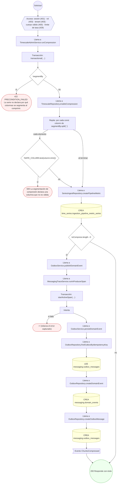

#### 2. POST /ts/admin/hypertables

Convertir una serie en hypertable y declarar su particionado

| HTTP | Código | Cuándo |
|---|---|---|
| 201 | — | Éxito |
| 400 | `VALIDATION_FAILED` | El cuerpo cumple el DTO (sin propiedades extra) |
| 401 | `UNAUTHENTICATED` | Hay una sesión válida (JWT) |
| 403 | `FORBIDDEN` | El rol está permitido; El tenant se resuelve y pertenece al actor |
| 429 | `RATE_LIMITED` | No se supera el límite de solicitudes |
| 500 | — | InternalServerErrorException: La dimensión de espacio no es un identificador de columna válido. |

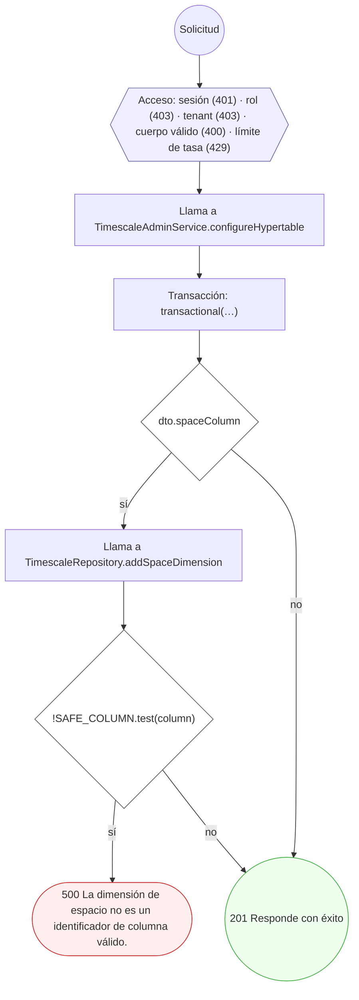

#### 3. PATCH /ts/admin/hypertables/{table}

Ajustar la anchura temporal del chunk

| HTTP | Código | Cuándo |
|---|---|---|
| 200 | — | Éxito |
| 400 | `VALIDATION_FAILED` | El cuerpo cumple el DTO (sin propiedades extra); BadRequestException: La tabla no pertenece al catálogo de series del módulo. |
| 401 | `UNAUTHENTICATED` | Hay una sesión válida (JWT) |
| 403 | `FORBIDDEN` | El rol está permitido; El tenant se resuelve y pertenece al actor |
| 422 | `PRECONDITION_FAILED` | PreconditionFailedException: La tabla todavía no es una hypertable; conviértela antes de ajustar sus chunks. |
| 429 | `RATE_LIMITED` | No se supera el límite de solicitudes |

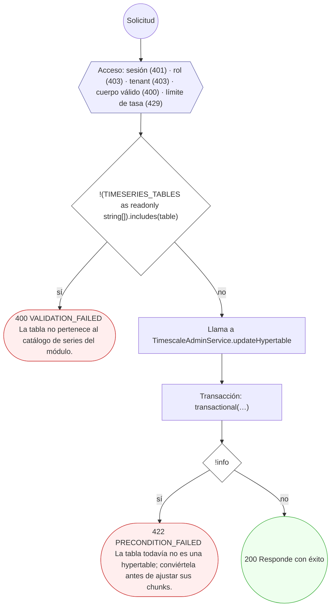

#### 4. POST /ts/admin/retention/policies

Aplicar la retención descartando chunks fuera de ventana

| HTTP | Código | Cuándo |
|---|---|---|
| 200 | — | Éxito |
| 400 | `VALIDATION_FAILED` | El cuerpo cumple el DTO (sin propiedades extra) |
| 401 | `UNAUTHENTICATED` | Hay una sesión válida (JWT) |
| 403 | `FORBIDDEN` | El rol está permitido; El tenant se resuelve y pertenece al actor |
| 429 | `RATE_LIMITED` | No se supera el límite de solicitudes |

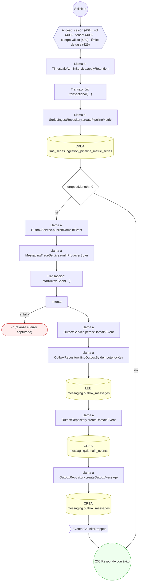

#### 5. POST /ts/admin/rollups/{name}/refresh

Materializar la ventana de un agregado continuo

| HTTP | Código | Cuándo |
|---|---|---|
| 200 | — | Éxito |
| 400 | `VALIDATION_FAILED` | El cuerpo cumple el DTO (sin propiedades extra); BadRequestException: El rollup debe ser uno de: {ROLLUP_NAMES.join(', ')}. |
| 401 | `UNAUTHENTICATED` | Hay una sesión válida (JWT) |
| 403 | `FORBIDDEN` | El rol está permitido; El tenant se resuelve y pertenece al actor |
| 422 | `PRECONDITION_FAILED` | PreconditionFailedException: La ventana a materializar tiene que empezar antes de terminar. |
| 429 | `RATE_LIMITED` | No se supera el límite de solicitudes |

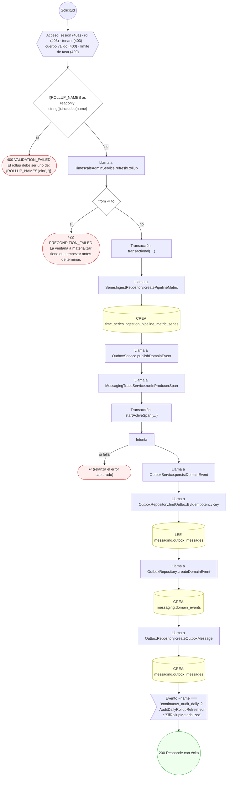

#### 6. POST /ts/admin/rollups/audit-daily/refresh

Refrescar el rollup de conteos diarios de auditoría

| HTTP | Código | Cuándo |
|---|---|---|
| 200 | — | Éxito |
| 400 | `VALIDATION_FAILED` | El cuerpo cumple el DTO (sin propiedades extra) |
| 401 | `UNAUTHENTICATED` | Hay una sesión válida (JWT) |
| 403 | `FORBIDDEN` | El rol está permitido; El tenant se resuelve y pertenece al actor |
| 422 | `PRECONDITION_FAILED` | PreconditionFailedException: La ventana a materializar tiene que empezar antes de terminar. |
| 429 | `RATE_LIMITED` | No se supera el límite de solicitudes |

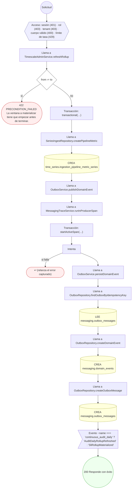

#### 7. POST /ts/ads/events/batch-ingest

Ingerir eventos de entrega de publicidad

| HTTP | Código | Cuándo |
|---|---|---|
| 201 | — | Éxito |
| 400 | `VALIDATION_FAILED` | El cuerpo cumple el DTO (sin propiedades extra) |
| 401 | `UNAUTHENTICATED` | Hay una sesión válida (JWT) |
| 403 | `FORBIDDEN` | El rol está permitido; El tenant se resuelve y pertenece al actor |
| 429 | `RATE_LIMITED` | No se supera el límite de solicitudes |

```mermaid
flowchart TD
  n1(("Solicitud")):::inicio
  n2{{"Acceso: sesión (401) · rol (403) · tenant (403) · cuerpo válido (400) · límite de tasa (429)"}}:::acceso
  n1 --> n2
  n3["Llama a SeriesIngestService.batchIngestAdsEvents"]:::llamada
  n2 --> n3
  n4["Transacción: transactional(…)"]:::transaccion
  n3 --> n4
  n5["Repite: por cada const event de dto.events"]:::bucle
  n4 --> n5
  n6["Llama a SeriesIngestRepository.findAdsEvent"]:::llamada
  n5 -->|"cada elemento"| n6
  n7[("LEE time_series.ads_delivery_event_series")]:::efecto
  n6 --> n7
  n8["Llama a SeriesIngestRepository.createAdsEvent"]:::llamada
  n7 --> n8
  n9[("CREA time_series.ads_delivery_event_series")]:::efecto
  n8 --> n9
  n10["Llama a SeriesIngestService.recordPipelineMetric"]:::llamada
  n9 --> n10
  n5 -->|"al terminar"| n10
  n11["Llama a SeriesIngestRepository.createPipelineMetric"]:::llamada
  n10 --> n11
  n12[("CREA time_series.ingestion_pipeline_metric_series")]:::efecto
  n11 --> n12
  n13{"inserted › 0"}:::decision
  n12 --> n13
  n14["Llama a OutboxService.publishDomainEvent"]:::llamada
  n13 -->|"sí"| n14
  n15["Llama a MessagingTraceService.runInProducerSpan"]:::llamada
  n14 --> n15
  n16["Transacción: startActiveSpan(…)"]:::transaccion
  n15 --> n16
  n17["Intenta"]:::intento
  n16 --> n17
  n18(["↩ (relanza el error capturado)"]):::error
  n17 -->|"si falla"| n18
  n19["Llama a OutboxService.persistDomainEvent"]:::llamada
  n17 --> n19
  n20["Llama a OutboxRepository.findOutboxByIdempotencyKey"]:::llamada
  n19 --> n20
  n21[("LEE messaging.outbox_messages")]:::efecto
  n20 --> n21
  n22["Llama a OutboxRepository.createDomainEvent"]:::llamada
  n21 --> n22
  n23[("CREA messaging.domain_events")]:::efecto
  n22 --> n23
  n24["Llama a OutboxRepository.createOutboxMessage"]:::llamada
  n23 --> n24
  n25[("CREA messaging.outbox_messages")]:::efecto
  n24 --> n25
  n26>"Evento AdsEventsIngested"]:::evento
  n25 --> n26
  n27(("201 Responde con éxito")):::ok
  n26 --> n27
  n13 -->|"no"| n27
  classDef acceso fill:#eef,stroke:#66a
  classDef error fill:#fee,stroke:#c33
  classDef ok fill:#efe,stroke:#3a3
  classDef efecto fill:#ffd,stroke:#aa3
  classDef decision fill:#fff,stroke:#555
  classDef corte fill:#eee,stroke:#999,stroke-dasharray: 4
```

#### 8. POST /ts/devices/{deviceId}/readings/ingest

Ingerir lecturas de un dispositivo médico

| HTTP | Código | Cuándo |
|---|---|---|
| 201 | — | Éxito |
| 400 | `VALIDATION_FAILED` | Los parámetros de ruta son UUID válidos; El cuerpo cumple el DTO (sin propiedades extra) |
| 401 | `UNAUTHENTICATED` | Hay una sesión válida (JWT) |
| 403 | `FORBIDDEN` | El rol está permitido; El tenant se resuelve y pertenece al actor |
| 429 | `RATE_LIMITED` | No se supera el límite de solicitudes |

```mermaid
flowchart TD
  n1(("Solicitud")):::inicio
  n2{{"Acceso: sesión (401) · rol (403) · tenant (403) · parámetros de ruta (400) · cuerpo válido (400) · límite de…"}}:::acceso
  n1 --> n2
  n3["Llama a SeriesIngestService.ingestDeviceReadings"]:::llamada
  n2 --> n3
  n4["Transacción: transactional(…)"]:::transaccion
  n3 --> n4
  n5["Repite: por cada const reading de dto.readings"]:::bucle
  n4 --> n5
  n6{"reading.deviceSequence"}:::decision
  n5 -->|"cada elemento"| n6
  n7["Llama a SeriesIngestRepository.findDeviceReadingBySequence"]:::llamada
  n6 -->|"sí"| n7
  n8[("LEE time_series.device_raw_reading_series")]:::efecto
  n7 --> n8
  n9["Llama a SeriesIngestRepository.createDeviceReading"]:::llamada
  n8 --> n9
  n6 -->|"no"| n9
  n10[("CREA time_series.device_raw_reading_series")]:::efecto
  n9 --> n10
  n11["Llama a SeriesIngestService.recordPipelineMetric"]:::llamada
  n10 --> n11
  n5 -->|"al terminar"| n11
  n12["Llama a SeriesIngestRepository.createPipelineMetric"]:::llamada
  n11 --> n12
  n13[("CREA time_series.ingestion_pipeline_metric_series")]:::efecto
  n12 --> n13
  n14{"inserted › 0"}:::decision
  n13 --> n14
  n15["Llama a OutboxService.publishDomainEvent"]:::llamada
  n14 -->|"sí"| n15
  n16["Llama a MessagingTraceService.runInProducerSpan"]:::llamada
  n15 --> n16
  n17["Transacción: startActiveSpan(…)"]:::transaccion
  n16 --> n17
  n18["Intenta"]:::intento
  n17 --> n18
  n19(["↩ (relanza el error capturado)"]):::error
  n18 -->|"si falla"| n19
  n20["Llama a OutboxService.persistDomainEvent"]:::llamada
  n18 --> n20
  n21["Llama a OutboxRepository.findOutboxByIdempotencyKey"]:::llamada
  n20 --> n21
  n22[("LEE messaging.outbox_messages")]:::efecto
  n21 --> n22
  n23["Llama a OutboxRepository.createDomainEvent"]:::llamada
  n22 --> n23
  n24[("CREA messaging.domain_events")]:::efecto
  n23 --> n24
  n25["Llama a OutboxRepository.createOutboxMessage"]:::llamada
  n24 --> n25
  n26[("CREA messaging.outbox_messages")]:::efecto
  n25 --> n26
  n27>"Evento DeviceRawReadingReceived"]:::evento
  n26 --> n27
  n28(("201 Responde con éxito")):::ok
  n27 --> n28
  n14 -->|"no"| n28
  classDef acceso fill:#eef,stroke:#66a
  classDef error fill:#fee,stroke:#c33
  classDef ok fill:#efe,stroke:#3a3
  classDef efecto fill:#ffd,stroke:#aa3
  classDef decision fill:#fff,stroke:#555
  classDef corte fill:#eee,stroke:#999,stroke-dasharray: 4
```

#### 9. POST /ts/location/pings/batch-ingest

Ingerir pings de ubicación

| HTTP | Código | Cuándo |
|---|---|---|
| 201 | — | Éxito |
| 400 | `VALIDATION_FAILED` | El cuerpo cumple el DTO (sin propiedades extra) |
| 401 | `UNAUTHENTICATED` | Hay una sesión válida (JWT) |
| 403 | `FORBIDDEN` | El rol está permitido; El tenant se resuelve y pertenece al actor |
| 429 | `RATE_LIMITED` | No se supera el límite de solicitudes |

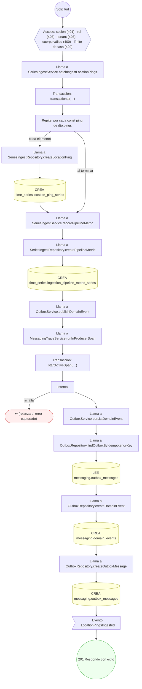

#### 10. POST /ts/metrics/{dataset}/batch-ingest

Ingerir métricas de runtime de IA, pipeline o SLI

| HTTP | Código | Cuándo |
|---|---|---|
| 201 | — | Éxito |
| 400 | `VALIDATION_FAILED` | El cuerpo cumple el DTO (sin propiedades extra); BadRequestException: El dataset de métricas debe ser uno de: {METRIC_DATASETS.join(', ')}. |
| 401 | `UNAUTHENTICATED` | Hay una sesión válida (JWT) |
| 403 | `FORBIDDEN` | El rol está permitido; El tenant se resuelve y pertenece al actor |
| 429 | `RATE_LIMITED` | No se supera el límite de solicitudes |

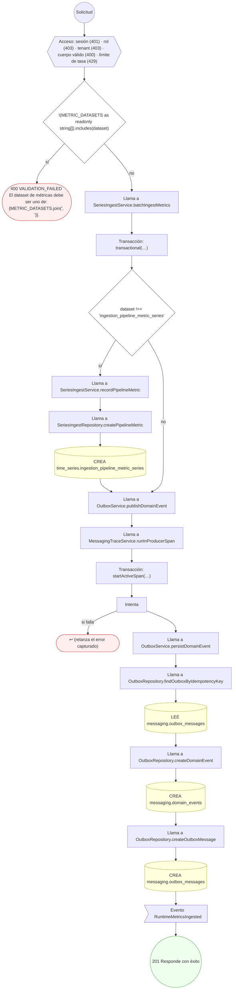

#### 11. POST /ts/normalize/run

Normalizar una lectura cruda y promoverla al registro clínico

| HTTP | Código | Cuándo |
|---|---|---|
| 201 | — | Éxito |
| 400 | `VALIDATION_FAILED` | El cuerpo cumple el DTO (sin propiedades extra) |
| 401 | `UNAUTHENTICATED` | Hay una sesión válida (JWT) |
| 403 | `FORBIDDEN` | El rol está permitido; El tenant se resuelve y pertenece al actor |
| 404 | `NOT_FOUND` | ResourceNotFoundException: No hay lectura cruda para ese instante y serie. |
| 422 | `PRECONDITION_FAILED` | PreconditionFailedException: La lectura cruda está marcada como rechazada; no se normaliza.; PreconditionFailedException: La lectura cruda no tiene valor numérico; no se puede normalizar. |
| 429 | `RATE_LIMITED` | No se supera el límite de solicitudes |

```mermaid
flowchart TD
  n1(("Solicitud")):::inicio
  n2{{"Acceso: sesión (401) · rol (403) · tenant (403) · cuerpo válido (400) · límite de tasa (429)"}}:::acceso
  n1 --> n2
  n3["Llama a VitalNormalizationService.normalizeReading"]:::llamada
  n2 --> n3
  n4["Transacción: transactional(…)"]:::transaccion
  n3 --> n4
  n5["Llama a SeriesIngestRepository.findVital"]:::llamada
  n4 --> n5
  n6[("LEE time_series.normalized_vital_series")]:::efecto
  n5 --> n6
  n7["Llama a SeriesIngestRepository.findDeviceReadingForUpdate"]:::llamada
  n6 --> n7
  n8[("LEE time_series.device_raw_reading_series")]:::efecto
  n7 --> n8
  n9{"!raw"}:::decision
  n8 --> n9
  n10(["404 NOT_FOUND No hay lectura cruda para ese instante y serie."]):::error
  n9 -->|"sí"| n10
  n11{"raw.qualityState === 'rejected'"}:::decision
  n9 -->|"no"| n11
  n12(["422 PRECONDITION_FAILED La lectura cruda está marcada como rechazada; no se normaliza."]):::error
  n11 -->|"sí"| n12
  n13{"raw.numericValue === undefined || raw.numericValue === null"}:::decision
  n11 -->|"no"| n13
  n14(["422 PRECONDITION_FAILED La lectura cruda no tiene valor numérico; no se puede normalizar."]):::error
  n13 -->|"sí"| n14
  n15["Llama a SeriesIngestRepository.createVital"]:::llamada
  n13 -->|"no"| n15
  n16[("CREA time_series.normalized_vital_series")]:::efecto
  n15 --> n16
  n17{"dto.promoteToClinical === true"}:::decision
  n16 --> n17
  n18["Llama a ObservationsRepository.create"]:::llamada
  n17 -->|"sí"| n18
  n19[("CREA clinical.observations")]:::efecto
  n18 --> n19
  n20[("ACTUALIZA time_series.normalized_vital_series")]:::efecto
  n19 --> n20
  n21["Llama a SeriesIngestRepository.createPipelineMetric"]:::llamada
  n20 --> n21
  n17 -->|"no"| n21
  n22[("CREA time_series.ingestion_pipeline_metric_series")]:::efecto
  n21 --> n22
  n23["Llama a OutboxService.publishDomainEvent"]:::llamada
  n22 --> n23
  n24["Llama a MessagingTraceService.runInProducerSpan"]:::llamada
  n23 --> n24
  n25["Transacción: startActiveSpan(…)"]:::transaccion
  n24 --> n25
  n26["Intenta"]:::intento
  n25 --> n26
  n27(["↩ (relanza el error capturado)"]):::error
  n26 -->|"si falla"| n27
  n28["Llama a OutboxService.persistDomainEvent"]:::llamada
  n26 --> n28
  n29["Llama a OutboxRepository.findOutboxByIdempotencyKey"]:::llamada
  n28 --> n29
  n30[("LEE messaging.outbox_messages")]:::efecto
  n29 --> n30
  n31["Llama a OutboxRepository.createDomainEvent"]:::llamada
  n30 --> n31
  n32[("CREA messaging.domain_events")]:::efecto
  n31 --> n32
  n33["Llama a OutboxRepository.createOutboxMessage"]:::llamada
  n32 --> n33
  n34[("CREA messaging.outbox_messages")]:::efecto
  n33 --> n34
  n35>"Evento VitalNormalizedAndPromoted"]:::evento
  n34 --> n35
  n36(("201 Responde con éxito")):::ok
  n35 --> n36
  classDef acceso fill:#eef,stroke:#66a
  classDef error fill:#fee,stroke:#c33
  classDef ok fill:#efe,stroke:#3a3
  classDef efecto fill:#ffd,stroke:#aa3
  classDef decision fill:#fff,stroke:#555
  classDef corte fill:#eee,stroke:#999,stroke-dasharray: 4
```

#### 12. POST /ts/series/{seriesId}/backfill/governed

Backfill gobernado de una serie

| HTTP | Código | Cuándo |
|---|---|---|
| 201 | — | Éxito |
| 400 | `VALIDATION_FAILED` | El cuerpo cumple el DTO (sin propiedades extra) |
| 401 | `UNAUTHENTICATED` | Hay una sesión válida (JWT) |
| 403 | `FORBIDDEN` | El rol está permitido; El tenant se resuelve y pertenece al actor |
| 422 | `PRECONDITION_FAILED` | PreconditionFailedException: La ventana de corrección tiene que empezar antes de terminar.; PreconditionFailedException: Una corrección cae fuera de la ventana declarada. |
| 429 | `RATE_LIMITED` | No se supera el límite de solicitudes |

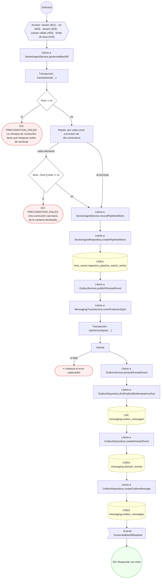

#### 13. POST /ts/series/{seriesId}/points/batch-ingest

Ingerir un lote de puntos en una serie

| HTTP | Código | Cuándo |
|---|---|---|
| 201 | — | Éxito |
| 400 | `VALIDATION_FAILED` | El cuerpo cumple el DTO (sin propiedades extra) |
| 401 | `UNAUTHENTICATED` | Hay una sesión válida (JWT) |
| 403 | `FORBIDDEN` | El rol está permitido; El tenant se resuelve y pertenece al actor |
| 429 | `RATE_LIMITED` | No se supera el límite de solicitudes |

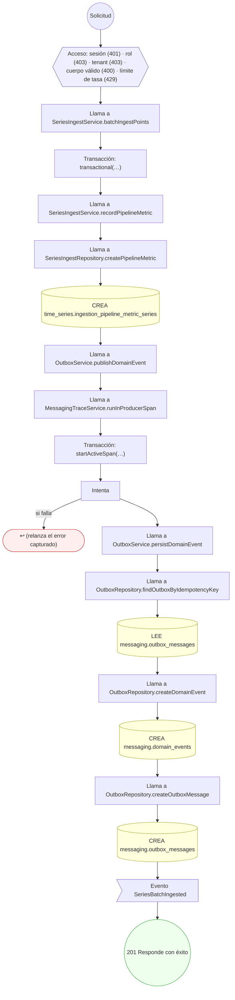

#### 14. GET /ts/series/{seriesId}/query

Consultar un rango con downsampling

| HTTP | Código | Cuándo |
|---|---|---|
| 200 | — | Éxito |
| 400 | `VALIDATION_FAILED` | Están los parámetros de consulta obligatorios |
| 401 | `UNAUTHENTICATED` | Hay una sesión válida (JWT) |
| 403 | `FORBIDDEN` | El rol está permitido; El tenant se resuelve y pertenece al actor |
| 422 | `PRECONDITION_FAILED` | PreconditionFailedException: El rango tiene que empezar antes de terminar.; PreconditionFailedException: Esta serie no tiene magnitud que agregar; sólo admite `count`. |
| 429 | `RATE_LIMITED` | No se supera el límite de solicitudes |
| 500 | — | InternalServerErrorException: La consulta declara una agregación que no es válida.; InternalServerErrorException: La consulta declara una columna que no es válida.; InternalServerErrorException: La serie no tiene columna numérica: sólo admite conteo. |

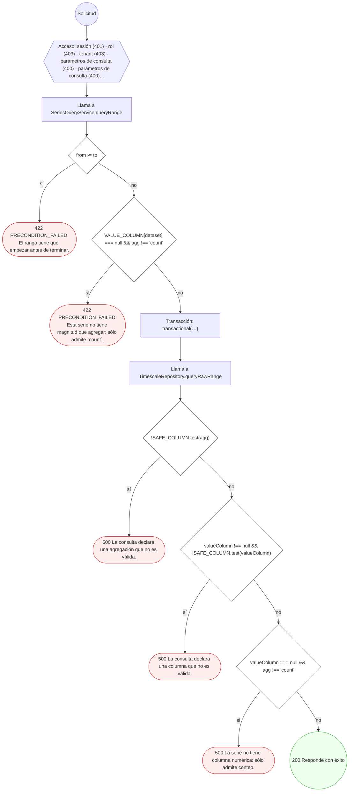

