<!-- AUTOGENERADO por tools/inventario/flujos.mjs. No editar manualmente. -->

# Flujos del módulo `tracking`

- **Procesos:** 1 · **Máquinas de estado:** 0
- **Operaciones:** 11 (11 con decisiones propias, 0 sin ellas)
- Inventario de endpoints del módulo: [tracking](../endpoints/tracking.md)

## Proceso: Módulo 37 — Seguimiento y Trazabilidad de Envíos

- **Código:** `tracking` · **Agrupación:** CASO_DE_USO_README · **Operaciones:** 11
- **Actores:** COURIER · LOGISTICS_OPERATOR · Público (sin sesión) · SYSTEM · TRACKING_ADMIN
- **Revisión:** AUTO_DETECTADA
- **Fuentes:** `src/modules/tracking/README.md`

### Para qué sirve

Sujetos rastreables con número opaco, envíos, catálogo de hitos esperados, timeline append-only, webhooks de transportista, traspasos, estimaciones de llegada, prueba de entrega, excepciones y barrido de compromisos de servicio.

_Fuente: `src/modules/tracking/README.md:3`_

### Flujo general declarado en el README

```text
sujeto (open, created) + envío (preparing)
   │
   ├─ dispatch ──> ambos in-transit + evento
   │
   ├─ evento manual ──> estado y hito avanzan; hito terminal ⇒ sujeto closed
   ├─ webhook del transportista ──> mapea el código externo; idempotente
   ├─ handoff ──> nuevo transportista/mensajero responsable + evento
   ├─ eta/recompute ──> estimación append-only; sólo la más reciente pasa al envío
   │
   ├─ delivery-proof ──> envío delivered + sujeto closed + evento
   ├─ exception ──> envío exception|retry + prioridad del sujeto escalada
   └─ cancel ──> envío cancelled + sujeto closed

sla/scan ──> hito siguiente vencido ⇒ evento de incumplimiento + escalada de prioridad
```

_Fuente: `src/modules/tracking/README.md:59`_

### Etapas y operaciones

| Etapa | Descripción | Operación | Quién actúa | Riesgo | Tablas |
|---|---|---|---|---|---|
| `UC-37-01` | Abrir sujeto y crear envío | POST /tracking/trackable-subjects | TRACKING_ADMIN · LOGISTICS_OPERATOR | MEDIO | 5 |
| `UC-37-02` | Catálogo de hitos esperados | POST /tracking/milestone-definitions | TRACKING_ADMIN | MEDIO | 2 |
| `UC-37-03` | Despachar envío | POST /tracking/shipments/{id}/dispatch | LOGISTICS_OPERATOR · TRACKING_ADMIN | MEDIO | 5 |
| `UC-37-04` | Evento y avance de hito | POST /tracking/trackable-subjects/{id}/events | LOGISTICS_OPERATOR · COURIER · TRACKING_ADMIN | MEDIO | 5 |
| `UC-37-05` | Webhook del transportista | POST /tracking/webhooks/carriers/{carrierCode} | Público (sin sesión) | ALTO | 7 |
| `UC-37-06` | Traspaso entre responsables | POST /tracking/shipments/{id}/handoffs | LOGISTICS_OPERATOR · COURIER · TRACKING_ADMIN | MEDIO | 5 |
| `UC-37-07` | Estimación de llegada | POST /tracking/shipments/{id}/eta/recompute | SYSTEM · LOGISTICS_OPERATOR · TRACKING_ADMIN | MEDIO | 5 |
| `UC-37-08` | Prueba de entrega y cierre | POST /tracking/shipments/{id}/delivery-proof | COURIER · LOGISTICS_OPERATOR · TRACKING_ADMIN | MEDIO | 8 |
| `UC-37-09` | Excepción o reintento | POST /tracking/shipments/{id}/exception | COURIER · LOGISTICS_OPERATOR · TRACKING_ADMIN | MEDIO | 6 |
| `UC-37-10` | Cancelar y cerrar | POST /tracking/shipments/{id}/cancel | LOGISTICS_OPERATOR · TRACKING_ADMIN | MEDIO | 5 |
| `UC-37-11` | Detectar incumplimiento de hito | POST /tracking/sla/scan | SYSTEM | MEDIO | 4 |

### Diagrama — etapas `UC-37-01`, `UC-37-02`, `UC-37-03`…

```mermaid
flowchart LR
  a2(["TRACKING_ADMIN · LOGISTICS_OPERATOR"]):::actor
  a7(["TRACKING_ADMIN"]):::actor
  a10(["LOGISTICS_OPERATOR · TRACKING_ADMIN"]):::actor
  a13(["LOGISTICS_OPERATOR · COURIER · TRACKING_ADMIN"]):::actor
  a15(["Público (sin sesión)"]):::actor
  a20(["SYSTEM · LOGISTICS_OPERATOR · TRACKING_ADMIN"]):::actor
  a23(["COURIER · LOGISTICS_OPERATOR · TRACKING_ADMIN"]):::actor
  a29(["SYSTEM"]):::actor
  t3[("tracking.shipments")]:::tabla
  t4[("tracking.trackable_subjects")]:::tabla
  t5[("tracking.tracking_carriers")]:::tabla
  t8[("tracking.milestone_definitions")]:::tabla
  t11[("tracking.tracking_events")]:::tabla
  t18[("tracking.shipment_handoffs")]:::tabla
  t21[("tracking.eta_estimates")]:::tabla
  t24[("tracking.delivery_proofs")]:::tabla
  subgraph s0["UC-37-01 · Abrir sujeto y crear envío"]
    o1["POST /tracking/trackable-subjects"]:::op
  end
  subgraph s1["UC-37-02 · Catálogo de hitos esperados"]
    o6["POST /tracking/milestone-definitions"]:::op
  end
  subgraph s2["UC-37-03 · Despachar envío"]
    o9["POST /tracking/shipments/{id}/dispatch"]:::op
  end
  subgraph s3["UC-37-04 · Evento y avance de hito"]
    o12["POST /tracking/trackable-subjects/{id}/events"]:::op
  end
  t16[("+1 tablas más")]
  subgraph s4["UC-37-05 · Webhook del transportista"]
    o14["POST /tracking/webhooks/carriers/{carrierCode}"]:::op
  end
  subgraph s5["UC-37-06 · Traspaso entre responsables"]
    o17["POST /tracking/shipments/{id}/handoffs"]:::op
  end
  subgraph s6["UC-37-07 · Estimación de llegada"]
    o19["POST /tracking/shipments/{id}/eta/recompute"]:::op
  end
  t25[("+2 tablas más")]
  subgraph s7["UC-37-08 · Prueba de entrega y cierre"]
    o22["POST /tracking/shipments/{id}/delivery-proof"]:::op
  end
  subgraph s8["UC-37-09 · Excepción o reintento"]
    o26["POST /tracking/shipments/{id}/exception"]:::op
  end
  subgraph s9["UC-37-10 · Cancelar y cerrar"]
    o27["POST /tracking/shipments/{id}/cancel"]:::op
  end
  subgraph s10["UC-37-11 · Detectar incumplimiento de hito"]
    o28["POST /tracking/sla/scan"]:::op
  end
  a2 --> o1
  o1 -->|"CREA"| t3
  o1 -->|"LEE"| t3
  o1 -->|"CREA"| t4
  o1 -->|"LEE"| t4
  o1 -->|"LEE"| t5
  a7 --> o6
  o6 -->|"CREA"| t8
  o6 -->|"LEE"| t8
  a10 --> o9
  o9 -->|"ACTUALIZA"| t3
  o9 -->|"LEE"| t3
  o9 -->|"ACTUALIZA"| t4
  o9 -->|"LEE"| t4
  o9 -->|"CREA"| t11
  a13 --> o12
  o12 -->|"LEE"| t8
  o12 -->|"LEE"| t3
  o12 -->|"ACTUALIZA"| t4
  o12 -->|"LEE"| t4
  o12 -->|"CREA"| t11
  a15 --> o14
  o14 -->|"ACTUALIZA"| t3
  o14 -->|"LEE"| t3
  o14 -->|"ACTUALIZA"| t4
  o14 -->|"LEE"| t4
  o14 -->|"LEE"| t5
  o14 -->|"CREA"| t11
  o14 -.-> t16
  a13 --> o17
  o17 -->|"CREA"| t18
  o17 -->|"ACTUALIZA"| t3
  o17 -->|"LEE"| t3
  o17 -->|"LEE"| t5
  o17 -->|"CREA"| t11
  a20 --> o19
  o19 -->|"CREA"| t21
  o19 -->|"LEE"| t21
  o19 -->|"ACTUALIZA"| t3
  o19 -->|"LEE"| t3
  o19 -->|"LEE"| t4
  a23 --> o22
  o22 -->|"CREA"| t24
  o22 -->|"LEE"| t24
  o22 -->|"LEE"| t8
  o22 -->|"ACTUALIZA"| t3
  o22 -->|"LEE"| t3
  o22 -->|"ACTUALIZA"| t4
  o22 -.-> t25
  a23 --> o26
  o26 -->|"CREA"| t24
  o26 -->|"ACTUALIZA"| t3
  o26 -->|"LEE"| t3
  o26 -->|"ACTUALIZA"| t4
  o26 -->|"LEE"| t4
  o26 -->|"CREA"| t11
  a10 --> o27
  o27 -->|"ACTUALIZA"| t3
  o27 -->|"LEE"| t3
  o27 -->|"ACTUALIZA"| t4
  o27 -->|"LEE"| t4
  o27 -->|"CREA"| t11
  a29 --> o28
  o28 -->|"LEE"| t8
  o28 -->|"ACTUALIZA"| t4
  o28 -->|"LEE"| t4
  o28 -->|"CREA"| t11
  classDef op fill:#fff,stroke:#446
  classDef actor fill:#eef,stroke:#66a
  classDef tabla fill:#ffd,stroke:#aa3
  classDef evento fill:#efe,stroke:#3a3
```

## Árbol de decisión por operación

Cada árbol se deriva del código del handler y de los métodos que invoca (hasta 4 niveles). Una rama que no decide, no escribe y no falla se poda. Los accesos y los efectos consecutivos se agrupan en un solo nodo.

### Operaciones con decisiones propias

#### 1. POST /tracking/milestone-definitions

Definir el catálogo de hitos esperados

| HTTP | Código | Cuándo |
|---|---|---|
| 201 | — | Éxito |
| 400 | `VALIDATION_FAILED` | El cuerpo cumple el DTO (sin propiedades extra) |
| 401 | `UNAUTHENTICATED` | Hay una sesión válida (JWT) |
| 403 | `FORBIDDEN` | El rol está permitido; El tenant se resuelve y pertenece al actor |
| 409 | `CONFLICT` | ConflictException: El tipo de sujeto ya tiene hito terminal |
| 422 | `PRECONDITION_FAILED` | PreconditionFailedException: Sólo puede haber un hito terminal |
| 429 | `RATE_LIMITED` | No se supera el límite de solicitudes |

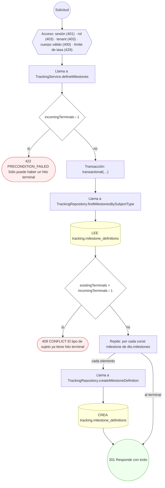

#### 2. POST /tracking/shipments/{id}/cancel

Cancelar el envío y cerrar el sujeto

| HTTP | Código | Cuándo |
|---|---|---|
| 200 | — | Éxito |
| 400 | `VALIDATION_FAILED` | Los parámetros de ruta son UUID válidos; El cuerpo cumple el DTO (sin propiedades extra) |
| 401 | `UNAUTHENTICATED` | Hay una sesión válida (JWT) |
| 403 | `FORBIDDEN` | El rol está permitido; El tenant se resuelve y pertenece al actor; InsufficientRoleException: No tiene acceso a este envío |
| 409 | `CONFLICT` | ConflictException: El envío ya está cancelado |
| 422 | `PRECONDITION_FAILED` | PreconditionFailedException: Un envío entregado no se cancela |
| 429 | `RATE_LIMITED` | No se supera el límite de solicitudes |

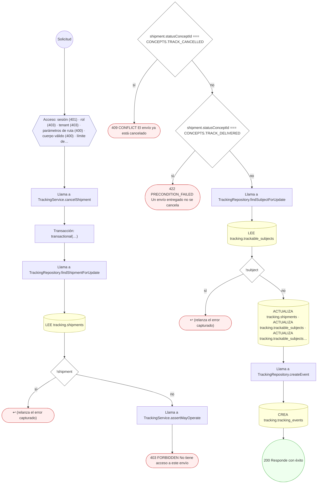

#### 3. POST /tracking/shipments/{id}/delivery-proof

Registrar la prueba de entrega y cerrar

| HTTP | Código | Cuándo |
|---|---|---|
| 201 | — | Éxito |
| 400 | `VALIDATION_FAILED` | Los parámetros de ruta son UUID válidos; El cuerpo cumple el DTO (sin propiedades extra) |
| 401 | `UNAUTHENTICATED` | Hay una sesión válida (JWT) |
| 403 | `FORBIDDEN` | El rol está permitido; El tenant se resuelve y pertenece al actor; InsufficientRoleException: No tiene acceso a este envío |
| 409 | `CONFLICT` | ConflictException: El envío ya está entregado; ConflictException: El envío ya tiene prueba de entrega verificada |
| 422 | `PRECONDITION_FAILED` | PreconditionFailedException: Una prueba por firma necesita el archivo de firma; PreconditionFailedException: Una prueba por foto necesita la foto; PreconditionFailedException: El envío no admite entrega en su estado actual |
| 429 | `RATE_LIMITED` | No se supera el límite de solicitudes |

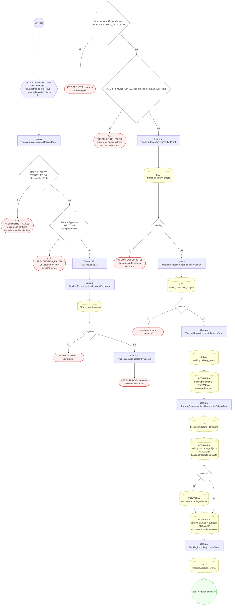

#### 4. POST /tracking/shipments/{id}/dispatch

Despachar el envío

| HTTP | Código | Cuándo |
|---|---|---|
| 200 | — | Éxito |
| 400 | `VALIDATION_FAILED` | Los parámetros de ruta son UUID válidos; El cuerpo cumple el DTO (sin propiedades extra) |
| 401 | `UNAUTHENTICATED` | Hay una sesión válida (JWT) |
| 403 | `FORBIDDEN` | El rol está permitido; El tenant se resuelve y pertenece al actor; InsufficientRoleException: No tiene acceso a este envío |
| 422 | `PRECONDITION_FAILED` | PreconditionFailedException: El envío no está en preparación; PreconditionFailedException: El despacho necesita transportista o mensajero asignado |
| 429 | `RATE_LIMITED` | No se supera el límite de solicitudes |

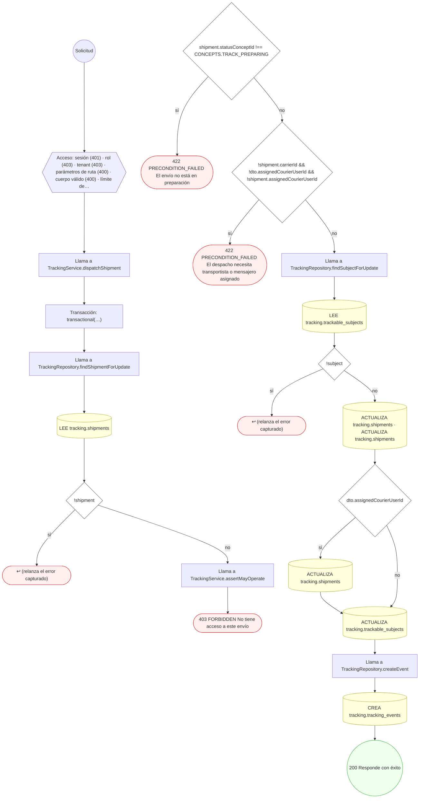

#### 5. POST /tracking/shipments/{id}/eta/recompute

Registrar una estimación de llegada

| HTTP | Código | Cuándo |
|---|---|---|
| 201 | — | Éxito |
| 400 | `VALIDATION_FAILED` | Los parámetros de ruta son UUID válidos; El cuerpo cumple el DTO (sin propiedades extra) |
| 401 | `UNAUTHENTICATED` | Hay una sesión válida (JWT) |
| 403 | `FORBIDDEN` | El rol está permitido; El tenant se resuelve y pertenece al actor; InsufficientRoleException: No tiene acceso a este envío |
| 422 | `PRECONDITION_FAILED` | PreconditionFailedException: El envío ya no admite estimaciones |
| 429 | `RATE_LIMITED` | No se supera el límite de solicitudes |

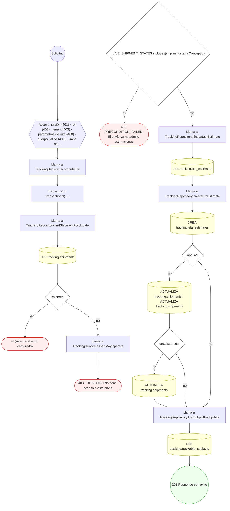

#### 6. POST /tracking/shipments/{id}/exception

Marcar una excepción o reintento de entrega

| HTTP | Código | Cuándo |
|---|---|---|
| 201 | — | Éxito |
| 400 | `VALIDATION_FAILED` | Los parámetros de ruta son UUID válidos; El cuerpo cumple el DTO (sin propiedades extra) |
| 401 | `UNAUTHENTICATED` | Hay una sesión válida (JWT) |
| 403 | `FORBIDDEN` | El rol está permitido; El tenant se resuelve y pertenece al actor; InsufficientRoleException: No tiene acceso a este envío |
| 422 | `PRECONDITION_FAILED` | PreconditionFailedException: El envío ya no admite excepciones |
| 429 | `RATE_LIMITED` | No se supera el límite de solicitudes |

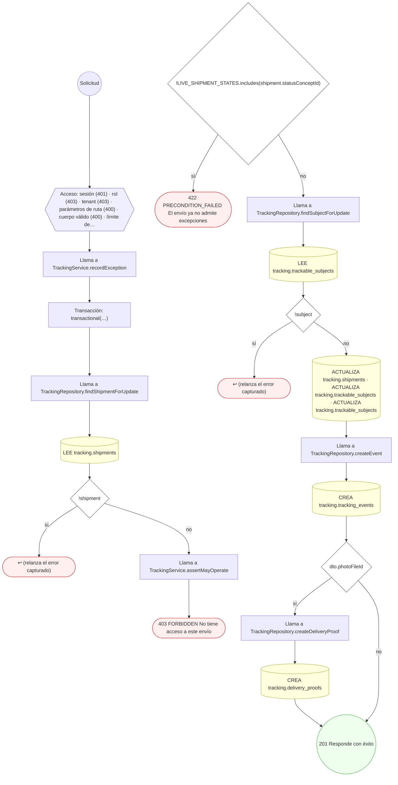

#### 7. POST /tracking/shipments/{id}/handoffs

Registrar el traspaso entre responsables

| HTTP | Código | Cuándo |
|---|---|---|
| 201 | — | Éxito |
| 400 | `VALIDATION_FAILED` | Los parámetros de ruta son UUID válidos; El cuerpo cumple el DTO (sin propiedades extra) |
| 401 | `UNAUTHENTICATED` | Hay una sesión válida (JWT) |
| 403 | `FORBIDDEN` | El rol está permitido; El tenant se resuelve y pertenece al actor; InsufficientRoleException: No tiene acceso a este envío |
| 404 | `NOT_FOUND` | ResourceNotFoundException: Transportista no encontrado |
| 422 | `PRECONDITION_FAILED` | PreconditionFailedException: El envío ya no admite traspasos; PreconditionFailedException: El transportista no está activo |
| 429 | `RATE_LIMITED` | No se supera el límite de solicitudes |

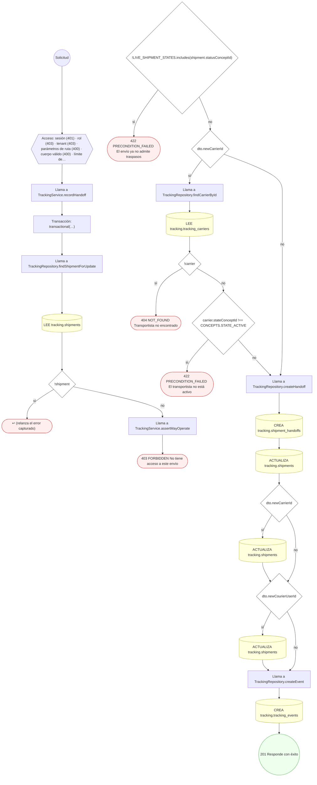

#### 8. POST /tracking/sla/scan

Barrer los compromisos de hito vencidos

| HTTP | Código | Cuándo |
|---|---|---|
| 200 | — | Éxito |
| 400 | `VALIDATION_FAILED` | El cuerpo cumple el DTO (sin propiedades extra) |
| 401 | `UNAUTHENTICATED` | Hay una sesión válida (JWT) |
| 403 | `FORBIDDEN` | El rol está permitido; El tenant se resuelve y pertenece al actor |
| 429 | `RATE_LIMITED` | No se supera el límite de solicitudes |

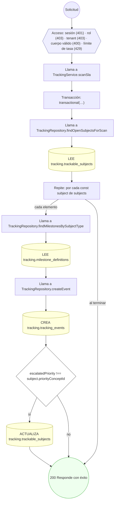

#### 9. POST /tracking/trackable-subjects

Abrir un sujeto rastreable y su envío

| HTTP | Código | Cuándo |
|---|---|---|
| 201 | — | Éxito |
| 400 | `VALIDATION_FAILED` | El cuerpo cumple el DTO (sin propiedades extra) |
| 401 | `UNAUTHENTICATED` | Hay una sesión válida (JWT) |
| 403 | `FORBIDDEN` | El rol está permitido; El tenant se resuelve y pertenece al actor |
| 404 | `NOT_FOUND` | ResourceNotFoundException: Transportista no encontrado |
| 409 | `CONFLICT` | ConflictException: La entidad ya tiene un seguimiento abierto; ConflictException: No se pudo generar un número de seguimiento libre; ConflictException: No se pudo asignar número de envío |
| 422 | `PRECONDITION_FAILED` | PreconditionFailedException: El transportista no está activo |
| 429 | `RATE_LIMITED` | No se supera el límite de solicitudes |

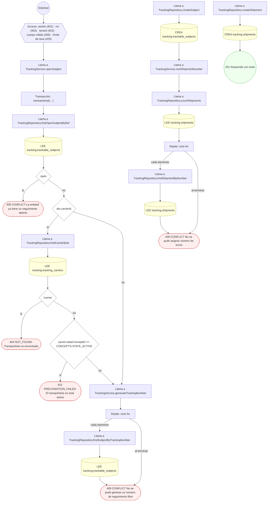

#### 10. POST /tracking/trackable-subjects/{id}/events

Registrar un evento y avanzar el hito

| HTTP | Código | Cuándo |
|---|---|---|
| 201 | — | Éxito |
| 400 | `VALIDATION_FAILED` | Los parámetros de ruta son UUID válidos; El cuerpo cumple el DTO (sin propiedades extra) |
| 401 | `UNAUTHENTICATED` | Hay una sesión válida (JWT) |
| 403 | `FORBIDDEN` | El rol está permitido; El tenant se resuelve y pertenece al actor; InsufficientRoleException: No tiene acceso a este envío |
| 404 | `NOT_FOUND` | ResourceNotFoundException: Hito no encontrado para el tipo de sujeto |
| 422 | `PRECONDITION_FAILED` | PreconditionFailedException: El seguimiento del sujeto está cerrado |
| 429 | `RATE_LIMITED` | No se supera el límite de solicitudes |

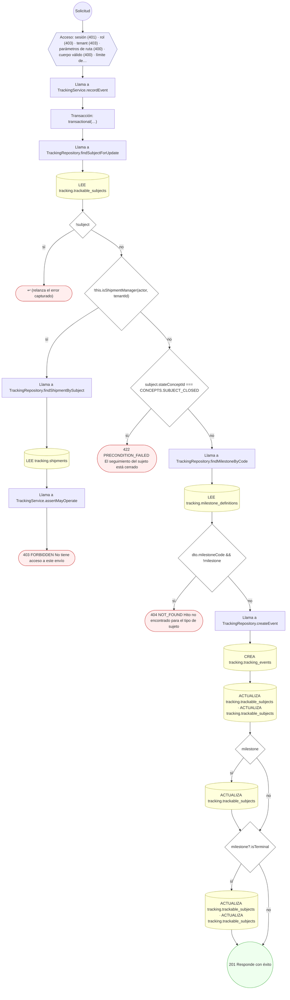

#### 11. POST /tracking/webhooks/carriers/{carrierCode}

Ingerir el webhook del transportista

| HTTP | Código | Cuándo |
|---|---|---|
| 200 | — | Éxito |
| 400 | `VALIDATION_FAILED` | El cuerpo cumple el DTO (sin propiedades extra) |
| 401 | `UNAUTHENTICATED` | Hay una sesión válida (JWT) |
| 404 | `NOT_FOUND` | ResourceNotFoundException: Sujeto rastreable no encontrado |
| 429 | `RATE_LIMITED` | No se supera el límite de solicitudes |

```mermaid
flowchart TD
  n1(("Solicitud")):::inicio
  n2{{"Acceso: sesión (401) · cuerpo válido (400) · límite de tasa (429)"}}:::acceso
  n1 --> n2
  n3["Llama a TrackingService.ingestCarrierWebhook"]:::llamada
  n2 --> n3
  n4["Transacción: transactional(…)"]:::transaccion
  n3 --> n4
  n5["Llama a TrackingRepository.findCarrierByCode"]:::llamada
  n4 --> n5
  n6[("LEE tracking.tracking_carriers")]:::efecto
  n5 --> n6
  n7["Llama a TrackingRepository.findSubjectByTrackingNumber"]:::llamada
  n6 --> n7
  n8[("LEE tracking.trackable_subjects")]:::efecto
  n7 --> n8
  n9{"!subject"}:::decision
  n8 --> n9
  n10(["↩ (relanza el error capturado)"]):::error
  n9 -->|"sí"| n10
  n11["Llama a TrackingRepository.lockSubjectById"]:::llamada
  n9 -->|"no"| n11
  n12[("LEE tracking.trackable_subjects")]:::efecto
  n11 --> n12
  n13{"!locked"}:::decision
  n12 --> n13
  n14(["404 NOT_FOUND Sujeto rastreable no encontrado"]):::error
  n13 -->|"sí"| n14
  n15["Llama a TrackingRepository.findShipmentBySubjectForUpdate"]:::llamada
  n13 -->|"no"| n15
  n16[("LEE tracking.shipments")]:::efecto
  n15 --> n16
  n17{"!shipment || shipment.carrierId !== carrier.id || (carrier.tenantId && locked.tenantId !== carrier.tenantId)"}:::decision
  n16 --> n17
  n18(["↩ (relanza el error capturado)"]):::error
  n17 -->|"sí"| n18
  n19["Llama a TrackingRepository.findEventByExternalReference"]:::llamada
  n17 -->|"no"| n19
  n20[("LEE tracking.tracking_events")]:::efecto
  n19 --> n20
  n21["Llama a TrackingRepository.createEvent"]:::llamada
  n20 --> n21
  n22[("CREA tracking.tracking_events")]:::efecto
  n21 --> n22
  n23[("ACTUALIZA tracking.trackable_subjects")]:::efecto
  n22 --> n23
  n24{"LIVE_SHIPMENT_STATES.includes(shipment.statusConceptId)"}:::decision
  n23 --> n24
  n25[("ACTUALIZA tracking.shipments")]:::efecto
  n24 -->|"sí"| n25
  n26{"statusConceptId === CONCEPTS.TRACK_DELIVERED"}:::decision
  n25 --> n26
  n27[("ACTUALIZA tracking.shipments")]:::efecto
  n26 -->|"sí"| n27
  n28(("200 Responde con éxito")):::ok
  n27 --> n28
  n26 -->|"no"| n28
  n24 -->|"no"| n28
  classDef acceso fill:#eef,stroke:#66a
  classDef error fill:#fee,stroke:#c33
  classDef ok fill:#efe,stroke:#3a3
  classDef efecto fill:#ffd,stroke:#aa3
  classDef decision fill:#fff,stroke:#555
  classDef corte fill:#eee,stroke:#999,stroke-dasharray: 4
```

