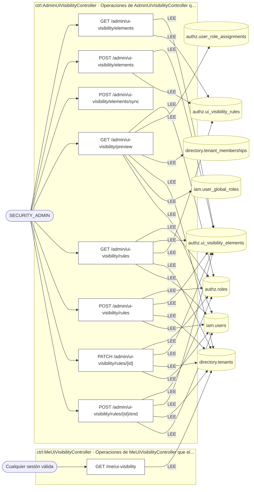
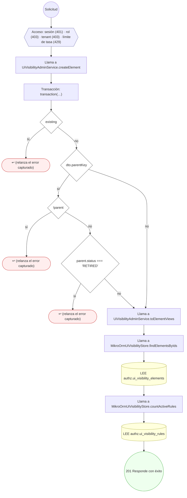
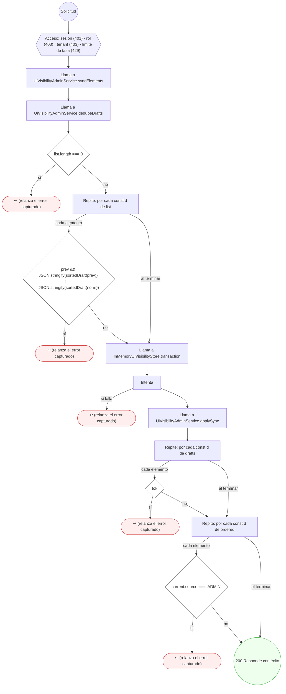
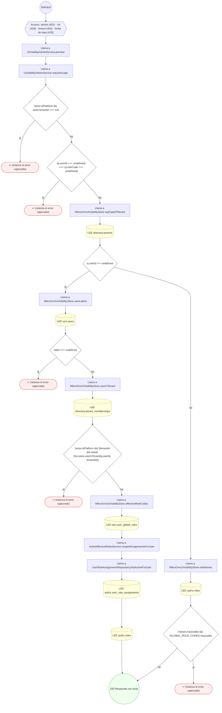

<!-- AUTOGENERADO por tools/inventario/flujos.mjs. No editar manualmente. -->

# Flujos del módulo `ui_visibility`

- **Procesos:** 1 · **Máquinas de estado:** 0
- **Operaciones:** 9 (7 con decisiones propias, 2 sin ellas)
- Inventario de endpoints del módulo: [ui_visibility](../endpoints/ui_visibility.md)

## Proceso: Módulo `ui_visibility` — Visibilidad de la interfaz

- **Código:** `ui_visibility` · **Agrupación:** AGRUPACION_POR_CONTROLADOR · **Operaciones:** 9
- **Actores:** Cualquier sesión válida · SECURITY_ADMIN
- **Revisión:** AUTO_DETECTADA
- **Fuentes:** `src/modules/ui_visibility/README.md`

### Para qué sirve

Catálogo de elementos de la interfaz y reglas SHOW/HIDE por sujeto. Contrato: `mantra-core-health/docs/trabajo/2026-10-31-visibilidad-rbac/CONTRATO.md`.

_Fuente: `src/modules/ui_visibility/README.md:3`_

### Etapas y operaciones

| Etapa | Descripción | Operación | Quién actúa | Riesgo | Tablas |
|---|---|---|---|---|---|
| `ctrl:AdminUiVisibilityController` | Operaciones de AdminUiVisibilityController que el README no asigna a un caso de uso | GET /admin/ui-visibility/elements | SECURITY_ADMIN | BAJO | 2 |
|  |  | POST /admin/ui-visibility/elements | SECURITY_ADMIN | BAJO | 2 |
|  |  | POST /admin/ui-visibility/elements/sync | SECURITY_ADMIN | BAJO | 0 |
|  |  | GET /admin/ui-visibility/preview | SECURITY_ADMIN | BAJO | 6 |
|  |  | GET /admin/ui-visibility/rules | SECURITY_ADMIN | BAJO | 5 |
|  |  | POST /admin/ui-visibility/rules | SECURITY_ADMIN | BAJO | 4 |
|  |  | PATCH /admin/ui-visibility/rules/{id} | SECURITY_ADMIN | BAJO | 4 |
|  |  | POST /admin/ui-visibility/rules/{id}/end | SECURITY_ADMIN | BAJO | 4 |
| `ctrl:MeUiVisibilityController` | Operaciones de MeUiVisibilityController que el README no asigna a un caso de uso | GET /me/ui-visibility | Cualquier sesión válida | BAJO | 1 |

### Diagrama — etapas `ctrl:AdminUiVisibilityController`, `ctrl:MeUiVisibilityController`

## Árbol de decisión por operación

Cada árbol se deriva del código del handler y de los métodos que invoca (hasta 4 niveles). Una rama que no decide, no escribe y no falla se poda. Los accesos y los efectos consecutivos se agrupan en un solo nodo.

### Operaciones con decisiones propias

#### 1. POST /admin/ui-visibility/elements

| HTTP | Código | Cuándo |
|---|---|---|
| 201 | — | Éxito |
| 401 | `UNAUTHENTICATED` | Hay una sesión válida (JWT) |
| 403 | `FORBIDDEN` | El rol está permitido; El tenant se resuelve y pertenece al actor |
| 429 | `RATE_LIMITED` | No se supera el límite de solicitudes |

#### 2. POST /admin/ui-visibility/elements/sync

| HTTP | Código | Cuándo |
|---|---|---|
| 200 | — | Éxito |
| 401 | `UNAUTHENTICATED` | Hay una sesión válida (JWT) |
| 403 | `FORBIDDEN` | El rol está permitido; El tenant se resuelve y pertenece al actor |
| 429 | `RATE_LIMITED` | No se supera el límite de solicitudes |

#### 3. GET /admin/ui-visibility/preview

| HTTP | Código | Cuándo |
|---|---|---|
| 200 | — | Éxito |
| 401 | `UNAUTHENTICATED` | Hay una sesión válida (JWT) |
| 403 | `FORBIDDEN` | El rol está permitido; El tenant se resuelve y pertenece al actor |
| 429 | `RATE_LIMITED` | No se supera el límite de solicitudes |

#### 4. GET /admin/ui-visibility/rules

| HTTP | Código | Cuándo |
|---|---|---|
| 200 | — | Éxito |
| 401 | `UNAUTHENTICATED` | Hay una sesión válida (JWT) |
| 403 | `FORBIDDEN` | El rol está permitido; El tenant se resuelve y pertenece al actor |
| 429 | `RATE_LIMITED` | No se supera el límite de solicitudes |

```mermaid
flowchart TD
  n1(("Solicitud")):::inicio
  n2{{"Acceso: sesión (401) · rol (403) · tenant (403) · límite de tasa (429)"}}:::acceso
  n1 --> n2
  n3["Llama a UiVisibilityAdminService.listRules"]:::llamada
  n2 --> n3
  n4["Llama a UiVisibilityAdminService.requireScope"]:::llamada
  n3 --> n4
  n5{"!actor.isPlatform && actor.tenantId === null"}:::decision
  n4 --> n5
  n6(["↩ (relanza el error capturado)"]):::error
  n5 -->|"sí"| n6
  n7{"q.elementKey !== undefined"}:::decision
  n5 -->|"no"| n7
  n8["Llama a MikroOrmUiVisibilityStore.findElementsByKeys"]:::llamada
  n7 -->|"sí"| n8
  n9[("LEE authz.ui_visibility_elements")]:::efecto
  n8 --> n9
  n10{"!element"}:::decision
  n9 --> n10
  n11(["↩ (relanza el error capturado)"]):::error
  n10 -->|"sí"| n11
  n12["Llama a MikroOrmUiVisibilityStore.listRules"]:::llamada
  n10 -->|"no"| n12
  n7 -->|"no"| n12
  n13[("LEE authz.ui_visibility_rules")]:::efecto
  n12 --> n13
  n14["Llama a MikroOrmUiVisibilityStore.countRules"]:::llamada
  n13 --> n14
  n15[("LEE authz.ui_visibility_rules")]:::efecto
  n14 --> n15
  n16["Llama a UiVisibilityAdminService.toRuleViews"]:::llamada
  n15 --> n16
  n17["Llama a MikroOrmUiVisibilityStore.findElementsByIds"]:::llamada
  n16 --> n17
  n18[("LEE authz.ui_visibility_elements")]:::efecto
  n17 --> n18
  n19["Llama a MikroOrmUiVisibilityStore.userLabels"]:::llamada
  n18 --> n19
  n20[("LEE iam.users")]:::efecto
  n19 --> n20
  n21["Llama a MikroOrmUiVisibilityStore.tenantLabels"]:::llamada
  n20 --> n21
  n22[("LEE directory.tenants")]:::efecto
  n21 --> n22
  n23["Llama a MikroOrmUiVisibilityStore.roleNames"]:::llamada
  n22 --> n23
  n24[("LEE authz.roles")]:::efecto
  n23 --> n24
  n25["Llama a MikroOrmUiVisibilityStore.userLabels"]:::llamada
  n24 --> n25
  n26[("LEE iam.users")]:::efecto
  n25 --> n26
  n27(("200 Responde con éxito")):::ok
  n26 --> n27
  classDef acceso fill:#eef,stroke:#66a
  classDef error fill:#fee,stroke:#c33
  classDef ok fill:#efe,stroke:#3a3
  classDef efecto fill:#ffd,stroke:#aa3
  classDef decision fill:#fff,stroke:#555
  classDef corte fill:#eee,stroke:#999,stroke-dasharray: 4
```

#### 5. POST /admin/ui-visibility/rules

| HTTP | Código | Cuándo |
|---|---|---|
| 201 | — | Éxito |
| 401 | `UNAUTHENTICATED` | Hay una sesión válida (JWT) |
| 403 | `FORBIDDEN` | El rol está permitido; El tenant se resuelve y pertenece al actor |
| 429 | `RATE_LIMITED` | No se supera el límite de solicitudes |

```mermaid
flowchart TD
  n1(("Solicitud")):::inicio
  n2{{"Acceso: sesión (401) · rol (403) · tenant (403) · límite de tasa (429)"}}:::acceso
  n1 --> n2
  n3["Llama a UiVisibilityAdminService.createRule"]:::llamada
  n2 --> n3
  n4["Llama a UiVisibilityAdminService.requireScope"]:::llamada
  n3 --> n4
  n5{"!actor.isPlatform && actor.tenantId === null"}:::decision
  n4 --> n5
  n6(["↩ (relanza el error capturado)"]):::error
  n5 -->|"sí"| n6
  n7["Llama a UiVisibilityAdminService.assertValidity"]:::llamada
  n5 -->|"no"| n7
  n8{"from && to && to.getTime() ‹= from.getTime()"}:::decision
  n7 --> n8
  n9(["↩ (relanza el error capturado)"]):::error
  n8 -->|"sí"| n9
  n10{"to && to.getTime() ‹= now.getTime()"}:::decision
  n8 -->|"no"| n10
  n11(["↩ (relanza el error capturado)"]):::error
  n10 -->|"sí"| n11
  n12["Intenta"]:::intento
  n10 -->|"no"| n12
  n13["Transacción: transaction(…)"]:::transaccion
  n12 --> n13
  n14{"!element"}:::decision
  n13 --> n14
  n15(["↩ (relanza el error capturado)"]):::error
  n14 -->|"sí"| n15
  n16{"element.status === 'RETIRED'"}:::decision
  n14 -->|"no"| n16
  n17(["↩ (relanza el error capturado)"]):::error
  n16 -->|"sí"| n17
  n18["Llama a UiVisibilityAdminService.assertSubject"]:::llamada
  n16 -->|"no"| n18
  n19{"type === 'ALL'"}:::decision
  n18 --> n19
  n20{"subjectId !== null"}:::decision
  n19 -->|"sí"| n20
  n21(["↩ (relanza el error capturado)"]):::error
  n20 -->|"sí"| n21
  n22{"!actor.isPlatform"}:::decision
  n20 -->|"no"| n22
  n23(["↩ (relanza el error capturado)"]):::error
  n22 -->|"sí"| n23
  n24{"subjectId === null || subjectId.length === 0"}:::decision
  n22 -->|"no"| n24
  n19 -->|"no"| n24
  n25(["↩ (relanza el error capturado)"]):::error
  n24 -->|"sí"| n25
  n26{"según type"}:::decision
  n24 -->|"no"| n26
  n27{"!UUID_RE.test(subjectId)"}:::decision
  n26 -->|"'USER'"| n27
  n28(["↩ (relanza el error capturado)"]):::error
  n27 -->|"sí"| n28
  n29{"!found.has(subjectId)"}:::decision
  n27 -->|"no"| n29
  n30(["↩ (relanza el error capturado)"]):::error
  n29 -->|"sí"| n30
  n31{"!actor.isPlatform && !( actor.tenantId && (await tx.userInTenant(subjectId, actor.tenantId)) )"}:::decision
  n29 -->|"no"| n31
  n32(["↩ (relanza el error capturado)"]):::error
  n31 -->|"sí"| n32
  n33{"!UUID_RE.test(subjectId)"}:::decision
  n26 -->|"'TENANT'"| n33
  n34(["↩ (relanza el error capturado)"]):::error
  n33 -->|"sí"| n34
  n35{"!actor.isPlatform && subjectId !== actor.tenantId"}:::decision
  n33 -->|"no"| n35
  n36(["↩ (relanza el error capturado)"]):::error
  n35 -->|"sí"| n36
  n37{"!found.has(subjectId)"}:::decision
  n35 -->|"no"| n37
  n38(["↩ (relanza el error capturado)"]):::error
  n37 -->|"sí"| n38
  n39{"!actor.isPlatform"}:::decision
  n26 -->|"'ROLE'"| n39
  n40(["↩ (relanza el error capturado)"]):::error
  n39 -->|"sí"| n40
  n41{"!names.has(subjectId) && !GLOBAL_ROLE_CODES.has(subjectId)"}:::decision
  n39 -->|"no"| n41
  n42(["↩ (relanza el error capturado)"]):::error
  n41 -->|"sí"| n42
  n43{"!actor.isPlatform"}:::decision
  n26 -->|"'ORG_TYPE'"| n43
  n44(["↩ (relanza el error capturado)"]):::error
  n43 -->|"sí"| n44
  n45{"!UI_ORG_TYPE_CODES.includes(subjectId)"}:::decision
  n43 -->|"no"| n45
  n46(["↩ (relanza el error capturado)"]):::error
  n45 -->|"sí"| n46
  n47(["↩ (relanza el error capturado)"]):::error
  n26 -->|"por defecto"| n47
  n48{"dto.effect === 'HIDE' && isProtectedElementKey(element.key)"}:::decision
  n31 -->|"no"| n48
  n37 -->|"no"| n48
  n41 -->|"no"| n48
  n45 -->|"no"| n48
  n49["Llama a UiVisibilityAdminService.assertNotAdminSubject"]:::llamada
  n48 -->|"sí"| n49
  n50{"type === 'ALL'"}:::decision
  n49 --> n50
  n51(["↩ (relanza el error capturado)"]):::error
  n50 -->|"sí"| n51
  n52{"type === 'ROLE' && subjectId && UI_PROTECTED_ROLES.includes(subjectId)"}:::decision
  n50 -->|"no"| n52
  n53(["↩ (relanza el error capturado)"]):::error
  n52 -->|"sí"| n53
  n54{"type === 'USER' && subjectId"}:::decision
  n52 -->|"no"| n54
  n55{"roles.some((r) =› UI_PROTECTED_ROLES.includes(r))"}:::decision
  n54 -->|"sí"| n55
  n56(["↩ (relanza el error capturado)"]):::error
  n55 -->|"sí"| n56
  n57{"await tx.findOpenRule(element.id, dto.subjectType, subjectId)"}:::decision
  n55 -->|"no"| n57
  n54 -->|"no"| n57
  n48 -->|"no"| n57
  n58(["↩ (relanza el error capturado)"]):::error
  n57 -->|"sí"| n58
  n59["Llama a UiVisibilityAdminService.toRuleViews"]:::llamada
  n57 -->|"no"| n59
  n60["Llama a MikroOrmUiVisibilityStore.findElementsByIds"]:::llamada
  n59 --> n60
  n61[("LEE authz.ui_visibility_elements")]:::efecto
  n60 --> n61
  n62["Llama a MikroOrmUiVisibilityStore.userLabels"]:::llamada
  n61 --> n62
  n63[("LEE iam.users")]:::efecto
  n62 --> n63
  n64["Llama a MikroOrmUiVisibilityStore.tenantLabels"]:::llamada
  n63 --> n64
  n65[("LEE directory.tenants")]:::efecto
  n64 --> n65
  n66["Llama a MikroOrmUiVisibilityStore.roleNames"]:::llamada
  n65 --> n66
  n67[("LEE authz.roles")]:::efecto
  n66 --> n67
  n68["Llama a MikroOrmUiVisibilityStore.userLabels"]:::llamada
  n67 --> n68
  n69[("LEE iam.users")]:::efecto
  n68 --> n69
  n70{"error instanceof UiRuleDuplicateError"}:::decision
  n12 -->|"si falla"| n70
  n71["… el resto del árbol (1 nodos) está en el JSON del inventario"]:::corte
  n70 -->|"sí"| n71
  classDef acceso fill:#eef,stroke:#66a
  classDef error fill:#fee,stroke:#c33
  classDef ok fill:#efe,stroke:#3a3
  classDef efecto fill:#ffd,stroke:#aa3
  classDef decision fill:#fff,stroke:#555
  classDef corte fill:#eee,stroke:#999,stroke-dasharray: 4
```

#### 6. PATCH /admin/ui-visibility/rules/{id}

| HTTP | Código | Cuándo |
|---|---|---|
| 200 | — | Éxito |
| 401 | `UNAUTHENTICATED` | Hay una sesión válida (JWT) |
| 403 | `FORBIDDEN` | El rol está permitido; El tenant se resuelve y pertenece al actor |
| 429 | `RATE_LIMITED` | No se supera el límite de solicitudes |

```mermaid
flowchart TD
  n1(("Solicitud")):::inicio
  n2{{"Acceso: sesión (401) · rol (403) · tenant (403) · límite de tasa (429)"}}:::acceso
  n1 --> n2
  n3["Llama a UiVisibilityAdminService.updateRule"]:::llamada
  n2 --> n3
  n4["Llama a UiVisibilityAdminService.requireScope"]:::llamada
  n3 --> n4
  n5{"!actor.isPlatform && actor.tenantId === null"}:::decision
  n4 --> n5
  n6(["↩ (relanza el error capturado)"]):::error
  n5 -->|"sí"| n6
  n7["Intenta"]:::intento
  n5 -->|"no"| n7
  n8["Transacción: transaction(…)"]:::transaccion
  n7 --> n8
  n9["Llama a UiVisibilityAdminService.loadInScope"]:::llamada
  n8 --> n9
  n10{"!rule"}:::decision
  n9 --> n10
  n11(["↩ (relanza el error capturado)"]):::error
  n10 -->|"sí"| n11
  n12{"!actor.isPlatform && rule.scopeTenantId !== actor.tenantId"}:::decision
  n10 -->|"no"| n12
  n13(["↩ (relanza el error capturado)"]):::error
  n12 -->|"sí"| n13
  n14{"rule.endedAt !== null"}:::decision
  n12 -->|"no"| n14
  n15(["↩ (relanza el error capturado)"]):::error
  n14 -->|"sí"| n15
  n16{"rule.rowVersion !== expectedVersion"}:::decision
  n14 -->|"no"| n16
  n17(["↩ (relanza el error capturado)"]):::error
  n16 -->|"sí"| n17
  n18{"dto.effect === undefined && dto.validFrom === undefined && dto.validTo === undefined && dto.reason === undefi…"}:::decision
  n16 -->|"no"| n18
  n19(["↩ (relanza el error capturado)"]):::error
  n18 -->|"sí"| n19
  n20{"resultingEffect === 'HIDE'"}:::decision
  n18 -->|"no"| n20
  n21{"element && isProtectedElementKey(element.key)"}:::decision
  n20 -->|"sí"| n21
  n22["Llama a UiVisibilityAdminService.assertNotAdminSubject"]:::llamada
  n21 -->|"sí"| n22
  n23{"type === 'ALL'"}:::decision
  n22 --> n23
  n24(["↩ (relanza el error capturado)"]):::error
  n23 -->|"sí"| n24
  n25{"type === 'ROLE' && subjectId && UI_PROTECTED_ROLES.includes(subjectId)"}:::decision
  n23 -->|"no"| n25
  n26(["↩ (relanza el error capturado)"]):::error
  n25 -->|"sí"| n26
  n27{"type === 'USER' && subjectId"}:::decision
  n25 -->|"no"| n27
  n28{"roles.some((r) =› UI_PROTECTED_ROLES.includes(r))"}:::decision
  n27 -->|"sí"| n28
  n29(["↩ (relanza el error capturado)"]):::error
  n28 -->|"sí"| n29
  n30{"dto.validFrom !== undefined || dto.validTo !== undefined"}:::decision
  n28 -->|"no"| n30
  n27 -->|"no"| n30
  n21 -->|"no"| n30
  n20 -->|"no"| n30
  n31["Llama a UiVisibilityAdminService.assertValidity"]:::llamada
  n30 -->|"sí"| n31
  n32{"from && to && to.getTime() ‹= from.getTime()"}:::decision
  n31 --> n32
  n33(["↩ (relanza el error capturado)"]):::error
  n32 -->|"sí"| n33
  n34{"to && to.getTime() ‹= now.getTime()"}:::decision
  n32 -->|"no"| n34
  n35(["↩ (relanza el error capturado)"]):::error
  n34 -->|"sí"| n35
  n36["Llama a UiVisibilityAdminService.toRuleViews"]:::llamada
  n34 -->|"no"| n36
  n30 -->|"no"| n36
  n37["Llama a MikroOrmUiVisibilityStore.findElementsByIds"]:::llamada
  n36 --> n37
  n38[("LEE authz.ui_visibility_elements")]:::efecto
  n37 --> n38
  n39["Llama a MikroOrmUiVisibilityStore.userLabels"]:::llamada
  n38 --> n39
  n40[("LEE iam.users")]:::efecto
  n39 --> n40
  n41["Llama a MikroOrmUiVisibilityStore.tenantLabels"]:::llamada
  n40 --> n41
  n42[("LEE directory.tenants")]:::efecto
  n41 --> n42
  n43["Llama a MikroOrmUiVisibilityStore.roleNames"]:::llamada
  n42 --> n43
  n44[("LEE authz.roles")]:::efecto
  n43 --> n44
  n45["Llama a MikroOrmUiVisibilityStore.userLabels"]:::llamada
  n44 --> n45
  n46[("LEE iam.users")]:::efecto
  n45 --> n46
  n47{"error instanceof UiStaleRecordError"}:::decision
  n7 -->|"si falla"| n47
  n48(["↩ (relanza el error capturado)"]):::error
  n47 -->|"sí"| n48
  n49(["↩ (relanza el error capturado)"]):::error
  n47 -->|"no"| n49
  n50(("200 Responde con éxito")):::ok
  n46 --> n50
  classDef acceso fill:#eef,stroke:#66a
  classDef error fill:#fee,stroke:#c33
  classDef ok fill:#efe,stroke:#3a3
  classDef efecto fill:#ffd,stroke:#aa3
  classDef decision fill:#fff,stroke:#555
  classDef corte fill:#eee,stroke:#999,stroke-dasharray: 4
```

#### 7. POST /admin/ui-visibility/rules/{id}/end

| HTTP | Código | Cuándo |
|---|---|---|
| 200 | — | Éxito |
| 401 | `UNAUTHENTICATED` | Hay una sesión válida (JWT) |
| 403 | `FORBIDDEN` | El rol está permitido; El tenant se resuelve y pertenece al actor |
| 429 | `RATE_LIMITED` | No se supera el límite de solicitudes |

```mermaid
flowchart TD
  n1(("Solicitud")):::inicio
  n2{{"Acceso: sesión (401) · rol (403) · tenant (403) · límite de tasa (429)"}}:::acceso
  n1 --> n2
  n3["Llama a UiVisibilityAdminService.endRule"]:::llamada
  n2 --> n3
  n4["Llama a UiVisibilityAdminService.requireScope"]:::llamada
  n3 --> n4
  n5{"!actor.isPlatform && actor.tenantId === null"}:::decision
  n4 --> n5
  n6(["↩ (relanza el error capturado)"]):::error
  n5 -->|"sí"| n6
  n7["Transacción: transaction(…)"]:::transaccion
  n5 -->|"no"| n7
  n8["Llama a UiVisibilityAdminService.loadInScope"]:::llamada
  n7 --> n8
  n9{"!rule"}:::decision
  n8 --> n9
  n10(["↩ (relanza el error capturado)"]):::error
  n9 -->|"sí"| n10
  n11{"!actor.isPlatform && rule.scopeTenantId !== actor.tenantId"}:::decision
  n9 -->|"no"| n11
  n12(["↩ (relanza el error capturado)"]):::error
  n11 -->|"sí"| n12
  n13["Llama a UiVisibilityAdminService.toRuleViews"]:::llamada
  n11 -->|"no"| n13
  n14["Llama a MikroOrmUiVisibilityStore.findElementsByIds"]:::llamada
  n13 --> n14
  n15[("LEE authz.ui_visibility_elements")]:::efecto
  n14 --> n15
  n16["Llama a MikroOrmUiVisibilityStore.userLabels"]:::llamada
  n15 --> n16
  n17[("LEE iam.users")]:::efecto
  n16 --> n17
  n18["Llama a MikroOrmUiVisibilityStore.tenantLabels"]:::llamada
  n17 --> n18
  n19[("LEE directory.tenants")]:::efecto
  n18 --> n19
  n20["Llama a MikroOrmUiVisibilityStore.roleNames"]:::llamada
  n19 --> n20
  n21[("LEE authz.roles")]:::efecto
  n20 --> n21
  n22["Llama a MikroOrmUiVisibilityStore.userLabels"]:::llamada
  n21 --> n22
  n23[("LEE iam.users")]:::efecto
  n22 --> n23
  n24{"rule.endedAt !== null"}:::decision
  n23 --> n24
  n25["Llama a UiVisibilityAdminService.toRuleViews"]:::llamada
  n24 -->|"sí"| n25
  n26["Llama a MikroOrmUiVisibilityStore.findElementsByIds"]:::llamada
  n25 --> n26
  n27[("LEE authz.ui_visibility_elements")]:::efecto
  n26 --> n27
  n28["Llama a MikroOrmUiVisibilityStore.userLabels"]:::llamada
  n27 --> n28
  n29[("LEE iam.users")]:::efecto
  n28 --> n29
  n30["Llama a MikroOrmUiVisibilityStore.tenantLabels"]:::llamada
  n29 --> n30
  n31[("LEE directory.tenants")]:::efecto
  n30 --> n31
  n32["Llama a MikroOrmUiVisibilityStore.roleNames"]:::llamada
  n31 --> n32
  n33[("LEE authz.roles")]:::efecto
  n32 --> n33
  n34["Llama a MikroOrmUiVisibilityStore.userLabels"]:::llamada
  n33 --> n34
  n35[("LEE iam.users")]:::efecto
  n34 --> n35
  n36["Transacción: catch(…)"]:::transaccion
  n35 --> n36
  n24 -->|"no"| n36
  n37{"error instanceof UiStaleRecordError"}:::decision
  n36 --> n37
  n38(["↩ (relanza el error capturado)"]):::error
  n37 -->|"sí"| n38
  n39(["↩ (relanza el error capturado)"]):::error
  n37 -->|"no"| n39
  n40["Llama a UiVisibilityAdminService.toRuleViews"]:::llamada
  n41["Llama a MikroOrmUiVisibilityStore.findElementsByIds"]:::llamada
  n40 --> n41
  n42[("LEE authz.ui_visibility_elements")]:::efecto
  n41 --> n42
  n43["Llama a MikroOrmUiVisibilityStore.userLabels"]:::llamada
  n42 --> n43
  n44[("LEE iam.users")]:::efecto
  n43 --> n44
  n45["Llama a MikroOrmUiVisibilityStore.tenantLabels"]:::llamada
  n44 --> n45
  n46[("LEE directory.tenants")]:::efecto
  n45 --> n46
  n47["Llama a MikroOrmUiVisibilityStore.roleNames"]:::llamada
  n46 --> n47
  n48[("LEE authz.roles")]:::efecto
  n47 --> n48
  n49["Llama a MikroOrmUiVisibilityStore.userLabels"]:::llamada
  n48 --> n49
  n50[("LEE iam.users")]:::efecto
  n49 --> n50
  n51(("200 Responde con éxito")):::ok
  n50 --> n51
  classDef acceso fill:#eef,stroke:#66a
  classDef error fill:#fee,stroke:#c33
  classDef ok fill:#efe,stroke:#3a3
  classDef efecto fill:#ffd,stroke:#aa3
  classDef decision fill:#fff,stroke:#555
  classDef corte fill:#eee,stroke:#999,stroke-dasharray: 4
```

### Operaciones sin decisiones propias

Sólo comprueban el acceso y leen o escriben: no tienen ramas que dibujar. Su detalle está en la ficha de endpoints.

| Operación | Respuestas posibles | Tablas |
|---|---|---|
| GET /admin/ui-visibility/elements | 200, 401, 403, 429 | 2 |
| GET /me/ui-visibility | 200, 401, 403, 429 | 1 |
