<!-- AUTOGENERADO por tools/inventario/flujos.mjs. No editar manualmente. -->

# Flujos del módulo `vector_rag`

- **Procesos:** 1 · **Máquinas de estado:** 0
- **Operaciones:** 16 (15 con decisiones propias, 1 sin ellas)
- Inventario de endpoints del módulo: [vector_rag](../endpoints/vector_rag.md)

## Proceso: Módulo 59 — Búsqueda vectorial, evidencia RAG y gobierno de embeddings

- **Código:** `vector_rag` · **Agrupación:** MIXTO · **Operaciones:** 16
- **Actores:** AGENT_RUNTIME · AI_GOVERNANCE_OFFICER · CLINICIAN · DPO · EMBEDDING_WORKER · MLOPS_ENGINEER · PLATFORM_ADMIN · PRIVACY_OFFICER · RAG_COLLECTION_ADMIN · RECONCILIATION_WORKER · RETRIEVAL_WORKER · SYSTEM
- **Revisión:** AUTO_DETECTADA
- **Fuentes:** `src/modules/vector_rag/README.md`

### Para qué sirve

Modelos de embedding aprobados uno a uno, colecciones que sólo aceptan lo que su modelo permite, políticas de acceso que se publican tras revisión de privacidad, y un retrieval en el que **cada candidato recibe una decisión de autorización y todas se guardan** — también las denegadas.

_Fuente: `src/modules/vector_rag/README.md:3`_

### Flujo general declarado en el README

```text
GOBIERNO
  embedding-model-versions ──> modelo aprobado (y quizá aprobado para PHI)
  rag-access-policies ───────> política DRAFT
    └─ /publish ─────────────> PUBLISHED + reenlaza colecciones
  collections ───────────────> dimensión y métrica DEL MODELO
                               PHI exige modelo aprobado para PHI
                               + binding de tenant ACTIVE

INGESTA
  collections/:id/embedding-jobs ──> job QUEUED (idempotente por alcance)
    └─ embedding-jobs/:id/run ─────> documento + chunks + vectores, misma tx
                                     reejecutar no duplica en ningún nivel
                                     finalBatch ⇒ job COMPLETED

CONSULTA
  retrieval-sessions ──> exige política PUBLISHED, propósito admitido,
                         y —si la política lo pide— paciente y consentimiento
    └─ /search ────────> por cada candidato: allow · deny_scope · deny_consent · deny_label
                         TODAS se guardan; topK recorta entre los autorizados
    └─ /evidence ──────> sólo lo seleccionado y autorizado; versión fuente copiada
                         sesión COMPLETED
    └─ /feedback ──────> safety_issue ⇒ sesión FLAGGED + evento aparte

MANTENIMIENTO
  deletion-jobs ──────────────> borrado FÍSICO: embeddings → chunks → documentos
  collections/:id/reconciliation > falta / huérfano / descuadrado, y su reparación
  collections/:id/re-embed ───> modelo nuevo; los vectores viejos a `superseded`
  .../retire · /lifecycle ────> modelo retirado, colección sellada, bindings congelados
```

_Fuente: `src/modules/vector_rag/README.md:79`_

### Etapas y operaciones

| Etapa | Descripción | Operación | Quién actúa | Riesgo | Tablas |
|---|---|---|---|---|---|
| `UC-59-01` | Registrar y aprobar versión de modelo | POST /vector-rag/embedding-model-versions | AI_GOVERNANCE_OFFICER · MLOPS_ENGINEER · PLATFORM_ADMIN | MEDIO | 5 |
| `UC-59-02` | Colección gobernada + binding de tenant | POST /vector-rag/collections | RAG_COLLECTION_ADMIN · PLATFORM_ADMIN | MEDIO | 9 |
| `UC-59-03` | Definir y publicar política | POST /vector-rag/rag-access-policies | PRIVACY_OFFICER · DPO · PLATFORM_ADMIN | MEDIO | 2 |
| `UC-59-04` | Encolar job de embedding | POST /vector-rag/collections/{id}/embedding-jobs | RAG_COLLECTION_ADMIN · PLATFORM_ADMIN | MEDIO | 5 |
| `UC-59-05` | Chunking + embedding + upsert | POST /vector-rag/embedding-jobs/{id}/run | SYSTEM · EMBEDDING_WORKER · PLATFORM_ADMIN | MEDIO | 12 |
| `UC-59-06` | Sesión consent-aware | POST /vector-rag/retrieval-sessions | CLINICIAN · AGENT_RUNTIME · SYSTEM · PLATFORM_ADMIN | MEDIO | 7 |
| `UC-59-07` | Ranquear y filtrar | POST /vector-rag/retrieval-sessions/{id}/search | SYSTEM · RETRIEVAL_WORKER · PLATFORM_ADMIN | MEDIO | 9 |
| `UC-59-08` | Evidencia citable | POST /vector-rag/retrieval-sessions/{id}/evidence | SYSTEM · RETRIEVAL_WORKER · PLATFORM_ADMIN | MEDIO | 8 |
| `UC-59-09` | Feedback de relevancia y seguridad | POST /vector-rag/retrieval-sessions/{id}/feedback | CLINICIAN · AGENT_RUNTIME · PLATFORM_ADMIN | MEDIO | 5 |
| `UC-59-10` | Propagar borrado a embeddings | POST /vector-rag/deletion-jobs | PRIVACY_OFFICER · DPO · SYSTEM · PLATFORM_ADMIN | ALTO | 12 |
| `UC-59-11` | Re-embeber tras cambio de modelo | POST /vector-rag/collections/{id}/re-embed | AI_GOVERNANCE_OFFICER · MLOPS_ENGINEER · PLATFORM_ADMIN | MEDIO | 10 |
| `UC-59-12` | Reconciliar canónico vs vectorial | POST /vector-rag/collections/{id}/reconciliation | SYSTEM · RECONCILIATION_WORKER · PLATFORM_ADMIN | MEDIO | 8 |
| `ctrl:VectorGovernanceController` | Operaciones de VectorGovernanceController que el README no asigna a un caso de uso | PUT /vector-rag/collections/{id}/lifecycle | AI_GOVERNANCE_OFFICER · RAG_COLLECTION_ADMIN · PLATFORM_ADMIN | MEDIO | 6 |
|  |  | POST /vector-rag/embedding-model-versions/{id}/retire | AI_GOVERNANCE_OFFICER · MLOPS_ENGINEER · PLATFORM_ADMIN | MEDIO | 7 |
|  |  | PUT /vector-rag/rag-access-policies/{id}/publish | PRIVACY_OFFICER · DPO · PLATFORM_ADMIN | MEDIO | 5 |
| `ctrl:VectorRuntimeController` | Operaciones de VectorRuntimeController que el README no asigna a un caso de uso | GET /vector-rag/embedding-jobs/pending | SYSTEM · EMBEDDING_WORKER · PLATFORM_ADMIN | BAJO | 1 |

### Diagrama — etapas `UC-59-01`, `UC-59-02`, `UC-59-03`…

```mermaid
flowchart LR
  a2(["AI_GOVERNANCE_OFFICER · MLOPS_ENGINEER · PLATFORM_ADMIN"]):::actor
  a8(["RAG_COLLECTION_ADMIN · PLATFORM_ADMIN"]):::actor
  a14(["PRIVACY_OFFICER · DPO · PLATFORM_ADMIN"]):::actor
  a19(["SYSTEM · EMBEDDING_WORKER · PLATFORM_ADMIN"]):::actor
  a24(["CLINICIAN · AGENT_RUNTIME · SYSTEM · PLATFORM_ADMIN"]):::actor
  a29(["SYSTEM · RETRIEVAL_WORKER · PLATFORM_ADMIN"]):::actor
  a38(["CLINICIAN · AGENT_RUNTIME · PLATFORM_ADMIN"]):::actor
  a43(["PRIVACY_OFFICER · DPO · SYSTEM · PLATFORM_ADMIN"]):::actor
  a50(["SYSTEM · RECONCILIATION_WORKER · PLATFORM_ADMIN"]):::actor
  a56(["AI_GOVERNANCE_OFFICER · RAG_COLLECTION_ADMIN · PLATFORM_ADM…"]):::actor
  t3[("messaging.domain_events")]:::tabla
  t4[("messaging.outbox_messages")]:::tabla
  t5[("vector_rag.embedding_model_versions")]:::tabla
  e6>"EmbeddingModelVersionApproved"]:::evento
  t9[("vector_rag.rag_access_policies")]:::tabla
  t10[("vector_rag.vector_collections")]:::tabla
  e12>"VectorCollectionProvisioned"]:::evento
  t16[("vector_rag.embedding_jobs")]:::tabla
  e17>"EmbeddingJobQueued"]:::evento
  t20[("vector_rag.vector_chunks")]:::tabla
  e22>"EmbeddingJobCompleted"]:::evento
  t25[("vector_rag.retrieval_sessions")]:::tabla
  e27>"RetrievalSessionOpened"]:::evento
  t30[("vector_rag.retrieval_candidates")]:::tabla
  e32>"RetrievalCandidatesRanked"]:::evento
  t34[("vector_rag.retrieval_evidence")]:::tabla
  e36>"RetrievalEvidenceMaterialized"]:::evento
  t39[("vector_rag.retrieval_feedback_events")]:::tabla
  e40>"RetrievalFeedbackCaptured"]:::evento
  e41>"RetrievalSafetyIssueRaised"]:::evento
  e45>"VectorEmbeddingsPurged"]:::evento
  e48>"CollectionReEmbedRequested"]:::evento
  t51[("vector_rag.vector_deletion_jobs")]:::tabla
  e53>"VectorReconciliationCompleted"]:::evento
  e54>"DriftDetected"]:::evento
  t57[("vector_rag.vector_tenant_bindings")]:::tabla
  e58>"VectorCollectionSealed"]:::evento
  e61>"EmbeddingModelRetired"]:::evento
  e63>"RagAccessPolicyPublished"]:::evento
  subgraph s0["UC-59-01 · Registrar y aprobar versión de modelo"]
    o1["POST /vector-rag/embedding-model-versions"]:::op
  end
  t11[("+3 tablas más")]
  subgraph s1["UC-59-02 · Colección gobernada + binding de tenant"]
    o7["POST /vector-rag/collections"]:::op
  end
  subgraph s2["UC-59-03 · Definir y publicar política"]
    o13["POST /vector-rag/rag-access-policies"]:::op
  end
  subgraph s3["UC-59-04 · Encolar job de embedding"]
    o15["POST /vector-rag/collections/{id}/embedding-jobs"]:::op
  end
  t21[("+6 tablas más")]
  subgraph s4["UC-59-05 · Chunking + embedding + upsert"]
    o18["POST /vector-rag/embedding-jobs/{id}/run"]:::op
  end
  t26[("+1 tablas más")]
  subgraph s5["UC-59-06 · Sesión consent-aware"]
    o23["POST /vector-rag/retrieval-sessions"]:::op
  end
  t31[("+3 tablas más")]
  subgraph s6["UC-59-07 · Ranquear y filtrar"]
    o28["POST /vector-rag/retrieval-sessions/{id}/search"]:::op
  end
  t35[("+2 tablas más")]
  subgraph s7["UC-59-08 · Evidencia citable"]
    o33["POST /vector-rag/retrieval-sessions/{id}/evidence"]:::op
  end
  subgraph s8["UC-59-09 · Feedback de relevancia y seguridad"]
    o37["POST /vector-rag/retrieval-sessions/{id}/feedback"]:::op
  end
  t44[("+6 tablas más")]
  subgraph s9["UC-59-10 · Propagar borrado a embeddings"]
    o42["POST /vector-rag/deletion-jobs"]:::op
  end
  t47[("+4 tablas más")]
  subgraph s10["UC-59-11 · Re-embeber tras cambio de modelo"]
    o46["POST /vector-rag/collections/{id}/re-embed"]:::op
  end
  t52[("+2 tablas más")]
  subgraph s11["UC-59-12 · Reconciliar canónico vs vectorial"]
    o49["POST /vector-rag/collections/{id}/reconciliation"]:::op
  end
  t60[("+1 tablas más")]
  subgraph s12["ctrl:VectorGovernanceController · Operaciones de VectorGovernanceController que…"]
    o55["PUT /vector-rag/collections/{id}/lifecycle"]:::op
    o59["POST /vector-rag/embedding-model-versions/{id}/retire"]:::op
    o62["PUT /vector-rag/rag-access-policies/{id}/publish"]:::op
  end
  subgraph s13["ctrl:VectorRuntimeController · Operaciones de VectorRuntimeController que el RE…"]
    o64["GET /vector-rag/embedding-jobs/pending"]:::op
  end
  a2 --> o1
  o1 -->|"CREA"| t3
  o1 -->|"CREA"| t4
  o1 -->|"LEE"| t4
  o1 -->|"CREA"| t5
  o1 -->|"LEE"| t5
  o1 -->|"evento"| e6
  a8 --> o7
  o7 -->|"CREA"| t3
  o7 -->|"CREA"| t4
  o7 -->|"LEE"| t4
  o7 -->|"LEE"| t5
  o7 -->|"LEE"| t9
  o7 -->|"CREA"| t10
  o7 -.-> t11
  o7 -->|"evento"| e12
  a14 --> o13
  o13 -->|"CREA"| t9
  o13 -->|"LEE"| t9
  a8 --> o15
  o15 -->|"CREA"| t3
  o15 -->|"CREA"| t4
  o15 -->|"LEE"| t4
  o15 -->|"CREA"| t16
  o15 -->|"LEE"| t10
  o15 -->|"evento"| e17
  a19 --> o18
  o18 -->|"CREA"| t3
  o18 -->|"CREA"| t4
  o18 -->|"LEE"| t4
  o18 -->|"LEE"| t16
  o18 -->|"LEE"| t5
  o18 -->|"CREA"| t20
  o18 -.-> t21
  o18 -->|"evento"| e22
  a24 --> o23
  o23 -->|"CREA"| t3
  o23 -->|"CREA"| t4
  o23 -->|"LEE"| t4
  o23 -->|"LEE"| t9
  o23 -->|"CREA"| t25
  o23 -->|"LEE"| t25
  o23 -.-> t26
  o23 -->|"evento"| e27
  a29 --> o28
  o28 -->|"CREA"| t3
  o28 -->|"CREA"| t4
  o28 -->|"LEE"| t4
  o28 -->|"LEE"| t9
  o28 -->|"CREA"| t30
  o28 -->|"LEE"| t25
  o28 -.-> t31
  o28 -->|"evento"| e32
  a29 --> o33
  o33 -->|"CREA"| t3
  o33 -->|"CREA"| t4
  o33 -->|"LEE"| t4
  o33 -->|"LEE"| t30
  o33 -->|"CREA"| t34
  o33 -->|"LEE"| t25
  o33 -.-> t35
  o33 -->|"evento"| e36
  a38 --> o37
  o37 -->|"CREA"| t3
  o37 -->|"CREA"| t4
  o37 -->|"LEE"| t4
  o37 -->|"CREA"| t39
  o37 -->|"LEE"| t25
  o37 -->|"evento"| e40
  o37 -->|"evento"| e41
  a43 --> o42
  o42 -->|"CREA"| t3
  o42 -->|"CREA"| t4
  o42 -->|"LEE"| t4
  o42 -->|"BORRA"| t20
  o42 -->|"LEE"| t20
  o42 -->|"LEE"| t10
  o42 -.-> t44
  o42 -->|"evento"| e45
  a2 --> o46
  o46 -->|"CREA"| t3
  o46 -->|"CREA"| t4
  o46 -->|"LEE"| t4
  o46 -->|"CREA"| t16
  o46 -->|"LEE"| t5
  o46 -->|"LEE"| t20
  o46 -.-> t47
  o46 -->|"evento"| e48
  a50 --> o49
  o49 -->|"CREA"| t3
  o49 -->|"CREA"| t4
  o49 -->|"LEE"| t4
  o49 -->|"CREA"| t16
  o49 -->|"LEE"| t10
  o49 -->|"CREA"| t51
  o49 -.-> t52
  o49 -->|"evento"| e53
  o49 -->|"evento"| e54
  a56 --> o55
  o55 -->|"CREA"| t3
  o55 -->|"CREA"| t4
  o55 -->|"LEE"| t4
  o55 -->|"LEE"| t10
  o55 -->|"ACTUALIZA"| t57
  o55 -->|"LEE"| t57
  o55 -->|"evento"| e58
  a2 --> o59
  o59 -->|"CREA"| t3
  o59 -->|"CREA"| t4
  o59 -->|"LEE"| t4
  o59 -->|"LEE"| t16
  o59 -->|"ACTUALIZA"| t5
  o59 -->|"LEE"| t5
  o59 -.-> t60
  o59 -->|"evento"| e61
  a14 --> o62
  o62 -->|"CREA"| t3
  o62 -->|"CREA"| t4
  o62 -->|"LEE"| t4
  o62 -->|"LEE"| t9
  o62 -->|"LEE"| t10
  o62 -->|"evento"| e63
  a19 --> o64
  o64 -->|"LEE"| t16
  classDef op fill:#fff,stroke:#446
  classDef actor fill:#eef,stroke:#66a
  classDef tabla fill:#ffd,stroke:#aa3
  classDef evento fill:#efe,stroke:#3a3
```

## Árbol de decisión por operación

Cada árbol se deriva del código del handler y de los métodos que invoca (hasta 4 niveles). Una rama que no decide, no escribe y no falla se poda. Los accesos y los efectos consecutivos se agrupan en un solo nodo.

### Operaciones con decisiones propias

#### 1. POST /vector-rag/collections

Crear una colección vectorial con su vínculo de tenant

| HTTP | Código | Cuándo |
|---|---|---|
| 201 | — | Éxito |
| 400 | `VALIDATION_FAILED` | El cuerpo cumple el DTO (sin propiedades extra) |
| 401 | `UNAUTHENTICATED` | Hay una sesión válida (JWT) |
| 403 | `FORBIDDEN` | El rol está permitido; El tenant se resuelve y pertenece al actor |
| 404 | `NOT_FOUND` | ResourceNotFoundException: Versión de modelo no encontrada. |
| 409 | `CONFLICT` | ConflictException: Ya existe una colección con ese código para el tenant.; ConflictException: El namespace ya está en uso por otro vínculo. |
| 422 | `PRECONDITION_FAILED` | PreconditionFailedException: El modelo está retirado; no se pueden crear colecciones nuevas sobre él.; PreconditionFailedException: El modelo no está aprobado para datos de paciente. |
| 429 | `RATE_LIMITED` | No se supera el límite de solicitudes |

```mermaid
flowchart TD
  n1(("Solicitud")):::inicio
  n2{{"Acceso: sesión (401) · rol (403) · tenant (403) · cuerpo válido (400) · límite de tasa (429)"}}:::acceso
  n1 --> n2
  n3["Llama a VectorGovernanceService.createCollection"]:::llamada
  n2 --> n3
  n4["Transacción: transactional(…)"]:::transaccion
  n3 --> n4
  n5["Llama a VectorCatalogRepository.findCollectionByCode"]:::llamada
  n4 --> n5
  n6[("LEE vector_rag.vector_collections")]:::efecto
  n5 --> n6
  n7{"duplicate"}:::decision
  n6 --> n7
  n8(["409 CONFLICT Ya existe una colección con ese código para el tenant."]):::error
  n7 -->|"sí"| n8
  n9["Llama a VectorCatalogRepository.findBindingByNamespace"]:::llamada
  n7 -->|"no"| n9
  n10[("LEE vector_rag.vector_tenant_bindings")]:::efecto
  n9 --> n10
  n11{"namespaceTaken"}:::decision
  n10 --> n11
  n12(["409 CONFLICT El namespace ya está en uso por otro vínculo."]):::error
  n11 -->|"sí"| n12
  n13["Llama a VectorCatalogRepository.findModelVersionForUpdate"]:::llamada
  n11 -->|"no"| n13
  n14[("LEE vector_rag.embedding_model_versions")]:::efecto
  n13 --> n14
  n15{"!model"}:::decision
  n14 --> n15
  n16(["404 NOT_FOUND Versión de modelo no encontrada."]):::error
  n15 -->|"sí"| n16
  n17{"model.retiredAt"}:::decision
  n15 -->|"no"| n17
  n18(["422 PRECONDITION_FAILED El modelo está retirado; no se pueden crear colecciones nuevas sobre él."]):::error
  n17 -->|"sí"| n18
  n19{"containsPhi && !model.approvedForPhi"}:::decision
  n17 -->|"no"| n19
  n20(["422 PRECONDITION_FAILED El modelo no está aprobado para datos de paciente."]):::error
  n19 -->|"sí"| n20
  n21{"dto.accessPolicyId"}:::decision
  n19 -->|"no"| n21
  n22["Llama a VectorCatalogRepository.findPolicyById"]:::llamada
  n21 -->|"sí"| n22
  n23[("LEE vector_rag.rag_access_policies")]:::efecto
  n22 --> n23
  n24["Llama a VectorCatalogRepository.createCollection"]:::llamada
  n23 --> n24
  n21 -->|"no"| n24
  n25[("CREA vector_rag.vector_collections")]:::efecto
  n24 --> n25
  n26["Llama a VectorCatalogRepository.createBinding"]:::llamada
  n25 --> n26
  n27[("CREA vector_rag.vector_tenant_bindings")]:::efecto
  n26 --> n27
  n28["Llama a OutboxService.publishDomainEvent"]:::llamada
  n27 --> n28
  n29["Llama a MessagingTraceService.runInProducerSpan"]:::llamada
  n28 --> n29
  n30["Transacción: startActiveSpan(…)"]:::transaccion
  n29 --> n30
  n31["Intenta"]:::intento
  n30 --> n31
  n32(["↩ (relanza el error capturado)"]):::error
  n31 -->|"si falla"| n32
  n33["Llama a OutboxService.persistDomainEvent"]:::llamada
  n31 --> n33
  n34["Llama a OutboxRepository.findOutboxByIdempotencyKey"]:::llamada
  n33 --> n34
  n35[("LEE messaging.outbox_messages")]:::efecto
  n34 --> n35
  n36["Llama a OutboxRepository.createDomainEvent"]:::llamada
  n35 --> n36
  n37[("CREA messaging.domain_events")]:::efecto
  n36 --> n37
  n38["Llama a OutboxRepository.createOutboxMessage"]:::llamada
  n37 --> n38
  n39[("CREA messaging.outbox_messages")]:::efecto
  n38 --> n39
  n40>"Evento VectorCollectionProvisioned"]:::evento
  n39 --> n40
  n41(("201 Responde con éxito")):::ok
  n40 --> n41
  classDef acceso fill:#eef,stroke:#66a
  classDef error fill:#fee,stroke:#c33
  classDef ok fill:#efe,stroke:#3a3
  classDef efecto fill:#ffd,stroke:#aa3
  classDef decision fill:#fff,stroke:#555
  classDef corte fill:#eee,stroke:#999,stroke-dasharray: 4
```

#### 2. POST /vector-rag/collections/{id}/embedding-jobs

Encolar un job de embedding

| HTTP | Código | Cuándo |
|---|---|---|
| 201 | — | Éxito |
| 400 | `VALIDATION_FAILED` | Los parámetros de ruta son UUID válidos; El cuerpo cumple el DTO (sin propiedades extra) |
| 401 | `UNAUTHENTICATED` | Hay una sesión válida (JWT) |
| 403 | `FORBIDDEN` | El rol está permitido; El tenant se resuelve y pertenece al actor |
| 422 | `PRECONDITION_FAILED` | PreconditionFailedException: La colección no está activa; no admite jobs de embedding. |
| 429 | `RATE_LIMITED` | No se supera el límite de solicitudes |

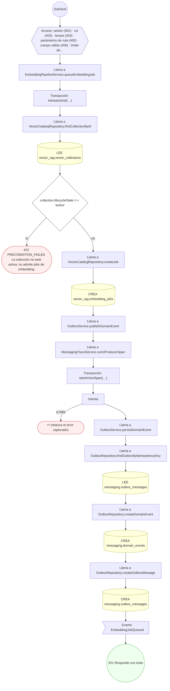

#### 3. PUT /vector-rag/collections/{id}/lifecycle

Sellar o deprecar la colección

| HTTP | Código | Cuándo |
|---|---|---|
| 200 | — | Éxito |
| 400 | `VALIDATION_FAILED` | Los parámetros de ruta son UUID válidos; El cuerpo cumple el DTO (sin propiedades extra) |
| 401 | `UNAUTHENTICATED` | Hay una sesión válida (JWT) |
| 403 | `FORBIDDEN` | El rol está permitido; El tenant se resuelve y pertenece al actor |
| 429 | `RATE_LIMITED` | No se supera el límite de solicitudes |

```mermaid
flowchart TD
  n1(("Solicitud")):::inicio
  n2{{"Acceso: sesión (401) · rol (403) · tenant (403) · parámetros de ruta (400) · cuerpo válido (400) · límite de…"}}:::acceso
  n1 --> n2
  n3["Llama a VectorGovernanceService.updateCollectionLifecycle"]:::llamada
  n2 --> n3
  n4["Transacción: transactional(…)"]:::transaccion
  n3 --> n4
  n5["Llama a VectorCatalogRepository.findCollectionForUpdate"]:::llamada
  n4 --> n5
  n6[("LEE vector_rag.vector_collections")]:::efecto
  n5 --> n6
  n7{"dto.lifecycleState === 'sealed'"}:::decision
  n6 --> n7
  n8["Llama a VectorCatalogRepository.findBindingsByCollectionForUpdate"]:::llamada
  n7 -->|"sí"| n8
  n9[("LEE vector_rag.vector_tenant_bindings")]:::efecto
  n8 --> n9
  n10["Repite: por cada const binding de bindings"]:::bucle
  n9 --> n10
  n11[("ACTUALIZA vector_rag.vector_tenant_bindings")]:::efecto
  n10 -->|"cada elemento"| n11
  n12["Llama a OutboxService.publishDomainEvent"]:::llamada
  n11 --> n12
  n10 -->|"al terminar"| n12
  n7 -->|"no"| n12
  n13["Llama a MessagingTraceService.runInProducerSpan"]:::llamada
  n12 --> n13
  n14["Transacción: startActiveSpan(…)"]:::transaccion
  n13 --> n14
  n15["Intenta"]:::intento
  n14 --> n15
  n16(["↩ (relanza el error capturado)"]):::error
  n15 -->|"si falla"| n16
  n17["Llama a OutboxService.persistDomainEvent"]:::llamada
  n15 --> n17
  n18["Llama a OutboxRepository.findOutboxByIdempotencyKey"]:::llamada
  n17 --> n18
  n19[("LEE messaging.outbox_messages")]:::efecto
  n18 --> n19
  n20["Llama a OutboxRepository.createDomainEvent"]:::llamada
  n19 --> n20
  n21[("CREA messaging.domain_events")]:::efecto
  n20 --> n21
  n22["Llama a OutboxRepository.createOutboxMessage"]:::llamada
  n21 --> n22
  n23[("CREA messaging.outbox_messages")]:::efecto
  n22 --> n23
  n24>"Evento VectorCollectionSealed"]:::evento
  n23 --> n24
  n25(("200 Responde con éxito")):::ok
  n24 --> n25
  classDef acceso fill:#eef,stroke:#66a
  classDef error fill:#fee,stroke:#c33
  classDef ok fill:#efe,stroke:#3a3
  classDef efecto fill:#ffd,stroke:#aa3
  classDef decision fill:#fff,stroke:#555
  classDef corte fill:#eee,stroke:#999,stroke-dasharray: 4
```

#### 4. POST /vector-rag/collections/{id}/re-embed

Migrar la colección a un modelo nuevo

| HTTP | Código | Cuándo |
|---|---|---|
| 201 | — | Éxito |
| 400 | `VALIDATION_FAILED` | Los parámetros de ruta son UUID válidos; El cuerpo cumple el DTO (sin propiedades extra) |
| 401 | `UNAUTHENTICATED` | Hay una sesión válida (JWT) |
| 403 | `FORBIDDEN` | El rol está permitido; El tenant se resuelve y pertenece al actor |
| 404 | `NOT_FOUND` | ResourceNotFoundException: Versión de modelo no encontrada. |
| 409 | `CONFLICT` | ConflictException: La colección ya usa esa versión de modelo. |
| 422 | `PRECONDITION_FAILED` | PreconditionFailedException: La colección no está activa.; PreconditionFailedException: El modelo de destino está retirado.; PreconditionFailedException: El modelo de destino no está aprobado para datos de paciente. |
| 429 | `RATE_LIMITED` | No se supera el límite de solicitudes |

```mermaid
flowchart TD
  n1(("Solicitud")):::inicio
  n2{{"Acceso: sesión (401) · rol (403) · tenant (403) · parámetros de ruta (400) · cuerpo válido (400) · límite de…"}}:::acceso
  n1 --> n2
  n3["Llama a EmbeddingPipelineService.reEmbedCollection"]:::llamada
  n2 --> n3
  n4["Transacción: transactional(…)"]:::transaccion
  n3 --> n4
  n5["Llama a VectorCatalogRepository.findCollectionForUpdate"]:::llamada
  n4 --> n5
  n6[("LEE vector_rag.vector_collections")]:::efecto
  n5 --> n6
  n7{"collection.lifecycleState !== 'active'"}:::decision
  n6 --> n7
  n8(["422 PRECONDITION_FAILED La colección no está activa."]):::error
  n7 -->|"sí"| n8
  n9{"collection.embeddingModelVersionId === dto.embeddingModelVersionId"}:::decision
  n7 -->|"no"| n9
  n10(["409 CONFLICT La colección ya usa esa versión de modelo."]):::error
  n9 -->|"sí"| n10
  n11["Llama a VectorCatalogRepository.findModelVersionForUpdate"]:::llamada
  n9 -->|"no"| n11
  n12[("LEE vector_rag.embedding_model_versions")]:::efecto
  n11 --> n12
  n13{"!model"}:::decision
  n12 --> n13
  n14(["404 NOT_FOUND Versión de modelo no encontrada."]):::error
  n13 -->|"sí"| n14
  n15{"model.retiredAt"}:::decision
  n13 -->|"no"| n15
  n16(["422 PRECONDITION_FAILED El modelo de destino está retirado."]):::error
  n15 -->|"sí"| n16
  n17{"collection.containsPhi && !model.approvedForPhi"}:::decision
  n15 -->|"no"| n17
  n18(["422 PRECONDITION_FAILED El modelo de destino no está aprobado para datos de paciente."]):::error
  n17 -->|"sí"| n18
  n19{"dto.supersedePrevious !== false"}:::decision
  n17 -->|"no"| n19
  n20["Llama a VectorCorpusRepository.findActiveDocumentsByCollection"]:::llamada
  n19 -->|"sí"| n20
  n21[("LEE vector_rag.vector_documents")]:::efecto
  n20 --> n21
  n22["Llama a VectorCorpusRepository.findChunksByDocuments"]:::llamada
  n21 --> n22
  n23[("LEE vector_rag.vector_chunks")]:::efecto
  n22 --> n23
  n24["Llama a VectorCorpusRepository.findEmbeddingsByChunksAndModelForUpdate"]:::llamada
  n23 --> n24
  n25[("LEE vector_rag.vector_embeddings")]:::efecto
  n24 --> n25
  n26["Repite: por cada const embedding de embeddings"]:::bucle
  n25 --> n26
  n27[("ACTUALIZA vector_rag.vector_embeddings")]:::efecto
  n26 -->|"cada elemento"| n27
  n28["Llama a VectorCatalogRepository.createJob"]:::llamada
  n27 --> n28
  n26 -->|"al terminar"| n28
  n19 -->|"no"| n28
  n29[("CREA vector_rag.embedding_jobs")]:::efecto
  n28 --> n29
  n30["Llama a OutboxService.publishDomainEvent"]:::llamada
  n29 --> n30
  n31["Llama a MessagingTraceService.runInProducerSpan"]:::llamada
  n30 --> n31
  n32["Transacción: startActiveSpan(…)"]:::transaccion
  n31 --> n32
  n33["Intenta"]:::intento
  n32 --> n33
  n34(["↩ (relanza el error capturado)"]):::error
  n33 -->|"si falla"| n34
  n35["Llama a OutboxService.persistDomainEvent"]:::llamada
  n33 --> n35
  n36["Llama a OutboxRepository.findOutboxByIdempotencyKey"]:::llamada
  n35 --> n36
  n37[("LEE messaging.outbox_messages")]:::efecto
  n36 --> n37
  n38["Llama a OutboxRepository.createDomainEvent"]:::llamada
  n37 --> n38
  n39[("CREA messaging.domain_events")]:::efecto
  n38 --> n39
  n40["Llama a OutboxRepository.createOutboxMessage"]:::llamada
  n39 --> n40
  n41[("CREA messaging.outbox_messages")]:::efecto
  n40 --> n41
  n42>"Evento CollectionReEmbedRequested"]:::evento
  n41 --> n42
  n43(("201 Responde con éxito")):::ok
  n42 --> n43
  classDef acceso fill:#eef,stroke:#66a
  classDef error fill:#fee,stroke:#c33
  classDef ok fill:#efe,stroke:#3a3
  classDef efecto fill:#ffd,stroke:#aa3
  classDef decision fill:#fff,stroke:#555
  classDef corte fill:#eee,stroke:#999,stroke-dasharray: 4
```

#### 5. POST /vector-rag/collections/{id}/reconciliation

Reconciliar el manifiesto canónico contra el vectorial

| HTTP | Código | Cuándo |
|---|---|---|
| 201 | — | Éxito |
| 400 | `VALIDATION_FAILED` | Los parámetros de ruta son UUID válidos; El cuerpo cumple el DTO (sin propiedades extra) |
| 401 | `UNAUTHENTICATED` | Hay una sesión válida (JWT) |
| 403 | `FORBIDDEN` | El rol está permitido; El tenant se resuelve y pertenece al actor |
| 429 | `RATE_LIMITED` | No se supera el límite de solicitudes |

```mermaid
flowchart TD
  n1(("Solicitud")):::inicio
  n2{{"Acceso: sesión (401) · rol (403) · tenant (403) · parámetros de ruta (400) · cuerpo válido (400) · límite de…"}}:::acceso
  n1 --> n2
  n3["Llama a VectorMaintenanceService.reconcileCollection"]:::llamada
  n2 --> n3
  n4["Transacción: transactional(…)"]:::transaccion
  n3 --> n4
  n5["Llama a VectorCatalogRepository.findCollectionById"]:::llamada
  n4 --> n5
  n6[("LEE vector_rag.vector_collections")]:::efecto
  n5 --> n6
  n7["Llama a VectorCorpusRepository.findActiveDocumentsByCollection"]:::llamada
  n6 --> n7
  n8[("LEE vector_rag.vector_documents")]:::efecto
  n7 --> n8
  n9{"dto.autoRepair !== false && drift › 0"}:::decision
  n8 --> n9
  n10{"missing.length › 0 || mismatched.length › 0"}:::decision
  n9 -->|"sí"| n10
  n11["Llama a VectorCatalogRepository.createJob"]:::llamada
  n10 -->|"sí"| n11
  n12[("CREA vector_rag.embedding_jobs")]:::efecto
  n11 --> n12
  n13{"orphans.length › 0"}:::decision
  n12 --> n13
  n10 -->|"no"| n13
  n14["Llama a VectorCorpusRepository.createDeletionJob"]:::llamada
  n13 -->|"sí"| n14
  n15[("CREA vector_rag.vector_deletion_jobs")]:::efecto
  n14 --> n15
  n16["Llama a VectorCorpusRepository.createReconciliationRun"]:::llamada
  n15 --> n16
  n13 -->|"no"| n16
  n9 -->|"no"| n16
  n17[("CREA vector_rag.vector_reconciliation_runs")]:::efecto
  n16 --> n17
  n18["Llama a OutboxService.publishDomainEvent"]:::llamada
  n17 --> n18
  n19["Llama a MessagingTraceService.runInProducerSpan"]:::llamada
  n18 --> n19
  n20["Transacción: startActiveSpan(…)"]:::transaccion
  n19 --> n20
  n21["Intenta"]:::intento
  n20 --> n21
  n22(["↩ (relanza el error capturado)"]):::error
  n21 -->|"si falla"| n22
  n23["Llama a OutboxService.persistDomainEvent"]:::llamada
  n21 --> n23
  n24["Llama a OutboxRepository.findOutboxByIdempotencyKey"]:::llamada
  n23 --> n24
  n25[("LEE messaging.outbox_messages")]:::efecto
  n24 --> n25
  n26["Llama a OutboxRepository.createDomainEvent"]:::llamada
  n25 --> n26
  n27[("CREA messaging.domain_events")]:::efecto
  n26 --> n27
  n28["Llama a OutboxRepository.createOutboxMessage"]:::llamada
  n27 --> n28
  n29[("CREA messaging.outbox_messages")]:::efecto
  n28 --> n29
  n30>"Evento VectorReconciliationCompleted"]:::evento
  n29 --> n30
  n31{"drift › 0"}:::decision
  n30 --> n31
  n32["Llama a OutboxService.publishDomainEvent"]:::llamada
  n31 -->|"sí"| n32
  n33["Llama a MessagingTraceService.runInProducerSpan"]:::llamada
  n32 --> n33
  n34["Transacción: startActiveSpan(…)"]:::transaccion
  n33 --> n34
  n35["Intenta"]:::intento
  n34 --> n35
  n36(["↩ (relanza el error capturado)"]):::error
  n35 -->|"si falla"| n36
  n37["Llama a OutboxService.persistDomainEvent"]:::llamada
  n35 --> n37
  n38["Llama a OutboxRepository.findOutboxByIdempotencyKey"]:::llamada
  n37 --> n38
  n39[("LEE messaging.outbox_messages")]:::efecto
  n38 --> n39
  n40["Llama a OutboxRepository.createDomainEvent"]:::llamada
  n39 --> n40
  n41[("CREA messaging.domain_events")]:::efecto
  n40 --> n41
  n42["Llama a OutboxRepository.createOutboxMessage"]:::llamada
  n41 --> n42
  n43[("CREA messaging.outbox_messages")]:::efecto
  n42 --> n43
  n44>"Evento DriftDetected"]:::evento
  n43 --> n44
  n45(("201 Responde con éxito")):::ok
  n44 --> n45
  n31 -->|"no"| n45
  classDef acceso fill:#eef,stroke:#66a
  classDef error fill:#fee,stroke:#c33
  classDef ok fill:#efe,stroke:#3a3
  classDef efecto fill:#ffd,stroke:#aa3
  classDef decision fill:#fff,stroke:#555
  classDef corte fill:#eee,stroke:#999,stroke-dasharray: 4
```

#### 6. POST /vector-rag/deletion-jobs

Propagar el borrado de la fuente a los embeddings

| HTTP | Código | Cuándo |
|---|---|---|
| 201 | — | Éxito |
| 400 | `VALIDATION_FAILED` | El cuerpo cumple el DTO (sin propiedades extra) |
| 401 | `UNAUTHENTICATED` | Hay una sesión válida (JWT) |
| 403 | `FORBIDDEN` | El rol está permitido; El tenant se resuelve y pertenece al actor |
| 404 | `NOT_FOUND` | ResourceNotFoundException: Referencia de borrado no encontrada. |
| 422 | `PRECONDITION_FAILED` | PreconditionFailedException: Hay que declarar qué se borra: un documento fuente o un paciente. |
| 429 | `RATE_LIMITED` | No se supera el límite de solicitudes |

```mermaid
flowchart TD
  n1(("Solicitud")):::inicio
  n2{{"Acceso: sesión (401) · rol (403) · tenant (403) · cuerpo válido (400) · límite de tasa (429)"}}:::acceso
  n1 --> n2
  n3["Llama a VectorMaintenanceService.propagateDeletion"]:::llamada
  n2 --> n3
  n4{"!dto.sourceDocumentId && !dto.patientProfileId"}:::decision
  n3 --> n4
  n5(["422 PRECONDITION_FAILED Hay que declarar qué se borra: un documento fuente o un paciente."]):::error
  n4 -->|"sí"| n5
  n6["Transacción: transactional(…)"]:::transaccion
  n4 -->|"no"| n6
  n7["Llama a VectorCorpusRepository.findDocumentsForDeletion"]:::llamada
  n6 --> n7
  n8[("LEE vector_rag.vector_collections · LEE vector_rag.vector_documents")]:::efecto
  n7 --> n8
  n9["Llama a VectorCorpusRepository.hasPriorDeletionJob"]:::llamada
  n8 --> n9
  n10[("LEE vector_rag.vector_deletion_jobs")]:::efecto
  n9 --> n10
  n11{"documents.length === 0 && !(await this.corpusRepo.hasPriorDeletionJob(tx, tenantId, filter))"}:::decision
  n10 --> n11
  n12(["404 NOT_FOUND Referencia de borrado no encontrada."]):::error
  n11 -->|"sí"| n12
  n13["Llama a VectorCorpusRepository.createDeletionJob"]:::llamada
  n11 -->|"no"| n13
  n14[("CREA vector_rag.vector_deletion_jobs")]:::efecto
  n13 --> n14
  n15["Llama a VectorCorpusRepository.findChunksByDocuments"]:::llamada
  n14 --> n15
  n16[("LEE vector_rag.vector_chunks")]:::efecto
  n15 --> n16
  n17["Llama a VectorCorpusRepository.deleteEmbeddingsByChunks"]:::llamada
  n16 --> n17
  n18[("BORRA vector_rag.vector_embeddings")]:::efecto
  n17 --> n18
  n19["Llama a VectorCorpusRepository.deleteChunks"]:::llamada
  n18 --> n19
  n20[("BORRA vector_rag.vector_chunks")]:::efecto
  n19 --> n20
  n21["Llama a VectorCorpusRepository.deleteDocuments"]:::llamada
  n20 --> n21
  n22[("BORRA vector_rag.vector_documents")]:::efecto
  n21 --> n22
  n23{"verified"}:::decision
  n22 --> n23
  n24[("ACTUALIZA vector_rag.vector_deletion_jobs · ACTUALIZA vector_rag.vector_deletion_jobs")]:::efecto
  n23 -->|"sí"| n24
  n25["Llama a OutboxService.publishDomainEvent"]:::llamada
  n24 --> n25
  n23 -->|"no"| n25
  n26["Llama a MessagingTraceService.runInProducerSpan"]:::llamada
  n25 --> n26
  n27["Transacción: startActiveSpan(…)"]:::transaccion
  n26 --> n27
  n28["Intenta"]:::intento
  n27 --> n28
  n29(["↩ (relanza el error capturado)"]):::error
  n28 -->|"si falla"| n29
  n30["Llama a OutboxService.persistDomainEvent"]:::llamada
  n28 --> n30
  n31["Llama a OutboxRepository.findOutboxByIdempotencyKey"]:::llamada
  n30 --> n31
  n32[("LEE messaging.outbox_messages")]:::efecto
  n31 --> n32
  n33["Llama a OutboxRepository.createDomainEvent"]:::llamada
  n32 --> n33
  n34[("CREA messaging.domain_events")]:::efecto
  n33 --> n34
  n35["Llama a OutboxRepository.createOutboxMessage"]:::llamada
  n34 --> n35
  n36[("CREA messaging.outbox_messages")]:::efecto
  n35 --> n36
  n37>"Evento VectorEmbeddingsPurged"]:::evento
  n36 --> n37
  n38(("201 Responde con éxito")):::ok
  n37 --> n38
  classDef acceso fill:#eef,stroke:#66a
  classDef error fill:#fee,stroke:#c33
  classDef ok fill:#efe,stroke:#3a3
  classDef efecto fill:#ffd,stroke:#aa3
  classDef decision fill:#fff,stroke:#555
  classDef corte fill:#eee,stroke:#999,stroke-dasharray: 4
```

#### 7. POST /vector-rag/embedding-jobs/{id}/run

Ejecutar un lote del job de embedding

| HTTP | Código | Cuándo |
|---|---|---|
| 200 | — | Éxito |
| 400 | `VALIDATION_FAILED` | Los parámetros de ruta son UUID válidos; El cuerpo cumple el DTO (sin propiedades extra) |
| 401 | `UNAUTHENTICATED` | Hay una sesión válida (JWT) |
| 403 | `FORBIDDEN` | El rol está permitido; El tenant se resuelve y pertenece al actor |
| 404 | `NOT_FOUND` | ResourceNotFoundException: Versión de modelo no encontrada. |
| 422 | `PRECONDITION_FAILED` | PreconditionFailedException: El job ya no está en cola ni en ejecución.; PreconditionFailedException: El modelo de la colección está retirado; el job no puede seguir.; PreconditionFailedException: La colección no admite datos de paciente y el documento los declara. |
| 429 | `RATE_LIMITED` | No se supera el límite de solicitudes |

```mermaid
flowchart TD
  n1(("Solicitud")):::inicio
  n2{{"Acceso: sesión (401) · rol (403) · tenant (403) · parámetros de ruta (400) · cuerpo válido (400) · límite de…"}}:::acceso
  n1 --> n2
  n3["Llama a EmbeddingPipelineService.runEmbeddingJob"]:::llamada
  n2 --> n3
  n4["Transacción: transactional(…)"]:::transaccion
  n3 --> n4
  n5["Llama a VectorCatalogRepository.findJobForUpdate"]:::llamada
  n4 --> n5
  n6[("LEE vector_rag.embedding_jobs")]:::efecto
  n5 --> n6
  n7{"!(ACTIVE_JOB_STATUSES as readonly string[]).includes(job.status)"}:::decision
  n6 --> n7
  n8(["422 PRECONDITION_FAILED El job ya no está en cola ni en ejecución."]):::error
  n7 -->|"sí"| n8
  n9["Llama a VectorCatalogRepository.findCollectionById"]:::llamada
  n7 -->|"no"| n9
  n10[("LEE vector_rag.vector_collections")]:::efecto
  n9 --> n10
  n11["Llama a VectorCatalogRepository.findModelVersionById"]:::llamada
  n10 --> n11
  n12[("LEE vector_rag.embedding_model_versions")]:::efecto
  n11 --> n12
  n13{"!model"}:::decision
  n12 --> n13
  n14(["404 NOT_FOUND Versión de modelo no encontrada."]):::error
  n13 -->|"sí"| n14
  n15{"model.retiredAt"}:::decision
  n13 -->|"no"| n15
  n16(["422 PRECONDITION_FAILED El modelo de la colección está retirado; el job no puede seguir."]):::error
  n15 -->|"sí"| n16
  n17["Repite: por cada const input de dto.documents ?? []"]:::bucle
  n15 -->|"no"| n17
  n18{"input.containsPhi === true && !collection.containsPhi"}:::decision
  n17 -->|"cada elemento"| n18
  n19(["422 PRECONDITION_FAILED La colección no admite datos de paciente y el documento los declara."]):::error
  n18 -->|"sí"| n19
  n20["Llama a VectorCorpusRepository.findDocument"]:::llamada
  n18 -->|"no"| n20
  n21[("LEE vector_rag.vector_documents")]:::efecto
  n20 --> n21
  n22{"!document"}:::decision
  n21 --> n22
  n23["Llama a VectorCorpusRepository.createDocument"]:::llamada
  n22 -->|"sí"| n23
  n24[("CREA vector_rag.vector_documents")]:::efecto
  n23 --> n24
  n25["Repite: por cada const chunkInput de input.chunks"]:::bucle
  n24 --> n25
  n22 -->|"no"| n25
  n26["Llama a VectorCorpusRepository.findChunkByHash"]:::llamada
  n25 -->|"cada elemento"| n26
  n27[("LEE vector_rag.vector_chunks")]:::efecto
  n26 --> n27
  n28{"!chunk"}:::decision
  n27 --> n28
  n29["Llama a VectorCorpusRepository.createChunk"]:::llamada
  n28 -->|"sí"| n29
  n30[("CREA vector_rag.vector_chunks")]:::efecto
  n29 --> n30
  n31["Llama a VectorCorpusRepository.findEmbedding"]:::llamada
  n30 --> n31
  n28 -->|"no"| n31
  n32[("LEE vector_rag.vector_embeddings")]:::efecto
  n31 --> n32
  n33["Llama a VectorCorpusRepository.createEmbedding"]:::llamada
  n32 --> n33
  n34[("CREA vector_rag.vector_embeddings")]:::efecto
  n33 --> n34
  n35{"dto.finalBatch === true"}:::decision
  n34 --> n35
  n25 -->|"al terminar"| n35
  n17 -->|"al terminar"| n35
  n36["Llama a OutboxService.publishDomainEvent"]:::llamada
  n35 -->|"sí"| n36
  n37["Llama a MessagingTraceService.runInProducerSpan"]:::llamada
  n36 --> n37
  n38["Transacción: startActiveSpan(…)"]:::transaccion
  n37 --> n38
  n39["Intenta"]:::intento
  n38 --> n39
  n40(["↩ (relanza el error capturado)"]):::error
  n39 -->|"si falla"| n40
  n41["Llama a OutboxService.persistDomainEvent"]:::llamada
  n39 --> n41
  n42["Llama a OutboxRepository.findOutboxByIdempotencyKey"]:::llamada
  n41 --> n42
  n43[("LEE messaging.outbox_messages")]:::efecto
  n42 --> n43
  n44["Llama a OutboxRepository.createDomainEvent"]:::llamada
  n43 --> n44
  n45[("CREA messaging.domain_events")]:::efecto
  n44 --> n45
  n46["Llama a OutboxRepository.createOutboxMessage"]:::llamada
  n45 --> n46
  n47[("CREA messaging.outbox_messages")]:::efecto
  n46 --> n47
  n48>"Evento EmbeddingJobCompleted"]:::evento
  n47 --> n48
  n49(("200 Responde con éxito")):::ok
  n48 --> n49
  n35 -->|"no"| n49
  classDef acceso fill:#eef,stroke:#66a
  classDef error fill:#fee,stroke:#c33
  classDef ok fill:#efe,stroke:#3a3
  classDef efecto fill:#ffd,stroke:#aa3
  classDef decision fill:#fff,stroke:#555
  classDef corte fill:#eee,stroke:#999,stroke-dasharray: 4
```

#### 8. POST /vector-rag/embedding-model-versions

Registrar y aprobar una versión de modelo de embedding

| HTTP | Código | Cuándo |
|---|---|---|
| 201 | — | Éxito |
| 400 | `VALIDATION_FAILED` | El cuerpo cumple el DTO (sin propiedades extra) |
| 401 | `UNAUTHENTICATED` | Hay una sesión válida (JWT) |
| 403 | `FORBIDDEN` | El rol está permitido; El tenant se resuelve y pertenece al actor |
| 409 | `CONFLICT` | ConflictException: Esa versión del modelo ya está registrada. |
| 429 | `RATE_LIMITED` | No se supera el límite de solicitudes |

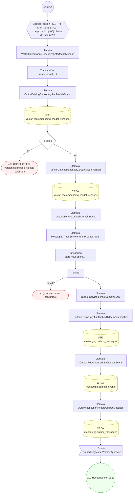

#### 9. POST /vector-rag/embedding-model-versions/{id}/retire

Retirar una versión de modelo

| HTTP | Código | Cuándo |
|---|---|---|
| 200 | — | Éxito |
| 400 | `VALIDATION_FAILED` | Los parámetros de ruta son UUID válidos; El cuerpo cumple el DTO (sin propiedades extra) |
| 401 | `UNAUTHENTICATED` | Hay una sesión válida (JWT) |
| 403 | `FORBIDDEN` | El rol está permitido; El tenant se resuelve y pertenece al actor |
| 404 | `NOT_FOUND` | ResourceNotFoundException: Versión de modelo no encontrada. |
| 409 | `CONFLICT` | ConflictException: El modelo ya está retirado. |
| 422 | `PRECONDITION_FAILED` | PreconditionFailedException: Hay jobs de embedding vivos que dependen del modelo. |
| 429 | `RATE_LIMITED` | No se supera el límite de solicitudes |

```mermaid
flowchart TD
  n1(("Solicitud")):::inicio
  n2{{"Acceso: sesión (401) · rol (403) · tenant (403) · parámetros de ruta (400) · cuerpo válido (400) · límite de…"}}:::acceso
  n1 --> n2
  n3["Llama a VectorGovernanceService.retireModelVersion"]:::llamada
  n2 --> n3
  n4["Transacción: transactional(…)"]:::transaccion
  n3 --> n4
  n5["Llama a VectorCatalogRepository.findModelVersionForUpdate"]:::llamada
  n4 --> n5
  n6[("LEE vector_rag.embedding_model_versions")]:::efecto
  n5 --> n6
  n7{"!model"}:::decision
  n6 --> n7
  n8(["404 NOT_FOUND Versión de modelo no encontrada."]):::error
  n7 -->|"sí"| n8
  n9{"model.retiredAt"}:::decision
  n7 -->|"no"| n9
  n10(["409 CONFLICT El modelo ya está retirado."]):::error
  n9 -->|"sí"| n10
  n11["Llama a VectorCatalogRepository.findCollectionsByModel"]:::llamada
  n9 -->|"no"| n11
  n12[("LEE vector_rag.vector_collections")]:::efecto
  n11 --> n12
  n13["Repite: por cada const collection de collections"]:::bucle
  n12 --> n13
  n14["Llama a VectorCatalogRepository.findActiveJobsByCollection"]:::llamada
  n13 -->|"cada elemento"| n14
  n15[("LEE vector_rag.embedding_jobs")]:::efecto
  n14 --> n15
  n16{"activeJobs.length › 0"}:::decision
  n15 --> n16
  n17(["422 PRECONDITION_FAILED Hay jobs de embedding vivos que dependen del modelo."]):::error
  n16 -->|"sí"| n17
  n18[("ACTUALIZA vector_rag.embedding_model_versions")]:::efecto
  n16 -->|"no"| n18
  n13 -->|"al terminar"| n18
  n19["Llama a OutboxService.publishDomainEvent"]:::llamada
  n18 --> n19
  n20["Llama a MessagingTraceService.runInProducerSpan"]:::llamada
  n19 --> n20
  n21["Transacción: startActiveSpan(…)"]:::transaccion
  n20 --> n21
  n22["Intenta"]:::intento
  n21 --> n22
  n23(["↩ (relanza el error capturado)"]):::error
  n22 -->|"si falla"| n23
  n24["Llama a OutboxService.persistDomainEvent"]:::llamada
  n22 --> n24
  n25["Llama a OutboxRepository.findOutboxByIdempotencyKey"]:::llamada
  n24 --> n25
  n26[("LEE messaging.outbox_messages")]:::efecto
  n25 --> n26
  n27["Llama a OutboxRepository.createDomainEvent"]:::llamada
  n26 --> n27
  n28[("CREA messaging.domain_events")]:::efecto
  n27 --> n28
  n29["Llama a OutboxRepository.createOutboxMessage"]:::llamada
  n28 --> n29
  n30[("CREA messaging.outbox_messages")]:::efecto
  n29 --> n30
  n31>"Evento EmbeddingModelRetired"]:::evento
  n30 --> n31
  n32(("200 Responde con éxito")):::ok
  n31 --> n32
  classDef acceso fill:#eef,stroke:#66a
  classDef error fill:#fee,stroke:#c33
  classDef ok fill:#efe,stroke:#3a3
  classDef efecto fill:#ffd,stroke:#aa3
  classDef decision fill:#fff,stroke:#555
  classDef corte fill:#eee,stroke:#999,stroke-dasharray: 4
```

#### 10. POST /vector-rag/rag-access-policies

Definir una política de acceso RAG

| HTTP | Código | Cuándo |
|---|---|---|
| 201 | — | Éxito |
| 400 | `VALIDATION_FAILED` | El cuerpo cumple el DTO (sin propiedades extra) |
| 401 | `UNAUTHENTICATED` | Hay una sesión válida (JWT) |
| 403 | `FORBIDDEN` | El rol está permitido; El tenant se resuelve y pertenece al actor |
| 409 | `CONFLICT` | ConflictException: Ya existe una política con ese código para el tenant. |
| 422 | `PRECONDITION_FAILED` | PreconditionFailedException: Exigir consentimiento obliga a exigir también el ámbito de paciente. |
| 429 | `RATE_LIMITED` | No se supera el límite de solicitudes |

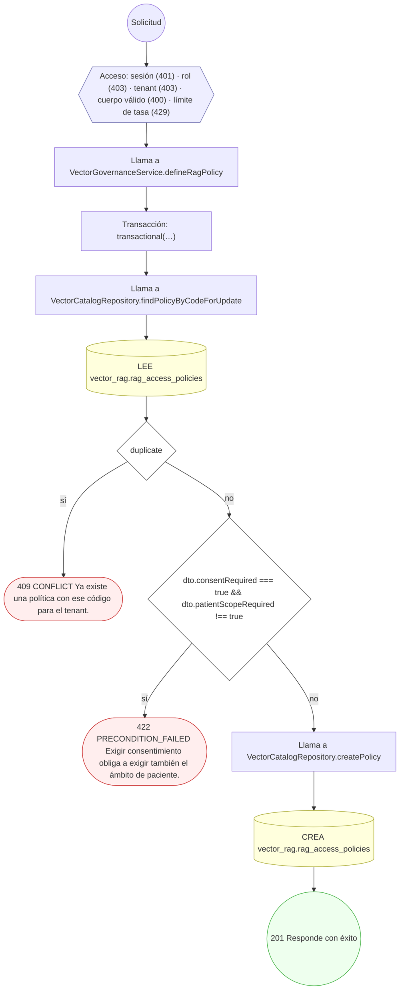

#### 11. PUT /vector-rag/rag-access-policies/{id}/publish

Publicar la política y reenlazar colecciones

| HTTP | Código | Cuándo |
|---|---|---|
| 200 | — | Éxito |
| 400 | `VALIDATION_FAILED` | Los parámetros de ruta son UUID válidos; El cuerpo cumple el DTO (sin propiedades extra) |
| 401 | `UNAUTHENTICATED` | Hay una sesión válida (JWT) |
| 403 | `FORBIDDEN` | El rol está permitido; El tenant se resuelve y pertenece al actor |
| 429 | `RATE_LIMITED` | No se supera el límite de solicitudes |

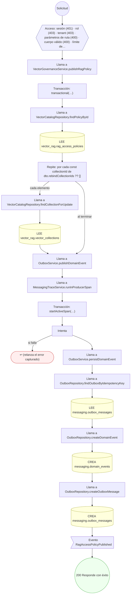

#### 12. POST /vector-rag/retrieval-sessions

Abrir una sesión de retrieval gobernada por consentimiento

| HTTP | Código | Cuándo |
|---|---|---|
| 201 | — | Éxito |
| 400 | `VALIDATION_FAILED` | El cuerpo cumple el DTO (sin propiedades extra) |
| 401 | `UNAUTHENTICATED` | Hay una sesión válida (JWT) |
| 403 | `FORBIDDEN` | El rol está permitido; El tenant se resuelve y pertenece al actor |
| 422 | `PRECONDITION_FAILED` | PreconditionFailedException: La colección está deprecada.; PreconditionFailedException: La colección no tiene política de acceso RAG; no se puede consultar.; PreconditionFailedException: La política de acceso RAG no está publicada.; PreconditionFailedException: La política no admite ese tipo de principal.; PreconditionFailedException: La política no admite ese propósito de uso.; PreconditionFailedException: La política exige declarar el paciente sobre el que se consulta.; PreconditionFailedException: La política exige una directiva de consentimiento vigente. |
| 429 | `RATE_LIMITED` | No se supera el límite de solicitudes |

```mermaid
flowchart TD
  n1(("Solicitud")):::inicio
  n2{{"Acceso: sesión (401) · rol (403) · tenant (403) · cuerpo válido (400) · límite de tasa (429)"}}:::acceso
  n1 --> n2
  n3["Llama a RetrievalService.openSession"]:::llamada
  n2 --> n3
  n4["Transacción: transactional(…)"]:::transaccion
  n3 --> n4
  n5["Llama a VectorCatalogRepository.findCollectionById"]:::llamada
  n4 --> n5
  n6[("LEE vector_rag.vector_collections")]:::efecto
  n5 --> n6
  n7{"collection.lifecycleState === 'deprecated'"}:::decision
  n6 --> n7
  n8(["422 PRECONDITION_FAILED La colección está deprecada."]):::error
  n7 -->|"sí"| n8
  n9["Llama a RetrievalService.requirePublishedPolicy"]:::llamada
  n7 -->|"no"| n9
  n10{"!accessPolicyId"}:::decision
  n9 --> n10
  n11(["422 PRECONDITION_FAILED La colección no tiene política de acceso RAG; no se puede consultar."]):::error
  n10 -->|"sí"| n11
  n12["Llama a VectorCatalogRepository.findPolicyById"]:::llamada
  n10 -->|"no"| n12
  n13[("LEE vector_rag.rag_access_policies")]:::efecto
  n12 --> n13
  n14{"policy.state !== 'published'"}:::decision
  n13 --> n14
  n15(["422 PRECONDITION_FAILED La política de acceso RAG no está publicada."]):::error
  n14 -->|"sí"| n15
  n16{"!policy.allowedPrincipalTypes.includes(dto.principalType)"}:::decision
  n14 -->|"no"| n16
  n17(["422 PRECONDITION_FAILED La política no admite ese tipo de principal."]):::error
  n16 -->|"sí"| n17
  n18{"!policy.allowedPurposeCodes.includes(dto.purposeOfUseCode)"}:::decision
  n16 -->|"no"| n18
  n19(["422 PRECONDITION_FAILED La política no admite ese propósito de uso."]):::error
  n18 -->|"sí"| n19
  n20{"policy.patientScopeRequired && !dto.patientProfileId"}:::decision
  n18 -->|"no"| n20
  n21(["422 PRECONDITION_FAILED La política exige declarar el paciente sobre el que se consulta."]):::error
  n20 -->|"sí"| n21
  n22{"policy.consentRequired && !dto.consentDirectiveId"}:::decision
  n20 -->|"no"| n22
  n23(["422 PRECONDITION_FAILED La política exige una directiva de consentimiento vigente."]):::error
  n22 -->|"sí"| n23
  n24["Llama a RetrievalRepository.findOpenSessionByHash"]:::llamada
  n22 -->|"no"| n24
  n25[("LEE vector_rag.retrieval_sessions")]:::efecto
  n24 --> n25
  n26["Llama a RetrievalRepository.createSession"]:::llamada
  n25 --> n26
  n27[("CREA vector_rag.retrieval_sessions")]:::efecto
  n26 --> n27
  n28["Llama a OutboxService.publishDomainEvent"]:::llamada
  n27 --> n28
  n29["Llama a MessagingTraceService.runInProducerSpan"]:::llamada
  n28 --> n29
  n30["Transacción: startActiveSpan(…)"]:::transaccion
  n29 --> n30
  n31["Intenta"]:::intento
  n30 --> n31
  n32(["↩ (relanza el error capturado)"]):::error
  n31 -->|"si falla"| n32
  n33["Llama a OutboxService.persistDomainEvent"]:::llamada
  n31 --> n33
  n34["Llama a OutboxRepository.findOutboxByIdempotencyKey"]:::llamada
  n33 --> n34
  n35[("LEE messaging.outbox_messages")]:::efecto
  n34 --> n35
  n36["Llama a OutboxRepository.createDomainEvent"]:::llamada
  n35 --> n36
  n37[("CREA messaging.domain_events")]:::efecto
  n36 --> n37
  n38["Llama a OutboxRepository.createOutboxMessage"]:::llamada
  n37 --> n38
  n39[("CREA messaging.outbox_messages")]:::efecto
  n38 --> n39
  n40>"Evento RetrievalSessionOpened"]:::evento
  n39 --> n40
  n41(("201 Responde con éxito")):::ok
  n40 --> n41
  classDef acceso fill:#eef,stroke:#66a
  classDef error fill:#fee,stroke:#c33
  classDef ok fill:#efe,stroke:#3a3
  classDef efecto fill:#ffd,stroke:#aa3
  classDef decision fill:#fff,stroke:#555
  classDef corte fill:#eee,stroke:#999,stroke-dasharray: 4
```

#### 13. POST /vector-rag/retrieval-sessions/{id}/evidence

Materializar la evidencia citable

| HTTP | Código | Cuándo |
|---|---|---|
| 201 | — | Éxito |
| 400 | `VALIDATION_FAILED` | Los parámetros de ruta son UUID válidos; El cuerpo cumple el DTO (sin propiedades extra) |
| 401 | `UNAUTHENTICATED` | Hay una sesión válida (JWT) |
| 403 | `FORBIDDEN` | El rol está permitido; El tenant se resuelve y pertenece al actor |
| 422 | `PRECONDITION_FAILED` | PreconditionFailedException: La sesión tiene que estar ranqueada para materializar evidencia.; PreconditionFailedException: La sesión no tiene ningún candidato seleccionado y autorizado que citar.; PreconditionFailedException: Se intenta citar un chunk que no quedó seleccionado y autorizado. |
| 429 | `RATE_LIMITED` | No se supera el límite de solicitudes |

```mermaid
flowchart TD
  n1(("Solicitud")):::inicio
  n2{{"Acceso: sesión (401) · rol (403) · tenant (403) · parámetros de ruta (400) · cuerpo válido (400) · límite de…"}}:::acceso
  n1 --> n2
  n3["Llama a RetrievalService.materializeEvidence"]:::llamada
  n2 --> n3
  n4["Transacción: transactional(…)"]:::transaccion
  n3 --> n4
  n5["Llama a RetrievalRepository.findSessionForUpdate"]:::llamada
  n4 --> n5
  n6[("LEE vector_rag.retrieval_sessions")]:::efecto
  n5 --> n6
  n7{"session.status !== 'ranked'"}:::decision
  n6 --> n7
  n8(["422 PRECONDITION_FAILED La sesión tiene que estar ranqueada para materializar evidencia."]):::error
  n7 -->|"sí"| n8
  n9["Llama a RetrievalRepository.findSelectedCandidates"]:::llamada
  n7 -->|"no"| n9
  n10[("LEE vector_rag.retrieval_candidates")]:::efecto
  n9 --> n10
  n11{"selectable.size === 0"}:::decision
  n10 --> n11
  n12(["422 PRECONDITION_FAILED La sesión no tiene ningún candidato seleccionado y autorizado que citar."]):::error
  n11 -->|"sí"| n12
  n13["Repite: por cada const citation de dto.citations"]:::bucle
  n11 -->|"no"| n13
  n14{"!selectable.has(citation.vectorChunkId)"}:::decision
  n13 -->|"cada elemento"| n14
  n15(["422 PRECONDITION_FAILED Se intenta citar un chunk que no quedó seleccionado y autorizado."]):::error
  n14 -->|"sí"| n15
  n16["Llama a VectorCorpusRepository.findChunkById"]:::llamada
  n14 -->|"no"| n16
  n17[("LEE vector_rag.vector_chunks")]:::efecto
  n16 --> n17
  n18["Llama a VectorCorpusRepository.findDocumentById"]:::llamada
  n17 --> n18
  n19[("LEE vector_rag.vector_documents")]:::efecto
  n18 --> n19
  n20["Llama a RetrievalRepository.createEvidence"]:::llamada
  n19 --> n20
  n21[("CREA vector_rag.retrieval_evidence")]:::efecto
  n20 --> n21
  n22["Llama a OutboxService.publishDomainEvent"]:::llamada
  n21 --> n22
  n13 -->|"al terminar"| n22
  n23["Llama a MessagingTraceService.runInProducerSpan"]:::llamada
  n22 --> n23
  n24["Transacción: startActiveSpan(…)"]:::transaccion
  n23 --> n24
  n25["Intenta"]:::intento
  n24 --> n25
  n26(["↩ (relanza el error capturado)"]):::error
  n25 -->|"si falla"| n26
  n27["Llama a OutboxService.persistDomainEvent"]:::llamada
  n25 --> n27
  n28["Llama a OutboxRepository.findOutboxByIdempotencyKey"]:::llamada
  n27 --> n28
  n29[("LEE messaging.outbox_messages")]:::efecto
  n28 --> n29
  n30["Llama a OutboxRepository.createDomainEvent"]:::llamada
  n29 --> n30
  n31[("CREA messaging.domain_events")]:::efecto
  n30 --> n31
  n32["Llama a OutboxRepository.createOutboxMessage"]:::llamada
  n31 --> n32
  n33[("CREA messaging.outbox_messages")]:::efecto
  n32 --> n33
  n34>"Evento RetrievalEvidenceMaterialized"]:::evento
  n33 --> n34
  n35(("201 Responde con éxito")):::ok
  n34 --> n35
  classDef acceso fill:#eef,stroke:#66a
  classDef error fill:#fee,stroke:#c33
  classDef ok fill:#efe,stroke:#3a3
  classDef efecto fill:#ffd,stroke:#aa3
  classDef decision fill:#fff,stroke:#555
  classDef corte fill:#eee,stroke:#999,stroke-dasharray: 4
```

#### 14. POST /vector-rag/retrieval-sessions/{id}/feedback

Capturar feedback de la sesión

| HTTP | Código | Cuándo |
|---|---|---|
| 201 | — | Éxito |
| 400 | `VALIDATION_FAILED` | Los parámetros de ruta son UUID válidos; El cuerpo cumple el DTO (sin propiedades extra) |
| 401 | `UNAUTHENTICATED` | Hay una sesión válida (JWT) |
| 403 | `FORBIDDEN` | El rol está permitido; El tenant se resuelve y pertenece al actor |
| 404 | `NOT_FOUND` | ResourceNotFoundException: Sesión de retrieval no encontrada. |
| 422 | `PRECONDITION_FAILED` | PreconditionFailedException: Sólo se puede dar feedback de una sesión completada. |
| 429 | `RATE_LIMITED` | No se supera el límite de solicitudes |

```mermaid
flowchart TD
  n1(("Solicitud")):::inicio
  n2{{"Acceso: sesión (401) · rol (403) · tenant (403) · parámetros de ruta (400) · cuerpo válido (400) · límite de…"}}:::acceso
  n1 --> n2
  n3["Llama a RetrievalService.captureFeedback"]:::llamada
  n2 --> n3
  n4["Transacción: transactional(…)"]:::transaccion
  n3 --> n4
  n5["Llama a RetrievalRepository.findSessionForUpdate"]:::llamada
  n4 --> n5
  n6[("LEE vector_rag.retrieval_sessions")]:::efecto
  n5 --> n6
  n7{"session.principalId !== actor.id && !roleAuthorizesInTenant(actor, 'PLATFORM_ADMIN', session.tenantId)"}:::decision
  n6 --> n7
  n8(["404 NOT_FOUND Sesión de retrieval no encontrada."]):::error
  n7 -->|"sí"| n8
  n9{"session.status !== 'completed' && session.status !== 'flagged'"}:::decision
  n7 -->|"no"| n9
  n10(["422 PRECONDITION_FAILED Sólo se puede dar feedback de una sesión completada."]):::error
  n9 -->|"sí"| n10
  n11["Llama a RetrievalRepository.createFeedback"]:::llamada
  n9 -->|"no"| n11
  n12[("CREA vector_rag.retrieval_feedback_events")]:::efecto
  n11 --> n12
  n13["Llama a OutboxService.publishDomainEvent"]:::llamada
  n12 --> n13
  n14["Llama a MessagingTraceService.runInProducerSpan"]:::llamada
  n13 --> n14
  n15["Transacción: startActiveSpan(…)"]:::transaccion
  n14 --> n15
  n16["Intenta"]:::intento
  n15 --> n16
  n17(["↩ (relanza el error capturado)"]):::error
  n16 -->|"si falla"| n17
  n18["Llama a OutboxService.persistDomainEvent"]:::llamada
  n16 --> n18
  n19["Llama a OutboxRepository.findOutboxByIdempotencyKey"]:::llamada
  n18 --> n19
  n20[("LEE messaging.outbox_messages")]:::efecto
  n19 --> n20
  n21["Llama a OutboxRepository.createDomainEvent"]:::llamada
  n20 --> n21
  n22[("CREA messaging.domain_events")]:::efecto
  n21 --> n22
  n23["Llama a OutboxRepository.createOutboxMessage"]:::llamada
  n22 --> n23
  n24[("CREA messaging.outbox_messages")]:::efecto
  n23 --> n24
  n25>"Evento RetrievalFeedbackCaptured"]:::evento
  n24 --> n25
  n26{"flagged"}:::decision
  n25 --> n26
  n27["Llama a OutboxService.publishDomainEvent"]:::llamada
  n26 -->|"sí"| n27
  n28["Llama a MessagingTraceService.runInProducerSpan"]:::llamada
  n27 --> n28
  n29["Transacción: startActiveSpan(…)"]:::transaccion
  n28 --> n29
  n30["Intenta"]:::intento
  n29 --> n30
  n31(["↩ (relanza el error capturado)"]):::error
  n30 -->|"si falla"| n31
  n32["Llama a OutboxService.persistDomainEvent"]:::llamada
  n30 --> n32
  n33["Llama a OutboxRepository.findOutboxByIdempotencyKey"]:::llamada
  n32 --> n33
  n34[("LEE messaging.outbox_messages")]:::efecto
  n33 --> n34
  n35["Llama a OutboxRepository.createDomainEvent"]:::llamada
  n34 --> n35
  n36[("CREA messaging.domain_events")]:::efecto
  n35 --> n36
  n37["Llama a OutboxRepository.createOutboxMessage"]:::llamada
  n36 --> n37
  n38[("CREA messaging.outbox_messages")]:::efecto
  n37 --> n38
  n39>"Evento RetrievalSafetyIssueRaised"]:::evento
  n38 --> n39
  n40(("201 Responde con éxito")):::ok
  n39 --> n40
  n26 -->|"no"| n40
  classDef acceso fill:#eef,stroke:#66a
  classDef error fill:#fee,stroke:#c33
  classDef ok fill:#efe,stroke:#3a3
  classDef efecto fill:#ffd,stroke:#aa3
  classDef decision fill:#fff,stroke:#555
  classDef corte fill:#eee,stroke:#999,stroke-dasharray: 4
```

#### 15. POST /vector-rag/retrieval-sessions/{id}/search

Ranquear los candidatos y filtrarlos por consentimiento y etiquetas

| HTTP | Código | Cuándo |
|---|---|---|
| 200 | — | Éxito |
| 400 | `VALIDATION_FAILED` | Los parámetros de ruta son UUID válidos; El cuerpo cumple el DTO (sin propiedades extra) |
| 401 | `UNAUTHENTICATED` | Hay una sesión válida (JWT) |
| 403 | `FORBIDDEN` | El rol está permitido; El tenant se resuelve y pertenece al actor |
| 404 | `NOT_FOUND` | ResourceNotFoundException: Chunk candidato no encontrado. |
| 422 | `PRECONDITION_FAILED` | PreconditionFailedException: La sesión ya no está abierta.; PreconditionFailedException: La colección no tiene política de acceso RAG; no se puede consultar.; PreconditionFailedException: La política de acceso RAG no está publicada. |
| 429 | `RATE_LIMITED` | No se supera el límite de solicitudes |

```mermaid
flowchart TD
  n1(("Solicitud")):::inicio
  n2{{"Acceso: sesión (401) · rol (403) · tenant (403) · parámetros de ruta (400) · cuerpo válido (400) · límite de…"}}:::acceso
  n1 --> n2
  n3["Llama a RetrievalService.rankCandidates"]:::llamada
  n2 --> n3
  n4["Transacción: transactional(…)"]:::transaccion
  n3 --> n4
  n5["Llama a RetrievalRepository.findSessionForUpdate"]:::llamada
  n4 --> n5
  n6[("LEE vector_rag.retrieval_sessions")]:::efecto
  n5 --> n6
  n7{"session.status !== 'open'"}:::decision
  n6 --> n7
  n8(["422 PRECONDITION_FAILED La sesión ya no está abierta."]):::error
  n7 -->|"sí"| n8
  n9["Repite: por cada const candidate de ordered.slice(0, MAX_CANDIDATES)"]:::bucle
  n7 -->|"no"| n9
  n10["Llama a VectorCorpusRepository.findChunkById"]:::llamada
  n9 -->|"cada elemento"| n10
  n11[("LEE vector_rag.vector_chunks")]:::efecto
  n10 --> n11
  n12["Llama a VectorCorpusRepository.findDocumentById"]:::llamada
  n11 --> n12
  n13[("LEE vector_rag.vector_documents")]:::efecto
  n12 --> n13
  n14["Llama a VectorCatalogRepository.findCollectionById"]:::llamada
  n13 --> n14
  n15[("LEE vector_rag.vector_collections")]:::efecto
  n14 --> n15
  n16{"!chunk || !document || !collection"}:::decision
  n15 --> n16
  n17(["404 NOT_FOUND Chunk candidato no encontrado."]):::error
  n16 -->|"sí"| n17
  n18["Llama a RetrievalService.requirePublishedPolicy"]:::llamada
  n16 -->|"no"| n18
  n19{"!accessPolicyId"}:::decision
  n18 --> n19
  n20(["422 PRECONDITION_FAILED La colección no tiene política de acceso RAG; no se puede consultar."]):::error
  n19 -->|"sí"| n20
  n21["Llama a VectorCatalogRepository.findPolicyById"]:::llamada
  n19 -->|"no"| n21
  n22[("LEE vector_rag.rag_access_policies")]:::efecto
  n21 --> n22
  n23{"policy.state !== 'published'"}:::decision
  n22 --> n23
  n24(["422 PRECONDITION_FAILED La política de acceso RAG no está publicada."]):::error
  n23 -->|"sí"| n24
  n25["Repite: map(…)"]:::bucle
  n23 -->|"no"| n25
  n9 -->|"al terminar"| n25
  n26["Llama a RetrievalRepository.createCandidate"]:::llamada
  n25 -->|"cada elemento"| n26
  n27[("CREA vector_rag.retrieval_candidates")]:::efecto
  n26 --> n27
  n28["Llama a OutboxService.publishDomainEvent"]:::llamada
  n27 --> n28
  n25 -->|"al terminar"| n28
  n29["Llama a MessagingTraceService.runInProducerSpan"]:::llamada
  n28 --> n29
  n30["Transacción: startActiveSpan(…)"]:::transaccion
  n29 --> n30
  n31["Intenta"]:::intento
  n30 --> n31
  n32(["↩ (relanza el error capturado)"]):::error
  n31 -->|"si falla"| n32
  n33["Llama a OutboxService.persistDomainEvent"]:::llamada
  n31 --> n33
  n34["Llama a OutboxRepository.findOutboxByIdempotencyKey"]:::llamada
  n33 --> n34
  n35[("LEE messaging.outbox_messages")]:::efecto
  n34 --> n35
  n36["Llama a OutboxRepository.createDomainEvent"]:::llamada
  n35 --> n36
  n37[("CREA messaging.domain_events")]:::efecto
  n36 --> n37
  n38["Llama a OutboxRepository.createOutboxMessage"]:::llamada
  n37 --> n38
  n39[("CREA messaging.outbox_messages")]:::efecto
  n38 --> n39
  n40>"Evento RetrievalCandidatesRanked"]:::evento
  n39 --> n40
  n41(("200 Responde con éxito")):::ok
  n40 --> n41
  classDef acceso fill:#eef,stroke:#66a
  classDef error fill:#fee,stroke:#c33
  classDef ok fill:#efe,stroke:#3a3
  classDef efecto fill:#ffd,stroke:#aa3
  classDef decision fill:#fff,stroke:#555
  classDef corte fill:#eee,stroke:#999,stroke-dasharray: 4
```

### Operaciones sin decisiones propias

Sólo comprueban el acceso y leen o escriben: no tienen ramas que dibujar. Su detalle está en la ficha de endpoints.

| Operación | Respuestas posibles | Tablas |
|---|---|---|
| GET /vector-rag/embedding-jobs/pending | 200, 400, 401, 403, 429 | 1 |
