<!-- AUTOGENERADO por tools/inventario/flujos.mjs. No editar manualmente. -->

# Flujos del módulo `workflow`

- **Procesos:** 1 · **Máquinas de estado:** 0
- **Operaciones:** 11 (11 con decisiones propias, 0 sin ellas)
- Inventario de endpoints del módulo: [workflow](../endpoints/workflow.md)

## Proceso: Módulo 32 — Máquinas de estado y flujos entre dominios

- **Código:** `workflow` · **Agrupación:** CASO_DE_USO_README · **Operaciones:** 11
- **Actores:** AUDITOR · BILLING_AGENT · CLINICIAN · COMPLIANCE_OFFICER · GOVERNANCE_ADMIN · PLATFORM_ADMIN · SAGA_ORCHESTRATOR · SCHEDULER · SYSTEM · WORKFLOW_ARCHITECT
- **Revisión:** AUTO_DETECTADA
- **Fuentes:** `src/modules/workflow/README.md`

### Para qué sirve

Un solo sitio donde se declara qué estados puede tener un agregado, qué comandos lo mueven de uno a otro, qué hay que cumplir para moverlo y qué pasa después de moverlo. Y un solo sitio donde eso se ejecuta, con idempotencia, compensación, reintento y vencimiento.

_Fuente: `src/modules/workflow/README.md:3`_

### Flujo general declarado en el README

```text
DEFINICIÓN (borrador)
  state-machines ──────────> máquina DRAFT, versión N+1 del value set
    ├─ :id/states ─────────> exactamente un inicial, al menos un terminal
    └─ :id/transitions ────> from no terminal; guardas y efectos ordenados
  :id/publish ─────────────> comprueba el grafo → ACTIVE
                             la versión activa anterior queda RETIRED

EJECUCIÓN
  aggregates/:id/transitions/:command
    1. FOR UPDATE sobre el agregado          ← antes de leer su estado
    2. ¿hay transición (estado actual, comando)?
    3. Idempotency-Key ya vista ─────────────> devuelve el resultado previo
    4. ¿motivo? ¿versión esperada? ¿guardas en orden?
    5. UPDATE del agregado + row_version++
    6. INSERT en state_transition_events (inmutable)
    7. outbox: un mensaje por efecto con outbox_event_type
                                             ↓ post-commit
                             el relay del módulo 35 los despacha

  .../:eventId/compensate ─> vuelve al estado de origen, evento nuevo con causation_id
  .../:eventId/retry ──────> no mueve nada; reusa la clave de idempotencia original

INSTANCIAS
  instances ───────────────> estado inicial de la definición + tareas OPEN
  tasks/:id/complete ──────> tarea COMPLETED, paso avanzado, transición si hay comando
  instances/sweep-timeouts > vencidas → ESCALATED (instancia y tareas), SKIP LOCKED
```

_Fuente: `src/modules/workflow/README.md:59`_

### Etapas y operaciones

| Etapa | Descripción | Operación | Quién actúa | Riesgo | Tablas |
|---|---|---|---|---|---|
| `UC-32-01` | Registrar definición de máquina | POST /workflow/state-machines | WORKFLOW_ARCHITECT · GOVERNANCE_ADMIN · PLATFORM_ADMIN | MEDIO | 5 |
| `UC-32-02` | Declarar estados (inicial/terminal) | POST /workflow/state-machines/{id}/states | WORKFLOW_ARCHITECT · GOVERNANCE_ADMIN · PLATFORM_ADMIN | MEDIO | 3 |
| `UC-32-03` | Transición con guardas y efectos | POST /workflow/state-machines/{id}/transitions | WORKFLOW_ARCHITECT · GOVERNANCE_ADMIN · PLATFORM_ADMIN | MEDIO | 6 |
| `UC-32-04` | Publicar/activar la versión | POST /workflow/state-machines/{id}/publish | WORKFLOW_ARCHITECT · GOVERNANCE_ADMIN · PLATFORM_ADMIN | MEDIO | 7 |
| `UC-32-05` | Disparar transición validada | POST /workflow/aggregates/{aggregateId}/transitions/{commandCode} | CLINICIAN · BILLING_AGENT · SCHEDULER · SYSTEM · PLATFORM_ADMIN | MEDIO | 9 |
| `UC-32-08` | Compensar (saga) | POST /workflow/aggregates/{aggregateId}/transitions/{eventId}/compensate | SYSTEM · SAGA_ORCHESTRATOR · PLATFORM_ADMIN | MEDIO | 7 |
| `UC-32-09` | Reintentar transición fallida | POST /workflow/aggregates/{aggregateId}/transitions/{eventId}/retry | SYSTEM · PLATFORM_ADMIN | MEDIO | 8 |
| `UC-32-10` | Escalar por vencimiento | POST /workflow/instances/sweep-timeouts | SYSTEM · PLATFORM_ADMIN | MEDIO | 7 |
| `UC-32-11` | Estado e historial | GET /workflow/aggregates/{aggregateId}/transitions | AUDITOR · COMPLIANCE_OFFICER · CLINICIAN · PLATFORM_ADMIN | BAJO | 4 |
| `UC-32-12` | Crear instancia y tareas | POST /workflow/instances | CLINICIAN · BILLING_AGENT · SCHEDULER · SYSTEM · PLATFORM_ADMIN | MEDIO | 8 |
| `UC-32-13` | Completar tarea | POST /workflow/tasks/{id}/complete | CLINICIAN · BILLING_AGENT · SCHEDULER · PLATFORM_ADMIN | MEDIO | 10 |

### Diagrama — etapas `UC-32-01`, `UC-32-02`, `UC-32-03`…

```mermaid
flowchart LR
  a2(["WORKFLOW_ARCHITECT · GOVERNANCE_ADMIN · PLATFORM_ADMIN"]):::actor
  a17(["CLINICIAN · BILLING_AGENT · SCHEDULER · SYSTEM · PLATFORM_A…"]):::actor
  a22(["SYSTEM · SAGA_ORCHESTRATOR · PLATFORM_ADMIN"]):::actor
  a27(["SYSTEM · PLATFORM_ADMIN"]):::actor
  a35(["AUDITOR · COMPLIANCE_OFFICER · CLINICIAN · PLATFORM_ADMIN"]):::actor
  a40(["CLINICIAN · BILLING_AGENT · SCHEDULER · PLATFORM_ADMIN"]):::actor
  t3[("messaging.domain_events")]:::tabla
  t4[("messaging.outbox_messages")]:::tabla
  t5[("workflow.state_machine_definitions")]:::tabla
  e6>"StateMachineDefined"]:::evento
  t8[("workflow.state_definitions")]:::tabla
  t10[("workflow.state_transition_definitions")]:::tabla
  t11[("workflow.transition_guards")]:::tabla
  t12[("workflow.transition_side_effects")]:::tabla
  e15>"StateMachineVersionPublished"]:::evento
  t18[("workflow.state_transition_events")]:::tabla
  e20>"~effect.outboxEventType"]:::evento
  e24>"TransitionCompensated"]:::evento
  e25>"~`${effect.outboxEventType}.compensated`"]:::evento
  t30[("workflow.workflow_instances")]:::tabla
  t31[("workflow.workflow_tasks")]:::tabla
  e33>"WorkflowTimedOut"]:::evento
  e38>"WorkflowInstanceStarted"]:::evento
  e42>"WorkflowTaskCompleted"]:::evento
  subgraph s0["UC-32-01 · Registrar definición de máquina"]
    o1["POST /workflow/state-machines"]:::op
  end
  subgraph s1["UC-32-02 · Declarar estados (inicial/terminal)"]
    o7["POST /workflow/state-machines/{id}/states"]:::op
  end
  subgraph s2["UC-32-03 · Transición con guardas y efectos"]
    o9["POST /workflow/state-machines/{id}/transitions"]:::op
  end
  t14[("+1 tablas más")]
  subgraph s3["UC-32-04 · Publicar/activar la versión"]
    o13["POST /workflow/state-machines/{id}/publish"]:::op
  end
  t19[("+3 tablas más")]
  subgraph s4["UC-32-05 · Disparar transición validada"]
    o16["POST /workflow/aggregates/{aggregateId}/transitions/{commandCode}"]:::op
  end
  t23[("+1 tablas más")]
  subgraph s5["UC-32-08 · Compensar (saga)"]
    o21["POST /workflow/aggregates/{aggregateId}/transitions/{eventId}/compens…"]:::op
  end
  t28[("+2 tablas más")]
  subgraph s6["UC-32-09 · Reintentar transición fallida"]
    o26["POST /workflow/aggregates/{aggregateId}/transitions/{eventId}/retry"]:::op
  end
  t32[("+1 tablas más")]
  subgraph s7["UC-32-10 · Escalar por vencimiento"]
    o29["POST /workflow/instances/sweep-timeouts"]:::op
  end
  subgraph s8["UC-32-11 · Estado e historial"]
    o34["GET /workflow/aggregates/{aggregateId}/transitions"]:::op
  end
  t37[("+2 tablas más")]
  subgraph s9["UC-32-12 · Crear instancia y tareas"]
    o36["POST /workflow/instances"]:::op
  end
  t41[("+4 tablas más")]
  subgraph s10["UC-32-13 · Completar tarea"]
    o39["POST /workflow/tasks/{id}/complete"]:::op
  end
  a2 --> o1
  o1 -->|"CREA"| t3
  o1 -->|"CREA"| t4
  o1 -->|"LEE"| t4
  o1 -->|"CREA"| t5
  o1 -->|"LEE"| t5
  o1 -->|"evento"| e6
  a2 --> o7
  o7 -->|"CREA"| t8
  o7 -->|"LEE"| t8
  o7 -->|"LEE"| t5
  a2 --> o9
  o9 -->|"LEE"| t8
  o9 -->|"LEE"| t5
  o9 -->|"CREA"| t10
  o9 -->|"LEE"| t10
  o9 -->|"CREA"| t11
  o9 -->|"CREA"| t12
  a2 --> o13
  o13 -->|"CREA"| t3
  o13 -->|"CREA"| t4
  o13 -->|"LEE"| t4
  o13 -->|"LEE"| t8
  o13 -->|"ACTUALIZA"| t5
  o13 -->|"LEE"| t5
  o13 -.-> t14
  o13 -->|"evento"| e15
  a17 --> o16
  o16 -->|"CREA"| t3
  o16 -->|"CREA"| t4
  o16 -->|"LEE"| t4
  o16 -->|"LEE"| t5
  o16 -->|"LEE"| t10
  o16 -->|"CREA"| t18
  o16 -.-> t19
  o16 -->|"evento"| e20
  a22 --> o21
  o21 -->|"CREA"| t3
  o21 -->|"CREA"| t4
  o21 -->|"LEE"| t4
  o21 -->|"LEE"| t5
  o21 -->|"CREA"| t18
  o21 -->|"LEE"| t18
  o21 -.-> t23
  o21 -->|"evento"| e24
  o21 -->|"evento"| e25
  a27 --> o26
  o26 -->|"CREA"| t3
  o26 -->|"CREA"| t4
  o26 -->|"LEE"| t4
  o26 -->|"CREA"| t18
  o26 -->|"LEE"| t18
  o26 -->|"LEE"| t12
  o26 -.-> t28
  o26 -->|"evento"| e20
  a27 --> o29
  o29 -->|"CREA"| t3
  o29 -->|"CREA"| t4
  o29 -->|"LEE"| t4
  o29 -->|"ACTUALIZA"| t30
  o29 -->|"LEE"| t30
  o29 -->|"ACTUALIZA"| t31
  o29 -.-> t32
  o29 -->|"evento"| e33
  a35 --> o34
  o34 -->|"LEE"| t5
  o34 -->|"LEE"| t10
  o34 -->|"LEE"| t18
  o34 -->|"LEE"| t30
  a17 --> o36
  o36 -->|"CREA"| t3
  o36 -->|"CREA"| t4
  o36 -->|"LEE"| t4
  o36 -->|"LEE"| t8
  o36 -->|"LEE"| t5
  o36 -->|"CREA"| t30
  o36 -.-> t37
  o36 -->|"evento"| e38
  a40 --> o39
  o39 -->|"CREA"| t3
  o39 -->|"CREA"| t4
  o39 -->|"LEE"| t4
  o39 -->|"LEE"| t5
  o39 -->|"LEE"| t10
  o39 -->|"CREA"| t18
  o39 -.-> t41
  o39 -->|"evento"| e42
  classDef op fill:#fff,stroke:#446
  classDef actor fill:#eef,stroke:#66a
  classDef tabla fill:#ffd,stroke:#aa3
  classDef evento fill:#efe,stroke:#3a3
```

## Árbol de decisión por operación

Cada árbol se deriva del código del handler y de los métodos que invoca (hasta 4 niveles). Una rama que no decide, no escribe y no falla se poda. Los accesos y los efectos consecutivos se agrupan en un solo nodo.

### Operaciones con decisiones propias

#### 1. GET /workflow/aggregates/{aggregateId}/transitions

Historial de transiciones del agregado

| HTTP | Código | Cuándo |
|---|---|---|
| 200 | — | Éxito |
| 400 | `VALIDATION_FAILED` | Los parámetros de ruta son UUID válidos |
| 401 | `UNAUTHENTICATED` | Hay una sesión válida (JWT) |
| 403 | `FORBIDDEN` | El rol está permitido; El tenant se resuelve y pertenece al actor |
| 404 | `NOT_FOUND` | ResourceNotFoundException: No hay una máquina activa con ese código. |
| 429 | `RATE_LIMITED` | No se supera el límite de solicitudes |

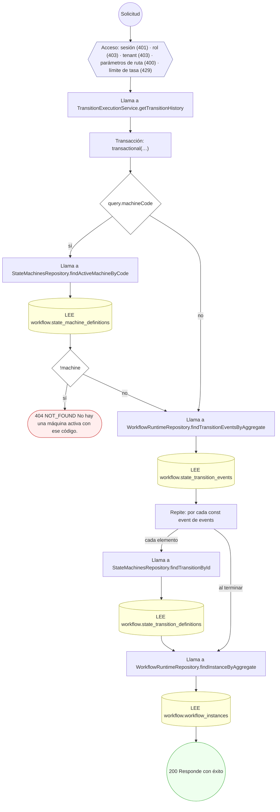

#### 2. POST /workflow/aggregates/{aggregateId}/transitions/{commandCode}

Disparar una transición validada

| HTTP | Código | Cuándo |
|---|---|---|
| 201 | — | Éxito |
| 400 | `VALIDATION_FAILED` | Los parámetros de ruta son UUID válidos; El cuerpo cumple el DTO (sin propiedades extra) |
| 401 | `UNAUTHENTICATED` | Hay una sesión válida (JWT) |
| 403 | `FORBIDDEN` | El rol está permitido; El tenant se resuelve y pertenece al actor |
| 404 | `NOT_FOUND` | ResourceNotFoundException: No hay una versión activa de esa máquina de estado.; ResourceNotFoundException: El agregado gobernado no existe. |
| 409 | `CONCURRENCY_CONFLICT` | ConcurrencyConflictException: El agregado cambió desde que el llamante lo leyó. |
| 422 | `PRECONDITION_FAILED` | PreconditionFailedException: El comando no es aplicable desde el estado actual del agregado.; PreconditionFailedException: Esta transición exige cabecera Idempotency-Key.; PreconditionFailedException: Esta transición exige declarar el motivo.; PreconditionFailedException: Esta transición exige enviar la versión del agregado que vio el llamante.; PreconditionFailedException: {guard.failureMessageKey ?? 'La transición no cumple una gua…} |
| 429 | `RATE_LIMITED` | No se supera el límite de solicitudes |

```mermaid
flowchart TD
  n1(("Solicitud")):::inicio
  n2{{"Acceso: sesión (401) · rol (403) · tenant (403) · parámetros de ruta (400) · cuerpo válido (400) · límite de…"}}:::acceso
  n1 --> n2
  n3["Llama a TransitionExecutionService.triggerTransition"]:::llamada
  n2 --> n3
  n4["Transacción: transactional(…)"]:::transaccion
  n3 --> n4
  n5["Llama a TransitionExecutionService.requireActiveMachine"]:::llamada
  n4 --> n5
  n6["Llama a StateMachinesRepository.findActiveMachineByCode"]:::llamada
  n5 --> n6
  n7[("LEE workflow.state_machine_definitions")]:::efecto
  n6 --> n7
  n8{"!machine"}:::decision
  n7 --> n8
  n9(["404 NOT_FOUND No hay una versión activa de esa máquina de estado."]):::error
  n8 -->|"sí"| n9
  n10{"!aggregate"}:::decision
  n8 -->|"no"| n10
  n11(["404 NOT_FOUND El agregado gobernado no existe."]):::error
  n10 -->|"sí"| n11
  n12["Llama a StateMachinesRepository.findTransitionByCommand"]:::llamada
  n10 -->|"no"| n12
  n13[("LEE workflow.state_transition_definitions")]:::efecto
  n12 --> n13
  n14{"!transition"}:::decision
  n13 --> n14
  n15(["422 PRECONDITION_FAILED El comando no es aplicable desde el estado actual del agregado."]):::error
  n14 -->|"sí"| n15
  n16{"transition.idempotencyRequired && !idempotencyKey"}:::decision
  n14 -->|"no"| n16
  n17(["422 PRECONDITION_FAILED Esta transición exige cabecera Idempotency-Key."]):::error
  n16 -->|"sí"| n17
  n18{"idempotencyKey"}:::decision
  n16 -->|"no"| n18
  n19["Llama a WorkflowRuntimeRepository.findTransitionEventByIdempotencyKey"]:::llamada
  n18 -->|"sí"| n19
  n20[("LEE workflow.state_transition_events")]:::efecto
  n19 --> n20
  n21{"transition.reasonRequired && !dto.reasonConceptId && !dto.reasonText"}:::decision
  n20 --> n21
  n18 -->|"no"| n21
  n22(["422 PRECONDITION_FAILED Esta transición exige declarar el motivo."]):::error
  n21 -->|"sí"| n22
  n23{"transition.optimisticLockRequired && dto.expectedRowVersion === undefined"}:::decision
  n21 -->|"no"| n23
  n24(["422 PRECONDITION_FAILED Esta transición exige enviar la versión del agregado que vio el llamante."]):::error
  n23 -->|"sí"| n24
  n25["Llama a StateMachinesRepository.findGuardsByTransition"]:::llamada
  n23 -->|"no"| n25
  n26[("LEE workflow.transition_guards")]:::efecto
  n25 --> n26
  n27["Llama a TransitionExecutionService.assertGuards"]:::llamada
  n26 --> n27
  n28["Repite: por cada const guard de guards"]:::bucle
  n27 --> n28
  n29(["422 PRECONDITION_FAILED {guard.failureMessageKey ?? 'La transición no cumple una gua…}"]):::error
  n28 -->|"cada elemento"| n29
  n30{"!applied"}:::decision
  n28 -->|"al terminar"| n30
  n31(["409 CONCURRENCY_CONFLICT El agregado cambió desde que el llamante lo leyó."]):::error
  n30 -->|"sí"| n31
  n32["Llama a WorkflowRuntimeRepository.createTransitionEvent"]:::llamada
  n30 -->|"no"| n32
  n33[("CREA workflow.state_transition_events")]:::efecto
  n32 --> n33
  n34["Llama a TransitionExecutionService.publishSideEffects"]:::llamada
  n33 --> n34
  n35["Llama a StateMachinesRepository.findSideEffectsByTransition"]:::llamada
  n34 --> n35
  n36[("LEE workflow.transition_side_effects")]:::efecto
  n35 --> n36
  n37["Repite: por cada const effect de effects"]:::bucle
  n36 --> n37
  n38["Llama a OutboxService.publishDomainEvent"]:::llamada
  n37 -->|"cada elemento"| n38
  n39["Llama a MessagingTraceService.runInProducerSpan"]:::llamada
  n38 --> n39
  n40["Transacción: startActiveSpan(…)"]:::transaccion
  n39 --> n40
  n41["Intenta"]:::intento
  n40 --> n41
  n42(["↩ (relanza el error capturado)"]):::error
  n41 -->|"si falla"| n42
  n43>"Evento ~effect.outboxEventType"]:::evento
  n41 --> n43
  n44(("201 Responde con éxito")):::ok
  n43 --> n44
  n37 -->|"al terminar"| n44
  classDef acceso fill:#eef,stroke:#66a
  classDef error fill:#fee,stroke:#c33
  classDef ok fill:#efe,stroke:#3a3
  classDef efecto fill:#ffd,stroke:#aa3
  classDef decision fill:#fff,stroke:#555
  classDef corte fill:#eee,stroke:#999,stroke-dasharray: 4
```

#### 3. POST /workflow/aggregates/{aggregateId}/transitions/{eventId}/compensate

Compensar una transición

| HTTP | Código | Cuándo |
|---|---|---|
| 200 | — | Éxito |
| 400 | `VALIDATION_FAILED` | Los parámetros de ruta son UUID válidos; El cuerpo cumple el DTO (sin propiedades extra) |
| 401 | `UNAUTHENTICATED` | Hay una sesión válida (JWT) |
| 403 | `FORBIDDEN` | El rol está permitido; El tenant se resuelve y pertenece al actor |
| 404 | `NOT_FOUND` | ResourceNotFoundException: La transición original no existe para ese agregado.; ResourceNotFoundException: Máquina de estado no encontrada.; ResourceNotFoundException: El agregado gobernado no existe. |
| 409 | `CONFLICT` | ConflictException: El agregado ya no está en el estado que dejó la transición que se quiere compensar. |
| 409 | `CONCURRENCY_CONFLICT` | ConcurrencyConflictException: El agregado cambió durante la compensación. |
| 422 | `PRECONDITION_FAILED` | PreconditionFailedException: La transición no declara compensación, así que no es reversible. |
| 429 | `RATE_LIMITED` | No se supera el límite de solicitudes |

```mermaid
flowchart TD
  n1(("Solicitud")):::inicio
  n2{{"Acceso: sesión (401) · rol (403) · tenant (403) · parámetros de ruta (400) · cuerpo válido (400) · límite de…"}}:::acceso
  n1 --> n2
  n3["Llama a TransitionExecutionService.compensateTransition"]:::llamada
  n2 --> n3
  n4["Transacción: transactional(…)"]:::transaccion
  n3 --> n4
  n5["Llama a WorkflowRuntimeRepository.findTransitionEventById"]:::llamada
  n4 --> n5
  n6[("LEE workflow.state_transition_events")]:::efecto
  n5 --> n6
  n7{"!original || original.aggregateId !== aggregateId"}:::decision
  n6 --> n7
  n8(["404 NOT_FOUND La transición original no existe para ese agregado."]):::error
  n7 -->|"sí"| n8
  n9["Llama a StateMachinesRepository.findMachineById"]:::llamada
  n7 -->|"no"| n9
  n10[("LEE workflow.state_machine_definitions")]:::efecto
  n9 --> n10
  n11{"!machine"}:::decision
  n10 --> n11
  n12(["404 NOT_FOUND Máquina de estado no encontrada."]):::error
  n11 -->|"sí"| n12
  n13["Llama a StateMachinesRepository.findSideEffectsByTransition"]:::llamada
  n11 -->|"no"| n13
  n14[("LEE workflow.transition_side_effects")]:::efecto
  n13 --> n14
  n15{"compensable.length === 0"}:::decision
  n14 --> n15
  n16(["422 PRECONDITION_FAILED La transición no declara compensación, así que no es reversible."]):::error
  n15 -->|"sí"| n16
  n17{"!aggregate"}:::decision
  n15 -->|"no"| n17
  n18(["404 NOT_FOUND El agregado gobernado no existe."]):::error
  n17 -->|"sí"| n18
  n19{"aggregate.stateConceptId !== original.toStateConceptId"}:::decision
  n17 -->|"no"| n19
  n20(["409 CONFLICT El agregado ya no está en el estado que dejó la transición que se quiere compensar."]):::error
  n19 -->|"sí"| n20
  n21{"!applied"}:::decision
  n19 -->|"no"| n21
  n22(["409 CONCURRENCY_CONFLICT El agregado cambió durante la compensación."]):::error
  n21 -->|"sí"| n22
  n23["Llama a WorkflowRuntimeRepository.createTransitionEvent"]:::llamada
  n21 -->|"no"| n23
  n24[("CREA workflow.state_transition_events")]:::efecto
  n23 --> n24
  n25["Llama a OutboxService.publishDomainEvent"]:::llamada
  n24 --> n25
  n26["Llama a MessagingTraceService.runInProducerSpan"]:::llamada
  n25 --> n26
  n27["Transacción: startActiveSpan(…)"]:::transaccion
  n26 --> n27
  n28["Intenta"]:::intento
  n27 --> n28
  n29(["↩ (relanza el error capturado)"]):::error
  n28 -->|"si falla"| n29
  n30["Llama a OutboxService.persistDomainEvent"]:::llamada
  n28 --> n30
  n31["Llama a OutboxRepository.findOutboxByIdempotencyKey"]:::llamada
  n30 --> n31
  n32[("LEE messaging.outbox_messages")]:::efecto
  n31 --> n32
  n33["Llama a OutboxRepository.createDomainEvent"]:::llamada
  n32 --> n33
  n34[("CREA messaging.domain_events")]:::efecto
  n33 --> n34
  n35["Llama a OutboxRepository.createOutboxMessage"]:::llamada
  n34 --> n35
  n36[("CREA messaging.outbox_messages")]:::efecto
  n35 --> n36
  n37>"Evento TransitionCompensated"]:::evento
  n36 --> n37
  n38["Repite: por cada const effect de compensable"]:::bucle
  n37 --> n38
  n39["Llama a OutboxService.publishDomainEvent"]:::llamada
  n38 -->|"cada elemento"| n39
  n40["Llama a MessagingTraceService.runInProducerSpan"]:::llamada
  n39 --> n40
  n41["Transacción: startActiveSpan(…)"]:::transaccion
  n40 --> n41
  n42["Intenta"]:::intento
  n41 --> n42
  n43(["↩ (relanza el error capturado)"]):::error
  n42 -->|"si falla"| n43
  n44["Llama a OutboxService.persistDomainEvent"]:::llamada
  n42 --> n44
  n45["Llama a OutboxRepository.findOutboxByIdempotencyKey"]:::llamada
  n44 --> n45
  n46[("LEE messaging.outbox_messages")]:::efecto
  n45 --> n46
  n47["Llama a OutboxRepository.createDomainEvent"]:::llamada
  n46 --> n47
  n48[("CREA messaging.domain_events")]:::efecto
  n47 --> n48
  n49["Llama a OutboxRepository.createOutboxMessage"]:::llamada
  n48 --> n49
  n50[("CREA messaging.outbox_messages")]:::efecto
  n49 --> n50
  n51>"Evento ~`${effect.outboxEventType}.compensated`"]:::evento
  n50 --> n51
  n52(("200 Responde con éxito")):::ok
  n51 --> n52
  n38 -->|"al terminar"| n52
  classDef acceso fill:#eef,stroke:#66a
  classDef error fill:#fee,stroke:#c33
  classDef ok fill:#efe,stroke:#3a3
  classDef efecto fill:#ffd,stroke:#aa3
  classDef decision fill:#fff,stroke:#555
  classDef corte fill:#eee,stroke:#999,stroke-dasharray: 4
```

#### 4. POST /workflow/aggregates/{aggregateId}/transitions/{eventId}/retry

Reintentar una transición cuyo efecto falló

| HTTP | Código | Cuándo |
|---|---|---|
| 200 | — | Éxito |
| 400 | `VALIDATION_FAILED` | Los parámetros de ruta son UUID válidos; El cuerpo cumple el DTO (sin propiedades extra) |
| 401 | `UNAUTHENTICATED` | Hay una sesión válida (JWT) |
| 403 | `FORBIDDEN` | El rol está permitido; El tenant se resuelve y pertenece al actor |
| 404 | `NOT_FOUND` | ResourceNotFoundException: La transición original no existe para ese agregado.; ResourceNotFoundException: Instancia de workflow no encontrada. |
| 422 | `PRECONDITION_FAILED` | PreconditionFailedException: La instancia no está en espera de reintento. |
| 429 | `RATE_LIMITED` | No se supera el límite de solicitudes |

```mermaid
flowchart TD
  n1(("Solicitud")):::inicio
  n2{{"Acceso: sesión (401) · rol (403) · tenant (403) · parámetros de ruta (400) · cuerpo válido (400) · límite de…"}}:::acceso
  n1 --> n2
  n3["Llama a TransitionExecutionService.retryTransition"]:::llamada
  n2 --> n3
  n4["Transacción: transactional(…)"]:::transaccion
  n3 --> n4
  n5["Llama a WorkflowRuntimeRepository.findTransitionEventById"]:::llamada
  n4 --> n5
  n6[("LEE workflow.state_transition_events")]:::efecto
  n5 --> n6
  n7{"!original || original.aggregateId !== aggregateId"}:::decision
  n6 --> n7
  n8(["404 NOT_FOUND La transición original no existe para ese agregado."]):::error
  n7 -->|"sí"| n8
  n9{"dto.workflowInstanceId"}:::decision
  n7 -->|"no"| n9
  n10["Llama a WorkflowRuntimeRepository.findInstanceForUpdate"]:::llamada
  n9 -->|"sí"| n10
  n11[("LEE workflow.workflow_instances")]:::efecto
  n10 --> n11
  n12{"!instance"}:::decision
  n11 --> n12
  n13(["404 NOT_FOUND Instancia de workflow no encontrada."]):::error
  n12 -->|"sí"| n13
  n14{"instance.currentStateConceptId !== CONCEPTS.WF_INSTANCE_RETRY_SCHEDULED"}:::decision
  n12 -->|"no"| n14
  n15(["422 PRECONDITION_FAILED La instancia no está en espera de reintento."]):::error
  n14 -->|"sí"| n15
  n16[("ACTUALIZA workflow.workflow_instances · ACTUALIZA workflow.workflow_instances")]:::efecto
  n14 -->|"no"| n16
  n17["Llama a WorkflowRuntimeRepository.createTransitionEvent"]:::llamada
  n16 --> n17
  n9 -->|"no"| n17
  n18[("CREA workflow.state_transition_events")]:::efecto
  n17 --> n18
  n19["Llama a TransitionExecutionService.publishSideEffects"]:::llamada
  n18 --> n19
  n20["Llama a StateMachinesRepository.findSideEffectsByTransition"]:::llamada
  n19 --> n20
  n21[("LEE workflow.transition_side_effects")]:::efecto
  n20 --> n21
  n22["Repite: por cada const effect de effects"]:::bucle
  n21 --> n22
  n23["Llama a OutboxService.publishDomainEvent"]:::llamada
  n22 -->|"cada elemento"| n23
  n24["Llama a MessagingTraceService.runInProducerSpan"]:::llamada
  n23 --> n24
  n25["Transacción: startActiveSpan(…)"]:::transaccion
  n24 --> n25
  n26["Intenta"]:::intento
  n25 --> n26
  n27(["↩ (relanza el error capturado)"]):::error
  n26 -->|"si falla"| n27
  n28>"Evento ~effect.outboxEventType"]:::evento
  n26 --> n28
  n29(("200 Responde con éxito")):::ok
  n28 --> n29
  n22 -->|"al terminar"| n29
  classDef acceso fill:#eef,stroke:#66a
  classDef error fill:#fee,stroke:#c33
  classDef ok fill:#efe,stroke:#3a3
  classDef efecto fill:#ffd,stroke:#aa3
  classDef decision fill:#fff,stroke:#555
  classDef corte fill:#eee,stroke:#999,stroke-dasharray: 4
```

#### 5. POST /workflow/instances

Crear una instancia de workflow y sus tareas iniciales

| HTTP | Código | Cuándo |
|---|---|---|
| 201 | — | Éxito |
| 400 | `VALIDATION_FAILED` | El cuerpo cumple el DTO (sin propiedades extra) |
| 401 | `UNAUTHENTICATED` | Hay una sesión válida (JWT) |
| 403 | `FORBIDDEN` | El rol está permitido; El tenant se resuelve y pertenece al actor |
| 404 | `NOT_FOUND` | ResourceNotFoundException: No hay una versión activa de la máquina de estado para ese workflow. |
| 409 | `CONFLICT` | ConflictException: Ya hay una instancia viva de ese workflow para el sujeto. |
| 422 | `PRECONDITION_FAILED` | PreconditionFailedException: La definición activa no declara estado inicial. |
| 429 | `RATE_LIMITED` | No se supera el límite de solicitudes |

```mermaid
flowchart TD
  n1(("Solicitud")):::inicio
  n2{{"Acceso: sesión (401) · rol (403) · tenant (403) · cuerpo válido (400) · límite de tasa (429)"}}:::acceso
  n1 --> n2
  n3["Llama a WorkflowInstancesService.createInstance"]:::llamada
  n2 --> n3
  n4["Transacción: transactional(…)"]:::transaccion
  n3 --> n4
  n5["Llama a StateMachinesRepository.findActiveMachineByCode"]:::llamada
  n4 --> n5
  n6[("LEE workflow.state_machine_definitions")]:::efecto
  n5 --> n6
  n7{"!machine"}:::decision
  n6 --> n7
  n8(["404 NOT_FOUND No hay una versión activa de la máquina de estado para ese workflow."]):::error
  n7 -->|"sí"| n8
  n9["Llama a StateMachinesRepository.findInitialState"]:::llamada
  n7 -->|"no"| n9
  n10[("LEE workflow.state_definitions")]:::efecto
  n9 --> n10
  n11{"!initialState"}:::decision
  n10 --> n11
  n12(["422 PRECONDITION_FAILED La definición activa no declara estado inicial."]):::error
  n11 -->|"sí"| n12
  n13["Llama a WorkflowRuntimeRepository.findLiveInstance"]:::llamada
  n11 -->|"no"| n13
  n14[("LEE workflow.workflow_instances")]:::efecto
  n13 --> n14
  n15{"live"}:::decision
  n14 --> n15
  n16(["409 CONFLICT Ya hay una instancia viva de ese workflow para el sujeto."]):::error
  n15 -->|"sí"| n16
  n17["Llama a WorkflowRuntimeRepository.createInstance"]:::llamada
  n15 -->|"no"| n17
  n18[("CREA workflow.workflow_instances")]:::efecto
  n17 --> n18
  n19["Repite: por cada const task de dto.tasks ?? []"]:::bucle
  n18 --> n19
  n20["Llama a WorkflowRuntimeRepository.createTask"]:::llamada
  n19 -->|"cada elemento"| n20
  n21[("CREA workflow.workflow_tasks")]:::efecto
  n20 --> n21
  n22["Llama a OutboxService.publishDomainEvent"]:::llamada
  n21 --> n22
  n19 -->|"al terminar"| n22
  n23["Llama a MessagingTraceService.runInProducerSpan"]:::llamada
  n22 --> n23
  n24["Transacción: startActiveSpan(…)"]:::transaccion
  n23 --> n24
  n25["Intenta"]:::intento
  n24 --> n25
  n26(["↩ (relanza el error capturado)"]):::error
  n25 -->|"si falla"| n26
  n27["Llama a OutboxService.persistDomainEvent"]:::llamada
  n25 --> n27
  n28["Llama a OutboxRepository.findOutboxByIdempotencyKey"]:::llamada
  n27 --> n28
  n29[("LEE messaging.outbox_messages")]:::efecto
  n28 --> n29
  n30["Llama a OutboxRepository.createDomainEvent"]:::llamada
  n29 --> n30
  n31[("CREA messaging.domain_events")]:::efecto
  n30 --> n31
  n32["Llama a OutboxRepository.createOutboxMessage"]:::llamada
  n31 --> n32
  n33[("CREA messaging.outbox_messages")]:::efecto
  n32 --> n33
  n34>"Evento WorkflowInstanceStarted"]:::evento
  n33 --> n34
  n35(("201 Responde con éxito")):::ok
  n34 --> n35
  classDef acceso fill:#eef,stroke:#66a
  classDef error fill:#fee,stroke:#c33
  classDef ok fill:#efe,stroke:#3a3
  classDef efecto fill:#ffd,stroke:#aa3
  classDef decision fill:#fff,stroke:#555
  classDef corte fill:#eee,stroke:#999,stroke-dasharray: 4
```

#### 6. POST /workflow/instances/sweep-timeouts

Escalar las instancias con el plazo vencido

| HTTP | Código | Cuándo |
|---|---|---|
| 200 | — | Éxito |
| 400 | `VALIDATION_FAILED` | El cuerpo cumple el DTO (sin propiedades extra) |
| 401 | `UNAUTHENTICATED` | Hay una sesión válida (JWT) |
| 403 | `FORBIDDEN` | El rol está permitido; El tenant se resuelve y pertenece al actor |
| 429 | `RATE_LIMITED` | No se supera el límite de solicitudes |

```mermaid
flowchart TD
  n1(("Solicitud")):::inicio
  n2{{"Acceso: sesión (401) · rol (403) · tenant (403) · cuerpo válido (400) · límite de tasa (429)"}}:::acceso
  n1 --> n2
  n3["Llama a WorkflowInstancesService.sweepTimeouts"]:::llamada
  n2 --> n3
  n4["Transacción: transactional(…)"]:::transaccion
  n3 --> n4
  n5["Llama a WorkflowRuntimeRepository.findDueInstancesForUpdate"]:::llamada
  n4 --> n5
  n6[("LEE workflow.workflow_instances")]:::efecto
  n5 --> n6
  n7["Repite: por cada const instance de due"]:::bucle
  n6 --> n7
  n8[("ACTUALIZA workflow.workflow_instances · ACTUALIZA workflow.workflow_instances · ACTUALIZA workflow.workflow_i…")]:::efecto
  n7 -->|"cada elemento"| n8
  n9["Llama a WorkflowRuntimeRepository.findDueTasksByInstanceForUpdate"]:::llamada
  n8 --> n9
  n10[("LEE workflow.workflow_tasks")]:::efecto
  n9 --> n10
  n11["Repite: por cada const task de tasks"]:::bucle
  n10 --> n11
  n12[("ACTUALIZA workflow.workflow_tasks")]:::efecto
  n11 -->|"cada elemento"| n12
  n13["Llama a OutboxService.publishDomainEvent"]:::llamada
  n12 --> n13
  n11 -->|"al terminar"| n13
  n14["Llama a MessagingTraceService.runInProducerSpan"]:::llamada
  n13 --> n14
  n15["Transacción: startActiveSpan(…)"]:::transaccion
  n14 --> n15
  n16["Intenta"]:::intento
  n15 --> n16
  n17(["↩ (relanza el error capturado)"]):::error
  n16 -->|"si falla"| n17
  n18["Llama a OutboxService.persistDomainEvent"]:::llamada
  n16 --> n18
  n19["Llama a OutboxRepository.findOutboxByIdempotencyKey"]:::llamada
  n18 --> n19
  n20[("LEE messaging.outbox_messages")]:::efecto
  n19 --> n20
  n21["Llama a OutboxRepository.createDomainEvent"]:::llamada
  n20 --> n21
  n22[("CREA messaging.domain_events")]:::efecto
  n21 --> n22
  n23["Llama a OutboxRepository.createOutboxMessage"]:::llamada
  n22 --> n23
  n24[("CREA messaging.outbox_messages")]:::efecto
  n23 --> n24
  n25>"Evento WorkflowTimedOut"]:::evento
  n24 --> n25
  n26(("200 Responde con éxito")):::ok
  n25 --> n26
  n7 -->|"al terminar"| n26
  classDef acceso fill:#eef,stroke:#66a
  classDef error fill:#fee,stroke:#c33
  classDef ok fill:#efe,stroke:#3a3
  classDef efecto fill:#ffd,stroke:#aa3
  classDef decision fill:#fff,stroke:#555
  classDef corte fill:#eee,stroke:#999,stroke-dasharray: 4
```

#### 7. POST /workflow/state-machines

Registrar una definición de máquina de estado

| HTTP | Código | Cuándo |
|---|---|---|
| 201 | — | Éxito |
| 400 | `VALIDATION_FAILED` | El cuerpo cumple el DTO (sin propiedades extra) |
| 401 | `UNAUTHENTICATED` | Hay una sesión válida (JWT) |
| 403 | `FORBIDDEN` | El rol está permitido; El tenant se resuelve y pertenece al actor |
| 409 | `CONFLICT` | ConflictException: Ya existe una máquina de estado con ese código. |
| 429 | `RATE_LIMITED` | No se supera el límite de solicitudes |

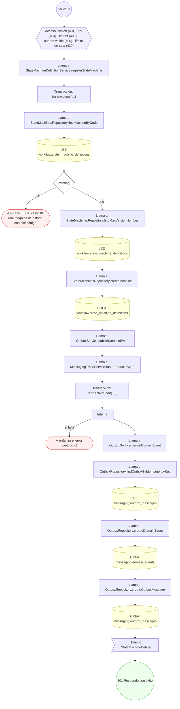

#### 8. POST /workflow/state-machines/{id}/publish

Publicar la versión de la definición

| HTTP | Código | Cuándo |
|---|---|---|
| 200 | — | Éxito |
| 400 | `VALIDATION_FAILED` | Los parámetros de ruta son UUID válidos; El cuerpo cumple el DTO (sin propiedades extra) |
| 401 | `UNAUTHENTICATED` | Hay una sesión válida (JWT) |
| 403 | `FORBIDDEN` | El rol está permitido; El tenant se resuelve y pertenece al actor |
| 404 | `NOT_FOUND` | ResourceNotFoundException: Máquina de estado no encontrada. |
| 422 | `PRECONDITION_FAILED` | PreconditionFailedException: La definición ya no está en borrador.; PreconditionFailedException: La definición debe tener exactamente un estado inicial para publicarse.; PreconditionFailedException: La definición debe tener al menos un estado terminal para publicarse.; PreconditionFailedException: Hay estados inalcanzables desde el estado inicial. |
| 429 | `RATE_LIMITED` | No se supera el límite de solicitudes |

```mermaid
flowchart TD
  n1(("Solicitud")):::inicio
  n2{{"Acceso: sesión (401) · rol (403) · tenant (403) · parámetros de ruta (400) · cuerpo válido (400) · límite de…"}}:::acceso
  n1 --> n2
  n3["Llama a StateMachineDefinitionService.publishStateMachine"]:::llamada
  n2 --> n3
  n4["Transacción: transactional(…)"]:::transaccion
  n3 --> n4
  n5["Llama a StateMachinesRepository.findMachineForUpdate"]:::llamada
  n4 --> n5
  n6[("LEE workflow.state_machine_definitions")]:::efecto
  n5 --> n6
  n7{"!machine"}:::decision
  n6 --> n7
  n8(["404 NOT_FOUND Máquina de estado no encontrada."]):::error
  n7 -->|"sí"| n8
  n9{"machine.statusConceptId !== CONCEPTS.WF_DEF_DRAFT"}:::decision
  n7 -->|"no"| n9
  n10(["422 PRECONDITION_FAILED La definición ya no está en borrador."]):::error
  n9 -->|"sí"| n10
  n11["Llama a StateMachinesRepository.findStatesByMachine"]:::llamada
  n9 -->|"no"| n11
  n12[("LEE workflow.state_definitions")]:::efecto
  n11 --> n12
  n13{"initial.length !== 1"}:::decision
  n12 --> n13
  n14(["422 PRECONDITION_FAILED La definición debe tener exactamente un estado inicial para publicarse."]):::error
  n13 -->|"sí"| n14
  n15{"!states.some((s) =› s.isTerminal)"}:::decision
  n13 -->|"no"| n15
  n16(["422 PRECONDITION_FAILED La definición debe tener al menos un estado terminal para publicarse."]):::error
  n15 -->|"sí"| n16
  n17["Llama a StateMachinesRepository.findTransitionsByMachine"]:::llamada
  n15 -->|"no"| n17
  n18[("LEE workflow.state_transition_definitions")]:::efecto
  n17 --> n18
  n19{"unreachable.length › 0"}:::decision
  n18 --> n19
  n20(["422 PRECONDITION_FAILED Hay estados inalcanzables desde el estado inicial."]):::error
  n19 -->|"sí"| n20
  n21["Llama a StateMachinesRepository.findActiveMachineForUpdate"]:::llamada
  n19 -->|"no"| n21
  n22[("LEE workflow.state_machine_definitions")]:::efecto
  n21 --> n22
  n23{"previous && previous.id !== machine.id"}:::decision
  n22 --> n23
  n24[("ACTUALIZA workflow.state_machine_definitions · ACTUALIZA workflow.state_machine_definitions")]:::efecto
  n23 -->|"sí"| n24
  n25[("ACTUALIZA workflow.state_machine_definitions · ACTUALIZA workflow.state_machine_definitions")]:::efecto
  n24 --> n25
  n23 -->|"no"| n25
  n26["Llama a OutboxService.publishDomainEvent"]:::llamada
  n25 --> n26
  n27["Llama a MessagingTraceService.runInProducerSpan"]:::llamada
  n26 --> n27
  n28["Transacción: startActiveSpan(…)"]:::transaccion
  n27 --> n28
  n29["Intenta"]:::intento
  n28 --> n29
  n30(["↩ (relanza el error capturado)"]):::error
  n29 -->|"si falla"| n30
  n31["Llama a OutboxService.persistDomainEvent"]:::llamada
  n29 --> n31
  n32["Llama a OutboxRepository.findOutboxByIdempotencyKey"]:::llamada
  n31 --> n32
  n33[("LEE messaging.outbox_messages")]:::efecto
  n32 --> n33
  n34["Llama a OutboxRepository.createDomainEvent"]:::llamada
  n33 --> n34
  n35[("CREA messaging.domain_events")]:::efecto
  n34 --> n35
  n36["Llama a OutboxRepository.createOutboxMessage"]:::llamada
  n35 --> n36
  n37[("CREA messaging.outbox_messages")]:::efecto
  n36 --> n37
  n38>"Evento StateMachineVersionPublished"]:::evento
  n37 --> n38
  n39(("200 Responde con éxito")):::ok
  n38 --> n39
  classDef acceso fill:#eef,stroke:#66a
  classDef error fill:#fee,stroke:#c33
  classDef ok fill:#efe,stroke:#3a3
  classDef efecto fill:#ffd,stroke:#aa3
  classDef decision fill:#fff,stroke:#555
  classDef corte fill:#eee,stroke:#999,stroke-dasharray: 4
```

#### 9. POST /workflow/state-machines/{id}/states

Declarar los estados de la máquina

| HTTP | Código | Cuándo |
|---|---|---|
| 201 | — | Éxito |
| 400 | `VALIDATION_FAILED` | Los parámetros de ruta son UUID válidos; El cuerpo cumple el DTO (sin propiedades extra) |
| 401 | `UNAUTHENTICATED` | Hay una sesión válida (JWT) |
| 403 | `FORBIDDEN` | El rol está permitido; El tenant se resuelve y pertenece al actor |
| 404 | `NOT_FOUND` | ResourceNotFoundException: Máquina de estado no encontrada. |
| 409 | `CONFLICT` | ConflictException: El estado ya está declarado en esta máquina. |
| 422 | `PRECONDITION_FAILED` | PreconditionFailedException: Sólo se pueden declarar estados sobre una definición en borrador.; PreconditionFailedException: La máquina debe declarar exactamente un estado inicial. |
| 429 | `RATE_LIMITED` | No se supera el límite de solicitudes |

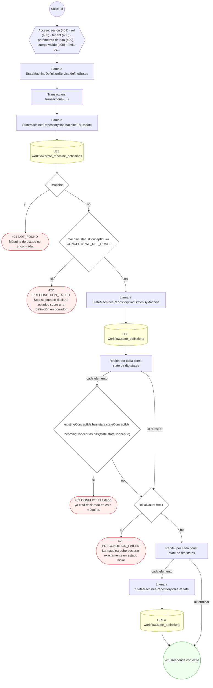

#### 10. POST /workflow/state-machines/{id}/transitions

Declarar una transición con sus guardas y efectos

| HTTP | Código | Cuándo |
|---|---|---|
| 201 | — | Éxito |
| 400 | `VALIDATION_FAILED` | Los parámetros de ruta son UUID válidos; El cuerpo cumple el DTO (sin propiedades extra) |
| 401 | `UNAUTHENTICATED` | Hay una sesión válida (JWT) |
| 403 | `FORBIDDEN` | El rol está permitido; El tenant se resuelve y pertenece al actor |
| 404 | `NOT_FOUND` | ResourceNotFoundException: Máquina de estado no encontrada. |
| 409 | `CONFLICT` | ConflictException: Ya existe una transición con ese código en la máquina.; ConflictException: Dos guardas comparten el mismo orden de evaluación.; ConflictException: Dos efectos comparten el mismo orden de ejecución. |
| 422 | `PRECONDITION_FAILED` | PreconditionFailedException: Sólo se pueden declarar transiciones sobre una definición en borrador.; PreconditionFailedException: El estado de origen no está declarado en esta máquina.; PreconditionFailedException: Un estado terminal no puede tener transiciones de salida.; PreconditionFailedException: El estado de destino no está declarado en esta máquina. |
| 429 | `RATE_LIMITED` | No se supera el límite de solicitudes |

```mermaid
flowchart TD
  n1(("Solicitud")):::inicio
  n2{{"Acceso: sesión (401) · rol (403) · tenant (403) · parámetros de ruta (400) · cuerpo válido (400) · límite de…"}}:::acceso
  n1 --> n2
  n3["Llama a StateMachineDefinitionService.defineTransition"]:::llamada
  n2 --> n3
  n4["Transacción: transactional(…)"]:::transaccion
  n3 --> n4
  n5["Llama a StateMachinesRepository.findMachineForUpdate"]:::llamada
  n4 --> n5
  n6[("LEE workflow.state_machine_definitions")]:::efecto
  n5 --> n6
  n7{"!machine"}:::decision
  n6 --> n7
  n8(["404 NOT_FOUND Máquina de estado no encontrada."]):::error
  n7 -->|"sí"| n8
  n9{"machine.statusConceptId !== CONCEPTS.WF_DEF_DRAFT"}:::decision
  n7 -->|"no"| n9
  n10(["422 PRECONDITION_FAILED Sólo se pueden declarar transiciones sobre una definición en borrador."]):::error
  n9 -->|"sí"| n10
  n11["Llama a StateMachinesRepository.findTransitionByCode"]:::llamada
  n9 -->|"no"| n11
  n12[("LEE workflow.state_transition_definitions")]:::efecto
  n11 --> n12
  n13{"duplicate"}:::decision
  n12 --> n13
  n14(["409 CONFLICT Ya existe una transición con ese código en la máquina."]):::error
  n13 -->|"sí"| n14
  n15["Llama a StateMachinesRepository.findState"]:::llamada
  n13 -->|"no"| n15
  n16[("LEE workflow.state_definitions")]:::efecto
  n15 --> n16
  n17{"!fromState"}:::decision
  n16 --> n17
  n18(["422 PRECONDITION_FAILED El estado de origen no está declarado en esta máquina."]):::error
  n17 -->|"sí"| n18
  n19{"fromState.isTerminal"}:::decision
  n17 -->|"no"| n19
  n20(["422 PRECONDITION_FAILED Un estado terminal no puede tener transiciones de salida."]):::error
  n19 -->|"sí"| n20
  n21["Llama a StateMachinesRepository.findState"]:::llamada
  n19 -->|"no"| n21
  n22[("LEE workflow.state_definitions")]:::efecto
  n21 --> n22
  n23{"!toState"}:::decision
  n22 --> n23
  n24(["422 PRECONDITION_FAILED El estado de destino no está declarado en esta máquina."]):::error
  n23 -->|"sí"| n24
  n25["Llama a StateMachinesRepository.createTransition"]:::llamada
  n23 -->|"no"| n25
  n26[("CREA workflow.state_transition_definitions")]:::efecto
  n25 --> n26
  n27["Repite: por cada const guard de dto.guards ?? []"]:::bucle
  n26 --> n27
  n28{"guardOrders.has(guard.evaluationOrder)"}:::decision
  n27 -->|"cada elemento"| n28
  n29(["409 CONFLICT Dos guardas comparten el mismo orden de evaluación."]):::error
  n28 -->|"sí"| n29
  n30["Llama a StateMachinesRepository.createGuard"]:::llamada
  n28 -->|"no"| n30
  n31[("CREA workflow.transition_guards")]:::efecto
  n30 --> n31
  n32["Repite: por cada const effect de dto.sideEffects ?? []"]:::bucle
  n31 --> n32
  n27 -->|"al terminar"| n32
  n33{"effectOrders.has(effect.executionOrder)"}:::decision
  n32 -->|"cada elemento"| n33
  n34(["409 CONFLICT Dos efectos comparten el mismo orden de ejecución."]):::error
  n33 -->|"sí"| n34
  n35["Llama a StateMachinesRepository.createSideEffect"]:::llamada
  n33 -->|"no"| n35
  n36[("CREA workflow.transition_side_effects")]:::efecto
  n35 --> n36
  n37(("201 Responde con éxito")):::ok
  n36 --> n37
  n32 -->|"al terminar"| n37
  classDef acceso fill:#eef,stroke:#66a
  classDef error fill:#fee,stroke:#c33
  classDef ok fill:#efe,stroke:#3a3
  classDef efecto fill:#ffd,stroke:#aa3
  classDef decision fill:#fff,stroke:#555
  classDef corte fill:#eee,stroke:#999,stroke-dasharray: 4
```

#### 11. POST /workflow/tasks/{id}/complete

Completar una tarea de workflow

| HTTP | Código | Cuándo |
|---|---|---|
| 200 | — | Éxito |
| 400 | `VALIDATION_FAILED` | Los parámetros de ruta son UUID válidos; El cuerpo cumple el DTO (sin propiedades extra) |
| 401 | `UNAUTHENTICATED` | Hay una sesión válida (JWT) |
| 403 | `FORBIDDEN` | El rol está permitido; El tenant se resuelve y pertenece al actor |
| 404 | `NOT_FOUND` | ResourceNotFoundException: Tarea de workflow no encontrada.; ResourceNotFoundException: Instancia de workflow no encontrada.; ResourceNotFoundException: No hay una versión activa de la máquina de estado para ese workflow. |
| 409 | `CONFLICT` | ConflictException: La tarea está asignada a otro usuario. |
| 422 | `PRECONDITION_FAILED` | PreconditionFailedException: La tarea ya no está abierta.; PreconditionFailedException: La instancia ya no está viva; su tarea no puede completarse.; PreconditionFailedException: El comando no es aplicable desde el estado actual de la instancia. |
| 429 | `RATE_LIMITED` | No se supera el límite de solicitudes |

```mermaid
flowchart TD
  n1(("Solicitud")):::inicio
  n2{{"Acceso: sesión (401) · rol (403) · tenant (403) · parámetros de ruta (400) · cuerpo válido (400) · límite de…"}}:::acceso
  n1 --> n2
  n3["Llama a WorkflowInstancesService.completeTask"]:::llamada
  n2 --> n3
  n4["Transacción: transactional(…)"]:::transaccion
  n3 --> n4
  n5["Llama a WorkflowRuntimeRepository.findTaskForUpdate"]:::llamada
  n4 --> n5
  n6[("LEE workflow.workflow_tasks")]:::efecto
  n5 --> n6
  n7{"!task"}:::decision
  n6 --> n7
  n8(["404 NOT_FOUND Tarea de workflow no encontrada."]):::error
  n7 -->|"sí"| n8
  n9{"!OPEN_TASK_STATUSES.includes(task.statusConceptId)"}:::decision
  n7 -->|"no"| n9
  n10(["422 PRECONDITION_FAILED La tarea ya no está abierta."]):::error
  n9 -->|"sí"| n10
  n11["Llama a WorkflowRuntimeRepository.findInstanceForUpdate"]:::llamada
  n9 -->|"no"| n11
  n12[("LEE workflow.workflow_instances")]:::efecto
  n11 --> n12
  n13{"!instance"}:::decision
  n12 --> n13
  n14(["404 NOT_FOUND Instancia de workflow no encontrada."]):::error
  n13 -->|"sí"| n14
  n15{"!LIVE_INSTANCE_STATUSES.includes(instance.statusConceptId)"}:::decision
  n13 -->|"no"| n15
  n16(["422 PRECONDITION_FAILED La instancia ya no está viva; su tarea no puede completarse."]):::error
  n15 -->|"sí"| n16
  n17{"task.assignedUserId && task.assignedUserId !== actor.id"}:::decision
  n15 -->|"no"| n17
  n18(["409 CONFLICT La tarea está asignada a otro usuario."]):::error
  n17 -->|"sí"| n18
  n19[("ACTUALIZA workflow.workflow_tasks · ACTUALIZA workflow.workflow_tasks · ACTUALIZA workflow.workflow_instances")]:::efecto
  n17 -->|"no"| n19
  n20{"dto.nextStepCode"}:::decision
  n19 --> n20
  n21[("ACTUALIZA workflow.workflow_instances")]:::efecto
  n20 -->|"sí"| n21
  n22[("ACTUALIZA workflow.workflow_instances")]:::efecto
  n21 --> n22
  n20 -->|"no"| n22
  n23{"dto.resultJson"}:::decision
  n22 --> n23
  n24[("ACTUALIZA workflow.workflow_instances")]:::efecto
  n23 -->|"sí"| n24
  n25{"dto.commandCode"}:::decision
  n24 --> n25
  n23 -->|"no"| n25
  n26["Llama a StateMachinesRepository.findActiveMachineByCode"]:::llamada
  n25 -->|"sí"| n26
  n27[("LEE workflow.state_machine_definitions")]:::efecto
  n26 --> n27
  n28{"!machine"}:::decision
  n27 --> n28
  n29(["404 NOT_FOUND No hay una versión activa de la máquina de estado para ese workflow."]):::error
  n28 -->|"sí"| n29
  n30["Llama a StateMachinesRepository.findTransitionByCommand"]:::llamada
  n28 -->|"no"| n30
  n31[("LEE workflow.state_transition_definitions")]:::efecto
  n30 --> n31
  n32{"!transition"}:::decision
  n31 --> n32
  n33(["422 PRECONDITION_FAILED El comando no es aplicable desde el estado actual de la instancia."]):::error
  n32 -->|"sí"| n33
  n34["Llama a WorkflowRuntimeRepository.createTransitionEvent"]:::llamada
  n32 -->|"no"| n34
  n35[("CREA workflow.state_transition_events")]:::efecto
  n34 --> n35
  n36[("ACTUALIZA workflow.workflow_instances")]:::efecto
  n35 --> n36
  n37["Llama a WorkflowRuntimeRepository.findOpenTasksByInstance"]:::llamada
  n36 --> n37
  n25 -->|"no"| n37
  n38[("LEE workflow.workflow_tasks")]:::efecto
  n37 --> n38
  n39["Llama a OutboxService.publishDomainEvent"]:::llamada
  n38 --> n39
  n40["Llama a MessagingTraceService.runInProducerSpan"]:::llamada
  n39 --> n40
  n41["Transacción: startActiveSpan(…)"]:::transaccion
  n40 --> n41
  n42["Intenta"]:::intento
  n41 --> n42
  n43(["↩ (relanza el error capturado)"]):::error
  n42 -->|"si falla"| n43
  n44["Llama a OutboxService.persistDomainEvent"]:::llamada
  n42 --> n44
  n45["Llama a OutboxRepository.findOutboxByIdempotencyKey"]:::llamada
  n44 --> n45
  n46[("LEE messaging.outbox_messages")]:::efecto
  n45 --> n46
  n47["Llama a OutboxRepository.createDomainEvent"]:::llamada
  n46 --> n47
  n48[("CREA messaging.domain_events")]:::efecto
  n47 --> n48
  n49["Llama a OutboxRepository.createOutboxMessage"]:::llamada
  n48 --> n49
  n50[("CREA messaging.outbox_messages")]:::efecto
  n49 --> n50
  n51>"Evento WorkflowTaskCompleted"]:::evento
  n50 --> n51
  n52(("200 Responde con éxito")):::ok
  n51 --> n52
  classDef acceso fill:#eef,stroke:#66a
  classDef error fill:#fee,stroke:#c33
  classDef ok fill:#efe,stroke:#3a3
  classDef efecto fill:#ffd,stroke:#aa3
  classDef decision fill:#fff,stroke:#555
  classDef corte fill:#eee,stroke:#999,stroke-dasharray: 4
```

